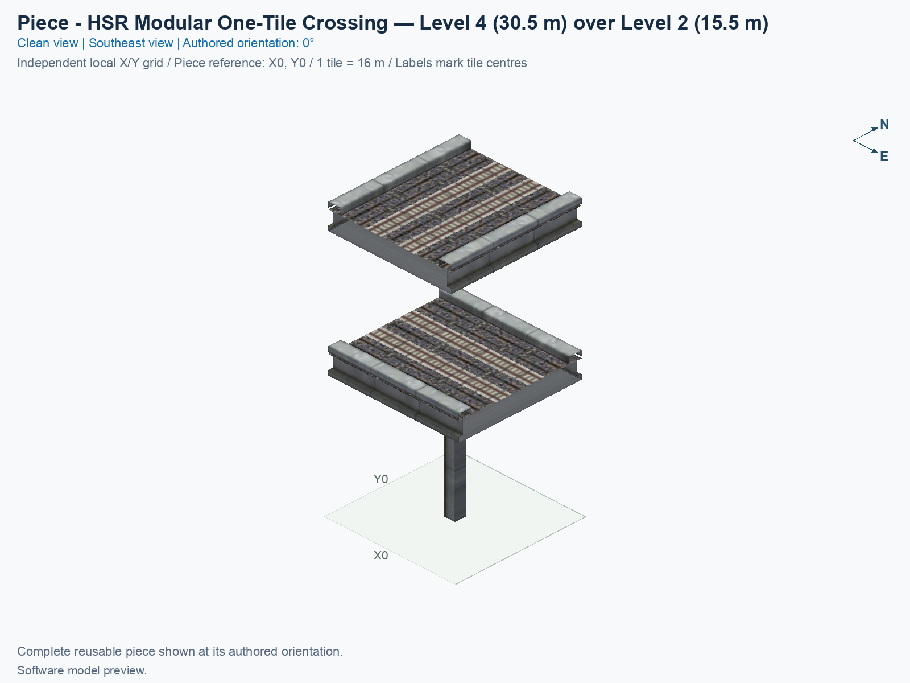
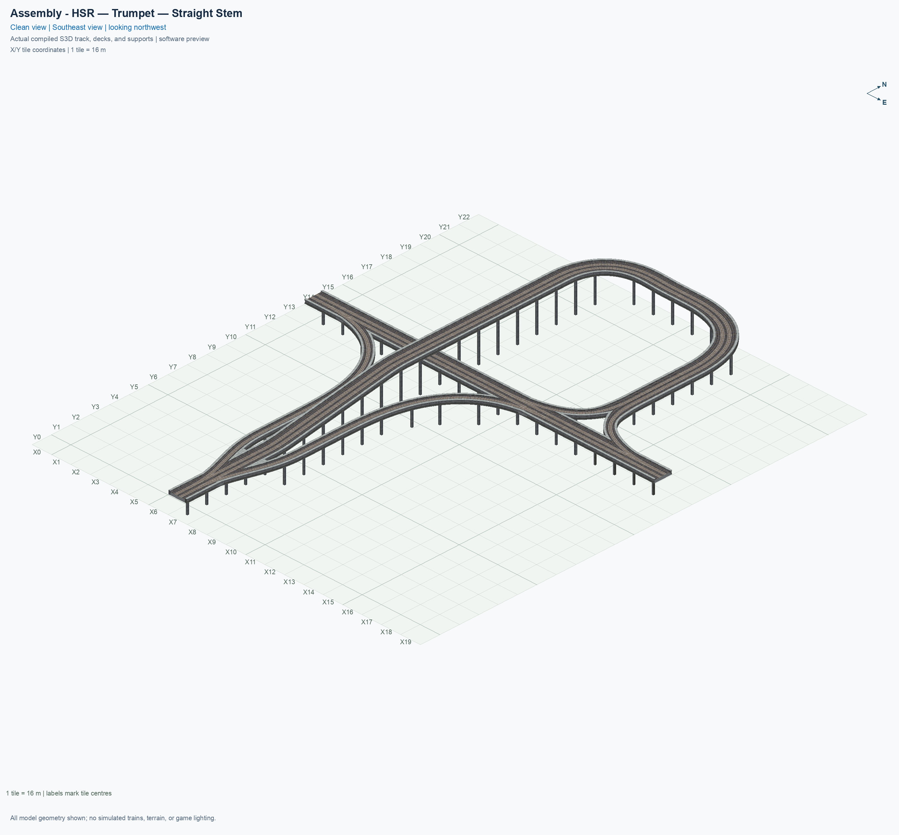
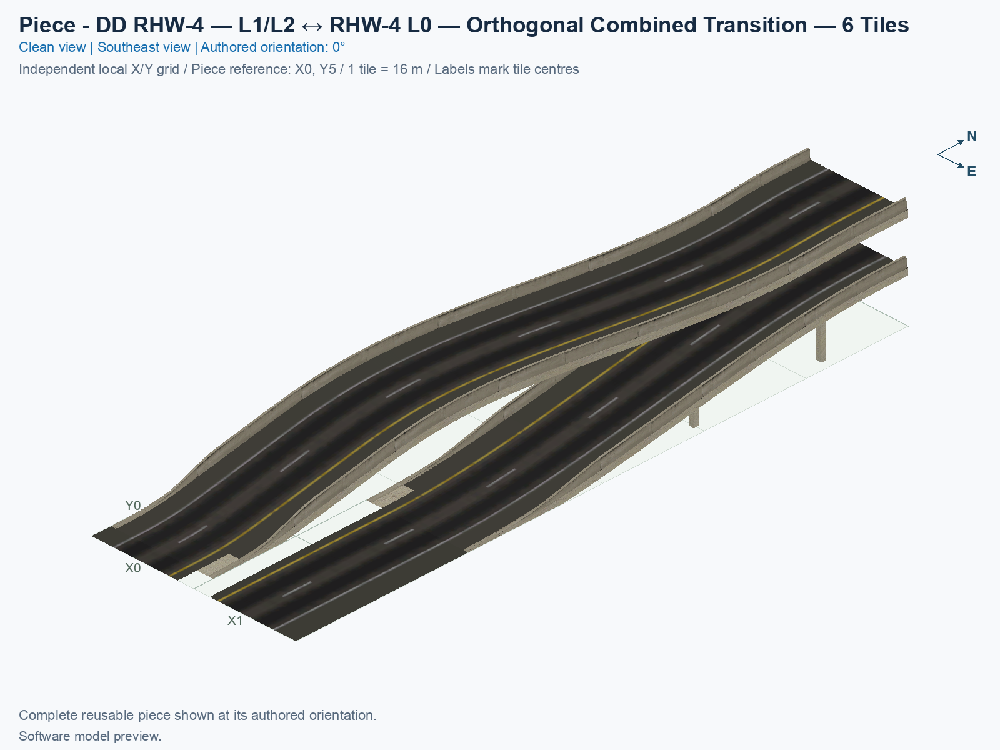
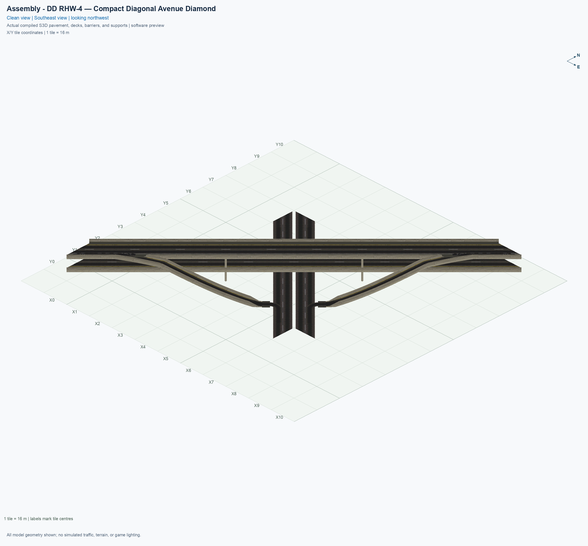

# Simon's Custom Pieces

<!-- BEGIN DOCUMENT NAVIGATION -->
[1. Player requirements](#1-player-requirements) · [2. Browse pieces and assemblies](#2-browse-pieces-and-assemblies) · [3. Get the source](#3-get-the-source) · [4. Prepare Python and run the tests](#4-prepare-python-and-run-the-tests) · [5. Build and use the mod](#5-build-and-use-the-mod) · [6. Contribute](#6-contribute)
<!-- END DOCUMENT NAVIGATION -->

Simon's Custom Pieces is an experimental SimCity 4 mod library with reusable pieces and layouts for high-speed rail and highways.

## 1. Player requirements

**Install the requirements below before selecting Install in SCP. The SCP installer includes the finished pieces and its own application runtime; it does not install the game, NAM, menu plugins, or Microsoft runtime for you.** Network Addon Mod (**NAM**) supplies the transport networks that SCP extends.

| Requirement | What you need |
| --- | --- |
| Windows computer | **64-bit Windows 10 or later**, with an Intel or AMD processor. NAM specifies at least **4 GB RAM** and **1 GB disk space** for NAM itself; allow additional space for the extracted SCP installer, installed pieces, temporary files, and backups. |
| Game | **SimCity 4 Deluxe for Windows, digital version 1.1.641**, with the original game archives matching the supported profile. Native macOS editions and older disc versions are outside this profile. |
| NAM | **NAM 50, right-hand traffic**, with the supported rail, RealHighway, US Road, and US RHW texture components. Right-hand traffic means vehicles drive on the right. [Required NAM components and setup](custom-pieces/docs/INSTALLER.md#11-required-software-and-nam-components) |
| NAM's DLL | **`NAM.dll`**, supplied with NAM 50, directly inside a Plugins folder. NAM 50 needs this file in addition to its DAT archives. [Official NAM installation](https://www.sc4nam.com/docs/getting-started/installation/) |
| SCP menu plugins | **Submenus DLL** (`memo.submenus.dll` and `submenu-essentials.dat`) and **Resource Loading Hooks DLL 2.0.1 or later** (`SC4ResourceLoadingHooks.dll`). Put the DLLs directly inside a Plugins folder. [Downloads and exact placement](custom-pieces/docs/INSTALLER.md#12-install-the-dlls-and-menu-files) |
| Microsoft runtime | **Microsoft Visual C++ 2022 or later x86 Redistributable**. The game and its DLL plugins are 32-bit, so the **x86** package is needed even though the SCP installer and Windows are 64-bit. [Microsoft downloads](https://learn.microsoft.com/en-us/cpp/windows/latest-supported-vc-redist) |

The **4 GB patch is recommended, but no longer mandatory for NAM 50**; follow the [NAM Team's current explanation](https://www.sc4nam.com/docs/feature-guides/nam-dll/#new-rul2-engine). The finished SCP installer needs no separate Python, Git, Java, Visual Studio, or resource-extraction tool. Java is relevant only if you choose NAM's separate Java-based installer.

The SCP installer checks exact game/NAM resource fingerprints and the three menu dependency filenames and locations. It does not currently validate `NAM.dll`, DLL versions, the Microsoft runtime, or whether the game loads the DLLs. Read the [complete player setup and check limits](custom-pieces/docs/INSTALLER.md#1-check-all-requirements) before downloading. Other game editions, NAM versions, traffic sides, and texture variants need a separate compatibility audit.

<a id="1-browse-pieces-and-assemblies"></a>

## 2. Browse pieces and assemblies

A **piece** is a reusable building block, such as a rail crossing or a highway ramp. An **assembly** is a layout you build by placing several pieces together, such as a junction or an interchange.

In `custom-pieces/domains/`, choose the rail or highway folder. Within each one, `00_pieces/` contains the individual pieces, and `01_assemblies/` contains the assembly guides. Open an illustrated catalogue to browse that folder's content.

| Network | Piece catalogue | Assembly catalogue |
| --- | --- | --- |
| High-speed rail | [Rail pieces](custom-pieces/domains/high-speed-rail/00_pieces/INVENTORY.md) | [Rail assemblies](custom-pieces/domains/high-speed-rail/01_assemblies/INVENTORY.md) |
| Highway | [Highway pieces](custom-pieces/domains/highway/00_pieces/INVENTORY.md) | [Highway assemblies](custom-pieces/domains/highway/01_assemblies/INVENTORY.md) |

| Example piece | Example assembly |
| --- | --- |
| [Two-level rail crossing](custom-pieces/domains/high-speed-rail/00_pieces/hsr-l4-over-hsr-l2-two-track-crossing-90deg/README.md)<br> | [Straight-stem rail trumpet](custom-pieces/domains/high-speed-rail/01_assemblies/hsr-trumpet-straight-stem/README.md)<br> |
| [Six-tile highway transition](custom-pieces/domains/highway/00_pieces/ddrhw-l1-l2-to-rhw-l0-transition-orthogonal-6tile/README.md)<br> | [Compact diagonal avenue diamond](custom-pieces/domains/highway/01_assemblies/ddrhw-l1-and-l2-diagonal-avenue-diamond/README.md)<br> |

| I want to… | Start here |
| --- | --- |
| Install without Python or build commands | [Windows installer guide](custom-pieces/docs/INSTALLER.md) |
| Understand how GitHub creates installer downloads | [Automatic releases, explained simply](custom-pieces/docs/AUTOMATIC_RELEASES.md) |
| Build or install a plugin from source | [Build and install](custom-pieces/docs/BUILD_AND_INSTALL.md) |
| Understand connector declarations and generated exports | [Connector reference](custom-pieces/docs/CONNECTOR_METADATA.md) |
| Create pieces, assemblies, or documentation | [Authoring workflows](custom-pieces/README.md) |
| Understand source ownership and file formats | [Project structure](custom-pieces/STRUCTURE.md) |
| Contribute changes and understand automated checks | [Contributor workflow](docs/GITHUB.md) |

<a id="get-the-source"></a>
<a id="1-get-the-source"></a>
<a id="2-get-the-source"></a>

## 3. Get the source

A **clone** is a local copy of the repository and its Git history. Install [Git](https://git-scm.com/downloads/) if needed, then open a terminal and type `git --version` to confirm that it is available. Clone the project into any directory where you keep source code:

```sh
git clone https://github.com/KomodorDev/sc4-simons-custom-pieces.git
cd sc4-simons-custom-pieces
```

The folder containing `custom-pieces/` and this README is the **repository root**. Run the following commands from that root.

<a id="prepare-python-and-run-the-tests"></a>
<a id="2-prepare-python-and-run-the-tests"></a>
<a id="3-prepare-python-and-run-the-tests"></a>

## 4. Prepare Python and run the tests

Use Python 3.11 or newer; [official Python downloads](https://www.python.org/downloads/) are available if it is not installed. CI uses Python 3.11. A **virtual environment** keeps the project's Python dependencies separate from other projects. Create and activate one using the commands for your operating system.

On macOS or Linux:

```sh
python3 -m venv .venv
source .venv/bin/activate
```

On Windows, in PowerShell:

```powershell
py -3 -m venv .venv
.\.venv\Scripts\Activate.ps1
```

With the environment active, install the dependencies, register the library's source packages, and run the shared test command:

```sh
python -m pip install -r requirements-ci.txt
python -m pip install -e custom-pieces
python -B tools/run_tests.py
```

The test command runs the library's framework, registered domain, and assembly suites. Pillow handles images, NumPy supports numerical geometry and rendering, and Shapely joins and triangulates authored road surfaces. These portable checks do not require a game installation. Tests that need unavailable NAM resources or saved development builds report explicit skips. NAM means Network Addon Mod, an external game dependency. Automated checks do not establish observed game behavior or update manual observations.

<a id="build-and-use-the-mod"></a>
<a id="3-build-and-use-the-mod"></a>
<a id="4-build-and-use-the-mod"></a>

## 5. Build and use the mod

For the graphical installer, complete the [player requirements](#1-player-requirements), then follow [Install SCP without Python](custom-pieces/docs/INSTALLER.md). Each accepted update to `main` starts a tested Windows installer build and publishes an **experimental prerelease** after every required installer job succeeds. Download the Windows x64 ZIP from [Releases](https://github.com/KomodorDev/sc4-simons-custom-pieces/releases), extract the entire ZIP, close the game, open **SCP Installer.exe**, select **Choose Plugins folder…**, choose the Plugins folder used by your game, and select **Install**. The compact installer includes its application runtime and finished SCP files, verifies the supported game and NAM inputs, and installs one managed plugin folder containing the pieces, Rail trumpet and Highway assembly buttons, and shared controller. It preserves ownership receipts, backups, updates, and Undo; repository previews, development evidence, authoring tools, and tests stay outside the player download. See the guide's supported-profile limits and first-launch instructions.

Building the game plugin requires the exact supported NAM inputs described in the [build guide](custom-pieces/docs/BUILD_AND_INSTALL.md#3-prepare-local-development-inputs). The repository provides a [workstation-settings example](custom-pieces/config/local.example.jsonc) and an [audited NAM profile](custom-pieces/config/profiles/nam50-rhd.jsonc). Each contributor supplies their own local game resources and ignored settings; existing build folders are optional and can be regenerated. Build outputs are written under `custom-pieces/dist/`. Neither the installed game resources nor personal settings belong in Git.

The project remains experimental. Read each piece's documented limits and recorded tests before using it. Software previews and passing automated checks do not prove placement, traffic, or rendering inside the game. Public binary distribution has separate [release requirements](custom-pieces/docs/RELEASE.md).

<a id="contribute"></a>
<a id="4-contribute"></a>
<a id="5-contribute"></a>

## 6. Contribute

The repository contains `custom-pieces/` and its repository support. Canonical images and evidence are tracked with their owning subjects; private settings, native test inputs, caches, and disposable builds are ignored. See [the contributor workflow](docs/GITHUB.md) for the exact file boundary and branch procedure.

`dev` is the default development branch. Create ordinary work branches from `dev`, and submit their pull requests to `dev`. Reserve `main` for release pull requests from this repository's `dev` branch. GitHub Actions runs `Tests` for pull requests, pushes to `dev` and `main`, and merge-queue candidates. Both branches require passing tests; `main` also requires `Release policy`, which rejects other release sources. Agents may create pull requests; human maintainers perform merges. See [the contributor workflow](docs/GITHUB.md#4-submit-a-release) for the release steps.
