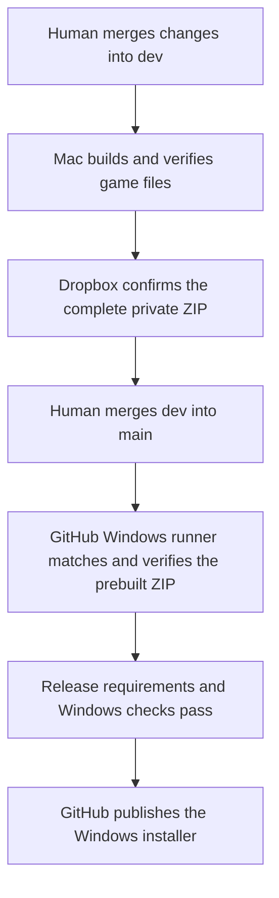

# Automatic releases, explained simply

<!-- BEGIN DOCUMENT NAVIGATION -->
[1. The route from a change to a download](#1-the-route-from-a-change-to-a-download) · [2. What runs on GitHub?](#2-what-runs-on-github) · [3. Why does a PR have an installer build before release?](#3-why-does-a-pr-have-an-installer-build-before-release) · [4. What do I click to publish and find the download?](#4-what-do-i-click-to-publish-and-find-the-download) · [5. What happens on the player's computer?](#5-what-happens-on-the-players-computer) · [6. What if something fails?](#6-what-if-something-fails) · [7. One-time Dropbox and hosted review setup](#7-one-time-dropbox-and-hosted-review-setup)
<!-- END DOCUMENT NAVIGATION -->

**GitHub Actions** follows the project's saved instructions on temporary computers hosted by GitHub. The Mac prepares the actual game files. The hosted Windows computer verifies and packages them. You decide what to merge.

## 1. The route from a change to a download

A **repository** contains the project's files and version history. A **commit** is one saved version. A **branch** is a named line of versions. `dev` holds accepted development work, and `main` holds releases. A **pull request**, or **PR**, proposes combining changes from one branch into another. Accepting that proposal is called a **merge**.



A **Git tree fingerprint** identifies all files tracked by Git, including their paths and contents. The Mac saves the original prebuild commit and its tree fingerprint. GitHub compares that fingerprint with the one from the resulting `main` commit. A merge commit can have a different commit ID and still have the exact same files. The release record preserves both commit IDs.

## 2. What runs on GitHub?

A **workflow** is a saved list of instructions, and a **job** is one group of steps. These jobs run on GitHub's hosted computers.

| Trigger | What runs |
| --- | --- |
| A pull request | Source tests and a source-builder Windows installer check. The job uses no Dropbox credentials. |
| A manual run on `dev` | **Private hosted prebuilt review** checks the real Dropbox handoff and rejects missing and mismatched test inputs. The packaged installer copies every finished DAT into a temporary Plugins folder, checks the installed checksums, and undoes the install. The runner uses synthetic NAM inputs and retains the compiled files only for the job. |
| A human merges the release PR into `main` | Source tests and **Publish verified prebuilt Windows installer**. The Windows job verifies the approved merge, the protected review record, the Dropbox archive, the release requirements, and the installer before publishing. |

The **protected environment** limits which branches may use its credentials. Review uses `scp-prebuilt-review` on `dev`, and publication uses `scp-prebuilt-release` on `main`. Read-only Dropbox access is available only during the download step. GitHub's public artifact storage is used for the source-builder PR checks. The prebuilt jobs keep their files on the runner until an approved release is published.

## 3. Why does a PR have an installer build before release?

The source-builder job gives you a Windows application check while the change is still under review. An **artifact** is a file attached to a workflow run for temporary download. The source-builder artifact appears as **installer-windows-x64** and is retained for 14 days. A successful PR check leaves both merges and release publication under their usual controls.

## 4. What do I click to publish and find the download?

The project's private Dropbox App Folder currently belongs to one maintainer. Only that maintainer has access to the app and its synced folder, so they prepare and upload the release ZIP. GitHub's protected jobs use stored read-only credentials to download it. Source reviews and merges follow the repository's usual GitHub permissions.

1. Complete the [one-time setup](#7-one-time-dropbox-and-hosted-review-setup). Merge the intended development PRs into `dev` and wait for **Tests** to pass. On the Mac, open Terminal in the root of your clean `dev` checkout. Update it with `git pull --ff-only`.
2. Run the preparation command below. Replace each placeholder in angle brackets with the actual folder path and keep the quotation marks. Use the game folder that contains `SimCity_3.dat`, the player-data folder or its `Plugins` folder containing NAM, and the private App Folder shown in Finder under **Dropbox → Apps**. To copy a folder path from Finder, select the folder and press **Option–Command–C**.

   ```sh
   python3 -B custom-pieces/installer/prepare_release.py --game-folder "<game folder>" --player-data "<player-data or Plugins folder>" --dropbox-folder "<Dropbox Apps/SCP Release Builds folder>"
   ```

   The preparation command uses half the available logical CPUs for game-file compilation by default, rounded down, with a minimum of one worker. Add `--jobs 1` at the end of the command to use a single build process, or `--jobs 2` to use up to two. See [the build guide](BUILD_AND_INSTALL.md#4-build-a-selected-collection) for how the worker limit is chosen.

3. Wait until the command reports `"status": "payload-ready"`. It first confirms that the folder you selected syncs to the authorized Dropbox app using a temporary test ZIP with no game files. It then waits for Dropbox to confirm the exact completed release ZIP. Keep the reported source commit and tree fingerprint. If `dev` changes, rerun the command for the new version. The separate public release requirements still apply.
4. On GitHub, open **Pull requests → New pull request**. Set **base: main** and **compare: dev** in this repository. Review **Files changed**, then select **Create pull request**. Wait for **Tests** and **Release policy**. A human selects **Merge pull request**, chooses **Create a merge commit**, and selects **Confirm merge**.
5. Open **Actions → Installer release** and select the run for the new `main` commit. When **Publish verified prebuilt Windows installer** passes, open [Releases](https://github.com/KomodorDev/sc4-simons-custom-pieces/releases). Under **Assets**, find `SCP-Installer-windows-x64-<commit>.zip`, its checksum, and `release-record.json`. The filename uses the first 12 characters of the merged `main` commit.

## 5. What happens on the player's computer?

Players download the published Windows installer from GitHub Releases without a Dropbox account. The installer ZIP contains the complete set of game files, called **DAT archives**. The player extracts the ZIP, closes SimCity 4, opens **SCP Installer.exe**, selects the game folder, and selects **Install**. The installer checks the package and the player's existing game and NAM resources, checks for conflicts, backs up the previous installation, and copies the finished files. Python is included. [Player instructions](INSTALLER.md)

## 6. What if something fails?

Open **Actions → Installer release**, select the failed run, select the failed job, and expand its red step. A missing or mismatched ZIP names the expected source revision. Prepare that exact revision on the Mac. If `dev` and the resulting `main` tree differ, reconcile their source through the normal PR process, prepare the resulting `dev` again, and make a new release PR.

If only Dropbox sync timed out, use the reported private ZIP with the same `--dropbox-folder` option and add `--resume-archive "<private ZIP path>"`. This verifies the ZIP against current `dev` before retrying the transfer. For a temporary hosted failure with the exact approved payload still available, select **Re-run jobs → Re-run failed jobs** on the same run. The GitHub source merge and release publication are separate steps.

## 7. One-time Dropbox and hosted review setup

The maintainer who operates the project's private release folder completes these setup steps once.

1. Open the [Dropbox App Console](https://www.dropbox.com/developers/apps/create) and sign in on Dropbox. Select **Scoped access**, select **App folder**, enter an app name such as **SCP Release Builds**, and select **Create app**. On **Permissions**, enable **files.metadata.read** and **files.content.read**, then select **Submit** or **Save changes**. Under **Settings → OAuth 2**, enable **Allow public clients** if it is off. Under **Settings → Credentials**, copy the **App key**. Keep the App Folder private and leave sharing links disabled. [Dropbox app setup](https://www.dropbox.com/developers/reference/getting-started) · [Dropbox authorization](https://docs.dropboxapi.com/dropbox-api/docs/get-started/authorization)
2. In Terminal, from the checkout root, run the authorization command. Replace `<App key>` with the App key. Open the link printed by the command, select **Allow** on Dropbox, then paste the authorization code at the Terminal prompt. The prompt hides the code. The command saves the refresh credential privately at `~/.config/scp/release-dropbox.json`. Keep authorization codes, refresh tokens, and app secrets out of Git, chat, and shell commands. In Dropbox Desktop, sign in to the same account. Open Finder, select **Dropbox** in the sidebar, and look under **Apps** for your app's folder. If it is missing, confirm the app folder is included in Dropbox Desktop's sync settings. [Dropbox Desktop setup](https://learn.dropbox.com/self-guided-learning/dropbox-fundamentals-course/dropbox-desktop-app)

   ```sh
   python3 -B custom-pieces/installer/release_dropbox.py authorize --app-key "<App key>"
   ```

3. In the GitHub repository, open **Settings → Environments**. Confirm that **scp-prebuilt-review** accepts only the `dev` branch and that **scp-prebuilt-release** accepts only the `main` branch. If either is missing, select **New environment**, enter its exact name, select **Configure environment**, and under **Deployment branches and tags** select **Selected branches and tags**. Select **Add deployment branch or tag rule**, choose **Branch**, and enter the matching branch name. Use the GitHub CLI command below to put the App key and refresh token directly into the review environment's **Environment secrets**. If GitHub CLI asks you to sign in, run `gh auth login`, select **GitHub.com**, and follow its browser login.

   ```sh
   python3 -B custom-pieces/installer/release_dropbox.py github-secrets --repository KomodorDev/sc4-simons-custom-pieces --environment scp-prebuilt-review
   ```

4. Once the pipeline code is on `dev`, prepare its ZIP using [chapter 4](#4-what-do-i-click-to-publish-and-find-the-download). Open **Actions → Installer release → Run workflow**, choose **dev**, and select **Run workflow**. Open the resulting run. Confirm that **Private hosted prebuilt review** and both of its handoff and installer steps passed. The run ID is the number after `/actions/runs/` in its URL.
5. After the successful private review, install the same read-only credentials in the release environment. In **Settings → Environments → scp-prebuilt-release → Environment variables**, select **Add variable**. Set **SCP_PREBUILT_REVIEW_RUN_ID** to the successful run ID. When the project's release evidence is ready, add **SCP_PREBUILT_PUBLICATION** with the value **enabled**. Use the same one-command preparation and normal human merge for each later release.

   ```sh
   python3 -B custom-pieces/installer/release_dropbox.py github-secrets --repository KomodorDev/sc4-simons-custom-pieces --environment scp-prebuilt-release
   ```

Repeat the private review if the release tooling changes and update the run ID. Each release checks its own exact payload and evidence. Catalogue changes follow the ordinary preparation and merge steps.

[GitHub environment settings](https://docs.github.com/en/actions/how-tos/deploy/configure-and-manage-deployments/manage-environments) · [Public release requirements](RELEASE.md#5-gates-for-a-public-package)
