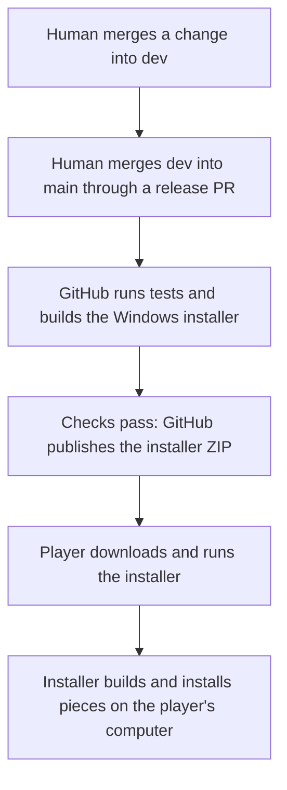

# Automatic releases, explained simply

<!-- BEGIN DOCUMENT NAVIGATION -->
[1. The route from a change to a download](#1-the-route-from-a-change-to-a-download) · [2. What runs on GitHub?](#2-what-runs-on-github) · [3. Why does a PR have an installer build before release?](#3-why-does-a-pr-have-an-installer-build-before-release) · [4. What do I click to publish and find the download?](#4-what-do-i-click-to-publish-and-find-the-download) · [5. What happens on the player's computer?](#5-what-happens-on-the-players-computer) · [6. What if something fails?](#6-what-if-something-fails)
<!-- END DOCUMENT NAVIGATION -->

**GitHub Actions** is GitHub's automation service. It follows our saved instructions on GitHub's temporary computers: check the code, package the Windows installer, and publish a download after a human accepts a release into `main`.

You decide which changes to accept. GitHub handles testing and packaging; your computer does not need to stay switched on.

## 1. The route from a change to a download

A **repository** contains the project's files and version history. A **commit** is one saved project version. A **branch** is a named line of versions: `dev` holds accepted development work, and `main` holds versions accepted for release. A **pull request**, or **PR**, proposes combining changes from one branch into another. Accepting that proposal is called a **merge**.

Merging into `dev` does not publish an installer. Each new `main` commit starts a release run, including documentation-only changes. Publication happens only if that run's installer checks succeed.

## 2. What runs on GitHub?

A **workflow** is a saved list of automated instructions. Its groups of steps are called **jobs**. This repository has three workflows:

| Name shown under Actions | What it does |
| --- | --- |
| **CI** | Runs source tests for PRs and updates to `dev` or `main`. CI means continuous integration: checking changes automatically. |
| **Release policy** | Checks that a PR targeting `main` comes from this repository's `dev` branch. It checks the proposed release route. |
| **Installer release** | Tests the source, packages and checks the Windows installer, and publishes it when the trigger is an accepted update to `main`. |

The **Installer release** workflow has three jobs, in order:

1. **Installer source checks:** a temporary Linux computer runs the source tests to catch software problems before packaging.
2. **Installer (windows-x64):** a temporary Windows computer bundles the application, Python, and supporting files. It tests installation and undo with disposable files, checks that the window opens, and verifies the ZIP.
3. **Publish experimental installer:** GitHub attaches the verified files to a release. This job requires the previous jobs to succeed and runs only for an update to `main`.

See the saved [workflow file](https://github.com/KomodorDev/sc4-simons-custom-pieces/blob/dev/.github/workflows/installer-release.yml), the project's [technical release instructions](https://github.com/KomodorDev/sc4-simons-custom-pieces/blob/dev/docs/GITHUB.md#automatic-installer-prereleases), or GitHub's [introduction to Actions](https://docs.github.com/en/actions/get-started/understand-github-actions) for more detail.

## 3. Why does a PR have an installer build before release?

A PR also runs **Installer release**, so we can check the program before accepting changes. Its publication job deliberately says **Skipped**. The test download is an **artifact**: a temporary review file. Look for **installer-windows-x64** on the run's page; it is retained for 14 days and contains the installer ZIP and check reports.

A **release asset** is a file attached to the public Releases page. The later `main` run builds and checks its own version before publishing those assets.

Manually selecting **Run workflow** also produces a review build; it does not publish. No workflow merges a PR automatically.

## 4. What do I click to publish and find the download?

1. Merge the intended development PRs into `dev` after reviewing their changes and checks.
2. Open the repository's **Pull requests** tab. Open the existing release PR from `dev` into `main`. If none exists, select **New pull request**, set **base: main** and **compare: dev**, review **Files changed**, enter a title, and select **Create pull request**.
3. Wait for **Tests** and **Release policy** to pass, and review the installer build's result. For the release merge, use **Merge pull request** with **Create a merge commit**, then select **Confirm merge**. A human performs this step.
4. Open **Actions → Installer release**. Select the run for the newly merged **main** version. Wait for **Installer source checks**, **Installer (windows-x64)**, and **Publish experimental installer** to succeed.
5. Open the [Releases page](https://github.com/KomodorDev/sc4-simons-custom-pieces/releases), and select the intended **SCP Installer — experimental** entry. Under **Assets**, download **`SCP-Installer-windows-x64-<commit>.zip`**. `<commit>` means the 12-character version identifier already present in the filename. Choose that file instead of the separate **Source code** ZIP.

A **prerelease** is a downloadable experimental version. These installers are marked as prereleases. The extra `.sha256` file helps detect a changed ZIP, and the reports record what was checked; players use the installer ZIP.

## 5. What happens on the player's computer?

**Building** means producing usable files from the project's instructions. **NAM** means Network Addon Mod. There are two different builds:

| Where | What gets built | When |
| --- | --- | --- |
| GitHub's temporary computers | The Windows installer ZIP, including Python and the builder | During the automated workflow |
| The player's computer | The actual game plugin files, called DAT archives, using that player's existing game and NAM resources | After the player opens the installer and selects Install |

GitHub does not access your personal game folder or **Plugins folder**, where the game reads add-ons. The download excludes game and NAM archives. Players need the supported game and NAM already installed.

The player extracts the ZIP, opens **SCP Installer.exe**, selects **Choose game folder…**, and selects **Install**. The installer finds Plugins, checks the original resources, builds all implemented pieces, prepares the trumpet's assembly button, verifies the result, saves a backup, and installs. Python is included; players do not need to install it or type commands. The [player guide](INSTALLER.md) covers requirements, extraction, Windows prompts, folder selection, and Undo.

## 6. What if something fails?

In **Actions → Installer release**, open the failed run, select the failed job, and expand the step marked with a red cross. Its **log** records what happened and the error.

A failed test or build stops publication. The merged source stays on `main`. For a temporary GitHub or network problem, a maintainer can select **Re-run jobs → Re-run failed jobs**. A code problem needs a fix through the usual work branch → `dev` → `main` route. The [technical release instructions](https://github.com/KomodorDev/sc4-simons-custom-pieces/blob/dev/docs/GITHUB.md#automatic-installer-prereleases) explain unfinished uploads and retry checks.

The installation test uses synthetic files: test data created for that check. The window check opens the application without installing into a real game. Tests needing unavailable game resources can be explicitly skipped. These jobs do not play SimCity 4 or change recorded placement, rendering, or traffic observations. The download remains experimental.
