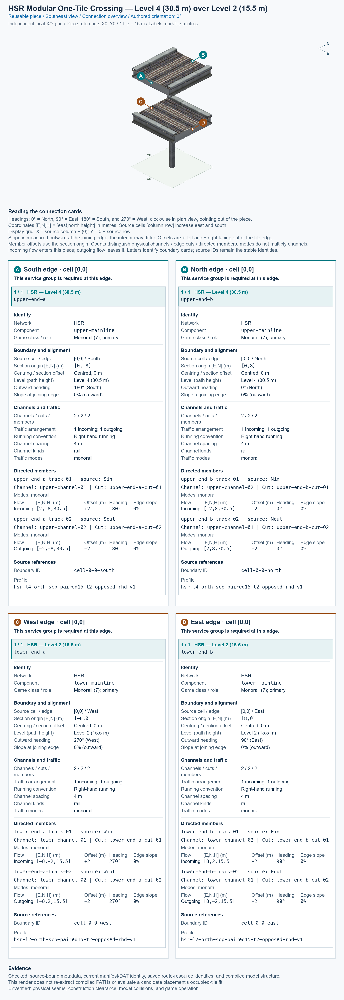
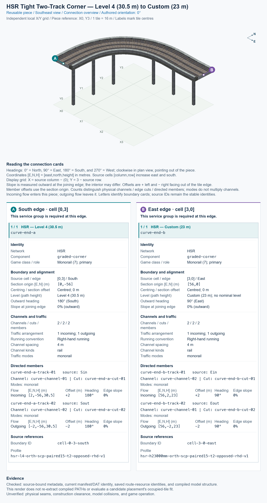

# Connector metadata: matching pieces at their shared edge

**Implementation scope:** The source library owns connector declarations, schemas, source validation, resolved exports, and generated connection overviews. The current migration covers four piece types, sixteen connector groups, and thirty-two measured directional endpoints: the two detailed High Speed Rail (HSR) examples below, the paired rising quarter-turn, and parallel HSR above ordinary Road. The Road example includes measured vehicle and pedestrian paths. Their authored group files use schema version 3, the optional shared-profile registry uses version 2, and generated `connector-data.json` files use version 1. The rules below apply across transport networks; a rule is not evidence that an untested source family works. Full-scene placement, terrain-aware construction, general model-collision and seam discovery, and actual game operation remain separate capabilities; each piece's evidence defines any narrower checks already performed. See [generation and overview instructions](WORKFLOW_DOCUMENTATION_GENERATION.md) for the exact authoring commands and output ownership.

## 1. A connection is agreement at the shared edge

**Metadata** means information describing a piece. A **piece** is one reusable construction type; an **instance** is one placed copy of that type. A **tile**, also called a plot in the discussion, is one 16 m × 16 m game square. A piece can own several tiles.

**A connection exists when both pieces expose compatible network services and the same geometric continuation at their shared edge, with complementary permitted movements.** Each piece describes its own side. A consumer can compare both descriptions under one proposed placement in a layout.

### Network-neutral terms

| Term | Meaning | Example or distinction |
| --- | --- | --- |
| Transport channel | One separately identifiable physical passage continued through a boundary | A railway track, road lane, walkway, or shared tram/car lane. “Channel” is the short form used below. |
| Channel kind | What sort of passage the channel represents | A road lane and a walkway do not become interchangeable because their coordinates agree. |
| Construction network | The infrastructure category used by the game's construction system | Its identity and placement rules come from the source; a traffic mode does not identify it. |
| Network service | The intended transport continuation exposed by the piece | A channel can serve more than one service if the source explicitly establishes that shared use; the service and construction-network classifications can differ. |
| Traffic mode | A permitted category of user or vehicle | Cars, buses, and pedestrians are distinct modes; supporting several modes does not automatically create several physical channels. |
| Directed route member | One source record describing movement in one direction | Several members can describe one bidirectional or shared channel. A source record is not automatically a separate channel. |
| Boundary intersection | The measured point where a route crosses a tile edge | Store or derive its position, outward direction, height, and slope at that exact point. |
| Section | A related set of channels continued together | Its channels can intersect different tile edges near a corner. |
| Component | A logical route grouping inside a piece | A component groups related connections; its ID does not supply a coordinate. |
| Directed journey | A permitted movement from an incoming member to an outgoing member inside a piece | A junction can allow some turns and forbid others. |

A **network boundary description** collects all required channels and directed movements crossing one shared tile edge. Comparing that complete description is the **atomic decision**: the smallest complete decision that this edge can join. One agreeing channel does not establish a connection if another required channel or service on the same edge disagrees.

Channel identities, route identities, and network identities are separate. One lane carrying cars and buses remains one physical channel. One bidirectional walkway can have two or more directed route records. Two sidewalks remain two channels even if both permit pedestrians. A one-way road can have bidirectional pedestrian channels alongside its vehicle channels.

A shared tram/car lane needs an explicit association between its services, modes, route members, and one physical channel. Overlapping route records alone prove neither a second channel nor a collision. An unmarked shared area may have several measured route intersections without one meaningful centreline; preserve those intersections instead of inventing a channel centre by averaging them.

The default direct continuation uses the same network service. If two differently named services can meet through a supported transition, that compatibility needs an explicit, source-backed rule. The tool must not infer such a rule from similar names, a shared traffic mode, or a shared game transport class. A transition can change channel arrangement inside a piece while still presenting the required arrangement at each joining edge.

The same boundary rules apply to different internal shapes: a straight, curve, junction, or height change. The source routes establish internal journeys. External agreement does not create a new turn or a transfer between services.

A successful boundary comparison establishes a route candidate. Rendering displays the existing models at that placement. Physical seams, model collisions, construction constraints, and observed game operation are separate checks. Connector metadata does not require a second hand-authored description of decks, walls, supports, or model surfaces.

## 2. Information required at each exposed edge

An **exposed edge** faces a tile that the piece does not own. An edge between two tiles already owned by the same piece is internal and cannot become an attachment choice. Identify the actual source tile and edge before describing its required continuations.

| Information | What must be recorded or obtained from the measured source | Why it is needed |
| --- | --- | --- |
| Boundary location | Source tile, tile edge, and every actual route intersection | A sideways displacement can prevent a join even when the channel counts agree. |
| Piece placement | Fixed authoring anchor, permitted rotation, and anchor position in the layout | Every channel, owned tile, and model surface must move together. |
| Channel identity and kind | Stable physical-channel identity and its association with source route members | A bidirectional passage or shared lane must not be counted once per direction or mode. |
| Network services and engine classifications | Construction-network identities, required services, supported transitions, game transport classes, and routing roles | Physical alignment or a shared engine class alone does not establish a permitted continuation. |
| Section count and edge-intersection count | Channels in the complete section, physical channel intersections with this edge, and directed members crossing it | These are different counts, especially for bidirectional movement and diagonal sections. |
| Arrangement and positions | Each measured route intersection, its channel association, and any source-backed section origin and spacing | Equal counts do not establish matching positions or arrangements. |
| Outward connection heading | Horizontal direction pointing out of the piece at each intersection | The continuing route must not acquire a sideways kink. |
| Nominal level | A named level, or an explicitly unassigned custom level | A descriptive label helps readers, but does not replace the actual height. |
| Path height | Exact route height at each intersection, in metres, with a defined height reference | Equal level names or different local ground references can conceal a height mismatch. |
| Centring and section offset | Whether an applicable section origin is at its tile-edge midpoint, and its signed displacement in metres | The reference is this tile edge, rather than the centre of the whole piece. |
| Slope at edge | Vertical grade at each route intersection, with an explicit direction convention | Equal height alone does not establish a smooth vertical continuation. |
| Permissions by channel and mode | Incoming, outgoing, or both directions for every required mode | A bidirectional pedestrian channel must not inherit a neighbouring vehicle lane's one-way restriction. |
| Required continuation or declared termination | Which movements must cross the edge, and any explicitly supported end behavior | Missing data is not an optional route or an automatic end cap. |
| Source evidence | References and fingerprints tying the declarations to measured routes, owned cells, and existing models | The declarations must describe the actual piece. |

These are the shared comparison requirements. The [authored-group schema](../schemas/connector-groups.schema.json), [optional-profile schema](../schemas/connector-profiles.schema.json), and [generated-data schema](../schemas/connector-data.schema.json) define the actual file structures. Source-backed channel associations and permissions belong in the declarations; measured geometry is resolved from the existing sources. Section 7 states the current implementation limits.

A **tangent** is a direction vector at a point on a route; a **vector** is a numerical arrow with direction and length. Path position, tangent, and slope come from the measured traffic routes. Path height is the route's vertical coordinate; it is not the top or thickness of a rendered surface. If members on one edge have different heights, headings, or slopes, preserve their individual values. A common displayed value is appropriate only when the members agree.

A section origin is useful for a clearly defined arrangement. It is not mandatory to invent one for every kind of passage. If an origin or a single centreline is not meaningful, label centring and section offset as not applicable, and compare the actual measured intersections. Distinguish not applicable from unknown or missing required data.

### Channel counts, directed movements, and multiple edges

Count physical channels from their established source associations, rather than by counting route records or traffic modes. Compare the associated required movements separately. A direct join must account for the channels and movements required by both sides; it cannot silently merge, split, or discard them. A merge or split belongs to an explicitly represented transition or internal journey.

An **edge cut** is one physical channel crossing of a particular edge. Several direction or mode records describing that crossing count as one cut. One channel can have several distinct cuts if it leaves and re-enters through the same edge; retain those crossing identities. Channel count, cut count, and route-record count therefore remain separate.

Raw route-record counts need not agree across source formats. For example, one source could have separate car and bus records, while another explicitly assigns both modes to one record. A **source adapter** is code that reads one source format and converts its measured facts into the common comparison model. It must produce comparable channel, crossing, direction, and mode facts without changing the original records. Compare complete permitted-movement coverage, rather than requiring equal numbers of raw records. Preserve original record identities as references. The current consumer normalizes per-mode movement coverage within an explicitly matched channel and cut; this does not establish a verified source adapter for every transport family.

A diagonal two-channel section near a tile corner can put one channel through the north edge and the other through the east edge. Preserve the complete section relationship and the actual edge intersections. Neither edge acquires an invented second endpoint, and a single intersection does not turn the complete two-channel section into a one-channel section. All required shared segments must fit under the same placement. This case requires source-backed coverage of every cut and every affected edge. The four migrated examples do not establish that diagonal case.

### Rendering from the existing models

The renderer and matcher use the same piece anchor, rotation, and measured endpoints. The renderer loads the existing piece/build model and applies that placement. Connection markers and route overlays derive from the measured paths, so they remain attached to the correct ends.

A schematic view can simplify the presentation. Visibility toggles can reveal lower channels, display names, or show owned tiles in a top-down view. These controls change what is visible; the stored placement, route positions, and source model remain the authority.

A **mesh** is the collection of surfaces making up a 3D model. Future seam and collision checks can derive evidence from the placed meshes, including supports and overhangs. Bind any generated collision data to the model's source fingerprint. This generated evidence is separate from connector metadata; no duplicate manual end-shape description is required. Until those checks run, their results remain unverified.

### Physical projection, ownership, and clearance

The **construction rectangle** is the declared width and depth around a piece, and the **owned-cell mask** identifies its actual claimed game tiles. Neither describes every surface of its model. A **physical projection** records the ground-plane area touched by actual model triangles, including decks, parapets, caps, and foundations. A **keep-clear restriction** states space that neighbouring construction must avoid, including any unowned projection cells and their relevant height ranges. An empty cell inside the rectangle, or a cell outside the owned mask, is not automatically clear.

Derive physical-space evidence from saved models using triangle-to-tile intersection, record exact affected cells and geometric scope, and bind it to the inspected model fingerprints. State the clipping tolerance and whether boundary-only contact counts. A vertex-only count can miss a triangle crossing a cell without a vertex inside it. Keep support-foundation ownership, complete overhang projection, and dimensioned traffic-corridor clearance as separate measurements. Preserve the results in the owning piece's existing engineering notes and evidence; the current connector schemas do not define a physical-footprint or keep-clear export.

Checking claimed cells for overlap does not reserve unowned projections or prove model clearance there. A future consumer needs source-bound physical-space data alongside owned cells and construction restrictions before it can enforce those reservations. Even then, a conservative two-dimensional reservation cannot establish three-dimensional fit: height-dependent collisions, traffic corridors, supports, and native deck seams require the actual placed geometry and explicit check scope. The [piece-creation support procedure](WORKFLOW_PIECE_CREATION.md#check-complete-support-solids-and-physical-space) explains the authoring checks. Keep such results unverified wherever those checks have not run.

## 3. Positions, headings, heights, and slopes use one comparison frame

A **local coordinate** describes a position relative to the reusable piece. A **layout coordinate** describes that position after an instance is moved and rotated. Put both pieces into the same layout coordinates before comparing them. Apply the same rotation to route positions, tangents, tile edges, owned cells, and models.

The current piece sources use metres in `[east,north,height]` order. Source cells use zero-based `[column,row]` indices: columns increase east, and rows increase south. Cell `[0,0]` is centred at local `(0,0)`; cell `[column,row]` is centred at `(16 × column, −16 × row)` metres. A tile edge lies 8 m from its tile centre. Other source formats must declare their frame and convert to this comparison frame explicitly.

Positions come from actual boundary intersections. Neither an ID nor a whole-piece centre supplies an endpoint position. Centred and off-centre sections can have the same service, count, and angle while failing to meet.

### 3.1 Which position or centre is meant?

| Position | Meaning | Use |
| --- | --- | --- |
| Piece anchor | Fixed authoring reference used to position and rotate the whole piece | Saves the instance's placement. |
| Bounding-box centre | Centre of the rectangle enclosing the construction footprint | Can be a display or drag handle; it need not equal the anchor. |
| Source-tile centre | Centre of one source tile inside the piece | Locates that tile before placement. |
| Tile-edge midpoint | Midpoint of one edge of that tile | Reference for a section's sideways offset. |
| Section origin | Explicit origin of one related channel arrangement at a boundary, where applicable | May be centred or shifted; it need not be an average of endpoints. |
| Individual route intersection | Exact measured position where a source route reaches the boundary | Supplies the position used for matching. |
| Placed piece position | Layout position of the fixed anchor, together with its rotation | Moves every part of the instance together. |

“Centred connection” means an applicable section origin lies at its own tile-edge midpoint. The displayed yes/no value derives from the signed offset; it is not a second independently editable truth. For a symmetric arrangement, the origin may coincide with the midpoint between two endpoints. Do not assume that for an asymmetric or shared-area arrangement.

A future interface can let the user drag a visual centre. Before saving, it must convert that handle position into the fixed anchor position: rotate the handle's local offset, then subtract it from the desired layout handle position. The placement must also satisfy the permitted tile lattice, meaning the allowed grid of anchor positions. A convenient drag handle does not authorize fractional-tile placement.

For **section offsets along the tile edge**, positive means left and negative means right when facing outward perpendicular to that edge. This frame comes from the edge's outward-facing direction, not from a potentially diagonal route heading. Looking north, left is west; looking south, left is east. A section 1 m west of the edge midpoint therefore has offset `+1 m` on a north-facing edge and `−1 m` on a south-facing edge. Those positions can meet. Equal signed values on opposite-facing edges can place the sections on opposite sides instead. Compare transformed positions, rather than requiring raw offset numbers to be equal.

### 3.2 Horizontal heading: the same continuation, opposite outward directions

An **outward connection heading** points from inside the piece toward its neighbour along the route at the joining point. Viewed from above, headings increase clockwise: **0° north, 45° northeast, 90° east, 180° south, and 270° west**. Heading describes the endpoint direction, not the camera or the total turn inside a piece.

Parallel channel routes may share one displayed heading. Different route headings require individual values; do not average them. The direction perpendicular to the tile edge is the **boundary normal**, a separate fact. A diagonal route can cross an east edge while pointing northeast.

A **connection-axis angle** describes a horizontal line without choosing one of its two directions. Reduce the heading modulo 180°: subtract 180° as necessary to obtain a value from 0° up to, but excluding, 180°. Thus, headings 45° and 225° have the same axis, as do 90° and 270°. Axis agreement is necessary for a straight continuation; the outward directions must also face opposite ways.

| Boundary fact after placement | Piece A | Piece B | Meaning |
| --- | ---: | ---: | --- |
| Tile edge facing the neighbour | East | West | The edges face each other. |
| Outward connection heading for an east/west continuation | 90° | 270° | The route headings differ by 180°. |
| Connection-axis angle | 90° | 90° | The horizontal line agrees. |
| Travel direction of a matched movement from A into B | East | East | A's outgoing movement continues into B's incoming movement. |

Measured tangent vectors are the authority. Derive displayed angles from them instead of entering a second angle that could disagree. Reverse an incoming member's travel tangent to obtain its outward direction. An outgoing member's travel tangent already points outward.

Measure both actual complementary native members independently. Use the saved nonzero PATH chord adjacent to each joining intersection, retain its asymmetry, and compare both complete boundaries under the same placement. A nominal diagonal label does not require identical 45° tangents on both channels. The [audited native HSR half](../domains/high-speed-rail/NETWORK_SPEC.md#measure-the-native-diagonal-half-exactly), for example, has a 5.1 m/5.2 m chord on one member and a 10.9 m/10.9 m chord on the other. Rounded headings, symmetric replacement offsets, or agreement on only one member cannot replace those measurements. Native PATH agreement remains separate from the physical model seam and game construction.

Spacing perpendicular to a route differs from spacing measured along a tile edge. For example, two parallel 45° centrelines spaced 4 m apart perpendicular to their direction intersect an east edge approximately 5.657 m apart. Do not substitute straight-section edge offsets for actual diagonal intersections.

The current placement convention rotates pieces counterclockwise. A 90° counterclockwise piece rotation subtracts 90° from the clockwise heading, wrapping around 360° when necessary: local east, 90°, becomes layout north, 0°. Quarter-turn rotations do not imply support for reflections. Reflection can change permitted travel and requires explicit source and construction support.

### 3.3 Height reference and nominal level

A **nominal level** is a descriptive label. A **path height** is the measured vertical coordinate at the intersection. Use the label for identification and filtering, and use the measured height for comparison. Two members with different heights cannot share a substituted average. An unassigned custom level is a legitimate label state, rather than missing height data.

Current pictures and trials use a common flat ground reference at height zero. Horizontal placement preserves authored height; free vertical relocation is not supported. A future terrain-aware scene must state how ground elevations and authored heights combine before comparing layout heights. Equal local numbers from different ground references do not establish equal layout heights. Construction rules must permit any terrain-dependent placement.

### 3.4 Slope exactly at the joining edge

**Grade** is height change divided by horizontal distance. Grade `0.1` means a 1 m rise per 10 m of horizontal travel, or a 10% slope. **Slope at edge** is this value at the exact joining boundary. It is not the average over the piece, the rendered surface's sideways tilt, or the slope inside a curve or ramp.

Use the **outward route direction** for the shared slope convention. An outgoing source member keeps its travel grade; an incoming source member reverses the sign. For a movement from A into B, their travel-direction grades agree, while their outward grades have opposite signs: outward `+0.1` on A joins outward `−0.1` on B. Flat endpoints have zero in either convention. Compare the vertical continuation at each measured intersection, alongside its height and horizontal tangent.

An interior height change can have flat ends. A perpendicular horizontal crossing of a tile edge also says nothing about its vertical grade. Store or derive these independent facts explicitly. **Banking**, or **crossfall**, is the sideways tilt of a physical surface. That tilt, surface width, and physical seam details belong to the existing model and any model-derived checks; matching route tangents alone does not establish their agreement.

## 4. Complete boundaries, shared channels, and junctions

### 4.1 Several services or heights on one edge

One tile edge can carry several services or heights. Collect every required continuation on both sides, and compare them under **one common placement** of the candidate. An upper continuation cannot conceal a missing lower continuation. A candidate that aligns one service at one position and another service only after a different translation or rotation fails the complete comparison.

Different edges of the same tile have separate boundary descriptions. A connection leaving south and another leaving north are not one edge bundle merely because they share a tile. Each still moves with the same piece anchor and rotation.

Account for the candidate's required contents as well as the selected piece's contents. An extra required channel cannot disappear because the other side lacks a counterpart. A deliberately terminating route needs explicitly supported end behavior. Unknown data, an optional UI display layer, and a real termination are different states.

Related sections can span several edges. Keep their relationships, and require every necessary shared segment to fit under the same placement. Other exposed branches can remain open during an unfinished layout; this does not authorize ignoring a conflicting branch where an existing neighbour is already present.

A combined piece can own an affected tile once while carrying several services at different heights. Two independent pieces claiming that same tile are not a supported stack just because their heights differ. A future solution using several pieces needs explicit game construction and ownership support.

### 4.2 Shared physical channels and traffic permissions

A channel can support several modes or services, but its source-backed physical identity remains one channel. Associate each directed member with the correct channel, service, mode, and routing role. Preserve auxiliary routing records without inventing extra primary channels.

Check permissions by channel and mode. Both directions on a walkway must continue if both are required, even when the vehicle channels alongside it permit only one direction. Additional modes or routes on either side need compatible continuation or explicit supported termination; do not silently remove a mode to make the geometry match.

The **game transport class** is an engine classification for a source route. A **routing role** distinguishes a primary service movement from another routing purpose. These facts can be needed by the source adapter, but neither alone defines a physical channel or network compatibility. If a shared-area source cannot establish which route records belong to the same physical passage, report the association as unresolved rather than guessing from coincident points.

### 4.3 Branches and internal journeys

A junction describes the actual boundary intersections and permissions for each branch. One edge can expose a two-channel section, while another exposes a one-channel branch at a different measured angle. The number of branches, the interior turning angle, and a component's name do not replace each endpoint's geometry.

Internal directed journeys determine which incoming movements can reach which outgoing movements. Channel or component proximity does not create a turn, cross-level transfer, or transfer between services. Multiple possible endpoint mappings that imply different journeys are an ambiguity requiring source information, rather than a reason to accept the first record encountered.

## 5. Matching procedure and evidence

Perform the following checks in order:

1. Validate declarations and measured-source references. Resolve shared defaults, verify source bindings, and report incomplete, stale, or ambiguous data before matching.
2. Move and rotate the candidate using a permitted placement. Keep every boundary, channel, owned tile, and model tied to that placement.
3. Identify the real shared tile edge. The transformed complete edge segments must coincide, and their outward boundary normals must oppose. For the current full-tile-edge model, contact at one corner is insufficient. A declared connection into another tile owned by the same piece is invalid.
4. Collect the complete required boundary contents on both sides: channel associations, services, intersections, heights, headings, slopes, and permitted movements. Preserve relationships to any additional required shared segments.
5. Find a complete correspondence between channels and their measured intersections. Compare channel kinds, compatible services, physical-channel and cut counts, arrangement, exact positions, horizontal continuation, height, and slope. A direct continuation requires corresponding physical channels; normalize route records into required movements instead of requiring equal raw record counts. Report unresolved mappings if they change journeys. Spacing agreement alone cannot compensate for a sideways shift.
6. Check every required directed movement and traffic mode in both directions. Outgoing movement on one side must continue as incoming movement on the other. Shared channels retain their per-mode permissions; extra required movements need counterparts or explicit supported termination.
7. Check the whole placement against the scene: every other boundary touching an existing neighbour, occupied tiles, terrain references, and applicable construction requirements. A successful selected-edge comparison cannot authorize a conflict elsewhere. Other unfinished branches may remain open when no conflicting neighbour occupies them.
8. Render the existing models at the same placement. When implemented, perform separate model-derived seam and collision checks for surfaces, supports, and overhangs. Unperformed physical checks remain unverified.
9. Report evidence states separately: metadata consistency, compiled-route agreement, occupied-tile fit, physical clearance, and observed game operation. A route candidate is not automatically a verified construction.

“Same” means agreement under explicit numerical tolerances: documented limits on acceptable measurement differences. The current [validator](../framework/scp/connector_metadata.py) uses `EPS = 0.00002`: position-vector comparisons use 0.00002 m, unit-tangent comparisons use a dimensionless vector-distance limit of 0.00002, and grade comparisons use 0.00002 rise/run, or 0.002 percentage points. The consumer reuses that constant. Angles displayed in degrees are derived from those tangents; rounded display labels never control the decision. A route-coordinate tolerance is not a physical-clearance allowance. Any additional source adapter must state its measured precision and use compatible comparison limits. Missing required data never counts as agreement.

Keep numeric policies tied to the property they measure. A visual texture-stripe exception, for example, must not change connector positions, unit tangents, grades, visible rail-centre checks, or support clearance. Record its original and replacement limits, exact geometric subset, measured maximum, source fingerprints, and independent negative controls in the owning piece's contract. Test the subset boundary and unchanged defaults explicitly. The [independent-verification procedure](WORKFLOW_PIECE_CREATION.md#keep-independent-checks-and-numeric-exceptions-scoped) defines that authoring requirement; this reference introduces no additional tolerance or exception.

### 5.1 Edge cases and evidence still needed

The existing tests include restricted pairwise comparisons and artificial records. The table separates those checks from source-backed evidence that is still needed. Section 7 explains the actual migrated inputs and implementation limits.

| Edge case | Required decision | Current evidence or remaining work |
| --- | --- | --- |
| Two services agree on one edge at one placement | Retain a candidate containing both | Existing synthetic resolved-record tests |
| A required second service is absent, at the wrong height, on the wrong service, or assigned the wrong engine class | Reject the complete boundary | Existing synthetic resolved-record tests |
| The second service has incompatible travel directions | Reject the complete boundary | Existing synthetic resolved-record test |
| One service fits at `[0,64]`, while another fits only at `[-16,64]` | Reject the combined placement | Existing synthetic stress test; not an authored source-valid combined piece |
| A required endpoint is missing | Report invalid data rather than accepting a partial result | Existing synthetic boundary test |
| Source definitions change without renewed bindings | Reject stale metadata | Existing source-binding test |
| Correct spacing is shifted sideways | Reject unless measured positions agree | Existing metadata tests |
| Opposite north/south offsets `+1 m` and `−1 m` both locate a section 1 m west | Permit if every other requirement agrees | Executed in-memory checks across all four quarter-turns |
| Equal endpoints lie where tile edges touch only at a vertex | Reject the shared-edge candidate | Regression test; complete edge coincidence is now required |
| A connection points into a cell owned by its own piece | Reject the internal edge | Regression test covers all four edge directions |
| A real shared edge has an endpoint exactly at its corner | Do not reject merely because the endpoint is at a corner | Positive shared-edge regression case |
| One bidirectional channel has several directed members | Count one channel and check all required directions | Source-backed bidirectional-channel examples and tests needed |
| One shared channel carries several modes or services | Preserve one physical channel and each required movement | Declarations support explicit associations; source-backed shared-channel examples and tests still needed |
| One-way vehicle movement coexists with bidirectional pedestrians | Check permissions separately for each channel and mode | Source-backed mixed-mode examples and consumer tests needed |
| Differently named services use an explicitly supported transition | Check the documented compatibility and geometry | Source-backed transition rules and tests needed; do not infer compatibility |
| A diagonal section intersects two different tile edges | Preserve the section relationship and actual cuts | Source-backed diagonal examples and tests needed |
| Members on one edge have different headings, heights, or slopes | Compare each member without averaging | Source-backed bidirectional-channel examples and tests needed |
| Several endpoint mappings imply different journeys | Report ambiguity | Ambiguity handling and routing evidence needed |
| Another part of the candidate conflicts with a third piece | Reject against the complete scene | Current `find_matches(a,b)` is pairwise; scene support needed |
| Independent pieces claim the same game-owned tile | Reject unless explicitly supported construction permits it | Current pairwise occupied-cell rule; combined-construction evidence still needed |
| A sparse owned-cell mask leaves empty cells inside its construction rectangle | Check construction restrictions and actual geometry separately | A mask alone does not establish construction clearance; apply the relevant piece/domain rules |
| Supports or overhangs collide despite disjoint owned cells | Reject on model interference | Physical-clearance checks remain unverified |
| Free vertical relocation would align otherwise incompatible ends | Reject unsupported relocation | Existing placement model preserves authored heights |
| Equal local heights use different terrain references | Resolve actual layout heights and construction requirements | Terrain-aware scene support needed |
| A reflection would appear to make the join fit | Require explicit source geometry, permissions, and construction support | Current quarter-turn placement does not support reflection |

## 6. Stable identity, reuse, and file ownership

Each reusable piece owns its boundary declarations. Stable IDs identify boundaries, components, physical channels, cuts, and directed members. An ID does not encode changing layout coordinates, compass directions after rotation, or travel semantics inferred from a number. Each placed instance needs a separate instance ID, anchor position, and rotation.

The library uses three separate connector files so that authored meaning, measured facts, and reproducible output do not become competing truths:

| File | Authority and permitted changes |
| --- | --- |
| `connector-groups.jsonc` | Authored declarations of stable identities, source-backed channel and cut associations, traffic permissions, complete boundary bundles, and optional shared defaults. Edit this file or its owning authoring generator when the intended semantics change. It references measured source ports; it does not redefine their positions. |
| `connections.json` | Intrinsic measured directional endpoints, resource fingerprints, permitted journeys, and forbidden transfers extracted from actual saved resources. Refresh it through the owning domain's extraction workflow after a real source change. Connector refresh reads and verifies it, but does not overwrite it. Older files can retain historical endpoint shortlists; those fields do not establish complete-boundary compatibility. |
| `connector-data.json` | Generated resolved export for overviews and consumers. It contains validated declarations, measured boundary and member geometry, permissions, journeys, and full source PATH polylines. Recreate it from its inputs; do not hand-edit it. |

`piece.json` remains the authority for the reusable type, source cells, and resource identities. Existing compiled resources remain the authority for measured traffic routes and models. The declarations do not require a second hand-authored description of decks, walls, supports, or mesh cross-sections. Rendering loads those actual models; future physical checks must derive from them and retain their own evidence.

The optional domain `connector-profiles.json` supplies shared defaults. After expansion, validation and matching use the resulting facts. A profile name, parent, or identical ID cannot erase a difference in service, channel arrangement, position, height, heading, slope, or permissions. Equivalent resolved geometry can have different labels, but its equivalence must be established from actual data. A profile reference is not mandatory for every group, and no code infers geometry or traffic rules by parsing a profile ID.

The [overview procedure](WORKFLOW_DOCUMENTATION_GENERATION.md) owns generation commands, marker ordering, card content, output files, and freshness checks. The [authoring skill](../skills/network-assembly-design/SKILL.md) routes the individual-piece and assembly workflows. The framework owns source-format parsing, validation, export, and generic generation; each domain owns its source adapters and reviewed network semantics. Application-specific placement, candidate discovery, and reports belong in a separate consumer, using the generated export rather than another source parser.

Only the four migrated pieces currently supply the new declaration/export set: the modular crossing, tight curve, paired rising quarter-turn, and parallel HSR/Road stack. Do not imply full-catalogue coverage from that subset, and do not manufacture missing geometry or channel associations to extend coverage. Current resolved exports omit legacy per-port counterpart shortlists and candidate counts, while unchanged measured files retain their original bytes. Piece validation and extraction do not compute neighbouring candidates or generate a manual pair-testing matrix.

The current library does not supply automatic compatibility discovery. A future consumer must consider only registered pieces with source-valid declarations and fresh generated exports, compare complete boundaries under one placement, and distinguish unmigrated pieces from missing, stale, or invalid data. An excluded piece has unknown compatibility, rather than a failed connection. Candidate results retain the limits of pairwise metadata and owned-cell checking; full-scene clearance and game operation remain separate evidence.

## 7. Current library format and implementation limits

The library owns the [version-3 authored-group schema](../schemas/connector-groups.schema.json), [version-2 optional-profile schema](../schemas/connector-profiles.schema.json), and [version-1 generated-data schema](../schemas/connector-data.schema.json). A schema checks file structure. The shared [connector validator](../framework/scp/connector_metadata.py) additionally checks cross-file references, measured directions and geometry, complete membership, exposed source edges, optional inheritance, permissions, and source bindings. A structurally valid file can still fail those checks.

**JSONC** means JSON with comments. The shared [reader](../framework/scp/jsonc.py) accepts `//` line comments and `/* ... */` block comments, preserves comment-like text inside strings, and rejects `#` comments and trailing commas. Only authored connector-group files use JSONC. Shared profiles, piece definitions, measured connections, and generated exports remain strict JSON. Explanations belong in actual comments, rather than a `documentation` data field or encoded matching rule.

A **source binding** uses SHA-256, an exact file-content fingerprint, to associate an authored declaration with its `piece.json` and `connections.json`. The generated export additionally binds its current inputs and derivation. Refresh checks actual saved DAT and PATH resources before producing the export. A changed binding requires a fresh source audit; copying a new hash into an old declaration does not establish correctness.

A group contains related directed members and explicit physical-channel associations. A boundary bundle collects the groups crossing one source cell and edge. Distinct measured cuts remain distinct even when they belong to one channel. Source port IDs remain references; stable library member IDs identify the resolved members and their journeys. Existing `connections.json` identities are preserved. Per-mode permissions are explicit declarations checked against their measured member directions; coincident source records do not automatically become a shared physical channel.

The export and overview derive from the same complete resolved representation. Refresh can pass that representation directly to rendering before writing the export, and standalone source rendering can resolve the authored library inputs through the same API. The resulting `connector-data.json` is the library-owned format for consumers. The export preserves the full ordered points of each saved PATH route fragment, including repeated endpoints where fragments meet at tile seams; fragment or point counts do not define physical-channel counts or independent complete journeys.

The current validator resolves each member's actual tangent, height, grade, and source-tile boundary position, rather than requiring every route to cross its edge perpendicularly. This does not establish arbitrary diagonal construction or a verified shared car/tram source. The actual migrated inputs are two paired HSR types with flat orthogonal endpoints. Source-backed diagonal, bidirectional-channel, and shared-mode examples still need their own declarations, independent checks, and compiled evidence.

The existing `section_offset_m` places an applicable section origin along its tile edge. Zero means centred, and positive means left when facing outward perpendicular to the edge. Lane or member offsets refer to that origin, rather than the whole-piece centre. Members retain their actual geometry, so no profile or offset can move a source endpoint to make it fit.

A complete-boundary comparison must use one placement, with an unambiguous one-to-one correspondence between physical channels and between their cuts. It must compare measured geometry, channel kind, service key, game transport class, routing role, and normalized per-mode movement permissions; equal raw directed-member counts are not required. Profile IDs, names, and expected widths do not decide compatibility. It must check the whole pair's owned cells. Full-scene checks against third pieces, verified adapters for other source families, service transitions, terrain-aware placement, free vertical movement, reflections, and model-derived physical seam or collision checks are not established by this two-piece migration.

Metadata validation, compiled-route agreement, occupied-tile fit, overview generation, physical clearance, and game operation remain separate evidence states. The two HSR examples do not supply verified Street geometry or construction contracts. No connector command builds a DAT, installs a plugin, edits a city, rewrites manual observations, or creates an in-game pass.

## 8. Examples: the two existing HSR pieces

These two detailed examples preserve the actual measured data. Railway-specific terms here describe these railway pieces; they are not universal names for the network-neutral model above. In these examples, one physical track is one transport channel. The two JSONC declarations and their generated exports use the library-owned format. The measured connections, geometry, saved assembly placements, and game-observation records retain their authority and are not rewritten by connector refresh. The additional [authoring examples](#86-additional-measured-authoring-examples) extend the migrated subset without changing these worked tables.

### 8.1 Reading the example tables and current profile IDs

The source files are the [crossing JSONC](../domains/high-speed-rail/00_pieces/hsr-component-modular-crossing-core/connector-groups.jsonc), [curve JSONC](../domains/high-speed-rail/00_pieces/hsr-component-tight-paired-curve90-l4-to-mid/connector-groups.jsonc), and shared [profile registry](../domains/high-speed-rail/connector-profiles.json).

Each table includes identity and component, source tile and edge, network and traffic classification, outward connection heading, channel counts and arrangement, centring and exact positions, nominal level, path height, and slope at the edge. Measurements are local to the authored 0° orientation. An instance's anchor position and rotation apply to all rows together.

**Column definitions:** `E` means east, and `N` means north. “Centred on tile edge?” derives from the section offset: zero means centred, positive means outward-left, and negative means outward-right in the edge frame. “Channel intersections” gives the incoming and outgoing east/north route positions; their common vertical coordinate is in “PATH height.” “Channels / edge cuts / directed members” lists the complete section's physical-channel count, the number of physical intersections with this edge, and the number of directed route records. “Arrangement / spacing” gives the running convention, offsets from the section origin, and centre-to-centre spacing. `RHD` means right-hand running. Monorail (7) is the game transport class used by these HSR routes; `primary` identifies their main service role. Each end has one incoming and one outgoing member on separate physical tracks.

**Heading and slope references:** 0° is north, 90° east, 180° south, and 270° west, increasing clockwise in plan view. Heading points outward; it is not incoming traffic's travel heading or the camera angle. Slope means the outward grade exactly at the joining edge. A card can show a common value for its own members only when they agree; each member's measured values remain available in that card. Equal values on different boundaries are still repeated in their own cards.

**Level versus height:** L2 denotes these measured 15.5 m ends, and L4 denotes these measured 30.5 m ends. The 23 m paired end has no assigned nominal level, so its entry says “Custom; no nominal level.” It must not be relabelled ordinary L3 because 23 m also occurs in another track family. A matching level label cannot replace the actual height or arrangement.

Each piece owns a fresh compiled-model [connection overview](WORKFLOW_DOCUMENTATION_GENERATION.md#reading-an-overview), with short boundary markers, complete structured cards, a conventions-only legend, and separate evidence. The tables below retain the measured source facts for these worked examples; the export, cards, and generated README overview derive from the same complete resolved representation. Consumers can read the generated `connector-data.json`.

The current profile ID is an exact registry key. Its readable concrete naming pattern is:

```text
<network>-<level-or-explicit-height>-<alignment>-<section>-<track-pattern>-<traffic>-v<contract-version>
```

| Existing token | Meaning in the implemented pilot | Structured data behind it |
| --- | --- | --- |
| `hsr` | High Speed Rail service. | `network: "hsr"`, engine transport class 7, and primary role. |
| `l2` | Nominal Level 2 endpoint. | `path_height_m: 15.5` and `nominal_level: "l2"`. |
| `l4` | Nominal Level 4 endpoint. | `path_height_m: 30.5` and `nominal_level: "l4"`. |
| `h23000mm` | Custom PATH height of 23,000 mm, or 23 m; a paired joint rather than an ordinary narrow L3 interface. | `path_height_m: 23.0` and `nominal_level: null`. |
| `orth` | These tracks meet their tile boundary perpendicularly. | A descriptive `alignment: "orth"` default; the actual measured tangents and tile edges supply the geometry used for comparison. |
| `scp-paired15` | Preserved name for the paired visual family, historically labelled 15 m. | No authored width or mesh cross-section is required by the current defaults. Actual compiled models supply physical geometry; this token does not establish fit. |
| `t2-opposed` | Two physical tracks carrying opposite directions. | Explicit channel associations and measured incoming at `+2 m` and outgoing at `−2 m` relative to the section origin establish these two tracks and their 4 m spacing. |
| `rhd` | Right-hand running in these reviewed examples. | Looking outward, the measured incoming endpoint is left, and the outgoing endpoint is right. The name alone supplies no flow or offset rule. |
| `v1` | Revision 1 of this named defaults entry. | Part of the existing registry key; separate from group schema version 3, profile-registry schema version 2, piece versions, and the NAM release. |

For example, `hsr-l4-orth-scp-paired15-t2-opposed-rhd-v1` references the optional 30.5 m defaults. The checker reads structured registry properties rather than parsing the identifier text, and the consumer compares resolved measured boundaries. The abstract parent `hsr-orth-scp-paired15-t2-opposed-rhd-v1` supplies common service, classification, and flat-end defaults without choosing an endpoint height; each concrete child adds its exact height. A shared parent does not make the heights interchangeable.

The `t1` and `t2` notation belongs to railway-specific profile naming: one or two physical tracks, respectively. It is not the universal channel-count vocabulary. A bidirectional single track can have several directed records while remaining `t1`. These two-track examples have two physical channels and two directed members at each end. All six section offsets are zero.

### 8.2 HSR Modular One-Tile Crossing — Level 4 (30.5 m) over Level 2 (15.5 m)



Fresh rendering of the actual compiled model at its authored 0° orientation, with one display title, A/B/C/D boundary markers, and four complete cards in a 2 × 2 grid below the scene. Two independent paired routes cross at PATH heights of 15.5 m and 30.5 m. The upper route's ends lie on the north and south edges; the lower route's ends lie on the west and east edges. Each boundary card retains its own matching facts, including its combined Level (path height) row and the full directed-member details. The shared legend explains conventions, and one evidence footer distinguishes this software rendering from game-operation evidence.

| End ID | Component | Source cell | Edge | Network | Game traffic class / role | Outward connection heading | Channels / edge cuts / directed members | Arrangement / spacing | Centred on tile edge? | Section offset (m) | Section centre `[E,N]` (m) | Channel intersections `[E,N]` (m) | Nominal level | PATH height (m) | Slope at edge (%) |
| --- | --- | --- | --- | --- | --- | ---: | --- | --- | --- | ---: | --- | --- | --- | ---: | --- |
| `upper-end-a` | `upper-mainline` | `[0,0]` | South | HSR | Monorail (7); primary | 180° | 2 / 2 / 2 | RHD; in +2 m; out −2 m; spacing 4 m | Yes | 0 | `[0,-8]` | in `[2,-8]`; out `[-2,-8]` | L4 | 30.5 | 0 (flat; both channels) |
| `upper-end-b` | `upper-mainline` | `[0,0]` | North | HSR | Monorail (7); primary | 0° | 2 / 2 / 2 | RHD; in +2 m; out −2 m; spacing 4 m | Yes | 0 | `[0,8]` | in `[-2,8]`; out `[2,8]` | L4 | 30.5 | 0 (flat; both channels) |
| `lower-end-a` | `lower-mainline` | `[0,0]` | West | HSR | Monorail (7); primary | 270° | 2 / 2 / 2 | RHD; in +2 m; out −2 m; spacing 4 m | Yes | 0 | `[-8,0]` | in `[-8,-2]`; out `[-8,2]` | L2 | 15.5 | 0 (flat; both channels) |
| `lower-end-b` | `lower-mainline` | `[0,0]` | East | HSR | Monorail (7); primary | 90° | 2 / 2 / 2 | RHD; in +2 m; out −2 m; spacing 4 m | Yes | 0 | `[8,0]` | in `[8,2]`; out `[8,-2]` | L2 | 15.5 | 0 (flat; both channels) |

All four sections are centred on their own tile boundaries. The crossing's piece anchor and bounding-box centre both happen to be `[0,0]`, because this is a one-tile piece. These coincident reference points must not be generalized to larger pieces. The picture's X0/Y0 tile is source cell `[0,0]`.

### 8.3 HSR Tight Two-Track Corner — Level 4 (30.5 m) to Custom (23 m)



Fresh rendering of the actual compiled model at its authored 0° orientation, with one display title, A/B boundary markers, and two complete cards across below the scene. Its south end is Level 4 (30.5 m), and its east end is Custom (23 m), without an assigned nominal level. Both connection ends have slope at the edge of 0%; each card retains that fact alongside its own member positions, flows, headings, offsets, classification, and references. The height change occurs inside the curve. The 4 × 4 construction rectangle contains ten owned cells, including structural cells. Empty spaces in the picture do not establish construction clearance.

| End ID | Component | Source cell | Edge | Network | Game traffic class / role | Outward connection heading | Channels / edge cuts / directed members | Arrangement / spacing | Centred on tile edge? | Section offset (m) | Section centre `[E,N]` (m) | Channel intersections `[E,N]` (m) | Nominal level | PATH height (m) | Slope at edge (%) |
| --- | --- | --- | --- | --- | --- | ---: | --- | --- | --- | ---: | --- | --- | --- | ---: | --- |
| `curve-end-a` | `graded-corner` | `[0,3]` | South | HSR | Monorail (7); primary | 180° | 2 / 2 / 2 | RHD; in +2 m; out −2 m; spacing 4 m | Yes | 0 | `[0,-56]` | in `[2,-56]`; out `[-2,-56]` | L4 | 30.5 | 0 (flat; both channels) |
| `curve-end-b` | `graded-corner` | `[3,0]` | East | HSR | Monorail (7); primary | 90° | 2 / 2 / 2 | RHD; in +2 m; out −2 m; spacing 4 m | Yes | 0 | `[56,0]` | in `[56,2]`; out `[56,-2]` | Custom; no nominal level | 23 | 0 (flat; both channels) |

The table uses the authoring coordinates explained in section 3. The picture uses a separate display grid: its X labels increase east, and its Y labels increase north from the southwest tile. Source rows instead increase south. For this four-row piece, display `X = source column` and display `Y = 3 − source row`. Consequently, source `[0,0]`, the piece anchor, appears at picture X0/Y3; `curve-end-a` belongs to source `[0,3]`, shown at X0/Y0; and `curve-end-b` belongs to source `[3,0]`, shown at X3/Y3. These are two coordinate descriptions of the same unchanged geometry.

The curve's section origins are centred on their respective source tile edges, even though neither is the centre of the whole construction rectangle. The source-backed positions make the difference explicit:

| Position | Actual tight-curve value before placement |
| --- | --- |
| Fixed piece anchor | `[east=0, north=0]` m; the centre of source cell `[0,0]` |
| Bounding-box centre | `[east=24, north=-24]` m; centre of the 4 × 4 rectangle |
| Source-tile centre for `curve-end-a` | Source `[0,3]`, at `[east=0, north=-48]` m |
| That tile's south-edge midpoint | `[east=0, north=-56]` m |
| Section origin for `curve-end-a` | `[east=0, north=-56, height=30.5]` m |
| Individual route intersections there | Incoming `[2,-56,30.5]`; outgoing `[-2,-56,30.5]` m |

The [HSR player guide](../domains/high-speed-rail/README.md) requires the whole declared construction rectangle to be clear. The curve's sparse owned-cell mask and the empty cells visible in its preview do not establish that another construction can be placed there. Tile ownership, construction restrictions, and physical clearance remain separate checks.

### 8.4 Placing these two pieces together

For the direct trial, keep the crossing anchor at `(0,0)` metres and place the unrotated curve anchor at `(0,64)`. The crossing's north edge is at north coordinate `8 m`. Translation moves the curve's south edge from `−56 m` to `8 m`, making the complete tile edges coincide. `upper-end-b` and `curve-end-a` then agree on their 30.5 m route positions and complementary movements.

At this placement, the curve's bounding-box centre is `[24,40]` m, its high section origin is `[0,8,30.5]` m, and its incoming/outgoing intersections are `[2,8,30.5]` and `[-2,8,30.5]` m. Every point uses the same translation; no end moves independently. As a separate drag-handle example, putting the unrotated curve's bounding-box centre at `[88,40]` requires anchor `[64,64]`: subtract its local centre `[24,-24]`.

The opposite direct trial places the curve at `(0,−64)` with a 180° rotation and joins the crossing's `upper-end-a`. The 23 m end matches neither crossing height directly. These two pairwise candidates do not establish a physical seam or game-operation result. The saved V4 trumpet remains unchanged, with five intervening upper straight pieces between the crossing and curve.

The crossing's measured journeys remain separate at the two heights: no upper/lower transfer is created. The curve continues its two permitted directions around the corner. The original directed source journeys remain the authority; the new table vocabulary does not add movements.

### 8.5 Related schematic case: HSR parallel above street

The real crossing has its two heights on different edges. A hypothetical combined piece can instead put HSR above Street at the same edge of the same tile. This Street case remains schematic; the separately measured parallel HSR/Road example uses ordinary Road, rather than establishing Street-source facts:

| Required part of source cell `[0,0]`'s east edge | Network | Outward connection heading | Required vertical position | Required sideways position |
| --- | --- | ---: | --- | --- |
| Upper continuation | HSR | 90° | Its measured elevated path height | Every measured channel intersection and applicable section origin |
| Lower continuation | Street | 90° | Its measured ground-route height | Every measured channel intersection and applicable section origin |

One candidate piece must satisfy both rows under one common placement, including each service's channel arrangement and traffic permissions. An HSR-only piece, a street-only piece, or different placements that fit the services independently are incomplete solutions. Two independent pieces claiming the same tile do not constitute a supported combined piece. Actual street heights, shared-channel associations, lane data, and construction behavior need measured source evidence; the HSR-only pilot cannot supply them.

Both figures use the actual compiled models, measured source positions, and library-owned declarations. Their evidence lives beside the pieces: [crossing overview evidence](../domains/high-speed-rail/00_pieces/hsr-component-modular-crossing-core/evidence/connection-overview.json) and [curve overview evidence](../domains/high-speed-rail/00_pieces/hsr-component-tight-paired-curve90-l4-to-mid/evidence/connection-overview.json). The [overview commands](WORKFLOW_DOCUMENTATION_GENERATION.md#refresh-and-check-the-two-migrated-pieces) reproduce the exports and artwork. These software renders do not mark physical-clearance or in-game tests as passed.

### 8.6 Additional measured authoring examples

Use these complete piece guides to follow source authoring, saved-resource verification, canonical views, connector declarations, generated cards, and scoped manual checks together. Each uses the shared numbered README layout and intrinsic movement matrix; neither supplies an automatic neighbour-compatibility catalogue.

| Maintained example | Additional measured scope | Connector sources |
| --- | --- | --- |
| [HSR Paired Quarter-Turn Level 2 to Level 4](../domains/high-speed-rail/00_pieces/blind-hsr-rise-quarter-turn/README.md) | Two paired native boundaries at 15.5 m and 30.5 m, connected by a rising quarter-turn. | [Authored groups](../domains/high-speed-rail/00_pieces/blind-hsr-rise-quarter-turn/connector-groups.jsonc); [resolved export](../domains/high-speed-rail/00_pieces/blind-hsr-rise-quarter-turn/connector-data.json). |
| [HSR above parallel Road with two side pillars and paved sidewalks](../domains/high-speed-rail/00_pieces/blind-hsr-road-stack/README.md) | North/south bundles each require HSR, Road-vehicle, and pedestrian groups together; lateral native pedestrian cuts remain separately described. | [Authored groups](../domains/high-speed-rail/00_pieces/blind-hsr-road-stack/connector-groups.jsonc); [resolved export](../domains/high-speed-rail/00_pieces/blind-hsr-road-stack/connector-data.json). |

The original crossing and tight curve contribute six groups and twelve measured directional endpoints. The rising quarter-turn adds two groups and four endpoints; the parallel stack adds eight groups and sixteen endpoints. These counts describe the four current exports, rather than coverage of every library type or transport family. Keep each piece's literal contracts, source permissions, physical-clearance scope, and unverified game behavior in its own guide and evidence.
