# High Speed Rail and Ground High Speed Rail — individual pieces

<!-- BEGIN DOCUMENT NAVIGATION -->
[1. Individual pieces](#1-individual-pieces)
<!-- END DOCUMENT NAVIGATION -->

Generated from each subject’s authoritative `checks/manual-tests.json`. Checked means every applicable listed current case passed. Preview review and correct rendering inside SimCity 4 are separate checks. A result covers only its named scope, rotation, and recorded environment. Legacy endpoint observations remain historical evidence in the subject checklist and do not establish current compatibility coverage.

## 1. Individual pieces

| Preview | Exact menu name / piece ID | Footprint; occupied | Design review | Preview reviewed | Renders correctly in game | Directed journey cases |
| --- | --- | --- | --- | --- | --- | --- |
| [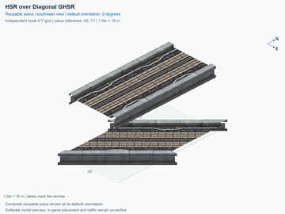](hsr-l2-over-ghsr-ground-two-track-crossing-lower-diagonal-45deg/previews/preview.png) | [HSR Level 2 (15.5 m) over GHSR Ground (1 m) — Two-Track Crossing 45° — Lower Diagonal](hsr-l2-over-ghsr-ground-two-track-crossing-lower-diagonal-45deg/README.md) `hsr-l2-over-ghsr-ground-two-track-crossing-lower-diagonal-45deg` | 1 × 2; 2 | No current design flag | [ ] Unverified; record subject does not match this folder | [ ] Unverified; record subject does not match this folder | [ ] Unverified; record subject does not match this folder |
|  | [HSR Level 2 (15.5 m) over Tram Ground (0 m) — Two-Track HSR over Tram Crossing 90°](hsr-l2-over-tram-ground-mixed-crossing-90deg/README.md) `hsr-l2-over-tram-ground-mixed-crossing-90deg` | 1 × 1; 1 | No current design flag | [ ] Unverified; record subject does not match this folder | [ ] Unverified; record subject does not match this folder | [ ] Unverified; record subject does not match this folder |
|  | [HSR Level 2 (15.5 m) over GHSR Ground (1 m) — Two-Track Crossing 90°](hsr-l2-over-ghsr-ground-two-track-crossing-90deg/README.md) `hsr-l2-over-ghsr-ground-two-track-crossing-90deg` | 1 × 1; 1 | No current design flag | [ ] Unverified; record subject does not match this folder | [ ] Unverified; record subject does not match this folder | [ ] Unverified; record subject does not match this folder |
|  | [HSR Level 2 (15.5 m) over GHSR Ground (1 m) — Two-Track Crossing 45° — Upper Diagonal](hsr-l2-over-ghsr-ground-two-track-crossing-upper-diagonal-45deg/README.md) `hsr-l2-over-ghsr-ground-two-track-crossing-upper-diagonal-45deg` | 1 × 2; 2 | No current design flag | [ ] Unverified; record subject does not match this folder | [ ] Unverified; record subject does not match this folder | [ ] Unverified; record subject does not match this folder |
| [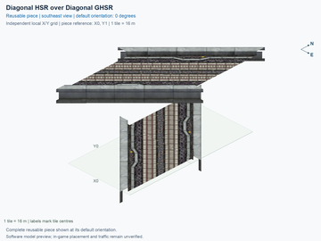](hsr-l2-over-ghsr-ground-two-track-crossing-both-diagonal-90deg/previews/preview.png) | [HSR Level 2 (15.5 m) over GHSR Ground (1 m) — Two-Track Crossing 90° — Both Diagonal](hsr-l2-over-ghsr-ground-two-track-crossing-both-diagonal-90deg/README.md) `hsr-l2-over-ghsr-ground-two-track-crossing-both-diagonal-90deg` | 1 × 2; 2 | No current design flag | [ ] Unverified; record subject does not match this folder | [ ] Unverified; record subject does not match this folder | [ ] Unverified; record subject does not match this folder |
| [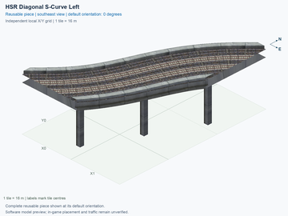](hsr-l2-two-track-s-curve-diagonal-left/previews/preview.png) | [HSR Level 2 (15.5 m) — Two-Track Diagonal S-Curve Left](hsr-l2-two-track-s-curve-diagonal-left/README.md) `hsr-l2-two-track-s-curve-diagonal-left` | 3 × 3; 4 | No current design flag | [ ] Unverified; record subject does not match this folder | [ ] Unverified; record subject does not match this folder | [ ] Unverified; record subject does not match this folder |
|  | [HSR Level 2 (15.5 m) — Two-Track Diagonal S-Curve Right](hsr-l2-two-track-s-curve-diagonal-right/README.md) `hsr-l2-two-track-s-curve-diagonal-right` | 3 × 3; 4 | No current design flag | [ ] Unverified; record subject does not match this folder | [ ] Unverified; record subject does not match this folder | [ ] Unverified; record subject does not match this folder |
|  | [GHSR Ground (1 m) — Two-Track Diagonal S-Curve Left](ghsr-ground-two-track-s-curve-diagonal-left/README.md) `ghsr-ground-two-track-s-curve-diagonal-left` | 3 × 3; 4 | No current design flag | [ ] Unverified; record subject does not match this folder | [ ] Unverified; record subject does not match this folder | [ ] Unverified; record subject does not match this folder |
|  | [GHSR Ground (1 m) — Two-Track Diagonal S-Curve Right](ghsr-ground-two-track-s-curve-diagonal-right/README.md) `ghsr-ground-two-track-s-curve-diagonal-right` | 3 × 3; 4 | No current design flag | [ ] Unverified; record subject does not match this folder | [ ] Unverified; record subject does not match this folder | [ ] Unverified; record subject does not match this folder |
|  | [HSR Level 2 (15.5 m) — Two-Track Adjacent Crossover Right](hsr-l2-two-track-crossover-adjacent-right/README.md) `hsr-l2-two-track-crossover-adjacent-right` | 2 × 3; 6 | [REVIEW NEEDED](hsr-l2-two-track-crossover-adjacent-right/README.md#design-review): Closely spaced pillars need a support-consolidation review. | [ ] Unverified; record subject does not match this folder | [ ] Unverified; record subject does not match this folder | [ ] Unverified; record subject does not match this folder |
|  | [HSR Level 2 (15.5 m) — Two-Track Adjacent Crossover Left](hsr-l2-two-track-crossover-adjacent-left/README.md) `hsr-l2-two-track-crossover-adjacent-left` | 2 × 3; 6 | [REVIEW NEEDED](hsr-l2-two-track-crossover-adjacent-left/README.md#design-review): Closely spaced pillars need a support-consolidation review. | [ ] Unverified; record subject does not match this folder | [ ] Unverified; record subject does not match this folder | [ ] Unverified; record subject does not match this folder |
|  | [GHSR Ground (1 m) — Two-Track Adjacent Crossover Right](ghsr-ground-two-track-crossover-adjacent-right/README.md) `ghsr-ground-two-track-crossover-adjacent-right` | 2 × 3; 6 | No current design flag | [ ] Unverified; record subject does not match this folder | [ ] Unverified; record subject does not match this folder | [ ] Unverified; record subject does not match this folder |
|  | [GHSR Ground (1 m) — Two-Track Adjacent Crossover Left](ghsr-ground-two-track-crossover-adjacent-left/README.md) `ghsr-ground-two-track-crossover-adjacent-left` | 2 × 3; 6 | No current design flag | [ ] Unverified; record subject does not match this folder | [ ] Unverified; record subject does not match this folder | [ ] Unverified; record subject does not match this folder |
| [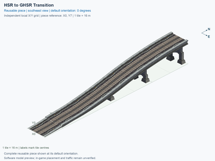](ghsr-ground-and-hsr-l2-two-track-transition/previews/preview.png) | [GHSR Ground (1 m) ↔ HSR Level 2 (15.5 m) — Two-Track Transition](ghsr-ground-and-hsr-l2-two-track-transition/README.md) `ghsr-ground-and-hsr-l2-two-track-transition` | 1 × 8; 8 | No current design flag | [ ] Unverified; record subject does not match this folder | [ ] Unverified; record subject does not match this folder | [ ] Unverified; record subject does not match this folder |
| [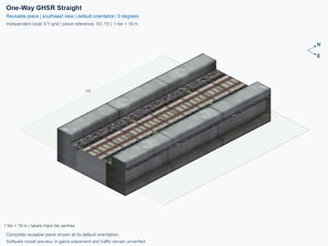](ghsr-ground-single-track-oneway-straight/previews/preview.png) | [GHSR Ground (1 m) — Single-Track One-Way Straight](ghsr-ground-single-track-oneway-straight/README.md) `ghsr-ground-single-track-oneway-straight` | 1 × 1; 1 | No current design flag | [ ] Unverified; record subject does not match this folder | [ ] Unverified; record subject does not match this folder | [ ] Unverified; record subject does not match this folder |
|  | [GHSR Ground (1 m) — Single-Track One-Way Diagonal Straight](ghsr-ground-single-track-oneway-straight-diagonal/README.md) `ghsr-ground-single-track-oneway-straight-diagonal` | 1 × 2; 2 | No current design flag | [ ] Unverified; record subject does not match this folder | [ ] Unverified; record subject does not match this folder | [ ] Unverified; record subject does not match this folder |
| [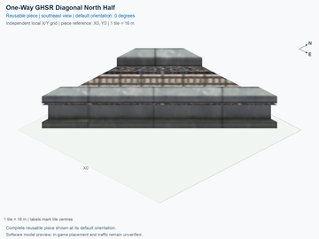](ghsr-ground-single-track-oneway-straight-diagonal-north-half/previews/preview.png) | [GHSR Ground (1 m) — Single-Track One-Way Diagonal Straight — North Half](ghsr-ground-single-track-oneway-straight-diagonal-north-half/README.md) `ghsr-ground-single-track-oneway-straight-diagonal-north-half` | 1 × 1; 1 | No current design flag | [ ] Unverified; record subject does not match this folder | [ ] Unverified; record subject does not match this folder | [ ] Unverified; record subject does not match this folder |
| [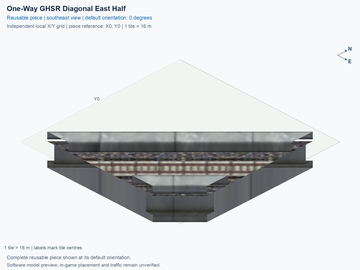](ghsr-ground-single-track-oneway-straight-diagonal-east-half/previews/preview.png) | [GHSR Ground (1 m) — Single-Track One-Way Diagonal Straight — East Half](ghsr-ground-single-track-oneway-straight-diagonal-east-half/README.md) `ghsr-ground-single-track-oneway-straight-diagonal-east-half` | 1 × 1; 1 | No current design flag | [ ] Unverified; record subject does not match this folder | [ ] Unverified; record subject does not match this folder | [ ] Unverified; record subject does not match this folder |
|  | [GHSR Ground (1 m) — Single-Track One-Way Curve 45° Right — Orthogonal to Diagonal](ghsr-ground-single-track-oneway-curve-to-diagonal-45deg-right/README.md) `ghsr-ground-single-track-oneway-curve-to-diagonal-45deg-right` | 1 × 2; 2 | No current design flag | [ ] Unverified; record subject does not match this folder | [ ] Unverified; record subject does not match this folder | [ ] Unverified; record subject does not match this folder |
| [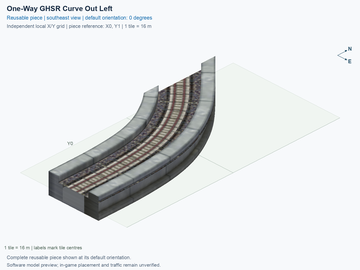](ghsr-ground-single-track-oneway-curve-to-diagonal-45deg-left/previews/preview.png) | [GHSR Ground (1 m) — Single-Track One-Way Curve 45° Left — Orthogonal to Diagonal](ghsr-ground-single-track-oneway-curve-to-diagonal-45deg-left/README.md) `ghsr-ground-single-track-oneway-curve-to-diagonal-45deg-left` | 1 × 2; 2 | No current design flag | [ ] Unverified; record subject does not match this folder | [ ] Unverified; record subject does not match this folder | [ ] Unverified; record subject does not match this folder |
| [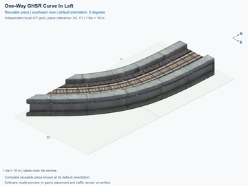](ghsr-ground-single-track-oneway-curve-from-diagonal-45deg-left/previews/preview.png) | [GHSR Ground (1 m) — Single-Track One-Way Curve 45° Left — Diagonal to Orthogonal](ghsr-ground-single-track-oneway-curve-from-diagonal-45deg-left/README.md) `ghsr-ground-single-track-oneway-curve-from-diagonal-45deg-left` | 1 × 2; 2 | No current design flag | [ ] Unverified; record subject does not match this folder | [ ] Unverified; record subject does not match this folder | [ ] Unverified; record subject does not match this folder |
|  | [GHSR Ground (1 m) — Single-Track One-Way Curve 45° Right — Diagonal to Orthogonal](ghsr-ground-single-track-oneway-curve-from-diagonal-45deg-right/README.md) `ghsr-ground-single-track-oneway-curve-from-diagonal-45deg-right` | 1 × 2; 2 | No current design flag | [ ] Unverified; record subject does not match this folder | [ ] Unverified; record subject does not match this folder | [ ] Unverified; record subject does not match this folder |
| [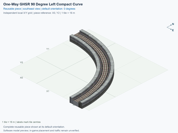](ghsr-ground-single-track-oneway-curve-90deg-left-compact/previews/preview.png) | [GHSR Ground (1 m) — Single-Track One-Way Curve 90° Left — Compact](ghsr-ground-single-track-oneway-curve-90deg-left-compact/README.md) `ghsr-ground-single-track-oneway-curve-90deg-left-compact` | 3 × 3; 5 | No current design flag | [ ] Unverified; record subject does not match this folder | [ ] Unverified; record subject does not match this folder | [ ] Unverified; record subject does not match this folder |
|  | [GHSR Ground (1 m) — Single-Track One-Way Curve 90° Right — Compact](ghsr-ground-single-track-oneway-curve-90deg-right-compact/README.md) `ghsr-ground-single-track-oneway-curve-90deg-right-compact` | 3 × 3; 5 | No current design flag | [ ] Unverified; record subject does not match this folder | [ ] Unverified; record subject does not match this folder | [ ] Unverified; record subject does not match this folder |
| [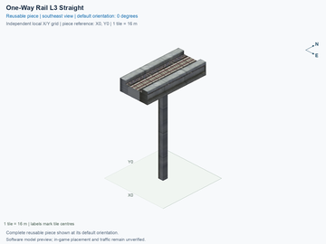](hsr-l3-single-track-oneway-straight/previews/preview.png) | [HSR Level 3 (23 m) — Single-Track One-Way Straight](hsr-l3-single-track-oneway-straight/README.md) `hsr-l3-single-track-oneway-straight` | 1 × 1; 1 | No current design flag | [ ] Unverified; record subject does not match this folder | [ ] Unverified; record subject does not match this folder | [ ] Unverified; record subject does not match this folder |
| [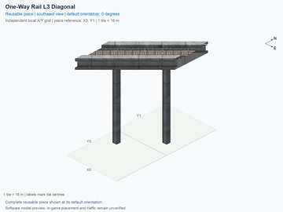](hsr-l3-single-track-oneway-straight-diagonal/previews/preview.png) | [HSR Level 3 (23 m) — Single-Track One-Way Diagonal Straight](hsr-l3-single-track-oneway-straight-diagonal/README.md) `hsr-l3-single-track-oneway-straight-diagonal` | 1 × 2; 2 | No current design flag | [ ] Unverified; record subject does not match this folder | [ ] Unverified; record subject does not match this folder | [ ] Unverified; record subject does not match this folder |
|  | [HSR Level 3 (23 m) — Single-Track One-Way Diagonal Straight — North Half](hsr-l3-single-track-oneway-straight-diagonal-north-half/README.md) `hsr-l3-single-track-oneway-straight-diagonal-north-half` | 1 × 1; 1 | No current design flag | [ ] Unverified; record subject does not match this folder | [ ] Unverified; record subject does not match this folder | [ ] Unverified; record subject does not match this folder |
|  | [HSR Level 3 (23 m) — Single-Track One-Way Diagonal Straight — East Half](hsr-l3-single-track-oneway-straight-diagonal-east-half/README.md) `hsr-l3-single-track-oneway-straight-diagonal-east-half` | 1 × 1; 1 | No current design flag | [ ] Unverified; record subject does not match this folder | [ ] Unverified; record subject does not match this folder | [ ] Unverified; record subject does not match this folder |
| [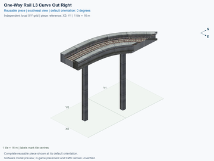](hsr-l3-single-track-oneway-curve-to-diagonal-45deg-right/previews/preview.png) | [HSR Level 3 (23 m) — Single-Track One-Way Curve 45° Right — Orthogonal to Diagonal](hsr-l3-single-track-oneway-curve-to-diagonal-45deg-right/README.md) `hsr-l3-single-track-oneway-curve-to-diagonal-45deg-right` | 1 × 2; 2 | No current design flag | [ ] Unverified; record subject does not match this folder | [ ] Unverified; record subject does not match this folder | [ ] Unverified; record subject does not match this folder |
| [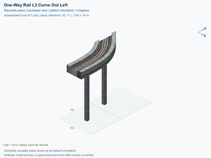](hsr-l3-single-track-oneway-curve-to-diagonal-45deg-left/previews/preview.png) | [HSR Level 3 (23 m) — Single-Track One-Way Curve 45° Left — Orthogonal to Diagonal](hsr-l3-single-track-oneway-curve-to-diagonal-45deg-left/README.md) `hsr-l3-single-track-oneway-curve-to-diagonal-45deg-left` | 1 × 2; 2 | No current design flag | [ ] Unverified; record subject does not match this folder | [ ] Unverified; record subject does not match this folder | [ ] Unverified; record subject does not match this folder |
| [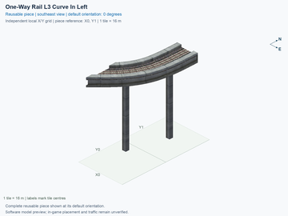](hsr-l3-single-track-oneway-curve-from-diagonal-45deg-left/previews/preview.png) | [HSR Level 3 (23 m) — Single-Track One-Way Curve 45° Left — Diagonal to Orthogonal](hsr-l3-single-track-oneway-curve-from-diagonal-45deg-left/README.md) `hsr-l3-single-track-oneway-curve-from-diagonal-45deg-left` | 1 × 2; 2 | No current design flag | [ ] Unverified; record subject does not match this folder | [ ] Unverified; record subject does not match this folder | [ ] Unverified; record subject does not match this folder |
| [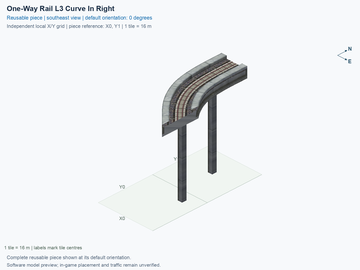](hsr-l3-single-track-oneway-curve-from-diagonal-45deg-right/previews/preview.png) | [HSR Level 3 (23 m) — Single-Track One-Way Curve 45° Right — Diagonal to Orthogonal](hsr-l3-single-track-oneway-curve-from-diagonal-45deg-right/README.md) `hsr-l3-single-track-oneway-curve-from-diagonal-45deg-right` | 1 × 2; 2 | No current design flag | [ ] Unverified; record subject does not match this folder | [ ] Unverified; record subject does not match this folder | [ ] Unverified; record subject does not match this folder |
|  | [HSR Level 3 (23 m) — Single-Track One-Way Curve 90° Left — Compact](hsr-l3-single-track-oneway-curve-90deg-left-compact/README.md) `hsr-l3-single-track-oneway-curve-90deg-left-compact` | 3 × 3; 5 | No current design flag | [ ] Unverified; record subject does not match this folder | [ ] Unverified; record subject does not match this folder | [ ] Unverified; record subject does not match this folder |
| [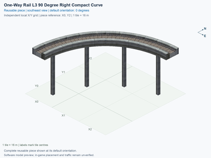](hsr-l3-single-track-oneway-curve-90deg-right-compact/previews/preview.png) | [HSR Level 3 (23 m) — Single-Track One-Way Curve 90° Right — Compact](hsr-l3-single-track-oneway-curve-90deg-right-compact/README.md) `hsr-l3-single-track-oneway-curve-90deg-right-compact` | 3 × 3; 5 | No current design flag | [ ] Unverified; record subject does not match this folder | [ ] Unverified; record subject does not match this folder | [ ] Unverified; record subject does not match this folder |
| [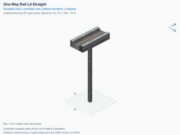](hsr-l4-single-track-oneway-straight/previews/preview.png) | [HSR Level 4 (30.5 m) — Single-Track One-Way Straight](hsr-l4-single-track-oneway-straight/README.md) `hsr-l4-single-track-oneway-straight` | 1 × 1; 1 | No current design flag | [ ] Unverified; record subject does not match this folder | [ ] Unverified; record subject does not match this folder | [ ] Unverified; record subject does not match this folder |
| [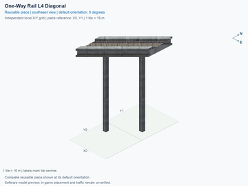](hsr-l4-single-track-oneway-straight-diagonal/previews/preview.png) | [HSR Level 4 (30.5 m) — Single-Track One-Way Diagonal Straight](hsr-l4-single-track-oneway-straight-diagonal/README.md) `hsr-l4-single-track-oneway-straight-diagonal` | 1 × 2; 2 | No current design flag | [ ] Unverified; record subject does not match this folder | [ ] Unverified; record subject does not match this folder | [ ] Unverified; record subject does not match this folder |
|  | [HSR Level 4 (30.5 m) — Single-Track One-Way Diagonal Straight — North Half](hsr-l4-single-track-oneway-straight-diagonal-north-half/README.md) `hsr-l4-single-track-oneway-straight-diagonal-north-half` | 1 × 1; 1 | No current design flag | [ ] Unverified; record subject does not match this folder | [ ] Unverified; record subject does not match this folder | [ ] Unverified; record subject does not match this folder |
| [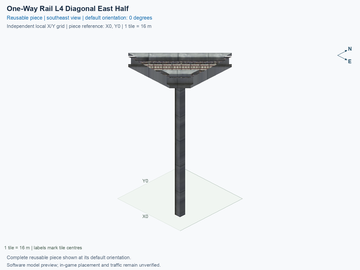](hsr-l4-single-track-oneway-straight-diagonal-east-half/previews/preview.png) | [HSR Level 4 (30.5 m) — Single-Track One-Way Diagonal Straight — East Half](hsr-l4-single-track-oneway-straight-diagonal-east-half/README.md) `hsr-l4-single-track-oneway-straight-diagonal-east-half` | 1 × 1; 1 | No current design flag | [ ] Unverified; record subject does not match this folder | [ ] Unverified; record subject does not match this folder | [ ] Unverified; record subject does not match this folder |
|  | [HSR Level 4 (30.5 m) — Single-Track One-Way Curve 45° Right — Orthogonal to Diagonal](hsr-l4-single-track-oneway-curve-to-diagonal-45deg-right/README.md) `hsr-l4-single-track-oneway-curve-to-diagonal-45deg-right` | 1 × 2; 2 | No current design flag | [ ] Unverified; record subject does not match this folder | [ ] Unverified; record subject does not match this folder | [ ] Unverified; record subject does not match this folder |
| [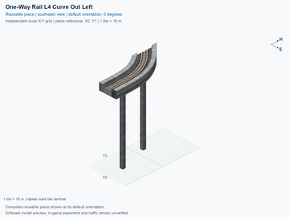](hsr-l4-single-track-oneway-curve-to-diagonal-45deg-left/previews/preview.png) | [HSR Level 4 (30.5 m) — Single-Track One-Way Curve 45° Left — Orthogonal to Diagonal](hsr-l4-single-track-oneway-curve-to-diagonal-45deg-left/README.md) `hsr-l4-single-track-oneway-curve-to-diagonal-45deg-left` | 1 × 2; 2 | No current design flag | [ ] Unverified; record subject does not match this folder | [ ] Unverified; record subject does not match this folder | [ ] Unverified; record subject does not match this folder |
|  | [HSR Level 4 (30.5 m) — Single-Track One-Way Curve 45° Left — Diagonal to Orthogonal](hsr-l4-single-track-oneway-curve-from-diagonal-45deg-left/README.md) `hsr-l4-single-track-oneway-curve-from-diagonal-45deg-left` | 1 × 2; 2 | No current design flag | [ ] Unverified; record subject does not match this folder | [ ] Unverified; record subject does not match this folder | [ ] Unverified; record subject does not match this folder |
|  | [HSR Level 4 (30.5 m) — Single-Track One-Way Curve 45° Right — Diagonal to Orthogonal](hsr-l4-single-track-oneway-curve-from-diagonal-45deg-right/README.md) `hsr-l4-single-track-oneway-curve-from-diagonal-45deg-right` | 1 × 2; 2 | No current design flag | [ ] Unverified; record subject does not match this folder | [ ] Unverified; record subject does not match this folder | [ ] Unverified; record subject does not match this folder |
|  | [HSR Level 4 (30.5 m) — Single-Track One-Way Curve 90° Left — Compact](hsr-l4-single-track-oneway-curve-90deg-left-compact/README.md) `hsr-l4-single-track-oneway-curve-90deg-left-compact` | 3 × 3; 5 | No current design flag | [ ] Unverified; record subject does not match this folder | [ ] Unverified; record subject does not match this folder | [ ] Unverified; record subject does not match this folder |
|  | [HSR Level 4 (30.5 m) — Single-Track One-Way Curve 90° Right — Compact](hsr-l4-single-track-oneway-curve-90deg-right-compact/README.md) `hsr-l4-single-track-oneway-curve-90deg-right-compact` | 3 × 3; 5 | No current design flag | [ ] Unverified; record subject does not match this folder | [ ] Unverified; record subject does not match this folder | [ ] Unverified; record subject does not match this folder |
| [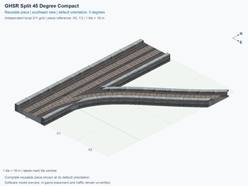](ghsr-ground-two-track-mainline-split-45deg-right-compact/previews/preview.png) | [GHSR Ground (1 m) — Split 45° Right from Two-Track Mainline — Compact](ghsr-ground-two-track-mainline-split-45deg-right-compact/README.md) `ghsr-ground-two-track-mainline-split-45deg-right-compact` | 3 × 4; 8 | No current design flag | [ ] Unverified; record subject does not match this folder | [ ] Unverified; record subject does not match this folder | [ ] Unverified; record subject does not match this folder |
|  | [GHSR Ground (1 m) — Merge 45° Right to Two-Track Mainline — Compact](ghsr-ground-two-track-mainline-merge-45deg-right-compact/README.md) `ghsr-ground-two-track-mainline-merge-45deg-right-compact` | 3 × 4; 8 | No current design flag | [ ] Unverified; record subject does not match this folder | [ ] Unverified; record subject does not match this folder | [ ] Unverified; record subject does not match this folder |
|  | [GHSR Ground (1 m) — Split 45° Right from Two-Track Mainline — Wide](ghsr-ground-two-track-mainline-split-45deg-right-wide/README.md) `ghsr-ground-two-track-mainline-split-45deg-right-wide` | 6 × 9; 18 | No current design flag | [ ] Unverified; record subject does not match this folder | [ ] Unverified; record subject does not match this folder | [ ] Unverified; record subject does not match this folder |
| [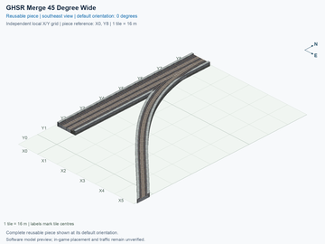](ghsr-ground-two-track-mainline-merge-45deg-right-wide/previews/preview.png) | [GHSR Ground (1 m) — Merge 45° Right to Two-Track Mainline — Wide](ghsr-ground-two-track-mainline-merge-45deg-right-wide/README.md) `ghsr-ground-two-track-mainline-merge-45deg-right-wide` | 6 × 9; 18 | No current design flag | [ ] Unverified; record subject does not match this folder | [ ] Unverified; record subject does not match this folder | [ ] Unverified; record subject does not match this folder |
|  | [GHSR Ground (1 m) — Split 90° Right from Two-Track Mainline — Compact](ghsr-ground-two-track-mainline-split-90deg-right-compact/README.md) `ghsr-ground-two-track-mainline-split-90deg-right-compact` | 2 × 2; 3 | No current design flag | [ ] Unverified; record subject does not match this folder | [ ] Unverified; record subject does not match this folder | [ ] Unverified; record subject does not match this folder |
|  | [GHSR Ground (1 m) — Merge 90° Right to Two-Track Mainline — Compact](ghsr-ground-two-track-mainline-merge-90deg-right-compact/README.md) `ghsr-ground-two-track-mainline-merge-90deg-right-compact` | 2 × 2; 3 | No current design flag | [ ] Unverified; record subject does not match this folder | [ ] Unverified; record subject does not match this folder | [ ] Unverified; record subject does not match this folder |
|  | [GHSR Ground (1 m) — Split 90° Right from Two-Track Mainline — Wide](ghsr-ground-two-track-mainline-split-90deg-right-wide/README.md) `ghsr-ground-two-track-mainline-split-90deg-right-wide` | 6 × 6; 14 | No current design flag | [ ] Unverified; record subject does not match this folder | [ ] Unverified; record subject does not match this folder | [ ] Unverified; record subject does not match this folder |
|  | [GHSR Ground (1 m) — Merge 90° Right to Two-Track Mainline — Wide](ghsr-ground-two-track-mainline-merge-90deg-right-wide/README.md) `ghsr-ground-two-track-mainline-merge-90deg-right-wide` | 6 × 6; 14 | No current design flag | [ ] Unverified; record subject does not match this folder | [ ] Unverified; record subject does not match this folder | [ ] Unverified; record subject does not match this folder |
|  | [GHSR Ground (1 m) — Split 135° Right from Two-Track Mainline — Compact](ghsr-ground-two-track-mainline-split-135deg-right-compact/README.md) `ghsr-ground-two-track-mainline-split-135deg-right-compact` | 6 × 6; 14 | No current design flag | [ ] Unverified; record subject does not match this folder | [ ] Unverified; record subject does not match this folder | [ ] Unverified; record subject does not match this folder |
|  | [GHSR Ground (1 m) — Merge 135° Right to Two-Track Mainline — Compact](ghsr-ground-two-track-mainline-merge-135deg-right-compact/README.md) `ghsr-ground-two-track-mainline-merge-135deg-right-compact` | 6 × 6; 14 | No current design flag | [ ] Unverified; record subject does not match this folder | [ ] Unverified; record subject does not match this folder | [ ] Unverified; record subject does not match this folder |
| [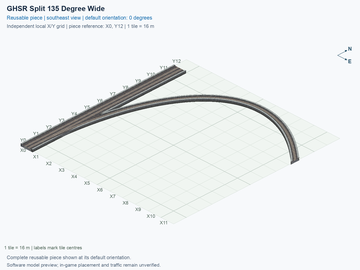](ghsr-ground-two-track-mainline-split-135deg-right-wide/previews/preview.png) | [GHSR Ground (1 m) — Split 135° Right from Two-Track Mainline — Wide](ghsr-ground-two-track-mainline-split-135deg-right-wide/README.md) `ghsr-ground-two-track-mainline-split-135deg-right-wide` | 12 × 13; 34 | No current design flag | [ ] Unverified; record subject does not match this folder | [ ] Unverified; record subject does not match this folder | [ ] Unverified; record subject does not match this folder |
| [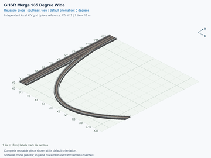](ghsr-ground-two-track-mainline-merge-135deg-right-wide/previews/preview.png) | [GHSR Ground (1 m) — Merge 135° Right to Two-Track Mainline — Wide](ghsr-ground-two-track-mainline-merge-135deg-right-wide/README.md) `ghsr-ground-two-track-mainline-merge-135deg-right-wide` | 12 × 13; 34 | No current design flag | [ ] Unverified; record subject does not match this folder | [ ] Unverified; record subject does not match this folder | [ ] Unverified; record subject does not match this folder |
| [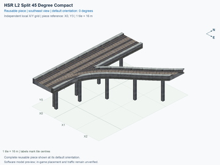](hsr-l2-two-track-mainline-split-45deg-right-compact/previews/preview.png) | [HSR Level 2 (15.5 m) — Split 45° Right from Two-Track Mainline — Compact](hsr-l2-two-track-mainline-split-45deg-right-compact/README.md) `hsr-l2-two-track-mainline-split-45deg-right-compact` | 3 × 4; 8 | [REVIEW NEEDED](hsr-l2-two-track-mainline-split-45deg-right-compact/README.md#design-review): Closely spaced pillars need a support-consolidation review. | [ ] Unverified; record subject does not match this folder | [ ] Unverified; record subject does not match this folder | [ ] Unverified; record subject does not match this folder |
|  | [HSR Level 2 (15.5 m) — Merge 45° Right to Two-Track Mainline — Compact](hsr-l2-two-track-mainline-merge-45deg-right-compact/README.md) `hsr-l2-two-track-mainline-merge-45deg-right-compact` | 3 × 4; 8 | [REVIEW NEEDED](hsr-l2-two-track-mainline-merge-45deg-right-compact/README.md#design-review): Closely spaced pillars need a support-consolidation review. | [ ] Unverified; record subject does not match this folder | [ ] Unverified; record subject does not match this folder | [ ] Unverified; record subject does not match this folder |
| [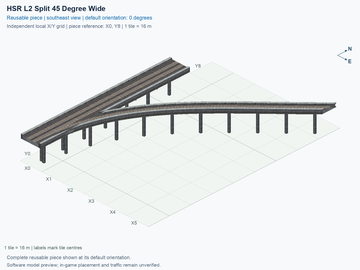](hsr-l2-two-track-mainline-split-45deg-right-wide/previews/preview.png) | [HSR Level 2 (15.5 m) — Split 45° Right from Two-Track Mainline — Wide](hsr-l2-two-track-mainline-split-45deg-right-wide/README.md) `hsr-l2-two-track-mainline-split-45deg-right-wide` | 6 × 9; 18 | [REVIEW NEEDED](hsr-l2-two-track-mainline-split-45deg-right-wide/README.md#design-review): Closely spaced pillars need a support-consolidation review. | [ ] Unverified; record subject does not match this folder | [ ] Unverified; record subject does not match this folder | [ ] Unverified; record subject does not match this folder |
| [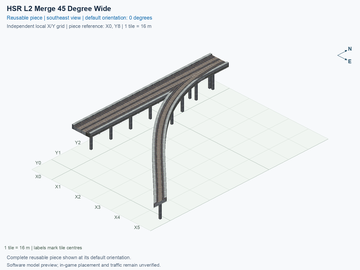](hsr-l2-two-track-mainline-merge-45deg-right-wide/previews/preview.png) | [HSR Level 2 (15.5 m) — Merge 45° Right to Two-Track Mainline — Wide](hsr-l2-two-track-mainline-merge-45deg-right-wide/README.md) `hsr-l2-two-track-mainline-merge-45deg-right-wide` | 6 × 9; 18 | [REVIEW NEEDED](hsr-l2-two-track-mainline-merge-45deg-right-wide/README.md#design-review): Closely spaced pillars need a support-consolidation review. | [ ] Unverified; record subject does not match this folder | [ ] Unverified; record subject does not match this folder | [ ] Unverified; record subject does not match this folder |
|  | [HSR Level 2 (15.5 m) — Split 90° Right from Two-Track Mainline — Compact](hsr-l2-two-track-mainline-split-90deg-right-compact/README.md) `hsr-l2-two-track-mainline-split-90deg-right-compact` | 2 × 2; 3 | No current design flag | [ ] Unverified; record subject does not match this folder | [ ] Unverified; record subject does not match this folder | [ ] Unverified; record subject does not match this folder |
|  | [HSR Level 2 (15.5 m) — Merge 90° Right to Two-Track Mainline — Compact](hsr-l2-two-track-mainline-merge-90deg-right-compact/README.md) `hsr-l2-two-track-mainline-merge-90deg-right-compact` | 2 × 2; 3 | No current design flag | [ ] Unverified; record subject does not match this folder | [ ] Unverified; record subject does not match this folder | [ ] Unverified; record subject does not match this folder |
| [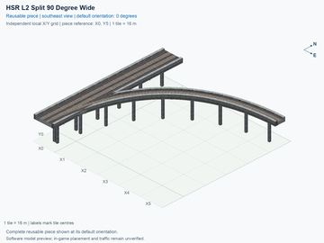](hsr-l2-two-track-mainline-split-90deg-right-wide/previews/preview.png) | [HSR Level 2 (15.5 m) — Split 90° Right from Two-Track Mainline — Wide](hsr-l2-two-track-mainline-split-90deg-right-wide/README.md) `hsr-l2-two-track-mainline-split-90deg-right-wide` | 6 × 6; 14 | [REVIEW NEEDED](hsr-l2-two-track-mainline-split-90deg-right-wide/README.md#design-review): Closely spaced pillars need a support-consolidation review. | [ ] Unverified; record subject does not match this folder | [ ] Unverified; record subject does not match this folder | [ ] Unverified; record subject does not match this folder |
|  | [HSR Level 2 (15.5 m) — Merge 90° Right to Two-Track Mainline — Wide](hsr-l2-two-track-mainline-merge-90deg-right-wide/README.md) `hsr-l2-two-track-mainline-merge-90deg-right-wide` | 6 × 6; 14 | [REVIEW NEEDED](hsr-l2-two-track-mainline-merge-90deg-right-wide/README.md#design-review): Closely spaced pillars need a support-consolidation review. | [ ] Unverified; record subject does not match this folder | [ ] Unverified; record subject does not match this folder | [ ] Unverified; record subject does not match this folder |
|  | [HSR Level 2 (15.5 m) — Split 135° Right from Two-Track Mainline — Compact](hsr-l2-two-track-mainline-split-135deg-right-compact/README.md) `hsr-l2-two-track-mainline-split-135deg-right-compact` | 6 × 6; 14 | [REVIEW NEEDED](hsr-l2-two-track-mainline-split-135deg-right-compact/README.md#design-review): Closely spaced pillars need a support-consolidation review. | [ ] Unverified; record subject does not match this folder | [ ] Unverified; record subject does not match this folder | [ ] Unverified; record subject does not match this folder |
|  | [HSR Level 2 (15.5 m) — Merge 135° Right to Two-Track Mainline — Compact](hsr-l2-two-track-mainline-merge-135deg-right-compact/README.md) `hsr-l2-two-track-mainline-merge-135deg-right-compact` | 6 × 6; 14 | [REVIEW NEEDED](hsr-l2-two-track-mainline-merge-135deg-right-compact/README.md#design-review): Closely spaced pillars need a support-consolidation review. | [ ] Unverified; record subject does not match this folder | [ ] Unverified; record subject does not match this folder | [ ] Unverified; record subject does not match this folder |
| [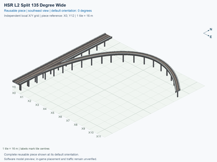](hsr-l2-two-track-mainline-split-135deg-right-wide/previews/preview.png) | [HSR Level 2 (15.5 m) — Split 135° Right from Two-Track Mainline — Wide](hsr-l2-two-track-mainline-split-135deg-right-wide/README.md) `hsr-l2-two-track-mainline-split-135deg-right-wide` | 12 × 13; 34 | [REVIEW NEEDED](hsr-l2-two-track-mainline-split-135deg-right-wide/README.md#design-review): Closely spaced pillars need a support-consolidation review. | [ ] Unverified; record subject does not match this folder | [ ] Unverified; record subject does not match this folder | [ ] Unverified; record subject does not match this folder |
|  | [HSR Level 2 (15.5 m) — Merge 135° Right to Two-Track Mainline — Wide](hsr-l2-two-track-mainline-merge-135deg-right-wide/README.md) `hsr-l2-two-track-mainline-merge-135deg-right-wide` | 12 × 13; 34 | [REVIEW NEEDED](hsr-l2-two-track-mainline-merge-135deg-right-wide/README.md#design-review): Closely spaced pillars need a support-consolidation review. | [ ] Unverified; record subject does not match this folder | [ ] Unverified; record subject does not match this folder | [ ] Unverified; record subject does not match this folder |
|  | [HSR Level 4 (30.5 m) — Split 45° Right from Single-Track One-Way Mainline — Compact](hsr-l4-single-track-oneway-split-45deg-right-compact/README.md) `hsr-l4-single-track-oneway-split-45deg-right-compact` | 3 × 4; 8 | No current design flag | [ ] Unverified; record subject does not match this folder | [ ] Unverified; record subject does not match this folder | [ ] Unverified; record subject does not match this folder |
| [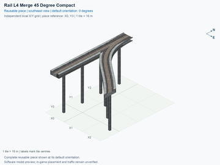](hsr-l4-single-track-oneway-merge-45deg-right-compact/previews/preview.png) | [HSR Level 4 (30.5 m) — Merge 45° Right to Single-Track One-Way Mainline — Compact](hsr-l4-single-track-oneway-merge-45deg-right-compact/README.md) `hsr-l4-single-track-oneway-merge-45deg-right-compact` | 3 × 4; 8 | No current design flag | [ ] Unverified; record subject does not match this folder | [ ] Unverified; record subject does not match this folder | [ ] Unverified; record subject does not match this folder |
|  | [HSR Level 4 (30.5 m) — Split 45° Right from Single-Track One-Way Mainline — Wide](hsr-l4-single-track-oneway-split-45deg-right-wide/README.md) `hsr-l4-single-track-oneway-split-45deg-right-wide` | 6 × 9; 18 | [REVIEW NEEDED](hsr-l4-single-track-oneway-split-45deg-right-wide/README.md#design-review): Closely spaced pillars need a support-consolidation review. | [ ] Unverified; record subject does not match this folder | [ ] Unverified; record subject does not match this folder | [ ] Unverified; record subject does not match this folder |
|  | [HSR Level 4 (30.5 m) — Merge 45° Right to Single-Track One-Way Mainline — Wide](hsr-l4-single-track-oneway-merge-45deg-right-wide/README.md) `hsr-l4-single-track-oneway-merge-45deg-right-wide` | 6 × 9; 18 | [REVIEW NEEDED](hsr-l4-single-track-oneway-merge-45deg-right-wide/README.md#design-review): Closely spaced pillars need a support-consolidation review. | [ ] Unverified; record subject does not match this folder | [ ] Unverified; record subject does not match this folder | [ ] Unverified; record subject does not match this folder |
| [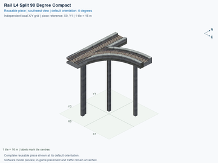](hsr-l4-single-track-oneway-split-90deg-right-compact/previews/preview.png) | [HSR Level 4 (30.5 m) — Split 90° Right from Single-Track One-Way Mainline — Compact](hsr-l4-single-track-oneway-split-90deg-right-compact/README.md) `hsr-l4-single-track-oneway-split-90deg-right-compact` | 2 × 2; 3 | [REVIEW NEEDED](hsr-l4-single-track-oneway-split-90deg-right-compact/README.md#design-review): Closely spaced pillars need a support-consolidation review. | [ ] Unverified; record subject does not match this folder | [ ] Unverified; record subject does not match this folder | [ ] Unverified; record subject does not match this folder |
|  | [HSR Level 4 (30.5 m) — Merge 90° Right to Single-Track One-Way Mainline — Compact](hsr-l4-single-track-oneway-merge-90deg-right-compact/README.md) `hsr-l4-single-track-oneway-merge-90deg-right-compact` | 2 × 2; 3 | [REVIEW NEEDED](hsr-l4-single-track-oneway-merge-90deg-right-compact/README.md#design-review): Closely spaced pillars need a support-consolidation review. | [ ] Unverified; record subject does not match this folder | [ ] Unverified; record subject does not match this folder | [ ] Unverified; record subject does not match this folder |
|  | [HSR Level 4 (30.5 m) — Split 90° Right from Single-Track One-Way Mainline — Wide](hsr-l4-single-track-oneway-split-90deg-right-wide/README.md) `hsr-l4-single-track-oneway-split-90deg-right-wide` | 6 × 6; 14 | [REVIEW NEEDED](hsr-l4-single-track-oneway-split-90deg-right-wide/README.md#design-review): Closely spaced pillars need a support-consolidation review. | [ ] Unverified; record subject does not match this folder | [ ] Unverified; record subject does not match this folder | [ ] Unverified; record subject does not match this folder |
| [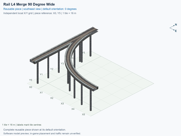](hsr-l4-single-track-oneway-merge-90deg-right-wide/previews/preview.png) | [HSR Level 4 (30.5 m) — Merge 90° Right to Single-Track One-Way Mainline — Wide](hsr-l4-single-track-oneway-merge-90deg-right-wide/README.md) `hsr-l4-single-track-oneway-merge-90deg-right-wide` | 6 × 6; 14 | [REVIEW NEEDED](hsr-l4-single-track-oneway-merge-90deg-right-wide/README.md#design-review): Closely spaced pillars need a support-consolidation review. | [ ] Unverified; record subject does not match this folder | [ ] Unverified; record subject does not match this folder | [ ] Unverified; record subject does not match this folder |
| [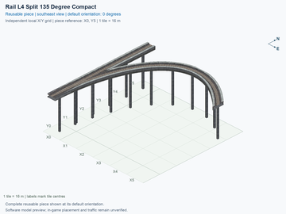](hsr-l4-single-track-oneway-split-135deg-right-compact/previews/preview.png) | [HSR Level 4 (30.5 m) — Split 135° Right from Single-Track One-Way Mainline — Compact](hsr-l4-single-track-oneway-split-135deg-right-compact/README.md) `hsr-l4-single-track-oneway-split-135deg-right-compact` | 6 × 6; 14 | [REVIEW NEEDED](hsr-l4-single-track-oneway-split-135deg-right-compact/README.md#design-review): Closely spaced pillars need a support-consolidation review. | [ ] Unverified; record subject does not match this folder | [ ] Unverified; record subject does not match this folder | [ ] Unverified; record subject does not match this folder |
| [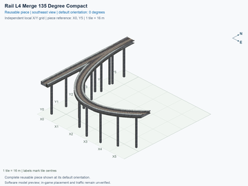](hsr-l4-single-track-oneway-merge-135deg-right-compact/previews/preview.png) | [HSR Level 4 (30.5 m) — Merge 135° Right to Single-Track One-Way Mainline — Compact](hsr-l4-single-track-oneway-merge-135deg-right-compact/README.md) `hsr-l4-single-track-oneway-merge-135deg-right-compact` | 6 × 6; 14 | [REVIEW NEEDED](hsr-l4-single-track-oneway-merge-135deg-right-compact/README.md#design-review): Closely spaced pillars need a support-consolidation review. | [ ] Unverified; record subject does not match this folder | [ ] Unverified; record subject does not match this folder | [ ] Unverified; record subject does not match this folder |
| [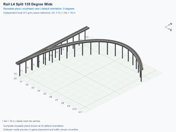](hsr-l4-single-track-oneway-split-135deg-right-wide/previews/preview.png) | [HSR Level 4 (30.5 m) — Split 135° Right from Single-Track One-Way Mainline — Wide](hsr-l4-single-track-oneway-split-135deg-right-wide/README.md) `hsr-l4-single-track-oneway-split-135deg-right-wide` | 12 × 13; 33 | [REVIEW NEEDED](hsr-l4-single-track-oneway-split-135deg-right-wide/README.md#design-review): Closely spaced pillars need a support-consolidation review. | [ ] Unverified; record subject does not match this folder | [ ] Unverified; record subject does not match this folder | [ ] Unverified; record subject does not match this folder |
|  | [HSR Level 4 (30.5 m) — Merge 135° Right to Single-Track One-Way Mainline — Wide](hsr-l4-single-track-oneway-merge-135deg-right-wide/README.md) `hsr-l4-single-track-oneway-merge-135deg-right-wide` | 12 × 13; 33 | [REVIEW NEEDED](hsr-l4-single-track-oneway-merge-135deg-right-wide/README.md#design-review): Closely spaced pillars need a support-consolidation review. | [ ] Unverified; record subject does not match this folder | [ ] Unverified; record subject does not match this folder | [ ] Unverified; record subject does not match this folder |
|  | [GHSR Ground (1 m) → HSR Level 2 (15.5 m) — Single-Track One-Way Ramp](ghsr-ground-to-hsr-l2-single-track-oneway-ramp/README.md) `ghsr-ground-to-hsr-l2-single-track-oneway-ramp` | 1 × 8; 8 | No current design flag | [ ] Unverified; record subject does not match this folder | [ ] Unverified; record subject does not match this folder | [ ] Unverified; record subject does not match this folder |
|  | [HSR Level 2 (15.5 m) → GHSR Ground (1 m) — Single-Track One-Way Ramp](hsr-l2-to-ghsr-ground-single-track-oneway-ramp/README.md) `hsr-l2-to-ghsr-ground-single-track-oneway-ramp` | 1 × 8; 8 | No current design flag | [ ] Unverified; record subject does not match this folder | [ ] Unverified; record subject does not match this folder | [ ] Unverified; record subject does not match this folder |
| [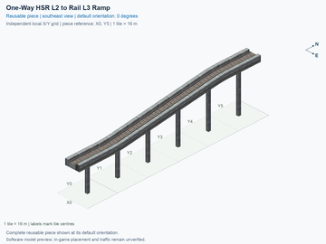](hsr-l2-to-l3-single-track-oneway-ramp/previews/preview.png) | [HSR Level 2 (15.5 m) → Level 3 (23 m) — Single-Track One-Way Ramp](hsr-l2-to-l3-single-track-oneway-ramp/README.md) `hsr-l2-to-l3-single-track-oneway-ramp` | 1 × 6; 6 | No current design flag | [ ] Unverified; record subject does not match this folder | [ ] Unverified; record subject does not match this folder | [ ] Unverified; record subject does not match this folder |
|  | [HSR Level 3 (23 m) → Level 2 (15.5 m) — Single-Track One-Way Ramp](hsr-l3-to-l2-single-track-oneway-ramp/README.md) `hsr-l3-to-l2-single-track-oneway-ramp` | 1 × 6; 6 | No current design flag | [ ] Unverified; record subject does not match this folder | [ ] Unverified; record subject does not match this folder | [ ] Unverified; record subject does not match this folder |
|  | [HSR Level 3 (23 m) → Level 4 (30.5 m) — Single-Track One-Way Ramp](hsr-l3-to-l4-single-track-oneway-ramp/README.md) `hsr-l3-to-l4-single-track-oneway-ramp` | 1 × 6; 6 | No current design flag | [ ] Unverified; record subject does not match this folder | [ ] Unverified; record subject does not match this folder | [ ] Unverified; record subject does not match this folder |
| [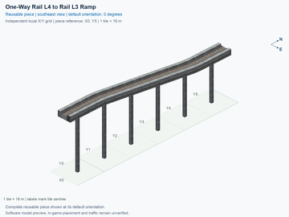](hsr-l4-to-l3-single-track-oneway-ramp/previews/preview.png) | [HSR Level 4 (30.5 m) → Level 3 (23 m) — Single-Track One-Way Ramp](hsr-l4-to-l3-single-track-oneway-ramp/README.md) `hsr-l4-to-l3-single-track-oneway-ramp` | 1 × 6; 6 | No current design flag | [ ] Unverified; record subject does not match this folder | [ ] Unverified; record subject does not match this folder | [ ] Unverified; record subject does not match this folder |
|  | [HSR Level 2 (15.5 m) → Level 4 (30.5 m) — Single-Track One-Way Ramp](hsr-l2-to-l4-single-track-oneway-ramp/README.md) `hsr-l2-to-l4-single-track-oneway-ramp` | 1 × 8; 8 | No current design flag | [ ] Unverified; record subject does not match this folder | [ ] Unverified; record subject does not match this folder | [ ] Unverified; record subject does not match this folder |
| [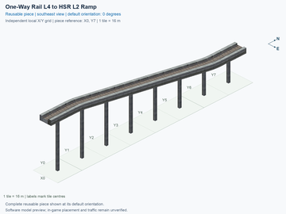](hsr-l4-to-l2-single-track-oneway-ramp/previews/preview.png) | [HSR Level 4 (30.5 m) → Level 2 (15.5 m) — Single-Track One-Way Ramp](hsr-l4-to-l2-single-track-oneway-ramp/README.md) `hsr-l4-to-l2-single-track-oneway-ramp` | 1 × 8; 8 | No current design flag | [ ] Unverified; record subject does not match this folder | [ ] Unverified; record subject does not match this folder | [ ] Unverified; record subject does not match this folder |
|  | [HSR Level 4 (30.5 m) over GHSR Ground (1 m) — Single-Track One-Way over Two-Track Crossing 90°](hsr-l4-over-ghsr-ground-mixed-crossing-90deg/README.md) `hsr-l4-over-ghsr-ground-mixed-crossing-90deg` | 3 × 1; 3 | No current design flag | [ ] Unverified; record subject does not match this folder | [ ] Unverified; record subject does not match this folder | [ ] Unverified; record subject does not match this folder |
| [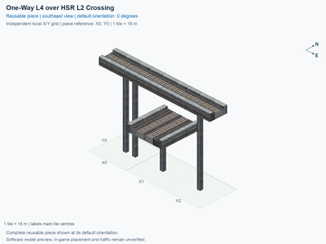](hsr-l4-over-hsr-l2-mixed-crossing-90deg/previews/preview.png) | [HSR Level 4 (30.5 m) over HSR Level 2 (15.5 m) — Single-Track One-Way over Two-Track Crossing 90°](hsr-l4-over-hsr-l2-mixed-crossing-90deg/README.md) `hsr-l4-over-hsr-l2-mixed-crossing-90deg` | 3 × 1; 3 | No current design flag | [ ] Unverified; record subject does not match this folder | [ ] Unverified; record subject does not match this folder | [ ] Unverified; record subject does not match this folder |
| [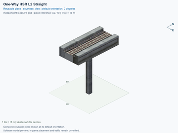](hsr-l2-single-track-oneway-straight-width7500mm/previews/preview.png) | [HSR Level 2 (15.5 m) — Single-Track One-Way Straight — 7.5 m Deck Width](hsr-l2-single-track-oneway-straight-width7500mm/README.md) `hsr-l2-single-track-oneway-straight-width7500mm` | 1 × 1; 1 | No current design flag | [ ] Unverified; record subject does not match this folder | [ ] Unverified; record subject does not match this folder | [ ] Unverified; record subject does not match this folder |
| [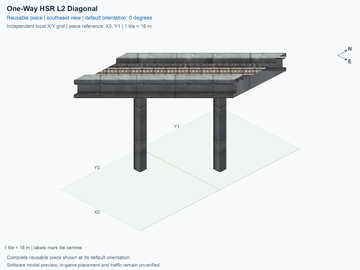](hsr-l2-single-track-oneway-straight-diagonal/previews/preview.png) | [HSR Level 2 (15.5 m) — Single-Track One-Way Diagonal Straight](hsr-l2-single-track-oneway-straight-diagonal/README.md) `hsr-l2-single-track-oneway-straight-diagonal` | 1 × 2; 2 | No current design flag | [ ] Unverified; record subject does not match this folder | [ ] Unverified; record subject does not match this folder | [ ] Unverified; record subject does not match this folder |
|  | [HSR Level 2 (15.5 m) — Single-Track One-Way Diagonal Straight — North Half](hsr-l2-single-track-oneway-straight-diagonal-north-half/README.md) `hsr-l2-single-track-oneway-straight-diagonal-north-half` | 1 × 1; 1 | No current design flag | [ ] Unverified; record subject does not match this folder | [ ] Unverified; record subject does not match this folder | [ ] Unverified; record subject does not match this folder |
|  | [HSR Level 2 (15.5 m) — Single-Track One-Way Diagonal Straight — East Half](hsr-l2-single-track-oneway-straight-diagonal-east-half/README.md) `hsr-l2-single-track-oneway-straight-diagonal-east-half` | 1 × 1; 1 | No current design flag | [ ] Unverified; record subject does not match this folder | [ ] Unverified; record subject does not match this folder | [ ] Unverified; record subject does not match this folder |
|  | [HSR Level 2 (15.5 m) — Single-Track One-Way Curve 45° Right — Orthogonal to Diagonal](hsr-l2-single-track-oneway-curve-to-diagonal-45deg-right/README.md) `hsr-l2-single-track-oneway-curve-to-diagonal-45deg-right` | 1 × 2; 2 | No current design flag | [ ] Unverified; record subject does not match this folder | [ ] Unverified; record subject does not match this folder | [ ] Unverified; record subject does not match this folder |
| [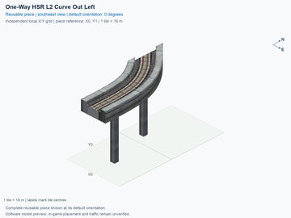](hsr-l2-single-track-oneway-curve-to-diagonal-45deg-left/previews/preview.png) | [HSR Level 2 (15.5 m) — Single-Track One-Way Curve 45° Left — Orthogonal to Diagonal](hsr-l2-single-track-oneway-curve-to-diagonal-45deg-left/README.md) `hsr-l2-single-track-oneway-curve-to-diagonal-45deg-left` | 1 × 2; 2 | No current design flag | [ ] Unverified; record subject does not match this folder | [ ] Unverified; record subject does not match this folder | [ ] Unverified; record subject does not match this folder |
| [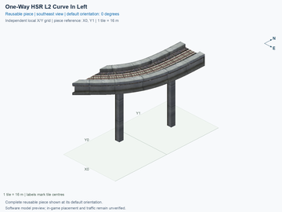](hsr-l2-single-track-oneway-curve-from-diagonal-45deg-left/previews/preview.png) | [HSR Level 2 (15.5 m) — Single-Track One-Way Curve 45° Left — Diagonal to Orthogonal](hsr-l2-single-track-oneway-curve-from-diagonal-45deg-left/README.md) `hsr-l2-single-track-oneway-curve-from-diagonal-45deg-left` | 1 × 2; 2 | No current design flag | [ ] Unverified; record subject does not match this folder | [ ] Unverified; record subject does not match this folder | [ ] Unverified; record subject does not match this folder |
|  | [HSR Level 2 (15.5 m) — Single-Track One-Way Curve 45° Right — Diagonal to Orthogonal](hsr-l2-single-track-oneway-curve-from-diagonal-45deg-right/README.md) `hsr-l2-single-track-oneway-curve-from-diagonal-45deg-right` | 1 × 2; 2 | No current design flag | [ ] Unverified; record subject does not match this folder | [ ] Unverified; record subject does not match this folder | [ ] Unverified; record subject does not match this folder |
| [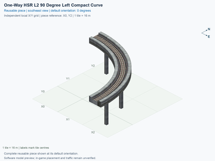](hsr-l2-single-track-oneway-curve-90deg-left-compact-width7500mm/previews/preview.png) | [HSR Level 2 (15.5 m) — Single-Track One-Way Curve 90° Left — Compact, 7.5 m Deck Width](hsr-l2-single-track-oneway-curve-90deg-left-compact-width7500mm/README.md) `hsr-l2-single-track-oneway-curve-90deg-left-compact-width7500mm` | 3 × 3; 5 | No current design flag | [ ] Unverified; record subject does not match this folder | [ ] Unverified; record subject does not match this folder | [ ] Unverified; record subject does not match this folder |
| [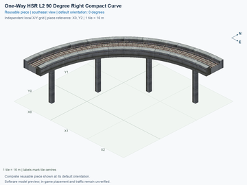](hsr-l2-single-track-oneway-curve-90deg-right-compact-width7500mm/previews/preview.png) | [HSR Level 2 (15.5 m) — Single-Track One-Way Curve 90° Right — Compact, 7.5 m Deck Width](hsr-l2-single-track-oneway-curve-90deg-right-compact-width7500mm/README.md) `hsr-l2-single-track-oneway-curve-90deg-right-compact-width7500mm` | 3 × 3; 5 | No current design flag | [ ] Unverified; record subject does not match this folder | [ ] Unverified; record subject does not match this folder | [ ] Unverified; record subject does not match this folder |
| [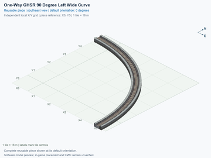](ghsr-ground-single-track-oneway-curve-90deg-left-wide/previews/preview.png) | [GHSR Ground (1 m) — Single-Track One-Way Curve 90° Left — Wide](ghsr-ground-single-track-oneway-curve-90deg-left-wide/README.md) `ghsr-ground-single-track-oneway-curve-90deg-left-wide` | 6 × 6; 11 | No current design flag | [ ] Unverified; record subject does not match this folder | [ ] Unverified; record subject does not match this folder | [ ] Unverified; record subject does not match this folder |
|  | [GHSR Ground (1 m) — Single-Track One-Way Curve 90° Right — Wide](ghsr-ground-single-track-oneway-curve-90deg-right-wide/README.md) `ghsr-ground-single-track-oneway-curve-90deg-right-wide` | 6 × 6; 11 | No current design flag | [ ] Unverified; record subject does not match this folder | [ ] Unverified; record subject does not match this folder | [ ] Unverified; record subject does not match this folder |
|  | [HSR Level 2 (15.5 m) — Single-Track One-Way Curve 90° Left — Wide, 7.5 m Deck Width](hsr-l2-single-track-oneway-curve-90deg-left-wide-width7500mm/README.md) `hsr-l2-single-track-oneway-curve-90deg-left-wide-width7500mm` | 6 × 6; 11 | No current design flag | [ ] Unverified; record subject does not match this folder | [ ] Unverified; record subject does not match this folder | [ ] Unverified; record subject does not match this folder |
| [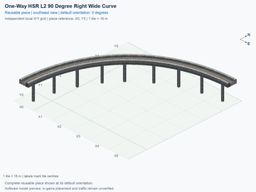](hsr-l2-single-track-oneway-curve-90deg-right-wide-width7500mm/previews/preview.png) | [HSR Level 2 (15.5 m) — Single-Track One-Way Curve 90° Right — Wide, 7.5 m Deck Width](hsr-l2-single-track-oneway-curve-90deg-right-wide-width7500mm/README.md) `hsr-l2-single-track-oneway-curve-90deg-right-wide-width7500mm` | 6 × 6; 11 | No current design flag | [ ] Unverified; record subject does not match this folder | [ ] Unverified; record subject does not match this folder | [ ] Unverified; record subject does not match this folder |
| [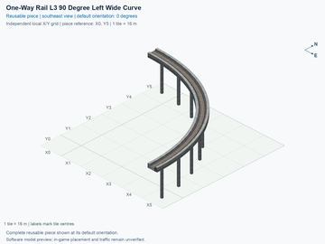](hsr-l3-single-track-oneway-curve-90deg-left-wide/previews/preview.png) | [HSR Level 3 (23 m) — Single-Track One-Way Curve 90° Left — Wide](hsr-l3-single-track-oneway-curve-90deg-left-wide/README.md) `hsr-l3-single-track-oneway-curve-90deg-left-wide` | 6 × 6; 11 | No current design flag | [ ] Unverified; record subject does not match this folder | [ ] Unverified; record subject does not match this folder | [ ] Unverified; record subject does not match this folder |
|  | [HSR Level 3 (23 m) — Single-Track One-Way Curve 90° Right — Wide](hsr-l3-single-track-oneway-curve-90deg-right-wide/README.md) `hsr-l3-single-track-oneway-curve-90deg-right-wide` | 6 × 6; 11 | No current design flag | [ ] Unverified; record subject does not match this folder | [ ] Unverified; record subject does not match this folder | [ ] Unverified; record subject does not match this folder |
| [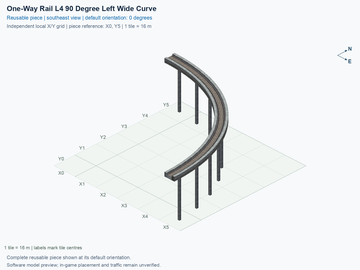](hsr-l4-single-track-oneway-curve-90deg-left-wide/previews/preview.png) | [HSR Level 4 (30.5 m) — Single-Track One-Way Curve 90° Left — Wide](hsr-l4-single-track-oneway-curve-90deg-left-wide/README.md) `hsr-l4-single-track-oneway-curve-90deg-left-wide` | 6 × 6; 11 | No current design flag | [ ] Unverified; record subject does not match this folder | [ ] Unverified; record subject does not match this folder | [ ] Unverified; record subject does not match this folder |
|  | [HSR Level 4 (30.5 m) — Single-Track One-Way Curve 90° Right — Wide](hsr-l4-single-track-oneway-curve-90deg-right-wide/README.md) `hsr-l4-single-track-oneway-curve-90deg-right-wide` | 6 × 6; 11 | No current design flag | [ ] Unverified; record subject does not match this folder | [ ] Unverified; record subject does not match this folder | [ ] Unverified; record subject does not match this folder |
|  | [HSR Level 4 (30.5 m) over GHSR Ground (1 m) — Single-Track One-Way over Two-Track Crossing 45° — Lower Diagonal](hsr-l4-over-ghsr-ground-mixed-crossing-lower-diagonal-45deg/README.md) `hsr-l4-over-ghsr-ground-mixed-crossing-lower-diagonal-45deg` | 3 × 3; 6 | No current design flag | [ ] Unverified; record subject does not match this folder | [ ] Unverified; record subject does not match this folder | [ ] Unverified; record subject does not match this folder |
|  | [HSR Level 4 (30.5 m) over GHSR Ground (1 m) — Single-Track One-Way over Two-Track Crossing 45° — Upper Diagonal](hsr-l4-over-ghsr-ground-mixed-crossing-upper-diagonal-45deg/README.md) `hsr-l4-over-ghsr-ground-mixed-crossing-upper-diagonal-45deg` | 3 × 3; 6 | No current design flag | [ ] Unverified; record subject does not match this folder | [ ] Unverified; record subject does not match this folder | [ ] Unverified; record subject does not match this folder |
|  | [HSR Level 4 (30.5 m) over GHSR Ground (1 m) — Single-Track One-Way over Two-Track Crossing 90° — Both Routes Diagonal](hsr-l4-over-ghsr-ground-mixed-crossing-diagonal-90deg/README.md) `hsr-l4-over-ghsr-ground-mixed-crossing-diagonal-90deg` | 3 × 3; 8 | No current design flag | [ ] Unverified; record subject does not match this folder | [ ] Unverified; record subject does not match this folder | [ ] Unverified; record subject does not match this folder |
|  | [HSR Level 4 (30.5 m) over HSR Level 2 (15.5 m) — Single-Track One-Way over Two-Track Crossing 45° — Lower Diagonal](hsr-l4-over-hsr-l2-mixed-crossing-lower-diagonal-45deg/README.md) `hsr-l4-over-hsr-l2-mixed-crossing-lower-diagonal-45deg` | 3 × 3; 6 | No current design flag | [ ] Unverified; record subject does not match this folder | [ ] Unverified; record subject does not match this folder | [ ] Unverified; record subject does not match this folder |
|  | [HSR Level 4 (30.5 m) over HSR Level 2 (15.5 m) — Single-Track One-Way over Two-Track Crossing 45° — Upper Diagonal](hsr-l4-over-hsr-l2-mixed-crossing-upper-diagonal-45deg/README.md) `hsr-l4-over-hsr-l2-mixed-crossing-upper-diagonal-45deg` | 3 × 3; 6 | No current design flag | [ ] Unverified; record subject does not match this folder | [ ] Unverified; record subject does not match this folder | [ ] Unverified; record subject does not match this folder |
|  | [HSR Level 4 (30.5 m) over HSR Level 2 (15.5 m) — Single-Track One-Way over Two-Track Crossing 90° — Both Routes Diagonal](hsr-l4-over-hsr-l2-mixed-crossing-diagonal-90deg/README.md) `hsr-l4-over-hsr-l2-mixed-crossing-diagonal-90deg` | 3 × 3; 8 | No current design flag | [ ] Unverified; record subject does not match this folder | [ ] Unverified; record subject does not match this folder | [ ] Unverified; record subject does not match this folder |
|  | [HSR Level 2 (15.5 m) over GHSR Ground (1 m) — Two-Track over Single-Track One-Way Crossing 90°](hsr-l2-over-ghsr-ground-mixed-crossing-90deg-lower-oneway/README.md) `hsr-l2-over-ghsr-ground-mixed-crossing-90deg-lower-oneway` | 1 × 3; 3 | No current design flag | [ ] Unverified; record subject does not match this folder | [ ] Unverified; record subject does not match this folder | [ ] Unverified; record subject does not match this folder |
|  | [HSR Level 2 (15.5 m) over GHSR Ground (1 m) — Single-Track One-Way over Two-Track Crossing 90°](hsr-l2-over-ghsr-ground-mixed-crossing-90deg-upper-oneway/README.md) `hsr-l2-over-ghsr-ground-mixed-crossing-90deg-upper-oneway` | 3 × 1; 3 | No current design flag | [ ] Unverified; record subject does not match this folder | [ ] Unverified; record subject does not match this folder | [ ] Unverified; record subject does not match this folder |
|  | [HSR Level 4 (30.5 m) — Split 45° Left from Single-Track One-Way Mainline — Compact](hsr-l4-single-track-oneway-split-45deg-left-compact/README.md) `hsr-l4-single-track-oneway-split-45deg-left-compact` | 3 × 4; 8 | No current design flag | [ ] Unverified; record subject does not match this folder | [ ] Unverified; record subject does not match this folder | [ ] Unverified; record subject does not match this folder |
|  | [HSR Level 4 (30.5 m) — Merge 45° Left to Single-Track One-Way Mainline — Compact](hsr-l4-single-track-oneway-merge-45deg-left-compact/README.md) `hsr-l4-single-track-oneway-merge-45deg-left-compact` | 3 × 4; 8 | No current design flag | [ ] Unverified; record subject does not match this folder | [ ] Unverified; record subject does not match this folder | [ ] Unverified; record subject does not match this folder |
|  | [HSR Level 4 (30.5 m) — Split 45° Left from Single-Track One-Way Mainline — Wide](hsr-l4-single-track-oneway-split-45deg-left-wide/README.md) `hsr-l4-single-track-oneway-split-45deg-left-wide` | 6 × 9; 18 | [REVIEW NEEDED](hsr-l4-single-track-oneway-split-45deg-left-wide/README.md#design-review): Closely spaced pillars need a support-consolidation review. | [ ] Unverified; record subject does not match this folder | [ ] Unverified; record subject does not match this folder | [ ] Unverified; record subject does not match this folder |
|  | [HSR Level 4 (30.5 m) — Merge 45° Left to Single-Track One-Way Mainline — Wide](hsr-l4-single-track-oneway-merge-45deg-left-wide/README.md) `hsr-l4-single-track-oneway-merge-45deg-left-wide` | 6 × 9; 18 | [REVIEW NEEDED](hsr-l4-single-track-oneway-merge-45deg-left-wide/README.md#design-review): Closely spaced pillars need a support-consolidation review. | [ ] Unverified; record subject does not match this folder | [ ] Unverified; record subject does not match this folder | [ ] Unverified; record subject does not match this folder |
|  | [HSR Level 4 (30.5 m) — Split 90° Left from Single-Track One-Way Mainline — Compact](hsr-l4-single-track-oneway-split-90deg-left-compact/README.md) `hsr-l4-single-track-oneway-split-90deg-left-compact` | 2 × 2; 3 | [REVIEW NEEDED](hsr-l4-single-track-oneway-split-90deg-left-compact/README.md#design-review): Closely spaced pillars need a support-consolidation review. | [ ] Unverified; record subject does not match this folder | [ ] Unverified; record subject does not match this folder | [ ] Unverified; record subject does not match this folder |
|  | [HSR Level 4 (30.5 m) — Merge 90° Left to Single-Track One-Way Mainline — Compact](hsr-l4-single-track-oneway-merge-90deg-left-compact/README.md) `hsr-l4-single-track-oneway-merge-90deg-left-compact` | 2 × 2; 3 | [REVIEW NEEDED](hsr-l4-single-track-oneway-merge-90deg-left-compact/README.md#design-review): Closely spaced pillars need a support-consolidation review. | [ ] Unverified; record subject does not match this folder | [ ] Unverified; record subject does not match this folder | [ ] Unverified; record subject does not match this folder |
|  | [HSR Level 4 (30.5 m) — Split 90° Left from Single-Track One-Way Mainline — Wide](hsr-l4-single-track-oneway-split-90deg-left-wide/README.md) `hsr-l4-single-track-oneway-split-90deg-left-wide` | 6 × 6; 14 | [REVIEW NEEDED](hsr-l4-single-track-oneway-split-90deg-left-wide/README.md#design-review): Closely spaced pillars need a support-consolidation review. | [ ] Unverified; record subject does not match this folder | [ ] Unverified; record subject does not match this folder | [ ] Unverified; record subject does not match this folder |
|  | [HSR Level 4 (30.5 m) — Merge 90° Left to Single-Track One-Way Mainline — Wide](hsr-l4-single-track-oneway-merge-90deg-left-wide/README.md) `hsr-l4-single-track-oneway-merge-90deg-left-wide` | 6 × 6; 14 | [REVIEW NEEDED](hsr-l4-single-track-oneway-merge-90deg-left-wide/README.md#design-review): Closely spaced pillars need a support-consolidation review. | [ ] Unverified; record subject does not match this folder | [ ] Unverified; record subject does not match this folder | [ ] Unverified; record subject does not match this folder |
|  | [HSR Level 4 (30.5 m) — Split 135° Left from Single-Track One-Way Mainline — Compact](hsr-l4-single-track-oneway-split-135deg-left-compact/README.md) `hsr-l4-single-track-oneway-split-135deg-left-compact` | 6 × 6; 14 | [REVIEW NEEDED](hsr-l4-single-track-oneway-split-135deg-left-compact/README.md#design-review): Closely spaced pillars need a support-consolidation review. | [ ] Unverified; record subject does not match this folder | [ ] Unverified; record subject does not match this folder | [ ] Unverified; record subject does not match this folder |
|  | [HSR Level 4 (30.5 m) — Merge 135° Left to Single-Track One-Way Mainline — Compact](hsr-l4-single-track-oneway-merge-135deg-left-compact/README.md) `hsr-l4-single-track-oneway-merge-135deg-left-compact` | 6 × 6; 14 | [REVIEW NEEDED](hsr-l4-single-track-oneway-merge-135deg-left-compact/README.md#design-review): Closely spaced pillars need a support-consolidation review. | [ ] Unverified; record subject does not match this folder | [ ] Unverified; record subject does not match this folder | [ ] Unverified; record subject does not match this folder |
|  | [HSR Level 4 (30.5 m) — Split 135° Left from Single-Track One-Way Mainline — Wide](hsr-l4-single-track-oneway-split-135deg-left-wide/README.md) `hsr-l4-single-track-oneway-split-135deg-left-wide` | 12 × 13; 33 | [REVIEW NEEDED](hsr-l4-single-track-oneway-split-135deg-left-wide/README.md#design-review): Closely spaced pillars need a support-consolidation review. | [ ] Unverified; record subject does not match this folder | [ ] Unverified; record subject does not match this folder | [ ] Unverified; record subject does not match this folder |
|  | [HSR Level 4 (30.5 m) — Merge 135° Left to Single-Track One-Way Mainline — Wide](hsr-l4-single-track-oneway-merge-135deg-left-wide/README.md) `hsr-l4-single-track-oneway-merge-135deg-left-wide` | 12 × 13; 33 | [REVIEW NEEDED](hsr-l4-single-track-oneway-merge-135deg-left-wide/README.md#design-review): Closely spaced pillars need a support-consolidation review. | [ ] Unverified; record subject does not match this folder | [ ] Unverified; record subject does not match this folder | [ ] Unverified; record subject does not match this folder |
|  | [HSR Level 2 (15.5 m) — Two-Track Adjacent Scissors](hsr-l2-two-track-scissors-adjacent/README.md) `hsr-l2-two-track-scissors-adjacent` | 2 × 3; 6 | No current design flag | [ ] Unverified; record subject does not match this folder | [ ] Unverified; record subject does not match this folder | [ ] Unverified; record subject does not match this folder |
|  | [GHSR Ground (1 m) — Two-Track Adjacent Scissors](ghsr-ground-two-track-scissors-adjacent/README.md) `ghsr-ground-two-track-scissors-adjacent` | 2 × 3; 6 | No current design flag | [ ] Unverified; record subject does not match this folder | [ ] Unverified; record subject does not match this folder | [ ] Unverified; record subject does not match this folder |
|  | [HSR Level 2 (15.5 m) — Two-Track Smooth T Junction — At Grade](hsr-l2-two-track-t-junction-at-grade-smooth/README.md) `hsr-l2-two-track-t-junction-at-grade-smooth` | 7 × 11; 22 | No current design flag | [ ] Unverified; record subject does not match this folder | [ ] Unverified; record subject does not match this folder | [ ] Unverified; record subject does not match this folder |
|  | [HSR Level 2 (15.5 m) — Two-Track Smooth Diagonal T Junction — At Grade](hsr-l2-two-track-t-junction-diagonal-at-grade-smooth/README.md) `hsr-l2-two-track-t-junction-diagonal-at-grade-smooth` | 13 × 14; 42 | No current design flag | [ ] Unverified; record subject does not match this folder | [ ] Unverified; record subject does not match this folder | [ ] Unverified; record subject does not match this folder |
|  | [HSR Level 4 (30.5 m) — Two-Track Straight](hsr-l4-two-track-straight/README.md) `hsr-l4-two-track-straight` | 1 × 1; 1 | No current design flag | [ ] Unverified; record subject does not match this folder | [ ] Unverified; record subject does not match this folder | [ ] Unverified; record subject does not match this folder |
|  | [HSR Level 4 (30.5 m) — Two-Track Curve 90° Right](hsr-l4-two-track-curve-90deg-right/README.md) `hsr-l4-two-track-curve-90deg-right` | 7 × 7; 20 | No current design flag | [ ] Unverified; record subject does not match this folder | [ ] Unverified; record subject does not match this folder | [ ] Unverified; record subject does not match this folder |
|  | [HSR Level 2 (15.5 m) → Level 4 (30.5 m) — Single-Track One-Way Curve 90° Ramp Right](hsr-l2-to-l4-single-track-oneway-curve-ramp-90deg-right/README.md) `hsr-l2-to-l4-single-track-oneway-curve-ramp-90deg-right` | 7 × 7; 15 | No current design flag | [ ] Unverified; record subject does not match this folder | [ ] Unverified; record subject does not match this folder | [ ] Unverified; record subject does not match this folder |
|  | [HSR Level 4 (30.5 m) → Level 2 (15.5 m) — Single-Track One-Way Curve 90° Ramp Right](hsr-l4-to-l2-single-track-oneway-curve-ramp-90deg-right/README.md) `hsr-l4-to-l2-single-track-oneway-curve-ramp-90deg-right` | 7 × 7; 15 | No current design flag | [ ] Unverified; record subject does not match this folder | [ ] Unverified; record subject does not match this folder | [ ] Unverified; record subject does not match this folder |
|  | [HSR Level 4 (30.5 m) — Two-Track Curve 90° Left](hsr-l4-two-track-curve-90deg-left/README.md) `hsr-l4-two-track-curve-90deg-left` | 7 × 7; 20 | No current design flag | [ ] Unverified; record subject does not match this folder | [ ] Unverified; record subject does not match this folder | [ ] Unverified; record subject does not match this folder |
|  | [HSR Level 2 (15.5 m) → Level 4 (30.5 m) — Single-Track One-Way Curve 90° Ramp Left](hsr-l2-to-l4-single-track-oneway-curve-ramp-90deg-left/README.md) `hsr-l2-to-l4-single-track-oneway-curve-ramp-90deg-left` | 7 × 7; 15 | No current design flag | [ ] Unverified; record subject does not match this folder | [ ] Unverified; record subject does not match this folder | [ ] Unverified; record subject does not match this folder |
|  | [HSR Level 4 (30.5 m) → Level 2 (15.5 m) — Single-Track One-Way Curve 90° Ramp Left](hsr-l4-to-l2-single-track-oneway-curve-ramp-90deg-left/README.md) `hsr-l4-to-l2-single-track-oneway-curve-ramp-90deg-left` | 7 × 7; 15 | No current design flag | [ ] Unverified; record subject does not match this folder | [ ] Unverified; record subject does not match this folder | [ ] Unverified; record subject does not match this folder |
|  | [HSR Level 4 (30.5 m) — Two-Track to Separate Single-Track Adapter](hsr-l4-two-track-adapter-separated/README.md) `hsr-l4-two-track-adapter-separated` | 2 × 8; 15 | No current design flag | [ ] Unverified; record subject does not match this folder | [ ] Unverified; record subject does not match this folder | [ ] Unverified; record subject does not match this folder |
|  | [HSR Level 2 (15.5 m) — Two-Track Straight](hsr-l2-two-track-straight/README.md) `hsr-l2-two-track-straight` | 1 × 1; 1 | No current design flag | [ ] Unverified; record subject does not match this folder | [ ] Unverified; record subject does not match this folder | [ ] Unverified; record subject does not match this folder |
|  | [HSR Level 2 (15.5 m) — Single-Track One-Way Straight — 8 m Deck Width](hsr-l2-single-track-oneway-straight-width8m/README.md) `hsr-l2-single-track-oneway-straight-width8m` | 1 × 1; 1 | No current design flag | [ ] Unverified; record subject does not match this folder | [ ] Unverified; record subject does not match this folder | [ ] Unverified; record subject does not match this folder |
|  | [HSR Level 2 (15.5 m) — Parallel Split from Two-Track Mainline](hsr-l2-two-track-mainline-split-parallel/README.md) `hsr-l2-two-track-mainline-split-parallel` | 2 × 8; 14 | No current design flag | [ ] Unverified; record subject does not match this folder | [ ] Unverified; record subject does not match this folder | [ ] Unverified; record subject does not match this folder |
|  | [HSR Level 2 (15.5 m) — Parallel Merge to Two-Track Mainline](hsr-l2-two-track-mainline-merge-parallel/README.md) `hsr-l2-two-track-mainline-merge-parallel` | 2 × 8; 14 | No current design flag | [ ] Unverified; record subject does not match this folder | [ ] Unverified; record subject does not match this folder | [ ] Unverified; record subject does not match this folder |
|  | [HSR Level 2 (15.5 m) — Opposed Parallel Merges to Two-Track Mainline](hsr-l2-two-track-mainline-opposed-merges-parallel/README.md) `hsr-l2-two-track-mainline-opposed-merges-parallel` | 3 × 8; 20 | No current design flag | [ ] Unverified; record subject does not match this folder | [ ] Unverified; record subject does not match this folder | [ ] Unverified; record subject does not match this folder |
|  | [HSR Level 2 (15.5 m) — Single-Track One-Way Curve 90° Right — Wide, 8 m Deck Width](hsr-l2-single-track-oneway-curve-90deg-right-wide-width8m/README.md) `hsr-l2-single-track-oneway-curve-90deg-right-wide-width8m` | 9 × 9; 20 | No current design flag | [ ] Unverified; record subject does not match this folder | [ ] Unverified; record subject does not match this folder | [ ] Unverified; record subject does not match this folder |
|  | [HSR Level 4 (30.5 m) — Two-Track Curve 90° Right — Wide](hsr-l4-two-track-curve-90deg-right-wide/README.md) `hsr-l4-two-track-curve-90deg-right-wide` | 13 × 13; 38 | No current design flag | [ ] Unverified; record subject does not match this folder | [ ] Unverified; record subject does not match this folder | [ ] Unverified; record subject does not match this folder |
|  | [HSR Level 4 (30.5 m) — Two-Track to Separate Single-Track Adapter — Compact](hsr-l4-two-track-adapter-separated-compact/README.md) `hsr-l4-two-track-adapter-separated-compact` | 2 × 6; 11 | No current design flag | [ ] Unverified; record subject does not match this folder | [ ] Unverified; record subject does not match this folder | [ ] Unverified; record subject does not match this folder |
|  | [HSR Level 2 (15.5 m) — Parallel Split from Two-Track Mainline — Compact](hsr-l2-two-track-mainline-split-parallel-compact/README.md) `hsr-l2-two-track-mainline-split-parallel-compact` | 2 × 6; 11 | No current design flag | [ ] Unverified; record subject does not match this folder | [ ] Unverified; record subject does not match this folder | [ ] Unverified; record subject does not match this folder |
|  | [HSR Level 2 (15.5 m) — Parallel Merge to Two-Track Mainline — Compact](hsr-l2-two-track-mainline-merge-parallel-compact/README.md) `hsr-l2-two-track-mainline-merge-parallel-compact` | 2 × 6; 11 | No current design flag | [ ] Unverified; record subject does not match this folder | [ ] Unverified; record subject does not match this folder | [ ] Unverified; record subject does not match this folder |
|  | [HSR Level 2 (15.5 m) — Parallel Split and Return Merge with Two-Track Mainline](hsr-l2-two-track-mainline-split-merge-parallel/README.md) `hsr-l2-two-track-mainline-split-merge-parallel` | 3 × 8; 20 | No current design flag | [ ] Unverified; record subject does not match this folder | [ ] Unverified; record subject does not match this folder | [ ] Unverified; record subject does not match this folder |
|  | [HSR Level 2 (15.5 m) ↔ Level 4 (30.5 m) — Y Junction with Two-Track Stem — Graded](hsr-l2-and-l4-mixed-y-junction-graded/README.md) `hsr-l2-and-l4-mixed-y-junction-graded` | 13 × 7; 25 | No current design flag | [ ] Unverified; record subject does not match this folder | [ ] Unverified; record subject does not match this folder | [ ] Unverified; record subject does not match this folder |
|  | [HSR Level 2 (15.5 m) — Single-Track One-Way Curve 90° Right — Standard, 8 m Deck Width](hsr-l2-single-track-oneway-curve-90deg-right-standard-width8m/README.md) `hsr-l2-single-track-oneway-curve-90deg-right-standard-width8m` | 7 × 7; 15 | No current design flag | [ ] Unverified; record subject does not match this folder | [ ] Unverified; record subject does not match this folder | [ ] Unverified; record subject does not match this folder |
|  | [HSR Custom (23 m) ↔ Level 4 (30.5 m) — Two-Track Curve 90° Ramp — Tight](hsr-h23000mm-and-l4-two-track-curve-ramp-90deg-tight/README.md) `hsr-h23000mm-and-l4-two-track-curve-ramp-90deg-tight` | 4 × 4; 10 | No current design flag | [ ] Unverified; record subject does not match this folder | [ ] Unverified; record subject does not match this folder | [ ] Unverified; record subject does not match this folder |
|  | [HSR Level 2 (15.5 m) ↔ Custom (23 m) — Two-Track Curve 90° Ramp — Tight](hsr-l2-and-h23000mm-two-track-curve-ramp-90deg-tight/README.md) `hsr-l2-and-h23000mm-two-track-curve-ramp-90deg-tight` | 4 × 4; 10 | No current design flag | [ ] Unverified; record subject does not match this folder | [ ] Unverified; record subject does not match this folder | [ ] Unverified; record subject does not match this folder |
|  | [HSR Level 2 (15.5 m) — Parallel Split and Return Merge with Two-Track Mainline — Recessed Mainline End](hsr-l2-two-track-mainline-split-merge-parallel-recessed-end/README.md) `hsr-l2-two-track-mainline-split-merge-parallel-recessed-end` | 3 × 6; 14 | No current design flag | [ ] Unverified; record subject does not match this folder | [ ] Unverified; record subject does not match this folder | [ ] Unverified; record subject does not match this folder |
|  | [HSR Level 2 (15.5 m) ↔ Level 4 (30.5 m) — Two-Track Ramp](hsr-l2-and-l4-two-track-ramp/README.md) `hsr-l2-and-l4-two-track-ramp` | 1 × 8; 8 | No current design flag | [ ] Unverified; record subject does not match this folder | [ ] Unverified; record subject does not match this folder | [ ] Unverified; record subject does not match this folder |
|  | [HSR Level 4 (30.5 m) over HSR Level 2 (15.5 m) — Two-Track Crossing 90°](hsr-l4-over-hsr-l2-two-track-crossing-90deg/README.md) `hsr-l4-over-hsr-l2-two-track-crossing-90deg` | 1 × 1; 1 | No current design flag | [ ] Unverified; record subject does not match this folder | [ ] Unverified; record subject does not match this folder | [ ] Unverified; record subject does not match this folder |
|  | [HSR Level 2 (15.5 m) — Split from Two-Track Mainline — Oblique Branch Cut](hsr-l2-two-track-mainline-split-oblique-cut/README.md) `hsr-l2-two-track-mainline-split-oblique-cut` | 4 × 1; 4 | No current design flag | [ ] Unverified; record subject does not match this folder | [ ] Unverified; record subject does not match this folder | [ ] Unverified; record subject does not match this folder |
|  | [HSR Level 2 (15.5 m) — Opposed Merges to Two-Track Mainline — Oblique Branch Cuts](hsr-l2-two-track-mainline-opposed-merges-oblique-cuts/README.md) `hsr-l2-two-track-mainline-opposed-merges-oblique-cuts` | 4 × 1; 4 | No current design flag | [ ] Unverified; record subject does not match this folder | [ ] Unverified; record subject does not match this folder | [ ] Unverified; record subject does not match this folder |
|  | [HSR Level 2 (15.5 m) — Single-Track One-Way Curve — Oblique Entry](hsr-l2-single-track-oneway-curve-oblique-entry/README.md) `hsr-l2-single-track-oneway-curve-oblique-entry` | 5 × 6; 12 | No current design flag | [ ] Unverified; record subject does not match this folder | [ ] Unverified; record subject does not match this folder | [ ] Unverified; record subject does not match this folder |
|  | [HSR Level 2 (15.5 m) — Single-Track One-Way Curve — Oblique Exit](hsr-l2-single-track-oneway-curve-oblique-exit/README.md) `hsr-l2-single-track-oneway-curve-oblique-exit` | 5 × 6; 12 | No current design flag | [ ] Unverified; record subject does not match this folder | [ ] Unverified; record subject does not match this folder | [ ] Unverified; record subject does not match this folder |
|  | [HSR Level 2 (15.5 m) over Road Level 0 (0 m) — Parallel Stack](hsr-l2-over-road-l0-mixed-parallel-stack/README.md) `hsr-l2-over-road-l0-mixed-parallel-stack` | 1 × 1; 1 | No current design flag | [ ] Unverified; record subject does not match this folder | [ ] Unverified; record subject does not match this folder | [ ] Unverified; record subject does not match this folder |
|  | [HSR Level 2 (15.5 m) ↔ Level 4 (30.5 m) — Two-Track Curve 90° Right Ramp](hsr-l2-and-l4-two-track-curve-ramp-90deg-right/README.md) `hsr-l2-and-l4-two-track-curve-ramp-90deg-right` | 7 × 7; 20 | No current design flag | [ ] Unverified; record subject does not match this folder | [ ] Unverified; record subject does not match this folder | [ ] Unverified; record subject does not match this folder |
|  | [HSR Level 2 (15.5 m) — Fan with Two-Track Stem — Compact, Recessed Web](hsr-l2-mixed-fan-compact-recessed-web/README.md) `hsr-l2-mixed-fan-compact-recessed-web` | 5 × 3; 9 | No current design flag | [ ] Unverified; record subject does not match this folder | [ ] Unverified; record subject does not match this folder | [ ] Unverified; record subject does not match this folder |
|  | [HSR Level 2 (15.5 m) — Two-Track Straight — Recessed Web](hsr-l2-two-track-straight-recessed-web/README.md) `hsr-l2-two-track-straight-recessed-web` | 1 × 1; 1 | No current design flag | [ ] Unverified; record subject does not match this folder | [ ] Unverified; record subject does not match this folder | [ ] Unverified; record subject does not match this folder |
