# High Speed Rail and Ground High Speed Rail — individual pieces

Generated from each subject’s authoritative `checks/manual-tests.json`. Checked means every applicable listed current case passed. Preview review and correct rendering inside SimCity 4 are separate checks. A result covers only its named scope, rotation, and recorded environment. Legacy endpoint observations remain historical evidence in the subject checklist and do not establish current compatibility coverage.

| Preview | Exact menu name / piece ID | Footprint; occupied | Design review | Preview reviewed | Renders correctly in game | Directed journey cases |
| --- | --- | --- | --- | --- | --- | --- |
|  | [HSR over Diagonal GHSR](hsr-diagonal-ghsr/README.md) `hsr-diagonal-ghsr` | 1 × 2; 2 | No current design flag | [ ] 0/1 passed; 1 unverified; 0 failed; 0 stale | [ ] 0/8 passed; 8 unverified; 0 failed; 0 stale | [ ] 0/32 passed; 32 unverified; 0 failed; 0 stale |
| [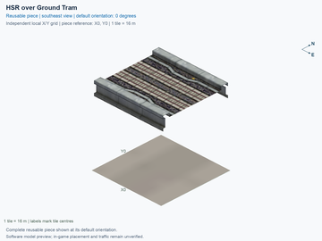](tram-under-hsr/preview.png) | [HSR over Ground Tram](tram-under-hsr/README.md) `tram-under-hsr` | 1 × 1; 1 | No current design flag | [ ] 0/1 passed; 1 unverified; 0 failed; 0 stale | [ ] 0/4 passed; 4 unverified; 0 failed; 0 stale | [ ] 0/24 passed; 24 unverified; 0 failed; 0 stale |
| [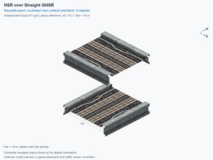](hsr-straight-ghsr/preview.png) | [HSR over Straight GHSR](hsr-straight-ghsr/README.md) `hsr-straight-ghsr` | 1 × 1; 1 | No current design flag | [ ] 0/1 passed; 1 unverified; 0 failed; 0 stale | [ ] 0/4 passed; 4 unverified; 0 failed; 0 stale | [ ] 0/16 passed; 16 unverified; 0 failed; 0 stale |
| [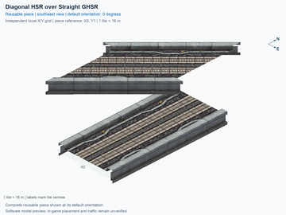](diagonal-hsr-straight-ghsr/preview.png) | [Diagonal HSR over Straight GHSR](diagonal-hsr-straight-ghsr/README.md) `diagonal-hsr-straight-ghsr` | 1 × 2; 2 | No current design flag | [ ] 0/1 passed; 1 unverified; 0 failed; 0 stale | [ ] 0/8 passed; 8 unverified; 0 failed; 0 stale | [ ] 0/32 passed; 32 unverified; 0 failed; 0 stale |
|  | [Diagonal HSR over Diagonal GHSR](diagonal-hsr-diagonal-ghsr/README.md) `diagonal-hsr-diagonal-ghsr` | 1 × 2; 2 | No current design flag | [ ] 0/1 passed; 1 unverified; 0 failed; 0 stale | [ ] 0/8 passed; 8 unverified; 0 failed; 0 stale | [ ] 0/32 passed; 32 unverified; 0 failed; 0 stale |
|  | [HSR Diagonal S-Curve Left](rail-hsr-diagonal-s-left/README.md) `rail-hsr-diagonal-s-left` | 3 × 3; 4 | No current design flag | [ ] 0/1 passed; 1 unverified; 0 failed; 0 stale | [ ] 0/4 passed; 4 unverified; 0 failed; 0 stale | [ ] 0/8 passed; 8 unverified; 0 failed; 0 stale |
| [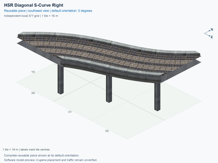](rail-hsr-diagonal-s-right/preview.png) | [HSR Diagonal S-Curve Right](rail-hsr-diagonal-s-right/README.md) `rail-hsr-diagonal-s-right` | 3 × 3; 4 | No current design flag | [ ] 0/1 passed; 1 unverified; 0 failed; 0 stale | [ ] 0/4 passed; 4 unverified; 0 failed; 0 stale | [ ] 0/8 passed; 8 unverified; 0 failed; 0 stale |
| [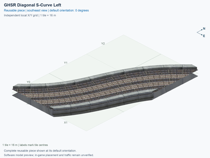](rail-ghsr-diagonal-s-left/preview.png) | [GHSR Diagonal S-Curve Left](rail-ghsr-diagonal-s-left/README.md) `rail-ghsr-diagonal-s-left` | 3 × 3; 4 | No current design flag | [ ] 0/1 passed; 1 unverified; 0 failed; 0 stale | [ ] 0/4 passed; 4 unverified; 0 failed; 0 stale | [ ] 0/8 passed; 8 unverified; 0 failed; 0 stale |
| [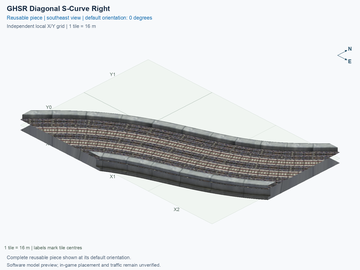](rail-ghsr-diagonal-s-right/preview.png) | [GHSR Diagonal S-Curve Right](rail-ghsr-diagonal-s-right/README.md) `rail-ghsr-diagonal-s-right` | 3 × 3; 4 | No current design flag | [ ] 0/1 passed; 1 unverified; 0 failed; 0 stale | [ ] 0/4 passed; 4 unverified; 0 failed; 0 stale | [ ] 0/8 passed; 8 unverified; 0 failed; 0 stale |
| [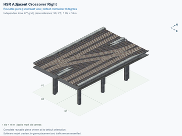](rail-hsr-adjacent-crossover-right/preview.png) | [HSR Adjacent Crossover Right](rail-hsr-adjacent-crossover-right/README.md) `rail-hsr-adjacent-crossover-right` | 2 × 3; 6 | [REVIEW NEEDED](rail-hsr-adjacent-crossover-right/README.md#design-review): Closely spaced pillars need a support-consolidation review. | [ ] 0/1 passed; 1 unverified; 0 failed; 0 stale | [ ] 0/4 passed; 4 unverified; 0 failed; 0 stale | [ ] 0/24 passed; 24 unverified; 0 failed; 0 stale |
| [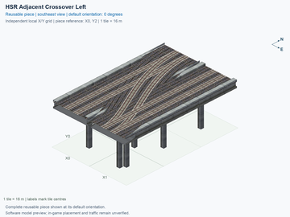](rail-hsr-adjacent-crossover-left/preview.png) | [HSR Adjacent Crossover Left](rail-hsr-adjacent-crossover-left/README.md) `rail-hsr-adjacent-crossover-left` | 2 × 3; 6 | [REVIEW NEEDED](rail-hsr-adjacent-crossover-left/README.md#design-review): Closely spaced pillars need a support-consolidation review. | [ ] 0/1 passed; 1 unverified; 0 failed; 0 stale | [ ] 0/4 passed; 4 unverified; 0 failed; 0 stale | [ ] 0/24 passed; 24 unverified; 0 failed; 0 stale |
| [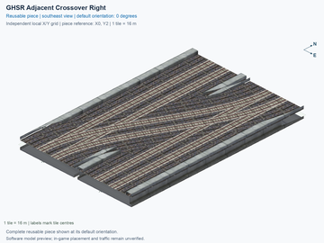](rail-ghsr-adjacent-crossover-right/preview.png) | [GHSR Adjacent Crossover Right](rail-ghsr-adjacent-crossover-right/README.md) `rail-ghsr-adjacent-crossover-right` | 2 × 3; 6 | No current design flag | [ ] 0/1 passed; 1 unverified; 0 failed; 0 stale | [ ] 0/4 passed; 4 unverified; 0 failed; 0 stale | [ ] 0/24 passed; 24 unverified; 0 failed; 0 stale |
| [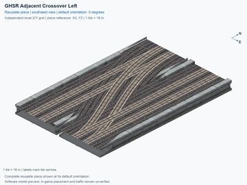](rail-ghsr-adjacent-crossover-left/preview.png) | [GHSR Adjacent Crossover Left](rail-ghsr-adjacent-crossover-left/README.md) `rail-ghsr-adjacent-crossover-left` | 2 × 3; 6 | No current design flag | [ ] 0/1 passed; 1 unverified; 0 failed; 0 stale | [ ] 0/4 passed; 4 unverified; 0 failed; 0 stale | [ ] 0/24 passed; 24 unverified; 0 failed; 0 stale |
|  | [HSR to GHSR Transition](rail-hsr-ghsr-transition/README.md) `rail-hsr-ghsr-transition` | 1 × 8; 8 | No current design flag | [ ] 0/1 passed; 1 unverified; 0 failed; 0 stale | [ ] 0/4 passed; 4 unverified; 0 failed; 0 stale | [ ] 0/8 passed; 8 unverified; 0 failed; 0 stale |
|  | [One-Way GHSR Straight](interchange-oneway-ground-straight/README.md) `interchange-oneway-ground-straight` | 1 × 1; 1 | No current design flag | [ ] 0/1 passed; 1 unverified; 0 failed; 0 stale | [ ] 0/4 passed; 4 unverified; 0 failed; 0 stale | [ ] 0/4 passed; 4 unverified; 0 failed; 0 stale |
| [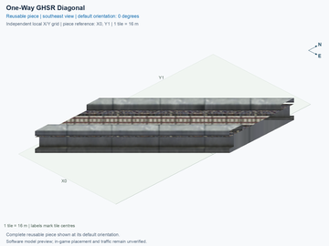](interchange-oneway-ground-diagonal/preview.png) | [One-Way GHSR Diagonal](interchange-oneway-ground-diagonal/README.md) `interchange-oneway-ground-diagonal` | 1 × 2; 2 | No current design flag | [ ] 0/1 passed; 1 unverified; 0 failed; 0 stale | [ ] 0/4 passed; 4 unverified; 0 failed; 0 stale | [ ] 0/4 passed; 4 unverified; 0 failed; 0 stale |
|  | [One-Way GHSR Diagonal North Half](interchange-oneway-ground-diagonal-north-half/README.md) `interchange-oneway-ground-diagonal-north-half` | 1 × 1; 1 | No current design flag | [ ] 0/1 passed; 1 unverified; 0 failed; 0 stale | [ ] 0/4 passed; 4 unverified; 0 failed; 0 stale | [ ] 0/4 passed; 4 unverified; 0 failed; 0 stale |
|  | [One-Way GHSR Diagonal East Half](interchange-oneway-ground-diagonal-east-half/README.md) `interchange-oneway-ground-diagonal-east-half` | 1 × 1; 1 | No current design flag | [ ] 0/1 passed; 1 unverified; 0 failed; 0 stale | [ ] 0/4 passed; 4 unverified; 0 failed; 0 stale | [ ] 0/4 passed; 4 unverified; 0 failed; 0 stale |
| [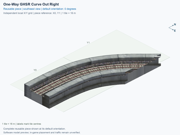](interchange-oneway-ground-curve-out-right/preview.png) | [One-Way GHSR Curve Out Right](interchange-oneway-ground-curve-out-right/README.md) `interchange-oneway-ground-curve-out-right` | 1 × 2; 2 | No current design flag | [ ] 0/1 passed; 1 unverified; 0 failed; 0 stale | [ ] 0/4 passed; 4 unverified; 0 failed; 0 stale | [ ] 0/4 passed; 4 unverified; 0 failed; 0 stale |
|  | [One-Way GHSR Curve Out Left](interchange-oneway-ground-curve-out-left/README.md) `interchange-oneway-ground-curve-out-left` | 1 × 2; 2 | No current design flag | [ ] 0/1 passed; 1 unverified; 0 failed; 0 stale | [ ] 0/4 passed; 4 unverified; 0 failed; 0 stale | [ ] 0/4 passed; 4 unverified; 0 failed; 0 stale |
|  | [One-Way GHSR Curve In Left](interchange-oneway-ground-curve-in-left/README.md) `interchange-oneway-ground-curve-in-left` | 1 × 2; 2 | No current design flag | [ ] 0/1 passed; 1 unverified; 0 failed; 0 stale | [ ] 0/4 passed; 4 unverified; 0 failed; 0 stale | [ ] 0/4 passed; 4 unverified; 0 failed; 0 stale |
| [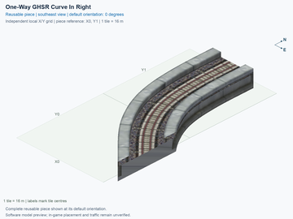](interchange-oneway-ground-curve-in-right/preview.png) | [One-Way GHSR Curve In Right](interchange-oneway-ground-curve-in-right/README.md) `interchange-oneway-ground-curve-in-right` | 1 × 2; 2 | No current design flag | [ ] 0/1 passed; 1 unverified; 0 failed; 0 stale | [ ] 0/4 passed; 4 unverified; 0 failed; 0 stale | [ ] 0/4 passed; 4 unverified; 0 failed; 0 stale |
|  | [One-Way GHSR 90 Degree Left Compact Curve](interchange-oneway-ground-turn90-left/README.md) `interchange-oneway-ground-turn90-left` | 3 × 3; 5 | No current design flag | [ ] 0/1 passed; 1 unverified; 0 failed; 0 stale | [ ] 0/4 passed; 4 unverified; 0 failed; 0 stale | [ ] 0/4 passed; 4 unverified; 0 failed; 0 stale |
| [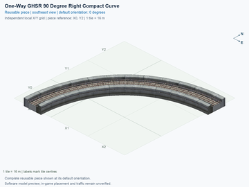](interchange-oneway-ground-turn90-right/preview.png) | [One-Way GHSR 90 Degree Right Compact Curve](interchange-oneway-ground-turn90-right/README.md) `interchange-oneway-ground-turn90-right` | 3 × 3; 5 | No current design flag | [ ] 0/1 passed; 1 unverified; 0 failed; 0 stale | [ ] 0/4 passed; 4 unverified; 0 failed; 0 stale | [ ] 0/4 passed; 4 unverified; 0 failed; 0 stale |
|  | [One-Way Rail L3 Straight](interchange-oneway-l3-straight/README.md) `interchange-oneway-l3-straight` | 1 × 1; 1 | No current design flag | [ ] 0/1 passed; 1 unverified; 0 failed; 0 stale | [ ] 0/4 passed; 4 unverified; 0 failed; 0 stale | [ ] 0/4 passed; 4 unverified; 0 failed; 0 stale |
|  | [One-Way Rail L3 Diagonal](interchange-oneway-l3-diagonal/README.md) `interchange-oneway-l3-diagonal` | 1 × 2; 2 | No current design flag | [ ] 0/1 passed; 1 unverified; 0 failed; 0 stale | [ ] 0/4 passed; 4 unverified; 0 failed; 0 stale | [ ] 0/4 passed; 4 unverified; 0 failed; 0 stale |
|  | [One-Way Rail L3 Diagonal North Half](interchange-oneway-l3-diagonal-north-half/README.md) `interchange-oneway-l3-diagonal-north-half` | 1 × 1; 1 | No current design flag | [ ] 0/1 passed; 1 unverified; 0 failed; 0 stale | [ ] 0/4 passed; 4 unverified; 0 failed; 0 stale | [ ] 0/4 passed; 4 unverified; 0 failed; 0 stale |
| [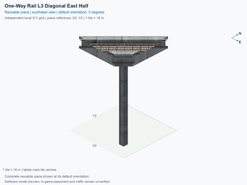](interchange-oneway-l3-diagonal-east-half/preview.png) | [One-Way Rail L3 Diagonal East Half](interchange-oneway-l3-diagonal-east-half/README.md) `interchange-oneway-l3-diagonal-east-half` | 1 × 1; 1 | No current design flag | [ ] 0/1 passed; 1 unverified; 0 failed; 0 stale | [ ] 0/4 passed; 4 unverified; 0 failed; 0 stale | [ ] 0/4 passed; 4 unverified; 0 failed; 0 stale |
|  | [One-Way Rail L3 Curve Out Right](interchange-oneway-l3-curve-out-right/README.md) `interchange-oneway-l3-curve-out-right` | 1 × 2; 2 | No current design flag | [ ] 0/1 passed; 1 unverified; 0 failed; 0 stale | [ ] 0/4 passed; 4 unverified; 0 failed; 0 stale | [ ] 0/4 passed; 4 unverified; 0 failed; 0 stale |
|  | [One-Way Rail L3 Curve Out Left](interchange-oneway-l3-curve-out-left/README.md) `interchange-oneway-l3-curve-out-left` | 1 × 2; 2 | No current design flag | [ ] 0/1 passed; 1 unverified; 0 failed; 0 stale | [ ] 0/4 passed; 4 unverified; 0 failed; 0 stale | [ ] 0/4 passed; 4 unverified; 0 failed; 0 stale |
|  | [One-Way Rail L3 Curve In Left](interchange-oneway-l3-curve-in-left/README.md) `interchange-oneway-l3-curve-in-left` | 1 × 2; 2 | No current design flag | [ ] 0/1 passed; 1 unverified; 0 failed; 0 stale | [ ] 0/4 passed; 4 unverified; 0 failed; 0 stale | [ ] 0/4 passed; 4 unverified; 0 failed; 0 stale |
|  | [One-Way Rail L3 Curve In Right](interchange-oneway-l3-curve-in-right/README.md) `interchange-oneway-l3-curve-in-right` | 1 × 2; 2 | No current design flag | [ ] 0/1 passed; 1 unverified; 0 failed; 0 stale | [ ] 0/4 passed; 4 unverified; 0 failed; 0 stale | [ ] 0/4 passed; 4 unverified; 0 failed; 0 stale |
| [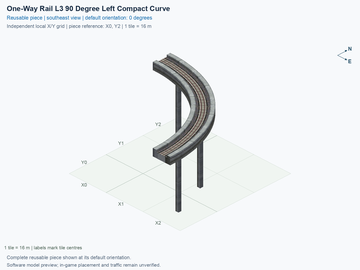](interchange-oneway-l3-turn90-left/preview.png) | [One-Way Rail L3 90 Degree Left Compact Curve](interchange-oneway-l3-turn90-left/README.md) `interchange-oneway-l3-turn90-left` | 3 × 3; 5 | No current design flag | [ ] 0/1 passed; 1 unverified; 0 failed; 0 stale | [ ] 0/4 passed; 4 unverified; 0 failed; 0 stale | [ ] 0/4 passed; 4 unverified; 0 failed; 0 stale |
|  | [One-Way Rail L3 90 Degree Right Compact Curve](interchange-oneway-l3-turn90-right/README.md) `interchange-oneway-l3-turn90-right` | 3 × 3; 5 | No current design flag | [ ] 0/1 passed; 1 unverified; 0 failed; 0 stale | [ ] 0/4 passed; 4 unverified; 0 failed; 0 stale | [ ] 0/4 passed; 4 unverified; 0 failed; 0 stale |
|  | [One-Way Rail L4 Straight](interchange-oneway-l4-straight/README.md) `interchange-oneway-l4-straight` | 1 × 1; 1 | No current design flag | [ ] 0/1 passed; 1 unverified; 0 failed; 0 stale | [ ] 0/4 passed; 4 unverified; 0 failed; 0 stale | [ ] 0/4 passed; 4 unverified; 0 failed; 0 stale |
|  | [One-Way Rail L4 Diagonal](interchange-oneway-l4-diagonal/README.md) `interchange-oneway-l4-diagonal` | 1 × 2; 2 | No current design flag | [ ] 0/1 passed; 1 unverified; 0 failed; 0 stale | [ ] 0/4 passed; 4 unverified; 0 failed; 0 stale | [ ] 0/4 passed; 4 unverified; 0 failed; 0 stale |
|  | [One-Way Rail L4 Diagonal North Half](interchange-oneway-l4-diagonal-north-half/README.md) `interchange-oneway-l4-diagonal-north-half` | 1 × 1; 1 | No current design flag | [ ] 0/1 passed; 1 unverified; 0 failed; 0 stale | [ ] 0/4 passed; 4 unverified; 0 failed; 0 stale | [ ] 0/4 passed; 4 unverified; 0 failed; 0 stale |
|  | [One-Way Rail L4 Diagonal East Half](interchange-oneway-l4-diagonal-east-half/README.md) `interchange-oneway-l4-diagonal-east-half` | 1 × 1; 1 | No current design flag | [ ] 0/1 passed; 1 unverified; 0 failed; 0 stale | [ ] 0/4 passed; 4 unverified; 0 failed; 0 stale | [ ] 0/4 passed; 4 unverified; 0 failed; 0 stale |
| [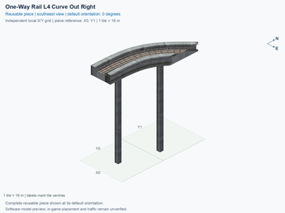](interchange-oneway-l4-curve-out-right/preview.png) | [One-Way Rail L4 Curve Out Right](interchange-oneway-l4-curve-out-right/README.md) `interchange-oneway-l4-curve-out-right` | 1 × 2; 2 | No current design flag | [ ] 0/1 passed; 1 unverified; 0 failed; 0 stale | [ ] 0/4 passed; 4 unverified; 0 failed; 0 stale | [ ] 0/4 passed; 4 unverified; 0 failed; 0 stale |
|  | [One-Way Rail L4 Curve Out Left](interchange-oneway-l4-curve-out-left/README.md) `interchange-oneway-l4-curve-out-left` | 1 × 2; 2 | No current design flag | [ ] 0/1 passed; 1 unverified; 0 failed; 0 stale | [ ] 0/4 passed; 4 unverified; 0 failed; 0 stale | [ ] 0/4 passed; 4 unverified; 0 failed; 0 stale |
| [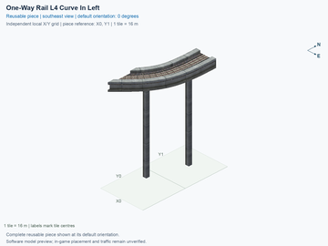](interchange-oneway-l4-curve-in-left/preview.png) | [One-Way Rail L4 Curve In Left](interchange-oneway-l4-curve-in-left/README.md) `interchange-oneway-l4-curve-in-left` | 1 × 2; 2 | No current design flag | [ ] 0/1 passed; 1 unverified; 0 failed; 0 stale | [ ] 0/4 passed; 4 unverified; 0 failed; 0 stale | [ ] 0/4 passed; 4 unverified; 0 failed; 0 stale |
| [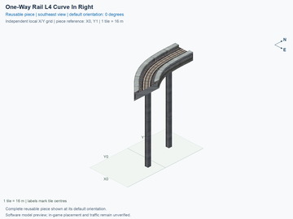](interchange-oneway-l4-curve-in-right/preview.png) | [One-Way Rail L4 Curve In Right](interchange-oneway-l4-curve-in-right/README.md) `interchange-oneway-l4-curve-in-right` | 1 × 2; 2 | No current design flag | [ ] 0/1 passed; 1 unverified; 0 failed; 0 stale | [ ] 0/4 passed; 4 unverified; 0 failed; 0 stale | [ ] 0/4 passed; 4 unverified; 0 failed; 0 stale |
| [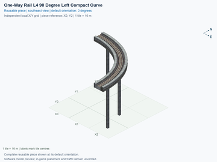](interchange-oneway-l4-turn90-left/preview.png) | [One-Way Rail L4 90 Degree Left Compact Curve](interchange-oneway-l4-turn90-left/README.md) `interchange-oneway-l4-turn90-left` | 3 × 3; 5 | No current design flag | [ ] 0/1 passed; 1 unverified; 0 failed; 0 stale | [ ] 0/4 passed; 4 unverified; 0 failed; 0 stale | [ ] 0/4 passed; 4 unverified; 0 failed; 0 stale |
| [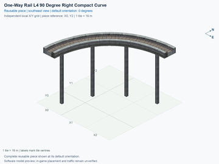](interchange-oneway-l4-turn90-right/preview.png) | [One-Way Rail L4 90 Degree Right Compact Curve](interchange-oneway-l4-turn90-right/README.md) `interchange-oneway-l4-turn90-right` | 3 × 3; 5 | No current design flag | [ ] 0/1 passed; 1 unverified; 0 failed; 0 stale | [ ] 0/4 passed; 4 unverified; 0 failed; 0 stale | [ ] 0/4 passed; 4 unverified; 0 failed; 0 stale |
|  | [GHSR Split 45 Degree Compact](interchange-ground-split-45-compact/README.md) `interchange-ground-split-45-compact` | 3 × 4; 8 | No current design flag | [ ] 0/1 passed; 1 unverified; 0 failed; 0 stale | [ ] 0/4 passed; 4 unverified; 0 failed; 0 stale | [ ] 0/12 passed; 12 unverified; 0 failed; 0 stale |
| [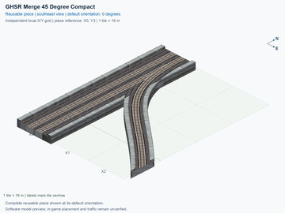](interchange-ground-merge-45-compact/preview.png) | [GHSR Merge 45 Degree Compact](interchange-ground-merge-45-compact/README.md) `interchange-ground-merge-45-compact` | 3 × 4; 8 | No current design flag | [ ] 0/1 passed; 1 unverified; 0 failed; 0 stale | [ ] 0/4 passed; 4 unverified; 0 failed; 0 stale | [ ] 0/12 passed; 12 unverified; 0 failed; 0 stale |
| [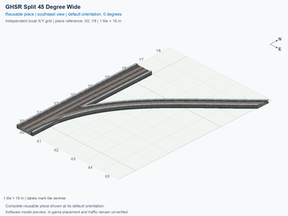](interchange-ground-split-45-wide/preview.png) | [GHSR Split 45 Degree Wide](interchange-ground-split-45-wide/README.md) `interchange-ground-split-45-wide` | 6 × 9; 18 | No current design flag | [ ] 0/1 passed; 1 unverified; 0 failed; 0 stale | [ ] 0/4 passed; 4 unverified; 0 failed; 0 stale | [ ] 0/12 passed; 12 unverified; 0 failed; 0 stale |
|  | [GHSR Merge 45 Degree Wide](interchange-ground-merge-45-wide/README.md) `interchange-ground-merge-45-wide` | 6 × 9; 18 | No current design flag | [ ] 0/1 passed; 1 unverified; 0 failed; 0 stale | [ ] 0/4 passed; 4 unverified; 0 failed; 0 stale | [ ] 0/12 passed; 12 unverified; 0 failed; 0 stale |
| [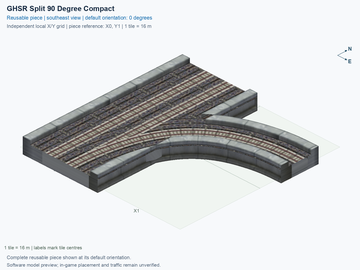](interchange-ground-split-90-compact/preview.png) | [GHSR Split 90 Degree Compact](interchange-ground-split-90-compact/README.md) `interchange-ground-split-90-compact` | 2 × 2; 3 | No current design flag | [ ] 0/1 passed; 1 unverified; 0 failed; 0 stale | [ ] 0/4 passed; 4 unverified; 0 failed; 0 stale | [ ] 0/12 passed; 12 unverified; 0 failed; 0 stale |
| [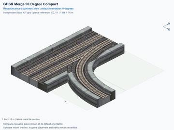](interchange-ground-merge-90-compact/preview.png) | [GHSR Merge 90 Degree Compact](interchange-ground-merge-90-compact/README.md) `interchange-ground-merge-90-compact` | 2 × 2; 3 | No current design flag | [ ] 0/1 passed; 1 unverified; 0 failed; 0 stale | [ ] 0/4 passed; 4 unverified; 0 failed; 0 stale | [ ] 0/12 passed; 12 unverified; 0 failed; 0 stale |
| [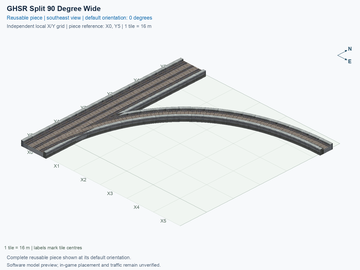](interchange-ground-split-90-wide/preview.png) | [GHSR Split 90 Degree Wide](interchange-ground-split-90-wide/README.md) `interchange-ground-split-90-wide` | 6 × 6; 14 | No current design flag | [ ] 0/1 passed; 1 unverified; 0 failed; 0 stale | [ ] 0/4 passed; 4 unverified; 0 failed; 0 stale | [ ] 0/12 passed; 12 unverified; 0 failed; 0 stale |
| [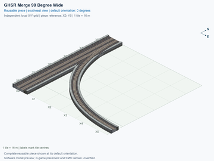](interchange-ground-merge-90-wide/preview.png) | [GHSR Merge 90 Degree Wide](interchange-ground-merge-90-wide/README.md) `interchange-ground-merge-90-wide` | 6 × 6; 14 | No current design flag | [ ] 0/1 passed; 1 unverified; 0 failed; 0 stale | [ ] 0/4 passed; 4 unverified; 0 failed; 0 stale | [ ] 0/12 passed; 12 unverified; 0 failed; 0 stale |
| [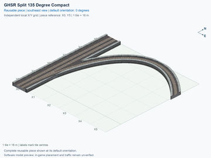](interchange-ground-split-135-compact/preview.png) | [GHSR Split 135 Degree Compact](interchange-ground-split-135-compact/README.md) `interchange-ground-split-135-compact` | 6 × 6; 14 | No current design flag | [ ] 0/1 passed; 1 unverified; 0 failed; 0 stale | [ ] 0/4 passed; 4 unverified; 0 failed; 0 stale | [ ] 0/12 passed; 12 unverified; 0 failed; 0 stale |
| [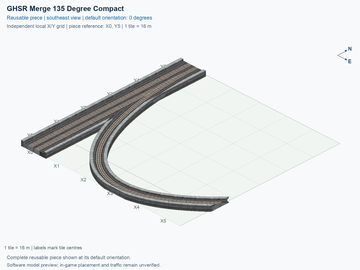](interchange-ground-merge-135-compact/preview.png) | [GHSR Merge 135 Degree Compact](interchange-ground-merge-135-compact/README.md) `interchange-ground-merge-135-compact` | 6 × 6; 14 | No current design flag | [ ] 0/1 passed; 1 unverified; 0 failed; 0 stale | [ ] 0/4 passed; 4 unverified; 0 failed; 0 stale | [ ] 0/12 passed; 12 unverified; 0 failed; 0 stale |
|  | [GHSR Split 135 Degree Wide](interchange-ground-split-135-wide/README.md) `interchange-ground-split-135-wide` | 12 × 13; 34 | No current design flag | [ ] 0/1 passed; 1 unverified; 0 failed; 0 stale | [ ] 0/4 passed; 4 unverified; 0 failed; 0 stale | [ ] 0/12 passed; 12 unverified; 0 failed; 0 stale |
|  | [GHSR Merge 135 Degree Wide](interchange-ground-merge-135-wide/README.md) `interchange-ground-merge-135-wide` | 12 × 13; 34 | No current design flag | [ ] 0/1 passed; 1 unverified; 0 failed; 0 stale | [ ] 0/4 passed; 4 unverified; 0 failed; 0 stale | [ ] 0/12 passed; 12 unverified; 0 failed; 0 stale |
|  | [HSR L2 Split 45 Degree Compact](interchange-hsr-split-45-compact/README.md) `interchange-hsr-split-45-compact` | 3 × 4; 8 | [REVIEW NEEDED](interchange-hsr-split-45-compact/README.md#design-review): Closely spaced pillars need a support-consolidation review. | [ ] 0/1 passed; 1 unverified; 0 failed; 0 stale | [ ] 0/4 passed; 4 unverified; 0 failed; 0 stale | [ ] 0/12 passed; 12 unverified; 0 failed; 0 stale |
| [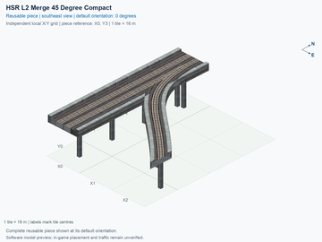](interchange-hsr-merge-45-compact/preview.png) | [HSR L2 Merge 45 Degree Compact](interchange-hsr-merge-45-compact/README.md) `interchange-hsr-merge-45-compact` | 3 × 4; 8 | [REVIEW NEEDED](interchange-hsr-merge-45-compact/README.md#design-review): Closely spaced pillars need a support-consolidation review. | [ ] 0/1 passed; 1 unverified; 0 failed; 0 stale | [ ] 0/4 passed; 4 unverified; 0 failed; 0 stale | [ ] 0/12 passed; 12 unverified; 0 failed; 0 stale |
|  | [HSR L2 Split 45 Degree Wide](interchange-hsr-split-45-wide/README.md) `interchange-hsr-split-45-wide` | 6 × 9; 18 | [REVIEW NEEDED](interchange-hsr-split-45-wide/README.md#design-review): Closely spaced pillars need a support-consolidation review. | [ ] 0/1 passed; 1 unverified; 0 failed; 0 stale | [ ] 0/4 passed; 4 unverified; 0 failed; 0 stale | [ ] 0/12 passed; 12 unverified; 0 failed; 0 stale |
|  | [HSR L2 Merge 45 Degree Wide](interchange-hsr-merge-45-wide/README.md) `interchange-hsr-merge-45-wide` | 6 × 9; 18 | [REVIEW NEEDED](interchange-hsr-merge-45-wide/README.md#design-review): Closely spaced pillars need a support-consolidation review. | [ ] 0/1 passed; 1 unverified; 0 failed; 0 stale | [ ] 0/4 passed; 4 unverified; 0 failed; 0 stale | [ ] 0/12 passed; 12 unverified; 0 failed; 0 stale |
| [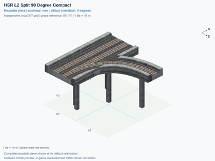](interchange-hsr-split-90-compact/preview.png) | [HSR L2 Split 90 Degree Compact](interchange-hsr-split-90-compact/README.md) `interchange-hsr-split-90-compact` | 2 × 2; 3 | No current design flag | [ ] 0/1 passed; 1 unverified; 0 failed; 0 stale | [ ] 0/4 passed; 4 unverified; 0 failed; 0 stale | [ ] 0/12 passed; 12 unverified; 0 failed; 0 stale |
| [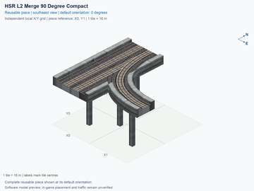](interchange-hsr-merge-90-compact/preview.png) | [HSR L2 Merge 90 Degree Compact](interchange-hsr-merge-90-compact/README.md) `interchange-hsr-merge-90-compact` | 2 × 2; 3 | No current design flag | [ ] 0/1 passed; 1 unverified; 0 failed; 0 stale | [ ] 0/4 passed; 4 unverified; 0 failed; 0 stale | [ ] 0/12 passed; 12 unverified; 0 failed; 0 stale |
|  | [HSR L2 Split 90 Degree Wide](interchange-hsr-split-90-wide/README.md) `interchange-hsr-split-90-wide` | 6 × 6; 14 | [REVIEW NEEDED](interchange-hsr-split-90-wide/README.md#design-review): Closely spaced pillars need a support-consolidation review. | [ ] 0/1 passed; 1 unverified; 0 failed; 0 stale | [ ] 0/4 passed; 4 unverified; 0 failed; 0 stale | [ ] 0/12 passed; 12 unverified; 0 failed; 0 stale |
| [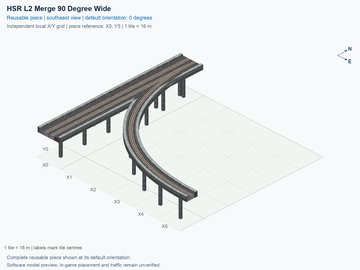](interchange-hsr-merge-90-wide/preview.png) | [HSR L2 Merge 90 Degree Wide](interchange-hsr-merge-90-wide/README.md) `interchange-hsr-merge-90-wide` | 6 × 6; 14 | [REVIEW NEEDED](interchange-hsr-merge-90-wide/README.md#design-review): Closely spaced pillars need a support-consolidation review. | [ ] 0/1 passed; 1 unverified; 0 failed; 0 stale | [ ] 0/4 passed; 4 unverified; 0 failed; 0 stale | [ ] 0/12 passed; 12 unverified; 0 failed; 0 stale |
| [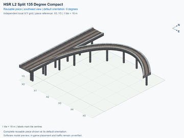](interchange-hsr-split-135-compact/preview.png) | [HSR L2 Split 135 Degree Compact](interchange-hsr-split-135-compact/README.md) `interchange-hsr-split-135-compact` | 6 × 6; 14 | [REVIEW NEEDED](interchange-hsr-split-135-compact/README.md#design-review): Closely spaced pillars need a support-consolidation review. | [ ] 0/1 passed; 1 unverified; 0 failed; 0 stale | [ ] 0/4 passed; 4 unverified; 0 failed; 0 stale | [ ] 0/12 passed; 12 unverified; 0 failed; 0 stale |
| [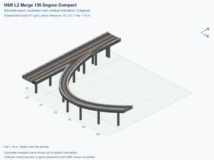](interchange-hsr-merge-135-compact/preview.png) | [HSR L2 Merge 135 Degree Compact](interchange-hsr-merge-135-compact/README.md) `interchange-hsr-merge-135-compact` | 6 × 6; 14 | [REVIEW NEEDED](interchange-hsr-merge-135-compact/README.md#design-review): Closely spaced pillars need a support-consolidation review. | [ ] 0/1 passed; 1 unverified; 0 failed; 0 stale | [ ] 0/4 passed; 4 unverified; 0 failed; 0 stale | [ ] 0/12 passed; 12 unverified; 0 failed; 0 stale |
|  | [HSR L2 Split 135 Degree Wide](interchange-hsr-split-135-wide/README.md) `interchange-hsr-split-135-wide` | 12 × 13; 34 | [REVIEW NEEDED](interchange-hsr-split-135-wide/README.md#design-review): Closely spaced pillars need a support-consolidation review. | [ ] 0/1 passed; 1 unverified; 0 failed; 0 stale | [ ] 0/4 passed; 4 unverified; 0 failed; 0 stale | [ ] 0/12 passed; 12 unverified; 0 failed; 0 stale |
| [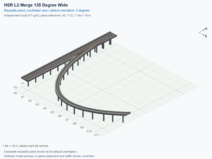](interchange-hsr-merge-135-wide/preview.png) | [HSR L2 Merge 135 Degree Wide](interchange-hsr-merge-135-wide/README.md) `interchange-hsr-merge-135-wide` | 12 × 13; 34 | [REVIEW NEEDED](interchange-hsr-merge-135-wide/README.md#design-review): Closely spaced pillars need a support-consolidation review. | [ ] 0/1 passed; 1 unverified; 0 failed; 0 stale | [ ] 0/4 passed; 4 unverified; 0 failed; 0 stale | [ ] 0/12 passed; 12 unverified; 0 failed; 0 stale |
| [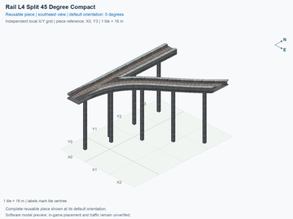](interchange-l4-split-45-compact/preview.png) | [Rail L4 Split 45 Degree Compact](interchange-l4-split-45-compact/README.md) `interchange-l4-split-45-compact` | 3 × 4; 8 | No current design flag | [ ] 0/1 passed; 1 unverified; 0 failed; 0 stale | [ ] 0/4 passed; 4 unverified; 0 failed; 0 stale | [ ] 0/8 passed; 8 unverified; 0 failed; 0 stale |
|  | [Rail L4 Merge 45 Degree Compact](interchange-l4-merge-45-compact/README.md) `interchange-l4-merge-45-compact` | 3 × 4; 8 | No current design flag | [ ] 0/1 passed; 1 unverified; 0 failed; 0 stale | [ ] 0/4 passed; 4 unverified; 0 failed; 0 stale | [ ] 0/8 passed; 8 unverified; 0 failed; 0 stale |
| [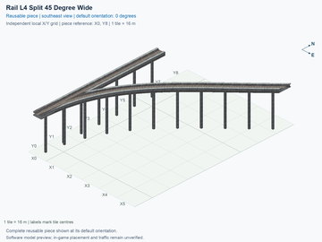](interchange-l4-split-45-wide/preview.png) | [Rail L4 Split 45 Degree Wide](interchange-l4-split-45-wide/README.md) `interchange-l4-split-45-wide` | 6 × 9; 18 | [REVIEW NEEDED](interchange-l4-split-45-wide/README.md#design-review): Closely spaced pillars need a support-consolidation review. | [ ] 0/1 passed; 1 unverified; 0 failed; 0 stale | [ ] 0/4 passed; 4 unverified; 0 failed; 0 stale | [ ] 0/8 passed; 8 unverified; 0 failed; 0 stale |
| [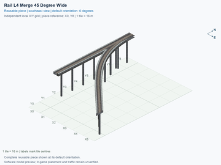](interchange-l4-merge-45-wide/preview.png) | [Rail L4 Merge 45 Degree Wide](interchange-l4-merge-45-wide/README.md) `interchange-l4-merge-45-wide` | 6 × 9; 18 | [REVIEW NEEDED](interchange-l4-merge-45-wide/README.md#design-review): Closely spaced pillars need a support-consolidation review. | [ ] 0/1 passed; 1 unverified; 0 failed; 0 stale | [ ] 0/4 passed; 4 unverified; 0 failed; 0 stale | [ ] 0/8 passed; 8 unverified; 0 failed; 0 stale |
|  | [Rail L4 Split 90 Degree Compact](interchange-l4-split-90-compact/README.md) `interchange-l4-split-90-compact` | 2 × 2; 3 | [REVIEW NEEDED](interchange-l4-split-90-compact/README.md#design-review): Closely spaced pillars need a support-consolidation review. | [ ] 0/1 passed; 1 unverified; 0 failed; 0 stale | [ ] 0/4 passed; 4 unverified; 0 failed; 0 stale | [ ] 0/8 passed; 8 unverified; 0 failed; 0 stale |
| [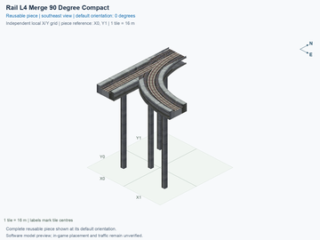](interchange-l4-merge-90-compact/preview.png) | [Rail L4 Merge 90 Degree Compact](interchange-l4-merge-90-compact/README.md) `interchange-l4-merge-90-compact` | 2 × 2; 3 | [REVIEW NEEDED](interchange-l4-merge-90-compact/README.md#design-review): Closely spaced pillars need a support-consolidation review. | [ ] 0/1 passed; 1 unverified; 0 failed; 0 stale | [ ] 0/4 passed; 4 unverified; 0 failed; 0 stale | [ ] 0/8 passed; 8 unverified; 0 failed; 0 stale |
| [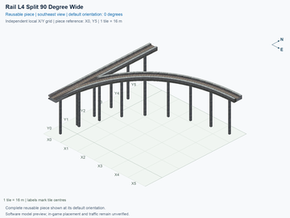](interchange-l4-split-90-wide/preview.png) | [Rail L4 Split 90 Degree Wide](interchange-l4-split-90-wide/README.md) `interchange-l4-split-90-wide` | 6 × 6; 14 | [REVIEW NEEDED](interchange-l4-split-90-wide/README.md#design-review): Closely spaced pillars need a support-consolidation review. | [ ] 0/1 passed; 1 unverified; 0 failed; 0 stale | [ ] 0/4 passed; 4 unverified; 0 failed; 0 stale | [ ] 0/8 passed; 8 unverified; 0 failed; 0 stale |
|  | [Rail L4 Merge 90 Degree Wide](interchange-l4-merge-90-wide/README.md) `interchange-l4-merge-90-wide` | 6 × 6; 14 | [REVIEW NEEDED](interchange-l4-merge-90-wide/README.md#design-review): Closely spaced pillars need a support-consolidation review. | [ ] 0/1 passed; 1 unverified; 0 failed; 0 stale | [ ] 0/4 passed; 4 unverified; 0 failed; 0 stale | [ ] 0/8 passed; 8 unverified; 0 failed; 0 stale |
|  | [Rail L4 Split 135 Degree Compact](interchange-l4-split-135-compact/README.md) `interchange-l4-split-135-compact` | 6 × 6; 14 | [REVIEW NEEDED](interchange-l4-split-135-compact/README.md#design-review): Closely spaced pillars need a support-consolidation review. | [ ] 0/1 passed; 1 unverified; 0 failed; 0 stale | [ ] 0/4 passed; 4 unverified; 0 failed; 0 stale | [ ] 0/8 passed; 8 unverified; 0 failed; 0 stale |
|  | [Rail L4 Merge 135 Degree Compact](interchange-l4-merge-135-compact/README.md) `interchange-l4-merge-135-compact` | 6 × 6; 14 | [REVIEW NEEDED](interchange-l4-merge-135-compact/README.md#design-review): Closely spaced pillars need a support-consolidation review. | [ ] 0/1 passed; 1 unverified; 0 failed; 0 stale | [ ] 0/4 passed; 4 unverified; 0 failed; 0 stale | [ ] 0/8 passed; 8 unverified; 0 failed; 0 stale |
|  | [Rail L4 Split 135 Degree Wide](interchange-l4-split-135-wide/README.md) `interchange-l4-split-135-wide` | 12 × 13; 33 | [REVIEW NEEDED](interchange-l4-split-135-wide/README.md#design-review): Closely spaced pillars need a support-consolidation review. | [ ] 0/1 passed; 1 unverified; 0 failed; 0 stale | [ ] 0/4 passed; 4 unverified; 0 failed; 0 stale | [ ] 0/8 passed; 8 unverified; 0 failed; 0 stale |
| [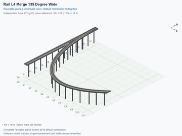](interchange-l4-merge-135-wide/preview.png) | [Rail L4 Merge 135 Degree Wide](interchange-l4-merge-135-wide/README.md) `interchange-l4-merge-135-wide` | 12 × 13; 33 | [REVIEW NEEDED](interchange-l4-merge-135-wide/README.md#design-review): Closely spaced pillars need a support-consolidation review. | [ ] 0/1 passed; 1 unverified; 0 failed; 0 stale | [ ] 0/4 passed; 4 unverified; 0 failed; 0 stale | [ ] 0/8 passed; 8 unverified; 0 failed; 0 stale |
| [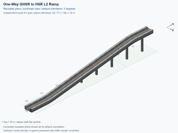](interchange-oneway-grade-ground-to-hsr/preview.png) | [One-Way GHSR to HSR L2 Ramp](interchange-oneway-grade-ground-to-hsr/README.md) `interchange-oneway-grade-ground-to-hsr` | 1 × 8; 8 | No current design flag | [ ] 0/1 passed; 1 unverified; 0 failed; 0 stale | [ ] 0/4 passed; 4 unverified; 0 failed; 0 stale | [ ] 0/4 passed; 4 unverified; 0 failed; 0 stale |
| [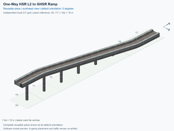](interchange-oneway-grade-hsr-to-ground/preview.png) | [One-Way HSR L2 to GHSR Ramp](interchange-oneway-grade-hsr-to-ground/README.md) `interchange-oneway-grade-hsr-to-ground` | 1 × 8; 8 | No current design flag | [ ] 0/1 passed; 1 unverified; 0 failed; 0 stale | [ ] 0/4 passed; 4 unverified; 0 failed; 0 stale | [ ] 0/4 passed; 4 unverified; 0 failed; 0 stale |
|  | [One-Way HSR L2 to Rail L3 Ramp](interchange-oneway-grade-hsr-to-l3/README.md) `interchange-oneway-grade-hsr-to-l3` | 1 × 6; 6 | No current design flag | [ ] 0/1 passed; 1 unverified; 0 failed; 0 stale | [ ] 0/4 passed; 4 unverified; 0 failed; 0 stale | [ ] 0/4 passed; 4 unverified; 0 failed; 0 stale |
| [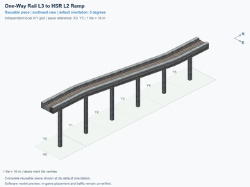](interchange-oneway-grade-l3-to-hsr/preview.png) | [One-Way Rail L3 to HSR L2 Ramp](interchange-oneway-grade-l3-to-hsr/README.md) `interchange-oneway-grade-l3-to-hsr` | 1 × 6; 6 | No current design flag | [ ] 0/1 passed; 1 unverified; 0 failed; 0 stale | [ ] 0/4 passed; 4 unverified; 0 failed; 0 stale | [ ] 0/4 passed; 4 unverified; 0 failed; 0 stale |
| [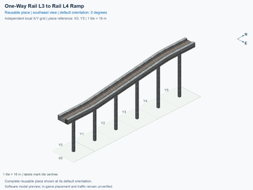](interchange-oneway-grade-l3-to-l4/preview.png) | [One-Way Rail L3 to Rail L4 Ramp](interchange-oneway-grade-l3-to-l4/README.md) `interchange-oneway-grade-l3-to-l4` | 1 × 6; 6 | No current design flag | [ ] 0/1 passed; 1 unverified; 0 failed; 0 stale | [ ] 0/4 passed; 4 unverified; 0 failed; 0 stale | [ ] 0/4 passed; 4 unverified; 0 failed; 0 stale |
|  | [One-Way Rail L4 to Rail L3 Ramp](interchange-oneway-grade-l4-to-l3/README.md) `interchange-oneway-grade-l4-to-l3` | 1 × 6; 6 | No current design flag | [ ] 0/1 passed; 1 unverified; 0 failed; 0 stale | [ ] 0/4 passed; 4 unverified; 0 failed; 0 stale | [ ] 0/4 passed; 4 unverified; 0 failed; 0 stale |
| [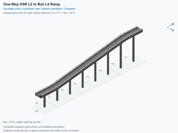](interchange-oneway-grade-hsr-to-l4/preview.png) | [One-Way HSR L2 to Rail L4 Ramp](interchange-oneway-grade-hsr-to-l4/README.md) `interchange-oneway-grade-hsr-to-l4` | 1 × 8; 8 | No current design flag | [ ] 0/1 passed; 1 unverified; 0 failed; 0 stale | [ ] 0/4 passed; 4 unverified; 0 failed; 0 stale | [ ] 0/4 passed; 4 unverified; 0 failed; 0 stale |
|  | [One-Way Rail L4 to HSR L2 Ramp](interchange-oneway-grade-l4-to-hsr/README.md) `interchange-oneway-grade-l4-to-hsr` | 1 × 8; 8 | No current design flag | [ ] 0/1 passed; 1 unverified; 0 failed; 0 stale | [ ] 0/4 passed; 4 unverified; 0 failed; 0 stale | [ ] 0/4 passed; 4 unverified; 0 failed; 0 stale |
| [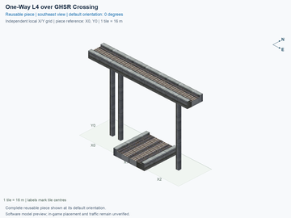](interchange-l4-oneway-over-ground/preview.png) | [One-Way L4 over GHSR Crossing](interchange-l4-oneway-over-ground/README.md) `interchange-l4-oneway-over-ground` | 3 × 1; 3 | No current design flag | [ ] 0/1 passed; 1 unverified; 0 failed; 0 stale | [ ] 0/4 passed; 4 unverified; 0 failed; 0 stale | [ ] 0/12 passed; 12 unverified; 0 failed; 0 stale |
|  | [One-Way L4 over HSR L2 Crossing](interchange-l4-oneway-over-hsr/README.md) `interchange-l4-oneway-over-hsr` | 3 × 1; 3 | No current design flag | [ ] 0/1 passed; 1 unverified; 0 failed; 0 stale | [ ] 0/4 passed; 4 unverified; 0 failed; 0 stale | [ ] 0/12 passed; 12 unverified; 0 failed; 0 stale |
|  | [One-Way HSR L2 Straight](interchange-oneway-hsr-straight/README.md) `interchange-oneway-hsr-straight` | 1 × 1; 1 | No current design flag | [ ] 0/1 passed; 1 unverified; 0 failed; 0 stale | [ ] 0/4 passed; 4 unverified; 0 failed; 0 stale | [ ] 0/4 passed; 4 unverified; 0 failed; 0 stale |
|  | [One-Way HSR L2 Diagonal](interchange-oneway-hsr-diagonal/README.md) `interchange-oneway-hsr-diagonal` | 1 × 2; 2 | No current design flag | [ ] 0/1 passed; 1 unverified; 0 failed; 0 stale | [ ] 0/4 passed; 4 unverified; 0 failed; 0 stale | [ ] 0/4 passed; 4 unverified; 0 failed; 0 stale |
| [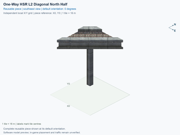](interchange-oneway-hsr-diagonal-north-half/preview.png) | [One-Way HSR L2 Diagonal North Half](interchange-oneway-hsr-diagonal-north-half/README.md) `interchange-oneway-hsr-diagonal-north-half` | 1 × 1; 1 | No current design flag | [ ] 0/1 passed; 1 unverified; 0 failed; 0 stale | [ ] 0/4 passed; 4 unverified; 0 failed; 0 stale | [ ] 0/4 passed; 4 unverified; 0 failed; 0 stale |
| [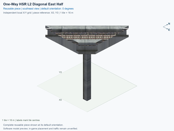](interchange-oneway-hsr-diagonal-east-half/preview.png) | [One-Way HSR L2 Diagonal East Half](interchange-oneway-hsr-diagonal-east-half/README.md) `interchange-oneway-hsr-diagonal-east-half` | 1 × 1; 1 | No current design flag | [ ] 0/1 passed; 1 unverified; 0 failed; 0 stale | [ ] 0/4 passed; 4 unverified; 0 failed; 0 stale | [ ] 0/4 passed; 4 unverified; 0 failed; 0 stale |
|  | [One-Way HSR L2 Curve Out Right](interchange-oneway-hsr-curve-out-right/README.md) `interchange-oneway-hsr-curve-out-right` | 1 × 2; 2 | No current design flag | [ ] 0/1 passed; 1 unverified; 0 failed; 0 stale | [ ] 0/4 passed; 4 unverified; 0 failed; 0 stale | [ ] 0/4 passed; 4 unverified; 0 failed; 0 stale |
|  | [One-Way HSR L2 Curve Out Left](interchange-oneway-hsr-curve-out-left/README.md) `interchange-oneway-hsr-curve-out-left` | 1 × 2; 2 | No current design flag | [ ] 0/1 passed; 1 unverified; 0 failed; 0 stale | [ ] 0/4 passed; 4 unverified; 0 failed; 0 stale | [ ] 0/4 passed; 4 unverified; 0 failed; 0 stale |
|  | [One-Way HSR L2 Curve In Left](interchange-oneway-hsr-curve-in-left/README.md) `interchange-oneway-hsr-curve-in-left` | 1 × 2; 2 | No current design flag | [ ] 0/1 passed; 1 unverified; 0 failed; 0 stale | [ ] 0/4 passed; 4 unverified; 0 failed; 0 stale | [ ] 0/4 passed; 4 unverified; 0 failed; 0 stale |
|  | [One-Way HSR L2 Curve In Right](interchange-oneway-hsr-curve-in-right/README.md) `interchange-oneway-hsr-curve-in-right` | 1 × 2; 2 | No current design flag | [ ] 0/1 passed; 1 unverified; 0 failed; 0 stale | [ ] 0/4 passed; 4 unverified; 0 failed; 0 stale | [ ] 0/4 passed; 4 unverified; 0 failed; 0 stale |
|  | [One-Way HSR L2 90 Degree Left Compact Curve](interchange-oneway-hsr-turn90-left/README.md) `interchange-oneway-hsr-turn90-left` | 3 × 3; 5 | No current design flag | [ ] 0/1 passed; 1 unverified; 0 failed; 0 stale | [ ] 0/4 passed; 4 unverified; 0 failed; 0 stale | [ ] 0/4 passed; 4 unverified; 0 failed; 0 stale |
|  | [One-Way HSR L2 90 Degree Right Compact Curve](interchange-oneway-hsr-turn90-right/README.md) `interchange-oneway-hsr-turn90-right` | 3 × 3; 5 | No current design flag | [ ] 0/1 passed; 1 unverified; 0 failed; 0 stale | [ ] 0/4 passed; 4 unverified; 0 failed; 0 stale | [ ] 0/4 passed; 4 unverified; 0 failed; 0 stale |
|  | [One-Way GHSR 90 Degree Left Wide Curve](interchange-oneway-ground-turn90-left-wide/README.md) `interchange-oneway-ground-turn90-left-wide` | 6 × 6; 11 | No current design flag | [ ] 0/1 passed; 1 unverified; 0 failed; 0 stale | [ ] 0/4 passed; 4 unverified; 0 failed; 0 stale | [ ] 0/4 passed; 4 unverified; 0 failed; 0 stale |
|  | [One-Way GHSR 90 Degree Right Wide Curve](interchange-oneway-ground-turn90-right-wide/README.md) `interchange-oneway-ground-turn90-right-wide` | 6 × 6; 11 | No current design flag | [ ] 0/1 passed; 1 unverified; 0 failed; 0 stale | [ ] 0/4 passed; 4 unverified; 0 failed; 0 stale | [ ] 0/4 passed; 4 unverified; 0 failed; 0 stale |
|  | [One-Way HSR L2 90 Degree Left Wide Curve](interchange-oneway-hsr-turn90-left-wide/README.md) `interchange-oneway-hsr-turn90-left-wide` | 6 × 6; 11 | No current design flag | [ ] 0/1 passed; 1 unverified; 0 failed; 0 stale | [ ] 0/4 passed; 4 unverified; 0 failed; 0 stale | [ ] 0/4 passed; 4 unverified; 0 failed; 0 stale |
|  | [One-Way HSR L2 90 Degree Right Wide Curve](interchange-oneway-hsr-turn90-right-wide/README.md) `interchange-oneway-hsr-turn90-right-wide` | 6 × 6; 11 | No current design flag | [ ] 0/1 passed; 1 unverified; 0 failed; 0 stale | [ ] 0/4 passed; 4 unverified; 0 failed; 0 stale | [ ] 0/4 passed; 4 unverified; 0 failed; 0 stale |
|  | [One-Way Rail L3 90 Degree Left Wide Curve](interchange-oneway-l3-turn90-left-wide/README.md) `interchange-oneway-l3-turn90-left-wide` | 6 × 6; 11 | No current design flag | [ ] 0/1 passed; 1 unverified; 0 failed; 0 stale | [ ] 0/4 passed; 4 unverified; 0 failed; 0 stale | [ ] 0/4 passed; 4 unverified; 0 failed; 0 stale |
|  | [One-Way Rail L3 90 Degree Right Wide Curve](interchange-oneway-l3-turn90-right-wide/README.md) `interchange-oneway-l3-turn90-right-wide` | 6 × 6; 11 | No current design flag | [ ] 0/1 passed; 1 unverified; 0 failed; 0 stale | [ ] 0/4 passed; 4 unverified; 0 failed; 0 stale | [ ] 0/4 passed; 4 unverified; 0 failed; 0 stale |
|  | [One-Way Rail L4 90 Degree Left Wide Curve](interchange-oneway-l4-turn90-left-wide/README.md) `interchange-oneway-l4-turn90-left-wide` | 6 × 6; 11 | No current design flag | [ ] 0/1 passed; 1 unverified; 0 failed; 0 stale | [ ] 0/4 passed; 4 unverified; 0 failed; 0 stale | [ ] 0/4 passed; 4 unverified; 0 failed; 0 stale |
|  | [One-Way Rail L4 90 Degree Right Wide Curve](interchange-oneway-l4-turn90-right-wide/README.md) `interchange-oneway-l4-turn90-right-wide` | 6 × 6; 11 | No current design flag | [ ] 0/1 passed; 1 unverified; 0 failed; 0 stale | [ ] 0/4 passed; 4 unverified; 0 failed; 0 stale | [ ] 0/4 passed; 4 unverified; 0 failed; 0 stale |
|  | [One-Way L4 over Diagonal GHSR](interchange-l4-upper-grid-lower-diag-over-ground/README.md) `interchange-l4-upper-grid-lower-diag-over-ground` | 3 × 3; 6 | No current design flag | [ ] 0/1 passed; 1 unverified; 0 failed; 0 stale | [ ] 0/4 passed; 4 unverified; 0 failed; 0 stale | [ ] 0/12 passed; 12 unverified; 0 failed; 0 stale |
|  | [Diagonal One-Way L4 over GHSR](interchange-l4-upper-diag-lower-grid-over-ground/README.md) `interchange-l4-upper-diag-lower-grid-over-ground` | 3 × 3; 6 | No current design flag | [ ] 0/1 passed; 1 unverified; 0 failed; 0 stale | [ ] 0/4 passed; 4 unverified; 0 failed; 0 stale | [ ] 0/12 passed; 12 unverified; 0 failed; 0 stale |
|  | [Diagonal One-Way L4 over Diagonal GHSR](interchange-l4-upper-diag-lower-diag-over-ground/README.md) `interchange-l4-upper-diag-lower-diag-over-ground` | 3 × 3; 8 | No current design flag | [ ] 0/1 passed; 1 unverified; 0 failed; 0 stale | [ ] 0/4 passed; 4 unverified; 0 failed; 0 stale | [ ] 0/12 passed; 12 unverified; 0 failed; 0 stale |
|  | [One-Way L4 over Diagonal HSR](interchange-l4-upper-grid-lower-diag-over-hsr/README.md) `interchange-l4-upper-grid-lower-diag-over-hsr` | 3 × 3; 6 | No current design flag | [ ] 0/1 passed; 1 unverified; 0 failed; 0 stale | [ ] 0/4 passed; 4 unverified; 0 failed; 0 stale | [ ] 0/12 passed; 12 unverified; 0 failed; 0 stale |
|  | [Diagonal One-Way L4 over HSR](interchange-l4-upper-diag-lower-grid-over-hsr/README.md) `interchange-l4-upper-diag-lower-grid-over-hsr` | 3 × 3; 6 | No current design flag | [ ] 0/1 passed; 1 unverified; 0 failed; 0 stale | [ ] 0/4 passed; 4 unverified; 0 failed; 0 stale | [ ] 0/12 passed; 12 unverified; 0 failed; 0 stale |
|  | [Diagonal One-Way L4 over Diagonal HSR](interchange-l4-upper-diag-lower-diag-over-hsr/README.md) `interchange-l4-upper-diag-lower-diag-over-hsr` | 3 × 3; 8 | No current design flag | [ ] 0/1 passed; 1 unverified; 0 failed; 0 stale | [ ] 0/4 passed; 4 unverified; 0 failed; 0 stale | [ ] 0/12 passed; 12 unverified; 0 failed; 0 stale |
|  | [Ground One-Way Track under HSR](interchange-ground-oneway-under-hsr/README.md) `interchange-ground-oneway-under-hsr` | 1 × 3; 3 | No current design flag | [ ] 0/1 passed; 1 unverified; 0 failed; 0 stale | [ ] 0/4 passed; 4 unverified; 0 failed; 0 stale | [ ] 0/12 passed; 12 unverified; 0 failed; 0 stale |
|  | [One-Way HSR over GHSR](interchange-hsr-oneway-over-ground/README.md) `interchange-hsr-oneway-over-ground` | 3 × 1; 3 | No current design flag | [ ] 0/1 passed; 1 unverified; 0 failed; 0 stale | [ ] 0/4 passed; 4 unverified; 0 failed; 0 stale | [ ] 0/12 passed; 12 unverified; 0 failed; 0 stale |
|  | [One-Way L4 Split 45deg Left Compact](interchange-l4-split-45-compact-left/README.md) `interchange-l4-split-45-compact-left` | 3 × 4; 8 | No current design flag | [ ] 0/1 passed; 1 unverified; 0 failed; 0 stale | [ ] 0/4 passed; 4 unverified; 0 failed; 0 stale | [ ] 0/8 passed; 8 unverified; 0 failed; 0 stale |
|  | [One-Way L4 Merge 45deg Left Compact](interchange-l4-merge-45-compact-left/README.md) `interchange-l4-merge-45-compact-left` | 3 × 4; 8 | No current design flag | [ ] 0/1 passed; 1 unverified; 0 failed; 0 stale | [ ] 0/4 passed; 4 unverified; 0 failed; 0 stale | [ ] 0/8 passed; 8 unverified; 0 failed; 0 stale |
|  | [One-Way L4 Split 45deg Left Wide](interchange-l4-split-45-wide-left/README.md) `interchange-l4-split-45-wide-left` | 6 × 9; 18 | [REVIEW NEEDED](interchange-l4-split-45-wide-left/README.md#design-review): Closely spaced pillars need a support-consolidation review. | [ ] 0/1 passed; 1 unverified; 0 failed; 0 stale | [ ] 0/4 passed; 4 unverified; 0 failed; 0 stale | [ ] 0/8 passed; 8 unverified; 0 failed; 0 stale |
|  | [One-Way L4 Merge 45deg Left Wide](interchange-l4-merge-45-wide-left/README.md) `interchange-l4-merge-45-wide-left` | 6 × 9; 18 | [REVIEW NEEDED](interchange-l4-merge-45-wide-left/README.md#design-review): Closely spaced pillars need a support-consolidation review. | [ ] 0/1 passed; 1 unverified; 0 failed; 0 stale | [ ] 0/4 passed; 4 unverified; 0 failed; 0 stale | [ ] 0/8 passed; 8 unverified; 0 failed; 0 stale |
|  | [One-Way L4 Split 90deg Left Compact](interchange-l4-split-90-compact-left/README.md) `interchange-l4-split-90-compact-left` | 2 × 2; 3 | [REVIEW NEEDED](interchange-l4-split-90-compact-left/README.md#design-review): Closely spaced pillars need a support-consolidation review. | [ ] 0/1 passed; 1 unverified; 0 failed; 0 stale | [ ] 0/4 passed; 4 unverified; 0 failed; 0 stale | [ ] 0/8 passed; 8 unverified; 0 failed; 0 stale |
|  | [One-Way L4 Merge 90deg Left Compact](interchange-l4-merge-90-compact-left/README.md) `interchange-l4-merge-90-compact-left` | 2 × 2; 3 | [REVIEW NEEDED](interchange-l4-merge-90-compact-left/README.md#design-review): Closely spaced pillars need a support-consolidation review. | [ ] 0/1 passed; 1 unverified; 0 failed; 0 stale | [ ] 0/4 passed; 4 unverified; 0 failed; 0 stale | [ ] 0/8 passed; 8 unverified; 0 failed; 0 stale |
|  | [One-Way L4 Split 90deg Left Wide](interchange-l4-split-90-wide-left/README.md) `interchange-l4-split-90-wide-left` | 6 × 6; 14 | [REVIEW NEEDED](interchange-l4-split-90-wide-left/README.md#design-review): Closely spaced pillars need a support-consolidation review. | [ ] 0/1 passed; 1 unverified; 0 failed; 0 stale | [ ] 0/4 passed; 4 unverified; 0 failed; 0 stale | [ ] 0/8 passed; 8 unverified; 0 failed; 0 stale |
|  | [One-Way L4 Merge 90deg Left Wide](interchange-l4-merge-90-wide-left/README.md) `interchange-l4-merge-90-wide-left` | 6 × 6; 14 | [REVIEW NEEDED](interchange-l4-merge-90-wide-left/README.md#design-review): Closely spaced pillars need a support-consolidation review. | [ ] 0/1 passed; 1 unverified; 0 failed; 0 stale | [ ] 0/4 passed; 4 unverified; 0 failed; 0 stale | [ ] 0/8 passed; 8 unverified; 0 failed; 0 stale |
|  | [One-Way L4 Split 135deg Left Compact](interchange-l4-split-135-compact-left/README.md) `interchange-l4-split-135-compact-left` | 6 × 6; 14 | [REVIEW NEEDED](interchange-l4-split-135-compact-left/README.md#design-review): Closely spaced pillars need a support-consolidation review. | [ ] 0/1 passed; 1 unverified; 0 failed; 0 stale | [ ] 0/4 passed; 4 unverified; 0 failed; 0 stale | [ ] 0/8 passed; 8 unverified; 0 failed; 0 stale |
|  | [One-Way L4 Merge 135deg Left Compact](interchange-l4-merge-135-compact-left/README.md) `interchange-l4-merge-135-compact-left` | 6 × 6; 14 | [REVIEW NEEDED](interchange-l4-merge-135-compact-left/README.md#design-review): Closely spaced pillars need a support-consolidation review. | [ ] 0/1 passed; 1 unverified; 0 failed; 0 stale | [ ] 0/4 passed; 4 unverified; 0 failed; 0 stale | [ ] 0/8 passed; 8 unverified; 0 failed; 0 stale |
|  | [One-Way L4 Split 135deg Left Wide](interchange-l4-split-135-wide-left/README.md) `interchange-l4-split-135-wide-left` | 12 × 13; 33 | [REVIEW NEEDED](interchange-l4-split-135-wide-left/README.md#design-review): Closely spaced pillars need a support-consolidation review. | [ ] 0/1 passed; 1 unverified; 0 failed; 0 stale | [ ] 0/4 passed; 4 unverified; 0 failed; 0 stale | [ ] 0/8 passed; 8 unverified; 0 failed; 0 stale |
|  | [One-Way L4 Merge 135deg Left Wide](interchange-l4-merge-135-wide-left/README.md) `interchange-l4-merge-135-wide-left` | 12 × 13; 33 | [REVIEW NEEDED](interchange-l4-merge-135-wide-left/README.md#design-review): Closely spaced pillars need a support-consolidation review. | [ ] 0/1 passed; 1 unverified; 0 failed; 0 stale | [ ] 0/4 passed; 4 unverified; 0 failed; 0 stale | [ ] 0/8 passed; 8 unverified; 0 failed; 0 stale |
|  | [HSR Adjacent Scissors Revised](rail-hsr-adjacent-scissors-revised/README.md) `rail-hsr-adjacent-scissors-revised` | 2 × 3; 6 | No current design flag | [ ] 0/1 passed; 1 unverified; 0 failed; 0 stale | [ ] 0/4 passed; 4 unverified; 0 failed; 0 stale | [ ] 0/32 passed; 32 unverified; 0 failed; 0 stale |
|  | [GHSR Adjacent Scissors Revised](rail-ghsr-adjacent-scissors-revised/README.md) `rail-ghsr-adjacent-scissors-revised` | 2 × 3; 6 | No current design flag | [ ] 0/1 passed; 1 unverified; 0 failed; 0 stale | [ ] 0/4 passed; 4 unverified; 0 failed; 0 stale | [ ] 0/32 passed; 32 unverified; 0 failed; 0 stale |
|  | [HSR Smooth Full T — At Grade](directional-hsr-t-smooth-at-grade/README.md) `directional-hsr-t-smooth-at-grade` | 7 × 11; 22 | No current design flag | [ ] 0/1 passed; 1 unverified; 0 failed; 0 stale | [ ] 0/4 passed; 4 unverified; 0 failed; 0 stale | [ ] 0/24 passed; 24 unverified; 0 failed; 0 stale |
|  | [HSR Smooth Diagonal Full T — At Grade](directional-hsr-t-smooth-diagonal-at-grade/README.md) `directional-hsr-t-smooth-diagonal-at-grade` | 13 × 14; 42 | No current design flag | [ ] 0/1 passed; 1 unverified; 0 failed; 0 stale | [ ] 0/4 passed; 4 unverified; 0 failed; 0 stale | [ ] 0/24 passed; 24 unverified; 0 failed; 0 stale |
|  | [HSR L4 Two-Track Straight](hsr-component-upper-paired-straight/README.md) `hsr-component-upper-paired-straight` | 1 × 1; 1 | No current design flag | [ ] 0/1 passed; 1 unverified; 0 failed; 0 stale | [ ] 0/4 passed; 4 unverified; 0 failed; 0 stale | [ ] 0/8 passed; 8 unverified; 0 failed; 0 stale |
|  | [HSR Two-Track L2 to L4 Ramp](hsr-component-paired-ramp-l2-to-l4/README.md) `hsr-component-paired-ramp-l2-to-l4` | 1 × 8; 8 | No current design flag | [ ] 0/1 passed; 1 unverified; 0 failed; 0 stale | [ ] 0/4 passed; 4 unverified; 0 failed; 0 stale | [ ] 0/8 passed; 8 unverified; 0 failed; 0 stale |
|  | [HSR L4 Two-Track 90 Degree Curve Right](hsr-component-upper-paired-curve90-right/README.md) `hsr-component-upper-paired-curve90-right` | 7 × 7; 20 | No current design flag | [ ] 0/1 passed; 1 unverified; 0 failed; 0 stale | [ ] 0/4 passed; 4 unverified; 0 failed; 0 stale | [ ] 0/8 passed; 8 unverified; 0 failed; 0 stale |
|  | [One-Way HSR 90 Degree Right L2 to L4 Ramp](hsr-component-oneway-curve90-right-l2-to-l4/README.md) `hsr-component-oneway-curve90-right-l2-to-l4` | 7 × 7; 15 | No current design flag | [ ] 0/1 passed; 1 unverified; 0 failed; 0 stale | [ ] 0/4 passed; 4 unverified; 0 failed; 0 stale | [ ] 0/4 passed; 4 unverified; 0 failed; 0 stale |
|  | [One-Way HSR 90 Degree Right L4 to L2 Ramp](hsr-component-oneway-curve90-right-l4-to-l2/README.md) `hsr-component-oneway-curve90-right-l4-to-l2` | 7 × 7; 15 | No current design flag | [ ] 0/1 passed; 1 unverified; 0 failed; 0 stale | [ ] 0/4 passed; 4 unverified; 0 failed; 0 stale | [ ] 0/4 passed; 4 unverified; 0 failed; 0 stale |
|  | [HSR L4 Two-Track 90 Degree Curve Left](hsr-component-upper-paired-curve90-left/README.md) `hsr-component-upper-paired-curve90-left` | 7 × 7; 20 | No current design flag | [ ] 0/1 passed; 1 unverified; 0 failed; 0 stale | [ ] 0/4 passed; 4 unverified; 0 failed; 0 stale | [ ] 0/8 passed; 8 unverified; 0 failed; 0 stale |
|  | [One-Way HSR 90 Degree Left L2 to L4 Ramp](hsr-component-oneway-curve90-left-l2-to-l4/README.md) `hsr-component-oneway-curve90-left-l2-to-l4` | 7 × 7; 15 | No current design flag | [ ] 0/1 passed; 1 unverified; 0 failed; 0 stale | [ ] 0/4 passed; 4 unverified; 0 failed; 0 stale | [ ] 0/4 passed; 4 unverified; 0 failed; 0 stale |
|  | [One-Way HSR 90 Degree Left L4 to L2 Ramp](hsr-component-oneway-curve90-left-l4-to-l2/README.md) `hsr-component-oneway-curve90-left-l4-to-l2` | 7 × 7; 15 | No current design flag | [ ] 0/1 passed; 1 unverified; 0 failed; 0 stale | [ ] 0/4 passed; 4 unverified; 0 failed; 0 stale | [ ] 0/4 passed; 4 unverified; 0 failed; 0 stale |
|  | [HSR L4 Two-Track to Separate One-Way Adapter](hsr-component-upper-paired-to-single-adapter/README.md) `hsr-component-upper-paired-to-single-adapter` | 2 × 8; 15 | No current design flag | [ ] 0/1 passed; 1 unverified; 0 failed; 0 stale | [ ] 0/4 passed; 4 unverified; 0 failed; 0 stale | [ ] 0/8 passed; 8 unverified; 0 failed; 0 stale |
|  | [HSR L2 Two-Track Straight](hsr-component-lower-paired-straight/README.md) `hsr-component-lower-paired-straight` | 1 × 1; 1 | No current design flag | [ ] 0/1 passed; 1 unverified; 0 failed; 0 stale | [ ] 0/4 passed; 4 unverified; 0 failed; 0 stale | [ ] 0/8 passed; 8 unverified; 0 failed; 0 stale |
|  | [One-Way HSR L2 Eight-Metre Straight](hsr-component-lower-oneway-straight/README.md) `hsr-component-lower-oneway-straight` | 1 × 1; 1 | No current design flag | [ ] 0/1 passed; 1 unverified; 0 failed; 0 stale | [ ] 0/4 passed; 4 unverified; 0 failed; 0 stale | [ ] 0/4 passed; 4 unverified; 0 failed; 0 stale |
|  | [HSR L2 Parallel One-Way Split](hsr-component-lower-zero-turn-split/README.md) `hsr-component-lower-zero-turn-split` | 2 × 8; 14 | No current design flag | [ ] 0/1 passed; 1 unverified; 0 failed; 0 stale | [ ] 0/4 passed; 4 unverified; 0 failed; 0 stale | [ ] 0/12 passed; 12 unverified; 0 failed; 0 stale |
|  | [HSR L2 Parallel One-Way Merge](hsr-component-lower-zero-turn-merge/README.md) `hsr-component-lower-zero-turn-merge` | 2 × 8; 14 | No current design flag | [ ] 0/1 passed; 1 unverified; 0 failed; 0 stale | [ ] 0/4 passed; 4 unverified; 0 failed; 0 stale | [ ] 0/12 passed; 12 unverified; 0 failed; 0 stale |
|  | [HSR L2 Opposite-Direction Parallel Merges](hsr-component-lower-zero-turn-double-merge/README.md) `hsr-component-lower-zero-turn-double-merge` | 3 × 8; 20 | No current design flag | [ ] 0/1 passed; 1 unverified; 0 failed; 0 stale | [ ] 0/4 passed; 4 unverified; 0 failed; 0 stale | [ ] 0/16 passed; 16 unverified; 0 failed; 0 stale |
|  | [One-Way HSR L2 Wide 90 Degree Curve Right](hsr-component-lower-oneway-curve90-right-wide/README.md) `hsr-component-lower-oneway-curve90-right-wide` | 9 × 9; 20 | No current design flag | [ ] 0/1 passed; 1 unverified; 0 failed; 0 stale | [ ] 0/4 passed; 4 unverified; 0 failed; 0 stale | [ ] 0/4 passed; 4 unverified; 0 failed; 0 stale |
|  | [HSR L4 Wide Two-Track 90 Degree Curve Right](hsr-component-upper-paired-curve90-right-wide/README.md) `hsr-component-upper-paired-curve90-right-wide` | 13 × 13; 38 | No current design flag | [ ] 0/1 passed; 1 unverified; 0 failed; 0 stale | [ ] 0/4 passed; 4 unverified; 0 failed; 0 stale | [ ] 0/8 passed; 8 unverified; 0 failed; 0 stale |
|  | [HSR L4 Compact Two-Track to Separate Tracks](hsr-component-upper-paired-to-single-adapter-compact/README.md) `hsr-component-upper-paired-to-single-adapter-compact` | 2 × 6; 11 | No current design flag | [ ] 0/1 passed; 1 unverified; 0 failed; 0 stale | [ ] 0/4 passed; 4 unverified; 0 failed; 0 stale | [ ] 0/8 passed; 8 unverified; 0 failed; 0 stale |
|  | [HSR L2 Compact Parallel One-Way Split](hsr-component-lower-zero-turn-split-compact/README.md) `hsr-component-lower-zero-turn-split-compact` | 2 × 6; 11 | No current design flag | [ ] 0/1 passed; 1 unverified; 0 failed; 0 stale | [ ] 0/4 passed; 4 unverified; 0 failed; 0 stale | [ ] 0/12 passed; 12 unverified; 0 failed; 0 stale |
|  | [HSR L2 Compact Parallel One-Way Merge](hsr-component-lower-zero-turn-merge-compact/README.md) `hsr-component-lower-zero-turn-merge-compact` | 2 × 6; 11 | No current design flag | [ ] 0/1 passed; 1 unverified; 0 failed; 0 stale | [ ] 0/4 passed; 4 unverified; 0 failed; 0 stale | [ ] 0/12 passed; 12 unverified; 0 failed; 0 stale |
|  | [HSR L2 Symmetric Parallel Split and Return Merge](hsr-component-lower-zero-turn-split-merge/README.md) `hsr-component-lower-zero-turn-split-merge` | 3 × 8; 20 | No current design flag | [ ] 0/1 passed; 1 unverified; 0 failed; 0 stale | [ ] 0/4 passed; 4 unverified; 0 failed; 0 stale | [ ] 0/16 passed; 16 unverified; 0 failed; 0 stale |
|  | [HSR Symmetric Upper Stem to Lower Curved Arms](hsr-component-symmetric-graded-y/README.md) `hsr-component-symmetric-graded-y` | 13 × 7; 25 | No current design flag | [ ] 0/1 passed; 1 unverified; 0 failed; 0 stale | [ ] 0/4 passed; 4 unverified; 0 failed; 0 stale | [ ] 0/8 passed; 8 unverified; 0 failed; 0 stale |
|  | [One-Way HSR L2 Standard 90 Degree Curve Right](hsr-component-lower-oneway-curve90-right/README.md) `hsr-component-lower-oneway-curve90-right` | 7 × 7; 15 | No current design flag | [ ] 0/1 passed; 1 unverified; 0 failed; 0 stale | [ ] 0/4 passed; 4 unverified; 0 failed; 0 stale | [ ] 0/4 passed; 4 unverified; 0 failed; 0 stale |
|  | [HSR Tight Two-Track Corner 30.5 to 23 Metres](hsr-component-tight-paired-curve90-l4-to-mid/README.md) `hsr-component-tight-paired-curve90-l4-to-mid` | 4 × 4; 10 | No current design flag | [ ] 0/3 passed; 3 unverified; 0 failed; 0 stale | [ ] 0/4 passed; 4 unverified; 0 failed; 0 stale | [ ] 0/8 passed; 8 unverified; 0 failed; 0 stale |
|  | [HSR Tight Two-Track Corner 23 to 15.5 Metres](hsr-component-tight-paired-curve90-mid-to-l2/README.md) `hsr-component-tight-paired-curve90-mid-to-l2` | 4 × 4; 10 | No current design flag | [ ] 0/1 passed; 1 unverified; 0 failed; 0 stale | [ ] 0/4 passed; 4 unverified; 0 failed; 0 stale | [ ] 0/8 passed; 8 unverified; 0 failed; 0 stale |
|  | [HSR Modular Symmetric Split and Return](hsr-component-modular-south-junction/README.md) `hsr-component-modular-south-junction` | 3 × 6; 14 | No current design flag | [ ] 0/1 passed; 1 unverified; 0 failed; 0 stale | [ ] 0/4 passed; 4 unverified; 0 failed; 0 stale | [ ] 0/16 passed; 16 unverified; 0 failed; 0 stale |
|  | [HSR Modular Two-Track L2 to L4 Climb](hsr-component-modular-paired-climb/README.md) `hsr-component-modular-paired-climb` | 1 × 8; 8 | No current design flag | [ ] 0/1 passed; 1 unverified; 0 failed; 0 stale | [ ] 0/4 passed; 4 unverified; 0 failed; 0 stale | [ ] 0/8 passed; 8 unverified; 0 failed; 0 stale |
|  | [HSR Modular One-Tile Two-Level Crossing](hsr-component-modular-crossing-core/README.md) `hsr-component-modular-crossing-core` | 1 × 1; 1 | No current design flag | [ ] 0/3 passed; 3 unverified; 0 failed; 0 stale | [ ] 0/4 passed; 4 unverified; 0 failed; 0 stale | [ ] 0/16 passed; 16 unverified; 0 failed; 0 stale |
|  | [HSR L2 Compact Fan Diverge](hsr-component-l2-compact-fan-diverge/README.md) `hsr-component-l2-compact-fan-diverge` | 3 × 1; 3 | No current design flag | [ ] 0/2 passed; 2 unverified; 0 failed; 0 stale | [ ] 0/4 passed; 4 unverified; 0 failed; 0 stale | [ ] 0/12 passed; 12 unverified; 0 failed; 0 stale |
|  | [HSR L2 Compact Paired Fan Join](hsr-component-l2-paired-fan-compact-join/README.md) `hsr-component-l2-paired-fan-compact-join` | 7 × 5; 15 | No current design flag | [ ] 0/2 passed; 2 unverified; 0 failed; 0 stale | [ ] 0/4 passed; 4 unverified; 0 failed; 0 stale | [ ] 0/8 passed; 8 unverified; 0 failed; 0 stale |
|  | [HSR L2 Short Mainline Diverge Core](hsr-component-l2-short-mainline-diverge-core/README.md) `hsr-component-l2-short-mainline-diverge-core` | 4 × 1; 4 | No current design flag | [ ] 0/2 passed; 2 unverified; 0 failed; 0 stale | [ ] 0/4 passed; 4 unverified; 0 failed; 0 stale | [ ] 0/12 passed; 12 unverified; 0 failed; 0 stale |
|  | [HSR L2 Short Opposed Merge Core](hsr-component-l2-short-opposed-merge-core/README.md) `hsr-component-l2-short-opposed-merge-core` | 5 × 1; 5 | No current design flag | [ ] 0/2 passed; 2 unverified; 0 failed; 0 stale | [ ] 0/4 passed; 4 unverified; 0 failed; 0 stale | [ ] 0/16 passed; 16 unverified; 0 failed; 0 stale |
|  | [HSR L2 Shortened One-Way Departure Curve](hsr-component-l2-shortened-departure-curve/README.md) `hsr-component-l2-shortened-departure-curve` | 5 × 6; 12 | No current design flag | [ ] 0/2 passed; 2 unverified; 0 failed; 0 stale | [ ] 0/4 passed; 4 unverified; 0 failed; 0 stale | [ ] 0/4 passed; 4 unverified; 0 failed; 0 stale |
|  | [HSR L2 Shortened One-Way Return Curve](hsr-component-l2-shortened-return-curve/README.md) `hsr-component-l2-shortened-return-curve` | 5 × 6; 12 | No current design flag | [ ] 0/2 passed; 2 unverified; 0 failed; 0 stale | [ ] 0/4 passed; 4 unverified; 0 failed; 0 stale | [ ] 0/4 passed; 4 unverified; 0 failed; 0 stale |
|  | [HSR Level 2 above Parallel Road Level 0 — Native Paired Straight](blind-hsr-road-stack/README.md) `blind-hsr-road-stack` | 1 × 1; 1 | No current design flag | [ ] 0/3 passed; 3 unverified; 0 failed; 0 stale | [ ] 0/4 passed; 4 unverified; 0 failed; 0 stale | [ ] 0/80 passed; 80 unverified; 0 failed; 0 stale |
|  | [HSR Paired Quarter-Turn Level 2 to Level 4](blind-hsr-rise-quarter-turn/README.md) `blind-hsr-rise-quarter-turn` | 7 × 7; 20 | No current design flag | [ ] 0/3 passed; 3 unverified; 0 failed; 0 stale | [ ] 0/4 passed; 4 unverified; 0 failed; 0 stale | [ ] 0/16 passed; 16 unverified; 0 failed; 0 stale |
