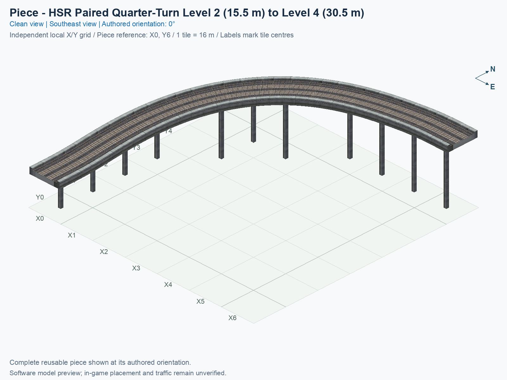
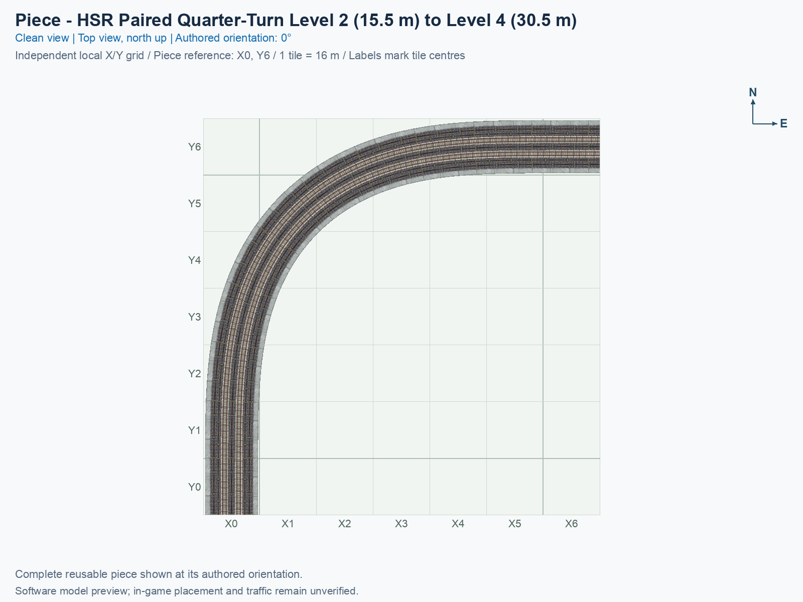
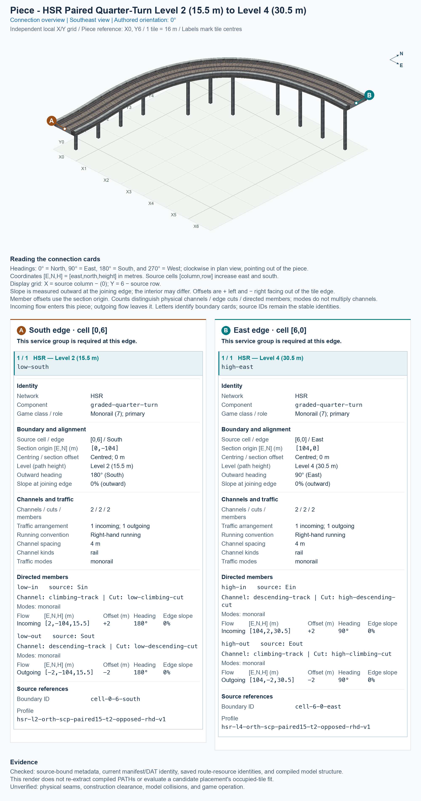

# HSR Paired Quarter-Turn Level 2 to Level 4

<!-- PIECE README LAYOUT: 1 -->

[1. Views](#1-views) · [2. Piece and placement](#2-piece-and-placement) · [3. Connection matrix](#3-connection-matrix) · [4. Testing](#4-testing)

This is one reusable High Speed Rail (HSR) piece with two tracks carrying opposite directions. In the pictured 0° orientation, a train entering from the south climbs from Level 2 (L2, a 15.5 m traffic-path height) and leaves toward the east at Level 4 (L4, a 30.5 m traffic-path height). A train entering from the east uses the other track and descends toward the south. The 15 m height change happens entirely inside this one piece; there is no exposed intermediate-height connection.

**Status: experimental.** Saved game resources pass software checks, and the pictures show those actual resources. No human preview approval or in-game result has been supplied. The piece remains optional and disabled in default builds.

The permanent type ID is `blind-hsr-rise-quarter-turn`. The exact compiled menu title is **SCP | [PART] HSR Paired Quarter-Turn Level 2 to Level 4**. PART identifies an individual building block. Its puzzle ID is `f82a`, its resource allocation begins at `7f5a1000`, and its complete cursor-preview model is `7f5a1ff5`.

## 1. Views

Both pictures show the complete saved model at the same authored 0° orientation. X increases eastward, and Y increases northward. Each tile is 16 × 16 m. The local picture grid runs from X0 to X6 and from Y0 to Y6.


The low connection is on the south side of tile (X0, Y0); the high connection is on the east side of tile (X6, Y6). The software construction reference is at (X0, Y6), in an empty source cell. That reference identifies coordinates and has not been confirmed as the game's mouse-click anchor.

<!-- BEGIN PIECE VIEWS -->





<!-- END PIECE VIEWS -->

## 2. Piece and placement

<!-- BEGIN PIECE OVERVIEW -->

A native-width paired right quarter-turn rises from L2 (15.5 m) at its south end to L4 (30.5 m) at its east end. The return track descends. Both ends retain 8 m straight, flat native collars.

Exact reusable identifier: `blind-hsr-rise-quarter-turn`.

Footprint: **7 × 7 tiles**. Exact menu name: **HSR Paired Quarter-Turn Level 2 to Level 4**.

<!-- END PIECE OVERVIEW -->

### Footprint and connections

Keep the whole **7 × 7 tile construction rectangle**, measuring 112 × 112 m, clear. The model owns 20 cells within it. Seven of those cells contain slab or structural geometry without a traffic route. An empty-looking cell does not establish that another object can be built there. The authoritative occupied cells, structural cells, and resource IDs are in [piece.json](piece.json).

A **joining boundary** is the complete tile edge where this piece meets its neighbour. Each joining boundary carries two physical track channels, meaning two continuous passages for trains. Their centres are 4 m apart, at native lateral offsets of +2 m and −2 m. Both channels must continue into the same correctly positioned paired approach. A centred one-way approach cannot supply this full connection.

Use a paired L2 approach at the low end and a paired L4 approach at the high end. The saved-resource combined check uses the existing **HSR L2 Two-Track Straight** and **HSR L4 Two-Track Straight** types. It confirms all four directed joins, exact heights, flat travel tangents, and disjoint cell ownership. It does not discover or certify arbitrary other neighbours. The library does not supply automatic compatibility discovery.

The generated connection section and overview below give the measured source ports and complete boundary facts. Their coordinates come from the actual saved traffic resources. Source cells use [column, row], with rows increasing southward; for this piece, picture X equals source column, and picture Y equals 6 minus source row. Do not interpret a source row as a picture Y label.

### Rotations and a future game trial

A **proper rotation** turns the whole piece without reflecting it. Four proper orientations are encoded, and the eight game construction states repeat them. The low and high ends move together:

| Rotation, counterclockwise from the pictures | Low L2 end | High L4 end |
| --- | --- | --- |
| 0° | South | East |
| 90° | East | North |
| 180° | North | West |
| 270° | West | South |

After following the [separate installation procedure](../../../../docs/BUILD_AND_INSTALL.md), use a disposable flat test city. Placement and rotation remain unverified in game.

1. Open **Transportation → Rail**, hover over the SCP icons, and select **HSR Paired Quarter-Turn Level 2 to Level 4**.
2. Move the preview over a clear **7 × 7 tile rectangle**. Press **Home** or **End** to rotate; on the documented Mac keyboard, **Fn + ←** and **Fn + →** produce those keys. **Tab** and **Shift+Tab** select types only within a declared construction family.
3. At 0°, align the low south end with the paired Level 2 approach and the high east end with the paired Level 4 approach. Use the rotation table above for another orientation. The empty construction reference is a software coordinate, so align the visible ends rather than treating it as a certified mouse-click anchor.
4. Click once to place the complete curve. Join both track channels at each end, preserving each approach's height, direction, and full deck profile.

Supply travel demand from south to east and then from east to south. Inspect both the route-query result and moving trains. Repeat the relevant placement, traffic, rendering, shadow, demolition, and save/reload cases at 0°, 90°, 180°, and 270°. Record observations through the [shared observation procedure](../../../../docs/TESTING.md), using this piece's existing [manual record](checks/manual-tests.json). Do not tick a checkbox merely because a software check passed.

## 3. Connection matrix

<!-- BEGIN PIECE CONNECTION MATRIX -->

### Directed entrance/exit matrix

Read **from an entrance row to an exit column**. **Saved PATH** checks the saved traffic route; **Route Query** checks the route shown by the game; **Visible travel** checks a vehicle completing that journey. For HSR, visible travel means a moving train.

**Game appearance:** [?](#case-in_game_render-0f600b2f29e571bd9b44) — the complete piece’s appearance in the game, checked separately from its journeys.

**Legend:** ✅ confirmed; ❌ failed; ? not established. **Forbidden** means the movement is unavailable; its in-game check confirms that it stays unavailable. Click a result for its exact test case. Scope, evidence, and limitations remain in [the test checklist](#test-checklist).

| Entrance ↓ / Exit → | **HSR · South exit**<br>`Sout` | **HSR · East exit**<br>`Eout` |
| --- | --- | --- |
| **HSR · South entrance**<br>`Sin` | **Forbidden**<br>**Saved PATH:** [✅](#case-software_connectivity-a3a1f88724c24d189acd)<br>In-game check: [?](#case-in_game_forbidden_transfer-a2d8ce2b734467088c0a) | **Saved PATH:** [✅](#case-software_connectivity-a3a1f88724c24d189acd)<br>**Route Query:** [?](#case-in_game_route_query-af5d6a1e35472d5b5547)<br>**Visible train travel:** [?](#case-in_game_visible_travel-af5d6a1e35472d5b5547) |
| **HSR · East entrance**<br>`Ein` | **Saved PATH:** [✅](#case-software_connectivity-a3a1f88724c24d189acd)<br>**Route Query:** [?](#case-in_game_route_query-685112907529e72119d8)<br>**Visible train travel:** [?](#case-in_game_visible_travel-685112907529e72119d8) | **Forbidden**<br>**Saved PATH:** [✅](#case-software_connectivity-a3a1f88724c24d189acd)<br>In-game check: [?](#case-in_game_forbidden_transfer-3cc896f717837707037a) |

Source: [connections.json](connections.json).

<!-- END PIECE CONNECTION MATRIX -->

<!-- BEGIN CONNECTOR OVERVIEW -->

### Connection overview

Generated from this piece's source-bound connector metadata and the current compiled model; marker letters refer to the boundary cards below.



[Rendering sources and verification scope](evidence/connection-overview.json).

Headings: 0° = North, 90° = East, 180° = South, and 270° = West; clockwise in plan view, pointing out of the piece.

Coordinates [E,N,H] = [east,north,height] in metres. Source cells [column,row] increase east and south.

Display grid: X = source column − (0); Y = 6 − source row.

Slope is measured outward at the joining edge; the interior may differ. Offsets are + left and − right facing out of the tile edge.

Member offsets use the section origin. Counts distinguish physical channels / edge cuts / directed members; modes do not multiply channels.

Incoming flow enters this piece; outgoing flow leaves it. Letters identify boundary cards; source IDs remain the stable identities.

#### Boundary A: `cell-0-6-south`

This service group is required at this edge.

##### Service group 1 / 1: HSR — Level 2 (15.5 m)

| Field | Value |
| --- | --- |
| End / component | `low-south` / `graded-quarter-turn` |
| Network / game class / role | hsr / Monorail (7); primary |
| Source cell / edge | `[0,6]` / South |
| Section origin [E,N] (m) | `[0,-104]` |
| Centring / section offset | Centred; 0 m |
| Level (path height) | Level 2 (15.5 m) |
| Outward heading | 180° (South) |
| Slope at joining edge | 0% outward |
| Channels / edge cuts / directed members | 2 / 2 / 2 |
| Traffic arrangement / running | 1 incoming; 1 outgoing; Right-hand running |
| Channel spacing | 4 m |
| Channel kinds | rail |
| Traffic modes | monorail |
| Profile | `hsr-l2-orth-scp-paired15-t2-opposed-rhd-v1` |

| Member / measured source | Channel / cut / modes | Flow | Endpoint [E,N,H] (m) | Offset (m) | Outward heading | Edge slope (%) |
| --- | --- | --- | --- | ---: | ---: | ---: |
| `low-in` / `Sin` | `climbing-track` / `low-climbing-cut` / monorail | Incoming | `[2,-104,15.5]` | +2 | 180° | 0 |
| `low-out` / `Sout` | `descending-track` / `low-descending-cut` / monorail | Outgoing | `[-2,-104,15.5]` | -2 | 180° | 0 |

#### Boundary B: `cell-6-0-east`

This service group is required at this edge.

##### Service group 1 / 1: HSR — Level 4 (30.5 m)

| Field | Value |
| --- | --- |
| End / component | `high-east` / `graded-quarter-turn` |
| Network / game class / role | hsr / Monorail (7); primary |
| Source cell / edge | `[6,0]` / East |
| Section origin [E,N] (m) | `[104,0]` |
| Centring / section offset | Centred; 0 m |
| Level (path height) | Level 4 (30.5 m) |
| Outward heading | 90° (East) |
| Slope at joining edge | 0% outward |
| Channels / edge cuts / directed members | 2 / 2 / 2 |
| Traffic arrangement / running | 1 incoming; 1 outgoing; Right-hand running |
| Channel spacing | 4 m |
| Channel kinds | rail |
| Traffic modes | monorail |
| Profile | `hsr-l4-orth-scp-paired15-t2-opposed-rhd-v1` |

| Member / measured source | Channel / cut / modes | Flow | Endpoint [E,N,H] (m) | Offset (m) | Outward heading | Edge slope (%) |
| --- | --- | --- | --- | ---: | ---: | ---: |
| `high-in` / `Ein` | `descending-track` / `high-descending-cut` / monorail | Incoming | `[104,2,30.5]` | +2 | 90° | 0 |
| `high-out` / `Eout` | `climbing-track` / `high-climbing-cut` / monorail | Outgoing | `[104,-2,30.5]` | -2 | 90° | 0 |

Rendering checks source metadata, current compiled resource identities, and model structure. It does not re-extract PATHs or evaluate placement; physical seams, construction clearance, collisions, and game operation remain unverified.

<!-- END CONNECTOR OVERVIEW -->

## 4. Testing

The [current import verification](evidence/import-verification.json) records the integrated checks and confirms that every saved model and traffic-path resource matches the preserved prototype byte for byte. Original prototype reports remain historical evidence; no human game result is inferred.

### Engineering contract

The curve uses one 15 m native HSR slab with two offset paths. Its eased body has 96 m displacement along each cardinal axis, followed by an 8 m straight collar at each end; the two external section origins therefore lie 104 m from the empty construction reference along their respective axes. A quintic heading transition makes the curvature fade smoothly into the straight ends. A monotonic height function keeps both collars exactly flat and eases the grade within the body.

Independent saved-resource checks measure the climbing path's horizontal length as approximately 176.005 m and the descending path's horizontal length as approximately 182.288 m. Their different lengths follow from the inner and outer tracks around the same bend. The maximum encoded rise/run is approximately 0.105758, or 10.5758%; the independent contract rejects values above 0.12, and the domain's general prototype limit is 0.25. These are geometry criteria, rather than realistic high-speed railway gradients or measured game limits. The smallest sampled radius is approximately 53.490 m.

Both native joining collars retain their complete slab width, underside thickness, parapets, and open interior. The compiler places 11 supports with 1.3 m foundations and a minimum centre spacing of 16 m. The independent audit checks nine underside contacts per support, giving 99 contact checks, and verifies a swept train corridor 5 m wide and 5 m high. The [independent contract](../../implementation/scp_hsr/hsr_blind_rise_verify.py), [saved-resource combined audit](../../tools/check_blind_rise.py), and [combined evidence](evidence/saved-resource-checks.json) describe the exact software scope.

The mesh and traffic checks inspect the actual saved S3D models and SC4PATH routes. S3D stores visible triangles; SC4PATH stores the train routes. The build checks 101 model resources for this piece, including all five zoom resources for each of its 20 cells and the assembled cursor preview. Every authored render group stays within the shared 512-vertex and 512-triangle budgets. Each proper rotation preserves the actual model heights and complete route geometry.

### Reproduce the local experiment

From the parent directory containing `custom-pieces`, with the source dependencies already available as described in the [build guide](../../../../docs/BUILD_AND_INSTALL.md), first prepare the [Road example’s two private captures](../blind-hsr-road-stack/README.md#native-inputs-and-source-reproduction), then build both authoring examples and the two existing approach types. The command below assumes those captures are under `custom-pieces/local/road-stack-inputs`; if they are already recorded in your private settings, omit the `--extra-plugins` option:

```sh
python3 custom-pieces/scp.py build --include blind-hsr-road-stack --include blind-hsr-rise-quarter-turn --include hsr-component-lower-paired-straight --include hsr-component-upper-paired-straight --extra-plugins "$PWD/custom-pieces/local/road-stack-inputs" --output custom-pieces/dist/piece-authoring-examples
python3 custom-pieces/scp.py verify --output custom-pieces/dist/piece-authoring-examples
python3 custom-pieces/domains/high-speed-rail/tools/check_blind_rise.py --build custom-pieces/dist/piece-authoring-examples --output custom-pieces/domains/high-speed-rail/00_pieces/blind-hsr-rise-quarter-turn/evidence/saved-resource-checks.json
```

This combined example build contains the two imported example types and the two existing straight approaches. The paired-curve audit reads the curve and those approaches; the Road example has its own independent checks. Building creates local files; it does not install them. To reproduce extraction, pictures, connector exports, image-bound review cases, and packaging in the required order, follow [documentation generation](../../../../docs/WORKFLOW_DOCUMENTATION_GENERATION.md), selecting this exact piece ID and the same verified build. Use `--piece blind-hsr-rise-quarter-turn` with the HSR extractor to preserve the unchanged approaches' measured records.

### Evidence and limits

The saved prototype reports in `evidence/` are retained historical measurements. The commands above reproduce checks against the current checkout; a successful new run does not establish a human image approval or game result.

The supported input is the pinned NAM 50 right-hand profile for SimCity 4 Windows 1.1.641. Native macOS SimCity 4, left-hand traffic, other NAM versions, arbitrary stations, bridges, neighbour connections, terrain changes, moving-train clearance, cursor placement, rotation controls, zoom rendering, shadows, demolition, and save/reload remain unverified for this new piece. Resource checks and rendered pictures establish software facts only. Redistribution permission is pending; the archives are local experiments and have not been installed or published.

<!-- BEGIN MANUAL SUMMARY -->

### Manual status

Generated from [the exact test cases](#test-checklist) and [authoritative observations](checks/manual-tests.json).

- [ ] Preview review: 0/3 applicable cases passed; 0 failed, 0 stale.
- [ ] In-game rendering: 0/4 applicable cases passed; 0 failed, 0 stale.
- [ ] Route Query: 0/8 applicable cases passed; 0 failed, 0 stale.
- [ ] Visible travel: 0/8 applicable cases passed; 0 failed, 0 stale.

These observations cover only the named services, directions, poses, rotations, and recorded platforms.

<!-- END MANUAL SUMMARY -->

<!-- BEGIN CONNECTIONS -->

### Connections and journeys

Generated from [connections.json](connections.json). Coordinates are canonical east, north and height in metres. A connection class names an encoded route interface; it does not prove visible deck/wall fit or an in-game test.

Supported placement states: 0° CCW, 90° CCW, 180° CCW, 270° CCW. Each state has its own declared manual scope.

A **port** is one directional transport-path endpoint. **Service** identifies the intended network service (for example HSR, street, or tram); **engine** is its internal traffic-class number, separate from the construction network. **Role** distinguishes primary service from auxiliary paths; sharing a traffic class does not establish service compatibility.

A **tangent** is a unit travel-direction vector: `[0,1]` means north. **Grade** is height gained per horizontal metre. These measured facts describe this subject alone. Compatibility requires a separate comparison of the complete joining boundaries; physical seams and actual game operation require their own evidence. See the [class index](../../connection-classes.json) for shared route-interface membership.

| Port | Service / engine / role | Direction | Location; tangent; grade | Connection class |
| --- | --- | --- | --- | --- |
| `Sout` | hsr / 7 / primary | out | [-2.0, -104.0, 15.5]; [0.0, -1.0]; 0.0 | `path-interface-12d12be31d2057c5763d` |
| `Sin` | hsr / 7 / primary | in | [2.0, -104.0, 15.5]; [0.0, 1.0]; 0.0 | `path-interface-fba09fbeb87ad95c667a` |
| `Eout` | hsr / 7 / primary | out | [104.0, -2.0, 30.5]; [1.0, 0.0]; 0.0 | `path-interface-ce3ccdc10e5e243d11ae` |
| `Ein` | hsr / 7 / primary | in | [104.0, 2.0, 30.5]; [-1.0, 0.0]; 0.0 | `path-interface-9b897a8bacb659f807fe` |

#### Directed journeys

| Service | Entry → exit | Role |
| --- | --- | --- |
| hsr | `Sin` → `Eout` | primary |
| hsr | `Ein` → `Sout` | primary |

#### Forbidden transfers

| From service / port | To service / port | Reason |
| --- | --- | --- |
| hsr / `Sin` | hsr / `Sout` | No directed route exists between these ports in the saved piece transport paths. In-game confirmation remains unverified. |
| hsr / `Ein` | hsr / `Eout` | No directed route exists between these ports in the saved piece transport paths. In-game confirmation remains unverified. |

Review the test checklist for the exact tested cases and environments.

<!-- END CONNECTIONS -->

<!-- BEGIN MANUAL CHECKS -->

### Test checklist

Generated from [the authoritative record](checks/manual-tests.json). Only explicit human observations create manual passes; software and preview checks remain separate. Expand a check/service group to see its rotation table, then expand the matching exact scope to copy a case ID and inspect its pose, reviewer, environment, and evidence. Grouping changes only this view; every declared case remains separate.

**States:** [x] passed; [ ] unverified, failed, or stale; N/A is an explicit inapplicable declaration. A dash means no case was declared in that column. Every pass covers only its recorded environment. T means a distinct construction-transposed state.

Four proper rotations are covered. No additional reflected state is established by this record; repeated construction aliases do not create new orientations.

Current totals: unverified: 43, passed: 2, failed: 0, stale: 0, not_applicable: 0.

#### Record an observation

Follow the [shared testing guide](../../../../docs/TESTING.md); copy [the unconfirmed example](checks/observation.example.json) to `checks/observation.json`. Case identifiers are in the expandable sections below. Do not edit generated checkboxes.

From the repository folder containing `custom-pieces`, run after filling `checks/observation.json` and explicitly confirming the exact observation:

```sh
python3 -m scp.content record --record custom-pieces/domains/high-speed-rail/00_pieces/blind-hsr-rise-quarter-turn/checks/manual-tests.json --observation custom-pieces/domains/high-speed-rail/00_pieces/blind-hsr-rise-quarter-turn/checks/observation.json
```

#### Detailed current checks

Each collapsed group shows exact case counts and states. Forbidden transfers are grouped by the directed service pair; the table inside retains every port pair and rotation.

<details>
<summary>Compiled resources — Whole subject — 1 case; passed: 1</summary>

| Check / exact scope | General | 0° | 90° | 180° | 270° |
| --- | --- | --- | --- | --- | --- |
| **Compiled resources**<br>Whole subject | <a href="#case-software_resources-a3a1f88724c24d189acd">[x] passed</a> | — | — | — | — |


<details>
<summary>Compiled resources — Whole subject</summary>

<a id="case-software_resources-a3a1f88724c24d189acd"></a>

**General: passed** — `software_resources-a3a1f88724c24d189acd`.

Verify the actual compiled resources and construction rules.

Scope: Whole subject.

Recorded observations (chronological; the state above checks the relevant dependency snapshot):

- result: passed; authority: software; reviewer: Integrated saved-resource verifier and intrinsic extractor; confirmed at: 2026-10-27; evidence: [evidence/import-verification.json, connections.json]; environment: {}

</details>

</details>

<details>
<summary>Directed routing graph — Whole subject — 1 case; passed: 1</summary>

| Check / exact scope | General | 0° | 90° | 180° | 270° |
| --- | --- | --- | --- | --- | --- |
| **Directed routing graph**<br>Whole subject | <a href="#case-software_connectivity-a3a1f88724c24d189acd">[x] passed</a> | — | — | — | — |


<details>
<summary>Directed routing graph — Whole subject</summary>

<a id="case-software_connectivity-a3a1f88724c24d189acd"></a>

**General: passed** — `software_connectivity-a3a1f88724c24d189acd`.

Verify the declared directed journeys and forbidden transfers.

Scope: Whole subject.

Recorded observations (chronological; the state above checks the relevant dependency snapshot):

- result: passed; authority: software; reviewer: Integrated saved-resource verifier and intrinsic extractor; confirmed at: 2026-10-27; evidence: [evidence/import-verification.json, connections.json]; environment: {}

</details>

</details>

<details>
<summary>In-game rendering — Whole subject — 4 cases; unverified: 4</summary>

| Check / exact scope | General | 0° | 90° | 180° | 270° |
| --- | --- | --- | --- | --- | --- |
| **In-game rendering**<br>Whole subject | — | <a href="#case-in_game_render-0f600b2f29e571bd9b44">[ ] unverified</a> | <a href="#case-in_game_render-36857315df4dfc89669a">[ ] unverified</a> | <a href="#case-in_game_render-ca7f938f9ac55d1f4411">[ ] unverified</a> | <a href="#case-in_game_render-d8a923607a47947ab44e">[ ] unverified</a> |


<details>
<summary>In-game rendering — Whole subject</summary>

<a id="case-in_game_render-0f600b2f29e571bd9b44"></a>

**0° CCW: unverified** — `in_game_render-0f600b2f29e571bd9b44`.

Inspect the placed tracks, walls, piers, seams and shadows in SimCity 4.

Scope: Whole subject.

No observation recorded.

<a id="case-in_game_render-36857315df4dfc89669a"></a>

**90° CCW: unverified** — `in_game_render-36857315df4dfc89669a`.

Inspect the placed tracks, walls, piers, seams and shadows in SimCity 4.

Scope: Whole subject.

No observation recorded.

<a id="case-in_game_render-ca7f938f9ac55d1f4411"></a>

**180° CCW: unverified** — `in_game_render-ca7f938f9ac55d1f4411`.

Inspect the placed tracks, walls, piers, seams and shadows in SimCity 4.

Scope: Whole subject.

No observation recorded.

<a id="case-in_game_render-d8a923607a47947ab44e"></a>

**270° CCW: unverified** — `in_game_render-d8a923607a47947ab44e`.

Inspect the placed tracks, walls, piers, seams and shadows in SimCity 4.

Scope: Whole subject.

No observation recorded.

</details>

</details>

<details>
<summary>Placement — Whole subject — 4 cases; unverified: 4</summary>

| Check / exact scope | General | 0° | 90° | 180° | 270° |
| --- | --- | --- | --- | --- | --- |
| **Placement**<br>Whole subject | — | <a href="#case-in_game_placement-0f600b2f29e571bd9b44">[ ] unverified</a> | <a href="#case-in_game_placement-36857315df4dfc89669a">[ ] unverified</a> | <a href="#case-in_game_placement-ca7f938f9ac55d1f4411">[ ] unverified</a> | <a href="#case-in_game_placement-d8a923607a47947ab44e">[ ] unverified</a> |


<details>
<summary>Placement — Whole subject</summary>

<a id="case-in_game_placement-0f600b2f29e571bd9b44"></a>

**0° CCW: unverified** — `in_game_placement-0f600b2f29e571bd9b44`.

Place this piece or complete blueprint and inspect every occupied tile.

Scope: Whole subject.

No observation recorded.

<a id="case-in_game_placement-36857315df4dfc89669a"></a>

**90° CCW: unverified** — `in_game_placement-36857315df4dfc89669a`.

Place this piece or complete blueprint and inspect every occupied tile.

Scope: Whole subject.

No observation recorded.

<a id="case-in_game_placement-ca7f938f9ac55d1f4411"></a>

**180° CCW: unverified** — `in_game_placement-ca7f938f9ac55d1f4411`.

Place this piece or complete blueprint and inspect every occupied tile.

Scope: Whole subject.

No observation recorded.

<a id="case-in_game_placement-d8a923607a47947ab44e"></a>

**270° CCW: unverified** — `in_game_placement-d8a923607a47947ab44e`.

Place this piece or complete blueprint and inspect every occupied tile.

Scope: Whole subject.

No observation recorded.

</details>

</details>

<details>
<summary>Demolition — Whole subject — 4 cases; unverified: 4</summary>

| Check / exact scope | General | 0° | 90° | 180° | 270° |
| --- | --- | --- | --- | --- | --- |
| **Demolition**<br>Whole subject | — | <a href="#case-in_game_demolition-0f600b2f29e571bd9b44">[ ] unverified</a> | <a href="#case-in_game_demolition-36857315df4dfc89669a">[ ] unverified</a> | <a href="#case-in_game_demolition-ca7f938f9ac55d1f4411">[ ] unverified</a> | <a href="#case-in_game_demolition-d8a923607a47947ab44e">[ ] unverified</a> |


<details>
<summary>Demolition — Whole subject</summary>

<a id="case-in_game_demolition-0f600b2f29e571bd9b44"></a>

**0° CCW: unverified** — `in_game_demolition-0f600b2f29e571bd9b44`.

Bulldoze the complete placement and inspect the cleared area.

Scope: Whole subject.

No observation recorded.

<a id="case-in_game_demolition-36857315df4dfc89669a"></a>

**90° CCW: unverified** — `in_game_demolition-36857315df4dfc89669a`.

Bulldoze the complete placement and inspect the cleared area.

Scope: Whole subject.

No observation recorded.

<a id="case-in_game_demolition-ca7f938f9ac55d1f4411"></a>

**180° CCW: unverified** — `in_game_demolition-ca7f938f9ac55d1f4411`.

Bulldoze the complete placement and inspect the cleared area.

Scope: Whole subject.

No observation recorded.

<a id="case-in_game_demolition-d8a923607a47947ab44e"></a>

**270° CCW: unverified** — `in_game_demolition-d8a923607a47947ab44e`.

Bulldoze the complete placement and inspect the cleared area.

Scope: Whole subject.

No observation recorded.

</details>

</details>

<details>
<summary>Save and reload — Whole subject — 4 cases; unverified: 4</summary>

| Check / exact scope | General | 0° | 90° | 180° | 270° |
| --- | --- | --- | --- | --- | --- |
| **Save and reload**<br>Whole subject | — | <a href="#case-in_game_save_reload-0f600b2f29e571bd9b44">[ ] unverified</a> | <a href="#case-in_game_save_reload-36857315df4dfc89669a">[ ] unverified</a> | <a href="#case-in_game_save_reload-ca7f938f9ac55d1f4411">[ ] unverified</a> | <a href="#case-in_game_save_reload-d8a923607a47947ab44e">[ ] unverified</a> |


<details>
<summary>Save and reload — Whole subject</summary>

<a id="case-in_game_save_reload-0f600b2f29e571bd9b44"></a>

**0° CCW: unverified** — `in_game_save_reload-0f600b2f29e571bd9b44`.

Save, quit, reload and inspect the placement and its paths.

Scope: Whole subject.

No observation recorded.

<a id="case-in_game_save_reload-36857315df4dfc89669a"></a>

**90° CCW: unverified** — `in_game_save_reload-36857315df4dfc89669a`.

Save, quit, reload and inspect the placement and its paths.

Scope: Whole subject.

No observation recorded.

<a id="case-in_game_save_reload-ca7f938f9ac55d1f4411"></a>

**180° CCW: unverified** — `in_game_save_reload-ca7f938f9ac55d1f4411`.

Save, quit, reload and inspect the placement and its paths.

Scope: Whole subject.

No observation recorded.

<a id="case-in_game_save_reload-d8a923607a47947ab44e"></a>

**270° CCW: unverified** — `in_game_save_reload-d8a923607a47947ab44e`.

Save, quit, reload and inspect the placement and its paths.

Scope: Whole subject.

No observation recorded.

</details>

</details>

<details>
<summary>Route Query — hsr — 8 cases; unverified: 8</summary>

| Check / exact scope | General | 0° | 90° | 180° | 270° |
| --- | --- | --- | --- | --- | --- |
| **Route Query**<br>Service: hsr; role: primary; journey: 7:Sin>Eout; entry: Sin; exit: Eout | — | <a href="#case-in_game_route_query-af5d6a1e35472d5b5547">[ ] unverified</a> | <a href="#case-in_game_route_query-d4a250fc2ff1e80ec283">[ ] unverified</a> | <a href="#case-in_game_route_query-038766525c5efa987842">[ ] unverified</a> | <a href="#case-in_game_route_query-0d4ac86e453bafc18260">[ ] unverified</a> |
| **Route Query**<br>Service: hsr; role: primary; journey: 7:Ein>Sout; entry: Ein; exit: Sout | — | <a href="#case-in_game_route_query-685112907529e72119d8">[ ] unverified</a> | <a href="#case-in_game_route_query-353761e5963c52cec4a7">[ ] unverified</a> | <a href="#case-in_game_route_query-3b5f5d29f7074e0ff3a6">[ ] unverified</a> | <a href="#case-in_game_route_query-ff9521e76a70ff47f116">[ ] unverified</a> |


<details>
<summary>Route Query — Service: hsr; role: primary; journey: 7:Sin>Eout; entry: Sin; exit: Eout</summary>

<a id="case-in_game_route_query-af5d6a1e35472d5b5547"></a>

**0° CCW: unverified** — `in_game_route_query-af5d6a1e35472d5b5547`.

Inspect this directed journey with the game Route Query tool.

Scope: Service: hsr; role: primary; journey: 7:Sin>Eout; entry: Sin; exit: Eout.

No observation recorded.

<a id="case-in_game_route_query-d4a250fc2ff1e80ec283"></a>

**90° CCW: unverified** — `in_game_route_query-d4a250fc2ff1e80ec283`.

Inspect this directed journey with the game Route Query tool.

Scope: Service: hsr; role: primary; journey: 7:Sin>Eout; entry: Sin; exit: Eout.

No observation recorded.

<a id="case-in_game_route_query-038766525c5efa987842"></a>

**180° CCW: unverified** — `in_game_route_query-038766525c5efa987842`.

Inspect this directed journey with the game Route Query tool.

Scope: Service: hsr; role: primary; journey: 7:Sin>Eout; entry: Sin; exit: Eout.

No observation recorded.

<a id="case-in_game_route_query-0d4ac86e453bafc18260"></a>

**270° CCW: unverified** — `in_game_route_query-0d4ac86e453bafc18260`.

Inspect this directed journey with the game Route Query tool.

Scope: Service: hsr; role: primary; journey: 7:Sin>Eout; entry: Sin; exit: Eout.

No observation recorded.

</details>


<details>
<summary>Route Query — Service: hsr; role: primary; journey: 7:Ein>Sout; entry: Ein; exit: Sout</summary>

<a id="case-in_game_route_query-685112907529e72119d8"></a>

**0° CCW: unverified** — `in_game_route_query-685112907529e72119d8`.

Inspect this directed journey with the game Route Query tool.

Scope: Service: hsr; role: primary; journey: 7:Ein>Sout; entry: Ein; exit: Sout.

No observation recorded.

<a id="case-in_game_route_query-353761e5963c52cec4a7"></a>

**90° CCW: unverified** — `in_game_route_query-353761e5963c52cec4a7`.

Inspect this directed journey with the game Route Query tool.

Scope: Service: hsr; role: primary; journey: 7:Ein>Sout; entry: Ein; exit: Sout.

No observation recorded.

<a id="case-in_game_route_query-3b5f5d29f7074e0ff3a6"></a>

**180° CCW: unverified** — `in_game_route_query-3b5f5d29f7074e0ff3a6`.

Inspect this directed journey with the game Route Query tool.

Scope: Service: hsr; role: primary; journey: 7:Ein>Sout; entry: Ein; exit: Sout.

No observation recorded.

<a id="case-in_game_route_query-ff9521e76a70ff47f116"></a>

**270° CCW: unverified** — `in_game_route_query-ff9521e76a70ff47f116`.

Inspect this directed journey with the game Route Query tool.

Scope: Service: hsr; role: primary; journey: 7:Ein>Sout; entry: Ein; exit: Sout.

No observation recorded.

</details>

</details>

<details>
<summary>Visible travel — hsr — 8 cases; unverified: 8</summary>

| Check / exact scope | General | 0° | 90° | 180° | 270° |
| --- | --- | --- | --- | --- | --- |
| **Visible travel**<br>Service: hsr; role: primary; journey: 7:Sin>Eout; entry: Sin; exit: Eout | — | <a href="#case-in_game_visible_travel-af5d6a1e35472d5b5547">[ ] unverified</a> | <a href="#case-in_game_visible_travel-d4a250fc2ff1e80ec283">[ ] unverified</a> | <a href="#case-in_game_visible_travel-038766525c5efa987842">[ ] unverified</a> | <a href="#case-in_game_visible_travel-0d4ac86e453bafc18260">[ ] unverified</a> |
| **Visible travel**<br>Service: hsr; role: primary; journey: 7:Ein>Sout; entry: Ein; exit: Sout | — | <a href="#case-in_game_visible_travel-685112907529e72119d8">[ ] unverified</a> | <a href="#case-in_game_visible_travel-353761e5963c52cec4a7">[ ] unverified</a> | <a href="#case-in_game_visible_travel-3b5f5d29f7074e0ff3a6">[ ] unverified</a> | <a href="#case-in_game_visible_travel-ff9521e76a70ff47f116">[ ] unverified</a> |


<details>
<summary>Visible travel — Service: hsr; role: primary; journey: 7:Sin>Eout; entry: Sin; exit: Eout</summary>

<a id="case-in_game_visible_travel-af5d6a1e35472d5b5547"></a>

**0° CCW: unverified** — `in_game_visible_travel-af5d6a1e35472d5b5547`.

Observe a vehicle or pedestrian completing this directed journey.

Scope: Service: hsr; role: primary; journey: 7:Sin>Eout; entry: Sin; exit: Eout.

No observation recorded.

<a id="case-in_game_visible_travel-d4a250fc2ff1e80ec283"></a>

**90° CCW: unverified** — `in_game_visible_travel-d4a250fc2ff1e80ec283`.

Observe a vehicle or pedestrian completing this directed journey.

Scope: Service: hsr; role: primary; journey: 7:Sin>Eout; entry: Sin; exit: Eout.

No observation recorded.

<a id="case-in_game_visible_travel-038766525c5efa987842"></a>

**180° CCW: unverified** — `in_game_visible_travel-038766525c5efa987842`.

Observe a vehicle or pedestrian completing this directed journey.

Scope: Service: hsr; role: primary; journey: 7:Sin>Eout; entry: Sin; exit: Eout.

No observation recorded.

<a id="case-in_game_visible_travel-0d4ac86e453bafc18260"></a>

**270° CCW: unverified** — `in_game_visible_travel-0d4ac86e453bafc18260`.

Observe a vehicle or pedestrian completing this directed journey.

Scope: Service: hsr; role: primary; journey: 7:Sin>Eout; entry: Sin; exit: Eout.

No observation recorded.

</details>


<details>
<summary>Visible travel — Service: hsr; role: primary; journey: 7:Ein>Sout; entry: Ein; exit: Sout</summary>

<a id="case-in_game_visible_travel-685112907529e72119d8"></a>

**0° CCW: unverified** — `in_game_visible_travel-685112907529e72119d8`.

Observe a vehicle or pedestrian completing this directed journey.

Scope: Service: hsr; role: primary; journey: 7:Ein>Sout; entry: Ein; exit: Sout.

No observation recorded.

<a id="case-in_game_visible_travel-353761e5963c52cec4a7"></a>

**90° CCW: unverified** — `in_game_visible_travel-353761e5963c52cec4a7`.

Observe a vehicle or pedestrian completing this directed journey.

Scope: Service: hsr; role: primary; journey: 7:Ein>Sout; entry: Ein; exit: Sout.

No observation recorded.

<a id="case-in_game_visible_travel-3b5f5d29f7074e0ff3a6"></a>

**180° CCW: unverified** — `in_game_visible_travel-3b5f5d29f7074e0ff3a6`.

Observe a vehicle or pedestrian completing this directed journey.

Scope: Service: hsr; role: primary; journey: 7:Ein>Sout; entry: Ein; exit: Sout.

No observation recorded.

<a id="case-in_game_visible_travel-ff9521e76a70ff47f116"></a>

**270° CCW: unverified** — `in_game_visible_travel-ff9521e76a70ff47f116`.

Observe a vehicle or pedestrian completing this directed journey.

Scope: Service: hsr; role: primary; journey: 7:Ein>Sout; entry: Ein; exit: Sout.

No observation recorded.

</details>

</details>

<details>
<summary>Forbidden transfer — hsr → hsr — 8 cases; unverified: 8</summary>

| Check / exact scope | General | 0° | 90° | 180° | 270° |
| --- | --- | --- | --- | --- | --- |
| **Forbidden transfer**<br>from port: Sin; to port: Sout; from service: hsr; to service: hsr; basis: not reachable in actual saved PATH graph | — | <a href="#case-in_game_forbidden_transfer-a2d8ce2b734467088c0a">[ ] unverified</a> | <a href="#case-in_game_forbidden_transfer-8b7fecd47ee033bad8fc">[ ] unverified</a> | <a href="#case-in_game_forbidden_transfer-750e1692ee3a82aadb74">[ ] unverified</a> | <a href="#case-in_game_forbidden_transfer-c58e5d25cd541962ce97">[ ] unverified</a> |
| **Forbidden transfer**<br>from port: Ein; to port: Eout; from service: hsr; to service: hsr; basis: not reachable in actual saved PATH graph | — | <a href="#case-in_game_forbidden_transfer-3cc896f717837707037a">[ ] unverified</a> | <a href="#case-in_game_forbidden_transfer-4b6d2a3a0d97c26a730d">[ ] unverified</a> | <a href="#case-in_game_forbidden_transfer-f35e17a3165a5fe78ae9">[ ] unverified</a> | <a href="#case-in_game_forbidden_transfer-4efe42d7ee5daceb4ddf">[ ] unverified</a> |


<details>
<summary>Forbidden transfer — from port: Sin; to port: Sout; from service: hsr; to service: hsr; basis: not reachable in actual saved PATH graph</summary>

<a id="case-in_game_forbidden_transfer-a2d8ce2b734467088c0a"></a>

**0° CCW: unverified** — `in_game_forbidden_transfer-a2d8ce2b734467088c0a`.

Confirm this undeclared transfer is unavailable.

Scope: from port: Sin; to port: Sout; from service: hsr; to service: hsr; basis: not reachable in actual saved PATH graph.

No observation recorded.

<a id="case-in_game_forbidden_transfer-8b7fecd47ee033bad8fc"></a>

**90° CCW: unverified** — `in_game_forbidden_transfer-8b7fecd47ee033bad8fc`.

Confirm this undeclared transfer is unavailable.

Scope: from port: Sin; to port: Sout; from service: hsr; to service: hsr; basis: not reachable in actual saved PATH graph.

No observation recorded.

<a id="case-in_game_forbidden_transfer-750e1692ee3a82aadb74"></a>

**180° CCW: unverified** — `in_game_forbidden_transfer-750e1692ee3a82aadb74`.

Confirm this undeclared transfer is unavailable.

Scope: from port: Sin; to port: Sout; from service: hsr; to service: hsr; basis: not reachable in actual saved PATH graph.

No observation recorded.

<a id="case-in_game_forbidden_transfer-c58e5d25cd541962ce97"></a>

**270° CCW: unverified** — `in_game_forbidden_transfer-c58e5d25cd541962ce97`.

Confirm this undeclared transfer is unavailable.

Scope: from port: Sin; to port: Sout; from service: hsr; to service: hsr; basis: not reachable in actual saved PATH graph.

No observation recorded.

</details>


<details>
<summary>Forbidden transfer — from port: Ein; to port: Eout; from service: hsr; to service: hsr; basis: not reachable in actual saved PATH graph</summary>

<a id="case-in_game_forbidden_transfer-3cc896f717837707037a"></a>

**0° CCW: unverified** — `in_game_forbidden_transfer-3cc896f717837707037a`.

Confirm this undeclared transfer is unavailable.

Scope: from port: Ein; to port: Eout; from service: hsr; to service: hsr; basis: not reachable in actual saved PATH graph.

No observation recorded.

<a id="case-in_game_forbidden_transfer-4b6d2a3a0d97c26a730d"></a>

**90° CCW: unverified** — `in_game_forbidden_transfer-4b6d2a3a0d97c26a730d`.

Confirm this undeclared transfer is unavailable.

Scope: from port: Ein; to port: Eout; from service: hsr; to service: hsr; basis: not reachable in actual saved PATH graph.

No observation recorded.

<a id="case-in_game_forbidden_transfer-f35e17a3165a5fe78ae9"></a>

**180° CCW: unverified** — `in_game_forbidden_transfer-f35e17a3165a5fe78ae9`.

Confirm this undeclared transfer is unavailable.

Scope: from port: Ein; to port: Eout; from service: hsr; to service: hsr; basis: not reachable in actual saved PATH graph.

No observation recorded.

<a id="case-in_game_forbidden_transfer-4efe42d7ee5daceb4ddf"></a>

**270° CCW: unverified** — `in_game_forbidden_transfer-4efe42d7ee5daceb4ddf`.

Confirm this undeclared transfer is unavailable.

Scope: from port: Ein; to port: Eout; from service: hsr; to service: hsr; basis: not reachable in actual saved PATH graph.

No observation recorded.

</details>

</details>

<details>
<summary>Preview review — Images — 3 cases; unverified: 3</summary>

| Check / exact scope | General | 0° | 90° | 180° | 270° |
| --- | --- | --- | --- | --- | --- |
| **Preview review**<br>Image: image:blind-hsr-rise-quarter-turn:canonical-southeast | <a href="#case-preview_review-8b8028377ee911bcd1a0">[ ] unverified</a> | — | — | — | — |
| **Preview review**<br>Image: image:blind-hsr-rise-quarter-turn:canonical-top | <a href="#case-preview_review-492315780fed23688a28">[ ] unverified</a> | — | — | — | — |
| **Preview review**<br>Image: image:blind-hsr-rise-quarter-turn:connection-overview | <a href="#case-preview_review-2e8cd573427e5eec6300">[ ] unverified</a> | — | — | — | — |


<details>
<summary>Preview review — Image: image:blind-hsr-rise-quarter-turn:canonical-southeast</summary>

<a id="case-preview_review-8b8028377ee911bcd1a0"></a>

**General: unverified** — `preview_review-8b8028377ee911bcd1a0`.

Inspect this exact image for paths, surfaces, supports, joins, shadows, and labels.

Scope: Image: image:blind-hsr-rise-quarter-turn:canonical-southeast.

No observation recorded.

</details>


<details>
<summary>Preview review — Image: image:blind-hsr-rise-quarter-turn:canonical-top</summary>

<a id="case-preview_review-492315780fed23688a28"></a>

**General: unverified** — `preview_review-492315780fed23688a28`.

Inspect this exact image for paths, surfaces, supports, joins, shadows, and labels.

Scope: Image: image:blind-hsr-rise-quarter-turn:canonical-top.

No observation recorded.

</details>


<details>
<summary>Preview review — Image: image:blind-hsr-rise-quarter-turn:connection-overview</summary>

<a id="case-preview_review-2e8cd573427e5eec6300"></a>

**General: unverified** — `preview_review-2e8cd573427e5eec6300`.

Inspect this exact image for paths, surfaces, supports, joins, shadows, and labels.

Scope: Image: image:blind-hsr-rise-quarter-turn:connection-overview.

No observation recorded.

</details>

</details>

<!-- END MANUAL CHECKS -->
