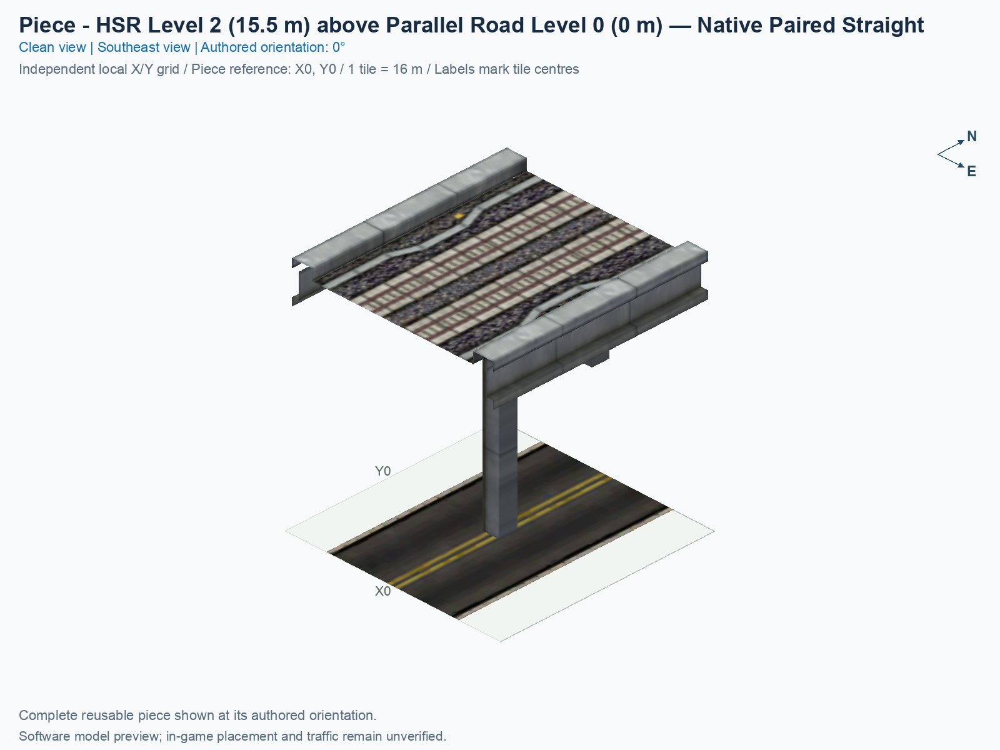
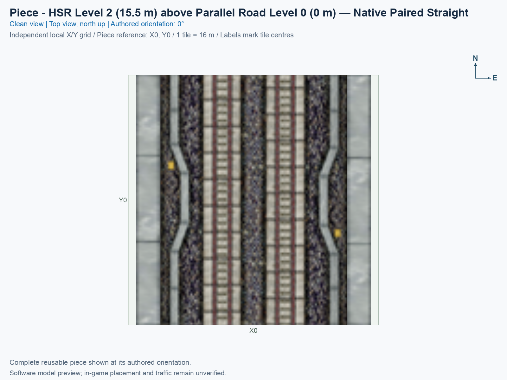
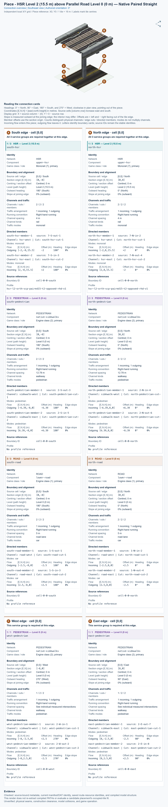

# HSR Level 2 above Parallel Road Level 0 — Native Paired Straight

<!-- PIECE README LAYOUT: 1 -->

[1. Views](#1-views) · [2. Piece and placement](#2-piece-and-placement) · [3. Connection matrix](#3-connection-matrix) · [4. Testing](#4-testing)

This experimental reusable piece puts **north/south High Speed Rail (HSR) directly above north/south ordinary two-way Road on the same owned tile**. Both routes are parallel. HSR is nominal Level 2 (L2), with train paths at 15.5 m; Road vehicles and actual native pedestrian paths are Level 0 (L0), at 0 m. A nominal level is the network's conventional level name; the measured path height is the actual encoded travel height. There is no transfer between HSR and Road.

**Status:** independently checked compiled resources; game operation and human image approval remain unverified. Nothing from this experiment has been installed into Plugins, placed in a city, or published. The piece remains disabled by default and must be selected explicitly for a build.

## 1. Views

Both clean views show the complete saved model at the authored 0° orientation. North is up in the top view; X increases eastward, Y increases northward, and one tile measures 16 × 16 m.

The top view shows the complete solid model, so the upper HSR deck hides most of the Road. The angled view exposes the Road, central column, and transverse cap. These pictures render the actual saved models and selected native textures; neither is a game screenshot.

<!-- BEGIN PIECE VIEWS -->





<!-- END PIECE VIEWS -->

## 2. Piece and placement

<!-- BEGIN PIECE OVERVIEW -->

One owned 16 m tile carries north/south paired HSR at 15.5 m directly above ordinary two-way Road and all six native pedestrian paths at 0 m. HSR, Road vehicles, and pedestrians are required together at both ends; lateral native sidewalk access is retained. No HSR/Road transfer.

Exact reusable identifier: `blind-hsr-road-stack`.

Footprint: **1 × 1 tiles**. Exact menu name: **HSR Level 2 above Parallel Road Level 0 — Native Paired Straight**.

<!-- END PIECE OVERVIEW -->

### Place and rotate the piece

After following the [separate installation procedure](../../../../docs/BUILD_AND_INSTALL.md), use a disposable flat test city. A construction rectangle is the complete reserved area around the piece; this type reserves one 16 × 16 m tile.

1. Open **Transportation → Rail**, hover over the SCP buttons, and select **HSR Level 2 above Parallel Road Level 0 — Native Paired Straight**.
2. Move the preview onto one clear tile. At 0°, both HSR and Road run north/south, with the train paths 15.5 m above the Road paths. Press **Home** or **End** to rotate both networks together; on the documented Mac keyboard, **Fn + ←** and **Fn + →** produce those keys.
3. Click once to place this one tile. To extend the stack, place another copy against its matching north or south boundary. Continue HSR, Road vehicles, and sidewalks together at that complete boundary; an HSR-only or Road-only approach leaves required services missing.
4. Check Road and pedestrian access, both HSR directions, the central pillar, the cap, and the seams. Supply travel demand, inspect Route Query, and watch actual travel. Record each exact case in **4. Testing**; these instructions do not establish a game pass.

### Complete joining boundaries

A **boundary bundle** collects every service that must agree at one physical tile edge under the same placement. At both the north edge and the south edge, the single bundle requires **HSR, Road vehicles, and pedestrians together**. Joining only the HSR paths does not establish a complete shared boundary. The connection overview below has separate panels for all three services, with their exact measured members and stable physical-channel identities.

The north/south through paths agree exactly with the captured native approaches: HSR offsets ±2 m at 15.5 m, vehicle offsets ±2.5 m at 0 m, and pedestrian offsets ±6.39 m at 0 m. Software also checks two copies placed on consecutive, disjoint tiles in all four rotations. This proves the encoded endpoints continue under that pose; it does not prove game construction, traffic choice, or a general compatibility list.

The native ordinary Road PATH also contains **lateral pedestrian access cuts**, meaning engine-2 endpoints that cross the west or east tile edge. At the west edge, the incoming cut is north −2.5 m, and the outgoing cut is north +2.5 m. At the east edge, the incoming cut is north +2.5 m, and the outgoing cut is north −2.5 m. All four are at 0 m. The saved bends connect them to their respective native sidewalks, without crossing the Road or transferring to HSR.

Those lateral cuts are retained as native sidewalk/lot-side access candidates. Their presence in an ordinary Road donor supports that interpretation, but the PATH bytes do not establish successful access to any particular adjacent lot. The piece declares **no east/west Road-vehicle or HSR continuation**, and its Road construction flags remain north/south. The generated west/east pedestrian cards report actual endpoints; they do not turn those edges into an ordinary Road connection or prove that a separate pedestrian network can be built there. The library does not supply automatic compatibility discovery. Lot access, game placement, and ordinary Road continuation require separate evidence and remain unverified here.

Compatibility discovery is a separate consumer operation. This authoring run has not created a neighbour shortlist, endpoint-pair matrix, or manual all-pairs checklist. The [connector source](connector-groups.jsonc), [resolved export](connector-data.json), and [actual-resource measurements](connections.json) supply the intrinsic facts only.

## 3. Connection matrix

<!-- BEGIN PIECE CONNECTION MATRIX -->

### Directed entrance/exit matrix

Read **from an entrance row to an exit column**. **Saved PATH** checks the saved traffic route; **Route Query** checks the route shown by the game; **Visible travel** checks a vehicle completing that journey. For HSR, visible travel means a moving train.

**Game appearance:** [?](#case-in_game_render-72589e1071dfa379ead7) — the complete piece’s appearance in the game, checked separately from its journeys.

**Legend:** ✅ confirmed; ❌ failed; ? not established. **Forbidden** means the movement is unavailable; its in-game check confirms that it stays unavailable. Click a result for its exact test case. Scope, evidence, and limitations remain in [the test checklist](#test-checklist).

| Entrance ↓ / Exit → | **Road · South exit**<br>`1-S-out-1`<br>Variant: ordinary-road | **Road · North exit**<br>`1-N-out-4`<br>Variant: ordinary-road | **Pedestrian · West exit**<br>`2-W-out-2`<br>Variant: native-road-sidewalk | **Pedestrian · South exit**<br>`2-S-out-3`<br>Variant: native-road-sidewalk | **Pedestrian · North exit**<br>`2-N-out-6`<br>Variant: native-road-sidewalk | **Pedestrian · East exit**<br>`2-E-out-7`<br>Variant: native-road-sidewalk | **HSR · South exit**<br>`7-S-out-1` | **HSR · North exit**<br>`7-N-out-4` |
| --- | --- | --- | --- | --- | --- | --- | --- | --- |
| **Road · North entrance**<br>`1-N-in-2`<br>Variant: ordinary-road | **Saved PATH:** [✅](#case-software_connectivity-f135451f80add1b3afcd)<br>**Route Query:** [?](#case-in_game_route_query-97a15630f19e9572e53e)<br>**Visible travel:** [?](#case-in_game_visible_travel-97a15630f19e9572e53e) | **Forbidden**<br>**Saved PATH:** [✅](#case-software_connectivity-f135451f80add1b3afcd)<br>In-game check: [?](#case-in_game_forbidden_transfer-e8d87f9b2305817df1f4) | **Forbidden**<br>**Saved PATH:** [✅](#case-software_connectivity-f135451f80add1b3afcd)<br>In-game check: [?](#case-in_game_forbidden_transfer-5048d43bdbbb43216258) | **Forbidden**<br>**Saved PATH:** [✅](#case-software_connectivity-f135451f80add1b3afcd)<br>In-game check: [?](#case-in_game_forbidden_transfer-047e19a1d6b604c9ef0f) | **Forbidden**<br>**Saved PATH:** [✅](#case-software_connectivity-f135451f80add1b3afcd)<br>In-game check: [?](#case-in_game_forbidden_transfer-ccf7ef5aa2c3c45ed0c1) | **Forbidden**<br>**Saved PATH:** [✅](#case-software_connectivity-f135451f80add1b3afcd)<br>In-game check: [?](#case-in_game_forbidden_transfer-8f4614ded46607a3bdea) | **Forbidden**<br>**Saved PATH:** [✅](#case-software_connectivity-f135451f80add1b3afcd)<br>In-game check: [?](#case-in_game_forbidden_transfer-37c2a16e93aa03308bab) | **Forbidden**<br>**Saved PATH:** [✅](#case-software_connectivity-f135451f80add1b3afcd)<br>In-game check: [?](#case-in_game_forbidden_transfer-755e5679a41854751332) |
| **Road · South entrance**<br>`1-S-in-3`<br>Variant: ordinary-road | **Forbidden**<br>**Saved PATH:** [✅](#case-software_connectivity-f135451f80add1b3afcd)<br>In-game check: [?](#case-in_game_forbidden_transfer-9a066feab9b26b0c1357) | **Saved PATH:** [✅](#case-software_connectivity-f135451f80add1b3afcd)<br>**Route Query:** [?](#case-in_game_route_query-3ed06d6346537fdd715b)<br>**Visible travel:** [?](#case-in_game_visible_travel-3ed06d6346537fdd715b) | **Forbidden**<br>**Saved PATH:** [✅](#case-software_connectivity-f135451f80add1b3afcd)<br>In-game check: [?](#case-in_game_forbidden_transfer-024f9830b656b15cf9b7) | **Forbidden**<br>**Saved PATH:** [✅](#case-software_connectivity-f135451f80add1b3afcd)<br>In-game check: [?](#case-in_game_forbidden_transfer-514fc2130c97133cb840) | **Forbidden**<br>**Saved PATH:** [✅](#case-software_connectivity-f135451f80add1b3afcd)<br>In-game check: [?](#case-in_game_forbidden_transfer-216e49813c25bb8c59e9) | **Forbidden**<br>**Saved PATH:** [✅](#case-software_connectivity-f135451f80add1b3afcd)<br>In-game check: [?](#case-in_game_forbidden_transfer-f4fcb6a220064cbfb963) | **Forbidden**<br>**Saved PATH:** [✅](#case-software_connectivity-f135451f80add1b3afcd)<br>In-game check: [?](#case-in_game_forbidden_transfer-5a715114b5dfb6121a27) | **Forbidden**<br>**Saved PATH:** [✅](#case-software_connectivity-f135451f80add1b3afcd)<br>In-game check: [?](#case-in_game_forbidden_transfer-fd5232a22bcc09ef99e1) |
| **Pedestrian · West entrance**<br>`2-W-in-1`<br>Variant: native-road-sidewalk | **Forbidden**<br>**Saved PATH:** [✅](#case-software_connectivity-f135451f80add1b3afcd)<br>In-game check: [?](#case-in_game_forbidden_transfer-25faaec38d14d982f596) | **Forbidden**<br>**Saved PATH:** [✅](#case-software_connectivity-f135451f80add1b3afcd)<br>In-game check: [?](#case-in_game_forbidden_transfer-62fbedf4c74b89b3370e) | **Forbidden**<br>**Saved PATH:** [✅](#case-software_connectivity-f135451f80add1b3afcd)<br>In-game check: [?](#case-in_game_forbidden_transfer-f66152e18b737f6aab04) | **Saved PATH:** [✅](#case-software_connectivity-f135451f80add1b3afcd)<br>**Route Query:** [?](#case-in_game_route_query-003ec701dbbf377d5207)<br>**Visible travel:** [?](#case-in_game_visible_travel-003ec701dbbf377d5207) | **Forbidden**<br>**Saved PATH:** [✅](#case-software_connectivity-f135451f80add1b3afcd)<br>In-game check: [?](#case-in_game_forbidden_transfer-e6be78c73aa9da4c1a99) | **Forbidden**<br>**Saved PATH:** [✅](#case-software_connectivity-f135451f80add1b3afcd)<br>In-game check: [?](#case-in_game_forbidden_transfer-b60c0e5ca4959c5002e2) | **Forbidden**<br>**Saved PATH:** [✅](#case-software_connectivity-f135451f80add1b3afcd)<br>In-game check: [?](#case-in_game_forbidden_transfer-a45b00c76aade7880137) | **Forbidden**<br>**Saved PATH:** [✅](#case-software_connectivity-f135451f80add1b3afcd)<br>In-game check: [?](#case-in_game_forbidden_transfer-0f8df04910cdea7809c0) |
| **Pedestrian · North entrance**<br>`2-N-in-4`<br>Variant: native-road-sidewalk | **Forbidden**<br>**Saved PATH:** [✅](#case-software_connectivity-f135451f80add1b3afcd)<br>In-game check: [?](#case-in_game_forbidden_transfer-ce681d98d7c63a311658) | **Forbidden**<br>**Saved PATH:** [✅](#case-software_connectivity-f135451f80add1b3afcd)<br>In-game check: [?](#case-in_game_forbidden_transfer-0a56e43e7ab1ab5755a7) | **Saved PATH:** [✅](#case-software_connectivity-f135451f80add1b3afcd)<br>**Route Query:** [?](#case-in_game_route_query-e8593113d11305255476)<br>**Visible travel:** [?](#case-in_game_visible_travel-e8593113d11305255476) | **Saved PATH:** [✅](#case-software_connectivity-f135451f80add1b3afcd)<br>**Route Query:** [?](#case-in_game_route_query-10996644ed6236efd8c0)<br>**Visible travel:** [?](#case-in_game_visible_travel-10996644ed6236efd8c0) | **Forbidden**<br>**Saved PATH:** [✅](#case-software_connectivity-f135451f80add1b3afcd)<br>In-game check: [?](#case-in_game_forbidden_transfer-fcbdfd6b12efab334626) | **Forbidden**<br>**Saved PATH:** [✅](#case-software_connectivity-f135451f80add1b3afcd)<br>In-game check: [?](#case-in_game_forbidden_transfer-7208745a61cad3247c8b) | **Forbidden**<br>**Saved PATH:** [✅](#case-software_connectivity-f135451f80add1b3afcd)<br>In-game check: [?](#case-in_game_forbidden_transfer-e1146acfd43595bbfad5) | **Forbidden**<br>**Saved PATH:** [✅](#case-software_connectivity-f135451f80add1b3afcd)<br>In-game check: [?](#case-in_game_forbidden_transfer-55b4e1fac839a56f33ba) |
| **Pedestrian · South entrance**<br>`2-S-in-5`<br>Variant: native-road-sidewalk | **Forbidden**<br>**Saved PATH:** [✅](#case-software_connectivity-f135451f80add1b3afcd)<br>In-game check: [?](#case-in_game_forbidden_transfer-55b4d96b96c5b360425f) | **Forbidden**<br>**Saved PATH:** [✅](#case-software_connectivity-f135451f80add1b3afcd)<br>In-game check: [?](#case-in_game_forbidden_transfer-4cfeb3398f4c052cb49f) | **Forbidden**<br>**Saved PATH:** [✅](#case-software_connectivity-f135451f80add1b3afcd)<br>In-game check: [?](#case-in_game_forbidden_transfer-fbd8649f49939f7b9ecc) | **Forbidden**<br>**Saved PATH:** [✅](#case-software_connectivity-f135451f80add1b3afcd)<br>In-game check: [?](#case-in_game_forbidden_transfer-b2d5cf92ad6e4330e1f1) | **Saved PATH:** [✅](#case-software_connectivity-f135451f80add1b3afcd)<br>**Route Query:** [?](#case-in_game_route_query-5215cc28a3d503108616)<br>**Visible travel:** [?](#case-in_game_visible_travel-5215cc28a3d503108616) | **Saved PATH:** [✅](#case-software_connectivity-f135451f80add1b3afcd)<br>**Route Query:** [?](#case-in_game_route_query-6f8300069735d462857f)<br>**Visible travel:** [?](#case-in_game_visible_travel-6f8300069735d462857f) | **Forbidden**<br>**Saved PATH:** [✅](#case-software_connectivity-f135451f80add1b3afcd)<br>In-game check: [?](#case-in_game_forbidden_transfer-b193bfadd71c51fc9d42) | **Forbidden**<br>**Saved PATH:** [✅](#case-software_connectivity-f135451f80add1b3afcd)<br>In-game check: [?](#case-in_game_forbidden_transfer-962f4ecffc1e6dfa9eb8) |
| **Pedestrian · East entrance**<br>`2-E-in-8`<br>Variant: native-road-sidewalk | **Forbidden**<br>**Saved PATH:** [✅](#case-software_connectivity-f135451f80add1b3afcd)<br>In-game check: [?](#case-in_game_forbidden_transfer-89749602039c000c35bf) | **Forbidden**<br>**Saved PATH:** [✅](#case-software_connectivity-f135451f80add1b3afcd)<br>In-game check: [?](#case-in_game_forbidden_transfer-bf77be28ff9e4047a33e) | **Forbidden**<br>**Saved PATH:** [✅](#case-software_connectivity-f135451f80add1b3afcd)<br>In-game check: [?](#case-in_game_forbidden_transfer-f09d10b10d63de2af10a) | **Forbidden**<br>**Saved PATH:** [✅](#case-software_connectivity-f135451f80add1b3afcd)<br>In-game check: [?](#case-in_game_forbidden_transfer-cdcfc53f6fd8e75e7cc6) | **Saved PATH:** [✅](#case-software_connectivity-f135451f80add1b3afcd)<br>**Route Query:** [?](#case-in_game_route_query-17a18ad59ffdc7cbbea9)<br>**Visible travel:** [?](#case-in_game_visible_travel-17a18ad59ffdc7cbbea9) | **Forbidden**<br>**Saved PATH:** [✅](#case-software_connectivity-f135451f80add1b3afcd)<br>In-game check: [?](#case-in_game_forbidden_transfer-d4261ba15ddf3cfc4115) | **Forbidden**<br>**Saved PATH:** [✅](#case-software_connectivity-f135451f80add1b3afcd)<br>In-game check: [?](#case-in_game_forbidden_transfer-504fa26a845bfd5c78ba) | **Forbidden**<br>**Saved PATH:** [✅](#case-software_connectivity-f135451f80add1b3afcd)<br>In-game check: [?](#case-in_game_forbidden_transfer-e69865286d34ed86550b) |
| **HSR · North entrance**<br>`7-N-in-2` | **Forbidden**<br>**Saved PATH:** [✅](#case-software_connectivity-f135451f80add1b3afcd)<br>In-game check: [?](#case-in_game_forbidden_transfer-22a473110f5a8f6876c2) | **Forbidden**<br>**Saved PATH:** [✅](#case-software_connectivity-f135451f80add1b3afcd)<br>In-game check: [?](#case-in_game_forbidden_transfer-41451b2a0b25312b8ac6) | **Forbidden**<br>**Saved PATH:** [✅](#case-software_connectivity-f135451f80add1b3afcd)<br>In-game check: [?](#case-in_game_forbidden_transfer-bb307e9cac2c69dedd15) | **Forbidden**<br>**Saved PATH:** [✅](#case-software_connectivity-f135451f80add1b3afcd)<br>In-game check: [?](#case-in_game_forbidden_transfer-117436e8ac348abfdc6b) | **Forbidden**<br>**Saved PATH:** [✅](#case-software_connectivity-f135451f80add1b3afcd)<br>In-game check: [?](#case-in_game_forbidden_transfer-a536763b1305744f9e1c) | **Forbidden**<br>**Saved PATH:** [✅](#case-software_connectivity-f135451f80add1b3afcd)<br>In-game check: [?](#case-in_game_forbidden_transfer-935c674c066c4e0cbdcd) | **Saved PATH:** [✅](#case-software_connectivity-f135451f80add1b3afcd)<br>**Route Query:** [?](#case-in_game_route_query-f1a5056d8d78b009f96b)<br>**Visible train travel:** [?](#case-in_game_visible_travel-f1a5056d8d78b009f96b) | **Forbidden**<br>**Saved PATH:** [✅](#case-software_connectivity-f135451f80add1b3afcd)<br>In-game check: [?](#case-in_game_forbidden_transfer-23b17037fa355416bcd3) |
| **HSR · South entrance**<br>`7-S-in-3` | **Forbidden**<br>**Saved PATH:** [✅](#case-software_connectivity-f135451f80add1b3afcd)<br>In-game check: [?](#case-in_game_forbidden_transfer-9478c160ef22c7f64110) | **Forbidden**<br>**Saved PATH:** [✅](#case-software_connectivity-f135451f80add1b3afcd)<br>In-game check: [?](#case-in_game_forbidden_transfer-d8b3b3b3e502fd787743) | **Forbidden**<br>**Saved PATH:** [✅](#case-software_connectivity-f135451f80add1b3afcd)<br>In-game check: [?](#case-in_game_forbidden_transfer-a707c0129b3de8ec3f5a) | **Forbidden**<br>**Saved PATH:** [✅](#case-software_connectivity-f135451f80add1b3afcd)<br>In-game check: [?](#case-in_game_forbidden_transfer-c7a8d0d4b5c19fe0cbf9) | **Forbidden**<br>**Saved PATH:** [✅](#case-software_connectivity-f135451f80add1b3afcd)<br>In-game check: [?](#case-in_game_forbidden_transfer-f7e94aab673877dc9ca5) | **Forbidden**<br>**Saved PATH:** [✅](#case-software_connectivity-f135451f80add1b3afcd)<br>In-game check: [?](#case-in_game_forbidden_transfer-20aaec528a256562c612) | **Forbidden**<br>**Saved PATH:** [✅](#case-software_connectivity-f135451f80add1b3afcd)<br>In-game check: [?](#case-in_game_forbidden_transfer-df257c09c98edb5b20f6) | **Saved PATH:** [✅](#case-software_connectivity-f135451f80add1b3afcd)<br>**Route Query:** [?](#case-in_game_route_query-88ea3cd9ba0dbc191594)<br>**Visible train travel:** [?](#case-in_game_visible_travel-88ea3cd9ba0dbc191594) |

Source: [connections.json](connections.json).

<!-- END PIECE CONNECTION MATRIX -->

<!-- BEGIN CONNECTOR OVERVIEW -->

### Connection overview

Generated from this piece's source-bound connector metadata and the current compiled model; marker letters refer to the boundary cards below.



[Rendering sources and verification scope](evidence/connection-overview.json).

Headings: 0° = North, 90° = East, 180° = South, and 270° = West; clockwise in plan view, pointing out of the piece.

Coordinates [E,N,H] = [east,north,height] in metres. Source cells [column,row] increase east and south.

Display grid: X = source column − (0); Y = 0 − source row.

Slope is measured outward at the joining edge; the interior may differ. Offsets are + left and − right facing out of the tile edge.

Member offsets use the section origin. Counts distinguish physical channels / edge cuts / directed members; modes do not multiply channels.

Incoming flow enters this piece; outgoing flow leaves it. Letters identify boundary cards; source IDs remain the stable identities.

#### Boundary A: `cell-0-0-south`

All 3 service groups are required together at this edge.

##### Service group 1 / 3: HSR — Level 2 (15.5 m)

| Field | Value |
| --- | --- |
| End / component | `south-hsr` / `upper-hsr` |
| Network / game class / role | hsr / Monorail (7); primary |
| Source cell / edge | `[0,0]` / South |
| Section origin [E,N] (m) | `[0,-8]` |
| Centring / section offset | Centred; 0 m |
| Level (path height) | Level 2 (15.5 m) |
| Outward heading | 180° (South) |
| Slope at joining edge | 0% outward |
| Channels / edge cuts / directed members | 2 / 2 / 2 |
| Traffic arrangement / running | 1 incoming; 1 outgoing; Right-hand running |
| Channel spacing | 4 m |
| Channel kinds | rail |
| Traffic modes | monorail |
| Profile | `hsr-l2-orth-scp-paired15-t2-opposed-rhd-v1` |

| Member / measured source | Channel / cut / modes | Flow | Endpoint [E,N,H] (m) | Offset (m) | Outward heading | Edge slope (%) |
| --- | --- | --- | --- | ---: | ---: | ---: |
| `south-hsr-member-1` / `7-S-out-1` | `hsr-west` / `south-hsr-cut-1` / monorail | Outgoing | `[-2,-8,15.5]` | -2 | 180° | 0 |
| `south-hsr-member-2` / `7-S-in-3` | `hsr-east` / `south-hsr-cut-2` / monorail | Incoming | `[2,-8,15.5]` | +2 | 180° | 0 |

##### Service group 2 / 3: PEDESTRIAN — Level 0 (0 m)

| Field | Value |
| --- | --- |
| End / component | `south-pedestrian` / `native-sidewalks` |
| Network / game class / role | pedestrian / Engine class (2); primary |
| Source cell / edge | `[0,0]` / South |
| Section origin [E,N] (m) | `[0,-8]` |
| Centring / section offset | Centred; 0 m |
| Level (path height) | Level 0 (0 m) |
| Outward heading | 180° (South) |
| Slope at joining edge | 0% outward |
| Channels / edge cuts / directed members | 2 / 2 / 2 |
| Traffic arrangement / running | 1 incoming; 1 outgoing; Right-hand running |
| Channel spacing | 12.78 m |
| Channel kinds | walkway |
| Traffic modes | pedestrian |
| Profile | No profile reference |

| Member / measured source | Channel / cut / modes | Flow | Endpoint [E,N,H] (m) | Offset (m) | Outward heading | Edge slope (%) |
| --- | --- | --- | --- | ---: | ---: | ---: |
| `south-pedestrian-member-1` / `2-S-out-3` | `sidewalk-west` / `south-pedestrian-cut-1` / pedestrian | Outgoing | `[-6.39,-8,0]` | -6.39 | 180° | 0 |
| `south-pedestrian-member-2` / `2-S-in-5` | `sidewalk-east` / `south-pedestrian-cut-2` / pedestrian | Incoming | `[6.39,-8,0]` | +6.39 | 180° | 0 |

##### Service group 3 / 3: ROAD — Level 0 (0 m)

| Field | Value |
| --- | --- |
| End / component | `south-road` / `lower-road` |
| Network / game class / role | road / Engine class (1); primary |
| Source cell / edge | `[0,0]` / South |
| Section origin [E,N] (m) | `[0,-8]` |
| Centring / section offset | Centred; 0 m |
| Level (path height) | Level 0 (0 m) |
| Outward heading | 180° (South) |
| Slope at joining edge | 0% outward |
| Channels / edge cuts / directed members | 2 / 2 / 2 |
| Traffic arrangement / running | 1 incoming; 1 outgoing; Right-hand running |
| Channel spacing | 5 m |
| Channel kinds | road-lane |
| Traffic modes | car |
| Profile | No profile reference |

| Member / measured source | Channel / cut / modes | Flow | Endpoint [E,N,H] (m) | Offset (m) | Outward heading | Edge slope (%) |
| --- | --- | --- | --- | ---: | ---: | ---: |
| `south-road-member-1` / `1-S-out-1` | `road-west` / `south-road-cut-1` / car | Outgoing | `[-2.5,-8,0]` | -2.5 | 180° | 0 |
| `south-road-member-2` / `1-S-in-3` | `road-east` / `south-road-cut-2` / car | Incoming | `[2.5,-8,0]` | +2.5 | 180° | 0 |

#### Boundary B: `cell-0-0-north`

All 3 service groups are required together at this edge.

##### Service group 1 / 3: HSR — Level 2 (15.5 m)

| Field | Value |
| --- | --- |
| End / component | `north-hsr` / `upper-hsr` |
| Network / game class / role | hsr / Monorail (7); primary |
| Source cell / edge | `[0,0]` / North |
| Section origin [E,N] (m) | `[0,8]` |
| Centring / section offset | Centred; 0 m |
| Level (path height) | Level 2 (15.5 m) |
| Outward heading | 0° (North) |
| Slope at joining edge | 0% outward |
| Channels / edge cuts / directed members | 2 / 2 / 2 |
| Traffic arrangement / running | 1 incoming; 1 outgoing; Right-hand running |
| Channel spacing | 4 m |
| Channel kinds | rail |
| Traffic modes | monorail |
| Profile | `hsr-l2-orth-scp-paired15-t2-opposed-rhd-v1` |

| Member / measured source | Channel / cut / modes | Flow | Endpoint [E,N,H] (m) | Offset (m) | Outward heading | Edge slope (%) |
| --- | --- | --- | --- | ---: | ---: | ---: |
| `north-hsr-member-1` / `7-N-in-2` | `hsr-west` / `north-hsr-cut-1` / monorail | Incoming | `[-2,8,15.5]` | +2 | 0° | 0 |
| `north-hsr-member-2` / `7-N-out-4` | `hsr-east` / `north-hsr-cut-2` / monorail | Outgoing | `[2,8,15.5]` | -2 | 0° | 0 |

##### Service group 2 / 3: PEDESTRIAN — Level 0 (0 m)

| Field | Value |
| --- | --- |
| End / component | `north-pedestrian` / `native-sidewalks` |
| Network / game class / role | pedestrian / Engine class (2); primary |
| Source cell / edge | `[0,0]` / North |
| Section origin [E,N] (m) | `[0,8]` |
| Centring / section offset | Centred; 0 m |
| Level (path height) | Level 0 (0 m) |
| Outward heading | 0° (North) |
| Slope at joining edge | 0% outward |
| Channels / edge cuts / directed members | 2 / 2 / 2 |
| Traffic arrangement / running | 1 incoming; 1 outgoing; Right-hand running |
| Channel spacing | 12.78 m |
| Channel kinds | walkway |
| Traffic modes | pedestrian |
| Profile | No profile reference |

| Member / measured source | Channel / cut / modes | Flow | Endpoint [E,N,H] (m) | Offset (m) | Outward heading | Edge slope (%) |
| --- | --- | --- | --- | ---: | ---: | ---: |
| `north-pedestrian-member-1` / `2-N-in-4` | `sidewalk-west` / `north-pedestrian-cut-1` / pedestrian | Incoming | `[-6.39,8,0]` | +6.39 | 0° | 0 |
| `north-pedestrian-member-2` / `2-N-out-6` | `sidewalk-east` / `north-pedestrian-cut-2` / pedestrian | Outgoing | `[6.39,8,0]` | -6.39 | 0° | 0 |

##### Service group 3 / 3: ROAD — Level 0 (0 m)

| Field | Value |
| --- | --- |
| End / component | `north-road` / `lower-road` |
| Network / game class / role | road / Engine class (1); primary |
| Source cell / edge | `[0,0]` / North |
| Section origin [E,N] (m) | `[0,8]` |
| Centring / section offset | Centred; 0 m |
| Level (path height) | Level 0 (0 m) |
| Outward heading | 0° (North) |
| Slope at joining edge | 0% outward |
| Channels / edge cuts / directed members | 2 / 2 / 2 |
| Traffic arrangement / running | 1 incoming; 1 outgoing; Right-hand running |
| Channel spacing | 5 m |
| Channel kinds | road-lane |
| Traffic modes | car |
| Profile | No profile reference |

| Member / measured source | Channel / cut / modes | Flow | Endpoint [E,N,H] (m) | Offset (m) | Outward heading | Edge slope (%) |
| --- | --- | --- | --- | ---: | ---: | ---: |
| `north-road-member-1` / `1-N-in-2` | `road-west` / `north-road-cut-1` / car | Incoming | `[-2.5,8,0]` | +2.5 | 0° | 0 |
| `north-road-member-2` / `1-N-out-4` | `road-east` / `north-road-cut-2` / car | Outgoing | `[2.5,8,0]` | -2.5 | 0° | 0 |

#### Boundary C: `cell-0-0-west`

This service group is required at this edge.

##### Service group 1 / 1: PEDESTRIAN — Level 0 (0 m)

| Field | Value |
| --- | --- |
| End / component | `west-pedestrian` / `native-sidewalks` |
| Network / game class / role | pedestrian / Engine class (2); primary |
| Source cell / edge | `[0,0]` / West |
| Section origin [E,N] (m) | `[-8,0]` |
| Centring / section offset | Centred; 0 m |
| Level (path height) | Level 0 (0 m) |
| Outward heading | 270° (West) |
| Slope at joining edge | 0% outward |
| Channels / edge cuts / directed members | 1 / 2 / 2 |
| Traffic arrangement / running | 1 incoming; 1 outgoing; Right-hand running |
| Channel spacing | See individual measured intersections |
| Channel kinds | walkway |
| Traffic modes | pedestrian |
| Profile | No profile reference |

| Member / measured source | Channel / cut / modes | Flow | Endpoint [E,N,H] (m) | Offset (m) | Outward heading | Edge slope (%) |
| --- | --- | --- | --- | ---: | ---: | ---: |
| `west-pedestrian-member-1` / `2-W-in-1` | `sidewalk-west` / `west-pedestrian-cut-1` / pedestrian | Incoming | `[-8,-2.5,0]` | +2.5 | 270° | 0 |
| `west-pedestrian-member-2` / `2-W-out-2` | `sidewalk-west` / `west-pedestrian-cut-2` / pedestrian | Outgoing | `[-8,2.5,0]` | -2.5 | 270° | 0 |

#### Boundary D: `cell-0-0-east`

This service group is required at this edge.

##### Service group 1 / 1: PEDESTRIAN — Level 0 (0 m)

| Field | Value |
| --- | --- |
| End / component | `east-pedestrian` / `native-sidewalks` |
| Network / game class / role | pedestrian / Engine class (2); primary |
| Source cell / edge | `[0,0]` / East |
| Section origin [E,N] (m) | `[8,0]` |
| Centring / section offset | Centred; 0 m |
| Level (path height) | Level 0 (0 m) |
| Outward heading | 90° (East) |
| Slope at joining edge | 0% outward |
| Channels / edge cuts / directed members | 1 / 2 / 2 |
| Traffic arrangement / running | 1 incoming; 1 outgoing; Right-hand running |
| Channel spacing | See individual measured intersections |
| Channel kinds | walkway |
| Traffic modes | pedestrian |
| Profile | No profile reference |

| Member / measured source | Channel / cut / modes | Flow | Endpoint [E,N,H] (m) | Offset (m) | Outward heading | Edge slope (%) |
| --- | --- | --- | --- | ---: | ---: | ---: |
| `east-pedestrian-member-1` / `2-E-out-7` | `sidewalk-east` / `east-pedestrian-cut-1` / pedestrian | Outgoing | `[8,-2.5,0]` | -2.5 | 90° | 0 |
| `east-pedestrian-member-2` / `2-E-in-8` | `sidewalk-east` / `east-pedestrian-cut-2` / pedestrian | Incoming | `[8,2.5,0]` | +2.5 | 90° | 0 |

Rendering checks source metadata, current compiled resource identities, and model structure. It does not re-extract PATHs or evaluate placement; physical seams, construction clearance, collisions, and game operation remain unverified.

<!-- END CONNECTOR OVERVIEW -->

## 4. Testing

The [current import verification](evidence/import-verification.json) records the integrated checks and confirms that every saved model and traffic-path resource matches the preserved prototype byte for byte. Original prototype reports remain historical evidence; no human game result is inferred.

### Engineering contract

A **PATH** resource stores directed vehicle or pedestrian travel lines; an **S3D** resource stores visible triangles and their texture coordinates. A visible road does not create a working route. This piece supplies and checks both resources independently.

| Property | Actual authored contract |
| --- | --- |
| Permanent type ID | `blind-hsr-road-stack` |
| Permanent puzzle / menu root | `f828` / `6a47f828` |
| Owned plot | One complete 16 m × 16 m tile; source cell `[0,0]` |
| Playable tile / cursor-preview model | `7f591000` / `7f591ff5` |
| HSR model | Exact valid visible mesh from native `5dd31500`; 15 m outside deck width |
| HSR travel | Two opposed native engine-7 routes, at east offsets −2 m and +2 m, height 15.5 m |
| Road surface | Full 16 m tile plane, using all of the audited US native `00004b0e` texture; native alpha is preserved |
| Road travel | Two native engine-1 vehicle routes, at east offsets −2.5 m and +2.5 m, height 0 m |
| Pedestrian travel | Six actual native engine-2 paths: two through paths at east offsets ±6.39 m, and four lateral access paths |
| Construction flags | Both `monorail: 0x02000200` and `road: 0x02000200` on the same owned cell |
| Support column | East [−0.65, +0.65] m; north [−0.65, +0.65] m; height 0–13.5 m |
| Transverse cap | East [−7.5, +7.5] m; north [−0.65, +0.65] m; height 13.5–14.0106707 m; contacts the native deck's lower side flanges |
| Rotations | 0°, 90°, 180°, and 270° proper rotations, repeated once to fill eight construction states; no reflection |
| Shadows | Five generated FSH silhouettes checked against the actual saved models; game shadow selection remains unverified |

In this table, east and north coordinates are metres from the tile centre. A source cell uses `[column,row]`, with columns increasing east and rows increasing south. A proper rotation turns the complete piece, including all paths and supports, without reflecting the right-hand travel arrangement. The two native HSR paths retain lane class 0; all eight native Road paths retain their lane class 0, node positions, and directions. The combined file uses SC4PATH 1.2 with explicit zero junction flags.

#### Full support clearance

The independent verifier reads the actual saved column and cap. It checks all 24 support triangles, all six faces of each closed solid, each face's area, edge closure, and each support's complete dimensions. It then compares every segment of all eight native Road paths against the complete supports; checking only the distance between a path centre and a pier centre would be insufficient.

The chosen **vehicle corridor** is 3.0 m wide and 4.5 m high around each saved vehicle path. The chosen **pedestrian corridor** is 1.8 m wide and 2.2 m high around each saved pedestrian path. A corridor is the explicit space reserved by this authoring check. These dimensions are design assumptions, rather than measured SimCity 4 collision boxes or a civil-engineering certification.

The smallest horizontal margin from a vehicle corridor to the central column is approximately **0.35 m**. The smallest pedestrian margin is approximately **4.84 m**. The cap's underside is **9.0 m** above the chosen vehicle height. The cap reaches the native lower side flanges at approximately 14.01067 m, and remains below the native rail floor. These are geometric facts about the saved resources; automata scaling, terrain adjustment, and in-game collision behavior remain unverified.

The preliminary outer-pier version was rejected after clearance review: it left only 0.41 m from the actual sidewalk centre to a pier face, which failed the chosen 1.8 m pedestrian corridor. The final piece uses the central column and cap above. The preliminary private build is retained as superseded workflow evidence and is not the final delivered geometry.


### Native inputs and source reproduction

A **TGI** is a resource's three-part type, group, and instance identifier. The native HSR deck and paths come from the pinned NAM 50 `High Speed Rail.dat`. Ordinary Road PATH `296678f7-69668828-00004b00` was found in `NetworkAddonMod_BaseContent.dat`; its full route geometry was inspected before use. Texture `7ab50e44-1abe787d-00004b0e` had two native variants. This experiment deliberately pins the US variant from `US_Common_Road.dat`; it does not infer a general game load-order winner. Only those exact selected resources were captured into private single-resource DATs, rather than importing their archives' unrelated overrides.

Inspect the [Road PATH audit](evidence/ordinary_road-audit.json), [Road texture audit](evidence/ordinary_road_texture-audit.json), and [measured native profile and design envelopes](evidence/native-profile.json). They record source archive hashes, original stored-resource hashes, decoded-resource hashes, capture hashes, coordinates, and the limits of each conclusion. Source capture does not grant redistribution permission. Public identifier reservation, asset permissions, and game platform testing remain pending.

For a fresh checkout, prepare Python dependencies and an editable installation using the shared [build guide](../../../../docs/BUILD_AND_INSTALL.md#build-a-selected-collection). An **editable installation** makes Python module commands use this checkout's source files. Keep that Python environment active, and run the commands below from the repository root, meaning the directory containing `custom-pieces/`. Source archives intentionally exclude native DAT inputs and private settings. This piece needs the core `controller` and `hsr` inputs, plus the two optional captures under `ordinary_road` and `ordinary_road_texture` in the [NAM profile](../../../../config/profiles/nam50-rhd.json).

1. Locate the original NAM inputs before capturing anything. Replace `/path/to/Plugins` below with the existing Plugins directory containing your NAM installation, keeping the single quotation marks so spaces work. A **shell variable** stores a value for later commands; the `scp_nam_plugins` variable below stores that directory's path. Run both read-only discovery commands, and inspect every matching archive they report:

   ```sh
   scp_nam_plugins='/path/to/Plugins'
   python3 -m scp.resource_audit --plugins "$scp_nam_plugins" --tgi 296678f7-69668828-00004b00
   python3 -m scp.resource_audit --plugins "$scp_nam_plugins" --tgi 7ab50e44-1abe787d-00004b0e
   ```

2. Choose the exact `NetworkAddonMod_BaseContent.dat` PATH source and `US_Common_Road.dat` texture source recorded in the linked audits. Copy their full archive paths from the discovery results into the variables below. The US texture is an intentional variant; do not select a different texture because it has the same resource ID. A **capture** is a small DAT containing only the selected resource, preserving its original stored bytes. The following commands create captures and audit reports in new private directories, without modifying the source archives:

   ```sh
   scp_road_archive='/path/to/NetworkAddonMod_BaseContent.dat'
   scp_road_texture_archive='/path/to/US_Common_Road.dat'
   python3 -m scp.resource_audit --archive "$scp_road_archive" --tgi 296678f7-69668828-00004b00 --capture custom-pieces/local/road-stack-captures/path --root custom-pieces
   python3 -m scp.resource_audit --archive "$scp_road_texture_archive" --tgi 7ab50e44-1abe787d-00004b0e --capture custom-pieces/local/road-stack-captures/texture --root custom-pieces
   ```

   Both capture directories must be new. If either already exists, preserve it and choose a new parent name, such as `road-stack-captures-v2`, in both commands and in the Python block below. Do not delete earlier captures or overwrite their audit reports to make a rerun succeed. Compare each new report's source archive and resource hashes with the linked audit before continuing.

3. Give the captured files the exact filenames expected by the profile. The capture tool names files by their TGI; the build profile uses descriptive names. Paste the complete Python block below, including its opening and closing `PY` lines. It checks both capture hashes before making the named copies. A **SHA-256 hash** identifies exact file bytes, so a different resource or capture cannot silently substitute for the pinned input:

   ```sh
   python3 - <<'PY'
   from pathlib import Path
   import hashlib
   import json
   import shutil

   root = Path('custom-pieces')
   source_root = root / 'local/road-stack-captures'
   target = root / 'local/road-stack-inputs'
   profile = json.loads((root / 'config/profiles/nam50-rhd.json').read_text())['files']
   copies = []
   for key, folder, filename in (
       ('ordinary_road', 'path', '296678f7-69668828-00004b00.dat'),
       ('ordinary_road_texture', 'texture', '7ab50e44-1abe787d-00004b0e.dat'),
   ):
       source = source_root / folder / filename
       if hashlib.sha256(source.read_bytes()).hexdigest() != profile[key]['sha256']:
           raise SystemExit('Capture differs from the pinned NAM 50 input: ' + key)
       copies.append((source, target / profile[key]['filename']))
   target.mkdir()
   for source, destination in copies:
       shutil.copy2(source, destination)
   print('Both captured inputs match the recorded profile.')
   PY
   ```

   The expected hashes are `0d9a2a851f9807bbccd738459e379c9d9cbd98e171405fada2d2d2de3b938c9c` for `SCP_OrdinaryRoad_Path_Capture.dat` and `6a8850121fc1bcb95e26b185db8691b35ec79397cd9e560cfbca815023392839` for `SCP_OrdinaryRoad_Texture_Capture.dat`. The `road-stack-inputs` directory must also be new. If it exists, choose a new target name in the Python block and in the build command below. A hash mismatch requires investigating the source selection; do not edit the public profile hash merely to accept a different file.

4. Build the selected piece, supplying the private capture directory as an additional read-only input location, then verify its saved resources:

   ```sh
   python3 custom-pieces/scp.py build --include blind-hsr-road-stack --plugins "$scp_nam_plugins" --extra-plugins "$PWD/custom-pieces/local/road-stack-inputs" --output custom-pieces/dist/road-stack-example
   python3 custom-pieces/scp.py verify --output custom-pieces/dist/road-stack-example
   python3 -m unittest discover -s custom-pieces/domains/high-speed-rail/tests -p test_road_stack.py -v
   ```

   `--extra-plugins` adds a source-scan directory; it does not install files into the real game Plugins directory. The `--output` argument selects a staged build under ignored `dist/`. Use a fresh build name after changing an experimental recipe or verifier, as explained in the [piece-creation workflow](../../../../docs/WORKFLOW_PIECE_CREATION.md#5-build-and-check-only-the-new-piece). Keep both capture directories, their audit reports, and their named copies under ignored `local/`; none belongs in Git or the real Plugins directory.

After a real source or geometry change, extract actual resources first, regenerate both canonical views, regenerate and check connectors, and bind review cases to the final images. Follow the shared [final-artifact workflow](../../../../docs/WORKFLOW_DOCUMENTATION_GENERATION.md#final-artifacts-and-packaging) in that order. Do not update fingerprints on stale declarations without inspecting the changed source.

### Required human checks

No human image approval or game evidence has been supplied. The generated checklist below therefore remains unverified, including rendering and directed journeys in all four rotations. Before claiming game support, a human must inspect placement, menu behavior, Road and pedestrian access, both HSR directions, all intended journeys, absence of unwanted transfers, shadows, demolition, and save/reload in the exact recorded environment. The shared [observation guide](../../../../docs/TESTING.md) explains how to record each explicit result without approving unrelated cases.

The imported audit reports retain the original measurements, with private paths explicitly redacted. They are historical evidence; rerun the documented commands against the current source before claiming a new software result.

<!-- BEGIN MANUAL SUMMARY -->

### Manual status

Generated from [the exact test cases](#test-checklist) and [authoritative observations](checks/manual-tests.json).

- [ ] Preview review: 0/3 applicable cases passed; 0 failed, 0 stale.
- [ ] In-game rendering: 0/4 applicable cases passed; 0 failed, 0 stale.
- [ ] Route Query: 0/40 applicable cases passed; 0 failed, 0 stale.
- [ ] Visible travel: 0/40 applicable cases passed; 0 failed, 0 stale.

These observations cover only the named services, directions, poses, rotations, and recorded platforms.

<!-- END MANUAL SUMMARY -->

<!-- BEGIN CONNECTIONS -->

### Connections and journeys

Generated from [connections.json](connections.json). Coordinates are canonical east, north and height in metres. A connection class names an encoded route interface; it does not prove visible deck/wall fit or an in-game test.

Supported placement states: 0° CCW, 90° CCW, 180° CCW, 270° CCW. Each state has its own declared manual scope.

A **port** is one directional transport-path endpoint. **Service** identifies the intended network service (for example HSR, street, or tram); **engine** is its internal traffic-class number, separate from the construction network. **Role** distinguishes primary service from auxiliary paths; sharing a traffic class does not establish service compatibility.

A **tangent** is a unit travel-direction vector: `[0,1]` means north. **Grade** is height gained per horizontal metre. These measured facts describe this subject alone. Compatibility requires a separate comparison of the complete joining boundaries; physical seams and actual game operation require their own evidence. See the [class index](../../connection-classes.json) for shared route-interface membership.

| Port | Service / engine / role | Direction | Location; tangent; grade | Connection class |
| --- | --- | --- | --- | --- |
| `1-S-out-1` | road / 1 / primary | out | [-2.5, -8.0, 0.0]; [0.0, -1.0]; 0.0 | `path-interface-2c0fa1b7975324446149` |
| `1-N-in-2` | road / 1 / primary | in | [-2.5, 8.0, 0.0]; [0.0, -1.0]; 0.0 | `path-interface-2c0fa1b7975324446149` |
| `1-S-in-3` | road / 1 / primary | in | [2.5, -8.0, 0.0]; [0.0, 1.0]; 0.0 | `path-interface-07ea7506553ac5546a40` |
| `1-N-out-4` | road / 1 / primary | out | [2.5, 8.0, 0.0]; [0.0, 1.0]; 0.0 | `path-interface-07ea7506553ac5546a40` |
| `2-W-in-1` | pedestrian / 2 / primary | in | [-8.0, -2.5, 0.0]; [1.0, 0.0]; 0.0 | `path-interface-2c39dfb4b856da5aea08` |
| `2-W-out-2` | pedestrian / 2 / primary | out | [-8.0, 2.5, 0.0]; [-1.0, 0.0]; 0.0 | `path-interface-161421aed635ea1db13a` |
| `2-S-out-3` | pedestrian / 2 / primary | out | [-6.39, -8.0, 0.0]; [0.0, -1.0]; 0.0 | `path-interface-6e8f939c06339e91dc5c` |
| `2-N-in-4` | pedestrian / 2 / primary | in | [-6.39, 8.0, 0.0]; [0.0, -1.0]; 0.0 | `path-interface-6e8f939c06339e91dc5c` |
| `2-S-in-5` | pedestrian / 2 / primary | in | [6.39, -8.0, 0.0]; [0.0, 1.0]; 0.0 | `path-interface-2fb4e4782aa828cc00b8` |
| `2-N-out-6` | pedestrian / 2 / primary | out | [6.39, 8.0, 0.0]; [0.0, 1.0]; 0.0 | `path-interface-2fb4e4782aa828cc00b8` |
| `2-E-out-7` | pedestrian / 2 / primary | out | [8.0, -2.5, 0.0]; [1.0, 0.0]; 0.0 | `path-interface-2c39dfb4b856da5aea08` |
| `2-E-in-8` | pedestrian / 2 / primary | in | [8.0, 2.5, 0.0]; [-1.0, 0.0]; 0.0 | `path-interface-161421aed635ea1db13a` |
| `7-S-out-1` | hsr / 7 / primary | out | [-2.0, -8.0, 15.5]; [0.0, -1.0]; 0.0 | `path-interface-12d12be31d2057c5763d` |
| `7-N-in-2` | hsr / 7 / primary | in | [-2.0, 8.0, 15.5]; [0.0, -1.0]; 0.0 | `path-interface-12d12be31d2057c5763d` |
| `7-S-in-3` | hsr / 7 / primary | in | [2.0, -8.0, 15.5]; [0.0, 1.0]; 0.0 | `path-interface-fba09fbeb87ad95c667a` |
| `7-N-out-4` | hsr / 7 / primary | out | [2.0, 8.0, 15.5]; [0.0, 1.0]; 0.0 | `path-interface-fba09fbeb87ad95c667a` |

#### Directed journeys

| Service | Entry → exit | Role |
| --- | --- | --- |
| road | `1-N-in-2` → `1-S-out-1` | primary |
| road | `1-S-in-3` → `1-N-out-4` | primary |
| pedestrian | `2-W-in-1` → `2-S-out-3` | primary |
| pedestrian | `2-N-in-4` → `2-W-out-2` | primary |
| pedestrian | `2-N-in-4` → `2-S-out-3` | primary |
| pedestrian | `2-S-in-5` → `2-E-out-7` | primary |
| pedestrian | `2-S-in-5` → `2-N-out-6` | primary |
| pedestrian | `2-E-in-8` → `2-N-out-6` | primary |
| hsr | `7-N-in-2` → `7-S-out-1` | primary |
| hsr | `7-S-in-3` → `7-N-out-4` | primary |

#### Forbidden transfers

| From service / port | To service / port | Reason |
| --- | --- | --- |
| road / `1-N-in-2` | road / `1-N-out-4` | No directed route exists between these ports in the saved piece transport paths. In-game confirmation remains unverified. |
| road / `1-N-in-2` | pedestrian / `2-W-out-2` | No directed route exists between these ports in the saved piece transport paths. In-game confirmation remains unverified. |
| road / `1-N-in-2` | pedestrian / `2-S-out-3` | No directed route exists between these ports in the saved piece transport paths. In-game confirmation remains unverified. |
| road / `1-N-in-2` | pedestrian / `2-N-out-6` | No directed route exists between these ports in the saved piece transport paths. In-game confirmation remains unverified. |
| road / `1-N-in-2` | pedestrian / `2-E-out-7` | No directed route exists between these ports in the saved piece transport paths. In-game confirmation remains unverified. |
| road / `1-N-in-2` | hsr / `7-S-out-1` | No directed route exists between these ports in the saved piece transport paths. In-game confirmation remains unverified. |
| road / `1-N-in-2` | hsr / `7-N-out-4` | No directed route exists between these ports in the saved piece transport paths. In-game confirmation remains unverified. |
| road / `1-S-in-3` | road / `1-S-out-1` | No directed route exists between these ports in the saved piece transport paths. In-game confirmation remains unverified. |
| road / `1-S-in-3` | pedestrian / `2-W-out-2` | No directed route exists between these ports in the saved piece transport paths. In-game confirmation remains unverified. |
| road / `1-S-in-3` | pedestrian / `2-S-out-3` | No directed route exists between these ports in the saved piece transport paths. In-game confirmation remains unverified. |
| road / `1-S-in-3` | pedestrian / `2-N-out-6` | No directed route exists between these ports in the saved piece transport paths. In-game confirmation remains unverified. |
| road / `1-S-in-3` | pedestrian / `2-E-out-7` | No directed route exists between these ports in the saved piece transport paths. In-game confirmation remains unverified. |
| road / `1-S-in-3` | hsr / `7-S-out-1` | No directed route exists between these ports in the saved piece transport paths. In-game confirmation remains unverified. |
| road / `1-S-in-3` | hsr / `7-N-out-4` | No directed route exists between these ports in the saved piece transport paths. In-game confirmation remains unverified. |
| pedestrian / `2-W-in-1` | road / `1-S-out-1` | No directed route exists between these ports in the saved piece transport paths. In-game confirmation remains unverified. |
| pedestrian / `2-W-in-1` | road / `1-N-out-4` | No directed route exists between these ports in the saved piece transport paths. In-game confirmation remains unverified. |
| pedestrian / `2-W-in-1` | pedestrian / `2-W-out-2` | No directed route exists between these ports in the saved piece transport paths. In-game confirmation remains unverified. |
| pedestrian / `2-W-in-1` | pedestrian / `2-N-out-6` | No directed route exists between these ports in the saved piece transport paths. In-game confirmation remains unverified. |
| pedestrian / `2-W-in-1` | pedestrian / `2-E-out-7` | No directed route exists between these ports in the saved piece transport paths. In-game confirmation remains unverified. |
| pedestrian / `2-W-in-1` | hsr / `7-S-out-1` | No directed route exists between these ports in the saved piece transport paths. In-game confirmation remains unverified. |
| pedestrian / `2-W-in-1` | hsr / `7-N-out-4` | No directed route exists between these ports in the saved piece transport paths. In-game confirmation remains unverified. |
| pedestrian / `2-N-in-4` | road / `1-S-out-1` | No directed route exists between these ports in the saved piece transport paths. In-game confirmation remains unverified. |
| pedestrian / `2-N-in-4` | road / `1-N-out-4` | No directed route exists between these ports in the saved piece transport paths. In-game confirmation remains unverified. |
| pedestrian / `2-N-in-4` | pedestrian / `2-N-out-6` | No directed route exists between these ports in the saved piece transport paths. In-game confirmation remains unverified. |
| pedestrian / `2-N-in-4` | pedestrian / `2-E-out-7` | No directed route exists between these ports in the saved piece transport paths. In-game confirmation remains unverified. |
| pedestrian / `2-N-in-4` | hsr / `7-S-out-1` | No directed route exists between these ports in the saved piece transport paths. In-game confirmation remains unverified. |
| pedestrian / `2-N-in-4` | hsr / `7-N-out-4` | No directed route exists between these ports in the saved piece transport paths. In-game confirmation remains unverified. |
| pedestrian / `2-S-in-5` | road / `1-S-out-1` | No directed route exists between these ports in the saved piece transport paths. In-game confirmation remains unverified. |
| pedestrian / `2-S-in-5` | road / `1-N-out-4` | No directed route exists between these ports in the saved piece transport paths. In-game confirmation remains unverified. |
| pedestrian / `2-S-in-5` | pedestrian / `2-W-out-2` | No directed route exists between these ports in the saved piece transport paths. In-game confirmation remains unverified. |
| pedestrian / `2-S-in-5` | pedestrian / `2-S-out-3` | No directed route exists between these ports in the saved piece transport paths. In-game confirmation remains unverified. |
| pedestrian / `2-S-in-5` | hsr / `7-S-out-1` | No directed route exists between these ports in the saved piece transport paths. In-game confirmation remains unverified. |
| pedestrian / `2-S-in-5` | hsr / `7-N-out-4` | No directed route exists between these ports in the saved piece transport paths. In-game confirmation remains unverified. |
| pedestrian / `2-E-in-8` | road / `1-S-out-1` | No directed route exists between these ports in the saved piece transport paths. In-game confirmation remains unverified. |
| pedestrian / `2-E-in-8` | road / `1-N-out-4` | No directed route exists between these ports in the saved piece transport paths. In-game confirmation remains unverified. |
| pedestrian / `2-E-in-8` | pedestrian / `2-W-out-2` | No directed route exists between these ports in the saved piece transport paths. In-game confirmation remains unverified. |
| pedestrian / `2-E-in-8` | pedestrian / `2-S-out-3` | No directed route exists between these ports in the saved piece transport paths. In-game confirmation remains unverified. |
| pedestrian / `2-E-in-8` | pedestrian / `2-E-out-7` | No directed route exists between these ports in the saved piece transport paths. In-game confirmation remains unverified. |
| pedestrian / `2-E-in-8` | hsr / `7-S-out-1` | No directed route exists between these ports in the saved piece transport paths. In-game confirmation remains unverified. |
| pedestrian / `2-E-in-8` | hsr / `7-N-out-4` | No directed route exists between these ports in the saved piece transport paths. In-game confirmation remains unverified. |
| hsr / `7-N-in-2` | road / `1-S-out-1` | No directed route exists between these ports in the saved piece transport paths. In-game confirmation remains unverified. |
| hsr / `7-N-in-2` | road / `1-N-out-4` | No directed route exists between these ports in the saved piece transport paths. In-game confirmation remains unverified. |
| hsr / `7-N-in-2` | pedestrian / `2-W-out-2` | No directed route exists between these ports in the saved piece transport paths. In-game confirmation remains unverified. |
| hsr / `7-N-in-2` | pedestrian / `2-S-out-3` | No directed route exists between these ports in the saved piece transport paths. In-game confirmation remains unverified. |
| hsr / `7-N-in-2` | pedestrian / `2-N-out-6` | No directed route exists between these ports in the saved piece transport paths. In-game confirmation remains unverified. |
| hsr / `7-N-in-2` | pedestrian / `2-E-out-7` | No directed route exists between these ports in the saved piece transport paths. In-game confirmation remains unverified. |
| hsr / `7-N-in-2` | hsr / `7-N-out-4` | No directed route exists between these ports in the saved piece transport paths. In-game confirmation remains unverified. |
| hsr / `7-S-in-3` | road / `1-S-out-1` | No directed route exists between these ports in the saved piece transport paths. In-game confirmation remains unverified. |
| hsr / `7-S-in-3` | road / `1-N-out-4` | No directed route exists between these ports in the saved piece transport paths. In-game confirmation remains unverified. |
| hsr / `7-S-in-3` | pedestrian / `2-W-out-2` | No directed route exists between these ports in the saved piece transport paths. In-game confirmation remains unverified. |
| hsr / `7-S-in-3` | pedestrian / `2-S-out-3` | No directed route exists between these ports in the saved piece transport paths. In-game confirmation remains unverified. |
| hsr / `7-S-in-3` | pedestrian / `2-N-out-6` | No directed route exists between these ports in the saved piece transport paths. In-game confirmation remains unverified. |
| hsr / `7-S-in-3` | pedestrian / `2-E-out-7` | No directed route exists between these ports in the saved piece transport paths. In-game confirmation remains unverified. |
| hsr / `7-S-in-3` | hsr / `7-S-out-1` | No directed route exists between these ports in the saved piece transport paths. In-game confirmation remains unverified. |

Review the test checklist for the exact tested cases and environments.

<!-- END CONNECTIONS -->

<!-- BEGIN MANUAL CHECKS -->

### Test checklist

Generated from [the authoritative record](checks/manual-tests.json). Only explicit human observations create manual passes; software and preview checks remain separate. Expand a check/service group to see its rotation table, then expand the matching exact scope to copy a case ID and inspect its pose, reviewer, environment, and evidence. Grouping changes only this view; every declared case remains separate.

**States:** [x] passed; [ ] unverified, failed, or stale; N/A is an explicit inapplicable declaration. A dash means no case was declared in that column. Every pass covers only its recorded environment. T means a distinct construction-transposed state.

Four proper rotations are covered. No additional reflected state is established by this record; repeated construction aliases do not create new orientations.

Current totals: unverified: 315, passed: 2, failed: 0, stale: 0, not_applicable: 0.

#### Record an observation

Follow the [shared testing guide](../../../../docs/TESTING.md); copy [the unconfirmed example](checks/observation.example.json) to `checks/observation.json`. Case identifiers are in the expandable sections below. Do not edit generated checkboxes.

From the repository folder containing `custom-pieces`, run after filling `checks/observation.json` and explicitly confirming the exact observation:

```sh
python3 -m scp.content record --record custom-pieces/domains/high-speed-rail/00_pieces/blind-hsr-road-stack/checks/manual-tests.json --observation custom-pieces/domains/high-speed-rail/00_pieces/blind-hsr-road-stack/checks/observation.json
```

#### Detailed current checks

Each collapsed group shows exact case counts and states. Forbidden transfers are grouped by the directed service pair; the table inside retains every port pair and rotation.

<details>
<summary>Compiled resources — Whole subject — 1 case; passed: 1</summary>

| Check / exact scope | General | 0° | 90° | 180° | 270° |
| --- | --- | --- | --- | --- | --- |
| **Compiled resources**<br>Whole subject | <a href="#case-software_resources-f135451f80add1b3afcd">[x] passed</a> | — | — | — | — |


<details>
<summary>Compiled resources — Whole subject</summary>

<a id="case-software_resources-f135451f80add1b3afcd"></a>

**General: passed** — `software_resources-f135451f80add1b3afcd`.

Verify the actual compiled resources and construction rules.

Scope: Whole subject.

Recorded observations (chronological; the state above checks the relevant dependency snapshot):

- result: passed; authority: software; reviewer: Integrated saved-resource verifier and intrinsic extractor; confirmed at: 2026-10-27; evidence: [evidence/import-verification.json, connections.json]; environment: {}

</details>

</details>

<details>
<summary>Directed routing graph — Whole subject — 1 case; passed: 1</summary>

| Check / exact scope | General | 0° | 90° | 180° | 270° |
| --- | --- | --- | --- | --- | --- |
| **Directed routing graph**<br>Whole subject | <a href="#case-software_connectivity-f135451f80add1b3afcd">[x] passed</a> | — | — | — | — |


<details>
<summary>Directed routing graph — Whole subject</summary>

<a id="case-software_connectivity-f135451f80add1b3afcd"></a>

**General: passed** — `software_connectivity-f135451f80add1b3afcd`.

Verify the declared directed journeys and forbidden transfers.

Scope: Whole subject.

Recorded observations (chronological; the state above checks the relevant dependency snapshot):

- result: passed; authority: software; reviewer: Integrated saved-resource verifier and intrinsic extractor; confirmed at: 2026-10-27; evidence: [evidence/import-verification.json, connections.json]; environment: {}

</details>

</details>

<details>
<summary>In-game rendering — Whole subject — 4 cases; unverified: 4</summary>

| Check / exact scope | General | 0° | 90° | 180° | 270° |
| --- | --- | --- | --- | --- | --- |
| **In-game rendering**<br>Whole subject | — | <a href="#case-in_game_render-72589e1071dfa379ead7">[ ] unverified</a> | <a href="#case-in_game_render-5beae6df5ce375eccd0a">[ ] unverified</a> | <a href="#case-in_game_render-397ff132bea030f8b470">[ ] unverified</a> | <a href="#case-in_game_render-74414452e86997529a2a">[ ] unverified</a> |


<details>
<summary>In-game rendering — Whole subject</summary>

<a id="case-in_game_render-72589e1071dfa379ead7"></a>

**0° CCW: unverified** — `in_game_render-72589e1071dfa379ead7`.

Inspect the placed tracks, walls, piers, seams and shadows in SimCity 4.

Scope: Whole subject.

No observation recorded.

<a id="case-in_game_render-5beae6df5ce375eccd0a"></a>

**90° CCW: unverified** — `in_game_render-5beae6df5ce375eccd0a`.

Inspect the placed tracks, walls, piers, seams and shadows in SimCity 4.

Scope: Whole subject.

No observation recorded.

<a id="case-in_game_render-397ff132bea030f8b470"></a>

**180° CCW: unverified** — `in_game_render-397ff132bea030f8b470`.

Inspect the placed tracks, walls, piers, seams and shadows in SimCity 4.

Scope: Whole subject.

No observation recorded.

<a id="case-in_game_render-74414452e86997529a2a"></a>

**270° CCW: unverified** — `in_game_render-74414452e86997529a2a`.

Inspect the placed tracks, walls, piers, seams and shadows in SimCity 4.

Scope: Whole subject.

No observation recorded.

</details>

</details>

<details>
<summary>Placement — Whole subject — 4 cases; unverified: 4</summary>

| Check / exact scope | General | 0° | 90° | 180° | 270° |
| --- | --- | --- | --- | --- | --- |
| **Placement**<br>Whole subject | — | <a href="#case-in_game_placement-72589e1071dfa379ead7">[ ] unverified</a> | <a href="#case-in_game_placement-5beae6df5ce375eccd0a">[ ] unverified</a> | <a href="#case-in_game_placement-397ff132bea030f8b470">[ ] unverified</a> | <a href="#case-in_game_placement-74414452e86997529a2a">[ ] unverified</a> |


<details>
<summary>Placement — Whole subject</summary>

<a id="case-in_game_placement-72589e1071dfa379ead7"></a>

**0° CCW: unverified** — `in_game_placement-72589e1071dfa379ead7`.

Place this piece or complete blueprint and inspect every occupied tile.

Scope: Whole subject.

No observation recorded.

<a id="case-in_game_placement-5beae6df5ce375eccd0a"></a>

**90° CCW: unverified** — `in_game_placement-5beae6df5ce375eccd0a`.

Place this piece or complete blueprint and inspect every occupied tile.

Scope: Whole subject.

No observation recorded.

<a id="case-in_game_placement-397ff132bea030f8b470"></a>

**180° CCW: unverified** — `in_game_placement-397ff132bea030f8b470`.

Place this piece or complete blueprint and inspect every occupied tile.

Scope: Whole subject.

No observation recorded.

<a id="case-in_game_placement-74414452e86997529a2a"></a>

**270° CCW: unverified** — `in_game_placement-74414452e86997529a2a`.

Place this piece or complete blueprint and inspect every occupied tile.

Scope: Whole subject.

No observation recorded.

</details>

</details>

<details>
<summary>Demolition — Whole subject — 4 cases; unverified: 4</summary>

| Check / exact scope | General | 0° | 90° | 180° | 270° |
| --- | --- | --- | --- | --- | --- |
| **Demolition**<br>Whole subject | — | <a href="#case-in_game_demolition-72589e1071dfa379ead7">[ ] unverified</a> | <a href="#case-in_game_demolition-5beae6df5ce375eccd0a">[ ] unverified</a> | <a href="#case-in_game_demolition-397ff132bea030f8b470">[ ] unverified</a> | <a href="#case-in_game_demolition-74414452e86997529a2a">[ ] unverified</a> |


<details>
<summary>Demolition — Whole subject</summary>

<a id="case-in_game_demolition-72589e1071dfa379ead7"></a>

**0° CCW: unverified** — `in_game_demolition-72589e1071dfa379ead7`.

Bulldoze the complete placement and inspect the cleared area.

Scope: Whole subject.

No observation recorded.

<a id="case-in_game_demolition-5beae6df5ce375eccd0a"></a>

**90° CCW: unverified** — `in_game_demolition-5beae6df5ce375eccd0a`.

Bulldoze the complete placement and inspect the cleared area.

Scope: Whole subject.

No observation recorded.

<a id="case-in_game_demolition-397ff132bea030f8b470"></a>

**180° CCW: unverified** — `in_game_demolition-397ff132bea030f8b470`.

Bulldoze the complete placement and inspect the cleared area.

Scope: Whole subject.

No observation recorded.

<a id="case-in_game_demolition-74414452e86997529a2a"></a>

**270° CCW: unverified** — `in_game_demolition-74414452e86997529a2a`.

Bulldoze the complete placement and inspect the cleared area.

Scope: Whole subject.

No observation recorded.

</details>

</details>

<details>
<summary>Save and reload — Whole subject — 4 cases; unverified: 4</summary>

| Check / exact scope | General | 0° | 90° | 180° | 270° |
| --- | --- | --- | --- | --- | --- |
| **Save and reload**<br>Whole subject | — | <a href="#case-in_game_save_reload-72589e1071dfa379ead7">[ ] unverified</a> | <a href="#case-in_game_save_reload-5beae6df5ce375eccd0a">[ ] unverified</a> | <a href="#case-in_game_save_reload-397ff132bea030f8b470">[ ] unverified</a> | <a href="#case-in_game_save_reload-74414452e86997529a2a">[ ] unverified</a> |


<details>
<summary>Save and reload — Whole subject</summary>

<a id="case-in_game_save_reload-72589e1071dfa379ead7"></a>

**0° CCW: unverified** — `in_game_save_reload-72589e1071dfa379ead7`.

Save, quit, reload and inspect the placement and its paths.

Scope: Whole subject.

No observation recorded.

<a id="case-in_game_save_reload-5beae6df5ce375eccd0a"></a>

**90° CCW: unverified** — `in_game_save_reload-5beae6df5ce375eccd0a`.

Save, quit, reload and inspect the placement and its paths.

Scope: Whole subject.

No observation recorded.

<a id="case-in_game_save_reload-397ff132bea030f8b470"></a>

**180° CCW: unverified** — `in_game_save_reload-397ff132bea030f8b470`.

Save, quit, reload and inspect the placement and its paths.

Scope: Whole subject.

No observation recorded.

<a id="case-in_game_save_reload-74414452e86997529a2a"></a>

**270° CCW: unverified** — `in_game_save_reload-74414452e86997529a2a`.

Save, quit, reload and inspect the placement and its paths.

Scope: Whole subject.

No observation recorded.

</details>

</details>

<details>
<summary>Route Query — road — 8 cases; unverified: 8</summary>

| Check / exact scope | General | 0° | 90° | 180° | 270° |
| --- | --- | --- | --- | --- | --- |
| **Route Query**<br>Service: road; role: primary; journey: 1:1-N-in-2>1-S-out-1; entry: 1-N-in-2; exit: 1-S-out-1 | — | <a href="#case-in_game_route_query-97a15630f19e9572e53e">[ ] unverified</a> | <a href="#case-in_game_route_query-f3f52d5f445ae6dafa08">[ ] unverified</a> | <a href="#case-in_game_route_query-90deda62a3ee3f5e8952">[ ] unverified</a> | <a href="#case-in_game_route_query-20c05ce4bfaf532e4591">[ ] unverified</a> |
| **Route Query**<br>Service: road; role: primary; journey: 1:1-S-in-3>1-N-out-4; entry: 1-S-in-3; exit: 1-N-out-4 | — | <a href="#case-in_game_route_query-3ed06d6346537fdd715b">[ ] unverified</a> | <a href="#case-in_game_route_query-7f7989fbf49d02c6c22d">[ ] unverified</a> | <a href="#case-in_game_route_query-dba4916fc6f70dea01af">[ ] unverified</a> | <a href="#case-in_game_route_query-0ed62d9d320ef36f5c80">[ ] unverified</a> |


<details>
<summary>Route Query — Service: road; role: primary; journey: 1:1-N-in-2>1-S-out-1; entry: 1-N-in-2; exit: 1-S-out-1</summary>

<a id="case-in_game_route_query-97a15630f19e9572e53e"></a>

**0° CCW: unverified** — `in_game_route_query-97a15630f19e9572e53e`.

Inspect this directed journey with the game Route Query tool.

Scope: Service: road; role: primary; journey: 1:1-N-in-2>1-S-out-1; entry: 1-N-in-2; exit: 1-S-out-1.

No observation recorded.

<a id="case-in_game_route_query-f3f52d5f445ae6dafa08"></a>

**90° CCW: unverified** — `in_game_route_query-f3f52d5f445ae6dafa08`.

Inspect this directed journey with the game Route Query tool.

Scope: Service: road; role: primary; journey: 1:1-N-in-2>1-S-out-1; entry: 1-N-in-2; exit: 1-S-out-1.

No observation recorded.

<a id="case-in_game_route_query-90deda62a3ee3f5e8952"></a>

**180° CCW: unverified** — `in_game_route_query-90deda62a3ee3f5e8952`.

Inspect this directed journey with the game Route Query tool.

Scope: Service: road; role: primary; journey: 1:1-N-in-2>1-S-out-1; entry: 1-N-in-2; exit: 1-S-out-1.

No observation recorded.

<a id="case-in_game_route_query-20c05ce4bfaf532e4591"></a>

**270° CCW: unverified** — `in_game_route_query-20c05ce4bfaf532e4591`.

Inspect this directed journey with the game Route Query tool.

Scope: Service: road; role: primary; journey: 1:1-N-in-2>1-S-out-1; entry: 1-N-in-2; exit: 1-S-out-1.

No observation recorded.

</details>


<details>
<summary>Route Query — Service: road; role: primary; journey: 1:1-S-in-3>1-N-out-4; entry: 1-S-in-3; exit: 1-N-out-4</summary>

<a id="case-in_game_route_query-3ed06d6346537fdd715b"></a>

**0° CCW: unverified** — `in_game_route_query-3ed06d6346537fdd715b`.

Inspect this directed journey with the game Route Query tool.

Scope: Service: road; role: primary; journey: 1:1-S-in-3>1-N-out-4; entry: 1-S-in-3; exit: 1-N-out-4.

No observation recorded.

<a id="case-in_game_route_query-7f7989fbf49d02c6c22d"></a>

**90° CCW: unverified** — `in_game_route_query-7f7989fbf49d02c6c22d`.

Inspect this directed journey with the game Route Query tool.

Scope: Service: road; role: primary; journey: 1:1-S-in-3>1-N-out-4; entry: 1-S-in-3; exit: 1-N-out-4.

No observation recorded.

<a id="case-in_game_route_query-dba4916fc6f70dea01af"></a>

**180° CCW: unverified** — `in_game_route_query-dba4916fc6f70dea01af`.

Inspect this directed journey with the game Route Query tool.

Scope: Service: road; role: primary; journey: 1:1-S-in-3>1-N-out-4; entry: 1-S-in-3; exit: 1-N-out-4.

No observation recorded.

<a id="case-in_game_route_query-0ed62d9d320ef36f5c80"></a>

**270° CCW: unverified** — `in_game_route_query-0ed62d9d320ef36f5c80`.

Inspect this directed journey with the game Route Query tool.

Scope: Service: road; role: primary; journey: 1:1-S-in-3>1-N-out-4; entry: 1-S-in-3; exit: 1-N-out-4.

No observation recorded.

</details>

</details>

<details>
<summary>Visible travel — road — 8 cases; unverified: 8</summary>

| Check / exact scope | General | 0° | 90° | 180° | 270° |
| --- | --- | --- | --- | --- | --- |
| **Visible travel**<br>Service: road; role: primary; journey: 1:1-N-in-2>1-S-out-1; entry: 1-N-in-2; exit: 1-S-out-1 | — | <a href="#case-in_game_visible_travel-97a15630f19e9572e53e">[ ] unverified</a> | <a href="#case-in_game_visible_travel-f3f52d5f445ae6dafa08">[ ] unverified</a> | <a href="#case-in_game_visible_travel-90deda62a3ee3f5e8952">[ ] unverified</a> | <a href="#case-in_game_visible_travel-20c05ce4bfaf532e4591">[ ] unverified</a> |
| **Visible travel**<br>Service: road; role: primary; journey: 1:1-S-in-3>1-N-out-4; entry: 1-S-in-3; exit: 1-N-out-4 | — | <a href="#case-in_game_visible_travel-3ed06d6346537fdd715b">[ ] unverified</a> | <a href="#case-in_game_visible_travel-7f7989fbf49d02c6c22d">[ ] unverified</a> | <a href="#case-in_game_visible_travel-dba4916fc6f70dea01af">[ ] unverified</a> | <a href="#case-in_game_visible_travel-0ed62d9d320ef36f5c80">[ ] unverified</a> |


<details>
<summary>Visible travel — Service: road; role: primary; journey: 1:1-N-in-2>1-S-out-1; entry: 1-N-in-2; exit: 1-S-out-1</summary>

<a id="case-in_game_visible_travel-97a15630f19e9572e53e"></a>

**0° CCW: unverified** — `in_game_visible_travel-97a15630f19e9572e53e`.

Observe a vehicle or pedestrian completing this directed journey.

Scope: Service: road; role: primary; journey: 1:1-N-in-2>1-S-out-1; entry: 1-N-in-2; exit: 1-S-out-1.

No observation recorded.

<a id="case-in_game_visible_travel-f3f52d5f445ae6dafa08"></a>

**90° CCW: unverified** — `in_game_visible_travel-f3f52d5f445ae6dafa08`.

Observe a vehicle or pedestrian completing this directed journey.

Scope: Service: road; role: primary; journey: 1:1-N-in-2>1-S-out-1; entry: 1-N-in-2; exit: 1-S-out-1.

No observation recorded.

<a id="case-in_game_visible_travel-90deda62a3ee3f5e8952"></a>

**180° CCW: unverified** — `in_game_visible_travel-90deda62a3ee3f5e8952`.

Observe a vehicle or pedestrian completing this directed journey.

Scope: Service: road; role: primary; journey: 1:1-N-in-2>1-S-out-1; entry: 1-N-in-2; exit: 1-S-out-1.

No observation recorded.

<a id="case-in_game_visible_travel-20c05ce4bfaf532e4591"></a>

**270° CCW: unverified** — `in_game_visible_travel-20c05ce4bfaf532e4591`.

Observe a vehicle or pedestrian completing this directed journey.

Scope: Service: road; role: primary; journey: 1:1-N-in-2>1-S-out-1; entry: 1-N-in-2; exit: 1-S-out-1.

No observation recorded.

</details>


<details>
<summary>Visible travel — Service: road; role: primary; journey: 1:1-S-in-3>1-N-out-4; entry: 1-S-in-3; exit: 1-N-out-4</summary>

<a id="case-in_game_visible_travel-3ed06d6346537fdd715b"></a>

**0° CCW: unverified** — `in_game_visible_travel-3ed06d6346537fdd715b`.

Observe a vehicle or pedestrian completing this directed journey.

Scope: Service: road; role: primary; journey: 1:1-S-in-3>1-N-out-4; entry: 1-S-in-3; exit: 1-N-out-4.

No observation recorded.

<a id="case-in_game_visible_travel-7f7989fbf49d02c6c22d"></a>

**90° CCW: unverified** — `in_game_visible_travel-7f7989fbf49d02c6c22d`.

Observe a vehicle or pedestrian completing this directed journey.

Scope: Service: road; role: primary; journey: 1:1-S-in-3>1-N-out-4; entry: 1-S-in-3; exit: 1-N-out-4.

No observation recorded.

<a id="case-in_game_visible_travel-dba4916fc6f70dea01af"></a>

**180° CCW: unverified** — `in_game_visible_travel-dba4916fc6f70dea01af`.

Observe a vehicle or pedestrian completing this directed journey.

Scope: Service: road; role: primary; journey: 1:1-S-in-3>1-N-out-4; entry: 1-S-in-3; exit: 1-N-out-4.

No observation recorded.

<a id="case-in_game_visible_travel-0ed62d9d320ef36f5c80"></a>

**270° CCW: unverified** — `in_game_visible_travel-0ed62d9d320ef36f5c80`.

Observe a vehicle or pedestrian completing this directed journey.

Scope: Service: road; role: primary; journey: 1:1-S-in-3>1-N-out-4; entry: 1-S-in-3; exit: 1-N-out-4.

No observation recorded.

</details>

</details>

<details>
<summary>Route Query — pedestrian — 24 cases; unverified: 24</summary>

| Check / exact scope | General | 0° | 90° | 180° | 270° |
| --- | --- | --- | --- | --- | --- |
| **Route Query**<br>Service: pedestrian; role: primary; journey: 2:2-W-in-1>2-S-out-3; entry: 2-W-in-1; exit: 2-S-out-3 | — | <a href="#case-in_game_route_query-003ec701dbbf377d5207">[ ] unverified</a> | <a href="#case-in_game_route_query-86f84b953d9a545a1c47">[ ] unverified</a> | <a href="#case-in_game_route_query-47c14285e6baa0cfa7f0">[ ] unverified</a> | <a href="#case-in_game_route_query-60c31b5437e761a555ab">[ ] unverified</a> |
| **Route Query**<br>Service: pedestrian; role: primary; journey: 2:2-N-in-4>2-W-out-2; entry: 2-N-in-4; exit: 2-W-out-2 | — | <a href="#case-in_game_route_query-e8593113d11305255476">[ ] unverified</a> | <a href="#case-in_game_route_query-2549df7f31cf65fb1398">[ ] unverified</a> | <a href="#case-in_game_route_query-951022ddbc86fcc78031">[ ] unverified</a> | <a href="#case-in_game_route_query-2e5267c39fc12c50b707">[ ] unverified</a> |
| **Route Query**<br>Service: pedestrian; role: primary; journey: 2:2-N-in-4>2-S-out-3; entry: 2-N-in-4; exit: 2-S-out-3 | — | <a href="#case-in_game_route_query-10996644ed6236efd8c0">[ ] unverified</a> | <a href="#case-in_game_route_query-ccb016ceaff52d069c1f">[ ] unverified</a> | <a href="#case-in_game_route_query-4e63c73d2429dec80917">[ ] unverified</a> | <a href="#case-in_game_route_query-c83c00e9d3f77912d10f">[ ] unverified</a> |
| **Route Query**<br>Service: pedestrian; role: primary; journey: 2:2-S-in-5>2-E-out-7; entry: 2-S-in-5; exit: 2-E-out-7 | — | <a href="#case-in_game_route_query-6f8300069735d462857f">[ ] unverified</a> | <a href="#case-in_game_route_query-7a773ce01be173809c36">[ ] unverified</a> | <a href="#case-in_game_route_query-b24cb0c7a5cfcab1256c">[ ] unverified</a> | <a href="#case-in_game_route_query-acf560552a1584f139bd">[ ] unverified</a> |
| **Route Query**<br>Service: pedestrian; role: primary; journey: 2:2-S-in-5>2-N-out-6; entry: 2-S-in-5; exit: 2-N-out-6 | — | <a href="#case-in_game_route_query-5215cc28a3d503108616">[ ] unverified</a> | <a href="#case-in_game_route_query-2f3f8da49001bab23c4b">[ ] unverified</a> | <a href="#case-in_game_route_query-abd525c4cbcc1989095c">[ ] unverified</a> | <a href="#case-in_game_route_query-1e4abdf64ef0019d1be4">[ ] unverified</a> |
| **Route Query**<br>Service: pedestrian; role: primary; journey: 2:2-E-in-8>2-N-out-6; entry: 2-E-in-8; exit: 2-N-out-6 | — | <a href="#case-in_game_route_query-17a18ad59ffdc7cbbea9">[ ] unverified</a> | <a href="#case-in_game_route_query-bb58df7e28f9683b04ff">[ ] unverified</a> | <a href="#case-in_game_route_query-40d05b93e5c55ada8353">[ ] unverified</a> | <a href="#case-in_game_route_query-78ac369fcf2b9dee7918">[ ] unverified</a> |


<details>
<summary>Route Query — Service: pedestrian; role: primary; journey: 2:2-W-in-1>2-S-out-3; entry: 2-W-in-1; exit: 2-S-out-3</summary>

<a id="case-in_game_route_query-003ec701dbbf377d5207"></a>

**0° CCW: unverified** — `in_game_route_query-003ec701dbbf377d5207`.

Inspect this directed journey with the game Route Query tool.

Scope: Service: pedestrian; role: primary; journey: 2:2-W-in-1>2-S-out-3; entry: 2-W-in-1; exit: 2-S-out-3.

No observation recorded.

<a id="case-in_game_route_query-86f84b953d9a545a1c47"></a>

**90° CCW: unverified** — `in_game_route_query-86f84b953d9a545a1c47`.

Inspect this directed journey with the game Route Query tool.

Scope: Service: pedestrian; role: primary; journey: 2:2-W-in-1>2-S-out-3; entry: 2-W-in-1; exit: 2-S-out-3.

No observation recorded.

<a id="case-in_game_route_query-47c14285e6baa0cfa7f0"></a>

**180° CCW: unverified** — `in_game_route_query-47c14285e6baa0cfa7f0`.

Inspect this directed journey with the game Route Query tool.

Scope: Service: pedestrian; role: primary; journey: 2:2-W-in-1>2-S-out-3; entry: 2-W-in-1; exit: 2-S-out-3.

No observation recorded.

<a id="case-in_game_route_query-60c31b5437e761a555ab"></a>

**270° CCW: unverified** — `in_game_route_query-60c31b5437e761a555ab`.

Inspect this directed journey with the game Route Query tool.

Scope: Service: pedestrian; role: primary; journey: 2:2-W-in-1>2-S-out-3; entry: 2-W-in-1; exit: 2-S-out-3.

No observation recorded.

</details>


<details>
<summary>Route Query — Service: pedestrian; role: primary; journey: 2:2-N-in-4>2-W-out-2; entry: 2-N-in-4; exit: 2-W-out-2</summary>

<a id="case-in_game_route_query-e8593113d11305255476"></a>

**0° CCW: unverified** — `in_game_route_query-e8593113d11305255476`.

Inspect this directed journey with the game Route Query tool.

Scope: Service: pedestrian; role: primary; journey: 2:2-N-in-4>2-W-out-2; entry: 2-N-in-4; exit: 2-W-out-2.

No observation recorded.

<a id="case-in_game_route_query-2549df7f31cf65fb1398"></a>

**90° CCW: unverified** — `in_game_route_query-2549df7f31cf65fb1398`.

Inspect this directed journey with the game Route Query tool.

Scope: Service: pedestrian; role: primary; journey: 2:2-N-in-4>2-W-out-2; entry: 2-N-in-4; exit: 2-W-out-2.

No observation recorded.

<a id="case-in_game_route_query-951022ddbc86fcc78031"></a>

**180° CCW: unverified** — `in_game_route_query-951022ddbc86fcc78031`.

Inspect this directed journey with the game Route Query tool.

Scope: Service: pedestrian; role: primary; journey: 2:2-N-in-4>2-W-out-2; entry: 2-N-in-4; exit: 2-W-out-2.

No observation recorded.

<a id="case-in_game_route_query-2e5267c39fc12c50b707"></a>

**270° CCW: unverified** — `in_game_route_query-2e5267c39fc12c50b707`.

Inspect this directed journey with the game Route Query tool.

Scope: Service: pedestrian; role: primary; journey: 2:2-N-in-4>2-W-out-2; entry: 2-N-in-4; exit: 2-W-out-2.

No observation recorded.

</details>


<details>
<summary>Route Query — Service: pedestrian; role: primary; journey: 2:2-N-in-4>2-S-out-3; entry: 2-N-in-4; exit: 2-S-out-3</summary>

<a id="case-in_game_route_query-10996644ed6236efd8c0"></a>

**0° CCW: unverified** — `in_game_route_query-10996644ed6236efd8c0`.

Inspect this directed journey with the game Route Query tool.

Scope: Service: pedestrian; role: primary; journey: 2:2-N-in-4>2-S-out-3; entry: 2-N-in-4; exit: 2-S-out-3.

No observation recorded.

<a id="case-in_game_route_query-ccb016ceaff52d069c1f"></a>

**90° CCW: unverified** — `in_game_route_query-ccb016ceaff52d069c1f`.

Inspect this directed journey with the game Route Query tool.

Scope: Service: pedestrian; role: primary; journey: 2:2-N-in-4>2-S-out-3; entry: 2-N-in-4; exit: 2-S-out-3.

No observation recorded.

<a id="case-in_game_route_query-4e63c73d2429dec80917"></a>

**180° CCW: unverified** — `in_game_route_query-4e63c73d2429dec80917`.

Inspect this directed journey with the game Route Query tool.

Scope: Service: pedestrian; role: primary; journey: 2:2-N-in-4>2-S-out-3; entry: 2-N-in-4; exit: 2-S-out-3.

No observation recorded.

<a id="case-in_game_route_query-c83c00e9d3f77912d10f"></a>

**270° CCW: unverified** — `in_game_route_query-c83c00e9d3f77912d10f`.

Inspect this directed journey with the game Route Query tool.

Scope: Service: pedestrian; role: primary; journey: 2:2-N-in-4>2-S-out-3; entry: 2-N-in-4; exit: 2-S-out-3.

No observation recorded.

</details>


<details>
<summary>Route Query — Service: pedestrian; role: primary; journey: 2:2-S-in-5>2-E-out-7; entry: 2-S-in-5; exit: 2-E-out-7</summary>

<a id="case-in_game_route_query-6f8300069735d462857f"></a>

**0° CCW: unverified** — `in_game_route_query-6f8300069735d462857f`.

Inspect this directed journey with the game Route Query tool.

Scope: Service: pedestrian; role: primary; journey: 2:2-S-in-5>2-E-out-7; entry: 2-S-in-5; exit: 2-E-out-7.

No observation recorded.

<a id="case-in_game_route_query-7a773ce01be173809c36"></a>

**90° CCW: unverified** — `in_game_route_query-7a773ce01be173809c36`.

Inspect this directed journey with the game Route Query tool.

Scope: Service: pedestrian; role: primary; journey: 2:2-S-in-5>2-E-out-7; entry: 2-S-in-5; exit: 2-E-out-7.

No observation recorded.

<a id="case-in_game_route_query-b24cb0c7a5cfcab1256c"></a>

**180° CCW: unverified** — `in_game_route_query-b24cb0c7a5cfcab1256c`.

Inspect this directed journey with the game Route Query tool.

Scope: Service: pedestrian; role: primary; journey: 2:2-S-in-5>2-E-out-7; entry: 2-S-in-5; exit: 2-E-out-7.

No observation recorded.

<a id="case-in_game_route_query-acf560552a1584f139bd"></a>

**270° CCW: unverified** — `in_game_route_query-acf560552a1584f139bd`.

Inspect this directed journey with the game Route Query tool.

Scope: Service: pedestrian; role: primary; journey: 2:2-S-in-5>2-E-out-7; entry: 2-S-in-5; exit: 2-E-out-7.

No observation recorded.

</details>


<details>
<summary>Route Query — Service: pedestrian; role: primary; journey: 2:2-S-in-5>2-N-out-6; entry: 2-S-in-5; exit: 2-N-out-6</summary>

<a id="case-in_game_route_query-5215cc28a3d503108616"></a>

**0° CCW: unverified** — `in_game_route_query-5215cc28a3d503108616`.

Inspect this directed journey with the game Route Query tool.

Scope: Service: pedestrian; role: primary; journey: 2:2-S-in-5>2-N-out-6; entry: 2-S-in-5; exit: 2-N-out-6.

No observation recorded.

<a id="case-in_game_route_query-2f3f8da49001bab23c4b"></a>

**90° CCW: unverified** — `in_game_route_query-2f3f8da49001bab23c4b`.

Inspect this directed journey with the game Route Query tool.

Scope: Service: pedestrian; role: primary; journey: 2:2-S-in-5>2-N-out-6; entry: 2-S-in-5; exit: 2-N-out-6.

No observation recorded.

<a id="case-in_game_route_query-abd525c4cbcc1989095c"></a>

**180° CCW: unverified** — `in_game_route_query-abd525c4cbcc1989095c`.

Inspect this directed journey with the game Route Query tool.

Scope: Service: pedestrian; role: primary; journey: 2:2-S-in-5>2-N-out-6; entry: 2-S-in-5; exit: 2-N-out-6.

No observation recorded.

<a id="case-in_game_route_query-1e4abdf64ef0019d1be4"></a>

**270° CCW: unverified** — `in_game_route_query-1e4abdf64ef0019d1be4`.

Inspect this directed journey with the game Route Query tool.

Scope: Service: pedestrian; role: primary; journey: 2:2-S-in-5>2-N-out-6; entry: 2-S-in-5; exit: 2-N-out-6.

No observation recorded.

</details>


<details>
<summary>Route Query — Service: pedestrian; role: primary; journey: 2:2-E-in-8>2-N-out-6; entry: 2-E-in-8; exit: 2-N-out-6</summary>

<a id="case-in_game_route_query-17a18ad59ffdc7cbbea9"></a>

**0° CCW: unverified** — `in_game_route_query-17a18ad59ffdc7cbbea9`.

Inspect this directed journey with the game Route Query tool.

Scope: Service: pedestrian; role: primary; journey: 2:2-E-in-8>2-N-out-6; entry: 2-E-in-8; exit: 2-N-out-6.

No observation recorded.

<a id="case-in_game_route_query-bb58df7e28f9683b04ff"></a>

**90° CCW: unverified** — `in_game_route_query-bb58df7e28f9683b04ff`.

Inspect this directed journey with the game Route Query tool.

Scope: Service: pedestrian; role: primary; journey: 2:2-E-in-8>2-N-out-6; entry: 2-E-in-8; exit: 2-N-out-6.

No observation recorded.

<a id="case-in_game_route_query-40d05b93e5c55ada8353"></a>

**180° CCW: unverified** — `in_game_route_query-40d05b93e5c55ada8353`.

Inspect this directed journey with the game Route Query tool.

Scope: Service: pedestrian; role: primary; journey: 2:2-E-in-8>2-N-out-6; entry: 2-E-in-8; exit: 2-N-out-6.

No observation recorded.

<a id="case-in_game_route_query-78ac369fcf2b9dee7918"></a>

**270° CCW: unverified** — `in_game_route_query-78ac369fcf2b9dee7918`.

Inspect this directed journey with the game Route Query tool.

Scope: Service: pedestrian; role: primary; journey: 2:2-E-in-8>2-N-out-6; entry: 2-E-in-8; exit: 2-N-out-6.

No observation recorded.

</details>

</details>

<details>
<summary>Visible travel — pedestrian — 24 cases; unverified: 24</summary>

| Check / exact scope | General | 0° | 90° | 180° | 270° |
| --- | --- | --- | --- | --- | --- |
| **Visible travel**<br>Service: pedestrian; role: primary; journey: 2:2-W-in-1>2-S-out-3; entry: 2-W-in-1; exit: 2-S-out-3 | — | <a href="#case-in_game_visible_travel-003ec701dbbf377d5207">[ ] unverified</a> | <a href="#case-in_game_visible_travel-86f84b953d9a545a1c47">[ ] unverified</a> | <a href="#case-in_game_visible_travel-47c14285e6baa0cfa7f0">[ ] unverified</a> | <a href="#case-in_game_visible_travel-60c31b5437e761a555ab">[ ] unverified</a> |
| **Visible travel**<br>Service: pedestrian; role: primary; journey: 2:2-N-in-4>2-W-out-2; entry: 2-N-in-4; exit: 2-W-out-2 | — | <a href="#case-in_game_visible_travel-e8593113d11305255476">[ ] unverified</a> | <a href="#case-in_game_visible_travel-2549df7f31cf65fb1398">[ ] unverified</a> | <a href="#case-in_game_visible_travel-951022ddbc86fcc78031">[ ] unverified</a> | <a href="#case-in_game_visible_travel-2e5267c39fc12c50b707">[ ] unverified</a> |
| **Visible travel**<br>Service: pedestrian; role: primary; journey: 2:2-N-in-4>2-S-out-3; entry: 2-N-in-4; exit: 2-S-out-3 | — | <a href="#case-in_game_visible_travel-10996644ed6236efd8c0">[ ] unverified</a> | <a href="#case-in_game_visible_travel-ccb016ceaff52d069c1f">[ ] unverified</a> | <a href="#case-in_game_visible_travel-4e63c73d2429dec80917">[ ] unverified</a> | <a href="#case-in_game_visible_travel-c83c00e9d3f77912d10f">[ ] unverified</a> |
| **Visible travel**<br>Service: pedestrian; role: primary; journey: 2:2-S-in-5>2-E-out-7; entry: 2-S-in-5; exit: 2-E-out-7 | — | <a href="#case-in_game_visible_travel-6f8300069735d462857f">[ ] unverified</a> | <a href="#case-in_game_visible_travel-7a773ce01be173809c36">[ ] unverified</a> | <a href="#case-in_game_visible_travel-b24cb0c7a5cfcab1256c">[ ] unverified</a> | <a href="#case-in_game_visible_travel-acf560552a1584f139bd">[ ] unverified</a> |
| **Visible travel**<br>Service: pedestrian; role: primary; journey: 2:2-S-in-5>2-N-out-6; entry: 2-S-in-5; exit: 2-N-out-6 | — | <a href="#case-in_game_visible_travel-5215cc28a3d503108616">[ ] unverified</a> | <a href="#case-in_game_visible_travel-2f3f8da49001bab23c4b">[ ] unverified</a> | <a href="#case-in_game_visible_travel-abd525c4cbcc1989095c">[ ] unverified</a> | <a href="#case-in_game_visible_travel-1e4abdf64ef0019d1be4">[ ] unverified</a> |
| **Visible travel**<br>Service: pedestrian; role: primary; journey: 2:2-E-in-8>2-N-out-6; entry: 2-E-in-8; exit: 2-N-out-6 | — | <a href="#case-in_game_visible_travel-17a18ad59ffdc7cbbea9">[ ] unverified</a> | <a href="#case-in_game_visible_travel-bb58df7e28f9683b04ff">[ ] unverified</a> | <a href="#case-in_game_visible_travel-40d05b93e5c55ada8353">[ ] unverified</a> | <a href="#case-in_game_visible_travel-78ac369fcf2b9dee7918">[ ] unverified</a> |


<details>
<summary>Visible travel — Service: pedestrian; role: primary; journey: 2:2-W-in-1>2-S-out-3; entry: 2-W-in-1; exit: 2-S-out-3</summary>

<a id="case-in_game_visible_travel-003ec701dbbf377d5207"></a>

**0° CCW: unverified** — `in_game_visible_travel-003ec701dbbf377d5207`.

Observe a vehicle or pedestrian completing this directed journey.

Scope: Service: pedestrian; role: primary; journey: 2:2-W-in-1>2-S-out-3; entry: 2-W-in-1; exit: 2-S-out-3.

No observation recorded.

<a id="case-in_game_visible_travel-86f84b953d9a545a1c47"></a>

**90° CCW: unverified** — `in_game_visible_travel-86f84b953d9a545a1c47`.

Observe a vehicle or pedestrian completing this directed journey.

Scope: Service: pedestrian; role: primary; journey: 2:2-W-in-1>2-S-out-3; entry: 2-W-in-1; exit: 2-S-out-3.

No observation recorded.

<a id="case-in_game_visible_travel-47c14285e6baa0cfa7f0"></a>

**180° CCW: unverified** — `in_game_visible_travel-47c14285e6baa0cfa7f0`.

Observe a vehicle or pedestrian completing this directed journey.

Scope: Service: pedestrian; role: primary; journey: 2:2-W-in-1>2-S-out-3; entry: 2-W-in-1; exit: 2-S-out-3.

No observation recorded.

<a id="case-in_game_visible_travel-60c31b5437e761a555ab"></a>

**270° CCW: unverified** — `in_game_visible_travel-60c31b5437e761a555ab`.

Observe a vehicle or pedestrian completing this directed journey.

Scope: Service: pedestrian; role: primary; journey: 2:2-W-in-1>2-S-out-3; entry: 2-W-in-1; exit: 2-S-out-3.

No observation recorded.

</details>


<details>
<summary>Visible travel — Service: pedestrian; role: primary; journey: 2:2-N-in-4>2-W-out-2; entry: 2-N-in-4; exit: 2-W-out-2</summary>

<a id="case-in_game_visible_travel-e8593113d11305255476"></a>

**0° CCW: unverified** — `in_game_visible_travel-e8593113d11305255476`.

Observe a vehicle or pedestrian completing this directed journey.

Scope: Service: pedestrian; role: primary; journey: 2:2-N-in-4>2-W-out-2; entry: 2-N-in-4; exit: 2-W-out-2.

No observation recorded.

<a id="case-in_game_visible_travel-2549df7f31cf65fb1398"></a>

**90° CCW: unverified** — `in_game_visible_travel-2549df7f31cf65fb1398`.

Observe a vehicle or pedestrian completing this directed journey.

Scope: Service: pedestrian; role: primary; journey: 2:2-N-in-4>2-W-out-2; entry: 2-N-in-4; exit: 2-W-out-2.

No observation recorded.

<a id="case-in_game_visible_travel-951022ddbc86fcc78031"></a>

**180° CCW: unverified** — `in_game_visible_travel-951022ddbc86fcc78031`.

Observe a vehicle or pedestrian completing this directed journey.

Scope: Service: pedestrian; role: primary; journey: 2:2-N-in-4>2-W-out-2; entry: 2-N-in-4; exit: 2-W-out-2.

No observation recorded.

<a id="case-in_game_visible_travel-2e5267c39fc12c50b707"></a>

**270° CCW: unverified** — `in_game_visible_travel-2e5267c39fc12c50b707`.

Observe a vehicle or pedestrian completing this directed journey.

Scope: Service: pedestrian; role: primary; journey: 2:2-N-in-4>2-W-out-2; entry: 2-N-in-4; exit: 2-W-out-2.

No observation recorded.

</details>


<details>
<summary>Visible travel — Service: pedestrian; role: primary; journey: 2:2-N-in-4>2-S-out-3; entry: 2-N-in-4; exit: 2-S-out-3</summary>

<a id="case-in_game_visible_travel-10996644ed6236efd8c0"></a>

**0° CCW: unverified** — `in_game_visible_travel-10996644ed6236efd8c0`.

Observe a vehicle or pedestrian completing this directed journey.

Scope: Service: pedestrian; role: primary; journey: 2:2-N-in-4>2-S-out-3; entry: 2-N-in-4; exit: 2-S-out-3.

No observation recorded.

<a id="case-in_game_visible_travel-ccb016ceaff52d069c1f"></a>

**90° CCW: unverified** — `in_game_visible_travel-ccb016ceaff52d069c1f`.

Observe a vehicle or pedestrian completing this directed journey.

Scope: Service: pedestrian; role: primary; journey: 2:2-N-in-4>2-S-out-3; entry: 2-N-in-4; exit: 2-S-out-3.

No observation recorded.

<a id="case-in_game_visible_travel-4e63c73d2429dec80917"></a>

**180° CCW: unverified** — `in_game_visible_travel-4e63c73d2429dec80917`.

Observe a vehicle or pedestrian completing this directed journey.

Scope: Service: pedestrian; role: primary; journey: 2:2-N-in-4>2-S-out-3; entry: 2-N-in-4; exit: 2-S-out-3.

No observation recorded.

<a id="case-in_game_visible_travel-c83c00e9d3f77912d10f"></a>

**270° CCW: unverified** — `in_game_visible_travel-c83c00e9d3f77912d10f`.

Observe a vehicle or pedestrian completing this directed journey.

Scope: Service: pedestrian; role: primary; journey: 2:2-N-in-4>2-S-out-3; entry: 2-N-in-4; exit: 2-S-out-3.

No observation recorded.

</details>


<details>
<summary>Visible travel — Service: pedestrian; role: primary; journey: 2:2-S-in-5>2-E-out-7; entry: 2-S-in-5; exit: 2-E-out-7</summary>

<a id="case-in_game_visible_travel-6f8300069735d462857f"></a>

**0° CCW: unverified** — `in_game_visible_travel-6f8300069735d462857f`.

Observe a vehicle or pedestrian completing this directed journey.

Scope: Service: pedestrian; role: primary; journey: 2:2-S-in-5>2-E-out-7; entry: 2-S-in-5; exit: 2-E-out-7.

No observation recorded.

<a id="case-in_game_visible_travel-7a773ce01be173809c36"></a>

**90° CCW: unverified** — `in_game_visible_travel-7a773ce01be173809c36`.

Observe a vehicle or pedestrian completing this directed journey.

Scope: Service: pedestrian; role: primary; journey: 2:2-S-in-5>2-E-out-7; entry: 2-S-in-5; exit: 2-E-out-7.

No observation recorded.

<a id="case-in_game_visible_travel-b24cb0c7a5cfcab1256c"></a>

**180° CCW: unverified** — `in_game_visible_travel-b24cb0c7a5cfcab1256c`.

Observe a vehicle or pedestrian completing this directed journey.

Scope: Service: pedestrian; role: primary; journey: 2:2-S-in-5>2-E-out-7; entry: 2-S-in-5; exit: 2-E-out-7.

No observation recorded.

<a id="case-in_game_visible_travel-acf560552a1584f139bd"></a>

**270° CCW: unverified** — `in_game_visible_travel-acf560552a1584f139bd`.

Observe a vehicle or pedestrian completing this directed journey.

Scope: Service: pedestrian; role: primary; journey: 2:2-S-in-5>2-E-out-7; entry: 2-S-in-5; exit: 2-E-out-7.

No observation recorded.

</details>


<details>
<summary>Visible travel — Service: pedestrian; role: primary; journey: 2:2-S-in-5>2-N-out-6; entry: 2-S-in-5; exit: 2-N-out-6</summary>

<a id="case-in_game_visible_travel-5215cc28a3d503108616"></a>

**0° CCW: unverified** — `in_game_visible_travel-5215cc28a3d503108616`.

Observe a vehicle or pedestrian completing this directed journey.

Scope: Service: pedestrian; role: primary; journey: 2:2-S-in-5>2-N-out-6; entry: 2-S-in-5; exit: 2-N-out-6.

No observation recorded.

<a id="case-in_game_visible_travel-2f3f8da49001bab23c4b"></a>

**90° CCW: unverified** — `in_game_visible_travel-2f3f8da49001bab23c4b`.

Observe a vehicle or pedestrian completing this directed journey.

Scope: Service: pedestrian; role: primary; journey: 2:2-S-in-5>2-N-out-6; entry: 2-S-in-5; exit: 2-N-out-6.

No observation recorded.

<a id="case-in_game_visible_travel-abd525c4cbcc1989095c"></a>

**180° CCW: unverified** — `in_game_visible_travel-abd525c4cbcc1989095c`.

Observe a vehicle or pedestrian completing this directed journey.

Scope: Service: pedestrian; role: primary; journey: 2:2-S-in-5>2-N-out-6; entry: 2-S-in-5; exit: 2-N-out-6.

No observation recorded.

<a id="case-in_game_visible_travel-1e4abdf64ef0019d1be4"></a>

**270° CCW: unverified** — `in_game_visible_travel-1e4abdf64ef0019d1be4`.

Observe a vehicle or pedestrian completing this directed journey.

Scope: Service: pedestrian; role: primary; journey: 2:2-S-in-5>2-N-out-6; entry: 2-S-in-5; exit: 2-N-out-6.

No observation recorded.

</details>


<details>
<summary>Visible travel — Service: pedestrian; role: primary; journey: 2:2-E-in-8>2-N-out-6; entry: 2-E-in-8; exit: 2-N-out-6</summary>

<a id="case-in_game_visible_travel-17a18ad59ffdc7cbbea9"></a>

**0° CCW: unverified** — `in_game_visible_travel-17a18ad59ffdc7cbbea9`.

Observe a vehicle or pedestrian completing this directed journey.

Scope: Service: pedestrian; role: primary; journey: 2:2-E-in-8>2-N-out-6; entry: 2-E-in-8; exit: 2-N-out-6.

No observation recorded.

<a id="case-in_game_visible_travel-bb58df7e28f9683b04ff"></a>

**90° CCW: unverified** — `in_game_visible_travel-bb58df7e28f9683b04ff`.

Observe a vehicle or pedestrian completing this directed journey.

Scope: Service: pedestrian; role: primary; journey: 2:2-E-in-8>2-N-out-6; entry: 2-E-in-8; exit: 2-N-out-6.

No observation recorded.

<a id="case-in_game_visible_travel-40d05b93e5c55ada8353"></a>

**180° CCW: unverified** — `in_game_visible_travel-40d05b93e5c55ada8353`.

Observe a vehicle or pedestrian completing this directed journey.

Scope: Service: pedestrian; role: primary; journey: 2:2-E-in-8>2-N-out-6; entry: 2-E-in-8; exit: 2-N-out-6.

No observation recorded.

<a id="case-in_game_visible_travel-78ac369fcf2b9dee7918"></a>

**270° CCW: unverified** — `in_game_visible_travel-78ac369fcf2b9dee7918`.

Observe a vehicle or pedestrian completing this directed journey.

Scope: Service: pedestrian; role: primary; journey: 2:2-E-in-8>2-N-out-6; entry: 2-E-in-8; exit: 2-N-out-6.

No observation recorded.

</details>

</details>

<details>
<summary>Route Query — hsr — 8 cases; unverified: 8</summary>

| Check / exact scope | General | 0° | 90° | 180° | 270° |
| --- | --- | --- | --- | --- | --- |
| **Route Query**<br>Service: hsr; role: primary; journey: 7:7-N-in-2>7-S-out-1; entry: 7-N-in-2; exit: 7-S-out-1 | — | <a href="#case-in_game_route_query-f1a5056d8d78b009f96b">[ ] unverified</a> | <a href="#case-in_game_route_query-8358304f12663c89652c">[ ] unverified</a> | <a href="#case-in_game_route_query-2fcea635c90c839b0dc3">[ ] unverified</a> | <a href="#case-in_game_route_query-2bb6308699736758a2df">[ ] unverified</a> |
| **Route Query**<br>Service: hsr; role: primary; journey: 7:7-S-in-3>7-N-out-4; entry: 7-S-in-3; exit: 7-N-out-4 | — | <a href="#case-in_game_route_query-88ea3cd9ba0dbc191594">[ ] unverified</a> | <a href="#case-in_game_route_query-f28dfe6d8d7293687857">[ ] unverified</a> | <a href="#case-in_game_route_query-628233884349bae3bae1">[ ] unverified</a> | <a href="#case-in_game_route_query-a4c6282aa11baee6b47d">[ ] unverified</a> |


<details>
<summary>Route Query — Service: hsr; role: primary; journey: 7:7-N-in-2>7-S-out-1; entry: 7-N-in-2; exit: 7-S-out-1</summary>

<a id="case-in_game_route_query-f1a5056d8d78b009f96b"></a>

**0° CCW: unverified** — `in_game_route_query-f1a5056d8d78b009f96b`.

Inspect this directed journey with the game Route Query tool.

Scope: Service: hsr; role: primary; journey: 7:7-N-in-2>7-S-out-1; entry: 7-N-in-2; exit: 7-S-out-1.

No observation recorded.

<a id="case-in_game_route_query-8358304f12663c89652c"></a>

**90° CCW: unverified** — `in_game_route_query-8358304f12663c89652c`.

Inspect this directed journey with the game Route Query tool.

Scope: Service: hsr; role: primary; journey: 7:7-N-in-2>7-S-out-1; entry: 7-N-in-2; exit: 7-S-out-1.

No observation recorded.

<a id="case-in_game_route_query-2fcea635c90c839b0dc3"></a>

**180° CCW: unverified** — `in_game_route_query-2fcea635c90c839b0dc3`.

Inspect this directed journey with the game Route Query tool.

Scope: Service: hsr; role: primary; journey: 7:7-N-in-2>7-S-out-1; entry: 7-N-in-2; exit: 7-S-out-1.

No observation recorded.

<a id="case-in_game_route_query-2bb6308699736758a2df"></a>

**270° CCW: unverified** — `in_game_route_query-2bb6308699736758a2df`.

Inspect this directed journey with the game Route Query tool.

Scope: Service: hsr; role: primary; journey: 7:7-N-in-2>7-S-out-1; entry: 7-N-in-2; exit: 7-S-out-1.

No observation recorded.

</details>


<details>
<summary>Route Query — Service: hsr; role: primary; journey: 7:7-S-in-3>7-N-out-4; entry: 7-S-in-3; exit: 7-N-out-4</summary>

<a id="case-in_game_route_query-88ea3cd9ba0dbc191594"></a>

**0° CCW: unverified** — `in_game_route_query-88ea3cd9ba0dbc191594`.

Inspect this directed journey with the game Route Query tool.

Scope: Service: hsr; role: primary; journey: 7:7-S-in-3>7-N-out-4; entry: 7-S-in-3; exit: 7-N-out-4.

No observation recorded.

<a id="case-in_game_route_query-f28dfe6d8d7293687857"></a>

**90° CCW: unverified** — `in_game_route_query-f28dfe6d8d7293687857`.

Inspect this directed journey with the game Route Query tool.

Scope: Service: hsr; role: primary; journey: 7:7-S-in-3>7-N-out-4; entry: 7-S-in-3; exit: 7-N-out-4.

No observation recorded.

<a id="case-in_game_route_query-628233884349bae3bae1"></a>

**180° CCW: unverified** — `in_game_route_query-628233884349bae3bae1`.

Inspect this directed journey with the game Route Query tool.

Scope: Service: hsr; role: primary; journey: 7:7-S-in-3>7-N-out-4; entry: 7-S-in-3; exit: 7-N-out-4.

No observation recorded.

<a id="case-in_game_route_query-a4c6282aa11baee6b47d"></a>

**270° CCW: unverified** — `in_game_route_query-a4c6282aa11baee6b47d`.

Inspect this directed journey with the game Route Query tool.

Scope: Service: hsr; role: primary; journey: 7:7-S-in-3>7-N-out-4; entry: 7-S-in-3; exit: 7-N-out-4.

No observation recorded.

</details>

</details>

<details>
<summary>Visible travel — hsr — 8 cases; unverified: 8</summary>

| Check / exact scope | General | 0° | 90° | 180° | 270° |
| --- | --- | --- | --- | --- | --- |
| **Visible travel**<br>Service: hsr; role: primary; journey: 7:7-N-in-2>7-S-out-1; entry: 7-N-in-2; exit: 7-S-out-1 | — | <a href="#case-in_game_visible_travel-f1a5056d8d78b009f96b">[ ] unverified</a> | <a href="#case-in_game_visible_travel-8358304f12663c89652c">[ ] unverified</a> | <a href="#case-in_game_visible_travel-2fcea635c90c839b0dc3">[ ] unverified</a> | <a href="#case-in_game_visible_travel-2bb6308699736758a2df">[ ] unverified</a> |
| **Visible travel**<br>Service: hsr; role: primary; journey: 7:7-S-in-3>7-N-out-4; entry: 7-S-in-3; exit: 7-N-out-4 | — | <a href="#case-in_game_visible_travel-88ea3cd9ba0dbc191594">[ ] unverified</a> | <a href="#case-in_game_visible_travel-f28dfe6d8d7293687857">[ ] unverified</a> | <a href="#case-in_game_visible_travel-628233884349bae3bae1">[ ] unverified</a> | <a href="#case-in_game_visible_travel-a4c6282aa11baee6b47d">[ ] unverified</a> |


<details>
<summary>Visible travel — Service: hsr; role: primary; journey: 7:7-N-in-2>7-S-out-1; entry: 7-N-in-2; exit: 7-S-out-1</summary>

<a id="case-in_game_visible_travel-f1a5056d8d78b009f96b"></a>

**0° CCW: unverified** — `in_game_visible_travel-f1a5056d8d78b009f96b`.

Observe a vehicle or pedestrian completing this directed journey.

Scope: Service: hsr; role: primary; journey: 7:7-N-in-2>7-S-out-1; entry: 7-N-in-2; exit: 7-S-out-1.

No observation recorded.

<a id="case-in_game_visible_travel-8358304f12663c89652c"></a>

**90° CCW: unverified** — `in_game_visible_travel-8358304f12663c89652c`.

Observe a vehicle or pedestrian completing this directed journey.

Scope: Service: hsr; role: primary; journey: 7:7-N-in-2>7-S-out-1; entry: 7-N-in-2; exit: 7-S-out-1.

No observation recorded.

<a id="case-in_game_visible_travel-2fcea635c90c839b0dc3"></a>

**180° CCW: unverified** — `in_game_visible_travel-2fcea635c90c839b0dc3`.

Observe a vehicle or pedestrian completing this directed journey.

Scope: Service: hsr; role: primary; journey: 7:7-N-in-2>7-S-out-1; entry: 7-N-in-2; exit: 7-S-out-1.

No observation recorded.

<a id="case-in_game_visible_travel-2bb6308699736758a2df"></a>

**270° CCW: unverified** — `in_game_visible_travel-2bb6308699736758a2df`.

Observe a vehicle or pedestrian completing this directed journey.

Scope: Service: hsr; role: primary; journey: 7:7-N-in-2>7-S-out-1; entry: 7-N-in-2; exit: 7-S-out-1.

No observation recorded.

</details>


<details>
<summary>Visible travel — Service: hsr; role: primary; journey: 7:7-S-in-3>7-N-out-4; entry: 7-S-in-3; exit: 7-N-out-4</summary>

<a id="case-in_game_visible_travel-88ea3cd9ba0dbc191594"></a>

**0° CCW: unverified** — `in_game_visible_travel-88ea3cd9ba0dbc191594`.

Observe a vehicle or pedestrian completing this directed journey.

Scope: Service: hsr; role: primary; journey: 7:7-S-in-3>7-N-out-4; entry: 7-S-in-3; exit: 7-N-out-4.

No observation recorded.

<a id="case-in_game_visible_travel-f28dfe6d8d7293687857"></a>

**90° CCW: unverified** — `in_game_visible_travel-f28dfe6d8d7293687857`.

Observe a vehicle or pedestrian completing this directed journey.

Scope: Service: hsr; role: primary; journey: 7:7-S-in-3>7-N-out-4; entry: 7-S-in-3; exit: 7-N-out-4.

No observation recorded.

<a id="case-in_game_visible_travel-628233884349bae3bae1"></a>

**180° CCW: unverified** — `in_game_visible_travel-628233884349bae3bae1`.

Observe a vehicle or pedestrian completing this directed journey.

Scope: Service: hsr; role: primary; journey: 7:7-S-in-3>7-N-out-4; entry: 7-S-in-3; exit: 7-N-out-4.

No observation recorded.

<a id="case-in_game_visible_travel-a4c6282aa11baee6b47d"></a>

**270° CCW: unverified** — `in_game_visible_travel-a4c6282aa11baee6b47d`.

Observe a vehicle or pedestrian completing this directed journey.

Scope: Service: hsr; role: primary; journey: 7:7-S-in-3>7-N-out-4; entry: 7-S-in-3; exit: 7-N-out-4.

No observation recorded.

</details>

</details>

<details>
<summary>Forbidden transfer — road → road — 8 cases; unverified: 8</summary>

| Check / exact scope | General | 0° | 90° | 180° | 270° |
| --- | --- | --- | --- | --- | --- |
| **Forbidden transfer**<br>from port: 1-N-in-2; to port: 1-N-out-4; from service: road; to service: road; basis: not reachable in actual saved PATH graph | — | <a href="#case-in_game_forbidden_transfer-e8d87f9b2305817df1f4">[ ] unverified</a> | <a href="#case-in_game_forbidden_transfer-79665d0b939d4c41d61d">[ ] unverified</a> | <a href="#case-in_game_forbidden_transfer-dc1964b9b56a3003398a">[ ] unverified</a> | <a href="#case-in_game_forbidden_transfer-4b728dec584aba53abb9">[ ] unverified</a> |
| **Forbidden transfer**<br>from port: 1-S-in-3; to port: 1-S-out-1; from service: road; to service: road; basis: not reachable in actual saved PATH graph | — | <a href="#case-in_game_forbidden_transfer-9a066feab9b26b0c1357">[ ] unverified</a> | <a href="#case-in_game_forbidden_transfer-b9a8b8bdd86d9ebd6190">[ ] unverified</a> | <a href="#case-in_game_forbidden_transfer-929b14298cb7bffa6e88">[ ] unverified</a> | <a href="#case-in_game_forbidden_transfer-7da64770e7fada8f1088">[ ] unverified</a> |


<details>
<summary>Forbidden transfer — from port: 1-N-in-2; to port: 1-N-out-4; from service: road; to service: road; basis: not reachable in actual saved PATH graph</summary>

<a id="case-in_game_forbidden_transfer-e8d87f9b2305817df1f4"></a>

**0° CCW: unverified** — `in_game_forbidden_transfer-e8d87f9b2305817df1f4`.

Confirm this undeclared transfer is unavailable.

Scope: from port: 1-N-in-2; to port: 1-N-out-4; from service: road; to service: road; basis: not reachable in actual saved PATH graph.

No observation recorded.

<a id="case-in_game_forbidden_transfer-79665d0b939d4c41d61d"></a>

**90° CCW: unverified** — `in_game_forbidden_transfer-79665d0b939d4c41d61d`.

Confirm this undeclared transfer is unavailable.

Scope: from port: 1-N-in-2; to port: 1-N-out-4; from service: road; to service: road; basis: not reachable in actual saved PATH graph.

No observation recorded.

<a id="case-in_game_forbidden_transfer-dc1964b9b56a3003398a"></a>

**180° CCW: unverified** — `in_game_forbidden_transfer-dc1964b9b56a3003398a`.

Confirm this undeclared transfer is unavailable.

Scope: from port: 1-N-in-2; to port: 1-N-out-4; from service: road; to service: road; basis: not reachable in actual saved PATH graph.

No observation recorded.

<a id="case-in_game_forbidden_transfer-4b728dec584aba53abb9"></a>

**270° CCW: unverified** — `in_game_forbidden_transfer-4b728dec584aba53abb9`.

Confirm this undeclared transfer is unavailable.

Scope: from port: 1-N-in-2; to port: 1-N-out-4; from service: road; to service: road; basis: not reachable in actual saved PATH graph.

No observation recorded.

</details>


<details>
<summary>Forbidden transfer — from port: 1-S-in-3; to port: 1-S-out-1; from service: road; to service: road; basis: not reachable in actual saved PATH graph</summary>

<a id="case-in_game_forbidden_transfer-9a066feab9b26b0c1357"></a>

**0° CCW: unverified** — `in_game_forbidden_transfer-9a066feab9b26b0c1357`.

Confirm this undeclared transfer is unavailable.

Scope: from port: 1-S-in-3; to port: 1-S-out-1; from service: road; to service: road; basis: not reachable in actual saved PATH graph.

No observation recorded.

<a id="case-in_game_forbidden_transfer-b9a8b8bdd86d9ebd6190"></a>

**90° CCW: unverified** — `in_game_forbidden_transfer-b9a8b8bdd86d9ebd6190`.

Confirm this undeclared transfer is unavailable.

Scope: from port: 1-S-in-3; to port: 1-S-out-1; from service: road; to service: road; basis: not reachable in actual saved PATH graph.

No observation recorded.

<a id="case-in_game_forbidden_transfer-929b14298cb7bffa6e88"></a>

**180° CCW: unverified** — `in_game_forbidden_transfer-929b14298cb7bffa6e88`.

Confirm this undeclared transfer is unavailable.

Scope: from port: 1-S-in-3; to port: 1-S-out-1; from service: road; to service: road; basis: not reachable in actual saved PATH graph.

No observation recorded.

<a id="case-in_game_forbidden_transfer-7da64770e7fada8f1088"></a>

**270° CCW: unverified** — `in_game_forbidden_transfer-7da64770e7fada8f1088`.

Confirm this undeclared transfer is unavailable.

Scope: from port: 1-S-in-3; to port: 1-S-out-1; from service: road; to service: road; basis: not reachable in actual saved PATH graph.

No observation recorded.

</details>

</details>

<details>
<summary>Forbidden transfer — road → pedestrian — 32 cases; unverified: 32</summary>

| Check / exact scope | General | 0° | 90° | 180° | 270° |
| --- | --- | --- | --- | --- | --- |
| **Forbidden transfer**<br>from port: 1-N-in-2; to port: 2-W-out-2; from service: road; to service: pedestrian; basis: not reachable in actual saved PATH graph | — | <a href="#case-in_game_forbidden_transfer-5048d43bdbbb43216258">[ ] unverified</a> | <a href="#case-in_game_forbidden_transfer-c3a62635504522d56042">[ ] unverified</a> | <a href="#case-in_game_forbidden_transfer-b629131de86f50606e28">[ ] unverified</a> | <a href="#case-in_game_forbidden_transfer-d4aa4eea434f9fd70aba">[ ] unverified</a> |
| **Forbidden transfer**<br>from port: 1-N-in-2; to port: 2-S-out-3; from service: road; to service: pedestrian; basis: not reachable in actual saved PATH graph | — | <a href="#case-in_game_forbidden_transfer-047e19a1d6b604c9ef0f">[ ] unverified</a> | <a href="#case-in_game_forbidden_transfer-dee00b888aac98575ca5">[ ] unverified</a> | <a href="#case-in_game_forbidden_transfer-c03412e59cefd26ea583">[ ] unverified</a> | <a href="#case-in_game_forbidden_transfer-b5756fd76ee9c377ee3e">[ ] unverified</a> |
| **Forbidden transfer**<br>from port: 1-N-in-2; to port: 2-N-out-6; from service: road; to service: pedestrian; basis: not reachable in actual saved PATH graph | — | <a href="#case-in_game_forbidden_transfer-ccf7ef5aa2c3c45ed0c1">[ ] unverified</a> | <a href="#case-in_game_forbidden_transfer-8d7745addd09aa41fdeb">[ ] unverified</a> | <a href="#case-in_game_forbidden_transfer-262842fd45d5253bbd88">[ ] unverified</a> | <a href="#case-in_game_forbidden_transfer-f3b4e083fd4b7e3fe037">[ ] unverified</a> |
| **Forbidden transfer**<br>from port: 1-N-in-2; to port: 2-E-out-7; from service: road; to service: pedestrian; basis: not reachable in actual saved PATH graph | — | <a href="#case-in_game_forbidden_transfer-8f4614ded46607a3bdea">[ ] unverified</a> | <a href="#case-in_game_forbidden_transfer-6b2dd53781363671e947">[ ] unverified</a> | <a href="#case-in_game_forbidden_transfer-93c3ce24c7d449c352c0">[ ] unverified</a> | <a href="#case-in_game_forbidden_transfer-54335b9ba6993c4bd4ea">[ ] unverified</a> |
| **Forbidden transfer**<br>from port: 1-S-in-3; to port: 2-W-out-2; from service: road; to service: pedestrian; basis: not reachable in actual saved PATH graph | — | <a href="#case-in_game_forbidden_transfer-024f9830b656b15cf9b7">[ ] unverified</a> | <a href="#case-in_game_forbidden_transfer-c6299aebce027413ec94">[ ] unverified</a> | <a href="#case-in_game_forbidden_transfer-9fa2ecfd2a0cc44dab90">[ ] unverified</a> | <a href="#case-in_game_forbidden_transfer-c85f57b047995788bb05">[ ] unverified</a> |
| **Forbidden transfer**<br>from port: 1-S-in-3; to port: 2-S-out-3; from service: road; to service: pedestrian; basis: not reachable in actual saved PATH graph | — | <a href="#case-in_game_forbidden_transfer-514fc2130c97133cb840">[ ] unverified</a> | <a href="#case-in_game_forbidden_transfer-ec087b900050c650b945">[ ] unverified</a> | <a href="#case-in_game_forbidden_transfer-e59b872860ca0b26b1d9">[ ] unverified</a> | <a href="#case-in_game_forbidden_transfer-9949a5f5ebd453551a5b">[ ] unverified</a> |
| **Forbidden transfer**<br>from port: 1-S-in-3; to port: 2-N-out-6; from service: road; to service: pedestrian; basis: not reachable in actual saved PATH graph | — | <a href="#case-in_game_forbidden_transfer-216e49813c25bb8c59e9">[ ] unverified</a> | <a href="#case-in_game_forbidden_transfer-58c7bdbb14582808eb4b">[ ] unverified</a> | <a href="#case-in_game_forbidden_transfer-a98d6f6ffdc964654895">[ ] unverified</a> | <a href="#case-in_game_forbidden_transfer-9ec0135187b999700421">[ ] unverified</a> |
| **Forbidden transfer**<br>from port: 1-S-in-3; to port: 2-E-out-7; from service: road; to service: pedestrian; basis: not reachable in actual saved PATH graph | — | <a href="#case-in_game_forbidden_transfer-f4fcb6a220064cbfb963">[ ] unverified</a> | <a href="#case-in_game_forbidden_transfer-004c5748809ffb9f481e">[ ] unverified</a> | <a href="#case-in_game_forbidden_transfer-f0a330f7716b04040d8c">[ ] unverified</a> | <a href="#case-in_game_forbidden_transfer-88ddfc08ae210b8bfd35">[ ] unverified</a> |


<details>
<summary>Forbidden transfer — from port: 1-N-in-2; to port: 2-W-out-2; from service: road; to service: pedestrian; basis: not reachable in actual saved PATH graph</summary>

<a id="case-in_game_forbidden_transfer-5048d43bdbbb43216258"></a>

**0° CCW: unverified** — `in_game_forbidden_transfer-5048d43bdbbb43216258`.

Confirm this undeclared transfer is unavailable.

Scope: from port: 1-N-in-2; to port: 2-W-out-2; from service: road; to service: pedestrian; basis: not reachable in actual saved PATH graph.

No observation recorded.

<a id="case-in_game_forbidden_transfer-c3a62635504522d56042"></a>

**90° CCW: unverified** — `in_game_forbidden_transfer-c3a62635504522d56042`.

Confirm this undeclared transfer is unavailable.

Scope: from port: 1-N-in-2; to port: 2-W-out-2; from service: road; to service: pedestrian; basis: not reachable in actual saved PATH graph.

No observation recorded.

<a id="case-in_game_forbidden_transfer-b629131de86f50606e28"></a>

**180° CCW: unverified** — `in_game_forbidden_transfer-b629131de86f50606e28`.

Confirm this undeclared transfer is unavailable.

Scope: from port: 1-N-in-2; to port: 2-W-out-2; from service: road; to service: pedestrian; basis: not reachable in actual saved PATH graph.

No observation recorded.

<a id="case-in_game_forbidden_transfer-d4aa4eea434f9fd70aba"></a>

**270° CCW: unverified** — `in_game_forbidden_transfer-d4aa4eea434f9fd70aba`.

Confirm this undeclared transfer is unavailable.

Scope: from port: 1-N-in-2; to port: 2-W-out-2; from service: road; to service: pedestrian; basis: not reachable in actual saved PATH graph.

No observation recorded.

</details>


<details>
<summary>Forbidden transfer — from port: 1-N-in-2; to port: 2-S-out-3; from service: road; to service: pedestrian; basis: not reachable in actual saved PATH graph</summary>

<a id="case-in_game_forbidden_transfer-047e19a1d6b604c9ef0f"></a>

**0° CCW: unverified** — `in_game_forbidden_transfer-047e19a1d6b604c9ef0f`.

Confirm this undeclared transfer is unavailable.

Scope: from port: 1-N-in-2; to port: 2-S-out-3; from service: road; to service: pedestrian; basis: not reachable in actual saved PATH graph.

No observation recorded.

<a id="case-in_game_forbidden_transfer-dee00b888aac98575ca5"></a>

**90° CCW: unverified** — `in_game_forbidden_transfer-dee00b888aac98575ca5`.

Confirm this undeclared transfer is unavailable.

Scope: from port: 1-N-in-2; to port: 2-S-out-3; from service: road; to service: pedestrian; basis: not reachable in actual saved PATH graph.

No observation recorded.

<a id="case-in_game_forbidden_transfer-c03412e59cefd26ea583"></a>

**180° CCW: unverified** — `in_game_forbidden_transfer-c03412e59cefd26ea583`.

Confirm this undeclared transfer is unavailable.

Scope: from port: 1-N-in-2; to port: 2-S-out-3; from service: road; to service: pedestrian; basis: not reachable in actual saved PATH graph.

No observation recorded.

<a id="case-in_game_forbidden_transfer-b5756fd76ee9c377ee3e"></a>

**270° CCW: unverified** — `in_game_forbidden_transfer-b5756fd76ee9c377ee3e`.

Confirm this undeclared transfer is unavailable.

Scope: from port: 1-N-in-2; to port: 2-S-out-3; from service: road; to service: pedestrian; basis: not reachable in actual saved PATH graph.

No observation recorded.

</details>


<details>
<summary>Forbidden transfer — from port: 1-N-in-2; to port: 2-N-out-6; from service: road; to service: pedestrian; basis: not reachable in actual saved PATH graph</summary>

<a id="case-in_game_forbidden_transfer-ccf7ef5aa2c3c45ed0c1"></a>

**0° CCW: unverified** — `in_game_forbidden_transfer-ccf7ef5aa2c3c45ed0c1`.

Confirm this undeclared transfer is unavailable.

Scope: from port: 1-N-in-2; to port: 2-N-out-6; from service: road; to service: pedestrian; basis: not reachable in actual saved PATH graph.

No observation recorded.

<a id="case-in_game_forbidden_transfer-8d7745addd09aa41fdeb"></a>

**90° CCW: unverified** — `in_game_forbidden_transfer-8d7745addd09aa41fdeb`.

Confirm this undeclared transfer is unavailable.

Scope: from port: 1-N-in-2; to port: 2-N-out-6; from service: road; to service: pedestrian; basis: not reachable in actual saved PATH graph.

No observation recorded.

<a id="case-in_game_forbidden_transfer-262842fd45d5253bbd88"></a>

**180° CCW: unverified** — `in_game_forbidden_transfer-262842fd45d5253bbd88`.

Confirm this undeclared transfer is unavailable.

Scope: from port: 1-N-in-2; to port: 2-N-out-6; from service: road; to service: pedestrian; basis: not reachable in actual saved PATH graph.

No observation recorded.

<a id="case-in_game_forbidden_transfer-f3b4e083fd4b7e3fe037"></a>

**270° CCW: unverified** — `in_game_forbidden_transfer-f3b4e083fd4b7e3fe037`.

Confirm this undeclared transfer is unavailable.

Scope: from port: 1-N-in-2; to port: 2-N-out-6; from service: road; to service: pedestrian; basis: not reachable in actual saved PATH graph.

No observation recorded.

</details>


<details>
<summary>Forbidden transfer — from port: 1-N-in-2; to port: 2-E-out-7; from service: road; to service: pedestrian; basis: not reachable in actual saved PATH graph</summary>

<a id="case-in_game_forbidden_transfer-8f4614ded46607a3bdea"></a>

**0° CCW: unverified** — `in_game_forbidden_transfer-8f4614ded46607a3bdea`.

Confirm this undeclared transfer is unavailable.

Scope: from port: 1-N-in-2; to port: 2-E-out-7; from service: road; to service: pedestrian; basis: not reachable in actual saved PATH graph.

No observation recorded.

<a id="case-in_game_forbidden_transfer-6b2dd53781363671e947"></a>

**90° CCW: unverified** — `in_game_forbidden_transfer-6b2dd53781363671e947`.

Confirm this undeclared transfer is unavailable.

Scope: from port: 1-N-in-2; to port: 2-E-out-7; from service: road; to service: pedestrian; basis: not reachable in actual saved PATH graph.

No observation recorded.

<a id="case-in_game_forbidden_transfer-93c3ce24c7d449c352c0"></a>

**180° CCW: unverified** — `in_game_forbidden_transfer-93c3ce24c7d449c352c0`.

Confirm this undeclared transfer is unavailable.

Scope: from port: 1-N-in-2; to port: 2-E-out-7; from service: road; to service: pedestrian; basis: not reachable in actual saved PATH graph.

No observation recorded.

<a id="case-in_game_forbidden_transfer-54335b9ba6993c4bd4ea"></a>

**270° CCW: unverified** — `in_game_forbidden_transfer-54335b9ba6993c4bd4ea`.

Confirm this undeclared transfer is unavailable.

Scope: from port: 1-N-in-2; to port: 2-E-out-7; from service: road; to service: pedestrian; basis: not reachable in actual saved PATH graph.

No observation recorded.

</details>


<details>
<summary>Forbidden transfer — from port: 1-S-in-3; to port: 2-W-out-2; from service: road; to service: pedestrian; basis: not reachable in actual saved PATH graph</summary>

<a id="case-in_game_forbidden_transfer-024f9830b656b15cf9b7"></a>

**0° CCW: unverified** — `in_game_forbidden_transfer-024f9830b656b15cf9b7`.

Confirm this undeclared transfer is unavailable.

Scope: from port: 1-S-in-3; to port: 2-W-out-2; from service: road; to service: pedestrian; basis: not reachable in actual saved PATH graph.

No observation recorded.

<a id="case-in_game_forbidden_transfer-c6299aebce027413ec94"></a>

**90° CCW: unverified** — `in_game_forbidden_transfer-c6299aebce027413ec94`.

Confirm this undeclared transfer is unavailable.

Scope: from port: 1-S-in-3; to port: 2-W-out-2; from service: road; to service: pedestrian; basis: not reachable in actual saved PATH graph.

No observation recorded.

<a id="case-in_game_forbidden_transfer-9fa2ecfd2a0cc44dab90"></a>

**180° CCW: unverified** — `in_game_forbidden_transfer-9fa2ecfd2a0cc44dab90`.

Confirm this undeclared transfer is unavailable.

Scope: from port: 1-S-in-3; to port: 2-W-out-2; from service: road; to service: pedestrian; basis: not reachable in actual saved PATH graph.

No observation recorded.

<a id="case-in_game_forbidden_transfer-c85f57b047995788bb05"></a>

**270° CCW: unverified** — `in_game_forbidden_transfer-c85f57b047995788bb05`.

Confirm this undeclared transfer is unavailable.

Scope: from port: 1-S-in-3; to port: 2-W-out-2; from service: road; to service: pedestrian; basis: not reachable in actual saved PATH graph.

No observation recorded.

</details>


<details>
<summary>Forbidden transfer — from port: 1-S-in-3; to port: 2-S-out-3; from service: road; to service: pedestrian; basis: not reachable in actual saved PATH graph</summary>

<a id="case-in_game_forbidden_transfer-514fc2130c97133cb840"></a>

**0° CCW: unverified** — `in_game_forbidden_transfer-514fc2130c97133cb840`.

Confirm this undeclared transfer is unavailable.

Scope: from port: 1-S-in-3; to port: 2-S-out-3; from service: road; to service: pedestrian; basis: not reachable in actual saved PATH graph.

No observation recorded.

<a id="case-in_game_forbidden_transfer-ec087b900050c650b945"></a>

**90° CCW: unverified** — `in_game_forbidden_transfer-ec087b900050c650b945`.

Confirm this undeclared transfer is unavailable.

Scope: from port: 1-S-in-3; to port: 2-S-out-3; from service: road; to service: pedestrian; basis: not reachable in actual saved PATH graph.

No observation recorded.

<a id="case-in_game_forbidden_transfer-e59b872860ca0b26b1d9"></a>

**180° CCW: unverified** — `in_game_forbidden_transfer-e59b872860ca0b26b1d9`.

Confirm this undeclared transfer is unavailable.

Scope: from port: 1-S-in-3; to port: 2-S-out-3; from service: road; to service: pedestrian; basis: not reachable in actual saved PATH graph.

No observation recorded.

<a id="case-in_game_forbidden_transfer-9949a5f5ebd453551a5b"></a>

**270° CCW: unverified** — `in_game_forbidden_transfer-9949a5f5ebd453551a5b`.

Confirm this undeclared transfer is unavailable.

Scope: from port: 1-S-in-3; to port: 2-S-out-3; from service: road; to service: pedestrian; basis: not reachable in actual saved PATH graph.

No observation recorded.

</details>


<details>
<summary>Forbidden transfer — from port: 1-S-in-3; to port: 2-N-out-6; from service: road; to service: pedestrian; basis: not reachable in actual saved PATH graph</summary>

<a id="case-in_game_forbidden_transfer-216e49813c25bb8c59e9"></a>

**0° CCW: unverified** — `in_game_forbidden_transfer-216e49813c25bb8c59e9`.

Confirm this undeclared transfer is unavailable.

Scope: from port: 1-S-in-3; to port: 2-N-out-6; from service: road; to service: pedestrian; basis: not reachable in actual saved PATH graph.

No observation recorded.

<a id="case-in_game_forbidden_transfer-58c7bdbb14582808eb4b"></a>

**90° CCW: unverified** — `in_game_forbidden_transfer-58c7bdbb14582808eb4b`.

Confirm this undeclared transfer is unavailable.

Scope: from port: 1-S-in-3; to port: 2-N-out-6; from service: road; to service: pedestrian; basis: not reachable in actual saved PATH graph.

No observation recorded.

<a id="case-in_game_forbidden_transfer-a98d6f6ffdc964654895"></a>

**180° CCW: unverified** — `in_game_forbidden_transfer-a98d6f6ffdc964654895`.

Confirm this undeclared transfer is unavailable.

Scope: from port: 1-S-in-3; to port: 2-N-out-6; from service: road; to service: pedestrian; basis: not reachable in actual saved PATH graph.

No observation recorded.

<a id="case-in_game_forbidden_transfer-9ec0135187b999700421"></a>

**270° CCW: unverified** — `in_game_forbidden_transfer-9ec0135187b999700421`.

Confirm this undeclared transfer is unavailable.

Scope: from port: 1-S-in-3; to port: 2-N-out-6; from service: road; to service: pedestrian; basis: not reachable in actual saved PATH graph.

No observation recorded.

</details>


<details>
<summary>Forbidden transfer — from port: 1-S-in-3; to port: 2-E-out-7; from service: road; to service: pedestrian; basis: not reachable in actual saved PATH graph</summary>

<a id="case-in_game_forbidden_transfer-f4fcb6a220064cbfb963"></a>

**0° CCW: unverified** — `in_game_forbidden_transfer-f4fcb6a220064cbfb963`.

Confirm this undeclared transfer is unavailable.

Scope: from port: 1-S-in-3; to port: 2-E-out-7; from service: road; to service: pedestrian; basis: not reachable in actual saved PATH graph.

No observation recorded.

<a id="case-in_game_forbidden_transfer-004c5748809ffb9f481e"></a>

**90° CCW: unverified** — `in_game_forbidden_transfer-004c5748809ffb9f481e`.

Confirm this undeclared transfer is unavailable.

Scope: from port: 1-S-in-3; to port: 2-E-out-7; from service: road; to service: pedestrian; basis: not reachable in actual saved PATH graph.

No observation recorded.

<a id="case-in_game_forbidden_transfer-f0a330f7716b04040d8c"></a>

**180° CCW: unverified** — `in_game_forbidden_transfer-f0a330f7716b04040d8c`.

Confirm this undeclared transfer is unavailable.

Scope: from port: 1-S-in-3; to port: 2-E-out-7; from service: road; to service: pedestrian; basis: not reachable in actual saved PATH graph.

No observation recorded.

<a id="case-in_game_forbidden_transfer-88ddfc08ae210b8bfd35"></a>

**270° CCW: unverified** — `in_game_forbidden_transfer-88ddfc08ae210b8bfd35`.

Confirm this undeclared transfer is unavailable.

Scope: from port: 1-S-in-3; to port: 2-E-out-7; from service: road; to service: pedestrian; basis: not reachable in actual saved PATH graph.

No observation recorded.

</details>

</details>

<details>
<summary>Forbidden transfer — road → hsr — 16 cases; unverified: 16</summary>

| Check / exact scope | General | 0° | 90° | 180° | 270° |
| --- | --- | --- | --- | --- | --- |
| **Forbidden transfer**<br>from port: 1-N-in-2; to port: 7-S-out-1; from service: road; to service: hsr; basis: not reachable in actual saved PATH graph | — | <a href="#case-in_game_forbidden_transfer-37c2a16e93aa03308bab">[ ] unverified</a> | <a href="#case-in_game_forbidden_transfer-ca57ee501610ffcf0e5d">[ ] unverified</a> | <a href="#case-in_game_forbidden_transfer-5e55a9348001511bf808">[ ] unverified</a> | <a href="#case-in_game_forbidden_transfer-3f91f966c5e04e6404da">[ ] unverified</a> |
| **Forbidden transfer**<br>from port: 1-N-in-2; to port: 7-N-out-4; from service: road; to service: hsr; basis: not reachable in actual saved PATH graph | — | <a href="#case-in_game_forbidden_transfer-755e5679a41854751332">[ ] unverified</a> | <a href="#case-in_game_forbidden_transfer-ad0fb17dd2c9b3d6df5a">[ ] unverified</a> | <a href="#case-in_game_forbidden_transfer-1dc16e7f9ab0d9a80871">[ ] unverified</a> | <a href="#case-in_game_forbidden_transfer-e79703ff18ca43448766">[ ] unverified</a> |
| **Forbidden transfer**<br>from port: 1-S-in-3; to port: 7-S-out-1; from service: road; to service: hsr; basis: not reachable in actual saved PATH graph | — | <a href="#case-in_game_forbidden_transfer-5a715114b5dfb6121a27">[ ] unverified</a> | <a href="#case-in_game_forbidden_transfer-0c2a1e15c81bb8b90744">[ ] unverified</a> | <a href="#case-in_game_forbidden_transfer-d28cd111af279369f5c7">[ ] unverified</a> | <a href="#case-in_game_forbidden_transfer-8c453a2af6d67e932054">[ ] unverified</a> |
| **Forbidden transfer**<br>from port: 1-S-in-3; to port: 7-N-out-4; from service: road; to service: hsr; basis: not reachable in actual saved PATH graph | — | <a href="#case-in_game_forbidden_transfer-fd5232a22bcc09ef99e1">[ ] unverified</a> | <a href="#case-in_game_forbidden_transfer-1294c530f0828d896a2b">[ ] unverified</a> | <a href="#case-in_game_forbidden_transfer-24edd5eefcdd2421a353">[ ] unverified</a> | <a href="#case-in_game_forbidden_transfer-4e937f6ac6ac92b06b80">[ ] unverified</a> |


<details>
<summary>Forbidden transfer — from port: 1-N-in-2; to port: 7-S-out-1; from service: road; to service: hsr; basis: not reachable in actual saved PATH graph</summary>

<a id="case-in_game_forbidden_transfer-37c2a16e93aa03308bab"></a>

**0° CCW: unverified** — `in_game_forbidden_transfer-37c2a16e93aa03308bab`.

Confirm this undeclared transfer is unavailable.

Scope: from port: 1-N-in-2; to port: 7-S-out-1; from service: road; to service: hsr; basis: not reachable in actual saved PATH graph.

No observation recorded.

<a id="case-in_game_forbidden_transfer-ca57ee501610ffcf0e5d"></a>

**90° CCW: unverified** — `in_game_forbidden_transfer-ca57ee501610ffcf0e5d`.

Confirm this undeclared transfer is unavailable.

Scope: from port: 1-N-in-2; to port: 7-S-out-1; from service: road; to service: hsr; basis: not reachable in actual saved PATH graph.

No observation recorded.

<a id="case-in_game_forbidden_transfer-5e55a9348001511bf808"></a>

**180° CCW: unverified** — `in_game_forbidden_transfer-5e55a9348001511bf808`.

Confirm this undeclared transfer is unavailable.

Scope: from port: 1-N-in-2; to port: 7-S-out-1; from service: road; to service: hsr; basis: not reachable in actual saved PATH graph.

No observation recorded.

<a id="case-in_game_forbidden_transfer-3f91f966c5e04e6404da"></a>

**270° CCW: unverified** — `in_game_forbidden_transfer-3f91f966c5e04e6404da`.

Confirm this undeclared transfer is unavailable.

Scope: from port: 1-N-in-2; to port: 7-S-out-1; from service: road; to service: hsr; basis: not reachable in actual saved PATH graph.

No observation recorded.

</details>


<details>
<summary>Forbidden transfer — from port: 1-N-in-2; to port: 7-N-out-4; from service: road; to service: hsr; basis: not reachable in actual saved PATH graph</summary>

<a id="case-in_game_forbidden_transfer-755e5679a41854751332"></a>

**0° CCW: unverified** — `in_game_forbidden_transfer-755e5679a41854751332`.

Confirm this undeclared transfer is unavailable.

Scope: from port: 1-N-in-2; to port: 7-N-out-4; from service: road; to service: hsr; basis: not reachable in actual saved PATH graph.

No observation recorded.

<a id="case-in_game_forbidden_transfer-ad0fb17dd2c9b3d6df5a"></a>

**90° CCW: unverified** — `in_game_forbidden_transfer-ad0fb17dd2c9b3d6df5a`.

Confirm this undeclared transfer is unavailable.

Scope: from port: 1-N-in-2; to port: 7-N-out-4; from service: road; to service: hsr; basis: not reachable in actual saved PATH graph.

No observation recorded.

<a id="case-in_game_forbidden_transfer-1dc16e7f9ab0d9a80871"></a>

**180° CCW: unverified** — `in_game_forbidden_transfer-1dc16e7f9ab0d9a80871`.

Confirm this undeclared transfer is unavailable.

Scope: from port: 1-N-in-2; to port: 7-N-out-4; from service: road; to service: hsr; basis: not reachable in actual saved PATH graph.

No observation recorded.

<a id="case-in_game_forbidden_transfer-e79703ff18ca43448766"></a>

**270° CCW: unverified** — `in_game_forbidden_transfer-e79703ff18ca43448766`.

Confirm this undeclared transfer is unavailable.

Scope: from port: 1-N-in-2; to port: 7-N-out-4; from service: road; to service: hsr; basis: not reachable in actual saved PATH graph.

No observation recorded.

</details>


<details>
<summary>Forbidden transfer — from port: 1-S-in-3; to port: 7-S-out-1; from service: road; to service: hsr; basis: not reachable in actual saved PATH graph</summary>

<a id="case-in_game_forbidden_transfer-5a715114b5dfb6121a27"></a>

**0° CCW: unverified** — `in_game_forbidden_transfer-5a715114b5dfb6121a27`.

Confirm this undeclared transfer is unavailable.

Scope: from port: 1-S-in-3; to port: 7-S-out-1; from service: road; to service: hsr; basis: not reachable in actual saved PATH graph.

No observation recorded.

<a id="case-in_game_forbidden_transfer-0c2a1e15c81bb8b90744"></a>

**90° CCW: unverified** — `in_game_forbidden_transfer-0c2a1e15c81bb8b90744`.

Confirm this undeclared transfer is unavailable.

Scope: from port: 1-S-in-3; to port: 7-S-out-1; from service: road; to service: hsr; basis: not reachable in actual saved PATH graph.

No observation recorded.

<a id="case-in_game_forbidden_transfer-d28cd111af279369f5c7"></a>

**180° CCW: unverified** — `in_game_forbidden_transfer-d28cd111af279369f5c7`.

Confirm this undeclared transfer is unavailable.

Scope: from port: 1-S-in-3; to port: 7-S-out-1; from service: road; to service: hsr; basis: not reachable in actual saved PATH graph.

No observation recorded.

<a id="case-in_game_forbidden_transfer-8c453a2af6d67e932054"></a>

**270° CCW: unverified** — `in_game_forbidden_transfer-8c453a2af6d67e932054`.

Confirm this undeclared transfer is unavailable.

Scope: from port: 1-S-in-3; to port: 7-S-out-1; from service: road; to service: hsr; basis: not reachable in actual saved PATH graph.

No observation recorded.

</details>


<details>
<summary>Forbidden transfer — from port: 1-S-in-3; to port: 7-N-out-4; from service: road; to service: hsr; basis: not reachable in actual saved PATH graph</summary>

<a id="case-in_game_forbidden_transfer-fd5232a22bcc09ef99e1"></a>

**0° CCW: unverified** — `in_game_forbidden_transfer-fd5232a22bcc09ef99e1`.

Confirm this undeclared transfer is unavailable.

Scope: from port: 1-S-in-3; to port: 7-N-out-4; from service: road; to service: hsr; basis: not reachable in actual saved PATH graph.

No observation recorded.

<a id="case-in_game_forbidden_transfer-1294c530f0828d896a2b"></a>

**90° CCW: unverified** — `in_game_forbidden_transfer-1294c530f0828d896a2b`.

Confirm this undeclared transfer is unavailable.

Scope: from port: 1-S-in-3; to port: 7-N-out-4; from service: road; to service: hsr; basis: not reachable in actual saved PATH graph.

No observation recorded.

<a id="case-in_game_forbidden_transfer-24edd5eefcdd2421a353"></a>

**180° CCW: unverified** — `in_game_forbidden_transfer-24edd5eefcdd2421a353`.

Confirm this undeclared transfer is unavailable.

Scope: from port: 1-S-in-3; to port: 7-N-out-4; from service: road; to service: hsr; basis: not reachable in actual saved PATH graph.

No observation recorded.

<a id="case-in_game_forbidden_transfer-4e937f6ac6ac92b06b80"></a>

**270° CCW: unverified** — `in_game_forbidden_transfer-4e937f6ac6ac92b06b80`.

Confirm this undeclared transfer is unavailable.

Scope: from port: 1-S-in-3; to port: 7-N-out-4; from service: road; to service: hsr; basis: not reachable in actual saved PATH graph.

No observation recorded.

</details>

</details>

<details>
<summary>Forbidden transfer — pedestrian → road — 32 cases; unverified: 32</summary>

| Check / exact scope | General | 0° | 90° | 180° | 270° |
| --- | --- | --- | --- | --- | --- |
| **Forbidden transfer**<br>from port: 2-W-in-1; to port: 1-S-out-1; from service: pedestrian; to service: road; basis: not reachable in actual saved PATH graph | — | <a href="#case-in_game_forbidden_transfer-25faaec38d14d982f596">[ ] unverified</a> | <a href="#case-in_game_forbidden_transfer-c8ed9213f1db3ff1fe1d">[ ] unverified</a> | <a href="#case-in_game_forbidden_transfer-f977d1adabc0c2e4f941">[ ] unverified</a> | <a href="#case-in_game_forbidden_transfer-88361cb2c329fd5f5b0b">[ ] unverified</a> |
| **Forbidden transfer**<br>from port: 2-W-in-1; to port: 1-N-out-4; from service: pedestrian; to service: road; basis: not reachable in actual saved PATH graph | — | <a href="#case-in_game_forbidden_transfer-62fbedf4c74b89b3370e">[ ] unverified</a> | <a href="#case-in_game_forbidden_transfer-2fbd819d076c8321f486">[ ] unverified</a> | <a href="#case-in_game_forbidden_transfer-6206ad7a8e744de38bf4">[ ] unverified</a> | <a href="#case-in_game_forbidden_transfer-1307855ea17995377e0c">[ ] unverified</a> |
| **Forbidden transfer**<br>from port: 2-N-in-4; to port: 1-S-out-1; from service: pedestrian; to service: road; basis: not reachable in actual saved PATH graph | — | <a href="#case-in_game_forbidden_transfer-ce681d98d7c63a311658">[ ] unverified</a> | <a href="#case-in_game_forbidden_transfer-7e0979578fb1d1deee47">[ ] unverified</a> | <a href="#case-in_game_forbidden_transfer-bb1583a5a87d64f5ea6b">[ ] unverified</a> | <a href="#case-in_game_forbidden_transfer-8d41da6437a8239e3571">[ ] unverified</a> |
| **Forbidden transfer**<br>from port: 2-N-in-4; to port: 1-N-out-4; from service: pedestrian; to service: road; basis: not reachable in actual saved PATH graph | — | <a href="#case-in_game_forbidden_transfer-0a56e43e7ab1ab5755a7">[ ] unverified</a> | <a href="#case-in_game_forbidden_transfer-4ae9c323729744606c57">[ ] unverified</a> | <a href="#case-in_game_forbidden_transfer-0a4764fb15edc67b4d6b">[ ] unverified</a> | <a href="#case-in_game_forbidden_transfer-24d3bbe9442efa245548">[ ] unverified</a> |
| **Forbidden transfer**<br>from port: 2-S-in-5; to port: 1-S-out-1; from service: pedestrian; to service: road; basis: not reachable in actual saved PATH graph | — | <a href="#case-in_game_forbidden_transfer-55b4d96b96c5b360425f">[ ] unverified</a> | <a href="#case-in_game_forbidden_transfer-c388158712a4b865dfb1">[ ] unverified</a> | <a href="#case-in_game_forbidden_transfer-878794e27a53531c2b04">[ ] unverified</a> | <a href="#case-in_game_forbidden_transfer-6740b0f65239b28f204c">[ ] unverified</a> |
| **Forbidden transfer**<br>from port: 2-S-in-5; to port: 1-N-out-4; from service: pedestrian; to service: road; basis: not reachable in actual saved PATH graph | — | <a href="#case-in_game_forbidden_transfer-4cfeb3398f4c052cb49f">[ ] unverified</a> | <a href="#case-in_game_forbidden_transfer-68536c6e5dac54c8da61">[ ] unverified</a> | <a href="#case-in_game_forbidden_transfer-604bae4f5498734f7b88">[ ] unverified</a> | <a href="#case-in_game_forbidden_transfer-89b58a57967db83a00ff">[ ] unverified</a> |
| **Forbidden transfer**<br>from port: 2-E-in-8; to port: 1-S-out-1; from service: pedestrian; to service: road; basis: not reachable in actual saved PATH graph | — | <a href="#case-in_game_forbidden_transfer-89749602039c000c35bf">[ ] unverified</a> | <a href="#case-in_game_forbidden_transfer-4c9ae6ebff9cd380436e">[ ] unverified</a> | <a href="#case-in_game_forbidden_transfer-3994a4853c055a2a8001">[ ] unverified</a> | <a href="#case-in_game_forbidden_transfer-81979976977f5908a1d7">[ ] unverified</a> |
| **Forbidden transfer**<br>from port: 2-E-in-8; to port: 1-N-out-4; from service: pedestrian; to service: road; basis: not reachable in actual saved PATH graph | — | <a href="#case-in_game_forbidden_transfer-bf77be28ff9e4047a33e">[ ] unverified</a> | <a href="#case-in_game_forbidden_transfer-f2e558cd148be1a58332">[ ] unverified</a> | <a href="#case-in_game_forbidden_transfer-20ea6999da2f77842add">[ ] unverified</a> | <a href="#case-in_game_forbidden_transfer-c92edce15d0fba5309ef">[ ] unverified</a> |


<details>
<summary>Forbidden transfer — from port: 2-W-in-1; to port: 1-S-out-1; from service: pedestrian; to service: road; basis: not reachable in actual saved PATH graph</summary>

<a id="case-in_game_forbidden_transfer-25faaec38d14d982f596"></a>

**0° CCW: unverified** — `in_game_forbidden_transfer-25faaec38d14d982f596`.

Confirm this undeclared transfer is unavailable.

Scope: from port: 2-W-in-1; to port: 1-S-out-1; from service: pedestrian; to service: road; basis: not reachable in actual saved PATH graph.

No observation recorded.

<a id="case-in_game_forbidden_transfer-c8ed9213f1db3ff1fe1d"></a>

**90° CCW: unverified** — `in_game_forbidden_transfer-c8ed9213f1db3ff1fe1d`.

Confirm this undeclared transfer is unavailable.

Scope: from port: 2-W-in-1; to port: 1-S-out-1; from service: pedestrian; to service: road; basis: not reachable in actual saved PATH graph.

No observation recorded.

<a id="case-in_game_forbidden_transfer-f977d1adabc0c2e4f941"></a>

**180° CCW: unverified** — `in_game_forbidden_transfer-f977d1adabc0c2e4f941`.

Confirm this undeclared transfer is unavailable.

Scope: from port: 2-W-in-1; to port: 1-S-out-1; from service: pedestrian; to service: road; basis: not reachable in actual saved PATH graph.

No observation recorded.

<a id="case-in_game_forbidden_transfer-88361cb2c329fd5f5b0b"></a>

**270° CCW: unverified** — `in_game_forbidden_transfer-88361cb2c329fd5f5b0b`.

Confirm this undeclared transfer is unavailable.

Scope: from port: 2-W-in-1; to port: 1-S-out-1; from service: pedestrian; to service: road; basis: not reachable in actual saved PATH graph.

No observation recorded.

</details>


<details>
<summary>Forbidden transfer — from port: 2-W-in-1; to port: 1-N-out-4; from service: pedestrian; to service: road; basis: not reachable in actual saved PATH graph</summary>

<a id="case-in_game_forbidden_transfer-62fbedf4c74b89b3370e"></a>

**0° CCW: unverified** — `in_game_forbidden_transfer-62fbedf4c74b89b3370e`.

Confirm this undeclared transfer is unavailable.

Scope: from port: 2-W-in-1; to port: 1-N-out-4; from service: pedestrian; to service: road; basis: not reachable in actual saved PATH graph.

No observation recorded.

<a id="case-in_game_forbidden_transfer-2fbd819d076c8321f486"></a>

**90° CCW: unverified** — `in_game_forbidden_transfer-2fbd819d076c8321f486`.

Confirm this undeclared transfer is unavailable.

Scope: from port: 2-W-in-1; to port: 1-N-out-4; from service: pedestrian; to service: road; basis: not reachable in actual saved PATH graph.

No observation recorded.

<a id="case-in_game_forbidden_transfer-6206ad7a8e744de38bf4"></a>

**180° CCW: unverified** — `in_game_forbidden_transfer-6206ad7a8e744de38bf4`.

Confirm this undeclared transfer is unavailable.

Scope: from port: 2-W-in-1; to port: 1-N-out-4; from service: pedestrian; to service: road; basis: not reachable in actual saved PATH graph.

No observation recorded.

<a id="case-in_game_forbidden_transfer-1307855ea17995377e0c"></a>

**270° CCW: unverified** — `in_game_forbidden_transfer-1307855ea17995377e0c`.

Confirm this undeclared transfer is unavailable.

Scope: from port: 2-W-in-1; to port: 1-N-out-4; from service: pedestrian; to service: road; basis: not reachable in actual saved PATH graph.

No observation recorded.

</details>


<details>
<summary>Forbidden transfer — from port: 2-N-in-4; to port: 1-S-out-1; from service: pedestrian; to service: road; basis: not reachable in actual saved PATH graph</summary>

<a id="case-in_game_forbidden_transfer-ce681d98d7c63a311658"></a>

**0° CCW: unverified** — `in_game_forbidden_transfer-ce681d98d7c63a311658`.

Confirm this undeclared transfer is unavailable.

Scope: from port: 2-N-in-4; to port: 1-S-out-1; from service: pedestrian; to service: road; basis: not reachable in actual saved PATH graph.

No observation recorded.

<a id="case-in_game_forbidden_transfer-7e0979578fb1d1deee47"></a>

**90° CCW: unverified** — `in_game_forbidden_transfer-7e0979578fb1d1deee47`.

Confirm this undeclared transfer is unavailable.

Scope: from port: 2-N-in-4; to port: 1-S-out-1; from service: pedestrian; to service: road; basis: not reachable in actual saved PATH graph.

No observation recorded.

<a id="case-in_game_forbidden_transfer-bb1583a5a87d64f5ea6b"></a>

**180° CCW: unverified** — `in_game_forbidden_transfer-bb1583a5a87d64f5ea6b`.

Confirm this undeclared transfer is unavailable.

Scope: from port: 2-N-in-4; to port: 1-S-out-1; from service: pedestrian; to service: road; basis: not reachable in actual saved PATH graph.

No observation recorded.

<a id="case-in_game_forbidden_transfer-8d41da6437a8239e3571"></a>

**270° CCW: unverified** — `in_game_forbidden_transfer-8d41da6437a8239e3571`.

Confirm this undeclared transfer is unavailable.

Scope: from port: 2-N-in-4; to port: 1-S-out-1; from service: pedestrian; to service: road; basis: not reachable in actual saved PATH graph.

No observation recorded.

</details>


<details>
<summary>Forbidden transfer — from port: 2-N-in-4; to port: 1-N-out-4; from service: pedestrian; to service: road; basis: not reachable in actual saved PATH graph</summary>

<a id="case-in_game_forbidden_transfer-0a56e43e7ab1ab5755a7"></a>

**0° CCW: unverified** — `in_game_forbidden_transfer-0a56e43e7ab1ab5755a7`.

Confirm this undeclared transfer is unavailable.

Scope: from port: 2-N-in-4; to port: 1-N-out-4; from service: pedestrian; to service: road; basis: not reachable in actual saved PATH graph.

No observation recorded.

<a id="case-in_game_forbidden_transfer-4ae9c323729744606c57"></a>

**90° CCW: unverified** — `in_game_forbidden_transfer-4ae9c323729744606c57`.

Confirm this undeclared transfer is unavailable.

Scope: from port: 2-N-in-4; to port: 1-N-out-4; from service: pedestrian; to service: road; basis: not reachable in actual saved PATH graph.

No observation recorded.

<a id="case-in_game_forbidden_transfer-0a4764fb15edc67b4d6b"></a>

**180° CCW: unverified** — `in_game_forbidden_transfer-0a4764fb15edc67b4d6b`.

Confirm this undeclared transfer is unavailable.

Scope: from port: 2-N-in-4; to port: 1-N-out-4; from service: pedestrian; to service: road; basis: not reachable in actual saved PATH graph.

No observation recorded.

<a id="case-in_game_forbidden_transfer-24d3bbe9442efa245548"></a>

**270° CCW: unverified** — `in_game_forbidden_transfer-24d3bbe9442efa245548`.

Confirm this undeclared transfer is unavailable.

Scope: from port: 2-N-in-4; to port: 1-N-out-4; from service: pedestrian; to service: road; basis: not reachable in actual saved PATH graph.

No observation recorded.

</details>


<details>
<summary>Forbidden transfer — from port: 2-S-in-5; to port: 1-S-out-1; from service: pedestrian; to service: road; basis: not reachable in actual saved PATH graph</summary>

<a id="case-in_game_forbidden_transfer-55b4d96b96c5b360425f"></a>

**0° CCW: unverified** — `in_game_forbidden_transfer-55b4d96b96c5b360425f`.

Confirm this undeclared transfer is unavailable.

Scope: from port: 2-S-in-5; to port: 1-S-out-1; from service: pedestrian; to service: road; basis: not reachable in actual saved PATH graph.

No observation recorded.

<a id="case-in_game_forbidden_transfer-c388158712a4b865dfb1"></a>

**90° CCW: unverified** — `in_game_forbidden_transfer-c388158712a4b865dfb1`.

Confirm this undeclared transfer is unavailable.

Scope: from port: 2-S-in-5; to port: 1-S-out-1; from service: pedestrian; to service: road; basis: not reachable in actual saved PATH graph.

No observation recorded.

<a id="case-in_game_forbidden_transfer-878794e27a53531c2b04"></a>

**180° CCW: unverified** — `in_game_forbidden_transfer-878794e27a53531c2b04`.

Confirm this undeclared transfer is unavailable.

Scope: from port: 2-S-in-5; to port: 1-S-out-1; from service: pedestrian; to service: road; basis: not reachable in actual saved PATH graph.

No observation recorded.

<a id="case-in_game_forbidden_transfer-6740b0f65239b28f204c"></a>

**270° CCW: unverified** — `in_game_forbidden_transfer-6740b0f65239b28f204c`.

Confirm this undeclared transfer is unavailable.

Scope: from port: 2-S-in-5; to port: 1-S-out-1; from service: pedestrian; to service: road; basis: not reachable in actual saved PATH graph.

No observation recorded.

</details>


<details>
<summary>Forbidden transfer — from port: 2-S-in-5; to port: 1-N-out-4; from service: pedestrian; to service: road; basis: not reachable in actual saved PATH graph</summary>

<a id="case-in_game_forbidden_transfer-4cfeb3398f4c052cb49f"></a>

**0° CCW: unverified** — `in_game_forbidden_transfer-4cfeb3398f4c052cb49f`.

Confirm this undeclared transfer is unavailable.

Scope: from port: 2-S-in-5; to port: 1-N-out-4; from service: pedestrian; to service: road; basis: not reachable in actual saved PATH graph.

No observation recorded.

<a id="case-in_game_forbidden_transfer-68536c6e5dac54c8da61"></a>

**90° CCW: unverified** — `in_game_forbidden_transfer-68536c6e5dac54c8da61`.

Confirm this undeclared transfer is unavailable.

Scope: from port: 2-S-in-5; to port: 1-N-out-4; from service: pedestrian; to service: road; basis: not reachable in actual saved PATH graph.

No observation recorded.

<a id="case-in_game_forbidden_transfer-604bae4f5498734f7b88"></a>

**180° CCW: unverified** — `in_game_forbidden_transfer-604bae4f5498734f7b88`.

Confirm this undeclared transfer is unavailable.

Scope: from port: 2-S-in-5; to port: 1-N-out-4; from service: pedestrian; to service: road; basis: not reachable in actual saved PATH graph.

No observation recorded.

<a id="case-in_game_forbidden_transfer-89b58a57967db83a00ff"></a>

**270° CCW: unverified** — `in_game_forbidden_transfer-89b58a57967db83a00ff`.

Confirm this undeclared transfer is unavailable.

Scope: from port: 2-S-in-5; to port: 1-N-out-4; from service: pedestrian; to service: road; basis: not reachable in actual saved PATH graph.

No observation recorded.

</details>


<details>
<summary>Forbidden transfer — from port: 2-E-in-8; to port: 1-S-out-1; from service: pedestrian; to service: road; basis: not reachable in actual saved PATH graph</summary>

<a id="case-in_game_forbidden_transfer-89749602039c000c35bf"></a>

**0° CCW: unverified** — `in_game_forbidden_transfer-89749602039c000c35bf`.

Confirm this undeclared transfer is unavailable.

Scope: from port: 2-E-in-8; to port: 1-S-out-1; from service: pedestrian; to service: road; basis: not reachable in actual saved PATH graph.

No observation recorded.

<a id="case-in_game_forbidden_transfer-4c9ae6ebff9cd380436e"></a>

**90° CCW: unverified** — `in_game_forbidden_transfer-4c9ae6ebff9cd380436e`.

Confirm this undeclared transfer is unavailable.

Scope: from port: 2-E-in-8; to port: 1-S-out-1; from service: pedestrian; to service: road; basis: not reachable in actual saved PATH graph.

No observation recorded.

<a id="case-in_game_forbidden_transfer-3994a4853c055a2a8001"></a>

**180° CCW: unverified** — `in_game_forbidden_transfer-3994a4853c055a2a8001`.

Confirm this undeclared transfer is unavailable.

Scope: from port: 2-E-in-8; to port: 1-S-out-1; from service: pedestrian; to service: road; basis: not reachable in actual saved PATH graph.

No observation recorded.

<a id="case-in_game_forbidden_transfer-81979976977f5908a1d7"></a>

**270° CCW: unverified** — `in_game_forbidden_transfer-81979976977f5908a1d7`.

Confirm this undeclared transfer is unavailable.

Scope: from port: 2-E-in-8; to port: 1-S-out-1; from service: pedestrian; to service: road; basis: not reachable in actual saved PATH graph.

No observation recorded.

</details>


<details>
<summary>Forbidden transfer — from port: 2-E-in-8; to port: 1-N-out-4; from service: pedestrian; to service: road; basis: not reachable in actual saved PATH graph</summary>

<a id="case-in_game_forbidden_transfer-bf77be28ff9e4047a33e"></a>

**0° CCW: unverified** — `in_game_forbidden_transfer-bf77be28ff9e4047a33e`.

Confirm this undeclared transfer is unavailable.

Scope: from port: 2-E-in-8; to port: 1-N-out-4; from service: pedestrian; to service: road; basis: not reachable in actual saved PATH graph.

No observation recorded.

<a id="case-in_game_forbidden_transfer-f2e558cd148be1a58332"></a>

**90° CCW: unverified** — `in_game_forbidden_transfer-f2e558cd148be1a58332`.

Confirm this undeclared transfer is unavailable.

Scope: from port: 2-E-in-8; to port: 1-N-out-4; from service: pedestrian; to service: road; basis: not reachable in actual saved PATH graph.

No observation recorded.

<a id="case-in_game_forbidden_transfer-20ea6999da2f77842add"></a>

**180° CCW: unverified** — `in_game_forbidden_transfer-20ea6999da2f77842add`.

Confirm this undeclared transfer is unavailable.

Scope: from port: 2-E-in-8; to port: 1-N-out-4; from service: pedestrian; to service: road; basis: not reachable in actual saved PATH graph.

No observation recorded.

<a id="case-in_game_forbidden_transfer-c92edce15d0fba5309ef"></a>

**270° CCW: unverified** — `in_game_forbidden_transfer-c92edce15d0fba5309ef`.

Confirm this undeclared transfer is unavailable.

Scope: from port: 2-E-in-8; to port: 1-N-out-4; from service: pedestrian; to service: road; basis: not reachable in actual saved PATH graph.

No observation recorded.

</details>

</details>

<details>
<summary>Forbidden transfer — pedestrian → pedestrian — 40 cases; unverified: 40</summary>

| Check / exact scope | General | 0° | 90° | 180° | 270° |
| --- | --- | --- | --- | --- | --- |
| **Forbidden transfer**<br>from port: 2-W-in-1; to port: 2-W-out-2; from service: pedestrian; to service: pedestrian; basis: not reachable in actual saved PATH graph | — | <a href="#case-in_game_forbidden_transfer-f66152e18b737f6aab04">[ ] unverified</a> | <a href="#case-in_game_forbidden_transfer-69610f17cc6969c407c6">[ ] unverified</a> | <a href="#case-in_game_forbidden_transfer-8d408342e458c8cb106d">[ ] unverified</a> | <a href="#case-in_game_forbidden_transfer-26a7be745e1c87710217">[ ] unverified</a> |
| **Forbidden transfer**<br>from port: 2-W-in-1; to port: 2-N-out-6; from service: pedestrian; to service: pedestrian; basis: not reachable in actual saved PATH graph | — | <a href="#case-in_game_forbidden_transfer-e6be78c73aa9da4c1a99">[ ] unverified</a> | <a href="#case-in_game_forbidden_transfer-4e10726c494bc7246f0b">[ ] unverified</a> | <a href="#case-in_game_forbidden_transfer-d1ebd82239c4d9736ada">[ ] unverified</a> | <a href="#case-in_game_forbidden_transfer-49b7c839872899040e8f">[ ] unverified</a> |
| **Forbidden transfer**<br>from port: 2-W-in-1; to port: 2-E-out-7; from service: pedestrian; to service: pedestrian; basis: not reachable in actual saved PATH graph | — | <a href="#case-in_game_forbidden_transfer-b60c0e5ca4959c5002e2">[ ] unverified</a> | <a href="#case-in_game_forbidden_transfer-6dd219732b7bf8a0e99d">[ ] unverified</a> | <a href="#case-in_game_forbidden_transfer-f365f89c3c9cf78d8888">[ ] unverified</a> | <a href="#case-in_game_forbidden_transfer-24eebe891e937f485d3d">[ ] unverified</a> |
| **Forbidden transfer**<br>from port: 2-N-in-4; to port: 2-N-out-6; from service: pedestrian; to service: pedestrian; basis: not reachable in actual saved PATH graph | — | <a href="#case-in_game_forbidden_transfer-fcbdfd6b12efab334626">[ ] unverified</a> | <a href="#case-in_game_forbidden_transfer-d7cd96c7f49f84882b72">[ ] unverified</a> | <a href="#case-in_game_forbidden_transfer-06cb34703b83b6603820">[ ] unverified</a> | <a href="#case-in_game_forbidden_transfer-7b901a059def4adb2a3a">[ ] unverified</a> |
| **Forbidden transfer**<br>from port: 2-N-in-4; to port: 2-E-out-7; from service: pedestrian; to service: pedestrian; basis: not reachable in actual saved PATH graph | — | <a href="#case-in_game_forbidden_transfer-7208745a61cad3247c8b">[ ] unverified</a> | <a href="#case-in_game_forbidden_transfer-6e1145d0f89c4fb9a33a">[ ] unverified</a> | <a href="#case-in_game_forbidden_transfer-f5bacc524a6b1c7ff318">[ ] unverified</a> | <a href="#case-in_game_forbidden_transfer-f0aed314819ab941f24c">[ ] unverified</a> |
| **Forbidden transfer**<br>from port: 2-S-in-5; to port: 2-W-out-2; from service: pedestrian; to service: pedestrian; basis: not reachable in actual saved PATH graph | — | <a href="#case-in_game_forbidden_transfer-fbd8649f49939f7b9ecc">[ ] unverified</a> | <a href="#case-in_game_forbidden_transfer-a30e062992ed0b4fa0c9">[ ] unverified</a> | <a href="#case-in_game_forbidden_transfer-eb66320158efac3597d1">[ ] unverified</a> | <a href="#case-in_game_forbidden_transfer-5d8baa16dceb4ad30339">[ ] unverified</a> |
| **Forbidden transfer**<br>from port: 2-S-in-5; to port: 2-S-out-3; from service: pedestrian; to service: pedestrian; basis: not reachable in actual saved PATH graph | — | <a href="#case-in_game_forbidden_transfer-b2d5cf92ad6e4330e1f1">[ ] unverified</a> | <a href="#case-in_game_forbidden_transfer-3e9c6c71aee228858b3c">[ ] unverified</a> | <a href="#case-in_game_forbidden_transfer-58917d7f90d9b41889fb">[ ] unverified</a> | <a href="#case-in_game_forbidden_transfer-87b33c312cc1766f030c">[ ] unverified</a> |
| **Forbidden transfer**<br>from port: 2-E-in-8; to port: 2-W-out-2; from service: pedestrian; to service: pedestrian; basis: not reachable in actual saved PATH graph | — | <a href="#case-in_game_forbidden_transfer-f09d10b10d63de2af10a">[ ] unverified</a> | <a href="#case-in_game_forbidden_transfer-96882aa98ca7fe48c4c4">[ ] unverified</a> | <a href="#case-in_game_forbidden_transfer-9f64cd714f6f836b2e4a">[ ] unverified</a> | <a href="#case-in_game_forbidden_transfer-f516b4c361e7860b4075">[ ] unverified</a> |
| **Forbidden transfer**<br>from port: 2-E-in-8; to port: 2-S-out-3; from service: pedestrian; to service: pedestrian; basis: not reachable in actual saved PATH graph | — | <a href="#case-in_game_forbidden_transfer-cdcfc53f6fd8e75e7cc6">[ ] unverified</a> | <a href="#case-in_game_forbidden_transfer-cf794ec3151dfcfb5fd6">[ ] unverified</a> | <a href="#case-in_game_forbidden_transfer-7c68fad115dfa5760065">[ ] unverified</a> | <a href="#case-in_game_forbidden_transfer-de1c885fb737ce18b402">[ ] unverified</a> |
| **Forbidden transfer**<br>from port: 2-E-in-8; to port: 2-E-out-7; from service: pedestrian; to service: pedestrian; basis: not reachable in actual saved PATH graph | — | <a href="#case-in_game_forbidden_transfer-d4261ba15ddf3cfc4115">[ ] unverified</a> | <a href="#case-in_game_forbidden_transfer-028e3d62bbfdf47cde00">[ ] unverified</a> | <a href="#case-in_game_forbidden_transfer-2de01ed17d8546c3f64e">[ ] unverified</a> | <a href="#case-in_game_forbidden_transfer-84edf2e0582d7f40153b">[ ] unverified</a> |


<details>
<summary>Forbidden transfer — from port: 2-W-in-1; to port: 2-W-out-2; from service: pedestrian; to service: pedestrian; basis: not reachable in actual saved PATH graph</summary>

<a id="case-in_game_forbidden_transfer-f66152e18b737f6aab04"></a>

**0° CCW: unverified** — `in_game_forbidden_transfer-f66152e18b737f6aab04`.

Confirm this undeclared transfer is unavailable.

Scope: from port: 2-W-in-1; to port: 2-W-out-2; from service: pedestrian; to service: pedestrian; basis: not reachable in actual saved PATH graph.

No observation recorded.

<a id="case-in_game_forbidden_transfer-69610f17cc6969c407c6"></a>

**90° CCW: unverified** — `in_game_forbidden_transfer-69610f17cc6969c407c6`.

Confirm this undeclared transfer is unavailable.

Scope: from port: 2-W-in-1; to port: 2-W-out-2; from service: pedestrian; to service: pedestrian; basis: not reachable in actual saved PATH graph.

No observation recorded.

<a id="case-in_game_forbidden_transfer-8d408342e458c8cb106d"></a>

**180° CCW: unverified** — `in_game_forbidden_transfer-8d408342e458c8cb106d`.

Confirm this undeclared transfer is unavailable.

Scope: from port: 2-W-in-1; to port: 2-W-out-2; from service: pedestrian; to service: pedestrian; basis: not reachable in actual saved PATH graph.

No observation recorded.

<a id="case-in_game_forbidden_transfer-26a7be745e1c87710217"></a>

**270° CCW: unverified** — `in_game_forbidden_transfer-26a7be745e1c87710217`.

Confirm this undeclared transfer is unavailable.

Scope: from port: 2-W-in-1; to port: 2-W-out-2; from service: pedestrian; to service: pedestrian; basis: not reachable in actual saved PATH graph.

No observation recorded.

</details>


<details>
<summary>Forbidden transfer — from port: 2-W-in-1; to port: 2-N-out-6; from service: pedestrian; to service: pedestrian; basis: not reachable in actual saved PATH graph</summary>

<a id="case-in_game_forbidden_transfer-e6be78c73aa9da4c1a99"></a>

**0° CCW: unverified** — `in_game_forbidden_transfer-e6be78c73aa9da4c1a99`.

Confirm this undeclared transfer is unavailable.

Scope: from port: 2-W-in-1; to port: 2-N-out-6; from service: pedestrian; to service: pedestrian; basis: not reachable in actual saved PATH graph.

No observation recorded.

<a id="case-in_game_forbidden_transfer-4e10726c494bc7246f0b"></a>

**90° CCW: unverified** — `in_game_forbidden_transfer-4e10726c494bc7246f0b`.

Confirm this undeclared transfer is unavailable.

Scope: from port: 2-W-in-1; to port: 2-N-out-6; from service: pedestrian; to service: pedestrian; basis: not reachable in actual saved PATH graph.

No observation recorded.

<a id="case-in_game_forbidden_transfer-d1ebd82239c4d9736ada"></a>

**180° CCW: unverified** — `in_game_forbidden_transfer-d1ebd82239c4d9736ada`.

Confirm this undeclared transfer is unavailable.

Scope: from port: 2-W-in-1; to port: 2-N-out-6; from service: pedestrian; to service: pedestrian; basis: not reachable in actual saved PATH graph.

No observation recorded.

<a id="case-in_game_forbidden_transfer-49b7c839872899040e8f"></a>

**270° CCW: unverified** — `in_game_forbidden_transfer-49b7c839872899040e8f`.

Confirm this undeclared transfer is unavailable.

Scope: from port: 2-W-in-1; to port: 2-N-out-6; from service: pedestrian; to service: pedestrian; basis: not reachable in actual saved PATH graph.

No observation recorded.

</details>


<details>
<summary>Forbidden transfer — from port: 2-W-in-1; to port: 2-E-out-7; from service: pedestrian; to service: pedestrian; basis: not reachable in actual saved PATH graph</summary>

<a id="case-in_game_forbidden_transfer-b60c0e5ca4959c5002e2"></a>

**0° CCW: unverified** — `in_game_forbidden_transfer-b60c0e5ca4959c5002e2`.

Confirm this undeclared transfer is unavailable.

Scope: from port: 2-W-in-1; to port: 2-E-out-7; from service: pedestrian; to service: pedestrian; basis: not reachable in actual saved PATH graph.

No observation recorded.

<a id="case-in_game_forbidden_transfer-6dd219732b7bf8a0e99d"></a>

**90° CCW: unverified** — `in_game_forbidden_transfer-6dd219732b7bf8a0e99d`.

Confirm this undeclared transfer is unavailable.

Scope: from port: 2-W-in-1; to port: 2-E-out-7; from service: pedestrian; to service: pedestrian; basis: not reachable in actual saved PATH graph.

No observation recorded.

<a id="case-in_game_forbidden_transfer-f365f89c3c9cf78d8888"></a>

**180° CCW: unverified** — `in_game_forbidden_transfer-f365f89c3c9cf78d8888`.

Confirm this undeclared transfer is unavailable.

Scope: from port: 2-W-in-1; to port: 2-E-out-7; from service: pedestrian; to service: pedestrian; basis: not reachable in actual saved PATH graph.

No observation recorded.

<a id="case-in_game_forbidden_transfer-24eebe891e937f485d3d"></a>

**270° CCW: unverified** — `in_game_forbidden_transfer-24eebe891e937f485d3d`.

Confirm this undeclared transfer is unavailable.

Scope: from port: 2-W-in-1; to port: 2-E-out-7; from service: pedestrian; to service: pedestrian; basis: not reachable in actual saved PATH graph.

No observation recorded.

</details>


<details>
<summary>Forbidden transfer — from port: 2-N-in-4; to port: 2-N-out-6; from service: pedestrian; to service: pedestrian; basis: not reachable in actual saved PATH graph</summary>

<a id="case-in_game_forbidden_transfer-fcbdfd6b12efab334626"></a>

**0° CCW: unverified** — `in_game_forbidden_transfer-fcbdfd6b12efab334626`.

Confirm this undeclared transfer is unavailable.

Scope: from port: 2-N-in-4; to port: 2-N-out-6; from service: pedestrian; to service: pedestrian; basis: not reachable in actual saved PATH graph.

No observation recorded.

<a id="case-in_game_forbidden_transfer-d7cd96c7f49f84882b72"></a>

**90° CCW: unverified** — `in_game_forbidden_transfer-d7cd96c7f49f84882b72`.

Confirm this undeclared transfer is unavailable.

Scope: from port: 2-N-in-4; to port: 2-N-out-6; from service: pedestrian; to service: pedestrian; basis: not reachable in actual saved PATH graph.

No observation recorded.

<a id="case-in_game_forbidden_transfer-06cb34703b83b6603820"></a>

**180° CCW: unverified** — `in_game_forbidden_transfer-06cb34703b83b6603820`.

Confirm this undeclared transfer is unavailable.

Scope: from port: 2-N-in-4; to port: 2-N-out-6; from service: pedestrian; to service: pedestrian; basis: not reachable in actual saved PATH graph.

No observation recorded.

<a id="case-in_game_forbidden_transfer-7b901a059def4adb2a3a"></a>

**270° CCW: unverified** — `in_game_forbidden_transfer-7b901a059def4adb2a3a`.

Confirm this undeclared transfer is unavailable.

Scope: from port: 2-N-in-4; to port: 2-N-out-6; from service: pedestrian; to service: pedestrian; basis: not reachable in actual saved PATH graph.

No observation recorded.

</details>


<details>
<summary>Forbidden transfer — from port: 2-N-in-4; to port: 2-E-out-7; from service: pedestrian; to service: pedestrian; basis: not reachable in actual saved PATH graph</summary>

<a id="case-in_game_forbidden_transfer-7208745a61cad3247c8b"></a>

**0° CCW: unverified** — `in_game_forbidden_transfer-7208745a61cad3247c8b`.

Confirm this undeclared transfer is unavailable.

Scope: from port: 2-N-in-4; to port: 2-E-out-7; from service: pedestrian; to service: pedestrian; basis: not reachable in actual saved PATH graph.

No observation recorded.

<a id="case-in_game_forbidden_transfer-6e1145d0f89c4fb9a33a"></a>

**90° CCW: unverified** — `in_game_forbidden_transfer-6e1145d0f89c4fb9a33a`.

Confirm this undeclared transfer is unavailable.

Scope: from port: 2-N-in-4; to port: 2-E-out-7; from service: pedestrian; to service: pedestrian; basis: not reachable in actual saved PATH graph.

No observation recorded.

<a id="case-in_game_forbidden_transfer-f5bacc524a6b1c7ff318"></a>

**180° CCW: unverified** — `in_game_forbidden_transfer-f5bacc524a6b1c7ff318`.

Confirm this undeclared transfer is unavailable.

Scope: from port: 2-N-in-4; to port: 2-E-out-7; from service: pedestrian; to service: pedestrian; basis: not reachable in actual saved PATH graph.

No observation recorded.

<a id="case-in_game_forbidden_transfer-f0aed314819ab941f24c"></a>

**270° CCW: unverified** — `in_game_forbidden_transfer-f0aed314819ab941f24c`.

Confirm this undeclared transfer is unavailable.

Scope: from port: 2-N-in-4; to port: 2-E-out-7; from service: pedestrian; to service: pedestrian; basis: not reachable in actual saved PATH graph.

No observation recorded.

</details>


<details>
<summary>Forbidden transfer — from port: 2-S-in-5; to port: 2-W-out-2; from service: pedestrian; to service: pedestrian; basis: not reachable in actual saved PATH graph</summary>

<a id="case-in_game_forbidden_transfer-fbd8649f49939f7b9ecc"></a>

**0° CCW: unverified** — `in_game_forbidden_transfer-fbd8649f49939f7b9ecc`.

Confirm this undeclared transfer is unavailable.

Scope: from port: 2-S-in-5; to port: 2-W-out-2; from service: pedestrian; to service: pedestrian; basis: not reachable in actual saved PATH graph.

No observation recorded.

<a id="case-in_game_forbidden_transfer-a30e062992ed0b4fa0c9"></a>

**90° CCW: unverified** — `in_game_forbidden_transfer-a30e062992ed0b4fa0c9`.

Confirm this undeclared transfer is unavailable.

Scope: from port: 2-S-in-5; to port: 2-W-out-2; from service: pedestrian; to service: pedestrian; basis: not reachable in actual saved PATH graph.

No observation recorded.

<a id="case-in_game_forbidden_transfer-eb66320158efac3597d1"></a>

**180° CCW: unverified** — `in_game_forbidden_transfer-eb66320158efac3597d1`.

Confirm this undeclared transfer is unavailable.

Scope: from port: 2-S-in-5; to port: 2-W-out-2; from service: pedestrian; to service: pedestrian; basis: not reachable in actual saved PATH graph.

No observation recorded.

<a id="case-in_game_forbidden_transfer-5d8baa16dceb4ad30339"></a>

**270° CCW: unverified** — `in_game_forbidden_transfer-5d8baa16dceb4ad30339`.

Confirm this undeclared transfer is unavailable.

Scope: from port: 2-S-in-5; to port: 2-W-out-2; from service: pedestrian; to service: pedestrian; basis: not reachable in actual saved PATH graph.

No observation recorded.

</details>


<details>
<summary>Forbidden transfer — from port: 2-S-in-5; to port: 2-S-out-3; from service: pedestrian; to service: pedestrian; basis: not reachable in actual saved PATH graph</summary>

<a id="case-in_game_forbidden_transfer-b2d5cf92ad6e4330e1f1"></a>

**0° CCW: unverified** — `in_game_forbidden_transfer-b2d5cf92ad6e4330e1f1`.

Confirm this undeclared transfer is unavailable.

Scope: from port: 2-S-in-5; to port: 2-S-out-3; from service: pedestrian; to service: pedestrian; basis: not reachable in actual saved PATH graph.

No observation recorded.

<a id="case-in_game_forbidden_transfer-3e9c6c71aee228858b3c"></a>

**90° CCW: unverified** — `in_game_forbidden_transfer-3e9c6c71aee228858b3c`.

Confirm this undeclared transfer is unavailable.

Scope: from port: 2-S-in-5; to port: 2-S-out-3; from service: pedestrian; to service: pedestrian; basis: not reachable in actual saved PATH graph.

No observation recorded.

<a id="case-in_game_forbidden_transfer-58917d7f90d9b41889fb"></a>

**180° CCW: unverified** — `in_game_forbidden_transfer-58917d7f90d9b41889fb`.

Confirm this undeclared transfer is unavailable.

Scope: from port: 2-S-in-5; to port: 2-S-out-3; from service: pedestrian; to service: pedestrian; basis: not reachable in actual saved PATH graph.

No observation recorded.

<a id="case-in_game_forbidden_transfer-87b33c312cc1766f030c"></a>

**270° CCW: unverified** — `in_game_forbidden_transfer-87b33c312cc1766f030c`.

Confirm this undeclared transfer is unavailable.

Scope: from port: 2-S-in-5; to port: 2-S-out-3; from service: pedestrian; to service: pedestrian; basis: not reachable in actual saved PATH graph.

No observation recorded.

</details>


<details>
<summary>Forbidden transfer — from port: 2-E-in-8; to port: 2-W-out-2; from service: pedestrian; to service: pedestrian; basis: not reachable in actual saved PATH graph</summary>

<a id="case-in_game_forbidden_transfer-f09d10b10d63de2af10a"></a>

**0° CCW: unverified** — `in_game_forbidden_transfer-f09d10b10d63de2af10a`.

Confirm this undeclared transfer is unavailable.

Scope: from port: 2-E-in-8; to port: 2-W-out-2; from service: pedestrian; to service: pedestrian; basis: not reachable in actual saved PATH graph.

No observation recorded.

<a id="case-in_game_forbidden_transfer-96882aa98ca7fe48c4c4"></a>

**90° CCW: unverified** — `in_game_forbidden_transfer-96882aa98ca7fe48c4c4`.

Confirm this undeclared transfer is unavailable.

Scope: from port: 2-E-in-8; to port: 2-W-out-2; from service: pedestrian; to service: pedestrian; basis: not reachable in actual saved PATH graph.

No observation recorded.

<a id="case-in_game_forbidden_transfer-9f64cd714f6f836b2e4a"></a>

**180° CCW: unverified** — `in_game_forbidden_transfer-9f64cd714f6f836b2e4a`.

Confirm this undeclared transfer is unavailable.

Scope: from port: 2-E-in-8; to port: 2-W-out-2; from service: pedestrian; to service: pedestrian; basis: not reachable in actual saved PATH graph.

No observation recorded.

<a id="case-in_game_forbidden_transfer-f516b4c361e7860b4075"></a>

**270° CCW: unverified** — `in_game_forbidden_transfer-f516b4c361e7860b4075`.

Confirm this undeclared transfer is unavailable.

Scope: from port: 2-E-in-8; to port: 2-W-out-2; from service: pedestrian; to service: pedestrian; basis: not reachable in actual saved PATH graph.

No observation recorded.

</details>


<details>
<summary>Forbidden transfer — from port: 2-E-in-8; to port: 2-S-out-3; from service: pedestrian; to service: pedestrian; basis: not reachable in actual saved PATH graph</summary>

<a id="case-in_game_forbidden_transfer-cdcfc53f6fd8e75e7cc6"></a>

**0° CCW: unverified** — `in_game_forbidden_transfer-cdcfc53f6fd8e75e7cc6`.

Confirm this undeclared transfer is unavailable.

Scope: from port: 2-E-in-8; to port: 2-S-out-3; from service: pedestrian; to service: pedestrian; basis: not reachable in actual saved PATH graph.

No observation recorded.

<a id="case-in_game_forbidden_transfer-cf794ec3151dfcfb5fd6"></a>

**90° CCW: unverified** — `in_game_forbidden_transfer-cf794ec3151dfcfb5fd6`.

Confirm this undeclared transfer is unavailable.

Scope: from port: 2-E-in-8; to port: 2-S-out-3; from service: pedestrian; to service: pedestrian; basis: not reachable in actual saved PATH graph.

No observation recorded.

<a id="case-in_game_forbidden_transfer-7c68fad115dfa5760065"></a>

**180° CCW: unverified** — `in_game_forbidden_transfer-7c68fad115dfa5760065`.

Confirm this undeclared transfer is unavailable.

Scope: from port: 2-E-in-8; to port: 2-S-out-3; from service: pedestrian; to service: pedestrian; basis: not reachable in actual saved PATH graph.

No observation recorded.

<a id="case-in_game_forbidden_transfer-de1c885fb737ce18b402"></a>

**270° CCW: unverified** — `in_game_forbidden_transfer-de1c885fb737ce18b402`.

Confirm this undeclared transfer is unavailable.

Scope: from port: 2-E-in-8; to port: 2-S-out-3; from service: pedestrian; to service: pedestrian; basis: not reachable in actual saved PATH graph.

No observation recorded.

</details>


<details>
<summary>Forbidden transfer — from port: 2-E-in-8; to port: 2-E-out-7; from service: pedestrian; to service: pedestrian; basis: not reachable in actual saved PATH graph</summary>

<a id="case-in_game_forbidden_transfer-d4261ba15ddf3cfc4115"></a>

**0° CCW: unverified** — `in_game_forbidden_transfer-d4261ba15ddf3cfc4115`.

Confirm this undeclared transfer is unavailable.

Scope: from port: 2-E-in-8; to port: 2-E-out-7; from service: pedestrian; to service: pedestrian; basis: not reachable in actual saved PATH graph.

No observation recorded.

<a id="case-in_game_forbidden_transfer-028e3d62bbfdf47cde00"></a>

**90° CCW: unverified** — `in_game_forbidden_transfer-028e3d62bbfdf47cde00`.

Confirm this undeclared transfer is unavailable.

Scope: from port: 2-E-in-8; to port: 2-E-out-7; from service: pedestrian; to service: pedestrian; basis: not reachable in actual saved PATH graph.

No observation recorded.

<a id="case-in_game_forbidden_transfer-2de01ed17d8546c3f64e"></a>

**180° CCW: unverified** — `in_game_forbidden_transfer-2de01ed17d8546c3f64e`.

Confirm this undeclared transfer is unavailable.

Scope: from port: 2-E-in-8; to port: 2-E-out-7; from service: pedestrian; to service: pedestrian; basis: not reachable in actual saved PATH graph.

No observation recorded.

<a id="case-in_game_forbidden_transfer-84edf2e0582d7f40153b"></a>

**270° CCW: unverified** — `in_game_forbidden_transfer-84edf2e0582d7f40153b`.

Confirm this undeclared transfer is unavailable.

Scope: from port: 2-E-in-8; to port: 2-E-out-7; from service: pedestrian; to service: pedestrian; basis: not reachable in actual saved PATH graph.

No observation recorded.

</details>

</details>

<details>
<summary>Forbidden transfer — pedestrian → hsr — 32 cases; unverified: 32</summary>

| Check / exact scope | General | 0° | 90° | 180° | 270° |
| --- | --- | --- | --- | --- | --- |
| **Forbidden transfer**<br>from port: 2-W-in-1; to port: 7-S-out-1; from service: pedestrian; to service: hsr; basis: not reachable in actual saved PATH graph | — | <a href="#case-in_game_forbidden_transfer-a45b00c76aade7880137">[ ] unverified</a> | <a href="#case-in_game_forbidden_transfer-8e7632b4210e900039d4">[ ] unverified</a> | <a href="#case-in_game_forbidden_transfer-049885ae5490b516f4dd">[ ] unverified</a> | <a href="#case-in_game_forbidden_transfer-7f9cfe23d07e1bfa32a7">[ ] unverified</a> |
| **Forbidden transfer**<br>from port: 2-W-in-1; to port: 7-N-out-4; from service: pedestrian; to service: hsr; basis: not reachable in actual saved PATH graph | — | <a href="#case-in_game_forbidden_transfer-0f8df04910cdea7809c0">[ ] unverified</a> | <a href="#case-in_game_forbidden_transfer-5b98afeb2d81433d164b">[ ] unverified</a> | <a href="#case-in_game_forbidden_transfer-5f305be8fa041573cb45">[ ] unverified</a> | <a href="#case-in_game_forbidden_transfer-78d9277f7653d7160f6d">[ ] unverified</a> |
| **Forbidden transfer**<br>from port: 2-N-in-4; to port: 7-S-out-1; from service: pedestrian; to service: hsr; basis: not reachable in actual saved PATH graph | — | <a href="#case-in_game_forbidden_transfer-e1146acfd43595bbfad5">[ ] unverified</a> | <a href="#case-in_game_forbidden_transfer-63806d6786eddd4c6993">[ ] unverified</a> | <a href="#case-in_game_forbidden_transfer-f8a88de111b7d9c59125">[ ] unverified</a> | <a href="#case-in_game_forbidden_transfer-f5314b1bdebbe533f505">[ ] unverified</a> |
| **Forbidden transfer**<br>from port: 2-N-in-4; to port: 7-N-out-4; from service: pedestrian; to service: hsr; basis: not reachable in actual saved PATH graph | — | <a href="#case-in_game_forbidden_transfer-55b4e1fac839a56f33ba">[ ] unverified</a> | <a href="#case-in_game_forbidden_transfer-5b9e1e2999c9335a6ea9">[ ] unverified</a> | <a href="#case-in_game_forbidden_transfer-4b76c6a0463f2cb12f3b">[ ] unverified</a> | <a href="#case-in_game_forbidden_transfer-78c0a7135d34de55536b">[ ] unverified</a> |
| **Forbidden transfer**<br>from port: 2-S-in-5; to port: 7-S-out-1; from service: pedestrian; to service: hsr; basis: not reachable in actual saved PATH graph | — | <a href="#case-in_game_forbidden_transfer-b193bfadd71c51fc9d42">[ ] unverified</a> | <a href="#case-in_game_forbidden_transfer-812c05925c7b865288e2">[ ] unverified</a> | <a href="#case-in_game_forbidden_transfer-795356e1dcd6e6dc76a4">[ ] unverified</a> | <a href="#case-in_game_forbidden_transfer-58624908366914d4757c">[ ] unverified</a> |
| **Forbidden transfer**<br>from port: 2-S-in-5; to port: 7-N-out-4; from service: pedestrian; to service: hsr; basis: not reachable in actual saved PATH graph | — | <a href="#case-in_game_forbidden_transfer-962f4ecffc1e6dfa9eb8">[ ] unverified</a> | <a href="#case-in_game_forbidden_transfer-c7f6608834fd7e7c55af">[ ] unverified</a> | <a href="#case-in_game_forbidden_transfer-8a1cfe2c15d7ac476287">[ ] unverified</a> | <a href="#case-in_game_forbidden_transfer-6f8fd396ef17168c9db9">[ ] unverified</a> |
| **Forbidden transfer**<br>from port: 2-E-in-8; to port: 7-S-out-1; from service: pedestrian; to service: hsr; basis: not reachable in actual saved PATH graph | — | <a href="#case-in_game_forbidden_transfer-504fa26a845bfd5c78ba">[ ] unverified</a> | <a href="#case-in_game_forbidden_transfer-5250daa93f8ebd91a75e">[ ] unverified</a> | <a href="#case-in_game_forbidden_transfer-4733208aa1fb981bdffc">[ ] unverified</a> | <a href="#case-in_game_forbidden_transfer-656d437754973c1b6f0c">[ ] unverified</a> |
| **Forbidden transfer**<br>from port: 2-E-in-8; to port: 7-N-out-4; from service: pedestrian; to service: hsr; basis: not reachable in actual saved PATH graph | — | <a href="#case-in_game_forbidden_transfer-e69865286d34ed86550b">[ ] unverified</a> | <a href="#case-in_game_forbidden_transfer-a5ab0cebdaaa48f648e0">[ ] unverified</a> | <a href="#case-in_game_forbidden_transfer-37d312809d374334abee">[ ] unverified</a> | <a href="#case-in_game_forbidden_transfer-963c945020c95fdb265e">[ ] unverified</a> |


<details>
<summary>Forbidden transfer — from port: 2-W-in-1; to port: 7-S-out-1; from service: pedestrian; to service: hsr; basis: not reachable in actual saved PATH graph</summary>

<a id="case-in_game_forbidden_transfer-a45b00c76aade7880137"></a>

**0° CCW: unverified** — `in_game_forbidden_transfer-a45b00c76aade7880137`.

Confirm this undeclared transfer is unavailable.

Scope: from port: 2-W-in-1; to port: 7-S-out-1; from service: pedestrian; to service: hsr; basis: not reachable in actual saved PATH graph.

No observation recorded.

<a id="case-in_game_forbidden_transfer-8e7632b4210e900039d4"></a>

**90° CCW: unverified** — `in_game_forbidden_transfer-8e7632b4210e900039d4`.

Confirm this undeclared transfer is unavailable.

Scope: from port: 2-W-in-1; to port: 7-S-out-1; from service: pedestrian; to service: hsr; basis: not reachable in actual saved PATH graph.

No observation recorded.

<a id="case-in_game_forbidden_transfer-049885ae5490b516f4dd"></a>

**180° CCW: unverified** — `in_game_forbidden_transfer-049885ae5490b516f4dd`.

Confirm this undeclared transfer is unavailable.

Scope: from port: 2-W-in-1; to port: 7-S-out-1; from service: pedestrian; to service: hsr; basis: not reachable in actual saved PATH graph.

No observation recorded.

<a id="case-in_game_forbidden_transfer-7f9cfe23d07e1bfa32a7"></a>

**270° CCW: unverified** — `in_game_forbidden_transfer-7f9cfe23d07e1bfa32a7`.

Confirm this undeclared transfer is unavailable.

Scope: from port: 2-W-in-1; to port: 7-S-out-1; from service: pedestrian; to service: hsr; basis: not reachable in actual saved PATH graph.

No observation recorded.

</details>


<details>
<summary>Forbidden transfer — from port: 2-W-in-1; to port: 7-N-out-4; from service: pedestrian; to service: hsr; basis: not reachable in actual saved PATH graph</summary>

<a id="case-in_game_forbidden_transfer-0f8df04910cdea7809c0"></a>

**0° CCW: unverified** — `in_game_forbidden_transfer-0f8df04910cdea7809c0`.

Confirm this undeclared transfer is unavailable.

Scope: from port: 2-W-in-1; to port: 7-N-out-4; from service: pedestrian; to service: hsr; basis: not reachable in actual saved PATH graph.

No observation recorded.

<a id="case-in_game_forbidden_transfer-5b98afeb2d81433d164b"></a>

**90° CCW: unverified** — `in_game_forbidden_transfer-5b98afeb2d81433d164b`.

Confirm this undeclared transfer is unavailable.

Scope: from port: 2-W-in-1; to port: 7-N-out-4; from service: pedestrian; to service: hsr; basis: not reachable in actual saved PATH graph.

No observation recorded.

<a id="case-in_game_forbidden_transfer-5f305be8fa041573cb45"></a>

**180° CCW: unverified** — `in_game_forbidden_transfer-5f305be8fa041573cb45`.

Confirm this undeclared transfer is unavailable.

Scope: from port: 2-W-in-1; to port: 7-N-out-4; from service: pedestrian; to service: hsr; basis: not reachable in actual saved PATH graph.

No observation recorded.

<a id="case-in_game_forbidden_transfer-78d9277f7653d7160f6d"></a>

**270° CCW: unverified** — `in_game_forbidden_transfer-78d9277f7653d7160f6d`.

Confirm this undeclared transfer is unavailable.

Scope: from port: 2-W-in-1; to port: 7-N-out-4; from service: pedestrian; to service: hsr; basis: not reachable in actual saved PATH graph.

No observation recorded.

</details>


<details>
<summary>Forbidden transfer — from port: 2-N-in-4; to port: 7-S-out-1; from service: pedestrian; to service: hsr; basis: not reachable in actual saved PATH graph</summary>

<a id="case-in_game_forbidden_transfer-e1146acfd43595bbfad5"></a>

**0° CCW: unverified** — `in_game_forbidden_transfer-e1146acfd43595bbfad5`.

Confirm this undeclared transfer is unavailable.

Scope: from port: 2-N-in-4; to port: 7-S-out-1; from service: pedestrian; to service: hsr; basis: not reachable in actual saved PATH graph.

No observation recorded.

<a id="case-in_game_forbidden_transfer-63806d6786eddd4c6993"></a>

**90° CCW: unverified** — `in_game_forbidden_transfer-63806d6786eddd4c6993`.

Confirm this undeclared transfer is unavailable.

Scope: from port: 2-N-in-4; to port: 7-S-out-1; from service: pedestrian; to service: hsr; basis: not reachable in actual saved PATH graph.

No observation recorded.

<a id="case-in_game_forbidden_transfer-f8a88de111b7d9c59125"></a>

**180° CCW: unverified** — `in_game_forbidden_transfer-f8a88de111b7d9c59125`.

Confirm this undeclared transfer is unavailable.

Scope: from port: 2-N-in-4; to port: 7-S-out-1; from service: pedestrian; to service: hsr; basis: not reachable in actual saved PATH graph.

No observation recorded.

<a id="case-in_game_forbidden_transfer-f5314b1bdebbe533f505"></a>

**270° CCW: unverified** — `in_game_forbidden_transfer-f5314b1bdebbe533f505`.

Confirm this undeclared transfer is unavailable.

Scope: from port: 2-N-in-4; to port: 7-S-out-1; from service: pedestrian; to service: hsr; basis: not reachable in actual saved PATH graph.

No observation recorded.

</details>


<details>
<summary>Forbidden transfer — from port: 2-N-in-4; to port: 7-N-out-4; from service: pedestrian; to service: hsr; basis: not reachable in actual saved PATH graph</summary>

<a id="case-in_game_forbidden_transfer-55b4e1fac839a56f33ba"></a>

**0° CCW: unverified** — `in_game_forbidden_transfer-55b4e1fac839a56f33ba`.

Confirm this undeclared transfer is unavailable.

Scope: from port: 2-N-in-4; to port: 7-N-out-4; from service: pedestrian; to service: hsr; basis: not reachable in actual saved PATH graph.

No observation recorded.

<a id="case-in_game_forbidden_transfer-5b9e1e2999c9335a6ea9"></a>

**90° CCW: unverified** — `in_game_forbidden_transfer-5b9e1e2999c9335a6ea9`.

Confirm this undeclared transfer is unavailable.

Scope: from port: 2-N-in-4; to port: 7-N-out-4; from service: pedestrian; to service: hsr; basis: not reachable in actual saved PATH graph.

No observation recorded.

<a id="case-in_game_forbidden_transfer-4b76c6a0463f2cb12f3b"></a>

**180° CCW: unverified** — `in_game_forbidden_transfer-4b76c6a0463f2cb12f3b`.

Confirm this undeclared transfer is unavailable.

Scope: from port: 2-N-in-4; to port: 7-N-out-4; from service: pedestrian; to service: hsr; basis: not reachable in actual saved PATH graph.

No observation recorded.

<a id="case-in_game_forbidden_transfer-78c0a7135d34de55536b"></a>

**270° CCW: unverified** — `in_game_forbidden_transfer-78c0a7135d34de55536b`.

Confirm this undeclared transfer is unavailable.

Scope: from port: 2-N-in-4; to port: 7-N-out-4; from service: pedestrian; to service: hsr; basis: not reachable in actual saved PATH graph.

No observation recorded.

</details>


<details>
<summary>Forbidden transfer — from port: 2-S-in-5; to port: 7-S-out-1; from service: pedestrian; to service: hsr; basis: not reachable in actual saved PATH graph</summary>

<a id="case-in_game_forbidden_transfer-b193bfadd71c51fc9d42"></a>

**0° CCW: unverified** — `in_game_forbidden_transfer-b193bfadd71c51fc9d42`.

Confirm this undeclared transfer is unavailable.

Scope: from port: 2-S-in-5; to port: 7-S-out-1; from service: pedestrian; to service: hsr; basis: not reachable in actual saved PATH graph.

No observation recorded.

<a id="case-in_game_forbidden_transfer-812c05925c7b865288e2"></a>

**90° CCW: unverified** — `in_game_forbidden_transfer-812c05925c7b865288e2`.

Confirm this undeclared transfer is unavailable.

Scope: from port: 2-S-in-5; to port: 7-S-out-1; from service: pedestrian; to service: hsr; basis: not reachable in actual saved PATH graph.

No observation recorded.

<a id="case-in_game_forbidden_transfer-795356e1dcd6e6dc76a4"></a>

**180° CCW: unverified** — `in_game_forbidden_transfer-795356e1dcd6e6dc76a4`.

Confirm this undeclared transfer is unavailable.

Scope: from port: 2-S-in-5; to port: 7-S-out-1; from service: pedestrian; to service: hsr; basis: not reachable in actual saved PATH graph.

No observation recorded.

<a id="case-in_game_forbidden_transfer-58624908366914d4757c"></a>

**270° CCW: unverified** — `in_game_forbidden_transfer-58624908366914d4757c`.

Confirm this undeclared transfer is unavailable.

Scope: from port: 2-S-in-5; to port: 7-S-out-1; from service: pedestrian; to service: hsr; basis: not reachable in actual saved PATH graph.

No observation recorded.

</details>


<details>
<summary>Forbidden transfer — from port: 2-S-in-5; to port: 7-N-out-4; from service: pedestrian; to service: hsr; basis: not reachable in actual saved PATH graph</summary>

<a id="case-in_game_forbidden_transfer-962f4ecffc1e6dfa9eb8"></a>

**0° CCW: unverified** — `in_game_forbidden_transfer-962f4ecffc1e6dfa9eb8`.

Confirm this undeclared transfer is unavailable.

Scope: from port: 2-S-in-5; to port: 7-N-out-4; from service: pedestrian; to service: hsr; basis: not reachable in actual saved PATH graph.

No observation recorded.

<a id="case-in_game_forbidden_transfer-c7f6608834fd7e7c55af"></a>

**90° CCW: unverified** — `in_game_forbidden_transfer-c7f6608834fd7e7c55af`.

Confirm this undeclared transfer is unavailable.

Scope: from port: 2-S-in-5; to port: 7-N-out-4; from service: pedestrian; to service: hsr; basis: not reachable in actual saved PATH graph.

No observation recorded.

<a id="case-in_game_forbidden_transfer-8a1cfe2c15d7ac476287"></a>

**180° CCW: unverified** — `in_game_forbidden_transfer-8a1cfe2c15d7ac476287`.

Confirm this undeclared transfer is unavailable.

Scope: from port: 2-S-in-5; to port: 7-N-out-4; from service: pedestrian; to service: hsr; basis: not reachable in actual saved PATH graph.

No observation recorded.

<a id="case-in_game_forbidden_transfer-6f8fd396ef17168c9db9"></a>

**270° CCW: unverified** — `in_game_forbidden_transfer-6f8fd396ef17168c9db9`.

Confirm this undeclared transfer is unavailable.

Scope: from port: 2-S-in-5; to port: 7-N-out-4; from service: pedestrian; to service: hsr; basis: not reachable in actual saved PATH graph.

No observation recorded.

</details>


<details>
<summary>Forbidden transfer — from port: 2-E-in-8; to port: 7-S-out-1; from service: pedestrian; to service: hsr; basis: not reachable in actual saved PATH graph</summary>

<a id="case-in_game_forbidden_transfer-504fa26a845bfd5c78ba"></a>

**0° CCW: unverified** — `in_game_forbidden_transfer-504fa26a845bfd5c78ba`.

Confirm this undeclared transfer is unavailable.

Scope: from port: 2-E-in-8; to port: 7-S-out-1; from service: pedestrian; to service: hsr; basis: not reachable in actual saved PATH graph.

No observation recorded.

<a id="case-in_game_forbidden_transfer-5250daa93f8ebd91a75e"></a>

**90° CCW: unverified** — `in_game_forbidden_transfer-5250daa93f8ebd91a75e`.

Confirm this undeclared transfer is unavailable.

Scope: from port: 2-E-in-8; to port: 7-S-out-1; from service: pedestrian; to service: hsr; basis: not reachable in actual saved PATH graph.

No observation recorded.

<a id="case-in_game_forbidden_transfer-4733208aa1fb981bdffc"></a>

**180° CCW: unverified** — `in_game_forbidden_transfer-4733208aa1fb981bdffc`.

Confirm this undeclared transfer is unavailable.

Scope: from port: 2-E-in-8; to port: 7-S-out-1; from service: pedestrian; to service: hsr; basis: not reachable in actual saved PATH graph.

No observation recorded.

<a id="case-in_game_forbidden_transfer-656d437754973c1b6f0c"></a>

**270° CCW: unverified** — `in_game_forbidden_transfer-656d437754973c1b6f0c`.

Confirm this undeclared transfer is unavailable.

Scope: from port: 2-E-in-8; to port: 7-S-out-1; from service: pedestrian; to service: hsr; basis: not reachable in actual saved PATH graph.

No observation recorded.

</details>


<details>
<summary>Forbidden transfer — from port: 2-E-in-8; to port: 7-N-out-4; from service: pedestrian; to service: hsr; basis: not reachable in actual saved PATH graph</summary>

<a id="case-in_game_forbidden_transfer-e69865286d34ed86550b"></a>

**0° CCW: unverified** — `in_game_forbidden_transfer-e69865286d34ed86550b`.

Confirm this undeclared transfer is unavailable.

Scope: from port: 2-E-in-8; to port: 7-N-out-4; from service: pedestrian; to service: hsr; basis: not reachable in actual saved PATH graph.

No observation recorded.

<a id="case-in_game_forbidden_transfer-a5ab0cebdaaa48f648e0"></a>

**90° CCW: unverified** — `in_game_forbidden_transfer-a5ab0cebdaaa48f648e0`.

Confirm this undeclared transfer is unavailable.

Scope: from port: 2-E-in-8; to port: 7-N-out-4; from service: pedestrian; to service: hsr; basis: not reachable in actual saved PATH graph.

No observation recorded.

<a id="case-in_game_forbidden_transfer-37d312809d374334abee"></a>

**180° CCW: unverified** — `in_game_forbidden_transfer-37d312809d374334abee`.

Confirm this undeclared transfer is unavailable.

Scope: from port: 2-E-in-8; to port: 7-N-out-4; from service: pedestrian; to service: hsr; basis: not reachable in actual saved PATH graph.

No observation recorded.

<a id="case-in_game_forbidden_transfer-963c945020c95fdb265e"></a>

**270° CCW: unverified** — `in_game_forbidden_transfer-963c945020c95fdb265e`.

Confirm this undeclared transfer is unavailable.

Scope: from port: 2-E-in-8; to port: 7-N-out-4; from service: pedestrian; to service: hsr; basis: not reachable in actual saved PATH graph.

No observation recorded.

</details>

</details>

<details>
<summary>Forbidden transfer — hsr → road — 16 cases; unverified: 16</summary>

| Check / exact scope | General | 0° | 90° | 180° | 270° |
| --- | --- | --- | --- | --- | --- |
| **Forbidden transfer**<br>from port: 7-N-in-2; to port: 1-S-out-1; from service: hsr; to service: road; basis: not reachable in actual saved PATH graph | — | <a href="#case-in_game_forbidden_transfer-22a473110f5a8f6876c2">[ ] unverified</a> | <a href="#case-in_game_forbidden_transfer-2ea3024bd8eada3cba13">[ ] unverified</a> | <a href="#case-in_game_forbidden_transfer-0f2bda005772d8c686ac">[ ] unverified</a> | <a href="#case-in_game_forbidden_transfer-6b16e0108229eb68183c">[ ] unverified</a> |
| **Forbidden transfer**<br>from port: 7-N-in-2; to port: 1-N-out-4; from service: hsr; to service: road; basis: not reachable in actual saved PATH graph | — | <a href="#case-in_game_forbidden_transfer-41451b2a0b25312b8ac6">[ ] unverified</a> | <a href="#case-in_game_forbidden_transfer-51f2322568a93d563212">[ ] unverified</a> | <a href="#case-in_game_forbidden_transfer-40ddd4a4252d6b17ac56">[ ] unverified</a> | <a href="#case-in_game_forbidden_transfer-0edf02c5a2339e4bac11">[ ] unverified</a> |
| **Forbidden transfer**<br>from port: 7-S-in-3; to port: 1-S-out-1; from service: hsr; to service: road; basis: not reachable in actual saved PATH graph | — | <a href="#case-in_game_forbidden_transfer-9478c160ef22c7f64110">[ ] unverified</a> | <a href="#case-in_game_forbidden_transfer-7f5094c8fa4fa5952ef9">[ ] unverified</a> | <a href="#case-in_game_forbidden_transfer-e1d2c89c98f1ae82a8ec">[ ] unverified</a> | <a href="#case-in_game_forbidden_transfer-a615e4f364e43211390e">[ ] unverified</a> |
| **Forbidden transfer**<br>from port: 7-S-in-3; to port: 1-N-out-4; from service: hsr; to service: road; basis: not reachable in actual saved PATH graph | — | <a href="#case-in_game_forbidden_transfer-d8b3b3b3e502fd787743">[ ] unverified</a> | <a href="#case-in_game_forbidden_transfer-99362cbeab147f2f895a">[ ] unverified</a> | <a href="#case-in_game_forbidden_transfer-88ebd4ae3d2521516320">[ ] unverified</a> | <a href="#case-in_game_forbidden_transfer-849d0906f8817fb4284e">[ ] unverified</a> |


<details>
<summary>Forbidden transfer — from port: 7-N-in-2; to port: 1-S-out-1; from service: hsr; to service: road; basis: not reachable in actual saved PATH graph</summary>

<a id="case-in_game_forbidden_transfer-22a473110f5a8f6876c2"></a>

**0° CCW: unverified** — `in_game_forbidden_transfer-22a473110f5a8f6876c2`.

Confirm this undeclared transfer is unavailable.

Scope: from port: 7-N-in-2; to port: 1-S-out-1; from service: hsr; to service: road; basis: not reachable in actual saved PATH graph.

No observation recorded.

<a id="case-in_game_forbidden_transfer-2ea3024bd8eada3cba13"></a>

**90° CCW: unverified** — `in_game_forbidden_transfer-2ea3024bd8eada3cba13`.

Confirm this undeclared transfer is unavailable.

Scope: from port: 7-N-in-2; to port: 1-S-out-1; from service: hsr; to service: road; basis: not reachable in actual saved PATH graph.

No observation recorded.

<a id="case-in_game_forbidden_transfer-0f2bda005772d8c686ac"></a>

**180° CCW: unverified** — `in_game_forbidden_transfer-0f2bda005772d8c686ac`.

Confirm this undeclared transfer is unavailable.

Scope: from port: 7-N-in-2; to port: 1-S-out-1; from service: hsr; to service: road; basis: not reachable in actual saved PATH graph.

No observation recorded.

<a id="case-in_game_forbidden_transfer-6b16e0108229eb68183c"></a>

**270° CCW: unverified** — `in_game_forbidden_transfer-6b16e0108229eb68183c`.

Confirm this undeclared transfer is unavailable.

Scope: from port: 7-N-in-2; to port: 1-S-out-1; from service: hsr; to service: road; basis: not reachable in actual saved PATH graph.

No observation recorded.

</details>


<details>
<summary>Forbidden transfer — from port: 7-N-in-2; to port: 1-N-out-4; from service: hsr; to service: road; basis: not reachable in actual saved PATH graph</summary>

<a id="case-in_game_forbidden_transfer-41451b2a0b25312b8ac6"></a>

**0° CCW: unverified** — `in_game_forbidden_transfer-41451b2a0b25312b8ac6`.

Confirm this undeclared transfer is unavailable.

Scope: from port: 7-N-in-2; to port: 1-N-out-4; from service: hsr; to service: road; basis: not reachable in actual saved PATH graph.

No observation recorded.

<a id="case-in_game_forbidden_transfer-51f2322568a93d563212"></a>

**90° CCW: unverified** — `in_game_forbidden_transfer-51f2322568a93d563212`.

Confirm this undeclared transfer is unavailable.

Scope: from port: 7-N-in-2; to port: 1-N-out-4; from service: hsr; to service: road; basis: not reachable in actual saved PATH graph.

No observation recorded.

<a id="case-in_game_forbidden_transfer-40ddd4a4252d6b17ac56"></a>

**180° CCW: unverified** — `in_game_forbidden_transfer-40ddd4a4252d6b17ac56`.

Confirm this undeclared transfer is unavailable.

Scope: from port: 7-N-in-2; to port: 1-N-out-4; from service: hsr; to service: road; basis: not reachable in actual saved PATH graph.

No observation recorded.

<a id="case-in_game_forbidden_transfer-0edf02c5a2339e4bac11"></a>

**270° CCW: unverified** — `in_game_forbidden_transfer-0edf02c5a2339e4bac11`.

Confirm this undeclared transfer is unavailable.

Scope: from port: 7-N-in-2; to port: 1-N-out-4; from service: hsr; to service: road; basis: not reachable in actual saved PATH graph.

No observation recorded.

</details>


<details>
<summary>Forbidden transfer — from port: 7-S-in-3; to port: 1-S-out-1; from service: hsr; to service: road; basis: not reachable in actual saved PATH graph</summary>

<a id="case-in_game_forbidden_transfer-9478c160ef22c7f64110"></a>

**0° CCW: unverified** — `in_game_forbidden_transfer-9478c160ef22c7f64110`.

Confirm this undeclared transfer is unavailable.

Scope: from port: 7-S-in-3; to port: 1-S-out-1; from service: hsr; to service: road; basis: not reachable in actual saved PATH graph.

No observation recorded.

<a id="case-in_game_forbidden_transfer-7f5094c8fa4fa5952ef9"></a>

**90° CCW: unverified** — `in_game_forbidden_transfer-7f5094c8fa4fa5952ef9`.

Confirm this undeclared transfer is unavailable.

Scope: from port: 7-S-in-3; to port: 1-S-out-1; from service: hsr; to service: road; basis: not reachable in actual saved PATH graph.

No observation recorded.

<a id="case-in_game_forbidden_transfer-e1d2c89c98f1ae82a8ec"></a>

**180° CCW: unverified** — `in_game_forbidden_transfer-e1d2c89c98f1ae82a8ec`.

Confirm this undeclared transfer is unavailable.

Scope: from port: 7-S-in-3; to port: 1-S-out-1; from service: hsr; to service: road; basis: not reachable in actual saved PATH graph.

No observation recorded.

<a id="case-in_game_forbidden_transfer-a615e4f364e43211390e"></a>

**270° CCW: unverified** — `in_game_forbidden_transfer-a615e4f364e43211390e`.

Confirm this undeclared transfer is unavailable.

Scope: from port: 7-S-in-3; to port: 1-S-out-1; from service: hsr; to service: road; basis: not reachable in actual saved PATH graph.

No observation recorded.

</details>


<details>
<summary>Forbidden transfer — from port: 7-S-in-3; to port: 1-N-out-4; from service: hsr; to service: road; basis: not reachable in actual saved PATH graph</summary>

<a id="case-in_game_forbidden_transfer-d8b3b3b3e502fd787743"></a>

**0° CCW: unverified** — `in_game_forbidden_transfer-d8b3b3b3e502fd787743`.

Confirm this undeclared transfer is unavailable.

Scope: from port: 7-S-in-3; to port: 1-N-out-4; from service: hsr; to service: road; basis: not reachable in actual saved PATH graph.

No observation recorded.

<a id="case-in_game_forbidden_transfer-99362cbeab147f2f895a"></a>

**90° CCW: unverified** — `in_game_forbidden_transfer-99362cbeab147f2f895a`.

Confirm this undeclared transfer is unavailable.

Scope: from port: 7-S-in-3; to port: 1-N-out-4; from service: hsr; to service: road; basis: not reachable in actual saved PATH graph.

No observation recorded.

<a id="case-in_game_forbidden_transfer-88ebd4ae3d2521516320"></a>

**180° CCW: unverified** — `in_game_forbidden_transfer-88ebd4ae3d2521516320`.

Confirm this undeclared transfer is unavailable.

Scope: from port: 7-S-in-3; to port: 1-N-out-4; from service: hsr; to service: road; basis: not reachable in actual saved PATH graph.

No observation recorded.

<a id="case-in_game_forbidden_transfer-849d0906f8817fb4284e"></a>

**270° CCW: unverified** — `in_game_forbidden_transfer-849d0906f8817fb4284e`.

Confirm this undeclared transfer is unavailable.

Scope: from port: 7-S-in-3; to port: 1-N-out-4; from service: hsr; to service: road; basis: not reachable in actual saved PATH graph.

No observation recorded.

</details>

</details>

<details>
<summary>Forbidden transfer — hsr → pedestrian — 32 cases; unverified: 32</summary>

| Check / exact scope | General | 0° | 90° | 180° | 270° |
| --- | --- | --- | --- | --- | --- |
| **Forbidden transfer**<br>from port: 7-N-in-2; to port: 2-W-out-2; from service: hsr; to service: pedestrian; basis: not reachable in actual saved PATH graph | — | <a href="#case-in_game_forbidden_transfer-bb307e9cac2c69dedd15">[ ] unverified</a> | <a href="#case-in_game_forbidden_transfer-72325ce13edc352c2da0">[ ] unverified</a> | <a href="#case-in_game_forbidden_transfer-d1f3571e12f120745776">[ ] unverified</a> | <a href="#case-in_game_forbidden_transfer-e9499077d314027bfa0a">[ ] unverified</a> |
| **Forbidden transfer**<br>from port: 7-N-in-2; to port: 2-S-out-3; from service: hsr; to service: pedestrian; basis: not reachable in actual saved PATH graph | — | <a href="#case-in_game_forbidden_transfer-117436e8ac348abfdc6b">[ ] unverified</a> | <a href="#case-in_game_forbidden_transfer-2295ae41b9547f2f0acb">[ ] unverified</a> | <a href="#case-in_game_forbidden_transfer-9aab146194efe4580f4e">[ ] unverified</a> | <a href="#case-in_game_forbidden_transfer-ea02649a6d4b7f37e6a5">[ ] unverified</a> |
| **Forbidden transfer**<br>from port: 7-N-in-2; to port: 2-N-out-6; from service: hsr; to service: pedestrian; basis: not reachable in actual saved PATH graph | — | <a href="#case-in_game_forbidden_transfer-a536763b1305744f9e1c">[ ] unverified</a> | <a href="#case-in_game_forbidden_transfer-2747fe536dbc4cdd4085">[ ] unverified</a> | <a href="#case-in_game_forbidden_transfer-5300dd73397e80d2c3d8">[ ] unverified</a> | <a href="#case-in_game_forbidden_transfer-8c6ca4b10a4e0658f0d5">[ ] unverified</a> |
| **Forbidden transfer**<br>from port: 7-N-in-2; to port: 2-E-out-7; from service: hsr; to service: pedestrian; basis: not reachable in actual saved PATH graph | — | <a href="#case-in_game_forbidden_transfer-935c674c066c4e0cbdcd">[ ] unverified</a> | <a href="#case-in_game_forbidden_transfer-dca0b3c3728bdebd14c4">[ ] unverified</a> | <a href="#case-in_game_forbidden_transfer-3ff849b25324509ba512">[ ] unverified</a> | <a href="#case-in_game_forbidden_transfer-965e8da3009fe5d78ecf">[ ] unverified</a> |
| **Forbidden transfer**<br>from port: 7-S-in-3; to port: 2-W-out-2; from service: hsr; to service: pedestrian; basis: not reachable in actual saved PATH graph | — | <a href="#case-in_game_forbidden_transfer-a707c0129b3de8ec3f5a">[ ] unverified</a> | <a href="#case-in_game_forbidden_transfer-d9d9d92730d7e8b5c4a8">[ ] unverified</a> | <a href="#case-in_game_forbidden_transfer-030c147d6a13521df25a">[ ] unverified</a> | <a href="#case-in_game_forbidden_transfer-297d42e4eef387e50036">[ ] unverified</a> |
| **Forbidden transfer**<br>from port: 7-S-in-3; to port: 2-S-out-3; from service: hsr; to service: pedestrian; basis: not reachable in actual saved PATH graph | — | <a href="#case-in_game_forbidden_transfer-c7a8d0d4b5c19fe0cbf9">[ ] unverified</a> | <a href="#case-in_game_forbidden_transfer-aee1660fd0f20b00127b">[ ] unverified</a> | <a href="#case-in_game_forbidden_transfer-9c08cc0880e0118912b7">[ ] unverified</a> | <a href="#case-in_game_forbidden_transfer-aca009f4b649ceb8269a">[ ] unverified</a> |
| **Forbidden transfer**<br>from port: 7-S-in-3; to port: 2-N-out-6; from service: hsr; to service: pedestrian; basis: not reachable in actual saved PATH graph | — | <a href="#case-in_game_forbidden_transfer-f7e94aab673877dc9ca5">[ ] unverified</a> | <a href="#case-in_game_forbidden_transfer-e82b12e8352d613f4a2f">[ ] unverified</a> | <a href="#case-in_game_forbidden_transfer-0bc32599b909eb29453d">[ ] unverified</a> | <a href="#case-in_game_forbidden_transfer-22bf4f879ebb7ecd7f38">[ ] unverified</a> |
| **Forbidden transfer**<br>from port: 7-S-in-3; to port: 2-E-out-7; from service: hsr; to service: pedestrian; basis: not reachable in actual saved PATH graph | — | <a href="#case-in_game_forbidden_transfer-20aaec528a256562c612">[ ] unverified</a> | <a href="#case-in_game_forbidden_transfer-922e4b1df178e4ff57f0">[ ] unverified</a> | <a href="#case-in_game_forbidden_transfer-cf2945e048d529886530">[ ] unverified</a> | <a href="#case-in_game_forbidden_transfer-d7b63cb10500d53d624d">[ ] unverified</a> |


<details>
<summary>Forbidden transfer — from port: 7-N-in-2; to port: 2-W-out-2; from service: hsr; to service: pedestrian; basis: not reachable in actual saved PATH graph</summary>

<a id="case-in_game_forbidden_transfer-bb307e9cac2c69dedd15"></a>

**0° CCW: unverified** — `in_game_forbidden_transfer-bb307e9cac2c69dedd15`.

Confirm this undeclared transfer is unavailable.

Scope: from port: 7-N-in-2; to port: 2-W-out-2; from service: hsr; to service: pedestrian; basis: not reachable in actual saved PATH graph.

No observation recorded.

<a id="case-in_game_forbidden_transfer-72325ce13edc352c2da0"></a>

**90° CCW: unverified** — `in_game_forbidden_transfer-72325ce13edc352c2da0`.

Confirm this undeclared transfer is unavailable.

Scope: from port: 7-N-in-2; to port: 2-W-out-2; from service: hsr; to service: pedestrian; basis: not reachable in actual saved PATH graph.

No observation recorded.

<a id="case-in_game_forbidden_transfer-d1f3571e12f120745776"></a>

**180° CCW: unverified** — `in_game_forbidden_transfer-d1f3571e12f120745776`.

Confirm this undeclared transfer is unavailable.

Scope: from port: 7-N-in-2; to port: 2-W-out-2; from service: hsr; to service: pedestrian; basis: not reachable in actual saved PATH graph.

No observation recorded.

<a id="case-in_game_forbidden_transfer-e9499077d314027bfa0a"></a>

**270° CCW: unverified** — `in_game_forbidden_transfer-e9499077d314027bfa0a`.

Confirm this undeclared transfer is unavailable.

Scope: from port: 7-N-in-2; to port: 2-W-out-2; from service: hsr; to service: pedestrian; basis: not reachable in actual saved PATH graph.

No observation recorded.

</details>


<details>
<summary>Forbidden transfer — from port: 7-N-in-2; to port: 2-S-out-3; from service: hsr; to service: pedestrian; basis: not reachable in actual saved PATH graph</summary>

<a id="case-in_game_forbidden_transfer-117436e8ac348abfdc6b"></a>

**0° CCW: unverified** — `in_game_forbidden_transfer-117436e8ac348abfdc6b`.

Confirm this undeclared transfer is unavailable.

Scope: from port: 7-N-in-2; to port: 2-S-out-3; from service: hsr; to service: pedestrian; basis: not reachable in actual saved PATH graph.

No observation recorded.

<a id="case-in_game_forbidden_transfer-2295ae41b9547f2f0acb"></a>

**90° CCW: unverified** — `in_game_forbidden_transfer-2295ae41b9547f2f0acb`.

Confirm this undeclared transfer is unavailable.

Scope: from port: 7-N-in-2; to port: 2-S-out-3; from service: hsr; to service: pedestrian; basis: not reachable in actual saved PATH graph.

No observation recorded.

<a id="case-in_game_forbidden_transfer-9aab146194efe4580f4e"></a>

**180° CCW: unverified** — `in_game_forbidden_transfer-9aab146194efe4580f4e`.

Confirm this undeclared transfer is unavailable.

Scope: from port: 7-N-in-2; to port: 2-S-out-3; from service: hsr; to service: pedestrian; basis: not reachable in actual saved PATH graph.

No observation recorded.

<a id="case-in_game_forbidden_transfer-ea02649a6d4b7f37e6a5"></a>

**270° CCW: unverified** — `in_game_forbidden_transfer-ea02649a6d4b7f37e6a5`.

Confirm this undeclared transfer is unavailable.

Scope: from port: 7-N-in-2; to port: 2-S-out-3; from service: hsr; to service: pedestrian; basis: not reachable in actual saved PATH graph.

No observation recorded.

</details>


<details>
<summary>Forbidden transfer — from port: 7-N-in-2; to port: 2-N-out-6; from service: hsr; to service: pedestrian; basis: not reachable in actual saved PATH graph</summary>

<a id="case-in_game_forbidden_transfer-a536763b1305744f9e1c"></a>

**0° CCW: unverified** — `in_game_forbidden_transfer-a536763b1305744f9e1c`.

Confirm this undeclared transfer is unavailable.

Scope: from port: 7-N-in-2; to port: 2-N-out-6; from service: hsr; to service: pedestrian; basis: not reachable in actual saved PATH graph.

No observation recorded.

<a id="case-in_game_forbidden_transfer-2747fe536dbc4cdd4085"></a>

**90° CCW: unverified** — `in_game_forbidden_transfer-2747fe536dbc4cdd4085`.

Confirm this undeclared transfer is unavailable.

Scope: from port: 7-N-in-2; to port: 2-N-out-6; from service: hsr; to service: pedestrian; basis: not reachable in actual saved PATH graph.

No observation recorded.

<a id="case-in_game_forbidden_transfer-5300dd73397e80d2c3d8"></a>

**180° CCW: unverified** — `in_game_forbidden_transfer-5300dd73397e80d2c3d8`.

Confirm this undeclared transfer is unavailable.

Scope: from port: 7-N-in-2; to port: 2-N-out-6; from service: hsr; to service: pedestrian; basis: not reachable in actual saved PATH graph.

No observation recorded.

<a id="case-in_game_forbidden_transfer-8c6ca4b10a4e0658f0d5"></a>

**270° CCW: unverified** — `in_game_forbidden_transfer-8c6ca4b10a4e0658f0d5`.

Confirm this undeclared transfer is unavailable.

Scope: from port: 7-N-in-2; to port: 2-N-out-6; from service: hsr; to service: pedestrian; basis: not reachable in actual saved PATH graph.

No observation recorded.

</details>


<details>
<summary>Forbidden transfer — from port: 7-N-in-2; to port: 2-E-out-7; from service: hsr; to service: pedestrian; basis: not reachable in actual saved PATH graph</summary>

<a id="case-in_game_forbidden_transfer-935c674c066c4e0cbdcd"></a>

**0° CCW: unverified** — `in_game_forbidden_transfer-935c674c066c4e0cbdcd`.

Confirm this undeclared transfer is unavailable.

Scope: from port: 7-N-in-2; to port: 2-E-out-7; from service: hsr; to service: pedestrian; basis: not reachable in actual saved PATH graph.

No observation recorded.

<a id="case-in_game_forbidden_transfer-dca0b3c3728bdebd14c4"></a>

**90° CCW: unverified** — `in_game_forbidden_transfer-dca0b3c3728bdebd14c4`.

Confirm this undeclared transfer is unavailable.

Scope: from port: 7-N-in-2; to port: 2-E-out-7; from service: hsr; to service: pedestrian; basis: not reachable in actual saved PATH graph.

No observation recorded.

<a id="case-in_game_forbidden_transfer-3ff849b25324509ba512"></a>

**180° CCW: unverified** — `in_game_forbidden_transfer-3ff849b25324509ba512`.

Confirm this undeclared transfer is unavailable.

Scope: from port: 7-N-in-2; to port: 2-E-out-7; from service: hsr; to service: pedestrian; basis: not reachable in actual saved PATH graph.

No observation recorded.

<a id="case-in_game_forbidden_transfer-965e8da3009fe5d78ecf"></a>

**270° CCW: unverified** — `in_game_forbidden_transfer-965e8da3009fe5d78ecf`.

Confirm this undeclared transfer is unavailable.

Scope: from port: 7-N-in-2; to port: 2-E-out-7; from service: hsr; to service: pedestrian; basis: not reachable in actual saved PATH graph.

No observation recorded.

</details>


<details>
<summary>Forbidden transfer — from port: 7-S-in-3; to port: 2-W-out-2; from service: hsr; to service: pedestrian; basis: not reachable in actual saved PATH graph</summary>

<a id="case-in_game_forbidden_transfer-a707c0129b3de8ec3f5a"></a>

**0° CCW: unverified** — `in_game_forbidden_transfer-a707c0129b3de8ec3f5a`.

Confirm this undeclared transfer is unavailable.

Scope: from port: 7-S-in-3; to port: 2-W-out-2; from service: hsr; to service: pedestrian; basis: not reachable in actual saved PATH graph.

No observation recorded.

<a id="case-in_game_forbidden_transfer-d9d9d92730d7e8b5c4a8"></a>

**90° CCW: unverified** — `in_game_forbidden_transfer-d9d9d92730d7e8b5c4a8`.

Confirm this undeclared transfer is unavailable.

Scope: from port: 7-S-in-3; to port: 2-W-out-2; from service: hsr; to service: pedestrian; basis: not reachable in actual saved PATH graph.

No observation recorded.

<a id="case-in_game_forbidden_transfer-030c147d6a13521df25a"></a>

**180° CCW: unverified** — `in_game_forbidden_transfer-030c147d6a13521df25a`.

Confirm this undeclared transfer is unavailable.

Scope: from port: 7-S-in-3; to port: 2-W-out-2; from service: hsr; to service: pedestrian; basis: not reachable in actual saved PATH graph.

No observation recorded.

<a id="case-in_game_forbidden_transfer-297d42e4eef387e50036"></a>

**270° CCW: unverified** — `in_game_forbidden_transfer-297d42e4eef387e50036`.

Confirm this undeclared transfer is unavailable.

Scope: from port: 7-S-in-3; to port: 2-W-out-2; from service: hsr; to service: pedestrian; basis: not reachable in actual saved PATH graph.

No observation recorded.

</details>


<details>
<summary>Forbidden transfer — from port: 7-S-in-3; to port: 2-S-out-3; from service: hsr; to service: pedestrian; basis: not reachable in actual saved PATH graph</summary>

<a id="case-in_game_forbidden_transfer-c7a8d0d4b5c19fe0cbf9"></a>

**0° CCW: unverified** — `in_game_forbidden_transfer-c7a8d0d4b5c19fe0cbf9`.

Confirm this undeclared transfer is unavailable.

Scope: from port: 7-S-in-3; to port: 2-S-out-3; from service: hsr; to service: pedestrian; basis: not reachable in actual saved PATH graph.

No observation recorded.

<a id="case-in_game_forbidden_transfer-aee1660fd0f20b00127b"></a>

**90° CCW: unverified** — `in_game_forbidden_transfer-aee1660fd0f20b00127b`.

Confirm this undeclared transfer is unavailable.

Scope: from port: 7-S-in-3; to port: 2-S-out-3; from service: hsr; to service: pedestrian; basis: not reachable in actual saved PATH graph.

No observation recorded.

<a id="case-in_game_forbidden_transfer-9c08cc0880e0118912b7"></a>

**180° CCW: unverified** — `in_game_forbidden_transfer-9c08cc0880e0118912b7`.

Confirm this undeclared transfer is unavailable.

Scope: from port: 7-S-in-3; to port: 2-S-out-3; from service: hsr; to service: pedestrian; basis: not reachable in actual saved PATH graph.

No observation recorded.

<a id="case-in_game_forbidden_transfer-aca009f4b649ceb8269a"></a>

**270° CCW: unverified** — `in_game_forbidden_transfer-aca009f4b649ceb8269a`.

Confirm this undeclared transfer is unavailable.

Scope: from port: 7-S-in-3; to port: 2-S-out-3; from service: hsr; to service: pedestrian; basis: not reachable in actual saved PATH graph.

No observation recorded.

</details>


<details>
<summary>Forbidden transfer — from port: 7-S-in-3; to port: 2-N-out-6; from service: hsr; to service: pedestrian; basis: not reachable in actual saved PATH graph</summary>

<a id="case-in_game_forbidden_transfer-f7e94aab673877dc9ca5"></a>

**0° CCW: unverified** — `in_game_forbidden_transfer-f7e94aab673877dc9ca5`.

Confirm this undeclared transfer is unavailable.

Scope: from port: 7-S-in-3; to port: 2-N-out-6; from service: hsr; to service: pedestrian; basis: not reachable in actual saved PATH graph.

No observation recorded.

<a id="case-in_game_forbidden_transfer-e82b12e8352d613f4a2f"></a>

**90° CCW: unverified** — `in_game_forbidden_transfer-e82b12e8352d613f4a2f`.

Confirm this undeclared transfer is unavailable.

Scope: from port: 7-S-in-3; to port: 2-N-out-6; from service: hsr; to service: pedestrian; basis: not reachable in actual saved PATH graph.

No observation recorded.

<a id="case-in_game_forbidden_transfer-0bc32599b909eb29453d"></a>

**180° CCW: unverified** — `in_game_forbidden_transfer-0bc32599b909eb29453d`.

Confirm this undeclared transfer is unavailable.

Scope: from port: 7-S-in-3; to port: 2-N-out-6; from service: hsr; to service: pedestrian; basis: not reachable in actual saved PATH graph.

No observation recorded.

<a id="case-in_game_forbidden_transfer-22bf4f879ebb7ecd7f38"></a>

**270° CCW: unverified** — `in_game_forbidden_transfer-22bf4f879ebb7ecd7f38`.

Confirm this undeclared transfer is unavailable.

Scope: from port: 7-S-in-3; to port: 2-N-out-6; from service: hsr; to service: pedestrian; basis: not reachable in actual saved PATH graph.

No observation recorded.

</details>


<details>
<summary>Forbidden transfer — from port: 7-S-in-3; to port: 2-E-out-7; from service: hsr; to service: pedestrian; basis: not reachable in actual saved PATH graph</summary>

<a id="case-in_game_forbidden_transfer-20aaec528a256562c612"></a>

**0° CCW: unverified** — `in_game_forbidden_transfer-20aaec528a256562c612`.

Confirm this undeclared transfer is unavailable.

Scope: from port: 7-S-in-3; to port: 2-E-out-7; from service: hsr; to service: pedestrian; basis: not reachable in actual saved PATH graph.

No observation recorded.

<a id="case-in_game_forbidden_transfer-922e4b1df178e4ff57f0"></a>

**90° CCW: unverified** — `in_game_forbidden_transfer-922e4b1df178e4ff57f0`.

Confirm this undeclared transfer is unavailable.

Scope: from port: 7-S-in-3; to port: 2-E-out-7; from service: hsr; to service: pedestrian; basis: not reachable in actual saved PATH graph.

No observation recorded.

<a id="case-in_game_forbidden_transfer-cf2945e048d529886530"></a>

**180° CCW: unverified** — `in_game_forbidden_transfer-cf2945e048d529886530`.

Confirm this undeclared transfer is unavailable.

Scope: from port: 7-S-in-3; to port: 2-E-out-7; from service: hsr; to service: pedestrian; basis: not reachable in actual saved PATH graph.

No observation recorded.

<a id="case-in_game_forbidden_transfer-d7b63cb10500d53d624d"></a>

**270° CCW: unverified** — `in_game_forbidden_transfer-d7b63cb10500d53d624d`.

Confirm this undeclared transfer is unavailable.

Scope: from port: 7-S-in-3; to port: 2-E-out-7; from service: hsr; to service: pedestrian; basis: not reachable in actual saved PATH graph.

No observation recorded.

</details>

</details>

<details>
<summary>Forbidden transfer — hsr → hsr — 8 cases; unverified: 8</summary>

| Check / exact scope | General | 0° | 90° | 180° | 270° |
| --- | --- | --- | --- | --- | --- |
| **Forbidden transfer**<br>from port: 7-N-in-2; to port: 7-N-out-4; from service: hsr; to service: hsr; basis: not reachable in actual saved PATH graph | — | <a href="#case-in_game_forbidden_transfer-23b17037fa355416bcd3">[ ] unverified</a> | <a href="#case-in_game_forbidden_transfer-bd924bc1f9f0623a6bd0">[ ] unverified</a> | <a href="#case-in_game_forbidden_transfer-633ad34ac5cd46dc0986">[ ] unverified</a> | <a href="#case-in_game_forbidden_transfer-e881d4f059930ab7674b">[ ] unverified</a> |
| **Forbidden transfer**<br>from port: 7-S-in-3; to port: 7-S-out-1; from service: hsr; to service: hsr; basis: not reachable in actual saved PATH graph | — | <a href="#case-in_game_forbidden_transfer-df257c09c98edb5b20f6">[ ] unverified</a> | <a href="#case-in_game_forbidden_transfer-9e0f0c94d183375e0535">[ ] unverified</a> | <a href="#case-in_game_forbidden_transfer-0f59088f1f2b619c05cc">[ ] unverified</a> | <a href="#case-in_game_forbidden_transfer-a1f71efc0477b9c00a37">[ ] unverified</a> |


<details>
<summary>Forbidden transfer — from port: 7-N-in-2; to port: 7-N-out-4; from service: hsr; to service: hsr; basis: not reachable in actual saved PATH graph</summary>

<a id="case-in_game_forbidden_transfer-23b17037fa355416bcd3"></a>

**0° CCW: unverified** — `in_game_forbidden_transfer-23b17037fa355416bcd3`.

Confirm this undeclared transfer is unavailable.

Scope: from port: 7-N-in-2; to port: 7-N-out-4; from service: hsr; to service: hsr; basis: not reachable in actual saved PATH graph.

No observation recorded.

<a id="case-in_game_forbidden_transfer-bd924bc1f9f0623a6bd0"></a>

**90° CCW: unverified** — `in_game_forbidden_transfer-bd924bc1f9f0623a6bd0`.

Confirm this undeclared transfer is unavailable.

Scope: from port: 7-N-in-2; to port: 7-N-out-4; from service: hsr; to service: hsr; basis: not reachable in actual saved PATH graph.

No observation recorded.

<a id="case-in_game_forbidden_transfer-633ad34ac5cd46dc0986"></a>

**180° CCW: unverified** — `in_game_forbidden_transfer-633ad34ac5cd46dc0986`.

Confirm this undeclared transfer is unavailable.

Scope: from port: 7-N-in-2; to port: 7-N-out-4; from service: hsr; to service: hsr; basis: not reachable in actual saved PATH graph.

No observation recorded.

<a id="case-in_game_forbidden_transfer-e881d4f059930ab7674b"></a>

**270° CCW: unverified** — `in_game_forbidden_transfer-e881d4f059930ab7674b`.

Confirm this undeclared transfer is unavailable.

Scope: from port: 7-N-in-2; to port: 7-N-out-4; from service: hsr; to service: hsr; basis: not reachable in actual saved PATH graph.

No observation recorded.

</details>


<details>
<summary>Forbidden transfer — from port: 7-S-in-3; to port: 7-S-out-1; from service: hsr; to service: hsr; basis: not reachable in actual saved PATH graph</summary>

<a id="case-in_game_forbidden_transfer-df257c09c98edb5b20f6"></a>

**0° CCW: unverified** — `in_game_forbidden_transfer-df257c09c98edb5b20f6`.

Confirm this undeclared transfer is unavailable.

Scope: from port: 7-S-in-3; to port: 7-S-out-1; from service: hsr; to service: hsr; basis: not reachable in actual saved PATH graph.

No observation recorded.

<a id="case-in_game_forbidden_transfer-9e0f0c94d183375e0535"></a>

**90° CCW: unverified** — `in_game_forbidden_transfer-9e0f0c94d183375e0535`.

Confirm this undeclared transfer is unavailable.

Scope: from port: 7-S-in-3; to port: 7-S-out-1; from service: hsr; to service: hsr; basis: not reachable in actual saved PATH graph.

No observation recorded.

<a id="case-in_game_forbidden_transfer-0f59088f1f2b619c05cc"></a>

**180° CCW: unverified** — `in_game_forbidden_transfer-0f59088f1f2b619c05cc`.

Confirm this undeclared transfer is unavailable.

Scope: from port: 7-S-in-3; to port: 7-S-out-1; from service: hsr; to service: hsr; basis: not reachable in actual saved PATH graph.

No observation recorded.

<a id="case-in_game_forbidden_transfer-a1f71efc0477b9c00a37"></a>

**270° CCW: unverified** — `in_game_forbidden_transfer-a1f71efc0477b9c00a37`.

Confirm this undeclared transfer is unavailable.

Scope: from port: 7-S-in-3; to port: 7-S-out-1; from service: hsr; to service: hsr; basis: not reachable in actual saved PATH graph.

No observation recorded.

</details>

</details>

<details>
<summary>Preview review — Images — 3 cases; unverified: 3</summary>

| Check / exact scope | General | 0° | 90° | 180° | 270° |
| --- | --- | --- | --- | --- | --- |
| **Preview review**<br>Image: image:blind-hsr-road-stack:canonical-southeast | <a href="#case-preview_review-629988a21c60183a418c">[ ] unverified</a> | — | — | — | — |
| **Preview review**<br>Image: image:blind-hsr-road-stack:canonical-top | <a href="#case-preview_review-f836585a45ac75762f72">[ ] unverified</a> | — | — | — | — |
| **Preview review**<br>Image: image:blind-hsr-road-stack:connection-overview | <a href="#case-preview_review-8a1e8414f3892063fdeb">[ ] unverified</a> | — | — | — | — |


<details>
<summary>Preview review — Image: image:blind-hsr-road-stack:canonical-southeast</summary>

<a id="case-preview_review-629988a21c60183a418c"></a>

**General: unverified** — `preview_review-629988a21c60183a418c`.

Inspect this exact image for paths, surfaces, supports, joins, shadows, and labels.

Scope: Image: image:blind-hsr-road-stack:canonical-southeast.

No observation recorded.

</details>


<details>
<summary>Preview review — Image: image:blind-hsr-road-stack:canonical-top</summary>

<a id="case-preview_review-f836585a45ac75762f72"></a>

**General: unverified** — `preview_review-f836585a45ac75762f72`.

Inspect this exact image for paths, surfaces, supports, joins, shadows, and labels.

Scope: Image: image:blind-hsr-road-stack:canonical-top.

No observation recorded.

</details>


<details>
<summary>Preview review — Image: image:blind-hsr-road-stack:connection-overview</summary>

<a id="case-preview_review-8a1e8414f3892063fdeb"></a>

**General: unverified** — `preview_review-8a1e8414f3892063fdeb`.

Inspect this exact image for paths, surfaces, supports, joins, shadows, and labels.

Scope: Image: image:blind-hsr-road-stack:connection-overview.

No observation recorded.

</details>

</details>

<!-- END MANUAL CHECKS -->
