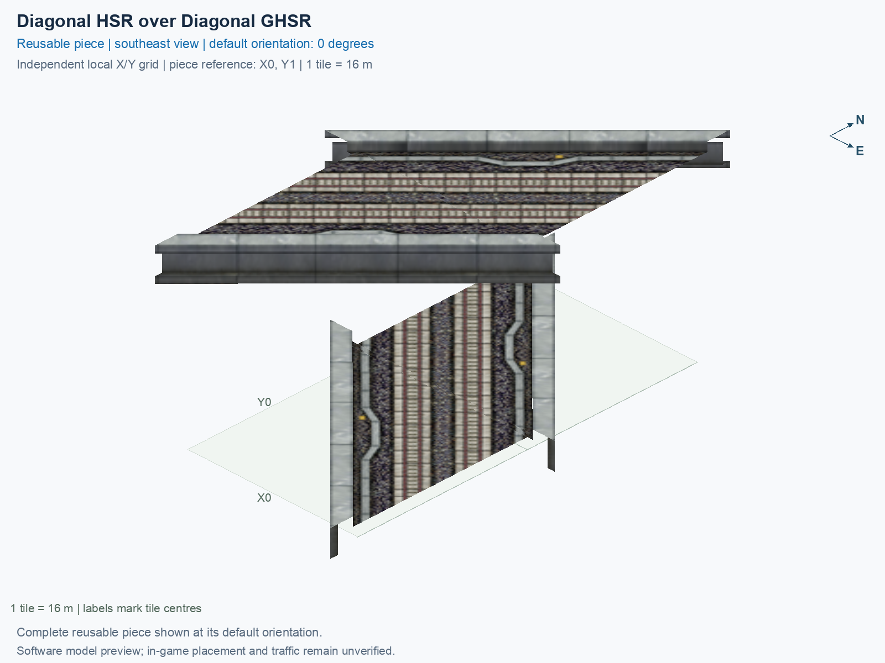

# Diagonal HSR over Diagonal GHSR

Purpose: explain this reusable piece, its matching connections and current test coverage.

<!-- BEGIN PIECE OVERVIEW -->

Diagonal elevated HSR crosses diagonal ground HSR at a right angle. Two tiles; no interchange.

Exact reusable identifier: `diagonal-hsr-diagonal-ghsr`.

Footprint: **1 × 2 tiles**. Exact menu name: **Diagonal HSR over Diagonal GHSR**.

Choose this exact name in Transportation → Rail. Press Home or End to rotate; use only the supported states listed below. Join each end to a matching port profile and direction.

- [Connections and journeys](#connections-and-journeys)
- [Test checklist](#test-checklist)



<!-- END PIECE OVERVIEW -->

<!-- BEGIN MANUAL SUMMARY -->

## Manual status

Generated from [the exact test cases](#test-checklist) and [authoritative observations](checks/manual-tests.json).

- [ ] Preview review: 0/1 applicable cases passed; 0 failed, 0 stale.
- [ ] In-game rendering: 0/8 applicable cases passed; 0 failed, 0 stale.
- [ ] Directed journeys: 0/32 applicable cases passed; 0 failed, 0 stale.

These observations cover only the named services, directions, poses, rotations, and recorded platforms.

<!-- END MANUAL SUMMARY -->

<!-- BEGIN CONNECTIONS -->

## Connections and journeys

Purpose: describe intrinsic directional interfaces and permitted service journeys.

Generated from [connections.json](connections.json). Coordinates are canonical east, north and height in metres. A connection class names an encoded route interface; it does not prove visible deck/wall fit or an in-game test.

Supported placement states: 0° CCW, 90° CCW, 180° CCW, 270° CCW, 0° CCW with construction Transpose, 90° CCW with construction Transpose, 180° CCW with construction Transpose, 270° CCW with construction Transpose. Each state has its own declared manual scope.

A **port** is one directional transport-path endpoint. **Service** identifies the intended network service (for example HSR, street, or tram); **engine** is its internal traffic-class number, separate from the construction network. **Role** distinguishes primary service from auxiliary paths; sharing a traffic class does not establish service compatibility.

A **tangent** is a unit travel-direction vector: `[0,1]` means north. **Grade** is height gained per horizontal metre. These measured facts describe this subject alone. Compatibility requires a separate comparison of the complete joining boundaries; physical seams and actual game operation require their own evidence. See the [class index](../../connection-classes.json) for shared route-interface membership.

| Port | Service / engine / role | Direction | Location; tangent; grade | Connection class |
| --- | --- | --- | --- | --- |
| `7-W-in-1` | hsr / 7 / primary | in | [-8.0, -18.9, 15.5]; [0.7071067811865476, 0.7071067811865475]; 0.0 | `path-interface-9f8c3dd2cd3e736ce4f1` |
| `7-W-out-2` | hsr / 7 / primary | out | [-8.0, -13.2, 15.5]; [-0.7002086668924693, -0.7139382485962431]; 0.0 | `path-interface-df84be787839515335e9` |
| `7-W-in-3` | ghsr / 7 / primary | in | [-8.0, -2.9, 1.0]; [0.7071067811865476, -0.7071067811865476]; 0.0 | `path-interface-d13580a5f8b596919466` |
| `7-W-out-4` | ghsr / 7 / primary | out | [-8.0, 2.9, 1.0]; [-0.7071067811865476, 0.7071067811865476]; 0.0 | `path-interface-d13580a5f8b596919466` |
| `7-E-out-5` | ghsr / 7 / primary | out | [8.0, -18.9, 1.0]; [0.7071067811865476, -0.7071067811865475]; 0.0 | `path-interface-d13580a5f8b596919466` |
| `7-E-in-6` | ghsr / 7 / primary | in | [8.0, -13.1, 1.0]; [-0.7071067811865476, 0.7071067811865476]; 0.0 | `path-interface-d13580a5f8b596919466` |
| `7-E-out-7` | hsr / 7 / primary | out | [8.0, -2.8, 15.5]; [0.7002086668924692, 0.7139382485962431]; 0.0 | `path-interface-df84be787839515335e9` |
| `7-E-in-8` | hsr / 7 / primary | in | [8.0, 2.9, 15.5]; [-0.7071067811865476, -0.7071067811865476]; 0.0 | `path-interface-9f8c3dd2cd3e736ce4f1` |

### Directed journeys

| Service | Entry → exit | Role |
| --- | --- | --- |
| hsr | `7-W-in-1` → `7-E-out-7` | primary |
| ghsr | `7-W-in-3` → `7-E-out-5` | primary |
| ghsr | `7-E-in-6` → `7-W-out-4` | primary |
| hsr | `7-E-in-8` → `7-W-out-2` | primary |

### Forbidden transfers

| From service / port | To service / port | Reason |
| --- | --- | --- |
| hsr / `7-W-in-1` | hsr / `7-W-out-2` | No directed route exists between these ports in the saved piece transport paths. In-game confirmation remains unverified. |
| hsr / `7-W-in-1` | ghsr / `7-W-out-4` | No directed route exists between these ports in the saved piece transport paths. In-game confirmation remains unverified. |
| hsr / `7-W-in-1` | ghsr / `7-E-out-5` | No directed route exists between these ports in the saved piece transport paths. In-game confirmation remains unverified. |
| ghsr / `7-W-in-3` | hsr / `7-W-out-2` | No directed route exists between these ports in the saved piece transport paths. In-game confirmation remains unverified. |
| ghsr / `7-W-in-3` | ghsr / `7-W-out-4` | No directed route exists between these ports in the saved piece transport paths. In-game confirmation remains unverified. |
| ghsr / `7-W-in-3` | hsr / `7-E-out-7` | No directed route exists between these ports in the saved piece transport paths. In-game confirmation remains unverified. |
| ghsr / `7-E-in-6` | hsr / `7-W-out-2` | No directed route exists between these ports in the saved piece transport paths. In-game confirmation remains unverified. |
| ghsr / `7-E-in-6` | ghsr / `7-E-out-5` | No directed route exists between these ports in the saved piece transport paths. In-game confirmation remains unverified. |
| ghsr / `7-E-in-6` | hsr / `7-E-out-7` | No directed route exists between these ports in the saved piece transport paths. In-game confirmation remains unverified. |
| hsr / `7-E-in-8` | ghsr / `7-W-out-4` | No directed route exists between these ports in the saved piece transport paths. In-game confirmation remains unverified. |
| hsr / `7-E-in-8` | ghsr / `7-E-out-5` | No directed route exists between these ports in the saved piece transport paths. In-game confirmation remains unverified. |
| hsr / `7-E-in-8` | hsr / `7-E-out-7` | No directed route exists between these ports in the saved piece transport paths. In-game confirmation remains unverified. |

Review the test checklist for the exact tested cases and environments.

<!-- END CONNECTIONS -->

<!-- BEGIN MANUAL CHECKS -->

## Test checklist

Generated from [the authoritative record](checks/manual-tests.json). Only explicit human observations create manual passes; software and preview checks remain separate. Expand a check/service group to see its rotation table, then expand the matching exact scope to copy a case ID and inspect its pose, reviewer, environment, and evidence. Grouping changes only this view; every declared case remains separate.

**States:** [x] passed; [ ] unverified, failed, or stale; N/A is an explicit inapplicable declaration. A dash means no case was declared in that column. Every pass covers only its recorded environment. T means a distinct construction-transposed state.

Actual emitted rules support four proper rotations and four distinct construction-transposed states; each has separate manual coverage. Counterpart reflection is never assumed.

Current totals: unverified: 163, passed: 0, failed: 0, stale: 0, not_applicable: 0.

### Record an observation

Follow the [shared testing guide](../../../../docs/TESTING.md); copy [the unconfirmed example](checks/observation.example.json) to `checks/observation.json`. Case identifiers are in the expandable sections below. Do not edit generated checkboxes.

From the repository folder containing `custom-pieces`, run after filling `checks/observation.json` and explicitly confirming the exact observation:

```sh
python3 -m scp.content record --record custom-pieces/domains/high-speed-rail/00_pieces/diagonal-hsr-diagonal-ghsr/checks/manual-tests.json --observation custom-pieces/domains/high-speed-rail/00_pieces/diagonal-hsr-diagonal-ghsr/checks/observation.json
```

### Detailed current checks

Each collapsed group shows exact case counts and states. Forbidden transfers are grouped by the directed service pair; the table inside retains every port pair and rotation.

<details>
<summary>Compiled resources — Whole subject — 1 case; unverified: 1</summary>

| Check / exact scope | General | 0° | 90° | 180° | 270° | 0° T | 90° T | 180° T | 270° T |
| --- | --- | --- | --- | --- | --- | --- | --- | --- | --- |
| **Compiled resources**<br>Whole subject | <a href="#case-software_resources-1e595a681357a02d4b14">[ ] unverified</a> | — | — | — | — | — | — | — | — |


<details>
<summary>Compiled resources — Whole subject</summary>

<a id="case-software_resources-1e595a681357a02d4b14"></a>

**General: unverified** — `software_resources-1e595a681357a02d4b14`.

Verify the actual compiled resources and construction rules.

Scope: Whole subject.

No observation recorded.

</details>

</details>

<details>
<summary>Directed routing graph — Whole subject — 1 case; unverified: 1</summary>

| Check / exact scope | General | 0° | 90° | 180° | 270° | 0° T | 90° T | 180° T | 270° T |
| --- | --- | --- | --- | --- | --- | --- | --- | --- | --- |
| **Directed routing graph**<br>Whole subject | <a href="#case-software_connectivity-1e595a681357a02d4b14">[ ] unverified</a> | — | — | — | — | — | — | — | — |


<details>
<summary>Directed routing graph — Whole subject</summary>

<a id="case-software_connectivity-1e595a681357a02d4b14"></a>

**General: unverified** — `software_connectivity-1e595a681357a02d4b14`.

Verify the declared directed journeys and forbidden transfers.

Scope: Whole subject.

No observation recorded.

</details>

</details>

<details>
<summary>Preview review — Images — 1 case; unverified: 1</summary>

| Check / exact scope | General | 0° | 90° | 180° | 270° | 0° T | 90° T | 180° T | 270° T |
| --- | --- | --- | --- | --- | --- | --- | --- | --- | --- |
| **Preview review**<br>Image: image:diagonal-hsr-diagonal-ghsr:canonical-southeast | <a href="#case-preview_review-956a8427350fe2f3f745">[ ] unverified</a> | — | — | — | — | — | — | — | — |


<details>
<summary>Preview review — Image: image:diagonal-hsr-diagonal-ghsr:canonical-southeast</summary>

<a id="case-preview_review-956a8427350fe2f3f745"></a>

**General: unverified** — `preview_review-956a8427350fe2f3f745`.

Inspect this exact preview for tracks, walls, piers, seams and shadows.

Scope: Image: image:diagonal-hsr-diagonal-ghsr:canonical-southeast.

No observation recorded.

</details>

</details>

<details>
<summary>In-game rendering — Whole subject — 8 cases; unverified: 8</summary>

| Check / exact scope | General | 0° | 90° | 180° | 270° | 0° T | 90° T | 180° T | 270° T |
| --- | --- | --- | --- | --- | --- | --- | --- | --- | --- |
| **In-game rendering**<br>Whole subject | — | <a href="#case-in_game_render-df79b627cc149b030ebe">[ ] unverified</a> | <a href="#case-in_game_render-717c3c4870134ea194b5">[ ] unverified</a> | <a href="#case-in_game_render-aab9111426d4385c2245">[ ] unverified</a> | <a href="#case-in_game_render-0e600a899acd4914529e">[ ] unverified</a> | <a href="#case-in_game_render-bee049b5f5f364d7db2c">[ ] unverified</a> | <a href="#case-in_game_render-ba1f39c3f4b9a60ba901">[ ] unverified</a> | <a href="#case-in_game_render-e9835b0491a81f32b44f">[ ] unverified</a> | <a href="#case-in_game_render-2f306e277c0f738c4777">[ ] unverified</a> |


<details>
<summary>In-game rendering — Whole subject</summary>

<a id="case-in_game_render-df79b627cc149b030ebe"></a>

**0° CCW: unverified** — `in_game_render-df79b627cc149b030ebe`.

Inspect the placed tracks, walls, piers, seams and shadows in SimCity 4.

Scope: Whole subject.

No observation recorded.

<a id="case-in_game_render-717c3c4870134ea194b5"></a>

**90° CCW: unverified** — `in_game_render-717c3c4870134ea194b5`.

Inspect the placed tracks, walls, piers, seams and shadows in SimCity 4.

Scope: Whole subject.

No observation recorded.

<a id="case-in_game_render-aab9111426d4385c2245"></a>

**180° CCW: unverified** — `in_game_render-aab9111426d4385c2245`.

Inspect the placed tracks, walls, piers, seams and shadows in SimCity 4.

Scope: Whole subject.

No observation recorded.

<a id="case-in_game_render-0e600a899acd4914529e"></a>

**270° CCW: unverified** — `in_game_render-0e600a899acd4914529e`.

Inspect the placed tracks, walls, piers, seams and shadows in SimCity 4.

Scope: Whole subject.

No observation recorded.

<a id="case-in_game_render-bee049b5f5f364d7db2c"></a>

**0° CCW with construction Transpose: unverified** — `in_game_render-bee049b5f5f364d7db2c`.

Inspect the placed tracks, walls, piers, seams and shadows in SimCity 4.

Scope: Whole subject.

No observation recorded.

<a id="case-in_game_render-ba1f39c3f4b9a60ba901"></a>

**90° CCW with construction Transpose: unverified** — `in_game_render-ba1f39c3f4b9a60ba901`.

Inspect the placed tracks, walls, piers, seams and shadows in SimCity 4.

Scope: Whole subject.

No observation recorded.

<a id="case-in_game_render-e9835b0491a81f32b44f"></a>

**180° CCW with construction Transpose: unverified** — `in_game_render-e9835b0491a81f32b44f`.

Inspect the placed tracks, walls, piers, seams and shadows in SimCity 4.

Scope: Whole subject.

No observation recorded.

<a id="case-in_game_render-2f306e277c0f738c4777"></a>

**270° CCW with construction Transpose: unverified** — `in_game_render-2f306e277c0f738c4777`.

Inspect the placed tracks, walls, piers, seams and shadows in SimCity 4.

Scope: Whole subject.

No observation recorded.

</details>

</details>

<details>
<summary>Placement — Whole subject — 8 cases; unverified: 8</summary>

| Check / exact scope | General | 0° | 90° | 180° | 270° | 0° T | 90° T | 180° T | 270° T |
| --- | --- | --- | --- | --- | --- | --- | --- | --- | --- |
| **Placement**<br>Whole subject | — | <a href="#case-in_game_placement-df79b627cc149b030ebe">[ ] unverified</a> | <a href="#case-in_game_placement-717c3c4870134ea194b5">[ ] unverified</a> | <a href="#case-in_game_placement-aab9111426d4385c2245">[ ] unverified</a> | <a href="#case-in_game_placement-0e600a899acd4914529e">[ ] unverified</a> | <a href="#case-in_game_placement-bee049b5f5f364d7db2c">[ ] unverified</a> | <a href="#case-in_game_placement-ba1f39c3f4b9a60ba901">[ ] unverified</a> | <a href="#case-in_game_placement-e9835b0491a81f32b44f">[ ] unverified</a> | <a href="#case-in_game_placement-2f306e277c0f738c4777">[ ] unverified</a> |


<details>
<summary>Placement — Whole subject</summary>

<a id="case-in_game_placement-df79b627cc149b030ebe"></a>

**0° CCW: unverified** — `in_game_placement-df79b627cc149b030ebe`.

Place this piece or complete blueprint and inspect every occupied tile.

Scope: Whole subject.

No observation recorded.

<a id="case-in_game_placement-717c3c4870134ea194b5"></a>

**90° CCW: unverified** — `in_game_placement-717c3c4870134ea194b5`.

Place this piece or complete blueprint and inspect every occupied tile.

Scope: Whole subject.

No observation recorded.

<a id="case-in_game_placement-aab9111426d4385c2245"></a>

**180° CCW: unverified** — `in_game_placement-aab9111426d4385c2245`.

Place this piece or complete blueprint and inspect every occupied tile.

Scope: Whole subject.

No observation recorded.

<a id="case-in_game_placement-0e600a899acd4914529e"></a>

**270° CCW: unverified** — `in_game_placement-0e600a899acd4914529e`.

Place this piece or complete blueprint and inspect every occupied tile.

Scope: Whole subject.

No observation recorded.

<a id="case-in_game_placement-bee049b5f5f364d7db2c"></a>

**0° CCW with construction Transpose: unverified** — `in_game_placement-bee049b5f5f364d7db2c`.

Place this piece or complete blueprint and inspect every occupied tile.

Scope: Whole subject.

No observation recorded.

<a id="case-in_game_placement-ba1f39c3f4b9a60ba901"></a>

**90° CCW with construction Transpose: unverified** — `in_game_placement-ba1f39c3f4b9a60ba901`.

Place this piece or complete blueprint and inspect every occupied tile.

Scope: Whole subject.

No observation recorded.

<a id="case-in_game_placement-e9835b0491a81f32b44f"></a>

**180° CCW with construction Transpose: unverified** — `in_game_placement-e9835b0491a81f32b44f`.

Place this piece or complete blueprint and inspect every occupied tile.

Scope: Whole subject.

No observation recorded.

<a id="case-in_game_placement-2f306e277c0f738c4777"></a>

**270° CCW with construction Transpose: unverified** — `in_game_placement-2f306e277c0f738c4777`.

Place this piece or complete blueprint and inspect every occupied tile.

Scope: Whole subject.

No observation recorded.

</details>

</details>

<details>
<summary>Demolition — Whole subject — 8 cases; unverified: 8</summary>

| Check / exact scope | General | 0° | 90° | 180° | 270° | 0° T | 90° T | 180° T | 270° T |
| --- | --- | --- | --- | --- | --- | --- | --- | --- | --- |
| **Demolition**<br>Whole subject | — | <a href="#case-in_game_demolition-df79b627cc149b030ebe">[ ] unverified</a> | <a href="#case-in_game_demolition-717c3c4870134ea194b5">[ ] unverified</a> | <a href="#case-in_game_demolition-aab9111426d4385c2245">[ ] unverified</a> | <a href="#case-in_game_demolition-0e600a899acd4914529e">[ ] unverified</a> | <a href="#case-in_game_demolition-bee049b5f5f364d7db2c">[ ] unverified</a> | <a href="#case-in_game_demolition-ba1f39c3f4b9a60ba901">[ ] unverified</a> | <a href="#case-in_game_demolition-e9835b0491a81f32b44f">[ ] unverified</a> | <a href="#case-in_game_demolition-2f306e277c0f738c4777">[ ] unverified</a> |


<details>
<summary>Demolition — Whole subject</summary>

<a id="case-in_game_demolition-df79b627cc149b030ebe"></a>

**0° CCW: unverified** — `in_game_demolition-df79b627cc149b030ebe`.

Bulldoze the complete placement and inspect the cleared area.

Scope: Whole subject.

No observation recorded.

<a id="case-in_game_demolition-717c3c4870134ea194b5"></a>

**90° CCW: unverified** — `in_game_demolition-717c3c4870134ea194b5`.

Bulldoze the complete placement and inspect the cleared area.

Scope: Whole subject.

No observation recorded.

<a id="case-in_game_demolition-aab9111426d4385c2245"></a>

**180° CCW: unverified** — `in_game_demolition-aab9111426d4385c2245`.

Bulldoze the complete placement and inspect the cleared area.

Scope: Whole subject.

No observation recorded.

<a id="case-in_game_demolition-0e600a899acd4914529e"></a>

**270° CCW: unverified** — `in_game_demolition-0e600a899acd4914529e`.

Bulldoze the complete placement and inspect the cleared area.

Scope: Whole subject.

No observation recorded.

<a id="case-in_game_demolition-bee049b5f5f364d7db2c"></a>

**0° CCW with construction Transpose: unverified** — `in_game_demolition-bee049b5f5f364d7db2c`.

Bulldoze the complete placement and inspect the cleared area.

Scope: Whole subject.

No observation recorded.

<a id="case-in_game_demolition-ba1f39c3f4b9a60ba901"></a>

**90° CCW with construction Transpose: unverified** — `in_game_demolition-ba1f39c3f4b9a60ba901`.

Bulldoze the complete placement and inspect the cleared area.

Scope: Whole subject.

No observation recorded.

<a id="case-in_game_demolition-e9835b0491a81f32b44f"></a>

**180° CCW with construction Transpose: unverified** — `in_game_demolition-e9835b0491a81f32b44f`.

Bulldoze the complete placement and inspect the cleared area.

Scope: Whole subject.

No observation recorded.

<a id="case-in_game_demolition-2f306e277c0f738c4777"></a>

**270° CCW with construction Transpose: unverified** — `in_game_demolition-2f306e277c0f738c4777`.

Bulldoze the complete placement and inspect the cleared area.

Scope: Whole subject.

No observation recorded.

</details>

</details>

<details>
<summary>Save and reload — Whole subject — 8 cases; unverified: 8</summary>

| Check / exact scope | General | 0° | 90° | 180° | 270° | 0° T | 90° T | 180° T | 270° T |
| --- | --- | --- | --- | --- | --- | --- | --- | --- | --- |
| **Save and reload**<br>Whole subject | — | <a href="#case-in_game_save_reload-df79b627cc149b030ebe">[ ] unverified</a> | <a href="#case-in_game_save_reload-717c3c4870134ea194b5">[ ] unverified</a> | <a href="#case-in_game_save_reload-aab9111426d4385c2245">[ ] unverified</a> | <a href="#case-in_game_save_reload-0e600a899acd4914529e">[ ] unverified</a> | <a href="#case-in_game_save_reload-bee049b5f5f364d7db2c">[ ] unverified</a> | <a href="#case-in_game_save_reload-ba1f39c3f4b9a60ba901">[ ] unverified</a> | <a href="#case-in_game_save_reload-e9835b0491a81f32b44f">[ ] unverified</a> | <a href="#case-in_game_save_reload-2f306e277c0f738c4777">[ ] unverified</a> |


<details>
<summary>Save and reload — Whole subject</summary>

<a id="case-in_game_save_reload-df79b627cc149b030ebe"></a>

**0° CCW: unverified** — `in_game_save_reload-df79b627cc149b030ebe`.

Save, quit, reload and inspect the placement and its paths.

Scope: Whole subject.

No observation recorded.

<a id="case-in_game_save_reload-717c3c4870134ea194b5"></a>

**90° CCW: unverified** — `in_game_save_reload-717c3c4870134ea194b5`.

Save, quit, reload and inspect the placement and its paths.

Scope: Whole subject.

No observation recorded.

<a id="case-in_game_save_reload-aab9111426d4385c2245"></a>

**180° CCW: unverified** — `in_game_save_reload-aab9111426d4385c2245`.

Save, quit, reload and inspect the placement and its paths.

Scope: Whole subject.

No observation recorded.

<a id="case-in_game_save_reload-0e600a899acd4914529e"></a>

**270° CCW: unverified** — `in_game_save_reload-0e600a899acd4914529e`.

Save, quit, reload and inspect the placement and its paths.

Scope: Whole subject.

No observation recorded.

<a id="case-in_game_save_reload-bee049b5f5f364d7db2c"></a>

**0° CCW with construction Transpose: unverified** — `in_game_save_reload-bee049b5f5f364d7db2c`.

Save, quit, reload and inspect the placement and its paths.

Scope: Whole subject.

No observation recorded.

<a id="case-in_game_save_reload-ba1f39c3f4b9a60ba901"></a>

**90° CCW with construction Transpose: unverified** — `in_game_save_reload-ba1f39c3f4b9a60ba901`.

Save, quit, reload and inspect the placement and its paths.

Scope: Whole subject.

No observation recorded.

<a id="case-in_game_save_reload-e9835b0491a81f32b44f"></a>

**180° CCW with construction Transpose: unverified** — `in_game_save_reload-e9835b0491a81f32b44f`.

Save, quit, reload and inspect the placement and its paths.

Scope: Whole subject.

No observation recorded.

<a id="case-in_game_save_reload-2f306e277c0f738c4777"></a>

**270° CCW with construction Transpose: unverified** — `in_game_save_reload-2f306e277c0f738c4777`.

Save, quit, reload and inspect the placement and its paths.

Scope: Whole subject.

No observation recorded.

</details>

</details>

<details>
<summary>Journey — hsr — 16 cases; unverified: 16</summary>

| Check / exact scope | General | 0° | 90° | 180° | 270° | 0° T | 90° T | 180° T | 270° T |
| --- | --- | --- | --- | --- | --- | --- | --- | --- | --- |
| **Journey**<br>Service: hsr; role: primary; journey: 7:7-W-in-1>7-E-out-7; entry: 7-W-in-1; exit: 7-E-out-7 | — | <a href="#case-in_game_journey-b07c0ac287eb03a3585b">[ ] unverified</a> | <a href="#case-in_game_journey-ef2721f065750d81afb0">[ ] unverified</a> | <a href="#case-in_game_journey-fb2d36eccca451877b2e">[ ] unverified</a> | <a href="#case-in_game_journey-5fc66d4b14c5a83ae154">[ ] unverified</a> | <a href="#case-in_game_journey-597d2b6dff12b4f1502f">[ ] unverified</a> | <a href="#case-in_game_journey-1cc006e3859774d53f61">[ ] unverified</a> | <a href="#case-in_game_journey-e5ec65a359687b505b71">[ ] unverified</a> | <a href="#case-in_game_journey-b859963dffb529a26098">[ ] unverified</a> |
| **Journey**<br>Service: hsr; role: primary; journey: 7:7-E-in-8>7-W-out-2; entry: 7-E-in-8; exit: 7-W-out-2 | — | <a href="#case-in_game_journey-8159335255a883f81a1c">[ ] unverified</a> | <a href="#case-in_game_journey-2d2554701d3e869948d4">[ ] unverified</a> | <a href="#case-in_game_journey-d6819c838c4c19f06595">[ ] unverified</a> | <a href="#case-in_game_journey-335ca25b8e36fbbbfb77">[ ] unverified</a> | <a href="#case-in_game_journey-4cc12369b19be27a625f">[ ] unverified</a> | <a href="#case-in_game_journey-4ceb50157b5cf214a4de">[ ] unverified</a> | <a href="#case-in_game_journey-552ce061f3c085c5d44d">[ ] unverified</a> | <a href="#case-in_game_journey-6f41a519c2668c1f7ebc">[ ] unverified</a> |


<details>
<summary>Journey — Service: hsr; role: primary; journey: 7:7-W-in-1>7-E-out-7; entry: 7-W-in-1; exit: 7-E-out-7</summary>

<a id="case-in_game_journey-b07c0ac287eb03a3585b"></a>

**0° CCW: unverified** — `in_game_journey-b07c0ac287eb03a3585b`.

Run the declared journey in this direction using its service network.

Scope: Service: hsr; role: primary; journey: 7:7-W-in-1>7-E-out-7; entry: 7-W-in-1; exit: 7-E-out-7.

No observation recorded.

<a id="case-in_game_journey-ef2721f065750d81afb0"></a>

**90° CCW: unverified** — `in_game_journey-ef2721f065750d81afb0`.

Run the declared journey in this direction using its service network.

Scope: Service: hsr; role: primary; journey: 7:7-W-in-1>7-E-out-7; entry: 7-W-in-1; exit: 7-E-out-7.

No observation recorded.

<a id="case-in_game_journey-fb2d36eccca451877b2e"></a>

**180° CCW: unverified** — `in_game_journey-fb2d36eccca451877b2e`.

Run the declared journey in this direction using its service network.

Scope: Service: hsr; role: primary; journey: 7:7-W-in-1>7-E-out-7; entry: 7-W-in-1; exit: 7-E-out-7.

No observation recorded.

<a id="case-in_game_journey-5fc66d4b14c5a83ae154"></a>

**270° CCW: unverified** — `in_game_journey-5fc66d4b14c5a83ae154`.

Run the declared journey in this direction using its service network.

Scope: Service: hsr; role: primary; journey: 7:7-W-in-1>7-E-out-7; entry: 7-W-in-1; exit: 7-E-out-7.

No observation recorded.

<a id="case-in_game_journey-597d2b6dff12b4f1502f"></a>

**0° CCW with construction Transpose: unverified** — `in_game_journey-597d2b6dff12b4f1502f`.

Run the declared journey in this direction using its service network.

Scope: Service: hsr; role: primary; journey: 7:7-W-in-1>7-E-out-7; entry: 7-W-in-1; exit: 7-E-out-7.

No observation recorded.

<a id="case-in_game_journey-1cc006e3859774d53f61"></a>

**90° CCW with construction Transpose: unverified** — `in_game_journey-1cc006e3859774d53f61`.

Run the declared journey in this direction using its service network.

Scope: Service: hsr; role: primary; journey: 7:7-W-in-1>7-E-out-7; entry: 7-W-in-1; exit: 7-E-out-7.

No observation recorded.

<a id="case-in_game_journey-e5ec65a359687b505b71"></a>

**180° CCW with construction Transpose: unverified** — `in_game_journey-e5ec65a359687b505b71`.

Run the declared journey in this direction using its service network.

Scope: Service: hsr; role: primary; journey: 7:7-W-in-1>7-E-out-7; entry: 7-W-in-1; exit: 7-E-out-7.

No observation recorded.

<a id="case-in_game_journey-b859963dffb529a26098"></a>

**270° CCW with construction Transpose: unverified** — `in_game_journey-b859963dffb529a26098`.

Run the declared journey in this direction using its service network.

Scope: Service: hsr; role: primary; journey: 7:7-W-in-1>7-E-out-7; entry: 7-W-in-1; exit: 7-E-out-7.

No observation recorded.

</details>


<details>
<summary>Journey — Service: hsr; role: primary; journey: 7:7-E-in-8>7-W-out-2; entry: 7-E-in-8; exit: 7-W-out-2</summary>

<a id="case-in_game_journey-8159335255a883f81a1c"></a>

**0° CCW: unverified** — `in_game_journey-8159335255a883f81a1c`.

Run the declared journey in this direction using its service network.

Scope: Service: hsr; role: primary; journey: 7:7-E-in-8>7-W-out-2; entry: 7-E-in-8; exit: 7-W-out-2.

No observation recorded.

<a id="case-in_game_journey-2d2554701d3e869948d4"></a>

**90° CCW: unverified** — `in_game_journey-2d2554701d3e869948d4`.

Run the declared journey in this direction using its service network.

Scope: Service: hsr; role: primary; journey: 7:7-E-in-8>7-W-out-2; entry: 7-E-in-8; exit: 7-W-out-2.

No observation recorded.

<a id="case-in_game_journey-d6819c838c4c19f06595"></a>

**180° CCW: unverified** — `in_game_journey-d6819c838c4c19f06595`.

Run the declared journey in this direction using its service network.

Scope: Service: hsr; role: primary; journey: 7:7-E-in-8>7-W-out-2; entry: 7-E-in-8; exit: 7-W-out-2.

No observation recorded.

<a id="case-in_game_journey-335ca25b8e36fbbbfb77"></a>

**270° CCW: unverified** — `in_game_journey-335ca25b8e36fbbbfb77`.

Run the declared journey in this direction using its service network.

Scope: Service: hsr; role: primary; journey: 7:7-E-in-8>7-W-out-2; entry: 7-E-in-8; exit: 7-W-out-2.

No observation recorded.

<a id="case-in_game_journey-4cc12369b19be27a625f"></a>

**0° CCW with construction Transpose: unverified** — `in_game_journey-4cc12369b19be27a625f`.

Run the declared journey in this direction using its service network.

Scope: Service: hsr; role: primary; journey: 7:7-E-in-8>7-W-out-2; entry: 7-E-in-8; exit: 7-W-out-2.

No observation recorded.

<a id="case-in_game_journey-4ceb50157b5cf214a4de"></a>

**90° CCW with construction Transpose: unverified** — `in_game_journey-4ceb50157b5cf214a4de`.

Run the declared journey in this direction using its service network.

Scope: Service: hsr; role: primary; journey: 7:7-E-in-8>7-W-out-2; entry: 7-E-in-8; exit: 7-W-out-2.

No observation recorded.

<a id="case-in_game_journey-552ce061f3c085c5d44d"></a>

**180° CCW with construction Transpose: unverified** — `in_game_journey-552ce061f3c085c5d44d`.

Run the declared journey in this direction using its service network.

Scope: Service: hsr; role: primary; journey: 7:7-E-in-8>7-W-out-2; entry: 7-E-in-8; exit: 7-W-out-2.

No observation recorded.

<a id="case-in_game_journey-6f41a519c2668c1f7ebc"></a>

**270° CCW with construction Transpose: unverified** — `in_game_journey-6f41a519c2668c1f7ebc`.

Run the declared journey in this direction using its service network.

Scope: Service: hsr; role: primary; journey: 7:7-E-in-8>7-W-out-2; entry: 7-E-in-8; exit: 7-W-out-2.

No observation recorded.

</details>

</details>

<details>
<summary>Journey — ghsr — 16 cases; unverified: 16</summary>

| Check / exact scope | General | 0° | 90° | 180° | 270° | 0° T | 90° T | 180° T | 270° T |
| --- | --- | --- | --- | --- | --- | --- | --- | --- | --- |
| **Journey**<br>Service: ghsr; role: primary; journey: 7:7-W-in-3>7-E-out-5; entry: 7-W-in-3; exit: 7-E-out-5 | — | <a href="#case-in_game_journey-2a2506537c568d12f7cb">[ ] unverified</a> | <a href="#case-in_game_journey-043f9dbaa0906aa4a434">[ ] unverified</a> | <a href="#case-in_game_journey-6fab74271455437e24c5">[ ] unverified</a> | <a href="#case-in_game_journey-318cc36e410603585d27">[ ] unverified</a> | <a href="#case-in_game_journey-fd81d28a997c22821cdb">[ ] unverified</a> | <a href="#case-in_game_journey-d32eeda383a992b6203f">[ ] unverified</a> | <a href="#case-in_game_journey-89e152419bb03ab4613d">[ ] unverified</a> | <a href="#case-in_game_journey-925c097f4eedf41df3cb">[ ] unverified</a> |
| **Journey**<br>Service: ghsr; role: primary; journey: 7:7-E-in-6>7-W-out-4; entry: 7-E-in-6; exit: 7-W-out-4 | — | <a href="#case-in_game_journey-1b90351965de128cceae">[ ] unverified</a> | <a href="#case-in_game_journey-ca19baa072a91cc164f8">[ ] unverified</a> | <a href="#case-in_game_journey-1b4bcad36a92e35cb072">[ ] unverified</a> | <a href="#case-in_game_journey-b08752b081c0a26cfbe3">[ ] unverified</a> | <a href="#case-in_game_journey-a6d39a6c46c1e0884695">[ ] unverified</a> | <a href="#case-in_game_journey-e9a2ed9a094c765e8a93">[ ] unverified</a> | <a href="#case-in_game_journey-53d302513c57c88b6c8e">[ ] unverified</a> | <a href="#case-in_game_journey-31f2dde399f6f84ab6d6">[ ] unverified</a> |


<details>
<summary>Journey — Service: ghsr; role: primary; journey: 7:7-W-in-3>7-E-out-5; entry: 7-W-in-3; exit: 7-E-out-5</summary>

<a id="case-in_game_journey-2a2506537c568d12f7cb"></a>

**0° CCW: unverified** — `in_game_journey-2a2506537c568d12f7cb`.

Run the declared journey in this direction using its service network.

Scope: Service: ghsr; role: primary; journey: 7:7-W-in-3>7-E-out-5; entry: 7-W-in-3; exit: 7-E-out-5.

No observation recorded.

<a id="case-in_game_journey-043f9dbaa0906aa4a434"></a>

**90° CCW: unverified** — `in_game_journey-043f9dbaa0906aa4a434`.

Run the declared journey in this direction using its service network.

Scope: Service: ghsr; role: primary; journey: 7:7-W-in-3>7-E-out-5; entry: 7-W-in-3; exit: 7-E-out-5.

No observation recorded.

<a id="case-in_game_journey-6fab74271455437e24c5"></a>

**180° CCW: unverified** — `in_game_journey-6fab74271455437e24c5`.

Run the declared journey in this direction using its service network.

Scope: Service: ghsr; role: primary; journey: 7:7-W-in-3>7-E-out-5; entry: 7-W-in-3; exit: 7-E-out-5.

No observation recorded.

<a id="case-in_game_journey-318cc36e410603585d27"></a>

**270° CCW: unverified** — `in_game_journey-318cc36e410603585d27`.

Run the declared journey in this direction using its service network.

Scope: Service: ghsr; role: primary; journey: 7:7-W-in-3>7-E-out-5; entry: 7-W-in-3; exit: 7-E-out-5.

No observation recorded.

<a id="case-in_game_journey-fd81d28a997c22821cdb"></a>

**0° CCW with construction Transpose: unverified** — `in_game_journey-fd81d28a997c22821cdb`.

Run the declared journey in this direction using its service network.

Scope: Service: ghsr; role: primary; journey: 7:7-W-in-3>7-E-out-5; entry: 7-W-in-3; exit: 7-E-out-5.

No observation recorded.

<a id="case-in_game_journey-d32eeda383a992b6203f"></a>

**90° CCW with construction Transpose: unverified** — `in_game_journey-d32eeda383a992b6203f`.

Run the declared journey in this direction using its service network.

Scope: Service: ghsr; role: primary; journey: 7:7-W-in-3>7-E-out-5; entry: 7-W-in-3; exit: 7-E-out-5.

No observation recorded.

<a id="case-in_game_journey-89e152419bb03ab4613d"></a>

**180° CCW with construction Transpose: unverified** — `in_game_journey-89e152419bb03ab4613d`.

Run the declared journey in this direction using its service network.

Scope: Service: ghsr; role: primary; journey: 7:7-W-in-3>7-E-out-5; entry: 7-W-in-3; exit: 7-E-out-5.

No observation recorded.

<a id="case-in_game_journey-925c097f4eedf41df3cb"></a>

**270° CCW with construction Transpose: unverified** — `in_game_journey-925c097f4eedf41df3cb`.

Run the declared journey in this direction using its service network.

Scope: Service: ghsr; role: primary; journey: 7:7-W-in-3>7-E-out-5; entry: 7-W-in-3; exit: 7-E-out-5.

No observation recorded.

</details>


<details>
<summary>Journey — Service: ghsr; role: primary; journey: 7:7-E-in-6>7-W-out-4; entry: 7-E-in-6; exit: 7-W-out-4</summary>

<a id="case-in_game_journey-1b90351965de128cceae"></a>

**0° CCW: unverified** — `in_game_journey-1b90351965de128cceae`.

Run the declared journey in this direction using its service network.

Scope: Service: ghsr; role: primary; journey: 7:7-E-in-6>7-W-out-4; entry: 7-E-in-6; exit: 7-W-out-4.

No observation recorded.

<a id="case-in_game_journey-ca19baa072a91cc164f8"></a>

**90° CCW: unverified** — `in_game_journey-ca19baa072a91cc164f8`.

Run the declared journey in this direction using its service network.

Scope: Service: ghsr; role: primary; journey: 7:7-E-in-6>7-W-out-4; entry: 7-E-in-6; exit: 7-W-out-4.

No observation recorded.

<a id="case-in_game_journey-1b4bcad36a92e35cb072"></a>

**180° CCW: unverified** — `in_game_journey-1b4bcad36a92e35cb072`.

Run the declared journey in this direction using its service network.

Scope: Service: ghsr; role: primary; journey: 7:7-E-in-6>7-W-out-4; entry: 7-E-in-6; exit: 7-W-out-4.

No observation recorded.

<a id="case-in_game_journey-b08752b081c0a26cfbe3"></a>

**270° CCW: unverified** — `in_game_journey-b08752b081c0a26cfbe3`.

Run the declared journey in this direction using its service network.

Scope: Service: ghsr; role: primary; journey: 7:7-E-in-6>7-W-out-4; entry: 7-E-in-6; exit: 7-W-out-4.

No observation recorded.

<a id="case-in_game_journey-a6d39a6c46c1e0884695"></a>

**0° CCW with construction Transpose: unverified** — `in_game_journey-a6d39a6c46c1e0884695`.

Run the declared journey in this direction using its service network.

Scope: Service: ghsr; role: primary; journey: 7:7-E-in-6>7-W-out-4; entry: 7-E-in-6; exit: 7-W-out-4.

No observation recorded.

<a id="case-in_game_journey-e9a2ed9a094c765e8a93"></a>

**90° CCW with construction Transpose: unverified** — `in_game_journey-e9a2ed9a094c765e8a93`.

Run the declared journey in this direction using its service network.

Scope: Service: ghsr; role: primary; journey: 7:7-E-in-6>7-W-out-4; entry: 7-E-in-6; exit: 7-W-out-4.

No observation recorded.

<a id="case-in_game_journey-53d302513c57c88b6c8e"></a>

**180° CCW with construction Transpose: unverified** — `in_game_journey-53d302513c57c88b6c8e`.

Run the declared journey in this direction using its service network.

Scope: Service: ghsr; role: primary; journey: 7:7-E-in-6>7-W-out-4; entry: 7-E-in-6; exit: 7-W-out-4.

No observation recorded.

<a id="case-in_game_journey-31f2dde399f6f84ab6d6"></a>

**270° CCW with construction Transpose: unverified** — `in_game_journey-31f2dde399f6f84ab6d6`.

Run the declared journey in this direction using its service network.

Scope: Service: ghsr; role: primary; journey: 7:7-E-in-6>7-W-out-4; entry: 7-E-in-6; exit: 7-W-out-4.

No observation recorded.

</details>

</details>

<details>
<summary>Forbidden transfer — hsr → hsr — 16 cases; unverified: 16</summary>

| Check / exact scope | General | 0° | 90° | 180° | 270° | 0° T | 90° T | 180° T | 270° T |
| --- | --- | --- | --- | --- | --- | --- | --- | --- | --- |
| **Forbidden transfer**<br>from port: 7-W-in-1; to port: 7-W-out-2; from service: hsr; to service: hsr; basis: not reachable in actual saved PATH graph | — | <a href="#case-in_game_forbidden_transfer-eae2e00bb3c6a2feb5ab">[ ] unverified</a> | <a href="#case-in_game_forbidden_transfer-08f7321c35b458af7406">[ ] unverified</a> | <a href="#case-in_game_forbidden_transfer-3e50b52bcedee5add597">[ ] unverified</a> | <a href="#case-in_game_forbidden_transfer-1c176c5094136221fabd">[ ] unverified</a> | <a href="#case-in_game_forbidden_transfer-627d96278ea54ce0063a">[ ] unverified</a> | <a href="#case-in_game_forbidden_transfer-35f1d5c894dc7b79aff1">[ ] unverified</a> | <a href="#case-in_game_forbidden_transfer-a5a7eb1c7ab2dd9181c9">[ ] unverified</a> | <a href="#case-in_game_forbidden_transfer-688e98e91f6e926298b9">[ ] unverified</a> |
| **Forbidden transfer**<br>from port: 7-E-in-8; to port: 7-E-out-7; from service: hsr; to service: hsr; basis: not reachable in actual saved PATH graph | — | <a href="#case-in_game_forbidden_transfer-2bbd8290530b25d1a1b7">[ ] unverified</a> | <a href="#case-in_game_forbidden_transfer-fda6eaf56a5c5dd5f4e3">[ ] unverified</a> | <a href="#case-in_game_forbidden_transfer-9b3dac08866d1c1d6a44">[ ] unverified</a> | <a href="#case-in_game_forbidden_transfer-dedd02b0f025b50202f6">[ ] unverified</a> | <a href="#case-in_game_forbidden_transfer-c5470e1edd82370b4885">[ ] unverified</a> | <a href="#case-in_game_forbidden_transfer-f5ea0985db8b125d9f84">[ ] unverified</a> | <a href="#case-in_game_forbidden_transfer-5ae0999710423ca85b54">[ ] unverified</a> | <a href="#case-in_game_forbidden_transfer-8da6a6d169f63795b984">[ ] unverified</a> |


<details>
<summary>Forbidden transfer — from port: 7-W-in-1; to port: 7-W-out-2; from service: hsr; to service: hsr; basis: not reachable in actual saved PATH graph</summary>

<a id="case-in_game_forbidden_transfer-eae2e00bb3c6a2feb5ab"></a>

**0° CCW: unverified** — `in_game_forbidden_transfer-eae2e00bb3c6a2feb5ab`.

Confirm this undeclared transfer is unavailable.

Scope: from port: 7-W-in-1; to port: 7-W-out-2; from service: hsr; to service: hsr; basis: not reachable in actual saved PATH graph.

No observation recorded.

<a id="case-in_game_forbidden_transfer-08f7321c35b458af7406"></a>

**90° CCW: unverified** — `in_game_forbidden_transfer-08f7321c35b458af7406`.

Confirm this undeclared transfer is unavailable.

Scope: from port: 7-W-in-1; to port: 7-W-out-2; from service: hsr; to service: hsr; basis: not reachable in actual saved PATH graph.

No observation recorded.

<a id="case-in_game_forbidden_transfer-3e50b52bcedee5add597"></a>

**180° CCW: unverified** — `in_game_forbidden_transfer-3e50b52bcedee5add597`.

Confirm this undeclared transfer is unavailable.

Scope: from port: 7-W-in-1; to port: 7-W-out-2; from service: hsr; to service: hsr; basis: not reachable in actual saved PATH graph.

No observation recorded.

<a id="case-in_game_forbidden_transfer-1c176c5094136221fabd"></a>

**270° CCW: unverified** — `in_game_forbidden_transfer-1c176c5094136221fabd`.

Confirm this undeclared transfer is unavailable.

Scope: from port: 7-W-in-1; to port: 7-W-out-2; from service: hsr; to service: hsr; basis: not reachable in actual saved PATH graph.

No observation recorded.

<a id="case-in_game_forbidden_transfer-627d96278ea54ce0063a"></a>

**0° CCW with construction Transpose: unverified** — `in_game_forbidden_transfer-627d96278ea54ce0063a`.

Confirm this undeclared transfer is unavailable.

Scope: from port: 7-W-in-1; to port: 7-W-out-2; from service: hsr; to service: hsr; basis: not reachable in actual saved PATH graph.

No observation recorded.

<a id="case-in_game_forbidden_transfer-35f1d5c894dc7b79aff1"></a>

**90° CCW with construction Transpose: unverified** — `in_game_forbidden_transfer-35f1d5c894dc7b79aff1`.

Confirm this undeclared transfer is unavailable.

Scope: from port: 7-W-in-1; to port: 7-W-out-2; from service: hsr; to service: hsr; basis: not reachable in actual saved PATH graph.

No observation recorded.

<a id="case-in_game_forbidden_transfer-a5a7eb1c7ab2dd9181c9"></a>

**180° CCW with construction Transpose: unverified** — `in_game_forbidden_transfer-a5a7eb1c7ab2dd9181c9`.

Confirm this undeclared transfer is unavailable.

Scope: from port: 7-W-in-1; to port: 7-W-out-2; from service: hsr; to service: hsr; basis: not reachable in actual saved PATH graph.

No observation recorded.

<a id="case-in_game_forbidden_transfer-688e98e91f6e926298b9"></a>

**270° CCW with construction Transpose: unverified** — `in_game_forbidden_transfer-688e98e91f6e926298b9`.

Confirm this undeclared transfer is unavailable.

Scope: from port: 7-W-in-1; to port: 7-W-out-2; from service: hsr; to service: hsr; basis: not reachable in actual saved PATH graph.

No observation recorded.

</details>


<details>
<summary>Forbidden transfer — from port: 7-E-in-8; to port: 7-E-out-7; from service: hsr; to service: hsr; basis: not reachable in actual saved PATH graph</summary>

<a id="case-in_game_forbidden_transfer-2bbd8290530b25d1a1b7"></a>

**0° CCW: unverified** — `in_game_forbidden_transfer-2bbd8290530b25d1a1b7`.

Confirm this undeclared transfer is unavailable.

Scope: from port: 7-E-in-8; to port: 7-E-out-7; from service: hsr; to service: hsr; basis: not reachable in actual saved PATH graph.

No observation recorded.

<a id="case-in_game_forbidden_transfer-fda6eaf56a5c5dd5f4e3"></a>

**90° CCW: unverified** — `in_game_forbidden_transfer-fda6eaf56a5c5dd5f4e3`.

Confirm this undeclared transfer is unavailable.

Scope: from port: 7-E-in-8; to port: 7-E-out-7; from service: hsr; to service: hsr; basis: not reachable in actual saved PATH graph.

No observation recorded.

<a id="case-in_game_forbidden_transfer-9b3dac08866d1c1d6a44"></a>

**180° CCW: unverified** — `in_game_forbidden_transfer-9b3dac08866d1c1d6a44`.

Confirm this undeclared transfer is unavailable.

Scope: from port: 7-E-in-8; to port: 7-E-out-7; from service: hsr; to service: hsr; basis: not reachable in actual saved PATH graph.

No observation recorded.

<a id="case-in_game_forbidden_transfer-dedd02b0f025b50202f6"></a>

**270° CCW: unverified** — `in_game_forbidden_transfer-dedd02b0f025b50202f6`.

Confirm this undeclared transfer is unavailable.

Scope: from port: 7-E-in-8; to port: 7-E-out-7; from service: hsr; to service: hsr; basis: not reachable in actual saved PATH graph.

No observation recorded.

<a id="case-in_game_forbidden_transfer-c5470e1edd82370b4885"></a>

**0° CCW with construction Transpose: unverified** — `in_game_forbidden_transfer-c5470e1edd82370b4885`.

Confirm this undeclared transfer is unavailable.

Scope: from port: 7-E-in-8; to port: 7-E-out-7; from service: hsr; to service: hsr; basis: not reachable in actual saved PATH graph.

No observation recorded.

<a id="case-in_game_forbidden_transfer-f5ea0985db8b125d9f84"></a>

**90° CCW with construction Transpose: unverified** — `in_game_forbidden_transfer-f5ea0985db8b125d9f84`.

Confirm this undeclared transfer is unavailable.

Scope: from port: 7-E-in-8; to port: 7-E-out-7; from service: hsr; to service: hsr; basis: not reachable in actual saved PATH graph.

No observation recorded.

<a id="case-in_game_forbidden_transfer-5ae0999710423ca85b54"></a>

**180° CCW with construction Transpose: unverified** — `in_game_forbidden_transfer-5ae0999710423ca85b54`.

Confirm this undeclared transfer is unavailable.

Scope: from port: 7-E-in-8; to port: 7-E-out-7; from service: hsr; to service: hsr; basis: not reachable in actual saved PATH graph.

No observation recorded.

<a id="case-in_game_forbidden_transfer-8da6a6d169f63795b984"></a>

**270° CCW with construction Transpose: unverified** — `in_game_forbidden_transfer-8da6a6d169f63795b984`.

Confirm this undeclared transfer is unavailable.

Scope: from port: 7-E-in-8; to port: 7-E-out-7; from service: hsr; to service: hsr; basis: not reachable in actual saved PATH graph.

No observation recorded.

</details>

</details>

<details>
<summary>Forbidden transfer — hsr → ghsr — 32 cases; unverified: 32</summary>

| Check / exact scope | General | 0° | 90° | 180° | 270° | 0° T | 90° T | 180° T | 270° T |
| --- | --- | --- | --- | --- | --- | --- | --- | --- | --- |
| **Forbidden transfer**<br>from port: 7-W-in-1; to port: 7-W-out-4; from service: hsr; to service: ghsr; basis: not reachable in actual saved PATH graph | — | <a href="#case-in_game_forbidden_transfer-b3d756b9823713d776ed">[ ] unverified</a> | <a href="#case-in_game_forbidden_transfer-69a91e72cdb298c85a26">[ ] unverified</a> | <a href="#case-in_game_forbidden_transfer-83feb5e081597b9c09ab">[ ] unverified</a> | <a href="#case-in_game_forbidden_transfer-d890a7f9ca4a7e71ff06">[ ] unverified</a> | <a href="#case-in_game_forbidden_transfer-a8f953e9284afc2a2514">[ ] unverified</a> | <a href="#case-in_game_forbidden_transfer-a27bcf11b1e30f7ba054">[ ] unverified</a> | <a href="#case-in_game_forbidden_transfer-e87e49916d82e02963b9">[ ] unverified</a> | <a href="#case-in_game_forbidden_transfer-edf29c927147df6da840">[ ] unverified</a> |
| **Forbidden transfer**<br>from port: 7-W-in-1; to port: 7-E-out-5; from service: hsr; to service: ghsr; basis: not reachable in actual saved PATH graph | — | <a href="#case-in_game_forbidden_transfer-9e1a8413d348865a1405">[ ] unverified</a> | <a href="#case-in_game_forbidden_transfer-bb7ed361646d8c74f9a9">[ ] unverified</a> | <a href="#case-in_game_forbidden_transfer-90fad9b3dc092804e326">[ ] unverified</a> | <a href="#case-in_game_forbidden_transfer-fbb8df52b1a66d76a649">[ ] unverified</a> | <a href="#case-in_game_forbidden_transfer-7ea44a862d2f2db6aede">[ ] unverified</a> | <a href="#case-in_game_forbidden_transfer-df78e7456a766a259f26">[ ] unverified</a> | <a href="#case-in_game_forbidden_transfer-75af0bacea04eca210c2">[ ] unverified</a> | <a href="#case-in_game_forbidden_transfer-fe9dce10ff98b17f7e4b">[ ] unverified</a> |
| **Forbidden transfer**<br>from port: 7-E-in-8; to port: 7-W-out-4; from service: hsr; to service: ghsr; basis: not reachable in actual saved PATH graph | — | <a href="#case-in_game_forbidden_transfer-508bbb1af2889f108c1d">[ ] unverified</a> | <a href="#case-in_game_forbidden_transfer-3e1798b065b56e8e020f">[ ] unverified</a> | <a href="#case-in_game_forbidden_transfer-6def6163c712930c6638">[ ] unverified</a> | <a href="#case-in_game_forbidden_transfer-4a93987ad4dc30f521e4">[ ] unverified</a> | <a href="#case-in_game_forbidden_transfer-220f7514b9c3769028ae">[ ] unverified</a> | <a href="#case-in_game_forbidden_transfer-d011bed39b57cea1247e">[ ] unverified</a> | <a href="#case-in_game_forbidden_transfer-20cebb9c4c0d2125433c">[ ] unverified</a> | <a href="#case-in_game_forbidden_transfer-5abb2b8af845b9f4a052">[ ] unverified</a> |
| **Forbidden transfer**<br>from port: 7-E-in-8; to port: 7-E-out-5; from service: hsr; to service: ghsr; basis: not reachable in actual saved PATH graph | — | <a href="#case-in_game_forbidden_transfer-eda4d4fef8759fec0e0e">[ ] unverified</a> | <a href="#case-in_game_forbidden_transfer-4080209bbb1e996fd282">[ ] unverified</a> | <a href="#case-in_game_forbidden_transfer-26e6607190cff1d679ff">[ ] unverified</a> | <a href="#case-in_game_forbidden_transfer-3493316de2deb20ae1ec">[ ] unverified</a> | <a href="#case-in_game_forbidden_transfer-b171e6ec759f79c1d582">[ ] unverified</a> | <a href="#case-in_game_forbidden_transfer-a0c53c6190a637c5cc8a">[ ] unverified</a> | <a href="#case-in_game_forbidden_transfer-b4748682a7e48f4488b6">[ ] unverified</a> | <a href="#case-in_game_forbidden_transfer-ecc680fa0d7b0b17a458">[ ] unverified</a> |


<details>
<summary>Forbidden transfer — from port: 7-W-in-1; to port: 7-W-out-4; from service: hsr; to service: ghsr; basis: not reachable in actual saved PATH graph</summary>

<a id="case-in_game_forbidden_transfer-b3d756b9823713d776ed"></a>

**0° CCW: unverified** — `in_game_forbidden_transfer-b3d756b9823713d776ed`.

Confirm this undeclared transfer is unavailable.

Scope: from port: 7-W-in-1; to port: 7-W-out-4; from service: hsr; to service: ghsr; basis: not reachable in actual saved PATH graph.

No observation recorded.

<a id="case-in_game_forbidden_transfer-69a91e72cdb298c85a26"></a>

**90° CCW: unverified** — `in_game_forbidden_transfer-69a91e72cdb298c85a26`.

Confirm this undeclared transfer is unavailable.

Scope: from port: 7-W-in-1; to port: 7-W-out-4; from service: hsr; to service: ghsr; basis: not reachable in actual saved PATH graph.

No observation recorded.

<a id="case-in_game_forbidden_transfer-83feb5e081597b9c09ab"></a>

**180° CCW: unverified** — `in_game_forbidden_transfer-83feb5e081597b9c09ab`.

Confirm this undeclared transfer is unavailable.

Scope: from port: 7-W-in-1; to port: 7-W-out-4; from service: hsr; to service: ghsr; basis: not reachable in actual saved PATH graph.

No observation recorded.

<a id="case-in_game_forbidden_transfer-d890a7f9ca4a7e71ff06"></a>

**270° CCW: unverified** — `in_game_forbidden_transfer-d890a7f9ca4a7e71ff06`.

Confirm this undeclared transfer is unavailable.

Scope: from port: 7-W-in-1; to port: 7-W-out-4; from service: hsr; to service: ghsr; basis: not reachable in actual saved PATH graph.

No observation recorded.

<a id="case-in_game_forbidden_transfer-a8f953e9284afc2a2514"></a>

**0° CCW with construction Transpose: unverified** — `in_game_forbidden_transfer-a8f953e9284afc2a2514`.

Confirm this undeclared transfer is unavailable.

Scope: from port: 7-W-in-1; to port: 7-W-out-4; from service: hsr; to service: ghsr; basis: not reachable in actual saved PATH graph.

No observation recorded.

<a id="case-in_game_forbidden_transfer-a27bcf11b1e30f7ba054"></a>

**90° CCW with construction Transpose: unverified** — `in_game_forbidden_transfer-a27bcf11b1e30f7ba054`.

Confirm this undeclared transfer is unavailable.

Scope: from port: 7-W-in-1; to port: 7-W-out-4; from service: hsr; to service: ghsr; basis: not reachable in actual saved PATH graph.

No observation recorded.

<a id="case-in_game_forbidden_transfer-e87e49916d82e02963b9"></a>

**180° CCW with construction Transpose: unverified** — `in_game_forbidden_transfer-e87e49916d82e02963b9`.

Confirm this undeclared transfer is unavailable.

Scope: from port: 7-W-in-1; to port: 7-W-out-4; from service: hsr; to service: ghsr; basis: not reachable in actual saved PATH graph.

No observation recorded.

<a id="case-in_game_forbidden_transfer-edf29c927147df6da840"></a>

**270° CCW with construction Transpose: unverified** — `in_game_forbidden_transfer-edf29c927147df6da840`.

Confirm this undeclared transfer is unavailable.

Scope: from port: 7-W-in-1; to port: 7-W-out-4; from service: hsr; to service: ghsr; basis: not reachable in actual saved PATH graph.

No observation recorded.

</details>


<details>
<summary>Forbidden transfer — from port: 7-W-in-1; to port: 7-E-out-5; from service: hsr; to service: ghsr; basis: not reachable in actual saved PATH graph</summary>

<a id="case-in_game_forbidden_transfer-9e1a8413d348865a1405"></a>

**0° CCW: unverified** — `in_game_forbidden_transfer-9e1a8413d348865a1405`.

Confirm this undeclared transfer is unavailable.

Scope: from port: 7-W-in-1; to port: 7-E-out-5; from service: hsr; to service: ghsr; basis: not reachable in actual saved PATH graph.

No observation recorded.

<a id="case-in_game_forbidden_transfer-bb7ed361646d8c74f9a9"></a>

**90° CCW: unverified** — `in_game_forbidden_transfer-bb7ed361646d8c74f9a9`.

Confirm this undeclared transfer is unavailable.

Scope: from port: 7-W-in-1; to port: 7-E-out-5; from service: hsr; to service: ghsr; basis: not reachable in actual saved PATH graph.

No observation recorded.

<a id="case-in_game_forbidden_transfer-90fad9b3dc092804e326"></a>

**180° CCW: unverified** — `in_game_forbidden_transfer-90fad9b3dc092804e326`.

Confirm this undeclared transfer is unavailable.

Scope: from port: 7-W-in-1; to port: 7-E-out-5; from service: hsr; to service: ghsr; basis: not reachable in actual saved PATH graph.

No observation recorded.

<a id="case-in_game_forbidden_transfer-fbb8df52b1a66d76a649"></a>

**270° CCW: unverified** — `in_game_forbidden_transfer-fbb8df52b1a66d76a649`.

Confirm this undeclared transfer is unavailable.

Scope: from port: 7-W-in-1; to port: 7-E-out-5; from service: hsr; to service: ghsr; basis: not reachable in actual saved PATH graph.

No observation recorded.

<a id="case-in_game_forbidden_transfer-7ea44a862d2f2db6aede"></a>

**0° CCW with construction Transpose: unverified** — `in_game_forbidden_transfer-7ea44a862d2f2db6aede`.

Confirm this undeclared transfer is unavailable.

Scope: from port: 7-W-in-1; to port: 7-E-out-5; from service: hsr; to service: ghsr; basis: not reachable in actual saved PATH graph.

No observation recorded.

<a id="case-in_game_forbidden_transfer-df78e7456a766a259f26"></a>

**90° CCW with construction Transpose: unverified** — `in_game_forbidden_transfer-df78e7456a766a259f26`.

Confirm this undeclared transfer is unavailable.

Scope: from port: 7-W-in-1; to port: 7-E-out-5; from service: hsr; to service: ghsr; basis: not reachable in actual saved PATH graph.

No observation recorded.

<a id="case-in_game_forbidden_transfer-75af0bacea04eca210c2"></a>

**180° CCW with construction Transpose: unverified** — `in_game_forbidden_transfer-75af0bacea04eca210c2`.

Confirm this undeclared transfer is unavailable.

Scope: from port: 7-W-in-1; to port: 7-E-out-5; from service: hsr; to service: ghsr; basis: not reachable in actual saved PATH graph.

No observation recorded.

<a id="case-in_game_forbidden_transfer-fe9dce10ff98b17f7e4b"></a>

**270° CCW with construction Transpose: unverified** — `in_game_forbidden_transfer-fe9dce10ff98b17f7e4b`.

Confirm this undeclared transfer is unavailable.

Scope: from port: 7-W-in-1; to port: 7-E-out-5; from service: hsr; to service: ghsr; basis: not reachable in actual saved PATH graph.

No observation recorded.

</details>


<details>
<summary>Forbidden transfer — from port: 7-E-in-8; to port: 7-W-out-4; from service: hsr; to service: ghsr; basis: not reachable in actual saved PATH graph</summary>

<a id="case-in_game_forbidden_transfer-508bbb1af2889f108c1d"></a>

**0° CCW: unverified** — `in_game_forbidden_transfer-508bbb1af2889f108c1d`.

Confirm this undeclared transfer is unavailable.

Scope: from port: 7-E-in-8; to port: 7-W-out-4; from service: hsr; to service: ghsr; basis: not reachable in actual saved PATH graph.

No observation recorded.

<a id="case-in_game_forbidden_transfer-3e1798b065b56e8e020f"></a>

**90° CCW: unverified** — `in_game_forbidden_transfer-3e1798b065b56e8e020f`.

Confirm this undeclared transfer is unavailable.

Scope: from port: 7-E-in-8; to port: 7-W-out-4; from service: hsr; to service: ghsr; basis: not reachable in actual saved PATH graph.

No observation recorded.

<a id="case-in_game_forbidden_transfer-6def6163c712930c6638"></a>

**180° CCW: unverified** — `in_game_forbidden_transfer-6def6163c712930c6638`.

Confirm this undeclared transfer is unavailable.

Scope: from port: 7-E-in-8; to port: 7-W-out-4; from service: hsr; to service: ghsr; basis: not reachable in actual saved PATH graph.

No observation recorded.

<a id="case-in_game_forbidden_transfer-4a93987ad4dc30f521e4"></a>

**270° CCW: unverified** — `in_game_forbidden_transfer-4a93987ad4dc30f521e4`.

Confirm this undeclared transfer is unavailable.

Scope: from port: 7-E-in-8; to port: 7-W-out-4; from service: hsr; to service: ghsr; basis: not reachable in actual saved PATH graph.

No observation recorded.

<a id="case-in_game_forbidden_transfer-220f7514b9c3769028ae"></a>

**0° CCW with construction Transpose: unverified** — `in_game_forbidden_transfer-220f7514b9c3769028ae`.

Confirm this undeclared transfer is unavailable.

Scope: from port: 7-E-in-8; to port: 7-W-out-4; from service: hsr; to service: ghsr; basis: not reachable in actual saved PATH graph.

No observation recorded.

<a id="case-in_game_forbidden_transfer-d011bed39b57cea1247e"></a>

**90° CCW with construction Transpose: unverified** — `in_game_forbidden_transfer-d011bed39b57cea1247e`.

Confirm this undeclared transfer is unavailable.

Scope: from port: 7-E-in-8; to port: 7-W-out-4; from service: hsr; to service: ghsr; basis: not reachable in actual saved PATH graph.

No observation recorded.

<a id="case-in_game_forbidden_transfer-20cebb9c4c0d2125433c"></a>

**180° CCW with construction Transpose: unverified** — `in_game_forbidden_transfer-20cebb9c4c0d2125433c`.

Confirm this undeclared transfer is unavailable.

Scope: from port: 7-E-in-8; to port: 7-W-out-4; from service: hsr; to service: ghsr; basis: not reachable in actual saved PATH graph.

No observation recorded.

<a id="case-in_game_forbidden_transfer-5abb2b8af845b9f4a052"></a>

**270° CCW with construction Transpose: unverified** — `in_game_forbidden_transfer-5abb2b8af845b9f4a052`.

Confirm this undeclared transfer is unavailable.

Scope: from port: 7-E-in-8; to port: 7-W-out-4; from service: hsr; to service: ghsr; basis: not reachable in actual saved PATH graph.

No observation recorded.

</details>


<details>
<summary>Forbidden transfer — from port: 7-E-in-8; to port: 7-E-out-5; from service: hsr; to service: ghsr; basis: not reachable in actual saved PATH graph</summary>

<a id="case-in_game_forbidden_transfer-eda4d4fef8759fec0e0e"></a>

**0° CCW: unverified** — `in_game_forbidden_transfer-eda4d4fef8759fec0e0e`.

Confirm this undeclared transfer is unavailable.

Scope: from port: 7-E-in-8; to port: 7-E-out-5; from service: hsr; to service: ghsr; basis: not reachable in actual saved PATH graph.

No observation recorded.

<a id="case-in_game_forbidden_transfer-4080209bbb1e996fd282"></a>

**90° CCW: unverified** — `in_game_forbidden_transfer-4080209bbb1e996fd282`.

Confirm this undeclared transfer is unavailable.

Scope: from port: 7-E-in-8; to port: 7-E-out-5; from service: hsr; to service: ghsr; basis: not reachable in actual saved PATH graph.

No observation recorded.

<a id="case-in_game_forbidden_transfer-26e6607190cff1d679ff"></a>

**180° CCW: unverified** — `in_game_forbidden_transfer-26e6607190cff1d679ff`.

Confirm this undeclared transfer is unavailable.

Scope: from port: 7-E-in-8; to port: 7-E-out-5; from service: hsr; to service: ghsr; basis: not reachable in actual saved PATH graph.

No observation recorded.

<a id="case-in_game_forbidden_transfer-3493316de2deb20ae1ec"></a>

**270° CCW: unverified** — `in_game_forbidden_transfer-3493316de2deb20ae1ec`.

Confirm this undeclared transfer is unavailable.

Scope: from port: 7-E-in-8; to port: 7-E-out-5; from service: hsr; to service: ghsr; basis: not reachable in actual saved PATH graph.

No observation recorded.

<a id="case-in_game_forbidden_transfer-b171e6ec759f79c1d582"></a>

**0° CCW with construction Transpose: unverified** — `in_game_forbidden_transfer-b171e6ec759f79c1d582`.

Confirm this undeclared transfer is unavailable.

Scope: from port: 7-E-in-8; to port: 7-E-out-5; from service: hsr; to service: ghsr; basis: not reachable in actual saved PATH graph.

No observation recorded.

<a id="case-in_game_forbidden_transfer-a0c53c6190a637c5cc8a"></a>

**90° CCW with construction Transpose: unverified** — `in_game_forbidden_transfer-a0c53c6190a637c5cc8a`.

Confirm this undeclared transfer is unavailable.

Scope: from port: 7-E-in-8; to port: 7-E-out-5; from service: hsr; to service: ghsr; basis: not reachable in actual saved PATH graph.

No observation recorded.

<a id="case-in_game_forbidden_transfer-b4748682a7e48f4488b6"></a>

**180° CCW with construction Transpose: unverified** — `in_game_forbidden_transfer-b4748682a7e48f4488b6`.

Confirm this undeclared transfer is unavailable.

Scope: from port: 7-E-in-8; to port: 7-E-out-5; from service: hsr; to service: ghsr; basis: not reachable in actual saved PATH graph.

No observation recorded.

<a id="case-in_game_forbidden_transfer-ecc680fa0d7b0b17a458"></a>

**270° CCW with construction Transpose: unverified** — `in_game_forbidden_transfer-ecc680fa0d7b0b17a458`.

Confirm this undeclared transfer is unavailable.

Scope: from port: 7-E-in-8; to port: 7-E-out-5; from service: hsr; to service: ghsr; basis: not reachable in actual saved PATH graph.

No observation recorded.

</details>

</details>

<details>
<summary>Forbidden transfer — ghsr → hsr — 32 cases; unverified: 32</summary>

| Check / exact scope | General | 0° | 90° | 180° | 270° | 0° T | 90° T | 180° T | 270° T |
| --- | --- | --- | --- | --- | --- | --- | --- | --- | --- |
| **Forbidden transfer**<br>from port: 7-W-in-3; to port: 7-W-out-2; from service: ghsr; to service: hsr; basis: not reachable in actual saved PATH graph | — | <a href="#case-in_game_forbidden_transfer-1f148f555f1705616d24">[ ] unverified</a> | <a href="#case-in_game_forbidden_transfer-7bc3f828ae3d52add064">[ ] unverified</a> | <a href="#case-in_game_forbidden_transfer-8d6b9f8eb16c29a73f64">[ ] unverified</a> | <a href="#case-in_game_forbidden_transfer-5ac3853cfc4dd0445207">[ ] unverified</a> | <a href="#case-in_game_forbidden_transfer-b83777073e183fce9125">[ ] unverified</a> | <a href="#case-in_game_forbidden_transfer-c5c0c8c0aa66f542aee9">[ ] unverified</a> | <a href="#case-in_game_forbidden_transfer-8f76af1bb52046b37660">[ ] unverified</a> | <a href="#case-in_game_forbidden_transfer-7199e1b07d808910f626">[ ] unverified</a> |
| **Forbidden transfer**<br>from port: 7-W-in-3; to port: 7-E-out-7; from service: ghsr; to service: hsr; basis: not reachable in actual saved PATH graph | — | <a href="#case-in_game_forbidden_transfer-5bb8666ec5c6b92ed6d8">[ ] unverified</a> | <a href="#case-in_game_forbidden_transfer-92f50ee82c7e2298b878">[ ] unverified</a> | <a href="#case-in_game_forbidden_transfer-1e4fe92fdb10654b89e0">[ ] unverified</a> | <a href="#case-in_game_forbidden_transfer-0b4aeee196874eeb4474">[ ] unverified</a> | <a href="#case-in_game_forbidden_transfer-33c0215bec1566c97f46">[ ] unverified</a> | <a href="#case-in_game_forbidden_transfer-f7d96e6adff4a57c3929">[ ] unverified</a> | <a href="#case-in_game_forbidden_transfer-0170922b67c8cb5c634a">[ ] unverified</a> | <a href="#case-in_game_forbidden_transfer-822887df445f829716a6">[ ] unverified</a> |
| **Forbidden transfer**<br>from port: 7-E-in-6; to port: 7-W-out-2; from service: ghsr; to service: hsr; basis: not reachable in actual saved PATH graph | — | <a href="#case-in_game_forbidden_transfer-532c2f3125a651d39748">[ ] unverified</a> | <a href="#case-in_game_forbidden_transfer-f68c6c73205043a4ca9e">[ ] unverified</a> | <a href="#case-in_game_forbidden_transfer-9cf973ff45bd0bc01f7c">[ ] unverified</a> | <a href="#case-in_game_forbidden_transfer-7255526ba5e9738e3170">[ ] unverified</a> | <a href="#case-in_game_forbidden_transfer-705d4309cdd948372bc4">[ ] unverified</a> | <a href="#case-in_game_forbidden_transfer-76a416b3f15483bac664">[ ] unverified</a> | <a href="#case-in_game_forbidden_transfer-f542a2ef4f15404467d3">[ ] unverified</a> | <a href="#case-in_game_forbidden_transfer-426732b7854dd9e80d20">[ ] unverified</a> |
| **Forbidden transfer**<br>from port: 7-E-in-6; to port: 7-E-out-7; from service: ghsr; to service: hsr; basis: not reachable in actual saved PATH graph | — | <a href="#case-in_game_forbidden_transfer-ab798689aa82c17ec1ab">[ ] unverified</a> | <a href="#case-in_game_forbidden_transfer-21678e35f4cff48d837b">[ ] unverified</a> | <a href="#case-in_game_forbidden_transfer-dc86459f5c66a01973a7">[ ] unverified</a> | <a href="#case-in_game_forbidden_transfer-72174aa9b6df458728f3">[ ] unverified</a> | <a href="#case-in_game_forbidden_transfer-bf394164e3042e2d710d">[ ] unverified</a> | <a href="#case-in_game_forbidden_transfer-450f4bb43fa15a3aa273">[ ] unverified</a> | <a href="#case-in_game_forbidden_transfer-296a7f826e0923cbb57e">[ ] unverified</a> | <a href="#case-in_game_forbidden_transfer-41d953d8ddd126ece027">[ ] unverified</a> |


<details>
<summary>Forbidden transfer — from port: 7-W-in-3; to port: 7-W-out-2; from service: ghsr; to service: hsr; basis: not reachable in actual saved PATH graph</summary>

<a id="case-in_game_forbidden_transfer-1f148f555f1705616d24"></a>

**0° CCW: unverified** — `in_game_forbidden_transfer-1f148f555f1705616d24`.

Confirm this undeclared transfer is unavailable.

Scope: from port: 7-W-in-3; to port: 7-W-out-2; from service: ghsr; to service: hsr; basis: not reachable in actual saved PATH graph.

No observation recorded.

<a id="case-in_game_forbidden_transfer-7bc3f828ae3d52add064"></a>

**90° CCW: unverified** — `in_game_forbidden_transfer-7bc3f828ae3d52add064`.

Confirm this undeclared transfer is unavailable.

Scope: from port: 7-W-in-3; to port: 7-W-out-2; from service: ghsr; to service: hsr; basis: not reachable in actual saved PATH graph.

No observation recorded.

<a id="case-in_game_forbidden_transfer-8d6b9f8eb16c29a73f64"></a>

**180° CCW: unverified** — `in_game_forbidden_transfer-8d6b9f8eb16c29a73f64`.

Confirm this undeclared transfer is unavailable.

Scope: from port: 7-W-in-3; to port: 7-W-out-2; from service: ghsr; to service: hsr; basis: not reachable in actual saved PATH graph.

No observation recorded.

<a id="case-in_game_forbidden_transfer-5ac3853cfc4dd0445207"></a>

**270° CCW: unverified** — `in_game_forbidden_transfer-5ac3853cfc4dd0445207`.

Confirm this undeclared transfer is unavailable.

Scope: from port: 7-W-in-3; to port: 7-W-out-2; from service: ghsr; to service: hsr; basis: not reachable in actual saved PATH graph.

No observation recorded.

<a id="case-in_game_forbidden_transfer-b83777073e183fce9125"></a>

**0° CCW with construction Transpose: unverified** — `in_game_forbidden_transfer-b83777073e183fce9125`.

Confirm this undeclared transfer is unavailable.

Scope: from port: 7-W-in-3; to port: 7-W-out-2; from service: ghsr; to service: hsr; basis: not reachable in actual saved PATH graph.

No observation recorded.

<a id="case-in_game_forbidden_transfer-c5c0c8c0aa66f542aee9"></a>

**90° CCW with construction Transpose: unverified** — `in_game_forbidden_transfer-c5c0c8c0aa66f542aee9`.

Confirm this undeclared transfer is unavailable.

Scope: from port: 7-W-in-3; to port: 7-W-out-2; from service: ghsr; to service: hsr; basis: not reachable in actual saved PATH graph.

No observation recorded.

<a id="case-in_game_forbidden_transfer-8f76af1bb52046b37660"></a>

**180° CCW with construction Transpose: unverified** — `in_game_forbidden_transfer-8f76af1bb52046b37660`.

Confirm this undeclared transfer is unavailable.

Scope: from port: 7-W-in-3; to port: 7-W-out-2; from service: ghsr; to service: hsr; basis: not reachable in actual saved PATH graph.

No observation recorded.

<a id="case-in_game_forbidden_transfer-7199e1b07d808910f626"></a>

**270° CCW with construction Transpose: unverified** — `in_game_forbidden_transfer-7199e1b07d808910f626`.

Confirm this undeclared transfer is unavailable.

Scope: from port: 7-W-in-3; to port: 7-W-out-2; from service: ghsr; to service: hsr; basis: not reachable in actual saved PATH graph.

No observation recorded.

</details>


<details>
<summary>Forbidden transfer — from port: 7-W-in-3; to port: 7-E-out-7; from service: ghsr; to service: hsr; basis: not reachable in actual saved PATH graph</summary>

<a id="case-in_game_forbidden_transfer-5bb8666ec5c6b92ed6d8"></a>

**0° CCW: unverified** — `in_game_forbidden_transfer-5bb8666ec5c6b92ed6d8`.

Confirm this undeclared transfer is unavailable.

Scope: from port: 7-W-in-3; to port: 7-E-out-7; from service: ghsr; to service: hsr; basis: not reachable in actual saved PATH graph.

No observation recorded.

<a id="case-in_game_forbidden_transfer-92f50ee82c7e2298b878"></a>

**90° CCW: unverified** — `in_game_forbidden_transfer-92f50ee82c7e2298b878`.

Confirm this undeclared transfer is unavailable.

Scope: from port: 7-W-in-3; to port: 7-E-out-7; from service: ghsr; to service: hsr; basis: not reachable in actual saved PATH graph.

No observation recorded.

<a id="case-in_game_forbidden_transfer-1e4fe92fdb10654b89e0"></a>

**180° CCW: unverified** — `in_game_forbidden_transfer-1e4fe92fdb10654b89e0`.

Confirm this undeclared transfer is unavailable.

Scope: from port: 7-W-in-3; to port: 7-E-out-7; from service: ghsr; to service: hsr; basis: not reachable in actual saved PATH graph.

No observation recorded.

<a id="case-in_game_forbidden_transfer-0b4aeee196874eeb4474"></a>

**270° CCW: unverified** — `in_game_forbidden_transfer-0b4aeee196874eeb4474`.

Confirm this undeclared transfer is unavailable.

Scope: from port: 7-W-in-3; to port: 7-E-out-7; from service: ghsr; to service: hsr; basis: not reachable in actual saved PATH graph.

No observation recorded.

<a id="case-in_game_forbidden_transfer-33c0215bec1566c97f46"></a>

**0° CCW with construction Transpose: unverified** — `in_game_forbidden_transfer-33c0215bec1566c97f46`.

Confirm this undeclared transfer is unavailable.

Scope: from port: 7-W-in-3; to port: 7-E-out-7; from service: ghsr; to service: hsr; basis: not reachable in actual saved PATH graph.

No observation recorded.

<a id="case-in_game_forbidden_transfer-f7d96e6adff4a57c3929"></a>

**90° CCW with construction Transpose: unverified** — `in_game_forbidden_transfer-f7d96e6adff4a57c3929`.

Confirm this undeclared transfer is unavailable.

Scope: from port: 7-W-in-3; to port: 7-E-out-7; from service: ghsr; to service: hsr; basis: not reachable in actual saved PATH graph.

No observation recorded.

<a id="case-in_game_forbidden_transfer-0170922b67c8cb5c634a"></a>

**180° CCW with construction Transpose: unverified** — `in_game_forbidden_transfer-0170922b67c8cb5c634a`.

Confirm this undeclared transfer is unavailable.

Scope: from port: 7-W-in-3; to port: 7-E-out-7; from service: ghsr; to service: hsr; basis: not reachable in actual saved PATH graph.

No observation recorded.

<a id="case-in_game_forbidden_transfer-822887df445f829716a6"></a>

**270° CCW with construction Transpose: unverified** — `in_game_forbidden_transfer-822887df445f829716a6`.

Confirm this undeclared transfer is unavailable.

Scope: from port: 7-W-in-3; to port: 7-E-out-7; from service: ghsr; to service: hsr; basis: not reachable in actual saved PATH graph.

No observation recorded.

</details>


<details>
<summary>Forbidden transfer — from port: 7-E-in-6; to port: 7-W-out-2; from service: ghsr; to service: hsr; basis: not reachable in actual saved PATH graph</summary>

<a id="case-in_game_forbidden_transfer-532c2f3125a651d39748"></a>

**0° CCW: unverified** — `in_game_forbidden_transfer-532c2f3125a651d39748`.

Confirm this undeclared transfer is unavailable.

Scope: from port: 7-E-in-6; to port: 7-W-out-2; from service: ghsr; to service: hsr; basis: not reachable in actual saved PATH graph.

No observation recorded.

<a id="case-in_game_forbidden_transfer-f68c6c73205043a4ca9e"></a>

**90° CCW: unverified** — `in_game_forbidden_transfer-f68c6c73205043a4ca9e`.

Confirm this undeclared transfer is unavailable.

Scope: from port: 7-E-in-6; to port: 7-W-out-2; from service: ghsr; to service: hsr; basis: not reachable in actual saved PATH graph.

No observation recorded.

<a id="case-in_game_forbidden_transfer-9cf973ff45bd0bc01f7c"></a>

**180° CCW: unverified** — `in_game_forbidden_transfer-9cf973ff45bd0bc01f7c`.

Confirm this undeclared transfer is unavailable.

Scope: from port: 7-E-in-6; to port: 7-W-out-2; from service: ghsr; to service: hsr; basis: not reachable in actual saved PATH graph.

No observation recorded.

<a id="case-in_game_forbidden_transfer-7255526ba5e9738e3170"></a>

**270° CCW: unverified** — `in_game_forbidden_transfer-7255526ba5e9738e3170`.

Confirm this undeclared transfer is unavailable.

Scope: from port: 7-E-in-6; to port: 7-W-out-2; from service: ghsr; to service: hsr; basis: not reachable in actual saved PATH graph.

No observation recorded.

<a id="case-in_game_forbidden_transfer-705d4309cdd948372bc4"></a>

**0° CCW with construction Transpose: unverified** — `in_game_forbidden_transfer-705d4309cdd948372bc4`.

Confirm this undeclared transfer is unavailable.

Scope: from port: 7-E-in-6; to port: 7-W-out-2; from service: ghsr; to service: hsr; basis: not reachable in actual saved PATH graph.

No observation recorded.

<a id="case-in_game_forbidden_transfer-76a416b3f15483bac664"></a>

**90° CCW with construction Transpose: unverified** — `in_game_forbidden_transfer-76a416b3f15483bac664`.

Confirm this undeclared transfer is unavailable.

Scope: from port: 7-E-in-6; to port: 7-W-out-2; from service: ghsr; to service: hsr; basis: not reachable in actual saved PATH graph.

No observation recorded.

<a id="case-in_game_forbidden_transfer-f542a2ef4f15404467d3"></a>

**180° CCW with construction Transpose: unverified** — `in_game_forbidden_transfer-f542a2ef4f15404467d3`.

Confirm this undeclared transfer is unavailable.

Scope: from port: 7-E-in-6; to port: 7-W-out-2; from service: ghsr; to service: hsr; basis: not reachable in actual saved PATH graph.

No observation recorded.

<a id="case-in_game_forbidden_transfer-426732b7854dd9e80d20"></a>

**270° CCW with construction Transpose: unverified** — `in_game_forbidden_transfer-426732b7854dd9e80d20`.

Confirm this undeclared transfer is unavailable.

Scope: from port: 7-E-in-6; to port: 7-W-out-2; from service: ghsr; to service: hsr; basis: not reachable in actual saved PATH graph.

No observation recorded.

</details>


<details>
<summary>Forbidden transfer — from port: 7-E-in-6; to port: 7-E-out-7; from service: ghsr; to service: hsr; basis: not reachable in actual saved PATH graph</summary>

<a id="case-in_game_forbidden_transfer-ab798689aa82c17ec1ab"></a>

**0° CCW: unverified** — `in_game_forbidden_transfer-ab798689aa82c17ec1ab`.

Confirm this undeclared transfer is unavailable.

Scope: from port: 7-E-in-6; to port: 7-E-out-7; from service: ghsr; to service: hsr; basis: not reachable in actual saved PATH graph.

No observation recorded.

<a id="case-in_game_forbidden_transfer-21678e35f4cff48d837b"></a>

**90° CCW: unverified** — `in_game_forbidden_transfer-21678e35f4cff48d837b`.

Confirm this undeclared transfer is unavailable.

Scope: from port: 7-E-in-6; to port: 7-E-out-7; from service: ghsr; to service: hsr; basis: not reachable in actual saved PATH graph.

No observation recorded.

<a id="case-in_game_forbidden_transfer-dc86459f5c66a01973a7"></a>

**180° CCW: unverified** — `in_game_forbidden_transfer-dc86459f5c66a01973a7`.

Confirm this undeclared transfer is unavailable.

Scope: from port: 7-E-in-6; to port: 7-E-out-7; from service: ghsr; to service: hsr; basis: not reachable in actual saved PATH graph.

No observation recorded.

<a id="case-in_game_forbidden_transfer-72174aa9b6df458728f3"></a>

**270° CCW: unverified** — `in_game_forbidden_transfer-72174aa9b6df458728f3`.

Confirm this undeclared transfer is unavailable.

Scope: from port: 7-E-in-6; to port: 7-E-out-7; from service: ghsr; to service: hsr; basis: not reachable in actual saved PATH graph.

No observation recorded.

<a id="case-in_game_forbidden_transfer-bf394164e3042e2d710d"></a>

**0° CCW with construction Transpose: unverified** — `in_game_forbidden_transfer-bf394164e3042e2d710d`.

Confirm this undeclared transfer is unavailable.

Scope: from port: 7-E-in-6; to port: 7-E-out-7; from service: ghsr; to service: hsr; basis: not reachable in actual saved PATH graph.

No observation recorded.

<a id="case-in_game_forbidden_transfer-450f4bb43fa15a3aa273"></a>

**90° CCW with construction Transpose: unverified** — `in_game_forbidden_transfer-450f4bb43fa15a3aa273`.

Confirm this undeclared transfer is unavailable.

Scope: from port: 7-E-in-6; to port: 7-E-out-7; from service: ghsr; to service: hsr; basis: not reachable in actual saved PATH graph.

No observation recorded.

<a id="case-in_game_forbidden_transfer-296a7f826e0923cbb57e"></a>

**180° CCW with construction Transpose: unverified** — `in_game_forbidden_transfer-296a7f826e0923cbb57e`.

Confirm this undeclared transfer is unavailable.

Scope: from port: 7-E-in-6; to port: 7-E-out-7; from service: ghsr; to service: hsr; basis: not reachable in actual saved PATH graph.

No observation recorded.

<a id="case-in_game_forbidden_transfer-41d953d8ddd126ece027"></a>

**270° CCW with construction Transpose: unverified** — `in_game_forbidden_transfer-41d953d8ddd126ece027`.

Confirm this undeclared transfer is unavailable.

Scope: from port: 7-E-in-6; to port: 7-E-out-7; from service: ghsr; to service: hsr; basis: not reachable in actual saved PATH graph.

No observation recorded.

</details>

</details>

<details>
<summary>Forbidden transfer — ghsr → ghsr — 16 cases; unverified: 16</summary>

| Check / exact scope | General | 0° | 90° | 180° | 270° | 0° T | 90° T | 180° T | 270° T |
| --- | --- | --- | --- | --- | --- | --- | --- | --- | --- |
| **Forbidden transfer**<br>from port: 7-W-in-3; to port: 7-W-out-4; from service: ghsr; to service: ghsr; basis: not reachable in actual saved PATH graph | — | <a href="#case-in_game_forbidden_transfer-2f0088d1a244ad842c4e">[ ] unverified</a> | <a href="#case-in_game_forbidden_transfer-635679dc75bb18b9d27d">[ ] unverified</a> | <a href="#case-in_game_forbidden_transfer-866f34462508f315a384">[ ] unverified</a> | <a href="#case-in_game_forbidden_transfer-87f5e8fcadd9dc3e6644">[ ] unverified</a> | <a href="#case-in_game_forbidden_transfer-6d7d835cceb159369c67">[ ] unverified</a> | <a href="#case-in_game_forbidden_transfer-46681848705e36325945">[ ] unverified</a> | <a href="#case-in_game_forbidden_transfer-2c82fe138cca474dedda">[ ] unverified</a> | <a href="#case-in_game_forbidden_transfer-5c0e4a6be3d51998f0f2">[ ] unverified</a> |
| **Forbidden transfer**<br>from port: 7-E-in-6; to port: 7-E-out-5; from service: ghsr; to service: ghsr; basis: not reachable in actual saved PATH graph | — | <a href="#case-in_game_forbidden_transfer-8329cb826de2e095588f">[ ] unverified</a> | <a href="#case-in_game_forbidden_transfer-b43aa25fd585501e1fb6">[ ] unverified</a> | <a href="#case-in_game_forbidden_transfer-6a43658fb821389c00c8">[ ] unverified</a> | <a href="#case-in_game_forbidden_transfer-4a1ee803db967b69e48b">[ ] unverified</a> | <a href="#case-in_game_forbidden_transfer-efe7261c7023e6b320c7">[ ] unverified</a> | <a href="#case-in_game_forbidden_transfer-01c9f9d57357be5c08e5">[ ] unverified</a> | <a href="#case-in_game_forbidden_transfer-590518885a274fde746d">[ ] unverified</a> | <a href="#case-in_game_forbidden_transfer-7f8bf75e3e0edf5530a7">[ ] unverified</a> |


<details>
<summary>Forbidden transfer — from port: 7-W-in-3; to port: 7-W-out-4; from service: ghsr; to service: ghsr; basis: not reachable in actual saved PATH graph</summary>

<a id="case-in_game_forbidden_transfer-2f0088d1a244ad842c4e"></a>

**0° CCW: unverified** — `in_game_forbidden_transfer-2f0088d1a244ad842c4e`.

Confirm this undeclared transfer is unavailable.

Scope: from port: 7-W-in-3; to port: 7-W-out-4; from service: ghsr; to service: ghsr; basis: not reachable in actual saved PATH graph.

No observation recorded.

<a id="case-in_game_forbidden_transfer-635679dc75bb18b9d27d"></a>

**90° CCW: unverified** — `in_game_forbidden_transfer-635679dc75bb18b9d27d`.

Confirm this undeclared transfer is unavailable.

Scope: from port: 7-W-in-3; to port: 7-W-out-4; from service: ghsr; to service: ghsr; basis: not reachable in actual saved PATH graph.

No observation recorded.

<a id="case-in_game_forbidden_transfer-866f34462508f315a384"></a>

**180° CCW: unverified** — `in_game_forbidden_transfer-866f34462508f315a384`.

Confirm this undeclared transfer is unavailable.

Scope: from port: 7-W-in-3; to port: 7-W-out-4; from service: ghsr; to service: ghsr; basis: not reachable in actual saved PATH graph.

No observation recorded.

<a id="case-in_game_forbidden_transfer-87f5e8fcadd9dc3e6644"></a>

**270° CCW: unverified** — `in_game_forbidden_transfer-87f5e8fcadd9dc3e6644`.

Confirm this undeclared transfer is unavailable.

Scope: from port: 7-W-in-3; to port: 7-W-out-4; from service: ghsr; to service: ghsr; basis: not reachable in actual saved PATH graph.

No observation recorded.

<a id="case-in_game_forbidden_transfer-6d7d835cceb159369c67"></a>

**0° CCW with construction Transpose: unverified** — `in_game_forbidden_transfer-6d7d835cceb159369c67`.

Confirm this undeclared transfer is unavailable.

Scope: from port: 7-W-in-3; to port: 7-W-out-4; from service: ghsr; to service: ghsr; basis: not reachable in actual saved PATH graph.

No observation recorded.

<a id="case-in_game_forbidden_transfer-46681848705e36325945"></a>

**90° CCW with construction Transpose: unverified** — `in_game_forbidden_transfer-46681848705e36325945`.

Confirm this undeclared transfer is unavailable.

Scope: from port: 7-W-in-3; to port: 7-W-out-4; from service: ghsr; to service: ghsr; basis: not reachable in actual saved PATH graph.

No observation recorded.

<a id="case-in_game_forbidden_transfer-2c82fe138cca474dedda"></a>

**180° CCW with construction Transpose: unverified** — `in_game_forbidden_transfer-2c82fe138cca474dedda`.

Confirm this undeclared transfer is unavailable.

Scope: from port: 7-W-in-3; to port: 7-W-out-4; from service: ghsr; to service: ghsr; basis: not reachable in actual saved PATH graph.

No observation recorded.

<a id="case-in_game_forbidden_transfer-5c0e4a6be3d51998f0f2"></a>

**270° CCW with construction Transpose: unverified** — `in_game_forbidden_transfer-5c0e4a6be3d51998f0f2`.

Confirm this undeclared transfer is unavailable.

Scope: from port: 7-W-in-3; to port: 7-W-out-4; from service: ghsr; to service: ghsr; basis: not reachable in actual saved PATH graph.

No observation recorded.

</details>


<details>
<summary>Forbidden transfer — from port: 7-E-in-6; to port: 7-E-out-5; from service: ghsr; to service: ghsr; basis: not reachable in actual saved PATH graph</summary>

<a id="case-in_game_forbidden_transfer-8329cb826de2e095588f"></a>

**0° CCW: unverified** — `in_game_forbidden_transfer-8329cb826de2e095588f`.

Confirm this undeclared transfer is unavailable.

Scope: from port: 7-E-in-6; to port: 7-E-out-5; from service: ghsr; to service: ghsr; basis: not reachable in actual saved PATH graph.

No observation recorded.

<a id="case-in_game_forbidden_transfer-b43aa25fd585501e1fb6"></a>

**90° CCW: unverified** — `in_game_forbidden_transfer-b43aa25fd585501e1fb6`.

Confirm this undeclared transfer is unavailable.

Scope: from port: 7-E-in-6; to port: 7-E-out-5; from service: ghsr; to service: ghsr; basis: not reachable in actual saved PATH graph.

No observation recorded.

<a id="case-in_game_forbidden_transfer-6a43658fb821389c00c8"></a>

**180° CCW: unverified** — `in_game_forbidden_transfer-6a43658fb821389c00c8`.

Confirm this undeclared transfer is unavailable.

Scope: from port: 7-E-in-6; to port: 7-E-out-5; from service: ghsr; to service: ghsr; basis: not reachable in actual saved PATH graph.

No observation recorded.

<a id="case-in_game_forbidden_transfer-4a1ee803db967b69e48b"></a>

**270° CCW: unverified** — `in_game_forbidden_transfer-4a1ee803db967b69e48b`.

Confirm this undeclared transfer is unavailable.

Scope: from port: 7-E-in-6; to port: 7-E-out-5; from service: ghsr; to service: ghsr; basis: not reachable in actual saved PATH graph.

No observation recorded.

<a id="case-in_game_forbidden_transfer-efe7261c7023e6b320c7"></a>

**0° CCW with construction Transpose: unverified** — `in_game_forbidden_transfer-efe7261c7023e6b320c7`.

Confirm this undeclared transfer is unavailable.

Scope: from port: 7-E-in-6; to port: 7-E-out-5; from service: ghsr; to service: ghsr; basis: not reachable in actual saved PATH graph.

No observation recorded.

<a id="case-in_game_forbidden_transfer-01c9f9d57357be5c08e5"></a>

**90° CCW with construction Transpose: unverified** — `in_game_forbidden_transfer-01c9f9d57357be5c08e5`.

Confirm this undeclared transfer is unavailable.

Scope: from port: 7-E-in-6; to port: 7-E-out-5; from service: ghsr; to service: ghsr; basis: not reachable in actual saved PATH graph.

No observation recorded.

<a id="case-in_game_forbidden_transfer-590518885a274fde746d"></a>

**180° CCW with construction Transpose: unverified** — `in_game_forbidden_transfer-590518885a274fde746d`.

Confirm this undeclared transfer is unavailable.

Scope: from port: 7-E-in-6; to port: 7-E-out-5; from service: ghsr; to service: ghsr; basis: not reachable in actual saved PATH graph.

No observation recorded.

<a id="case-in_game_forbidden_transfer-7f8bf75e3e0edf5530a7"></a>

**270° CCW with construction Transpose: unverified** — `in_game_forbidden_transfer-7f8bf75e3e0edf5530a7`.

Confirm this undeclared transfer is unavailable.

Scope: from port: 7-E-in-6; to port: 7-E-out-5; from service: ghsr; to service: ghsr; basis: not reachable in actual saved PATH graph.

No observation recorded.

</details>

</details>

<!-- END MANUAL CHECKS -->
