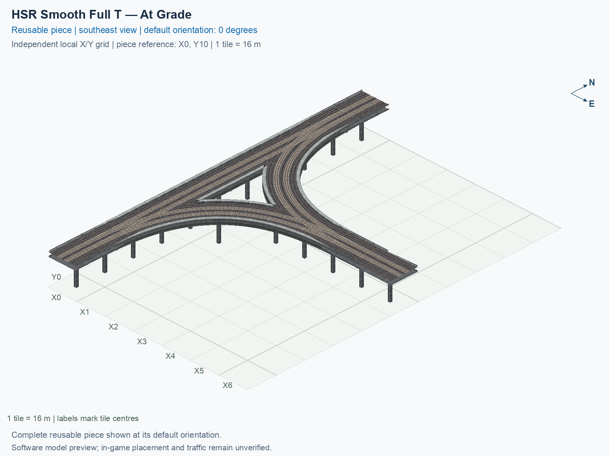

# HSR Smooth Full T — At Grade

Purpose: explain this reusable piece, its matching connections and current test coverage.

<!-- BEGIN PIECE OVERVIEW -->

HSR Smooth Full T — At Grade. Straight HSR mainline with four direct smooth turning connections. All routes stay at the native HSR path height of 15.5 m. This is an at-grade junction: turning routes cross other routes at the same height. It is not a flyover and adds no train signalling or conflict simulation. New visual-review example; experimental, with actual game operation unverified.

Exact reusable identifier: `directional-hsr-t-smooth-at-grade`.

Footprint: **7 × 11 tiles**. Exact menu name: **HSR Smooth Full T — At Grade**.

Choose this exact name in Transportation → Rail. Press Home or End to rotate; use only the supported states listed below. Join each end to a matching port profile and direction.

- [Connections and journeys](#connections-and-journeys)
- [Test checklist](#test-checklist)



<!-- END PIECE OVERVIEW -->

<!-- BEGIN MANUAL SUMMARY -->

## Manual status

Generated from [the exact test cases](#test-checklist) and [authoritative observations](checks/manual-tests.json).

- [ ] Preview review: 0/1 applicable cases passed; 0 failed, 0 stale.
- [ ] In-game rendering: 0/4 applicable cases passed; 0 failed, 0 stale.
- [ ] Directed journeys: 0/24 applicable cases passed; 0 failed, 0 stale.

These observations cover only the named services, directions, poses, rotations, and recorded platforms.

<!-- END MANUAL SUMMARY -->

## Shape and placement example

**At grade** means the routes meet and cross at the same train-path height inside the junction. The whole HSR junction remains elevated above the terrain. Its base orientation has a north/south paired mainline and an east branch. Each arm carries both directions, so all six journeys between different arms are permitted; there is no same-arm U-turn.

The four turning connections use direct curves whose curvature eases into straight native HSR approaches. **Curvature** describes how sharply a track bends. All paths stay at 15.5 m with native lane offsets. This design has three deliberate pairs of conflicting journeys: south → north crosses north → east; south → north crosses east → south; north → east crosses east → south. It is a same-height junction with no added signalling or train-scheduling simulation.

The 7 × 11 construction rectangle measures 112 × 176 m and contains 22 occupied network cells. Keep the complete rectangle clear during placement tests: native-width concrete reaches about 3.43 m into some neighbouring unused cells, although the whole geometry remains inside the construction rectangle and every foundation is in an occupied cell. The triangular gap does not establish that a building or road fits there. The shared support plan has 18 pillars at least 16 m apart; nine underside contact points per pillar are checked.

1. In a disposable flat city, open **Transportation → Rail** and select **SCP | HSR Smooth Full T — At Grade**.
2. Leave the full 7 × 11 area clear. The base mainline runs north/south and the branch east. Press **Home/End** to choose another quarter-turn orientation, then click once to place the whole junction.
3. Join compatible native paired HSR at all three outside ends; stop each drag at the junction boundary.
4. Supply travel demand and test each of the six directed journeys, both straight and turning. Observe the same-height crossings rather than assuming that the visible junction adds signals. Repeat the other rotations and save/reload checks using the generated checklist below.

To build only this optional piece, run these commands from the project folder containing `custom-pieces`:

```sh
python3 custom-pieces/scp.py build --set redesigned-junction-example --output custom-pieces/dist/smooth-t-example
python3 custom-pieces/scp.py verify --output custom-pieces/dist/smooth-t-example
```

These commands create and verify staged files; follow the [installation guide](../../../../docs/BUILD_AND_INSTALL.md) for the separate installation step. Use `--set smooth-t-junctions` to include both this piece and the [diagonal counterpart](../directional-hsr-t-smooth-diagonal-at-grade/README.md).

## Software checks and their limits

The independent checker reads encoded PATH points and actual models. It measures the six journeys, route length relative to end-to-end distance, total turn, sampled minimum radius and changes in curvature. Those numerical measurements use explicit tolerances; they do not prove that rendered moving trains follow a mathematically continuous curve. The model checks include connections, native profiles, floor overlaps, walls, visible rails and the shared support plan. Its authored train corridor is 5 m wide and 5 m high, a project review criterion rather than a measured game vehicle box or real-world railway standard.

Actual placement, moving trains, long-car overhang, terrain, shadows and save/reload need matching human observations. The preview and successful software checks do not tick those cases. Additional numerical implementation details live in the [engineering contract below](#engineering-contract); review flags for other catalogue pieces remain independent of this piece's audit.

<!-- BEGIN CONNECTIONS -->

## Connections and journeys

Purpose: describe intrinsic directional interfaces and permitted service journeys.

Generated from [connections.json](connections.json). Coordinates are canonical east, north and height in metres. A connection class names an encoded route interface; it does not prove visible deck/wall fit or an in-game test.

Supported placement states: 0° CCW, 90° CCW, 180° CCW, 270° CCW. Each state has its own declared manual scope.

A **port** is one directional transport-path endpoint. **Service** identifies the intended network service (for example HSR, street, or tram); **engine** is its internal traffic-class number, separate from the construction network. **Role** distinguishes primary service from auxiliary paths; sharing a traffic class does not establish service compatibility.

A **tangent** is a unit travel-direction vector: `[0,1]` means north. **Grade** is height gained per horizontal metre. These measured facts describe this subject alone. Compatibility requires a separate comparison of the complete joining boundaries; physical seams and actual game operation require their own evidence. See the [class index](../../connection-classes.json) for shared route-interface membership.

| Port | Service / engine / role | Direction | Location; tangent; grade | Connection class |
| --- | --- | --- | --- | --- |
| `Sout` | hsr / 7 / primary | out | [-2.0, -168.0, 15.5]; [0.0, -1.0]; 0.0 | `path-interface-12d12be31d2057c5763d` |
| `Nin` | hsr / 7 / primary | in | [-2.0, 8.0, 15.5]; [0.0, -1.0]; 0.0 | `path-interface-12d12be31d2057c5763d` |
| `Sin` | hsr / 7 / primary | in | [2.0, -168.0, 15.5]; [0.0, 1.0]; 0.0 | `path-interface-fba09fbeb87ad95c667a` |
| `Nout` | hsr / 7 / primary | out | [2.0, 8.0, 15.5]; [0.0, 1.0]; 0.0 | `path-interface-fba09fbeb87ad95c667a` |
| `Eout` | hsr / 7 / primary | out | [104.0, -82.0, 15.5]; [1.0, 0.0]; 0.0 | `path-interface-12d12be31d2057c5763d` |
| `Ein` | hsr / 7 / primary | in | [104.0, -78.0, 15.5]; [-1.0, 0.0]; 0.0 | `path-interface-fba09fbeb87ad95c667a` |

### Directed journeys

| Service | Entry → exit | Role |
| --- | --- | --- |
| hsr | `Nin` → `Eout` | primary |
| hsr | `Nin` → `Sout` | primary |
| hsr | `Sin` → `Nout` | primary |
| hsr | `Sin` → `Eout` | primary |
| hsr | `Ein` → `Sout` | primary |
| hsr | `Ein` → `Nout` | primary |

### Forbidden transfers

| From service / port | To service / port | Reason |
| --- | --- | --- |
| hsr / `Nin` | hsr / `Nout` | No directed route exists between these ports in the saved piece transport paths. In-game confirmation remains unverified. |
| hsr / `Sin` | hsr / `Sout` | No directed route exists between these ports in the saved piece transport paths. In-game confirmation remains unverified. |
| hsr / `Ein` | hsr / `Eout` | No directed route exists between these ports in the saved piece transport paths. In-game confirmation remains unverified. |

Review the test checklist for the exact tested cases and environments.

<!-- END CONNECTIONS -->

<!-- BEGIN MANUAL CHECKS -->

## Test checklist

Generated from [the authoritative record](checks/manual-tests.json). Only explicit human observations create manual passes; software and preview checks remain separate. Expand a check/service group to see its rotation table, then expand the matching exact scope to copy a case ID and inspect its pose, reviewer, environment, and evidence. Grouping changes only this view; every declared case remains separate.

**States:** [x] passed; [ ] unverified, failed, or stale; N/A is an explicit inapplicable declaration. A dash means no case was declared in that column. Every pass covers only its recorded environment. T means a distinct construction-transposed state.

Four proper rotations are covered. No additional reflected state is established by this record; repeated construction aliases do not create new orientations.

Current totals: unverified: 55, passed: 0, failed: 0, stale: 0, not_applicable: 0.

### Record an observation

Follow the [shared testing guide](../../../../docs/TESTING.md); copy [the unconfirmed example](checks/observation.example.json) to `checks/observation.json`. Case identifiers are in the expandable sections below. Do not edit generated checkboxes.

From the repository folder containing `custom-pieces`, run after filling `checks/observation.json` and explicitly confirming the exact observation:

```sh
python3 -m scp.content record --record custom-pieces/domains/high-speed-rail/00_pieces/directional-hsr-t-smooth-at-grade/checks/manual-tests.json --observation custom-pieces/domains/high-speed-rail/00_pieces/directional-hsr-t-smooth-at-grade/checks/observation.json
```

### Detailed current checks

Each collapsed group shows exact case counts and states. Forbidden transfers are grouped by the directed service pair; the table inside retains every port pair and rotation.

<details>
<summary>Compiled resources — Whole subject — 1 case; unverified: 1</summary>

| Check / exact scope | General | 0° | 90° | 180° | 270° |
| --- | --- | --- | --- | --- | --- |
| **Compiled resources**<br>Whole subject | <a href="#case-software_resources-d33fd6ca5d6c6a02cb8d">[ ] unverified</a> | — | — | — | — |


<details>
<summary>Compiled resources — Whole subject</summary>

<a id="case-software_resources-d33fd6ca5d6c6a02cb8d"></a>

**General: unverified** — `software_resources-d33fd6ca5d6c6a02cb8d`.

Verify the actual compiled resources and construction rules.

Scope: Whole subject.

No observation recorded.

</details>

</details>

<details>
<summary>Directed routing graph — Whole subject — 1 case; unverified: 1</summary>

| Check / exact scope | General | 0° | 90° | 180° | 270° |
| --- | --- | --- | --- | --- | --- |
| **Directed routing graph**<br>Whole subject | <a href="#case-software_connectivity-d33fd6ca5d6c6a02cb8d">[ ] unverified</a> | — | — | — | — |


<details>
<summary>Directed routing graph — Whole subject</summary>

<a id="case-software_connectivity-d33fd6ca5d6c6a02cb8d"></a>

**General: unverified** — `software_connectivity-d33fd6ca5d6c6a02cb8d`.

Verify the declared directed journeys and forbidden transfers.

Scope: Whole subject.

No observation recorded.

</details>

</details>

<details>
<summary>Preview review — Images — 1 case; unverified: 1</summary>

| Check / exact scope | General | 0° | 90° | 180° | 270° |
| --- | --- | --- | --- | --- | --- |
| **Preview review**<br>Image: image:directional-hsr-t-smooth-at-grade:canonical-southeast | <a href="#case-preview_review-fce05610be47999c24a7">[ ] unverified</a> | — | — | — | — |


<details>
<summary>Preview review — Image: image:directional-hsr-t-smooth-at-grade:canonical-southeast</summary>

<a id="case-preview_review-fce05610be47999c24a7"></a>

**General: unverified** — `preview_review-fce05610be47999c24a7`.

Inspect this exact preview for tracks, walls, piers, seams and shadows.

Scope: Image: image:directional-hsr-t-smooth-at-grade:canonical-southeast.

No observation recorded.

</details>

</details>

<details>
<summary>In-game rendering — Whole subject — 4 cases; unverified: 4</summary>

| Check / exact scope | General | 0° | 90° | 180° | 270° |
| --- | --- | --- | --- | --- | --- |
| **In-game rendering**<br>Whole subject | — | <a href="#case-in_game_render-b40cc187f85cf5282186">[ ] unverified</a> | <a href="#case-in_game_render-d75844d059f5eb5e87c2">[ ] unverified</a> | <a href="#case-in_game_render-508dd1964d0f7cbdfcae">[ ] unverified</a> | <a href="#case-in_game_render-943c064fa7dd6f5e09ab">[ ] unverified</a> |


<details>
<summary>In-game rendering — Whole subject</summary>

<a id="case-in_game_render-b40cc187f85cf5282186"></a>

**0° CCW: unverified** — `in_game_render-b40cc187f85cf5282186`.

Inspect the placed tracks, walls, piers, seams and shadows in SimCity 4.

Scope: Whole subject.

No observation recorded.

<a id="case-in_game_render-d75844d059f5eb5e87c2"></a>

**90° CCW: unverified** — `in_game_render-d75844d059f5eb5e87c2`.

Inspect the placed tracks, walls, piers, seams and shadows in SimCity 4.

Scope: Whole subject.

No observation recorded.

<a id="case-in_game_render-508dd1964d0f7cbdfcae"></a>

**180° CCW: unverified** — `in_game_render-508dd1964d0f7cbdfcae`.

Inspect the placed tracks, walls, piers, seams and shadows in SimCity 4.

Scope: Whole subject.

No observation recorded.

<a id="case-in_game_render-943c064fa7dd6f5e09ab"></a>

**270° CCW: unverified** — `in_game_render-943c064fa7dd6f5e09ab`.

Inspect the placed tracks, walls, piers, seams and shadows in SimCity 4.

Scope: Whole subject.

No observation recorded.

</details>

</details>

<details>
<summary>Placement — Whole subject — 4 cases; unverified: 4</summary>

| Check / exact scope | General | 0° | 90° | 180° | 270° |
| --- | --- | --- | --- | --- | --- |
| **Placement**<br>Whole subject | — | <a href="#case-in_game_placement-b40cc187f85cf5282186">[ ] unverified</a> | <a href="#case-in_game_placement-d75844d059f5eb5e87c2">[ ] unverified</a> | <a href="#case-in_game_placement-508dd1964d0f7cbdfcae">[ ] unverified</a> | <a href="#case-in_game_placement-943c064fa7dd6f5e09ab">[ ] unverified</a> |


<details>
<summary>Placement — Whole subject</summary>

<a id="case-in_game_placement-b40cc187f85cf5282186"></a>

**0° CCW: unverified** — `in_game_placement-b40cc187f85cf5282186`.

Place this piece or complete blueprint and inspect every occupied tile.

Scope: Whole subject.

No observation recorded.

<a id="case-in_game_placement-d75844d059f5eb5e87c2"></a>

**90° CCW: unverified** — `in_game_placement-d75844d059f5eb5e87c2`.

Place this piece or complete blueprint and inspect every occupied tile.

Scope: Whole subject.

No observation recorded.

<a id="case-in_game_placement-508dd1964d0f7cbdfcae"></a>

**180° CCW: unverified** — `in_game_placement-508dd1964d0f7cbdfcae`.

Place this piece or complete blueprint and inspect every occupied tile.

Scope: Whole subject.

No observation recorded.

<a id="case-in_game_placement-943c064fa7dd6f5e09ab"></a>

**270° CCW: unverified** — `in_game_placement-943c064fa7dd6f5e09ab`.

Place this piece or complete blueprint and inspect every occupied tile.

Scope: Whole subject.

No observation recorded.

</details>

</details>

<details>
<summary>Demolition — Whole subject — 4 cases; unverified: 4</summary>

| Check / exact scope | General | 0° | 90° | 180° | 270° |
| --- | --- | --- | --- | --- | --- |
| **Demolition**<br>Whole subject | — | <a href="#case-in_game_demolition-b40cc187f85cf5282186">[ ] unverified</a> | <a href="#case-in_game_demolition-d75844d059f5eb5e87c2">[ ] unverified</a> | <a href="#case-in_game_demolition-508dd1964d0f7cbdfcae">[ ] unverified</a> | <a href="#case-in_game_demolition-943c064fa7dd6f5e09ab">[ ] unverified</a> |


<details>
<summary>Demolition — Whole subject</summary>

<a id="case-in_game_demolition-b40cc187f85cf5282186"></a>

**0° CCW: unverified** — `in_game_demolition-b40cc187f85cf5282186`.

Bulldoze the complete placement and inspect the cleared area.

Scope: Whole subject.

No observation recorded.

<a id="case-in_game_demolition-d75844d059f5eb5e87c2"></a>

**90° CCW: unverified** — `in_game_demolition-d75844d059f5eb5e87c2`.

Bulldoze the complete placement and inspect the cleared area.

Scope: Whole subject.

No observation recorded.

<a id="case-in_game_demolition-508dd1964d0f7cbdfcae"></a>

**180° CCW: unverified** — `in_game_demolition-508dd1964d0f7cbdfcae`.

Bulldoze the complete placement and inspect the cleared area.

Scope: Whole subject.

No observation recorded.

<a id="case-in_game_demolition-943c064fa7dd6f5e09ab"></a>

**270° CCW: unverified** — `in_game_demolition-943c064fa7dd6f5e09ab`.

Bulldoze the complete placement and inspect the cleared area.

Scope: Whole subject.

No observation recorded.

</details>

</details>

<details>
<summary>Save and reload — Whole subject — 4 cases; unverified: 4</summary>

| Check / exact scope | General | 0° | 90° | 180° | 270° |
| --- | --- | --- | --- | --- | --- |
| **Save and reload**<br>Whole subject | — | <a href="#case-in_game_save_reload-b40cc187f85cf5282186">[ ] unverified</a> | <a href="#case-in_game_save_reload-d75844d059f5eb5e87c2">[ ] unverified</a> | <a href="#case-in_game_save_reload-508dd1964d0f7cbdfcae">[ ] unverified</a> | <a href="#case-in_game_save_reload-943c064fa7dd6f5e09ab">[ ] unverified</a> |


<details>
<summary>Save and reload — Whole subject</summary>

<a id="case-in_game_save_reload-b40cc187f85cf5282186"></a>

**0° CCW: unverified** — `in_game_save_reload-b40cc187f85cf5282186`.

Save, quit, reload and inspect the placement and its paths.

Scope: Whole subject.

No observation recorded.

<a id="case-in_game_save_reload-d75844d059f5eb5e87c2"></a>

**90° CCW: unverified** — `in_game_save_reload-d75844d059f5eb5e87c2`.

Save, quit, reload and inspect the placement and its paths.

Scope: Whole subject.

No observation recorded.

<a id="case-in_game_save_reload-508dd1964d0f7cbdfcae"></a>

**180° CCW: unverified** — `in_game_save_reload-508dd1964d0f7cbdfcae`.

Save, quit, reload and inspect the placement and its paths.

Scope: Whole subject.

No observation recorded.

<a id="case-in_game_save_reload-943c064fa7dd6f5e09ab"></a>

**270° CCW: unverified** — `in_game_save_reload-943c064fa7dd6f5e09ab`.

Save, quit, reload and inspect the placement and its paths.

Scope: Whole subject.

No observation recorded.

</details>

</details>

<details>
<summary>Journey — hsr — 24 cases; unverified: 24</summary>

| Check / exact scope | General | 0° | 90° | 180° | 270° |
| --- | --- | --- | --- | --- | --- |
| **Journey**<br>Service: hsr; role: primary; journey: 7:Nin>Eout; entry: Nin; exit: Eout | — | <a href="#case-in_game_journey-1f6fb72c64b7481aea1d">[ ] unverified</a> | <a href="#case-in_game_journey-6eb6fb723f467721e523">[ ] unverified</a> | <a href="#case-in_game_journey-579bb9ba948db940e00e">[ ] unverified</a> | <a href="#case-in_game_journey-9cfd1c44ee0faeca00ac">[ ] unverified</a> |
| **Journey**<br>Service: hsr; role: primary; journey: 7:Nin>Sout; entry: Nin; exit: Sout | — | <a href="#case-in_game_journey-cce749b638d5f5d672a2">[ ] unverified</a> | <a href="#case-in_game_journey-3a432014950a5a4de8ee">[ ] unverified</a> | <a href="#case-in_game_journey-bb5fc32d025bec615aba">[ ] unverified</a> | <a href="#case-in_game_journey-f419fadbd75fceb4d44d">[ ] unverified</a> |
| **Journey**<br>Service: hsr; role: primary; journey: 7:Sin>Nout; entry: Sin; exit: Nout | — | <a href="#case-in_game_journey-1a36730e1f866b991684">[ ] unverified</a> | <a href="#case-in_game_journey-a8d729531f65a44cf7f3">[ ] unverified</a> | <a href="#case-in_game_journey-b29475b355542598eb68">[ ] unverified</a> | <a href="#case-in_game_journey-fc1f8243197f7c73818f">[ ] unverified</a> |
| **Journey**<br>Service: hsr; role: primary; journey: 7:Sin>Eout; entry: Sin; exit: Eout | — | <a href="#case-in_game_journey-57d3c446f079836cc50f">[ ] unverified</a> | <a href="#case-in_game_journey-a064bf8be8845fd76c58">[ ] unverified</a> | <a href="#case-in_game_journey-2f6ee49815abe79a3783">[ ] unverified</a> | <a href="#case-in_game_journey-b0bbe123e7b90b5f0232">[ ] unverified</a> |
| **Journey**<br>Service: hsr; role: primary; journey: 7:Ein>Sout; entry: Ein; exit: Sout | — | <a href="#case-in_game_journey-dadedcf5570768afb425">[ ] unverified</a> | <a href="#case-in_game_journey-9c6aee6ad02673aabd0a">[ ] unverified</a> | <a href="#case-in_game_journey-2add655b91499c63d478">[ ] unverified</a> | <a href="#case-in_game_journey-1ecac43a62291a800d09">[ ] unverified</a> |
| **Journey**<br>Service: hsr; role: primary; journey: 7:Ein>Nout; entry: Ein; exit: Nout | — | <a href="#case-in_game_journey-df968dab10e926ae3d30">[ ] unverified</a> | <a href="#case-in_game_journey-ae7770e6b9345d03ee1c">[ ] unverified</a> | <a href="#case-in_game_journey-592c511ab25ddce6b50d">[ ] unverified</a> | <a href="#case-in_game_journey-a32206a52f385e3f6662">[ ] unverified</a> |


<details>
<summary>Journey — Service: hsr; role: primary; journey: 7:Nin>Eout; entry: Nin; exit: Eout</summary>

<a id="case-in_game_journey-1f6fb72c64b7481aea1d"></a>

**0° CCW: unverified** — `in_game_journey-1f6fb72c64b7481aea1d`.

Run the declared journey in this direction using its service network.

Scope: Service: hsr; role: primary; journey: 7:Nin>Eout; entry: Nin; exit: Eout.

No observation recorded.

<a id="case-in_game_journey-6eb6fb723f467721e523"></a>

**90° CCW: unverified** — `in_game_journey-6eb6fb723f467721e523`.

Run the declared journey in this direction using its service network.

Scope: Service: hsr; role: primary; journey: 7:Nin>Eout; entry: Nin; exit: Eout.

No observation recorded.

<a id="case-in_game_journey-579bb9ba948db940e00e"></a>

**180° CCW: unverified** — `in_game_journey-579bb9ba948db940e00e`.

Run the declared journey in this direction using its service network.

Scope: Service: hsr; role: primary; journey: 7:Nin>Eout; entry: Nin; exit: Eout.

No observation recorded.

<a id="case-in_game_journey-9cfd1c44ee0faeca00ac"></a>

**270° CCW: unverified** — `in_game_journey-9cfd1c44ee0faeca00ac`.

Run the declared journey in this direction using its service network.

Scope: Service: hsr; role: primary; journey: 7:Nin>Eout; entry: Nin; exit: Eout.

No observation recorded.

</details>


<details>
<summary>Journey — Service: hsr; role: primary; journey: 7:Nin>Sout; entry: Nin; exit: Sout</summary>

<a id="case-in_game_journey-cce749b638d5f5d672a2"></a>

**0° CCW: unverified** — `in_game_journey-cce749b638d5f5d672a2`.

Run the declared journey in this direction using its service network.

Scope: Service: hsr; role: primary; journey: 7:Nin>Sout; entry: Nin; exit: Sout.

No observation recorded.

<a id="case-in_game_journey-3a432014950a5a4de8ee"></a>

**90° CCW: unverified** — `in_game_journey-3a432014950a5a4de8ee`.

Run the declared journey in this direction using its service network.

Scope: Service: hsr; role: primary; journey: 7:Nin>Sout; entry: Nin; exit: Sout.

No observation recorded.

<a id="case-in_game_journey-bb5fc32d025bec615aba"></a>

**180° CCW: unverified** — `in_game_journey-bb5fc32d025bec615aba`.

Run the declared journey in this direction using its service network.

Scope: Service: hsr; role: primary; journey: 7:Nin>Sout; entry: Nin; exit: Sout.

No observation recorded.

<a id="case-in_game_journey-f419fadbd75fceb4d44d"></a>

**270° CCW: unverified** — `in_game_journey-f419fadbd75fceb4d44d`.

Run the declared journey in this direction using its service network.

Scope: Service: hsr; role: primary; journey: 7:Nin>Sout; entry: Nin; exit: Sout.

No observation recorded.

</details>


<details>
<summary>Journey — Service: hsr; role: primary; journey: 7:Sin>Nout; entry: Sin; exit: Nout</summary>

<a id="case-in_game_journey-1a36730e1f866b991684"></a>

**0° CCW: unverified** — `in_game_journey-1a36730e1f866b991684`.

Run the declared journey in this direction using its service network.

Scope: Service: hsr; role: primary; journey: 7:Sin>Nout; entry: Sin; exit: Nout.

No observation recorded.

<a id="case-in_game_journey-a8d729531f65a44cf7f3"></a>

**90° CCW: unverified** — `in_game_journey-a8d729531f65a44cf7f3`.

Run the declared journey in this direction using its service network.

Scope: Service: hsr; role: primary; journey: 7:Sin>Nout; entry: Sin; exit: Nout.

No observation recorded.

<a id="case-in_game_journey-b29475b355542598eb68"></a>

**180° CCW: unverified** — `in_game_journey-b29475b355542598eb68`.

Run the declared journey in this direction using its service network.

Scope: Service: hsr; role: primary; journey: 7:Sin>Nout; entry: Sin; exit: Nout.

No observation recorded.

<a id="case-in_game_journey-fc1f8243197f7c73818f"></a>

**270° CCW: unverified** — `in_game_journey-fc1f8243197f7c73818f`.

Run the declared journey in this direction using its service network.

Scope: Service: hsr; role: primary; journey: 7:Sin>Nout; entry: Sin; exit: Nout.

No observation recorded.

</details>


<details>
<summary>Journey — Service: hsr; role: primary; journey: 7:Sin>Eout; entry: Sin; exit: Eout</summary>

<a id="case-in_game_journey-57d3c446f079836cc50f"></a>

**0° CCW: unverified** — `in_game_journey-57d3c446f079836cc50f`.

Run the declared journey in this direction using its service network.

Scope: Service: hsr; role: primary; journey: 7:Sin>Eout; entry: Sin; exit: Eout.

No observation recorded.

<a id="case-in_game_journey-a064bf8be8845fd76c58"></a>

**90° CCW: unverified** — `in_game_journey-a064bf8be8845fd76c58`.

Run the declared journey in this direction using its service network.

Scope: Service: hsr; role: primary; journey: 7:Sin>Eout; entry: Sin; exit: Eout.

No observation recorded.

<a id="case-in_game_journey-2f6ee49815abe79a3783"></a>

**180° CCW: unverified** — `in_game_journey-2f6ee49815abe79a3783`.

Run the declared journey in this direction using its service network.

Scope: Service: hsr; role: primary; journey: 7:Sin>Eout; entry: Sin; exit: Eout.

No observation recorded.

<a id="case-in_game_journey-b0bbe123e7b90b5f0232"></a>

**270° CCW: unverified** — `in_game_journey-b0bbe123e7b90b5f0232`.

Run the declared journey in this direction using its service network.

Scope: Service: hsr; role: primary; journey: 7:Sin>Eout; entry: Sin; exit: Eout.

No observation recorded.

</details>


<details>
<summary>Journey — Service: hsr; role: primary; journey: 7:Ein>Sout; entry: Ein; exit: Sout</summary>

<a id="case-in_game_journey-dadedcf5570768afb425"></a>

**0° CCW: unverified** — `in_game_journey-dadedcf5570768afb425`.

Run the declared journey in this direction using its service network.

Scope: Service: hsr; role: primary; journey: 7:Ein>Sout; entry: Ein; exit: Sout.

No observation recorded.

<a id="case-in_game_journey-9c6aee6ad02673aabd0a"></a>

**90° CCW: unverified** — `in_game_journey-9c6aee6ad02673aabd0a`.

Run the declared journey in this direction using its service network.

Scope: Service: hsr; role: primary; journey: 7:Ein>Sout; entry: Ein; exit: Sout.

No observation recorded.

<a id="case-in_game_journey-2add655b91499c63d478"></a>

**180° CCW: unverified** — `in_game_journey-2add655b91499c63d478`.

Run the declared journey in this direction using its service network.

Scope: Service: hsr; role: primary; journey: 7:Ein>Sout; entry: Ein; exit: Sout.

No observation recorded.

<a id="case-in_game_journey-1ecac43a62291a800d09"></a>

**270° CCW: unverified** — `in_game_journey-1ecac43a62291a800d09`.

Run the declared journey in this direction using its service network.

Scope: Service: hsr; role: primary; journey: 7:Ein>Sout; entry: Ein; exit: Sout.

No observation recorded.

</details>


<details>
<summary>Journey — Service: hsr; role: primary; journey: 7:Ein>Nout; entry: Ein; exit: Nout</summary>

<a id="case-in_game_journey-df968dab10e926ae3d30"></a>

**0° CCW: unverified** — `in_game_journey-df968dab10e926ae3d30`.

Run the declared journey in this direction using its service network.

Scope: Service: hsr; role: primary; journey: 7:Ein>Nout; entry: Ein; exit: Nout.

No observation recorded.

<a id="case-in_game_journey-ae7770e6b9345d03ee1c"></a>

**90° CCW: unverified** — `in_game_journey-ae7770e6b9345d03ee1c`.

Run the declared journey in this direction using its service network.

Scope: Service: hsr; role: primary; journey: 7:Ein>Nout; entry: Ein; exit: Nout.

No observation recorded.

<a id="case-in_game_journey-592c511ab25ddce6b50d"></a>

**180° CCW: unverified** — `in_game_journey-592c511ab25ddce6b50d`.

Run the declared journey in this direction using its service network.

Scope: Service: hsr; role: primary; journey: 7:Ein>Nout; entry: Ein; exit: Nout.

No observation recorded.

<a id="case-in_game_journey-a32206a52f385e3f6662"></a>

**270° CCW: unverified** — `in_game_journey-a32206a52f385e3f6662`.

Run the declared journey in this direction using its service network.

Scope: Service: hsr; role: primary; journey: 7:Ein>Nout; entry: Ein; exit: Nout.

No observation recorded.

</details>

</details>

<details>
<summary>Forbidden transfer — hsr → hsr — 12 cases; unverified: 12</summary>

| Check / exact scope | General | 0° | 90° | 180° | 270° |
| --- | --- | --- | --- | --- | --- |
| **Forbidden transfer**<br>from port: Nin; to port: Nout; from service: hsr; to service: hsr; basis: not reachable in actual saved PATH graph | — | <a href="#case-in_game_forbidden_transfer-efb4f92efedadcebad1b">[ ] unverified</a> | <a href="#case-in_game_forbidden_transfer-e97b7ab2415a52e2a1df">[ ] unverified</a> | <a href="#case-in_game_forbidden_transfer-5bfa45009f0ecba704f9">[ ] unverified</a> | <a href="#case-in_game_forbidden_transfer-805b23468ec589258dec">[ ] unverified</a> |
| **Forbidden transfer**<br>from port: Sin; to port: Sout; from service: hsr; to service: hsr; basis: not reachable in actual saved PATH graph | — | <a href="#case-in_game_forbidden_transfer-fe8468ca7383eebffc74">[ ] unverified</a> | <a href="#case-in_game_forbidden_transfer-aee2a947958a847c9933">[ ] unverified</a> | <a href="#case-in_game_forbidden_transfer-c5df112e518b4b35eebe">[ ] unverified</a> | <a href="#case-in_game_forbidden_transfer-0d663691d49796c9a554">[ ] unverified</a> |
| **Forbidden transfer**<br>from port: Ein; to port: Eout; from service: hsr; to service: hsr; basis: not reachable in actual saved PATH graph | — | <a href="#case-in_game_forbidden_transfer-46a185d1e6cc5dffeeec">[ ] unverified</a> | <a href="#case-in_game_forbidden_transfer-ffaf8971e5fb48b1aeca">[ ] unverified</a> | <a href="#case-in_game_forbidden_transfer-7b7f03c023523a44dcd2">[ ] unverified</a> | <a href="#case-in_game_forbidden_transfer-4bb938204363f68100bb">[ ] unverified</a> |


<details>
<summary>Forbidden transfer — from port: Nin; to port: Nout; from service: hsr; to service: hsr; basis: not reachable in actual saved PATH graph</summary>

<a id="case-in_game_forbidden_transfer-efb4f92efedadcebad1b"></a>

**0° CCW: unverified** — `in_game_forbidden_transfer-efb4f92efedadcebad1b`.

Confirm this undeclared transfer is unavailable.

Scope: from port: Nin; to port: Nout; from service: hsr; to service: hsr; basis: not reachable in actual saved PATH graph.

No observation recorded.

<a id="case-in_game_forbidden_transfer-e97b7ab2415a52e2a1df"></a>

**90° CCW: unverified** — `in_game_forbidden_transfer-e97b7ab2415a52e2a1df`.

Confirm this undeclared transfer is unavailable.

Scope: from port: Nin; to port: Nout; from service: hsr; to service: hsr; basis: not reachable in actual saved PATH graph.

No observation recorded.

<a id="case-in_game_forbidden_transfer-5bfa45009f0ecba704f9"></a>

**180° CCW: unverified** — `in_game_forbidden_transfer-5bfa45009f0ecba704f9`.

Confirm this undeclared transfer is unavailable.

Scope: from port: Nin; to port: Nout; from service: hsr; to service: hsr; basis: not reachable in actual saved PATH graph.

No observation recorded.

<a id="case-in_game_forbidden_transfer-805b23468ec589258dec"></a>

**270° CCW: unverified** — `in_game_forbidden_transfer-805b23468ec589258dec`.

Confirm this undeclared transfer is unavailable.

Scope: from port: Nin; to port: Nout; from service: hsr; to service: hsr; basis: not reachable in actual saved PATH graph.

No observation recorded.

</details>


<details>
<summary>Forbidden transfer — from port: Sin; to port: Sout; from service: hsr; to service: hsr; basis: not reachable in actual saved PATH graph</summary>

<a id="case-in_game_forbidden_transfer-fe8468ca7383eebffc74"></a>

**0° CCW: unverified** — `in_game_forbidden_transfer-fe8468ca7383eebffc74`.

Confirm this undeclared transfer is unavailable.

Scope: from port: Sin; to port: Sout; from service: hsr; to service: hsr; basis: not reachable in actual saved PATH graph.

No observation recorded.

<a id="case-in_game_forbidden_transfer-aee2a947958a847c9933"></a>

**90° CCW: unverified** — `in_game_forbidden_transfer-aee2a947958a847c9933`.

Confirm this undeclared transfer is unavailable.

Scope: from port: Sin; to port: Sout; from service: hsr; to service: hsr; basis: not reachable in actual saved PATH graph.

No observation recorded.

<a id="case-in_game_forbidden_transfer-c5df112e518b4b35eebe"></a>

**180° CCW: unverified** — `in_game_forbidden_transfer-c5df112e518b4b35eebe`.

Confirm this undeclared transfer is unavailable.

Scope: from port: Sin; to port: Sout; from service: hsr; to service: hsr; basis: not reachable in actual saved PATH graph.

No observation recorded.

<a id="case-in_game_forbidden_transfer-0d663691d49796c9a554"></a>

**270° CCW: unverified** — `in_game_forbidden_transfer-0d663691d49796c9a554`.

Confirm this undeclared transfer is unavailable.

Scope: from port: Sin; to port: Sout; from service: hsr; to service: hsr; basis: not reachable in actual saved PATH graph.

No observation recorded.

</details>


<details>
<summary>Forbidden transfer — from port: Ein; to port: Eout; from service: hsr; to service: hsr; basis: not reachable in actual saved PATH graph</summary>

<a id="case-in_game_forbidden_transfer-46a185d1e6cc5dffeeec"></a>

**0° CCW: unverified** — `in_game_forbidden_transfer-46a185d1e6cc5dffeeec`.

Confirm this undeclared transfer is unavailable.

Scope: from port: Ein; to port: Eout; from service: hsr; to service: hsr; basis: not reachable in actual saved PATH graph.

No observation recorded.

<a id="case-in_game_forbidden_transfer-ffaf8971e5fb48b1aeca"></a>

**90° CCW: unverified** — `in_game_forbidden_transfer-ffaf8971e5fb48b1aeca`.

Confirm this undeclared transfer is unavailable.

Scope: from port: Ein; to port: Eout; from service: hsr; to service: hsr; basis: not reachable in actual saved PATH graph.

No observation recorded.

<a id="case-in_game_forbidden_transfer-7b7f03c023523a44dcd2"></a>

**180° CCW: unverified** — `in_game_forbidden_transfer-7b7f03c023523a44dcd2`.

Confirm this undeclared transfer is unavailable.

Scope: from port: Ein; to port: Eout; from service: hsr; to service: hsr; basis: not reachable in actual saved PATH graph.

No observation recorded.

<a id="case-in_game_forbidden_transfer-4bb938204363f68100bb"></a>

**270° CCW: unverified** — `in_game_forbidden_transfer-4bb938204363f68100bb`.

Confirm this undeclared transfer is unavailable.

Scope: from port: Ein; to port: Eout; from service: hsr; to service: hsr; basis: not reachable in actual saved PATH graph.

No observation recorded.

</details>

</details>

<!-- END MANUAL CHECKS -->

## Engineering contract

Three real dual-track decks follow four direct turning routes and the mainline. The geometry uses smooth endpoint curvature and one global support plan. The shape section above records the literal 7 × 11 footprint, 22 traffic cells, 18 pillars at least 16 m apart, and nine underside contacts per pillar; its six journeys and three deliberate at-grade conflicts remain unchanged.

New independent quality checks must inspect encoded PATH samples: unique journeys, no redundant loops, maximum turn/direct-distance ratio, total turn, minimum sampled radius, and curvature continuity. Do not replace these with generator-declared radii or a list of reachable endpoints. Keep the actual 5 m by 5 m corridor check. Any future flying variant needs its own literal height/conflict contract; never weaken old interchange checks to permit same-height crossings globally. Show and review one actual model before expanding it into a large family again.

The [reviewed smooth-T floor compiler](../../NETWORK_SPEC.md#reviewed-smooth-t-floor-compilation) owns the shared clipping and coplanarity rules used by the two accepted T recipes. Its broader catalogue review does not certify unrelated floors. This piece is selected by `--set redesigned-junction-example`; `--set smooth-t-junctions` also includes the diagonal counterpart.

Use the [independent source contract](../../implementation/scp_hsr/directional_t_verify.py) and this type's [definition](piece.json) for exact expectations. Shared HSR/GHSR facts remain in [NETWORK_SPEC.md](../../NETWORK_SPEC.md). These authored notes supplement generated source views; they do not change geometry, reset observations, or establish game operation.
