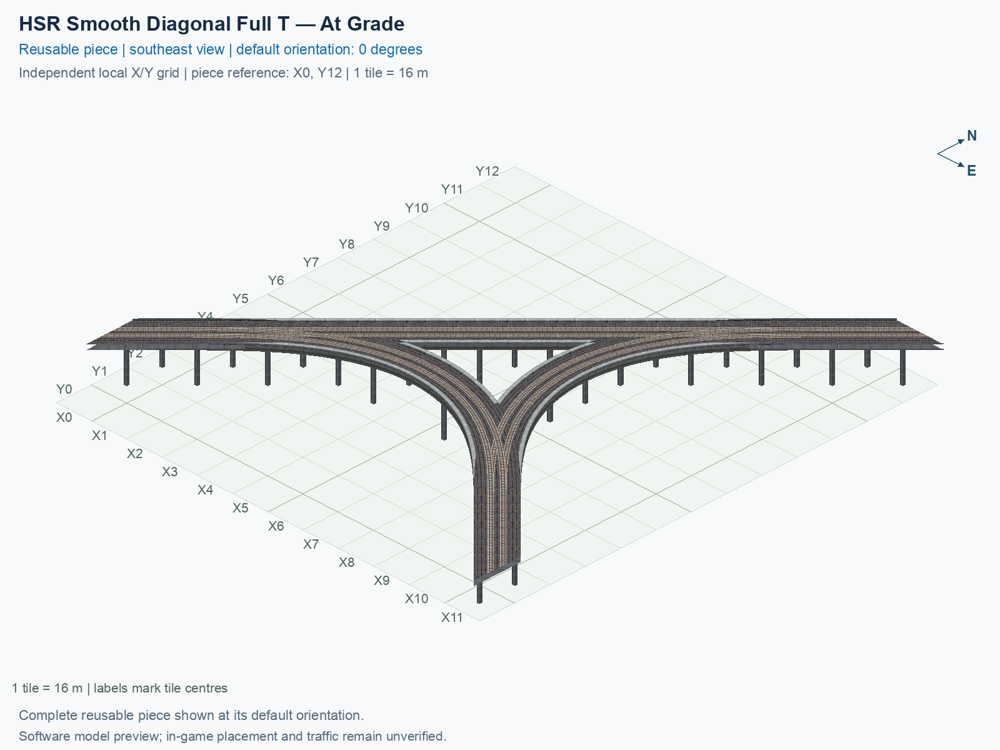

# HSR Smooth Diagonal Full T — At Grade

Purpose: explain this reusable piece, its matching connections and current test coverage.

<!-- BEGIN PIECE OVERVIEW -->

HSR Smooth Diagonal Full T — At Grade. Diagonal HSR mainline with four direct smooth turning connections. All routes stay at the native HSR path height of 15.5 m. This is an at-grade junction: turning routes cross other routes at the same height. It is not a flyover and adds no train signalling or conflict simulation. New visual-review example; experimental, with actual game operation unverified.

Exact reusable identifier: `directional-hsr-t-smooth-diagonal-at-grade`.

Footprint: **13 × 14 tiles**. Exact menu name: **HSR Smooth Diagonal Full T — At Grade**.

Choose this exact name in Transportation → Rail. Press Home or End to rotate; use only the supported states listed below. Join each end to a matching port profile and direction.

- [Connections and journeys](#connections-and-journeys)
- [Test checklist](#test-checklist)



<!-- END PIECE OVERVIEW -->

<!-- BEGIN MANUAL SUMMARY -->

## Manual status

Generated from [the exact test cases](#test-checklist) and [authoritative observations](checks/manual-tests.json).

- [ ] Preview review: 0/1 applicable cases passed; 0 failed, 0 stale.
- [ ] In-game rendering: 0/4 applicable cases passed; 0 failed, 0 stale.
- [ ] Directed journeys: 0/24 applicable cases passed; 0 failed, 0 stale.

These observations cover only the named services, directions, poses, rotations, and recorded platforms.

<!-- END MANUAL SUMMARY -->

## Shape and placement example

This is the diagonal counterpart of the [straight smooth T](../directional-hsr-t-smooth-at-grade/README.md). Its base paired mainline runs southwest/northeast and its third arm southeast. Each arm carries both directions. All six journeys between different arms are permitted; there are no same-arm U-turns.

**At grade** means the routes meet and cross at the same 15.5 m train-path height, while the whole junction remains elevated above the terrain. It has the straight version's three deliberate same-height conflict pairs, rotated to these diagonal approaches, and adds no signalling simulation. Native external offsets are exactly 2.8 or 2.9 m from the relevant tile centre. Four-metre straight collars preserve exact diagonal headings, and small native offset differences ease into the curves.

The 13 × 14 construction rectangle measures 208 × 224 m with 42 occupied cells. Keep the whole rectangle clear during tests: unused cells allow the curved arms and native-width deck edges, rather than promising room for another building or road. The shared support plan has 37 pillars at least 16 m apart. Foundations stay in occupied cells and all 333 underside contact points are checked.

1. Open **Transportation → Rail** in a disposable flat city and select **SCP | HSR Smooth Diagonal Full T — At Grade**.
2. Keep a 13 × 14 area clear. Its base mainline runs southwest/northeast and its branch southeast. Press **Home/End** to rotate by quarter turns, then click once to place. The eight menu states repeat four proper rotations; they do not reflect running directions.
3. Join matching native diagonal paired HSR at all three outside ends. Stop drags at the piece boundary.
4. Create travel demand and check all six journeys, close-up joins and the deliberate same-height crossings. Repeat the other rotations, terrain/shadow inspection, demolition and save/reload checks using the checklist below.

To build only this optional piece, run these commands from the project folder containing `custom-pieces`:

```sh
python3 custom-pieces/scp.py build --set redesigned-diagonal-junction-example --output custom-pieces/dist/diagonal-t-example
python3 custom-pieces/scp.py verify --output custom-pieces/dist/diagonal-t-example
```

Use `--set smooth-t-junctions` to build the two accepted T pieces together under one controller. These commands create staged files; follow the [installation guide](../../../../docs/BUILD_AND_INSTALL.md) for the separate installation step.

## Software checks and their limits

The independent checker tests all six encoded journeys through four rotations, exact native endpoints, approach tangents, route smoothness, visible rails, deck overlap, walls, supports and all five model zooms. Its authored clearance corridor is 5 m wide and 5 m high. This is a project criterion, not a measured game vehicle box.

At an exact external diagonal port, part of a perpendicular corridor belongs to the adjoining native piece. Only the first/last segment is clipped at the declared connection plane for bed coverage; all interior segments retain full width. Nearby interior holes still fail. Native meshes can themselves extend beyond their network cells. The [engineering contract below](#engineering-contract) records the strict boundary/cap criteria, native audit, and negative tests; these are not general exceptions for missing deck coverage.

Actual placement, moving trains, long-car overhang, shadows, terrain and save/reload require matching human observations. Software passes and the compiled preview do not tick game-test cases.

<!-- BEGIN CONNECTIONS -->

## Connections and journeys

Purpose: describe intrinsic directional interfaces and permitted service journeys.

Generated from [connections.json](connections.json). Coordinates are canonical east, north and height in metres. A connection class names an encoded route interface; it does not prove visible deck/wall fit or an in-game test.

Supported placement states: 0° CCW, 90° CCW, 180° CCW, 270° CCW. Each state has its own declared manual scope.

A **port** is one directional transport-path endpoint. **Service** identifies the intended network service (for example HSR, street, or tram); **engine** is its internal traffic-class number, separate from the construction network. **Role** distinguishes primary service from auxiliary paths; sharing a traffic class does not establish service compatibility.

A **tangent** is a unit travel-direction vector: `[0,1]` means north. **Grade** is height gained per horizontal metre. These measured facts describe this subject alone. Compatibility requires a separate comparison of the complete joining boundaries; physical seams and actual game operation require their own evidence. See the [class index](../../connection-classes.json) for shared route-interface membership.

| Port | Service / engine / role | Direction | Location; tangent; grade | Connection class |
| --- | --- | --- | --- | --- |
| `Sin` | hsr / 7 / primary | in | [-8.0, -178.9, 15.5]; [0.7071067811865475, 0.7071067811865475]; 0.0 | `path-interface-9f8c3dd2cd3e736ce4f1` |
| `Sout` | hsr / 7 / primary | out | [-8.0, -173.2, 15.5]; [-0.7071067811865475, -0.7071067811865475]; 0.0 | `path-interface-88adae773e3ea9f487d2` |
| `Nin` | hsr / 7 / primary | in | [173.1, 8.0, 15.5]; [-0.7071067811865475, -0.7071067811865475]; 0.0 | `path-interface-50cc847d03cb7f174ed0` |
| `Nout` | hsr / 7 / primary | out | [178.9, 8.0, 15.5]; [0.7071067811865475, 0.7071067811865475]; 0.0 | `path-interface-50cc847d03cb7f174ed0` |
| `Eout` | hsr / 7 / primary | out | [184.0, -194.9, 15.5]; [0.7071067811865475, -0.7071067811865475]; 0.0 | `path-interface-50cc847d03cb7f174ed0` |
| `Ein` | hsr / 7 / primary | in | [184.0, -189.1, 15.5]; [-0.7071067811865475, 0.7071067811865475]; 0.0 | `path-interface-50cc847d03cb7f174ed0` |

### Directed journeys

| Service | Entry → exit | Role |
| --- | --- | --- |
| hsr | `Sin` → `Eout` | primary |
| hsr | `Sin` → `Nout` | primary |
| hsr | `Nin` → `Sout` | primary |
| hsr | `Nin` → `Eout` | primary |
| hsr | `Ein` → `Nout` | primary |
| hsr | `Ein` → `Sout` | primary |

### Forbidden transfers

| From service / port | To service / port | Reason |
| --- | --- | --- |
| hsr / `Sin` | hsr / `Sout` | No directed route exists between these ports in the saved piece transport paths. In-game confirmation remains unverified. |
| hsr / `Nin` | hsr / `Nout` | No directed route exists between these ports in the saved piece transport paths. In-game confirmation remains unverified. |
| hsr / `Ein` | hsr / `Eout` | No directed route exists between these ports in the saved piece transport paths. In-game confirmation remains unverified. |

Review the test checklist for the exact tested cases and environments.

<!-- END CONNECTIONS -->

<!-- BEGIN MANUAL CHECKS -->

## Test checklist

Generated from [the authoritative record](checks/manual-tests.json). Only explicit human observations create manual passes; software and preview checks remain separate. Expand a check/service group to see its rotation table, then expand the matching exact scope to copy a case ID and inspect its pose, reviewer, environment, and evidence. Grouping changes only this view; every declared case remains separate.

**States:** [x] passed; [ ] unverified, failed, or stale; N/A is an explicit inapplicable declaration. A dash means no case was declared in that column. Every pass covers only its recorded environment. T means a distinct construction-transposed state.

Four proper rotations are covered. No additional reflected state is established by this record; repeated construction aliases do not create new orientations.

Current totals: unverified: 55, passed: 0, failed: 0, stale: 0, not_applicable: 0.

### Record an observation

Follow the [shared testing guide](../../../../docs/TESTING.md); copy [the unconfirmed example](checks/observation.example.json) to `checks/observation.json`. Case identifiers are in the expandable sections below. Do not edit generated checkboxes.

From the repository folder containing `custom-pieces`, run after filling `checks/observation.json` and explicitly confirming the exact observation:

```sh
python3 -m scp.content record --record custom-pieces/domains/high-speed-rail/00_pieces/directional-hsr-t-smooth-diagonal-at-grade/checks/manual-tests.json --observation custom-pieces/domains/high-speed-rail/00_pieces/directional-hsr-t-smooth-diagonal-at-grade/checks/observation.json
```

### Detailed current checks

Each collapsed group shows exact case counts and states. Forbidden transfers are grouped by the directed service pair; the table inside retains every port pair and rotation.

<details>
<summary>Compiled resources — Whole subject — 1 case; unverified: 1</summary>

| Check / exact scope | General | 0° | 90° | 180° | 270° |
| --- | --- | --- | --- | --- | --- |
| **Compiled resources**<br>Whole subject | <a href="#case-software_resources-4f9dde992f0ec5f83553">[ ] unverified</a> | — | — | — | — |


<details>
<summary>Compiled resources — Whole subject</summary>

<a id="case-software_resources-4f9dde992f0ec5f83553"></a>

**General: unverified** — `software_resources-4f9dde992f0ec5f83553`.

Verify the actual compiled resources and construction rules.

Scope: Whole subject.

No observation recorded.

</details>

</details>

<details>
<summary>Directed routing graph — Whole subject — 1 case; unverified: 1</summary>

| Check / exact scope | General | 0° | 90° | 180° | 270° |
| --- | --- | --- | --- | --- | --- |
| **Directed routing graph**<br>Whole subject | <a href="#case-software_connectivity-4f9dde992f0ec5f83553">[ ] unverified</a> | — | — | — | — |


<details>
<summary>Directed routing graph — Whole subject</summary>

<a id="case-software_connectivity-4f9dde992f0ec5f83553"></a>

**General: unverified** — `software_connectivity-4f9dde992f0ec5f83553`.

Verify the declared directed journeys and forbidden transfers.

Scope: Whole subject.

No observation recorded.

</details>

</details>

<details>
<summary>Preview review — Images — 1 case; unverified: 1</summary>

| Check / exact scope | General | 0° | 90° | 180° | 270° |
| --- | --- | --- | --- | --- | --- |
| **Preview review**<br>Image: image:directional-hsr-t-smooth-diagonal-at-grade:canonical-southeast | <a href="#case-preview_review-80a51fe4567fd9ba67a0">[ ] unverified</a> | — | — | — | — |


<details>
<summary>Preview review — Image: image:directional-hsr-t-smooth-diagonal-at-grade:canonical-southeast</summary>

<a id="case-preview_review-80a51fe4567fd9ba67a0"></a>

**General: unverified** — `preview_review-80a51fe4567fd9ba67a0`.

Inspect this exact preview for tracks, walls, piers, seams and shadows.

Scope: Image: image:directional-hsr-t-smooth-diagonal-at-grade:canonical-southeast.

No observation recorded.

</details>

</details>

<details>
<summary>In-game rendering — Whole subject — 4 cases; unverified: 4</summary>

| Check / exact scope | General | 0° | 90° | 180° | 270° |
| --- | --- | --- | --- | --- | --- |
| **In-game rendering**<br>Whole subject | — | <a href="#case-in_game_render-b9059a2600c20b5beac2">[ ] unverified</a> | <a href="#case-in_game_render-6d7da243959047f98f88">[ ] unverified</a> | <a href="#case-in_game_render-5d1bf6cd14d82a825943">[ ] unverified</a> | <a href="#case-in_game_render-39d648567af7b7a1e7c1">[ ] unverified</a> |


<details>
<summary>In-game rendering — Whole subject</summary>

<a id="case-in_game_render-b9059a2600c20b5beac2"></a>

**0° CCW: unverified** — `in_game_render-b9059a2600c20b5beac2`.

Inspect the placed tracks, walls, piers, seams and shadows in SimCity 4.

Scope: Whole subject.

No observation recorded.

<a id="case-in_game_render-6d7da243959047f98f88"></a>

**90° CCW: unverified** — `in_game_render-6d7da243959047f98f88`.

Inspect the placed tracks, walls, piers, seams and shadows in SimCity 4.

Scope: Whole subject.

No observation recorded.

<a id="case-in_game_render-5d1bf6cd14d82a825943"></a>

**180° CCW: unverified** — `in_game_render-5d1bf6cd14d82a825943`.

Inspect the placed tracks, walls, piers, seams and shadows in SimCity 4.

Scope: Whole subject.

No observation recorded.

<a id="case-in_game_render-39d648567af7b7a1e7c1"></a>

**270° CCW: unverified** — `in_game_render-39d648567af7b7a1e7c1`.

Inspect the placed tracks, walls, piers, seams and shadows in SimCity 4.

Scope: Whole subject.

No observation recorded.

</details>

</details>

<details>
<summary>Placement — Whole subject — 4 cases; unverified: 4</summary>

| Check / exact scope | General | 0° | 90° | 180° | 270° |
| --- | --- | --- | --- | --- | --- |
| **Placement**<br>Whole subject | — | <a href="#case-in_game_placement-b9059a2600c20b5beac2">[ ] unverified</a> | <a href="#case-in_game_placement-6d7da243959047f98f88">[ ] unverified</a> | <a href="#case-in_game_placement-5d1bf6cd14d82a825943">[ ] unverified</a> | <a href="#case-in_game_placement-39d648567af7b7a1e7c1">[ ] unverified</a> |


<details>
<summary>Placement — Whole subject</summary>

<a id="case-in_game_placement-b9059a2600c20b5beac2"></a>

**0° CCW: unverified** — `in_game_placement-b9059a2600c20b5beac2`.

Place this piece or complete blueprint and inspect every occupied tile.

Scope: Whole subject.

No observation recorded.

<a id="case-in_game_placement-6d7da243959047f98f88"></a>

**90° CCW: unverified** — `in_game_placement-6d7da243959047f98f88`.

Place this piece or complete blueprint and inspect every occupied tile.

Scope: Whole subject.

No observation recorded.

<a id="case-in_game_placement-5d1bf6cd14d82a825943"></a>

**180° CCW: unverified** — `in_game_placement-5d1bf6cd14d82a825943`.

Place this piece or complete blueprint and inspect every occupied tile.

Scope: Whole subject.

No observation recorded.

<a id="case-in_game_placement-39d648567af7b7a1e7c1"></a>

**270° CCW: unverified** — `in_game_placement-39d648567af7b7a1e7c1`.

Place this piece or complete blueprint and inspect every occupied tile.

Scope: Whole subject.

No observation recorded.

</details>

</details>

<details>
<summary>Demolition — Whole subject — 4 cases; unverified: 4</summary>

| Check / exact scope | General | 0° | 90° | 180° | 270° |
| --- | --- | --- | --- | --- | --- |
| **Demolition**<br>Whole subject | — | <a href="#case-in_game_demolition-b9059a2600c20b5beac2">[ ] unverified</a> | <a href="#case-in_game_demolition-6d7da243959047f98f88">[ ] unverified</a> | <a href="#case-in_game_demolition-5d1bf6cd14d82a825943">[ ] unverified</a> | <a href="#case-in_game_demolition-39d648567af7b7a1e7c1">[ ] unverified</a> |


<details>
<summary>Demolition — Whole subject</summary>

<a id="case-in_game_demolition-b9059a2600c20b5beac2"></a>

**0° CCW: unverified** — `in_game_demolition-b9059a2600c20b5beac2`.

Bulldoze the complete placement and inspect the cleared area.

Scope: Whole subject.

No observation recorded.

<a id="case-in_game_demolition-6d7da243959047f98f88"></a>

**90° CCW: unverified** — `in_game_demolition-6d7da243959047f98f88`.

Bulldoze the complete placement and inspect the cleared area.

Scope: Whole subject.

No observation recorded.

<a id="case-in_game_demolition-5d1bf6cd14d82a825943"></a>

**180° CCW: unverified** — `in_game_demolition-5d1bf6cd14d82a825943`.

Bulldoze the complete placement and inspect the cleared area.

Scope: Whole subject.

No observation recorded.

<a id="case-in_game_demolition-39d648567af7b7a1e7c1"></a>

**270° CCW: unverified** — `in_game_demolition-39d648567af7b7a1e7c1`.

Bulldoze the complete placement and inspect the cleared area.

Scope: Whole subject.

No observation recorded.

</details>

</details>

<details>
<summary>Save and reload — Whole subject — 4 cases; unverified: 4</summary>

| Check / exact scope | General | 0° | 90° | 180° | 270° |
| --- | --- | --- | --- | --- | --- |
| **Save and reload**<br>Whole subject | — | <a href="#case-in_game_save_reload-b9059a2600c20b5beac2">[ ] unverified</a> | <a href="#case-in_game_save_reload-6d7da243959047f98f88">[ ] unverified</a> | <a href="#case-in_game_save_reload-5d1bf6cd14d82a825943">[ ] unverified</a> | <a href="#case-in_game_save_reload-39d648567af7b7a1e7c1">[ ] unverified</a> |


<details>
<summary>Save and reload — Whole subject</summary>

<a id="case-in_game_save_reload-b9059a2600c20b5beac2"></a>

**0° CCW: unverified** — `in_game_save_reload-b9059a2600c20b5beac2`.

Save, quit, reload and inspect the placement and its paths.

Scope: Whole subject.

No observation recorded.

<a id="case-in_game_save_reload-6d7da243959047f98f88"></a>

**90° CCW: unverified** — `in_game_save_reload-6d7da243959047f98f88`.

Save, quit, reload and inspect the placement and its paths.

Scope: Whole subject.

No observation recorded.

<a id="case-in_game_save_reload-5d1bf6cd14d82a825943"></a>

**180° CCW: unverified** — `in_game_save_reload-5d1bf6cd14d82a825943`.

Save, quit, reload and inspect the placement and its paths.

Scope: Whole subject.

No observation recorded.

<a id="case-in_game_save_reload-39d648567af7b7a1e7c1"></a>

**270° CCW: unverified** — `in_game_save_reload-39d648567af7b7a1e7c1`.

Save, quit, reload and inspect the placement and its paths.

Scope: Whole subject.

No observation recorded.

</details>

</details>

<details>
<summary>Journey — hsr — 24 cases; unverified: 24</summary>

| Check / exact scope | General | 0° | 90° | 180° | 270° |
| --- | --- | --- | --- | --- | --- |
| **Journey**<br>Service: hsr; role: primary; journey: 7:Sin>Eout; entry: Sin; exit: Eout | — | <a href="#case-in_game_journey-670a51f75607f4e34e3c">[ ] unverified</a> | <a href="#case-in_game_journey-66a6141c16f7eb0a30c0">[ ] unverified</a> | <a href="#case-in_game_journey-a7037fdbfa84ea21c321">[ ] unverified</a> | <a href="#case-in_game_journey-227d3cc0ccb1943b782d">[ ] unverified</a> |
| **Journey**<br>Service: hsr; role: primary; journey: 7:Sin>Nout; entry: Sin; exit: Nout | — | <a href="#case-in_game_journey-d27a24e91d2591aed2a8">[ ] unverified</a> | <a href="#case-in_game_journey-a89b68e5879aedc312e1">[ ] unverified</a> | <a href="#case-in_game_journey-313bae739459b34a4d64">[ ] unverified</a> | <a href="#case-in_game_journey-680695e3a26ad257296f">[ ] unverified</a> |
| **Journey**<br>Service: hsr; role: primary; journey: 7:Nin>Sout; entry: Nin; exit: Sout | — | <a href="#case-in_game_journey-95ac72e51c8dc0873ea1">[ ] unverified</a> | <a href="#case-in_game_journey-f4e68a1494ae6a1d5932">[ ] unverified</a> | <a href="#case-in_game_journey-d269a92c8454d8937a81">[ ] unverified</a> | <a href="#case-in_game_journey-70040940b863f5ca039b">[ ] unverified</a> |
| **Journey**<br>Service: hsr; role: primary; journey: 7:Nin>Eout; entry: Nin; exit: Eout | — | <a href="#case-in_game_journey-04c30da983d39a9a00e6">[ ] unverified</a> | <a href="#case-in_game_journey-48464c22cf74ad05d613">[ ] unverified</a> | <a href="#case-in_game_journey-bc5af1b533afb1dc721d">[ ] unverified</a> | <a href="#case-in_game_journey-96b41f629c4330d50f06">[ ] unverified</a> |
| **Journey**<br>Service: hsr; role: primary; journey: 7:Ein>Nout; entry: Ein; exit: Nout | — | <a href="#case-in_game_journey-8418203f4ba0d3429195">[ ] unverified</a> | <a href="#case-in_game_journey-5aca6617136eca196d00">[ ] unverified</a> | <a href="#case-in_game_journey-652b91dda6733b20bac8">[ ] unverified</a> | <a href="#case-in_game_journey-a3ce4afa02dbc2c5cb05">[ ] unverified</a> |
| **Journey**<br>Service: hsr; role: primary; journey: 7:Ein>Sout; entry: Ein; exit: Sout | — | <a href="#case-in_game_journey-2770e8fccc5a3373409b">[ ] unverified</a> | <a href="#case-in_game_journey-e8221b0fe6cba5f2e8cb">[ ] unverified</a> | <a href="#case-in_game_journey-f213b17a85eada7ee8a4">[ ] unverified</a> | <a href="#case-in_game_journey-25b87402b86d23925df3">[ ] unverified</a> |


<details>
<summary>Journey — Service: hsr; role: primary; journey: 7:Sin>Eout; entry: Sin; exit: Eout</summary>

<a id="case-in_game_journey-670a51f75607f4e34e3c"></a>

**0° CCW: unverified** — `in_game_journey-670a51f75607f4e34e3c`.

Run the declared journey in this direction using its service network.

Scope: Service: hsr; role: primary; journey: 7:Sin>Eout; entry: Sin; exit: Eout.

No observation recorded.

<a id="case-in_game_journey-66a6141c16f7eb0a30c0"></a>

**90° CCW: unverified** — `in_game_journey-66a6141c16f7eb0a30c0`.

Run the declared journey in this direction using its service network.

Scope: Service: hsr; role: primary; journey: 7:Sin>Eout; entry: Sin; exit: Eout.

No observation recorded.

<a id="case-in_game_journey-a7037fdbfa84ea21c321"></a>

**180° CCW: unverified** — `in_game_journey-a7037fdbfa84ea21c321`.

Run the declared journey in this direction using its service network.

Scope: Service: hsr; role: primary; journey: 7:Sin>Eout; entry: Sin; exit: Eout.

No observation recorded.

<a id="case-in_game_journey-227d3cc0ccb1943b782d"></a>

**270° CCW: unverified** — `in_game_journey-227d3cc0ccb1943b782d`.

Run the declared journey in this direction using its service network.

Scope: Service: hsr; role: primary; journey: 7:Sin>Eout; entry: Sin; exit: Eout.

No observation recorded.

</details>


<details>
<summary>Journey — Service: hsr; role: primary; journey: 7:Sin>Nout; entry: Sin; exit: Nout</summary>

<a id="case-in_game_journey-d27a24e91d2591aed2a8"></a>

**0° CCW: unverified** — `in_game_journey-d27a24e91d2591aed2a8`.

Run the declared journey in this direction using its service network.

Scope: Service: hsr; role: primary; journey: 7:Sin>Nout; entry: Sin; exit: Nout.

No observation recorded.

<a id="case-in_game_journey-a89b68e5879aedc312e1"></a>

**90° CCW: unverified** — `in_game_journey-a89b68e5879aedc312e1`.

Run the declared journey in this direction using its service network.

Scope: Service: hsr; role: primary; journey: 7:Sin>Nout; entry: Sin; exit: Nout.

No observation recorded.

<a id="case-in_game_journey-313bae739459b34a4d64"></a>

**180° CCW: unverified** — `in_game_journey-313bae739459b34a4d64`.

Run the declared journey in this direction using its service network.

Scope: Service: hsr; role: primary; journey: 7:Sin>Nout; entry: Sin; exit: Nout.

No observation recorded.

<a id="case-in_game_journey-680695e3a26ad257296f"></a>

**270° CCW: unverified** — `in_game_journey-680695e3a26ad257296f`.

Run the declared journey in this direction using its service network.

Scope: Service: hsr; role: primary; journey: 7:Sin>Nout; entry: Sin; exit: Nout.

No observation recorded.

</details>


<details>
<summary>Journey — Service: hsr; role: primary; journey: 7:Nin>Sout; entry: Nin; exit: Sout</summary>

<a id="case-in_game_journey-95ac72e51c8dc0873ea1"></a>

**0° CCW: unverified** — `in_game_journey-95ac72e51c8dc0873ea1`.

Run the declared journey in this direction using its service network.

Scope: Service: hsr; role: primary; journey: 7:Nin>Sout; entry: Nin; exit: Sout.

No observation recorded.

<a id="case-in_game_journey-f4e68a1494ae6a1d5932"></a>

**90° CCW: unverified** — `in_game_journey-f4e68a1494ae6a1d5932`.

Run the declared journey in this direction using its service network.

Scope: Service: hsr; role: primary; journey: 7:Nin>Sout; entry: Nin; exit: Sout.

No observation recorded.

<a id="case-in_game_journey-d269a92c8454d8937a81"></a>

**180° CCW: unverified** — `in_game_journey-d269a92c8454d8937a81`.

Run the declared journey in this direction using its service network.

Scope: Service: hsr; role: primary; journey: 7:Nin>Sout; entry: Nin; exit: Sout.

No observation recorded.

<a id="case-in_game_journey-70040940b863f5ca039b"></a>

**270° CCW: unverified** — `in_game_journey-70040940b863f5ca039b`.

Run the declared journey in this direction using its service network.

Scope: Service: hsr; role: primary; journey: 7:Nin>Sout; entry: Nin; exit: Sout.

No observation recorded.

</details>


<details>
<summary>Journey — Service: hsr; role: primary; journey: 7:Nin>Eout; entry: Nin; exit: Eout</summary>

<a id="case-in_game_journey-04c30da983d39a9a00e6"></a>

**0° CCW: unverified** — `in_game_journey-04c30da983d39a9a00e6`.

Run the declared journey in this direction using its service network.

Scope: Service: hsr; role: primary; journey: 7:Nin>Eout; entry: Nin; exit: Eout.

No observation recorded.

<a id="case-in_game_journey-48464c22cf74ad05d613"></a>

**90° CCW: unverified** — `in_game_journey-48464c22cf74ad05d613`.

Run the declared journey in this direction using its service network.

Scope: Service: hsr; role: primary; journey: 7:Nin>Eout; entry: Nin; exit: Eout.

No observation recorded.

<a id="case-in_game_journey-bc5af1b533afb1dc721d"></a>

**180° CCW: unverified** — `in_game_journey-bc5af1b533afb1dc721d`.

Run the declared journey in this direction using its service network.

Scope: Service: hsr; role: primary; journey: 7:Nin>Eout; entry: Nin; exit: Eout.

No observation recorded.

<a id="case-in_game_journey-96b41f629c4330d50f06"></a>

**270° CCW: unverified** — `in_game_journey-96b41f629c4330d50f06`.

Run the declared journey in this direction using its service network.

Scope: Service: hsr; role: primary; journey: 7:Nin>Eout; entry: Nin; exit: Eout.

No observation recorded.

</details>


<details>
<summary>Journey — Service: hsr; role: primary; journey: 7:Ein>Nout; entry: Ein; exit: Nout</summary>

<a id="case-in_game_journey-8418203f4ba0d3429195"></a>

**0° CCW: unverified** — `in_game_journey-8418203f4ba0d3429195`.

Run the declared journey in this direction using its service network.

Scope: Service: hsr; role: primary; journey: 7:Ein>Nout; entry: Ein; exit: Nout.

No observation recorded.

<a id="case-in_game_journey-5aca6617136eca196d00"></a>

**90° CCW: unverified** — `in_game_journey-5aca6617136eca196d00`.

Run the declared journey in this direction using its service network.

Scope: Service: hsr; role: primary; journey: 7:Ein>Nout; entry: Ein; exit: Nout.

No observation recorded.

<a id="case-in_game_journey-652b91dda6733b20bac8"></a>

**180° CCW: unverified** — `in_game_journey-652b91dda6733b20bac8`.

Run the declared journey in this direction using its service network.

Scope: Service: hsr; role: primary; journey: 7:Ein>Nout; entry: Ein; exit: Nout.

No observation recorded.

<a id="case-in_game_journey-a3ce4afa02dbc2c5cb05"></a>

**270° CCW: unverified** — `in_game_journey-a3ce4afa02dbc2c5cb05`.

Run the declared journey in this direction using its service network.

Scope: Service: hsr; role: primary; journey: 7:Ein>Nout; entry: Ein; exit: Nout.

No observation recorded.

</details>


<details>
<summary>Journey — Service: hsr; role: primary; journey: 7:Ein>Sout; entry: Ein; exit: Sout</summary>

<a id="case-in_game_journey-2770e8fccc5a3373409b"></a>

**0° CCW: unverified** — `in_game_journey-2770e8fccc5a3373409b`.

Run the declared journey in this direction using its service network.

Scope: Service: hsr; role: primary; journey: 7:Ein>Sout; entry: Ein; exit: Sout.

No observation recorded.

<a id="case-in_game_journey-e8221b0fe6cba5f2e8cb"></a>

**90° CCW: unverified** — `in_game_journey-e8221b0fe6cba5f2e8cb`.

Run the declared journey in this direction using its service network.

Scope: Service: hsr; role: primary; journey: 7:Ein>Sout; entry: Ein; exit: Sout.

No observation recorded.

<a id="case-in_game_journey-f213b17a85eada7ee8a4"></a>

**180° CCW: unverified** — `in_game_journey-f213b17a85eada7ee8a4`.

Run the declared journey in this direction using its service network.

Scope: Service: hsr; role: primary; journey: 7:Ein>Sout; entry: Ein; exit: Sout.

No observation recorded.

<a id="case-in_game_journey-25b87402b86d23925df3"></a>

**270° CCW: unverified** — `in_game_journey-25b87402b86d23925df3`.

Run the declared journey in this direction using its service network.

Scope: Service: hsr; role: primary; journey: 7:Ein>Sout; entry: Ein; exit: Sout.

No observation recorded.

</details>

</details>

<details>
<summary>Forbidden transfer — hsr → hsr — 12 cases; unverified: 12</summary>

| Check / exact scope | General | 0° | 90° | 180° | 270° |
| --- | --- | --- | --- | --- | --- |
| **Forbidden transfer**<br>from port: Sin; to port: Sout; from service: hsr; to service: hsr; basis: not reachable in actual saved PATH graph | — | <a href="#case-in_game_forbidden_transfer-e38798f2f9b9d30f76f4">[ ] unverified</a> | <a href="#case-in_game_forbidden_transfer-07c4d0632e509ec63164">[ ] unverified</a> | <a href="#case-in_game_forbidden_transfer-ffcbabeca75bdb3ab024">[ ] unverified</a> | <a href="#case-in_game_forbidden_transfer-8670fc5dbf2496f98a8d">[ ] unverified</a> |
| **Forbidden transfer**<br>from port: Nin; to port: Nout; from service: hsr; to service: hsr; basis: not reachable in actual saved PATH graph | — | <a href="#case-in_game_forbidden_transfer-1c552a84e38ea3f81474">[ ] unverified</a> | <a href="#case-in_game_forbidden_transfer-cf5e9ec239028136ca66">[ ] unverified</a> | <a href="#case-in_game_forbidden_transfer-3e1b55f91429bd27cecc">[ ] unverified</a> | <a href="#case-in_game_forbidden_transfer-630ac4730f3ece9e6c9e">[ ] unverified</a> |
| **Forbidden transfer**<br>from port: Ein; to port: Eout; from service: hsr; to service: hsr; basis: not reachable in actual saved PATH graph | — | <a href="#case-in_game_forbidden_transfer-48dd7060923074009d70">[ ] unverified</a> | <a href="#case-in_game_forbidden_transfer-8d755f2424978e448ae5">[ ] unverified</a> | <a href="#case-in_game_forbidden_transfer-7388a027444a9f7fb8d7">[ ] unverified</a> | <a href="#case-in_game_forbidden_transfer-ce70a771ca48be40d7d8">[ ] unverified</a> |


<details>
<summary>Forbidden transfer — from port: Sin; to port: Sout; from service: hsr; to service: hsr; basis: not reachable in actual saved PATH graph</summary>

<a id="case-in_game_forbidden_transfer-e38798f2f9b9d30f76f4"></a>

**0° CCW: unverified** — `in_game_forbidden_transfer-e38798f2f9b9d30f76f4`.

Confirm this undeclared transfer is unavailable.

Scope: from port: Sin; to port: Sout; from service: hsr; to service: hsr; basis: not reachable in actual saved PATH graph.

No observation recorded.

<a id="case-in_game_forbidden_transfer-07c4d0632e509ec63164"></a>

**90° CCW: unverified** — `in_game_forbidden_transfer-07c4d0632e509ec63164`.

Confirm this undeclared transfer is unavailable.

Scope: from port: Sin; to port: Sout; from service: hsr; to service: hsr; basis: not reachable in actual saved PATH graph.

No observation recorded.

<a id="case-in_game_forbidden_transfer-ffcbabeca75bdb3ab024"></a>

**180° CCW: unverified** — `in_game_forbidden_transfer-ffcbabeca75bdb3ab024`.

Confirm this undeclared transfer is unavailable.

Scope: from port: Sin; to port: Sout; from service: hsr; to service: hsr; basis: not reachable in actual saved PATH graph.

No observation recorded.

<a id="case-in_game_forbidden_transfer-8670fc5dbf2496f98a8d"></a>

**270° CCW: unverified** — `in_game_forbidden_transfer-8670fc5dbf2496f98a8d`.

Confirm this undeclared transfer is unavailable.

Scope: from port: Sin; to port: Sout; from service: hsr; to service: hsr; basis: not reachable in actual saved PATH graph.

No observation recorded.

</details>


<details>
<summary>Forbidden transfer — from port: Nin; to port: Nout; from service: hsr; to service: hsr; basis: not reachable in actual saved PATH graph</summary>

<a id="case-in_game_forbidden_transfer-1c552a84e38ea3f81474"></a>

**0° CCW: unverified** — `in_game_forbidden_transfer-1c552a84e38ea3f81474`.

Confirm this undeclared transfer is unavailable.

Scope: from port: Nin; to port: Nout; from service: hsr; to service: hsr; basis: not reachable in actual saved PATH graph.

No observation recorded.

<a id="case-in_game_forbidden_transfer-cf5e9ec239028136ca66"></a>

**90° CCW: unverified** — `in_game_forbidden_transfer-cf5e9ec239028136ca66`.

Confirm this undeclared transfer is unavailable.

Scope: from port: Nin; to port: Nout; from service: hsr; to service: hsr; basis: not reachable in actual saved PATH graph.

No observation recorded.

<a id="case-in_game_forbidden_transfer-3e1b55f91429bd27cecc"></a>

**180° CCW: unverified** — `in_game_forbidden_transfer-3e1b55f91429bd27cecc`.

Confirm this undeclared transfer is unavailable.

Scope: from port: Nin; to port: Nout; from service: hsr; to service: hsr; basis: not reachable in actual saved PATH graph.

No observation recorded.

<a id="case-in_game_forbidden_transfer-630ac4730f3ece9e6c9e"></a>

**270° CCW: unverified** — `in_game_forbidden_transfer-630ac4730f3ece9e6c9e`.

Confirm this undeclared transfer is unavailable.

Scope: from port: Nin; to port: Nout; from service: hsr; to service: hsr; basis: not reachable in actual saved PATH graph.

No observation recorded.

</details>


<details>
<summary>Forbidden transfer — from port: Ein; to port: Eout; from service: hsr; to service: hsr; basis: not reachable in actual saved PATH graph</summary>

<a id="case-in_game_forbidden_transfer-48dd7060923074009d70"></a>

**0° CCW: unverified** — `in_game_forbidden_transfer-48dd7060923074009d70`.

Confirm this undeclared transfer is unavailable.

Scope: from port: Ein; to port: Eout; from service: hsr; to service: hsr; basis: not reachable in actual saved PATH graph.

No observation recorded.

<a id="case-in_game_forbidden_transfer-8d755f2424978e448ae5"></a>

**90° CCW: unverified** — `in_game_forbidden_transfer-8d755f2424978e448ae5`.

Confirm this undeclared transfer is unavailable.

Scope: from port: Ein; to port: Eout; from service: hsr; to service: hsr; basis: not reachable in actual saved PATH graph.

No observation recorded.

<a id="case-in_game_forbidden_transfer-7388a027444a9f7fb8d7"></a>

**180° CCW: unverified** — `in_game_forbidden_transfer-7388a027444a9f7fb8d7`.

Confirm this undeclared transfer is unavailable.

Scope: from port: Ein; to port: Eout; from service: hsr; to service: hsr; basis: not reachable in actual saved PATH graph.

No observation recorded.

<a id="case-in_game_forbidden_transfer-ce70a771ca48be40d7d8"></a>

**270° CCW: unverified** — `in_game_forbidden_transfer-ce70a771ca48be40d7d8`.

Confirm this undeclared transfer is unavailable.

Scope: from port: Ein; to port: Eout; from service: hsr; to service: hsr; basis: not reachable in actual saved PATH graph.

No observation recorded.

</details>

</details>

<!-- END MANUAL CHECKS -->

## Engineering contract

The accepted straight generator and verifier remain unchanged. The diagonal generator reuses the robust clipping and partition helpers, with its own wall-only compiler, diagonal floor union, and complete-input bounded cache. It skips old flat-surface calculations that would immediately be replaced. The floor union clips faces into exact 4 m grid cells before joining them. Long diagonal faces otherwise fragment repeatedly against hundreds of nearby curve faces, causing severe unnecessary work. Exact row-strip clipping finds the touched cells; this must never become a sampled occupancy mask. Preserve full coverage, input order, and texture priority within each cell, and keep the independent floor audit. Retessellation is permitted only for this new geometry; existing visible geometry, visible triangle order, XYZ/UV, materials, and render state remain fixed. Serialization-only differences need the separate exact-equivalence guard and explicit encoding disclosure. Do not rotate old two-metre track offsets and claim native diagonal compatibility: use the audited native asymmetric 2.8/2.9 m ports.

The shape section above records its southwest/northeast mainline, southeast branch, 13 × 14 rectangle, 42 traffic cells, 37 globally planned piers at least 16 m apart, 333 underside contacts, 15.5 m paths, six journeys, and three declared same-height conflicts. Check all five model zooms and the preview, and retain the smooth-route criteria and 5 m × 5 m corridor checks.

At exact declared external diagonal ports only, the bed audit clips the first/last segment corridor to the piece side of its literal connection plane. The other half belongs to the native continuation; this is not a general bounding-box exception or an interior width reduction. Exact 4 m native tangent collars keep later segments fully inside. Test a nearby interior hole and an undeclared near-port endpoint as negative controls. Native donor meshes themselves can overhang their cells. Allow honest native-width profile margins inside the full authored rectangle.

The [native port-cap audit](../../native-diagonal-port-cap-audit.json) demonstrates another diagonal boundary effect on the actual `5dd01a00` donor. A rail-band point at `(4.200757, 8)` lies 1.300757 m from the north-out PATH endpoint `(2.9, 8)`, yet only 0.919774 m perpendicular to its exact 45-degree rail line. A contained native triangle has the same effect at its centroid. A finite endpoint-distance test therefore rejects legitimate diagonal rail texture. Any declared-port cap matching must require the exact declared native port, authored-side connection halfspace, and the existing perpendicular allowance; keep its outward reach bounded by that allowance and keep interior checks. The diagonal verifier applies this exception only to wide rail-band triangle centroids, using the existing 1.1 m limit in both perpendicular distance and outward reach. Recovered rail centres still require the actual finite encoded PATH within 0.25 m; there are no centre-line cap exceptions. Require an exact external endpoint in the actual PATH records before using the literal cap. Do not trim the physical native-width deck or increase global tolerances.

Use the independent literal diagonal verifier for these exceptions and their nearby-hole and undeclared-endpoint negative controls. The straight smooth T retains its own generator and verifier; do not overwrite it or clear another piece's design-review flag. `--set redesigned-diagonal-junction-example` selects this type, while `--set smooth-t-junctions` selects both accepted T types.

Use the [independent source contract](../../implementation/scp_hsr/directional_diagonal_t_verify.py) and this type's [definition](piece.json) for exact expectations. Shared HSR/GHSR facts remain in [NETWORK_SPEC.md](../../NETWORK_SPEC.md). These authored notes supplement generated source views; they do not change geometry, reset observations, or establish game operation.
