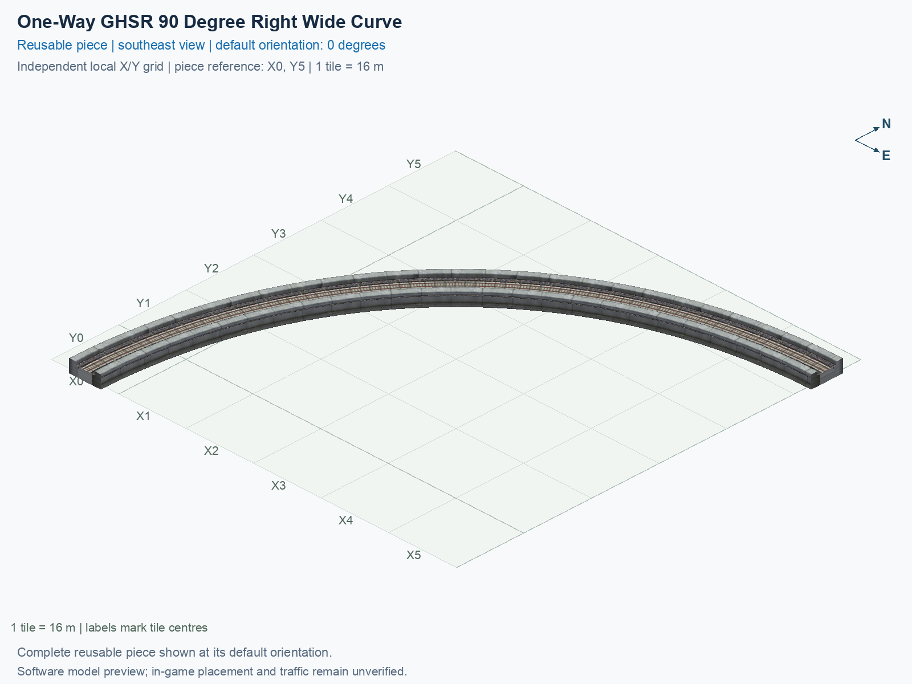

<a id="one-way-ghsr-90-degree-right-wide-curve"></a>

# GHSR Ground (1 m) — Single-Track One-Way Curve 90° Right — Wide

<!-- SUBJECT IDENTITY MIGRATION -->

Identity migration: `interchange-oneway-ground-turn90-right-wide` → `ghsr-ground-single-track-oneway-curve-90deg-right-wide`. Earlier measurements, observations, and pictures retain their recorded names and fingerprints; they do not establish verification of the renamed build. See the [identity migration rules](../../../../docs/NAMING_CONVENTIONS.md#10-choosing-and-changing-names).

Purpose: explain this reusable piece, its matching connections and current test coverage.

<!-- BEGIN PIECE OVERVIEW -->

GHSR Ground (1 m) — Single-Track One-Way Curve 90° Right — Wide. Fixed click-to-place piece in a 6 by 6 tile area. Follow the arrows and join only matching track widths, directions, and height labels. Four proper rotations; the second four states repeat them. Experimental; game testing pending.

Exact reusable identifier: `ghsr-ground-single-track-oneway-curve-90deg-right-wide`.

Footprint: **6 × 6 tiles**. Exact menu name: **GHSR Ground (1 m) — Single-Track One-Way Curve 90° Right — Wide**.

Choose this exact name in Transportation → Rail. Press Home or End to rotate; use only the supported states listed below. Join each end to a matching port profile and direction.

- [Connections and journeys](#connections-and-journeys)
- [Test checklist](#test-checklist)



<!-- END PIECE OVERVIEW -->

<!-- BEGIN MANUAL SUMMARY -->

## Manual status

Generated from [the exact test cases](#test-checklist) and [authoritative observations](checks/manual-tests.json).

- [ ] Preview review: 0/1 applicable cases passed; 0 failed, 0 stale.
- [ ] In-game rendering: 0/4 applicable cases passed; 0 failed, 0 stale.
- [ ] Directed journeys: 0/4 applicable cases passed; 0 failed, 0 stale.

These observations cover only the named services, directions, poses, rotations, and recorded platforms.

<!-- END MANUAL SUMMARY -->

<!-- BEGIN CONNECTIONS -->

## Connections and journeys

Purpose: describe intrinsic directional interfaces and permitted service journeys.

Generated from [connections.json](connections.json). Coordinates are canonical east, north, and height in metres. A connection class names an encoded route interface; it does not prove visible deck/wall fit or an in-game test.

Supported placement states: 0° CCW, 90° CCW, 180° CCW, 270° CCW. Each state has its own declared manual scope.

A **port** is one directional transport-path endpoint. **Service** identifies the intended network service (for example HSR, street, or tram); **engine** is its internal traffic-class number, separate from the construction network. **Role** distinguishes primary service from auxiliary paths; sharing a traffic class does not establish service compatibility.

A **tangent** is a unit travel-direction vector: `[0,1]` means north. **Grade** is height gained per horizontal metre. These measured facts describe this subject alone. Compatibility requires a separate comparison of the complete joining boundaries; physical seams and actual game operation require their own evidence. See the [class index](../../connection-classes.jsonc) for shared route-interface membership.

| Port | Service / engine / role | Direction | Location; tangent; grade | Connection class |
| --- | --- | --- | --- | --- |
| `in` | ghsr / 7 / primary | in | [0.0, -88.0, 1.0]; [0.0, 1.0]; 0.0 | `path-interface-459a3d38a8ff1501aa51` |
| `out` | ghsr / 7 / primary | out | [88.0, 0.0, 1.0]; [1.0, 0.0]; 0.0 | `path-interface-ab4e40517da7fa0dbd34` |

### Directed journeys

| Service | Entry → exit | Role |
| --- | --- | --- |
| ghsr | `in` → `out` | primary |

### Forbidden transfers

No additional forbidden-transfer cases are declared beyond the directed graph; no extra transfers are implied.

Review the test checklist for the exact tested cases and environments.

<!-- END CONNECTIONS -->

<!-- BEGIN MANUAL CHECKS -->

## Test checklist

Generated from [the authoritative record](checks/manual-tests.json). Only explicit human observations create manual passes; software and preview checks remain separate. Expand a check/service group to see its rotation table, then expand the matching exact scope to copy a case ID and inspect its pose, reviewer, environment, and evidence. Grouping changes only this view; every declared case remains separate.

**States:** [x] passed; [ ] unverified, failed, or stale; N/A is an explicit inapplicable declaration. A dash means no case was declared in that column. Every pass covers only its recorded environment. T means a distinct construction-transposed state.

Four proper rotations are covered. No additional reflected state is established by this record; repeated construction aliases do not create new orientations.

Current totals: unverified: 23, passed: 0, failed: 0, stale: 0, not_applicable: 0.

### Record an observation

Follow the [shared testing guide](../../../../docs/TESTING.md); copy [the unconfirmed example](checks/observation.example.json) to `checks/observation.json`. Case identifiers are in the expandable sections below. Do not edit generated checkboxes.

From the repository folder containing `custom-pieces`, run after filling `checks/observation.json` and explicitly confirming the exact observation:

```sh
python3 -m scp.content record --record custom-pieces/domains/high-speed-rail/00_pieces/ghsr-ground-single-track-oneway-curve-90deg-right-wide/checks/manual-tests.json --observation custom-pieces/domains/high-speed-rail/00_pieces/ghsr-ground-single-track-oneway-curve-90deg-right-wide/checks/observation.json
```

### Detailed current checks

Each collapsed group shows exact case counts and states. Forbidden transfers are grouped by the directed service pair; the table inside retains every port pair and rotation.

<details>
<summary>Compiled resources — Whole subject — 1 case; unverified: 1</summary>

| Check / exact scope | General | 0° | 90° | 180° | 270° |
| --- | --- | --- | --- | --- | --- |
| **Compiled resources**<br>Whole subject | <a href="#case-software_resources-b7804e1e0ffaeec524f8">[ ] unverified</a> | — | — | — | — |


<details>
<summary>Compiled resources — Whole subject</summary>

<a id="case-software_resources-b7804e1e0ffaeec524f8"></a>

**General: unverified** — `software_resources-b7804e1e0ffaeec524f8`.

Verify the actual compiled resources and construction rules.

Scope: Whole subject.

No observation recorded.

</details>

</details>

<details>
<summary>Directed routing graph — Whole subject — 1 case; unverified: 1</summary>

| Check / exact scope | General | 0° | 90° | 180° | 270° |
| --- | --- | --- | --- | --- | --- |
| **Directed routing graph**<br>Whole subject | <a href="#case-software_connectivity-b7804e1e0ffaeec524f8">[ ] unverified</a> | — | — | — | — |


<details>
<summary>Directed routing graph — Whole subject</summary>

<a id="case-software_connectivity-b7804e1e0ffaeec524f8"></a>

**General: unverified** — `software_connectivity-b7804e1e0ffaeec524f8`.

Verify the declared directed journeys and forbidden transfers.

Scope: Whole subject.

No observation recorded.

</details>

</details>

<details>
<summary>Preview review — Images — 1 case; unverified: 1</summary>

| Check / exact scope | General | 0° | 90° | 180° | 270° |
| --- | --- | --- | --- | --- | --- |
| **Preview review**<br>Image: image:interchange-oneway-ground-turn90-right-wide:canonical-southeast | <a href="#case-preview_review-f60441974ae8bdd4912a">[ ] unverified</a> | — | — | — | — |


<details>
<summary>Preview review — Image: image:interchange-oneway-ground-turn90-right-wide:canonical-southeast</summary>

<a id="case-preview_review-f60441974ae8bdd4912a"></a>

**General: unverified** — `preview_review-f60441974ae8bdd4912a`.

Inspect this exact preview for tracks, walls, piers, seams and shadows.

Scope: Image: image:interchange-oneway-ground-turn90-right-wide:canonical-southeast.

No observation recorded.

</details>

</details>

<details>
<summary>In-game rendering — Whole subject — 4 cases; unverified: 4</summary>

| Check / exact scope | General | 0° | 90° | 180° | 270° |
| --- | --- | --- | --- | --- | --- |
| **In-game rendering**<br>Whole subject | — | <a href="#case-in_game_render-c57ae87433b2bf32c9aa">[ ] unverified</a> | <a href="#case-in_game_render-53f481cff64137620869">[ ] unverified</a> | <a href="#case-in_game_render-472dc502167370528c4a">[ ] unverified</a> | <a href="#case-in_game_render-b723b1d10945eca27779">[ ] unverified</a> |


<details>
<summary>In-game rendering — Whole subject</summary>

<a id="case-in_game_render-c57ae87433b2bf32c9aa"></a>

**0° CCW: unverified** — `in_game_render-c57ae87433b2bf32c9aa`.

Inspect the placed tracks, walls, piers, seams and shadows in SimCity 4.

Scope: Whole subject.

No observation recorded.

<a id="case-in_game_render-53f481cff64137620869"></a>

**90° CCW: unverified** — `in_game_render-53f481cff64137620869`.

Inspect the placed tracks, walls, piers, seams and shadows in SimCity 4.

Scope: Whole subject.

No observation recorded.

<a id="case-in_game_render-472dc502167370528c4a"></a>

**180° CCW: unverified** — `in_game_render-472dc502167370528c4a`.

Inspect the placed tracks, walls, piers, seams and shadows in SimCity 4.

Scope: Whole subject.

No observation recorded.

<a id="case-in_game_render-b723b1d10945eca27779"></a>

**270° CCW: unverified** — `in_game_render-b723b1d10945eca27779`.

Inspect the placed tracks, walls, piers, seams and shadows in SimCity 4.

Scope: Whole subject.

No observation recorded.

</details>

</details>

<details>
<summary>Placement — Whole subject — 4 cases; unverified: 4</summary>

| Check / exact scope | General | 0° | 90° | 180° | 270° |
| --- | --- | --- | --- | --- | --- |
| **Placement**<br>Whole subject | — | <a href="#case-in_game_placement-c57ae87433b2bf32c9aa">[ ] unverified</a> | <a href="#case-in_game_placement-53f481cff64137620869">[ ] unverified</a> | <a href="#case-in_game_placement-472dc502167370528c4a">[ ] unverified</a> | <a href="#case-in_game_placement-b723b1d10945eca27779">[ ] unverified</a> |


<details>
<summary>Placement — Whole subject</summary>

<a id="case-in_game_placement-c57ae87433b2bf32c9aa"></a>

**0° CCW: unverified** — `in_game_placement-c57ae87433b2bf32c9aa`.

Place this piece or complete blueprint and inspect every occupied tile.

Scope: Whole subject.

No observation recorded.

<a id="case-in_game_placement-53f481cff64137620869"></a>

**90° CCW: unverified** — `in_game_placement-53f481cff64137620869`.

Place this piece or complete blueprint and inspect every occupied tile.

Scope: Whole subject.

No observation recorded.

<a id="case-in_game_placement-472dc502167370528c4a"></a>

**180° CCW: unverified** — `in_game_placement-472dc502167370528c4a`.

Place this piece or complete blueprint and inspect every occupied tile.

Scope: Whole subject.

No observation recorded.

<a id="case-in_game_placement-b723b1d10945eca27779"></a>

**270° CCW: unverified** — `in_game_placement-b723b1d10945eca27779`.

Place this piece or complete blueprint and inspect every occupied tile.

Scope: Whole subject.

No observation recorded.

</details>

</details>

<details>
<summary>Demolition — Whole subject — 4 cases; unverified: 4</summary>

| Check / exact scope | General | 0° | 90° | 180° | 270° |
| --- | --- | --- | --- | --- | --- |
| **Demolition**<br>Whole subject | — | <a href="#case-in_game_demolition-c57ae87433b2bf32c9aa">[ ] unverified</a> | <a href="#case-in_game_demolition-53f481cff64137620869">[ ] unverified</a> | <a href="#case-in_game_demolition-472dc502167370528c4a">[ ] unverified</a> | <a href="#case-in_game_demolition-b723b1d10945eca27779">[ ] unverified</a> |


<details>
<summary>Demolition — Whole subject</summary>

<a id="case-in_game_demolition-c57ae87433b2bf32c9aa"></a>

**0° CCW: unverified** — `in_game_demolition-c57ae87433b2bf32c9aa`.

Bulldoze the complete placement and inspect the cleared area.

Scope: Whole subject.

No observation recorded.

<a id="case-in_game_demolition-53f481cff64137620869"></a>

**90° CCW: unverified** — `in_game_demolition-53f481cff64137620869`.

Bulldoze the complete placement and inspect the cleared area.

Scope: Whole subject.

No observation recorded.

<a id="case-in_game_demolition-472dc502167370528c4a"></a>

**180° CCW: unverified** — `in_game_demolition-472dc502167370528c4a`.

Bulldoze the complete placement and inspect the cleared area.

Scope: Whole subject.

No observation recorded.

<a id="case-in_game_demolition-b723b1d10945eca27779"></a>

**270° CCW: unverified** — `in_game_demolition-b723b1d10945eca27779`.

Bulldoze the complete placement and inspect the cleared area.

Scope: Whole subject.

No observation recorded.

</details>

</details>

<details>
<summary>Save and reload — Whole subject — 4 cases; unverified: 4</summary>

| Check / exact scope | General | 0° | 90° | 180° | 270° |
| --- | --- | --- | --- | --- | --- |
| **Save and reload**<br>Whole subject | — | <a href="#case-in_game_save_reload-c57ae87433b2bf32c9aa">[ ] unverified</a> | <a href="#case-in_game_save_reload-53f481cff64137620869">[ ] unverified</a> | <a href="#case-in_game_save_reload-472dc502167370528c4a">[ ] unverified</a> | <a href="#case-in_game_save_reload-b723b1d10945eca27779">[ ] unverified</a> |


<details>
<summary>Save and reload — Whole subject</summary>

<a id="case-in_game_save_reload-c57ae87433b2bf32c9aa"></a>

**0° CCW: unverified** — `in_game_save_reload-c57ae87433b2bf32c9aa`.

Save, quit, reload and inspect the placement and its paths.

Scope: Whole subject.

No observation recorded.

<a id="case-in_game_save_reload-53f481cff64137620869"></a>

**90° CCW: unverified** — `in_game_save_reload-53f481cff64137620869`.

Save, quit, reload and inspect the placement and its paths.

Scope: Whole subject.

No observation recorded.

<a id="case-in_game_save_reload-472dc502167370528c4a"></a>

**180° CCW: unverified** — `in_game_save_reload-472dc502167370528c4a`.

Save, quit, reload and inspect the placement and its paths.

Scope: Whole subject.

No observation recorded.

<a id="case-in_game_save_reload-b723b1d10945eca27779"></a>

**270° CCW: unverified** — `in_game_save_reload-b723b1d10945eca27779`.

Save, quit, reload and inspect the placement and its paths.

Scope: Whole subject.

No observation recorded.

</details>

</details>

<details>
<summary>Journey — ghsr — 4 cases; unverified: 4</summary>

| Check / exact scope | General | 0° | 90° | 180° | 270° |
| --- | --- | --- | --- | --- | --- |
| **Journey**<br>Service: ghsr; role: primary; journey: 7:in>out; entry: in; exit: out | — | <a href="#case-in_game_journey-13bb8c0a5289ee8ab3db">[ ] unverified</a> | <a href="#case-in_game_journey-980e40e867eb58385c22">[ ] unverified</a> | <a href="#case-in_game_journey-93dfd91ad0af4b7a7fcc">[ ] unverified</a> | <a href="#case-in_game_journey-f5216abe4f11c4bdb323">[ ] unverified</a> |


<details>
<summary>Journey — Service: ghsr; role: primary; journey: 7:in>out; entry: in; exit: out</summary>

<a id="case-in_game_journey-13bb8c0a5289ee8ab3db"></a>

**0° CCW: unverified** — `in_game_journey-13bb8c0a5289ee8ab3db`.

Run the declared journey in this direction using its service network.

Scope: Service: ghsr; role: primary; journey: 7:in>out; entry: in; exit: out.

No observation recorded.

<a id="case-in_game_journey-980e40e867eb58385c22"></a>

**90° CCW: unverified** — `in_game_journey-980e40e867eb58385c22`.

Run the declared journey in this direction using its service network.

Scope: Service: ghsr; role: primary; journey: 7:in>out; entry: in; exit: out.

No observation recorded.

<a id="case-in_game_journey-93dfd91ad0af4b7a7fcc"></a>

**180° CCW: unverified** — `in_game_journey-93dfd91ad0af4b7a7fcc`.

Run the declared journey in this direction using its service network.

Scope: Service: ghsr; role: primary; journey: 7:in>out; entry: in; exit: out.

No observation recorded.

<a id="case-in_game_journey-f5216abe4f11c4bdb323"></a>

**270° CCW: unverified** — `in_game_journey-f5216abe4f11c4bdb323`.

Run the declared journey in this direction using its service network.

Scope: Service: ghsr; role: primary; journey: 7:in>out; entry: in; exit: out.

No observation recorded.

</details>

</details>

<!-- END MANUAL CHECKS -->
