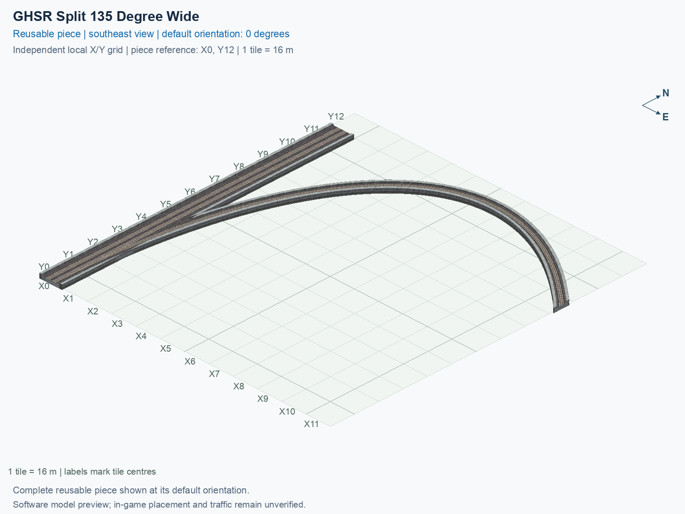

<a id="ghsr-split-135-degree-wide"></a>

# GHSR Ground (1 m) — Split 135° Right from Two-Track Mainline — Wide

<!-- SUBJECT IDENTITY MIGRATION -->

Identity migration: `interchange-ground-split-135-wide` → `ghsr-ground-two-track-mainline-split-135deg-right-wide`. Earlier measurements, observations, and pictures retain their recorded names and fingerprints; they do not establish verification of the renamed build. See the [identity migration rules](../../../../docs/NAMING_CONVENTIONS.md#10-choosing-and-changing-names).

Purpose: explain this reusable piece, its matching connections and current test coverage.

<!-- BEGIN PIECE OVERVIEW -->

GHSR Ground (1 m) — Split 135° Right from Two-Track Mainline — Wide. Fixed click-to-place piece in a 12 by 13 tile area. Follow the arrows and join only matching track widths, directions, and height labels. Four proper rotations; the second four states repeat them. Experimental; game testing pending. The mainline retains both directions; only the branch is one-way.

Exact reusable identifier: `ghsr-ground-two-track-mainline-split-135deg-right-wide`.

Footprint: **12 × 13 tiles**. Exact menu name: **GHSR Ground (1 m) — Split 135° Right from Two-Track Mainline — Wide**.

Choose this exact name in Transportation → Rail. Press Home or End to rotate; use only the supported states listed below. Join each end to a matching port profile and direction.

- [Connections and journeys](#connections-and-journeys)
- [Test checklist](#test-checklist)



<!-- END PIECE OVERVIEW -->

<!-- BEGIN MANUAL SUMMARY -->

## Manual status

Generated from [the exact test cases](#test-checklist) and [authoritative observations](checks/manual-tests.json).

- [ ] Preview review: 0/1 applicable cases passed; 0 failed, 0 stale.
- [ ] In-game rendering: 0/4 applicable cases passed; 0 failed, 0 stale.
- [ ] Directed journeys: 0/12 applicable cases passed; 0 failed, 0 stale.

These observations cover only the named services, directions, poses, rotations, and recorded platforms.

<!-- END MANUAL SUMMARY -->

<!-- BEGIN CONNECTIONS -->

## Connections and journeys

Purpose: describe intrinsic directional interfaces and permitted service journeys.

Generated from [connections.json](connections.json). Coordinates are canonical east, north, and height in metres. A connection class names an encoded route interface; it does not prove visible deck/wall fit or an in-game test.

Supported placement states: 0° CCW, 90° CCW, 180° CCW, 270° CCW. Each state has its own declared manual scope.

A **port** is one directional transport-path endpoint. **Service** identifies the intended network service (for example HSR, street, or tram); **engine** is its internal traffic-class number, separate from the construction network. **Role** distinguishes primary service from auxiliary paths; sharing a traffic class does not establish service compatibility.

A **tangent** is a unit travel-direction vector: `[0,1]` means north. **Grade** is height gained per horizontal metre. These measured facts describe this subject alone. Compatibility requires a separate comparison of the complete joining boundaries; physical seams and actual game operation require their own evidence. See the [class index](../../connection-classes.jsonc) for shared route-interface membership.

| Port | Service / engine / role | Direction | Location; tangent; grade | Connection class |
| --- | --- | --- | --- | --- |
| `Sout` | ghsr / 7 / primary | out | [-2.0, -200.0, 1.0]; [0.0, -1.0]; 0.0 | `path-interface-c78c5ac4b558d84b46f2` |
| `Nin` | ghsr / 7 / primary | in | [-2.0, -8.0, 1.0]; [0.0, -1.0]; 0.0 | `path-interface-c78c5ac4b558d84b46f2` |
| `Sin` | ghsr / 7 / primary | in | [2.0, -200.0, 1.0]; [0.0, 1.0]; 0.0 | `path-interface-fab587419de6b5848d74` |
| `Nout` | ghsr / 7 / primary | out | [2.0, -8.0, 1.0]; [0.0, 1.0]; 0.0 | `path-interface-fab587419de6b5848d74` |
| `Bout` | ghsr / 7 / primary | out | [184.0, -48.0, 1.0]; [0.7071067811865475, -0.7071067811865475]; 0.0 | `path-interface-6c94c39b4abd67a7479e` |

### Directed journeys

| Service | Entry → exit | Role |
| --- | --- | --- |
| ghsr | `Nin` → `Sout` | primary |
| ghsr | `Sin` → `Bout` | primary |
| ghsr | `Sin` → `Nout` | primary |

### Forbidden transfers

| From service / port | To service / port | Reason |
| --- | --- | --- |
| ghsr / `Nin` | ghsr / `Nout` | No directed route exists between these ports in the saved piece transport paths. In-game confirmation remains unverified. |
| ghsr / `Nin` | ghsr / `Bout` | No directed route exists between these ports in the saved piece transport paths. In-game confirmation remains unverified. |
| ghsr / `Sin` | ghsr / `Sout` | No directed route exists between these ports in the saved piece transport paths. In-game confirmation remains unverified. |

Review the test checklist for the exact tested cases and environments.

<!-- END CONNECTIONS -->

<!-- BEGIN MANUAL CHECKS -->

## Test checklist

Generated from [the authoritative record](checks/manual-tests.json). Only explicit human observations create manual passes; software and preview checks remain separate. Expand a check/service group to see its rotation table, then expand the matching exact scope to copy a case ID and inspect its pose, reviewer, environment, and evidence. Grouping changes only this view; every declared case remains separate.

**States:** [x] passed; [ ] unverified, failed, or stale; N/A is an explicit inapplicable declaration. A dash means no case was declared in that column. Every pass covers only its recorded environment. T means a distinct construction-transposed state.

Four proper rotations are covered. No additional reflected state is established by this record; repeated construction aliases do not create new orientations.

Current totals: unverified: 43, passed: 0, failed: 0, stale: 0, not_applicable: 0.

### Record an observation

Follow the [shared testing guide](../../../../docs/TESTING.md); copy [the unconfirmed example](checks/observation.example.json) to `checks/observation.json`. Case identifiers are in the expandable sections below. Do not edit generated checkboxes.

From the repository folder containing `custom-pieces`, run after filling `checks/observation.json` and explicitly confirming the exact observation:

```sh
python3 -m scp.content record --record custom-pieces/domains/high-speed-rail/00_pieces/ghsr-ground-two-track-mainline-split-135deg-right-wide/checks/manual-tests.json --observation custom-pieces/domains/high-speed-rail/00_pieces/ghsr-ground-two-track-mainline-split-135deg-right-wide/checks/observation.json
```

### Detailed current checks

Each collapsed group shows exact case counts and states. Forbidden transfers are grouped by the directed service pair; the table inside retains every port pair and rotation.

<details>
<summary>Compiled resources — Whole subject — 1 case; unverified: 1</summary>

| Check / exact scope | General | 0° | 90° | 180° | 270° |
| --- | --- | --- | --- | --- | --- |
| **Compiled resources**<br>Whole subject | <a href="#case-software_resources-0423b7317679158577d2">[ ] unverified</a> | — | — | — | — |


<details>
<summary>Compiled resources — Whole subject</summary>

<a id="case-software_resources-0423b7317679158577d2"></a>

**General: unverified** — `software_resources-0423b7317679158577d2`.

Verify the actual compiled resources and construction rules.

Scope: Whole subject.

No observation recorded.

</details>

</details>

<details>
<summary>Directed routing graph — Whole subject — 1 case; unverified: 1</summary>

| Check / exact scope | General | 0° | 90° | 180° | 270° |
| --- | --- | --- | --- | --- | --- |
| **Directed routing graph**<br>Whole subject | <a href="#case-software_connectivity-0423b7317679158577d2">[ ] unverified</a> | — | — | — | — |


<details>
<summary>Directed routing graph — Whole subject</summary>

<a id="case-software_connectivity-0423b7317679158577d2"></a>

**General: unverified** — `software_connectivity-0423b7317679158577d2`.

Verify the declared directed journeys and forbidden transfers.

Scope: Whole subject.

No observation recorded.

</details>

</details>

<details>
<summary>Preview review — Images — 1 case; unverified: 1</summary>

| Check / exact scope | General | 0° | 90° | 180° | 270° |
| --- | --- | --- | --- | --- | --- |
| **Preview review**<br>Image: image:interchange-ground-split-135-wide:canonical-southeast | <a href="#case-preview_review-c0dc7cf4541db737550d">[ ] unverified</a> | — | — | — | — |


<details>
<summary>Preview review — Image: image:interchange-ground-split-135-wide:canonical-southeast</summary>

<a id="case-preview_review-c0dc7cf4541db737550d"></a>

**General: unverified** — `preview_review-c0dc7cf4541db737550d`.

Inspect this exact preview for tracks, walls, piers, seams and shadows.

Scope: Image: image:interchange-ground-split-135-wide:canonical-southeast.

No observation recorded.

</details>

</details>

<details>
<summary>In-game rendering — Whole subject — 4 cases; unverified: 4</summary>

| Check / exact scope | General | 0° | 90° | 180° | 270° |
| --- | --- | --- | --- | --- | --- |
| **In-game rendering**<br>Whole subject | — | <a href="#case-in_game_render-72e367928518bd2fc9f5">[ ] unverified</a> | <a href="#case-in_game_render-edd48cb710eaea361a1b">[ ] unverified</a> | <a href="#case-in_game_render-15a5a32e8dbef8724225">[ ] unverified</a> | <a href="#case-in_game_render-e401c49627ba95070881">[ ] unverified</a> |


<details>
<summary>In-game rendering — Whole subject</summary>

<a id="case-in_game_render-72e367928518bd2fc9f5"></a>

**0° CCW: unverified** — `in_game_render-72e367928518bd2fc9f5`.

Inspect the placed tracks, walls, piers, seams and shadows in SimCity 4.

Scope: Whole subject.

No observation recorded.

<a id="case-in_game_render-edd48cb710eaea361a1b"></a>

**90° CCW: unverified** — `in_game_render-edd48cb710eaea361a1b`.

Inspect the placed tracks, walls, piers, seams and shadows in SimCity 4.

Scope: Whole subject.

No observation recorded.

<a id="case-in_game_render-15a5a32e8dbef8724225"></a>

**180° CCW: unverified** — `in_game_render-15a5a32e8dbef8724225`.

Inspect the placed tracks, walls, piers, seams and shadows in SimCity 4.

Scope: Whole subject.

No observation recorded.

<a id="case-in_game_render-e401c49627ba95070881"></a>

**270° CCW: unverified** — `in_game_render-e401c49627ba95070881`.

Inspect the placed tracks, walls, piers, seams and shadows in SimCity 4.

Scope: Whole subject.

No observation recorded.

</details>

</details>

<details>
<summary>Placement — Whole subject — 4 cases; unverified: 4</summary>

| Check / exact scope | General | 0° | 90° | 180° | 270° |
| --- | --- | --- | --- | --- | --- |
| **Placement**<br>Whole subject | — | <a href="#case-in_game_placement-72e367928518bd2fc9f5">[ ] unverified</a> | <a href="#case-in_game_placement-edd48cb710eaea361a1b">[ ] unverified</a> | <a href="#case-in_game_placement-15a5a32e8dbef8724225">[ ] unverified</a> | <a href="#case-in_game_placement-e401c49627ba95070881">[ ] unverified</a> |


<details>
<summary>Placement — Whole subject</summary>

<a id="case-in_game_placement-72e367928518bd2fc9f5"></a>

**0° CCW: unverified** — `in_game_placement-72e367928518bd2fc9f5`.

Place this piece or complete blueprint and inspect every occupied tile.

Scope: Whole subject.

No observation recorded.

<a id="case-in_game_placement-edd48cb710eaea361a1b"></a>

**90° CCW: unverified** — `in_game_placement-edd48cb710eaea361a1b`.

Place this piece or complete blueprint and inspect every occupied tile.

Scope: Whole subject.

No observation recorded.

<a id="case-in_game_placement-15a5a32e8dbef8724225"></a>

**180° CCW: unverified** — `in_game_placement-15a5a32e8dbef8724225`.

Place this piece or complete blueprint and inspect every occupied tile.

Scope: Whole subject.

No observation recorded.

<a id="case-in_game_placement-e401c49627ba95070881"></a>

**270° CCW: unverified** — `in_game_placement-e401c49627ba95070881`.

Place this piece or complete blueprint and inspect every occupied tile.

Scope: Whole subject.

No observation recorded.

</details>

</details>

<details>
<summary>Demolition — Whole subject — 4 cases; unverified: 4</summary>

| Check / exact scope | General | 0° | 90° | 180° | 270° |
| --- | --- | --- | --- | --- | --- |
| **Demolition**<br>Whole subject | — | <a href="#case-in_game_demolition-72e367928518bd2fc9f5">[ ] unverified</a> | <a href="#case-in_game_demolition-edd48cb710eaea361a1b">[ ] unverified</a> | <a href="#case-in_game_demolition-15a5a32e8dbef8724225">[ ] unverified</a> | <a href="#case-in_game_demolition-e401c49627ba95070881">[ ] unverified</a> |


<details>
<summary>Demolition — Whole subject</summary>

<a id="case-in_game_demolition-72e367928518bd2fc9f5"></a>

**0° CCW: unverified** — `in_game_demolition-72e367928518bd2fc9f5`.

Bulldoze the complete placement and inspect the cleared area.

Scope: Whole subject.

No observation recorded.

<a id="case-in_game_demolition-edd48cb710eaea361a1b"></a>

**90° CCW: unverified** — `in_game_demolition-edd48cb710eaea361a1b`.

Bulldoze the complete placement and inspect the cleared area.

Scope: Whole subject.

No observation recorded.

<a id="case-in_game_demolition-15a5a32e8dbef8724225"></a>

**180° CCW: unverified** — `in_game_demolition-15a5a32e8dbef8724225`.

Bulldoze the complete placement and inspect the cleared area.

Scope: Whole subject.

No observation recorded.

<a id="case-in_game_demolition-e401c49627ba95070881"></a>

**270° CCW: unverified** — `in_game_demolition-e401c49627ba95070881`.

Bulldoze the complete placement and inspect the cleared area.

Scope: Whole subject.

No observation recorded.

</details>

</details>

<details>
<summary>Save and reload — Whole subject — 4 cases; unverified: 4</summary>

| Check / exact scope | General | 0° | 90° | 180° | 270° |
| --- | --- | --- | --- | --- | --- |
| **Save and reload**<br>Whole subject | — | <a href="#case-in_game_save_reload-72e367928518bd2fc9f5">[ ] unverified</a> | <a href="#case-in_game_save_reload-edd48cb710eaea361a1b">[ ] unverified</a> | <a href="#case-in_game_save_reload-15a5a32e8dbef8724225">[ ] unverified</a> | <a href="#case-in_game_save_reload-e401c49627ba95070881">[ ] unverified</a> |


<details>
<summary>Save and reload — Whole subject</summary>

<a id="case-in_game_save_reload-72e367928518bd2fc9f5"></a>

**0° CCW: unverified** — `in_game_save_reload-72e367928518bd2fc9f5`.

Save, quit, reload and inspect the placement and its paths.

Scope: Whole subject.

No observation recorded.

<a id="case-in_game_save_reload-edd48cb710eaea361a1b"></a>

**90° CCW: unverified** — `in_game_save_reload-edd48cb710eaea361a1b`.

Save, quit, reload and inspect the placement and its paths.

Scope: Whole subject.

No observation recorded.

<a id="case-in_game_save_reload-15a5a32e8dbef8724225"></a>

**180° CCW: unverified** — `in_game_save_reload-15a5a32e8dbef8724225`.

Save, quit, reload and inspect the placement and its paths.

Scope: Whole subject.

No observation recorded.

<a id="case-in_game_save_reload-e401c49627ba95070881"></a>

**270° CCW: unverified** — `in_game_save_reload-e401c49627ba95070881`.

Save, quit, reload and inspect the placement and its paths.

Scope: Whole subject.

No observation recorded.

</details>

</details>

<details>
<summary>Journey — ghsr — 12 cases; unverified: 12</summary>

| Check / exact scope | General | 0° | 90° | 180° | 270° |
| --- | --- | --- | --- | --- | --- |
| **Journey**<br>Service: ghsr; role: primary; journey: 7:Nin>Sout; entry: Nin; exit: Sout | — | <a href="#case-in_game_journey-66af7936af6a820db6d0">[ ] unverified</a> | <a href="#case-in_game_journey-ec956dd3b98826e97d43">[ ] unverified</a> | <a href="#case-in_game_journey-eed8167b79e01c608cdb">[ ] unverified</a> | <a href="#case-in_game_journey-2e2e49c15f62d92e6e3e">[ ] unverified</a> |
| **Journey**<br>Service: ghsr; role: primary; journey: 7:Sin>Bout; entry: Sin; exit: Bout | — | <a href="#case-in_game_journey-2c303425119c86125662">[ ] unverified</a> | <a href="#case-in_game_journey-e39626da604181e30d3b">[ ] unverified</a> | <a href="#case-in_game_journey-526b5244874c30ef9f4e">[ ] unverified</a> | <a href="#case-in_game_journey-6fbd78f1bf859294a0cc">[ ] unverified</a> |
| **Journey**<br>Service: ghsr; role: primary; journey: 7:Sin>Nout; entry: Sin; exit: Nout | — | <a href="#case-in_game_journey-9a420d96c1c5a1dd805e">[ ] unverified</a> | <a href="#case-in_game_journey-10364b3e94a2aebf496a">[ ] unverified</a> | <a href="#case-in_game_journey-e63c1ded3a6b7d468689">[ ] unverified</a> | <a href="#case-in_game_journey-cfaf4b57642031c5db13">[ ] unverified</a> |


<details>
<summary>Journey — Service: ghsr; role: primary; journey: 7:Nin>Sout; entry: Nin; exit: Sout</summary>

<a id="case-in_game_journey-66af7936af6a820db6d0"></a>

**0° CCW: unverified** — `in_game_journey-66af7936af6a820db6d0`.

Run the declared journey in this direction using its service network.

Scope: Service: ghsr; role: primary; journey: 7:Nin>Sout; entry: Nin; exit: Sout.

No observation recorded.

<a id="case-in_game_journey-ec956dd3b98826e97d43"></a>

**90° CCW: unverified** — `in_game_journey-ec956dd3b98826e97d43`.

Run the declared journey in this direction using its service network.

Scope: Service: ghsr; role: primary; journey: 7:Nin>Sout; entry: Nin; exit: Sout.

No observation recorded.

<a id="case-in_game_journey-eed8167b79e01c608cdb"></a>

**180° CCW: unverified** — `in_game_journey-eed8167b79e01c608cdb`.

Run the declared journey in this direction using its service network.

Scope: Service: ghsr; role: primary; journey: 7:Nin>Sout; entry: Nin; exit: Sout.

No observation recorded.

<a id="case-in_game_journey-2e2e49c15f62d92e6e3e"></a>

**270° CCW: unverified** — `in_game_journey-2e2e49c15f62d92e6e3e`.

Run the declared journey in this direction using its service network.

Scope: Service: ghsr; role: primary; journey: 7:Nin>Sout; entry: Nin; exit: Sout.

No observation recorded.

</details>


<details>
<summary>Journey — Service: ghsr; role: primary; journey: 7:Sin>Bout; entry: Sin; exit: Bout</summary>

<a id="case-in_game_journey-2c303425119c86125662"></a>

**0° CCW: unverified** — `in_game_journey-2c303425119c86125662`.

Run the declared journey in this direction using its service network.

Scope: Service: ghsr; role: primary; journey: 7:Sin>Bout; entry: Sin; exit: Bout.

No observation recorded.

<a id="case-in_game_journey-e39626da604181e30d3b"></a>

**90° CCW: unverified** — `in_game_journey-e39626da604181e30d3b`.

Run the declared journey in this direction using its service network.

Scope: Service: ghsr; role: primary; journey: 7:Sin>Bout; entry: Sin; exit: Bout.

No observation recorded.

<a id="case-in_game_journey-526b5244874c30ef9f4e"></a>

**180° CCW: unverified** — `in_game_journey-526b5244874c30ef9f4e`.

Run the declared journey in this direction using its service network.

Scope: Service: ghsr; role: primary; journey: 7:Sin>Bout; entry: Sin; exit: Bout.

No observation recorded.

<a id="case-in_game_journey-6fbd78f1bf859294a0cc"></a>

**270° CCW: unverified** — `in_game_journey-6fbd78f1bf859294a0cc`.

Run the declared journey in this direction using its service network.

Scope: Service: ghsr; role: primary; journey: 7:Sin>Bout; entry: Sin; exit: Bout.

No observation recorded.

</details>


<details>
<summary>Journey — Service: ghsr; role: primary; journey: 7:Sin>Nout; entry: Sin; exit: Nout</summary>

<a id="case-in_game_journey-9a420d96c1c5a1dd805e"></a>

**0° CCW: unverified** — `in_game_journey-9a420d96c1c5a1dd805e`.

Run the declared journey in this direction using its service network.

Scope: Service: ghsr; role: primary; journey: 7:Sin>Nout; entry: Sin; exit: Nout.

No observation recorded.

<a id="case-in_game_journey-10364b3e94a2aebf496a"></a>

**90° CCW: unverified** — `in_game_journey-10364b3e94a2aebf496a`.

Run the declared journey in this direction using its service network.

Scope: Service: ghsr; role: primary; journey: 7:Sin>Nout; entry: Sin; exit: Nout.

No observation recorded.

<a id="case-in_game_journey-e63c1ded3a6b7d468689"></a>

**180° CCW: unverified** — `in_game_journey-e63c1ded3a6b7d468689`.

Run the declared journey in this direction using its service network.

Scope: Service: ghsr; role: primary; journey: 7:Sin>Nout; entry: Sin; exit: Nout.

No observation recorded.

<a id="case-in_game_journey-cfaf4b57642031c5db13"></a>

**270° CCW: unverified** — `in_game_journey-cfaf4b57642031c5db13`.

Run the declared journey in this direction using its service network.

Scope: Service: ghsr; role: primary; journey: 7:Sin>Nout; entry: Sin; exit: Nout.

No observation recorded.

</details>

</details>

<details>
<summary>Forbidden transfer — ghsr → ghsr — 12 cases; unverified: 12</summary>

| Check / exact scope | General | 0° | 90° | 180° | 270° |
| --- | --- | --- | --- | --- | --- |
| **Forbidden transfer**<br>from port: Nin; to port: Nout; from service: ghsr; to service: ghsr; basis: not reachable in actual saved PATH graph | — | <a href="#case-in_game_forbidden_transfer-f1b49090e385cb86f355">[ ] unverified</a> | <a href="#case-in_game_forbidden_transfer-9f8e202f7e01f684d67a">[ ] unverified</a> | <a href="#case-in_game_forbidden_transfer-cb698c4228b26f56f027">[ ] unverified</a> | <a href="#case-in_game_forbidden_transfer-136836100de2401b62da">[ ] unverified</a> |
| **Forbidden transfer**<br>from port: Nin; to port: Bout; from service: ghsr; to service: ghsr; basis: not reachable in actual saved PATH graph | — | <a href="#case-in_game_forbidden_transfer-18dcaf1d670d46047e2f">[ ] unverified</a> | <a href="#case-in_game_forbidden_transfer-779d43d3b4363f9443ab">[ ] unverified</a> | <a href="#case-in_game_forbidden_transfer-46fef24c27efc469c6c0">[ ] unverified</a> | <a href="#case-in_game_forbidden_transfer-26a247b87eabb6e3e326">[ ] unverified</a> |
| **Forbidden transfer**<br>from port: Sin; to port: Sout; from service: ghsr; to service: ghsr; basis: not reachable in actual saved PATH graph | — | <a href="#case-in_game_forbidden_transfer-8db8b74e902fab0338e5">[ ] unverified</a> | <a href="#case-in_game_forbidden_transfer-99f3ed4d97dc47bd157e">[ ] unverified</a> | <a href="#case-in_game_forbidden_transfer-1565181bf79ead828029">[ ] unverified</a> | <a href="#case-in_game_forbidden_transfer-c9b21abaee6c13e2d484">[ ] unverified</a> |


<details>
<summary>Forbidden transfer — from port: Nin; to port: Nout; from service: ghsr; to service: ghsr; basis: not reachable in actual saved PATH graph</summary>

<a id="case-in_game_forbidden_transfer-f1b49090e385cb86f355"></a>

**0° CCW: unverified** — `in_game_forbidden_transfer-f1b49090e385cb86f355`.

Confirm this undeclared transfer is unavailable.

Scope: from port: Nin; to port: Nout; from service: ghsr; to service: ghsr; basis: not reachable in actual saved PATH graph.

No observation recorded.

<a id="case-in_game_forbidden_transfer-9f8e202f7e01f684d67a"></a>

**90° CCW: unverified** — `in_game_forbidden_transfer-9f8e202f7e01f684d67a`.

Confirm this undeclared transfer is unavailable.

Scope: from port: Nin; to port: Nout; from service: ghsr; to service: ghsr; basis: not reachable in actual saved PATH graph.

No observation recorded.

<a id="case-in_game_forbidden_transfer-cb698c4228b26f56f027"></a>

**180° CCW: unverified** — `in_game_forbidden_transfer-cb698c4228b26f56f027`.

Confirm this undeclared transfer is unavailable.

Scope: from port: Nin; to port: Nout; from service: ghsr; to service: ghsr; basis: not reachable in actual saved PATH graph.

No observation recorded.

<a id="case-in_game_forbidden_transfer-136836100de2401b62da"></a>

**270° CCW: unverified** — `in_game_forbidden_transfer-136836100de2401b62da`.

Confirm this undeclared transfer is unavailable.

Scope: from port: Nin; to port: Nout; from service: ghsr; to service: ghsr; basis: not reachable in actual saved PATH graph.

No observation recorded.

</details>


<details>
<summary>Forbidden transfer — from port: Nin; to port: Bout; from service: ghsr; to service: ghsr; basis: not reachable in actual saved PATH graph</summary>

<a id="case-in_game_forbidden_transfer-18dcaf1d670d46047e2f"></a>

**0° CCW: unverified** — `in_game_forbidden_transfer-18dcaf1d670d46047e2f`.

Confirm this undeclared transfer is unavailable.

Scope: from port: Nin; to port: Bout; from service: ghsr; to service: ghsr; basis: not reachable in actual saved PATH graph.

No observation recorded.

<a id="case-in_game_forbidden_transfer-779d43d3b4363f9443ab"></a>

**90° CCW: unverified** — `in_game_forbidden_transfer-779d43d3b4363f9443ab`.

Confirm this undeclared transfer is unavailable.

Scope: from port: Nin; to port: Bout; from service: ghsr; to service: ghsr; basis: not reachable in actual saved PATH graph.

No observation recorded.

<a id="case-in_game_forbidden_transfer-46fef24c27efc469c6c0"></a>

**180° CCW: unverified** — `in_game_forbidden_transfer-46fef24c27efc469c6c0`.

Confirm this undeclared transfer is unavailable.

Scope: from port: Nin; to port: Bout; from service: ghsr; to service: ghsr; basis: not reachable in actual saved PATH graph.

No observation recorded.

<a id="case-in_game_forbidden_transfer-26a247b87eabb6e3e326"></a>

**270° CCW: unverified** — `in_game_forbidden_transfer-26a247b87eabb6e3e326`.

Confirm this undeclared transfer is unavailable.

Scope: from port: Nin; to port: Bout; from service: ghsr; to service: ghsr; basis: not reachable in actual saved PATH graph.

No observation recorded.

</details>


<details>
<summary>Forbidden transfer — from port: Sin; to port: Sout; from service: ghsr; to service: ghsr; basis: not reachable in actual saved PATH graph</summary>

<a id="case-in_game_forbidden_transfer-8db8b74e902fab0338e5"></a>

**0° CCW: unverified** — `in_game_forbidden_transfer-8db8b74e902fab0338e5`.

Confirm this undeclared transfer is unavailable.

Scope: from port: Sin; to port: Sout; from service: ghsr; to service: ghsr; basis: not reachable in actual saved PATH graph.

No observation recorded.

<a id="case-in_game_forbidden_transfer-99f3ed4d97dc47bd157e"></a>

**90° CCW: unverified** — `in_game_forbidden_transfer-99f3ed4d97dc47bd157e`.

Confirm this undeclared transfer is unavailable.

Scope: from port: Sin; to port: Sout; from service: ghsr; to service: ghsr; basis: not reachable in actual saved PATH graph.

No observation recorded.

<a id="case-in_game_forbidden_transfer-1565181bf79ead828029"></a>

**180° CCW: unverified** — `in_game_forbidden_transfer-1565181bf79ead828029`.

Confirm this undeclared transfer is unavailable.

Scope: from port: Sin; to port: Sout; from service: ghsr; to service: ghsr; basis: not reachable in actual saved PATH graph.

No observation recorded.

<a id="case-in_game_forbidden_transfer-c9b21abaee6c13e2d484"></a>

**270° CCW: unverified** — `in_game_forbidden_transfer-c9b21abaee6c13e2d484`.

Confirm this undeclared transfer is unavailable.

Scope: from port: Sin; to port: Sout; from service: ghsr; to service: ghsr; basis: not reachable in actual saved PATH graph.

No observation recorded.

</details>

</details>

<!-- END MANUAL CHECKS -->
