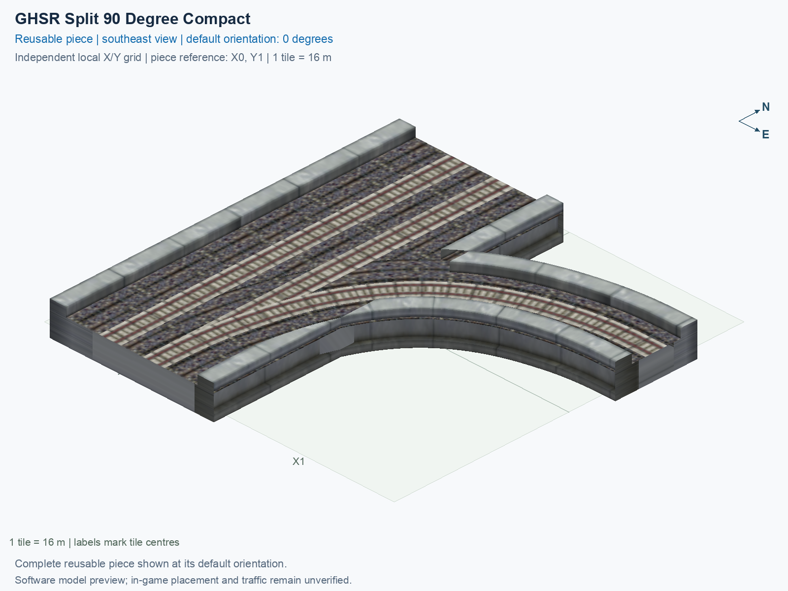

<a id="ghsr-split-90-degree-compact"></a>

# GHSR Ground (1 m) — Split 90° Right from Two-Track Mainline — Compact

<!-- SUBJECT IDENTITY MIGRATION -->

Identity migration: `interchange-ground-split-90-compact` → `ghsr-ground-two-track-mainline-split-90deg-right-compact`. Earlier measurements, observations, and pictures retain their recorded names and fingerprints; they do not establish verification of the renamed build. See the [identity migration rules](../../../../docs/NAMING_CONVENTIONS.md#10-choosing-and-changing-names).

Purpose: explain this reusable piece, its matching connections and current test coverage.

<!-- BEGIN PIECE OVERVIEW -->

GHSR Ground (1 m) — Split 90° Right from Two-Track Mainline — Compact. Fixed click-to-place piece in a 2 by 2 tile area. Follow the arrows and join only matching track widths, directions, and height labels. Four proper rotations; the second four states repeat them. Experimental; game testing pending. The mainline retains both directions; only the branch is one-way.

Exact reusable identifier: `ghsr-ground-two-track-mainline-split-90deg-right-compact`.

Footprint: **2 × 2 tiles**. Exact menu name: **GHSR Ground (1 m) — Split 90° Right from Two-Track Mainline — Compact**.

Choose this exact name in Transportation → Rail. Press Home or End to rotate; use only the supported states listed below. Join each end to a matching port profile and direction.

- [Connections and journeys](#connections-and-journeys)
- [Test checklist](#test-checklist)



<!-- END PIECE OVERVIEW -->

<!-- BEGIN MANUAL SUMMARY -->

## Manual status

Generated from [the exact test cases](#test-checklist) and [authoritative observations](checks/manual-tests.json).

- [ ] Preview review: 0/1 applicable cases passed; 0 failed, 0 stale.
- [ ] In-game rendering: 0/4 applicable cases passed; 0 failed, 0 stale.
- [ ] Directed journeys: 0/12 applicable cases passed; 0 failed, 0 stale.

These observations cover only the named services, directions, poses, rotations, and recorded platforms.

<!-- END MANUAL SUMMARY -->

<!-- BEGIN CONNECTIONS -->

## Connections and journeys

Purpose: describe intrinsic directional interfaces and permitted service journeys.

Generated from [connections.json](connections.json). Coordinates are canonical east, north, and height in metres. A connection class names an encoded route interface; it does not prove visible deck/wall fit or an in-game test.

Supported placement states: 0° CCW, 90° CCW, 180° CCW, 270° CCW. Each state has its own declared manual scope.

A **port** is one directional transport-path endpoint. **Service** identifies the intended network service (for example HSR, street, or tram); **engine** is its internal traffic-class number, separate from the construction network. **Role** distinguishes primary service from auxiliary paths; sharing a traffic class does not establish service compatibility.

A **tangent** is a unit travel-direction vector: `[0,1]` means north. **Grade** is height gained per horizontal metre. These measured facts describe this subject alone. Compatibility requires a separate comparison of the complete joining boundaries; physical seams and actual game operation require their own evidence. See the [class index](../../connection-classes.jsonc) for shared route-interface membership.

| Port | Service / engine / role | Direction | Location; tangent; grade | Connection class |
| --- | --- | --- | --- | --- |
| `Sout` | ghsr / 7 / primary | out | [-2.0, -24.0, 1.0]; [0.0, -1.0]; 0.0 | `path-interface-c78c5ac4b558d84b46f2` |
| `Nin` | ghsr / 7 / primary | in | [-2.0, 8.0, 1.0]; [0.0, -1.0]; 0.0 | `path-interface-c78c5ac4b558d84b46f2` |
| `Sin` | ghsr / 7 / primary | in | [2.0, -24.0, 1.0]; [0.0, 1.0]; 0.0 | `path-interface-fab587419de6b5848d74` |
| `Nout` | ghsr / 7 / primary | out | [2.0, 8.0, 1.0]; [0.0, 1.0]; 0.0 | `path-interface-fab587419de6b5848d74` |
| `Bout` | ghsr / 7 / primary | out | [24.0, 0.0, 1.0]; [1.0, 0.0]; 0.0 | `path-interface-ab4e40517da7fa0dbd34` |

### Directed journeys

| Service | Entry → exit | Role |
| --- | --- | --- |
| ghsr | `Nin` → `Sout` | primary |
| ghsr | `Sin` → `Bout` | primary |
| ghsr | `Sin` → `Nout` | primary |

### Forbidden transfers

| From service / port | To service / port | Reason |
| --- | --- | --- |
| ghsr / `Nin` | ghsr / `Nout` | No directed route exists between these ports in the saved piece transport paths. In-game confirmation remains unverified. |
| ghsr / `Nin` | ghsr / `Bout` | No directed route exists between these ports in the saved piece transport paths. In-game confirmation remains unverified. |
| ghsr / `Sin` | ghsr / `Sout` | No directed route exists between these ports in the saved piece transport paths. In-game confirmation remains unverified. |

Review the test checklist for the exact tested cases and environments.

<!-- END CONNECTIONS -->

<!-- BEGIN MANUAL CHECKS -->

## Test checklist

Generated from [the authoritative record](checks/manual-tests.json). Only explicit human observations create manual passes; software and preview checks remain separate. Expand a check/service group to see its rotation table, then expand the matching exact scope to copy a case ID and inspect its pose, reviewer, environment, and evidence. Grouping changes only this view; every declared case remains separate.

**States:** [x] passed; [ ] unverified, failed, or stale; N/A is an explicit inapplicable declaration. A dash means no case was declared in that column. Every pass covers only its recorded environment. T means a distinct construction-transposed state.

Four proper rotations are covered. No additional reflected state is established by this record; repeated construction aliases do not create new orientations.

Current totals: unverified: 43, passed: 0, failed: 0, stale: 0, not_applicable: 0.

### Record an observation

Follow the [shared testing guide](../../../../docs/TESTING.md); copy [the unconfirmed example](checks/observation.example.json) to `checks/observation.json`. Case identifiers are in the expandable sections below. Do not edit generated checkboxes.

From the repository folder containing `custom-pieces`, run after filling `checks/observation.json` and explicitly confirming the exact observation:

```sh
python3 -m scp.content record --record custom-pieces/domains/high-speed-rail/00_pieces/ghsr-ground-two-track-mainline-split-90deg-right-compact/checks/manual-tests.json --observation custom-pieces/domains/high-speed-rail/00_pieces/ghsr-ground-two-track-mainline-split-90deg-right-compact/checks/observation.json
```

### Detailed current checks

Each collapsed group shows exact case counts and states. Forbidden transfers are grouped by the directed service pair; the table inside retains every port pair and rotation.

<details>
<summary>Compiled resources — Whole subject — 1 case; unverified: 1</summary>

| Check / exact scope | General | 0° | 90° | 180° | 270° |
| --- | --- | --- | --- | --- | --- |
| **Compiled resources**<br>Whole subject | <a href="#case-software_resources-6150866653585da4a0c5">[ ] unverified</a> | — | — | — | — |


<details>
<summary>Compiled resources — Whole subject</summary>

<a id="case-software_resources-6150866653585da4a0c5"></a>

**General: unverified** — `software_resources-6150866653585da4a0c5`.

Verify the actual compiled resources and construction rules.

Scope: Whole subject.

No observation recorded.

</details>

</details>

<details>
<summary>Directed routing graph — Whole subject — 1 case; unverified: 1</summary>

| Check / exact scope | General | 0° | 90° | 180° | 270° |
| --- | --- | --- | --- | --- | --- |
| **Directed routing graph**<br>Whole subject | <a href="#case-software_connectivity-6150866653585da4a0c5">[ ] unverified</a> | — | — | — | — |


<details>
<summary>Directed routing graph — Whole subject</summary>

<a id="case-software_connectivity-6150866653585da4a0c5"></a>

**General: unverified** — `software_connectivity-6150866653585da4a0c5`.

Verify the declared directed journeys and forbidden transfers.

Scope: Whole subject.

No observation recorded.

</details>

</details>

<details>
<summary>Preview review — Images — 1 case; unverified: 1</summary>

| Check / exact scope | General | 0° | 90° | 180° | 270° |
| --- | --- | --- | --- | --- | --- |
| **Preview review**<br>Image: image:interchange-ground-split-90-compact:canonical-southeast | <a href="#case-preview_review-9f4bd3cfd714c96b13cd">[ ] unverified</a> | — | — | — | — |


<details>
<summary>Preview review — Image: image:interchange-ground-split-90-compact:canonical-southeast</summary>

<a id="case-preview_review-9f4bd3cfd714c96b13cd"></a>

**General: unverified** — `preview_review-9f4bd3cfd714c96b13cd`.

Inspect this exact preview for tracks, walls, piers, seams and shadows.

Scope: Image: image:interchange-ground-split-90-compact:canonical-southeast.

No observation recorded.

</details>

</details>

<details>
<summary>In-game rendering — Whole subject — 4 cases; unverified: 4</summary>

| Check / exact scope | General | 0° | 90° | 180° | 270° |
| --- | --- | --- | --- | --- | --- |
| **In-game rendering**<br>Whole subject | — | <a href="#case-in_game_render-fb9ffed9b3cc43bbf65c">[ ] unverified</a> | <a href="#case-in_game_render-78d771aea7bb7eae964c">[ ] unverified</a> | <a href="#case-in_game_render-485db127128d51d61369">[ ] unverified</a> | <a href="#case-in_game_render-86f304f3bd317fe5fc66">[ ] unverified</a> |


<details>
<summary>In-game rendering — Whole subject</summary>

<a id="case-in_game_render-fb9ffed9b3cc43bbf65c"></a>

**0° CCW: unverified** — `in_game_render-fb9ffed9b3cc43bbf65c`.

Inspect the placed tracks, walls, piers, seams and shadows in SimCity 4.

Scope: Whole subject.

No observation recorded.

<a id="case-in_game_render-78d771aea7bb7eae964c"></a>

**90° CCW: unverified** — `in_game_render-78d771aea7bb7eae964c`.

Inspect the placed tracks, walls, piers, seams and shadows in SimCity 4.

Scope: Whole subject.

No observation recorded.

<a id="case-in_game_render-485db127128d51d61369"></a>

**180° CCW: unverified** — `in_game_render-485db127128d51d61369`.

Inspect the placed tracks, walls, piers, seams and shadows in SimCity 4.

Scope: Whole subject.

No observation recorded.

<a id="case-in_game_render-86f304f3bd317fe5fc66"></a>

**270° CCW: unverified** — `in_game_render-86f304f3bd317fe5fc66`.

Inspect the placed tracks, walls, piers, seams and shadows in SimCity 4.

Scope: Whole subject.

No observation recorded.

</details>

</details>

<details>
<summary>Placement — Whole subject — 4 cases; unverified: 4</summary>

| Check / exact scope | General | 0° | 90° | 180° | 270° |
| --- | --- | --- | --- | --- | --- |
| **Placement**<br>Whole subject | — | <a href="#case-in_game_placement-fb9ffed9b3cc43bbf65c">[ ] unverified</a> | <a href="#case-in_game_placement-78d771aea7bb7eae964c">[ ] unverified</a> | <a href="#case-in_game_placement-485db127128d51d61369">[ ] unverified</a> | <a href="#case-in_game_placement-86f304f3bd317fe5fc66">[ ] unverified</a> |


<details>
<summary>Placement — Whole subject</summary>

<a id="case-in_game_placement-fb9ffed9b3cc43bbf65c"></a>

**0° CCW: unverified** — `in_game_placement-fb9ffed9b3cc43bbf65c`.

Place this piece or complete blueprint and inspect every occupied tile.

Scope: Whole subject.

No observation recorded.

<a id="case-in_game_placement-78d771aea7bb7eae964c"></a>

**90° CCW: unverified** — `in_game_placement-78d771aea7bb7eae964c`.

Place this piece or complete blueprint and inspect every occupied tile.

Scope: Whole subject.

No observation recorded.

<a id="case-in_game_placement-485db127128d51d61369"></a>

**180° CCW: unverified** — `in_game_placement-485db127128d51d61369`.

Place this piece or complete blueprint and inspect every occupied tile.

Scope: Whole subject.

No observation recorded.

<a id="case-in_game_placement-86f304f3bd317fe5fc66"></a>

**270° CCW: unverified** — `in_game_placement-86f304f3bd317fe5fc66`.

Place this piece or complete blueprint and inspect every occupied tile.

Scope: Whole subject.

No observation recorded.

</details>

</details>

<details>
<summary>Demolition — Whole subject — 4 cases; unverified: 4</summary>

| Check / exact scope | General | 0° | 90° | 180° | 270° |
| --- | --- | --- | --- | --- | --- |
| **Demolition**<br>Whole subject | — | <a href="#case-in_game_demolition-fb9ffed9b3cc43bbf65c">[ ] unverified</a> | <a href="#case-in_game_demolition-78d771aea7bb7eae964c">[ ] unverified</a> | <a href="#case-in_game_demolition-485db127128d51d61369">[ ] unverified</a> | <a href="#case-in_game_demolition-86f304f3bd317fe5fc66">[ ] unverified</a> |


<details>
<summary>Demolition — Whole subject</summary>

<a id="case-in_game_demolition-fb9ffed9b3cc43bbf65c"></a>

**0° CCW: unverified** — `in_game_demolition-fb9ffed9b3cc43bbf65c`.

Bulldoze the complete placement and inspect the cleared area.

Scope: Whole subject.

No observation recorded.

<a id="case-in_game_demolition-78d771aea7bb7eae964c"></a>

**90° CCW: unverified** — `in_game_demolition-78d771aea7bb7eae964c`.

Bulldoze the complete placement and inspect the cleared area.

Scope: Whole subject.

No observation recorded.

<a id="case-in_game_demolition-485db127128d51d61369"></a>

**180° CCW: unverified** — `in_game_demolition-485db127128d51d61369`.

Bulldoze the complete placement and inspect the cleared area.

Scope: Whole subject.

No observation recorded.

<a id="case-in_game_demolition-86f304f3bd317fe5fc66"></a>

**270° CCW: unverified** — `in_game_demolition-86f304f3bd317fe5fc66`.

Bulldoze the complete placement and inspect the cleared area.

Scope: Whole subject.

No observation recorded.

</details>

</details>

<details>
<summary>Save and reload — Whole subject — 4 cases; unverified: 4</summary>

| Check / exact scope | General | 0° | 90° | 180° | 270° |
| --- | --- | --- | --- | --- | --- |
| **Save and reload**<br>Whole subject | — | <a href="#case-in_game_save_reload-fb9ffed9b3cc43bbf65c">[ ] unverified</a> | <a href="#case-in_game_save_reload-78d771aea7bb7eae964c">[ ] unverified</a> | <a href="#case-in_game_save_reload-485db127128d51d61369">[ ] unverified</a> | <a href="#case-in_game_save_reload-86f304f3bd317fe5fc66">[ ] unverified</a> |


<details>
<summary>Save and reload — Whole subject</summary>

<a id="case-in_game_save_reload-fb9ffed9b3cc43bbf65c"></a>

**0° CCW: unverified** — `in_game_save_reload-fb9ffed9b3cc43bbf65c`.

Save, quit, reload and inspect the placement and its paths.

Scope: Whole subject.

No observation recorded.

<a id="case-in_game_save_reload-78d771aea7bb7eae964c"></a>

**90° CCW: unverified** — `in_game_save_reload-78d771aea7bb7eae964c`.

Save, quit, reload and inspect the placement and its paths.

Scope: Whole subject.

No observation recorded.

<a id="case-in_game_save_reload-485db127128d51d61369"></a>

**180° CCW: unverified** — `in_game_save_reload-485db127128d51d61369`.

Save, quit, reload and inspect the placement and its paths.

Scope: Whole subject.

No observation recorded.

<a id="case-in_game_save_reload-86f304f3bd317fe5fc66"></a>

**270° CCW: unverified** — `in_game_save_reload-86f304f3bd317fe5fc66`.

Save, quit, reload and inspect the placement and its paths.

Scope: Whole subject.

No observation recorded.

</details>

</details>

<details>
<summary>Journey — ghsr — 12 cases; unverified: 12</summary>

| Check / exact scope | General | 0° | 90° | 180° | 270° |
| --- | --- | --- | --- | --- | --- |
| **Journey**<br>Service: ghsr; role: primary; journey: 7:Nin>Sout; entry: Nin; exit: Sout | — | <a href="#case-in_game_journey-747d52adc45275f9ae4f">[ ] unverified</a> | <a href="#case-in_game_journey-1fd2e1ecb80c6e0e4622">[ ] unverified</a> | <a href="#case-in_game_journey-9326d930f32af8078632">[ ] unverified</a> | <a href="#case-in_game_journey-bfb0adbe4ad7322b5d14">[ ] unverified</a> |
| **Journey**<br>Service: ghsr; role: primary; journey: 7:Sin>Bout; entry: Sin; exit: Bout | — | <a href="#case-in_game_journey-e9dbe87f00ada41959fa">[ ] unverified</a> | <a href="#case-in_game_journey-14b7f92d65d4cad17f9a">[ ] unverified</a> | <a href="#case-in_game_journey-d4177518b2ac5efd74d9">[ ] unverified</a> | <a href="#case-in_game_journey-6651d28497f8f3c65d6a">[ ] unverified</a> |
| **Journey**<br>Service: ghsr; role: primary; journey: 7:Sin>Nout; entry: Sin; exit: Nout | — | <a href="#case-in_game_journey-2bb38a4aa0be7535b987">[ ] unverified</a> | <a href="#case-in_game_journey-d3bd2ce7b0ffad11e31d">[ ] unverified</a> | <a href="#case-in_game_journey-fa5ee8b98d7f9d1c3ff1">[ ] unverified</a> | <a href="#case-in_game_journey-d9e9506122af09e2447f">[ ] unverified</a> |


<details>
<summary>Journey — Service: ghsr; role: primary; journey: 7:Nin>Sout; entry: Nin; exit: Sout</summary>

<a id="case-in_game_journey-747d52adc45275f9ae4f"></a>

**0° CCW: unverified** — `in_game_journey-747d52adc45275f9ae4f`.

Run the declared journey in this direction using its service network.

Scope: Service: ghsr; role: primary; journey: 7:Nin>Sout; entry: Nin; exit: Sout.

No observation recorded.

<a id="case-in_game_journey-1fd2e1ecb80c6e0e4622"></a>

**90° CCW: unverified** — `in_game_journey-1fd2e1ecb80c6e0e4622`.

Run the declared journey in this direction using its service network.

Scope: Service: ghsr; role: primary; journey: 7:Nin>Sout; entry: Nin; exit: Sout.

No observation recorded.

<a id="case-in_game_journey-9326d930f32af8078632"></a>

**180° CCW: unverified** — `in_game_journey-9326d930f32af8078632`.

Run the declared journey in this direction using its service network.

Scope: Service: ghsr; role: primary; journey: 7:Nin>Sout; entry: Nin; exit: Sout.

No observation recorded.

<a id="case-in_game_journey-bfb0adbe4ad7322b5d14"></a>

**270° CCW: unverified** — `in_game_journey-bfb0adbe4ad7322b5d14`.

Run the declared journey in this direction using its service network.

Scope: Service: ghsr; role: primary; journey: 7:Nin>Sout; entry: Nin; exit: Sout.

No observation recorded.

</details>


<details>
<summary>Journey — Service: ghsr; role: primary; journey: 7:Sin>Bout; entry: Sin; exit: Bout</summary>

<a id="case-in_game_journey-e9dbe87f00ada41959fa"></a>

**0° CCW: unverified** — `in_game_journey-e9dbe87f00ada41959fa`.

Run the declared journey in this direction using its service network.

Scope: Service: ghsr; role: primary; journey: 7:Sin>Bout; entry: Sin; exit: Bout.

No observation recorded.

<a id="case-in_game_journey-14b7f92d65d4cad17f9a"></a>

**90° CCW: unverified** — `in_game_journey-14b7f92d65d4cad17f9a`.

Run the declared journey in this direction using its service network.

Scope: Service: ghsr; role: primary; journey: 7:Sin>Bout; entry: Sin; exit: Bout.

No observation recorded.

<a id="case-in_game_journey-d4177518b2ac5efd74d9"></a>

**180° CCW: unverified** — `in_game_journey-d4177518b2ac5efd74d9`.

Run the declared journey in this direction using its service network.

Scope: Service: ghsr; role: primary; journey: 7:Sin>Bout; entry: Sin; exit: Bout.

No observation recorded.

<a id="case-in_game_journey-6651d28497f8f3c65d6a"></a>

**270° CCW: unverified** — `in_game_journey-6651d28497f8f3c65d6a`.

Run the declared journey in this direction using its service network.

Scope: Service: ghsr; role: primary; journey: 7:Sin>Bout; entry: Sin; exit: Bout.

No observation recorded.

</details>


<details>
<summary>Journey — Service: ghsr; role: primary; journey: 7:Sin>Nout; entry: Sin; exit: Nout</summary>

<a id="case-in_game_journey-2bb38a4aa0be7535b987"></a>

**0° CCW: unverified** — `in_game_journey-2bb38a4aa0be7535b987`.

Run the declared journey in this direction using its service network.

Scope: Service: ghsr; role: primary; journey: 7:Sin>Nout; entry: Sin; exit: Nout.

No observation recorded.

<a id="case-in_game_journey-d3bd2ce7b0ffad11e31d"></a>

**90° CCW: unverified** — `in_game_journey-d3bd2ce7b0ffad11e31d`.

Run the declared journey in this direction using its service network.

Scope: Service: ghsr; role: primary; journey: 7:Sin>Nout; entry: Sin; exit: Nout.

No observation recorded.

<a id="case-in_game_journey-fa5ee8b98d7f9d1c3ff1"></a>

**180° CCW: unverified** — `in_game_journey-fa5ee8b98d7f9d1c3ff1`.

Run the declared journey in this direction using its service network.

Scope: Service: ghsr; role: primary; journey: 7:Sin>Nout; entry: Sin; exit: Nout.

No observation recorded.

<a id="case-in_game_journey-d9e9506122af09e2447f"></a>

**270° CCW: unverified** — `in_game_journey-d9e9506122af09e2447f`.

Run the declared journey in this direction using its service network.

Scope: Service: ghsr; role: primary; journey: 7:Sin>Nout; entry: Sin; exit: Nout.

No observation recorded.

</details>

</details>

<details>
<summary>Forbidden transfer — ghsr → ghsr — 12 cases; unverified: 12</summary>

| Check / exact scope | General | 0° | 90° | 180° | 270° |
| --- | --- | --- | --- | --- | --- |
| **Forbidden transfer**<br>from port: Nin; to port: Nout; from service: ghsr; to service: ghsr; basis: not reachable in actual saved PATH graph | — | <a href="#case-in_game_forbidden_transfer-38bcfaceb05369935d41">[ ] unverified</a> | <a href="#case-in_game_forbidden_transfer-bbd9e1387f328e685887">[ ] unverified</a> | <a href="#case-in_game_forbidden_transfer-4ee1b229eacc3cdf70fa">[ ] unverified</a> | <a href="#case-in_game_forbidden_transfer-eca63486dce77761021a">[ ] unverified</a> |
| **Forbidden transfer**<br>from port: Nin; to port: Bout; from service: ghsr; to service: ghsr; basis: not reachable in actual saved PATH graph | — | <a href="#case-in_game_forbidden_transfer-ae13a6669a1fc54295b0">[ ] unverified</a> | <a href="#case-in_game_forbidden_transfer-035fe7da3b52f77e9090">[ ] unverified</a> | <a href="#case-in_game_forbidden_transfer-29546f656530562651b8">[ ] unverified</a> | <a href="#case-in_game_forbidden_transfer-20ecc97bc44a58bd2c03">[ ] unverified</a> |
| **Forbidden transfer**<br>from port: Sin; to port: Sout; from service: ghsr; to service: ghsr; basis: not reachable in actual saved PATH graph | — | <a href="#case-in_game_forbidden_transfer-73c421f0d308f97ee729">[ ] unverified</a> | <a href="#case-in_game_forbidden_transfer-04ccf0d81e98d04f13f7">[ ] unverified</a> | <a href="#case-in_game_forbidden_transfer-9ea7e184916b2648287f">[ ] unverified</a> | <a href="#case-in_game_forbidden_transfer-b951edd42fc06068176a">[ ] unverified</a> |


<details>
<summary>Forbidden transfer — from port: Nin; to port: Nout; from service: ghsr; to service: ghsr; basis: not reachable in actual saved PATH graph</summary>

<a id="case-in_game_forbidden_transfer-38bcfaceb05369935d41"></a>

**0° CCW: unverified** — `in_game_forbidden_transfer-38bcfaceb05369935d41`.

Confirm this undeclared transfer is unavailable.

Scope: from port: Nin; to port: Nout; from service: ghsr; to service: ghsr; basis: not reachable in actual saved PATH graph.

No observation recorded.

<a id="case-in_game_forbidden_transfer-bbd9e1387f328e685887"></a>

**90° CCW: unverified** — `in_game_forbidden_transfer-bbd9e1387f328e685887`.

Confirm this undeclared transfer is unavailable.

Scope: from port: Nin; to port: Nout; from service: ghsr; to service: ghsr; basis: not reachable in actual saved PATH graph.

No observation recorded.

<a id="case-in_game_forbidden_transfer-4ee1b229eacc3cdf70fa"></a>

**180° CCW: unverified** — `in_game_forbidden_transfer-4ee1b229eacc3cdf70fa`.

Confirm this undeclared transfer is unavailable.

Scope: from port: Nin; to port: Nout; from service: ghsr; to service: ghsr; basis: not reachable in actual saved PATH graph.

No observation recorded.

<a id="case-in_game_forbidden_transfer-eca63486dce77761021a"></a>

**270° CCW: unverified** — `in_game_forbidden_transfer-eca63486dce77761021a`.

Confirm this undeclared transfer is unavailable.

Scope: from port: Nin; to port: Nout; from service: ghsr; to service: ghsr; basis: not reachable in actual saved PATH graph.

No observation recorded.

</details>


<details>
<summary>Forbidden transfer — from port: Nin; to port: Bout; from service: ghsr; to service: ghsr; basis: not reachable in actual saved PATH graph</summary>

<a id="case-in_game_forbidden_transfer-ae13a6669a1fc54295b0"></a>

**0° CCW: unverified** — `in_game_forbidden_transfer-ae13a6669a1fc54295b0`.

Confirm this undeclared transfer is unavailable.

Scope: from port: Nin; to port: Bout; from service: ghsr; to service: ghsr; basis: not reachable in actual saved PATH graph.

No observation recorded.

<a id="case-in_game_forbidden_transfer-035fe7da3b52f77e9090"></a>

**90° CCW: unverified** — `in_game_forbidden_transfer-035fe7da3b52f77e9090`.

Confirm this undeclared transfer is unavailable.

Scope: from port: Nin; to port: Bout; from service: ghsr; to service: ghsr; basis: not reachable in actual saved PATH graph.

No observation recorded.

<a id="case-in_game_forbidden_transfer-29546f656530562651b8"></a>

**180° CCW: unverified** — `in_game_forbidden_transfer-29546f656530562651b8`.

Confirm this undeclared transfer is unavailable.

Scope: from port: Nin; to port: Bout; from service: ghsr; to service: ghsr; basis: not reachable in actual saved PATH graph.

No observation recorded.

<a id="case-in_game_forbidden_transfer-20ecc97bc44a58bd2c03"></a>

**270° CCW: unverified** — `in_game_forbidden_transfer-20ecc97bc44a58bd2c03`.

Confirm this undeclared transfer is unavailable.

Scope: from port: Nin; to port: Bout; from service: ghsr; to service: ghsr; basis: not reachable in actual saved PATH graph.

No observation recorded.

</details>


<details>
<summary>Forbidden transfer — from port: Sin; to port: Sout; from service: ghsr; to service: ghsr; basis: not reachable in actual saved PATH graph</summary>

<a id="case-in_game_forbidden_transfer-73c421f0d308f97ee729"></a>

**0° CCW: unverified** — `in_game_forbidden_transfer-73c421f0d308f97ee729`.

Confirm this undeclared transfer is unavailable.

Scope: from port: Sin; to port: Sout; from service: ghsr; to service: ghsr; basis: not reachable in actual saved PATH graph.

No observation recorded.

<a id="case-in_game_forbidden_transfer-04ccf0d81e98d04f13f7"></a>

**90° CCW: unverified** — `in_game_forbidden_transfer-04ccf0d81e98d04f13f7`.

Confirm this undeclared transfer is unavailable.

Scope: from port: Sin; to port: Sout; from service: ghsr; to service: ghsr; basis: not reachable in actual saved PATH graph.

No observation recorded.

<a id="case-in_game_forbidden_transfer-9ea7e184916b2648287f"></a>

**180° CCW: unverified** — `in_game_forbidden_transfer-9ea7e184916b2648287f`.

Confirm this undeclared transfer is unavailable.

Scope: from port: Sin; to port: Sout; from service: ghsr; to service: ghsr; basis: not reachable in actual saved PATH graph.

No observation recorded.

<a id="case-in_game_forbidden_transfer-b951edd42fc06068176a"></a>

**270° CCW: unverified** — `in_game_forbidden_transfer-b951edd42fc06068176a`.

Confirm this undeclared transfer is unavailable.

Scope: from port: Sin; to port: Sout; from service: ghsr; to service: ghsr; basis: not reachable in actual saved PATH graph.

No observation recorded.

</details>

</details>

<!-- END MANUAL CHECKS -->
