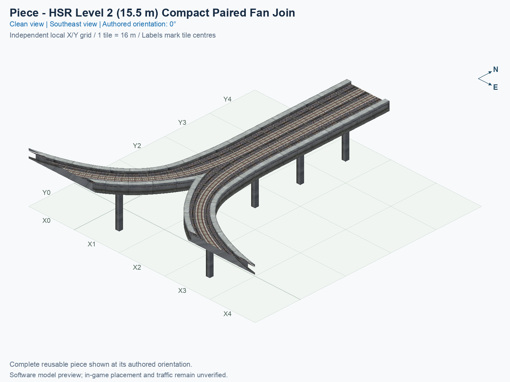
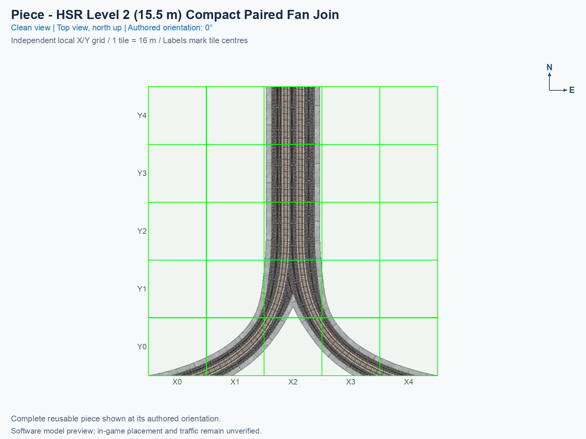
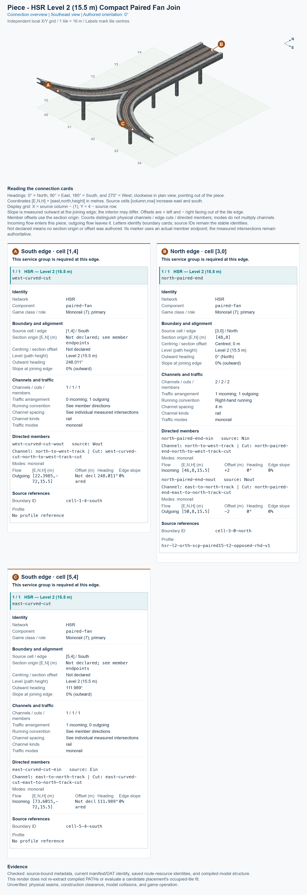

# HSR L2 Compact Paired Fan Join

<!-- PIECE README LAYOUT: 2 -->

[1. Views](#1-views) · [2. Piece and placement](#2-piece-and-placement) · [3. Connection matrix](#3-connection-matrix) · [Testing ↗ (separate document)](TESTING.md)

This reusable High Speed Rail (HSR) piece connects one north-facing pair of tracks to two curved branch ends. At the authored 0° orientation, traffic entering from the north leaves through the western branch; traffic entering from the eastern branch continues north. Both directions remain at nominal Level 2 (L2), with a train-path height of 15.5 m.

**Status: experimental.** Human image approval and operation inside SimCity 4 require their own recorded observations. The permanent type ID is `hsr-component-l2-paired-fan-compact-join`; its existing game-resource identifiers are retained. This guide describes the reusable type independently of any assembly placement label.

## 1. Views

Both clean pictures show the same complete saved model at the authored 0° orientation. North is up in the top view; X increases eastward, Y increases northward, and each city tile measures 16 × 16 m. The standalone grid belongs to this piece. It does not use an interchange's placement positions or rotations.

<!-- BEGIN PIECE VIEWS -->

<!-- END PIECE VIEWS -->

The generated connection overview in chapter 3 identifies complete joining boundaries and their required channels. Its cards report the measured facts for the saved model. Software pictures show geometry and selected textures; they do not establish game appearance or train operation.

## 2. Piece and placement

<!-- BEGIN PIECE OVERVIEW -->

Two opposite-direction flat L2 fan arms join the native paired north mouth to matched oblique mainline branches, using the Short Mainline Diverge Core angles and six explicitly owned supports.

Exact reusable identifier: `hsr-component-l2-paired-fan-compact-join`.

Footprint: **7 × 5 tiles**. Exact menu name: **HSR L2 Compact Paired Fan Join**.

<!-- END PIECE OVERVIEW -->

### Function and complete joining boundaries

The fan separates the two directions of paired HSR into their respective curved connections. Its two branch routes do not transfer into each other. The current branch angles are designed together with the adjoining opposed merge and the existing Short Mainline Diverge Core; the exact saved-resource endpoints and permitted movements belong in the generated sections below.

The north-facing boundary carries both directions of ordinary paired L2 HSR. Each curved branch has its own directed connection, whose position, heading, deck, walls, and train clearance must all match its neighbour. A shared height alone does not establish a complete join. The library does not supply automatic compatibility discovery.

The paired structure remains **15 m wide** through the straight approach and the start of the fork. The shoulder taper begins 48 m along each authored sweep and ends at 72 m, after the tracks have begun separating. The [earlier saved-model width audit](evidence/fan-width-audit.json) retains that width review and its original image approval. The central raised grey border now continues between the two existing ballast outlines into the separate curved walls, filling the former missing triangle. The [current saved-model border comparison](evidence/central-parapet-alignment.json) checks the new top and both inside faces while preserving the rails, ballast floor, undersides, supports, and PATH resources.

The permanent construction definition is [piece.json](piece.json), and the authoring geometry is [geometry.json](geometry.json). Source cells use [column, row], with columns increasing eastward and rows increasing southward; the picture's Y axis increases northward. Use the generated coordinate conversion rather than reading a source row as a picture Y label.

Keep the complete construction rectangle clear, including cells without a visible train route. This is a sparse piece: an apparently empty cell can be its software construction reference, and that reference has not been confirmed as the game's mouse-click anchor.

### Place and rotate the piece

After following the [separate build and installation procedure](../../../../docs/BUILD_AND_INSTALL.md), use a disposable flat test city. A proper rotation turns the entire component and all its travel directions together; it does not reflect the component or reverse a one-way route.

1. Open **Transportation → Rail**, hover over the SCP buttons, and select **HSR L2 Compact Paired Fan Join**. An installed assembly may instead include this same type within its declared Tab/Shift+Tab cycle.
2. Move the cursor preview over clear terrain. Press **Home** or **End** to rotate the whole piece; on the documented Mac keyboard, **Fn + ←** and **Fn + →** provide those keys. Use only the supported construction states listed in the generated connection section.
3. At 0°, identify the north-facing paired end and the two curved branch ends in the top picture. Align the complete cursor preview with the intended joining boundaries; a normal cardinal straight cannot replace either custom curved branch.
4. Click once to place the component. Supply matching outside connections and travel demand. Inspect the rails, decks, walls, supports, and shadows, then test the permitted journeys and forbidden movements separately.

The [trumpet blueprint](../../01_assemblies/straight-stem-trumpet/README.md) is one documented use of this type. Its assembly position, neighbours, and end-to-end evidence do not approve every other use of this reusable piece.

## 3. Connection matrix

<!-- BEGIN PIECE CONNECTION MATRIX -->

### Directed entrance/exit matrix

Read **from an entrance row to an exit column**. **Saved PATH** checks the saved traffic route; **Route Query** checks the route shown by the game; **Visible travel** checks a vehicle completing that journey. For HSR, visible travel means a moving train.

**Game appearance:** [?](TESTING.md#case-in_game_render-2953a796038b1c66047b) — the complete piece’s appearance in the game, checked separately from its journeys.

**Legend:** ✅ confirmed; ❌ failed; ? not established. **Forbidden** means the movement is unavailable; its in-game check confirms that it stays unavailable. Click a result for its exact test case. Scope, evidence, and limitations remain in [the test checklist](TESTING.md#test-checklist).

| Entrance ↓ / Exit → | **HSR · South exit** `Wout` | **HSR · North exit** `Nout` |
| --- | --- | --- |
| **HSR · North entrance** `Nin` | **Saved PATH:** [✅](TESTING.md#case-software_connectivity-bc65ebc1e8aece8c8a6d) **Route Query:** [?](TESTING.md#case-in_game_route_query-efa01c69d3d0a595addc) **Visible train travel:** [?](TESTING.md#case-in_game_visible_travel-efa01c69d3d0a595addc) | **Forbidden** **Saved PATH:** [✅](TESTING.md#case-software_connectivity-bc65ebc1e8aece8c8a6d) In-game check: [?](TESTING.md#case-in_game_forbidden_transfer-3ad08e7a19456cd90fd0) |
| **HSR · South entrance** `Ein` | **Forbidden** **Saved PATH:** [✅](TESTING.md#case-software_connectivity-bc65ebc1e8aece8c8a6d) In-game check: [?](TESTING.md#case-in_game_forbidden_transfer-97aa23dd677c7b8c9e3c) | **Saved PATH:** [✅](TESTING.md#case-software_connectivity-bc65ebc1e8aece8c8a6d) **Route Query:** [?](TESTING.md#case-in_game_route_query-65a9b6549c48f167a40e) **Visible train travel:** [?](TESTING.md#case-in_game_visible_travel-65a9b6549c48f167a40e) |

Source: [connections.json](connections.json).

<!-- END PIECE CONNECTION MATRIX -->

<!-- BEGIN CONNECTOR OVERVIEW -->

### Connection overview

Generated from this piece's source-bound connector metadata and the current compiled model; marker letters refer to the boundary cards below.

[Rendering sources and verification scope](evidence/connection-overview.json).

Headings: 0° = North, 90° = East, 180° = South, and 270° = West; clockwise in plan view, pointing out of the piece.

Coordinates [E,N,H] = [east,north,height] in metres. Source cells [column,row] increase east and south.

Display grid: X = source column − (1); Y = 4 − source row.

Slope is measured outward at the joining edge; the interior may differ. Offsets are + left and − right facing out of the tile edge.

Member offsets use the section origin. Counts distinguish physical channels / edge cuts / directed members; modes do not multiply channels.

Incoming flow enters this piece; outgoing flow leaves it. Letters identify boundary cards; source IDs remain the stable identities.

Not declared means no section origin or offset was authored. Its marker uses an actual member endpoint; the measured intersections remain authoritative.

#### Boundary A: `cell-1-4-south`

This service group is required at this edge.

##### Service group 1 / 1: HSR — Level 2 (15.5 m)

| Field | Value |
| --- | --- |
| End / component | `west-curved-cut` / `paired-fan` |
| Network / game class / role | hsr / Monorail (7); primary |
| Source cell / edge | `[1,4]` / South |
| Section origin [E,N] (m) | Not declared; see member endpoints |
| Centring / section offset | Not declared |
| Level (path height) | Level 2 (15.5 m) |
| Outward heading | 248.011° |
| Slope at joining edge | 0% outward |
| Channels / edge cuts / directed members | 1 / 1 / 1 |
| Traffic arrangement / running | 0 incoming; 1 outgoing; See member directions |
| Channel spacing | See individual measured intersections |
| Channel kinds | rail |
| Traffic modes | monorail |
| Profile | No profile reference |

| Member / measured source | Channel / cut / modes | Flow | Endpoint [E,N,H] (m) | Offset (m) | Outward heading | Edge slope (%) |
| --- | --- | --- | --- | ---: | ---: | ---: |
| `west-curved-cut-wout` / `Wout` | `north-to-west-track` / `west-curved-cut-north-to-west-track-cut` / monorail | Outgoing | `[22.3985,-72,15.5]` | Not declared | 248.011° | 0 |

#### Boundary B: `cell-3-0-north`

This service group is required at this edge.

##### Service group 1 / 1: HSR — Level 2 (15.5 m)

| Field | Value |
| --- | --- |
| End / component | `north-paired-end` / `paired-fan` |
| Network / game class / role | hsr / Monorail (7); primary |
| Source cell / edge | `[3,0]` / North |
| Section origin [E,N] (m) | `[48,8]` |
| Centring / section offset | Centred; 0 m |
| Level (path height) | Level 2 (15.5 m) |
| Outward heading | 0° (North) |
| Slope at joining edge | 0% outward |
| Channels / edge cuts / directed members | 2 / 2 / 2 |
| Traffic arrangement / running | 1 incoming; 1 outgoing; Right-hand running |
| Channel spacing | 4 m |
| Channel kinds | rail |
| Traffic modes | monorail |
| Profile | `hsr-l2-orth-scp-paired15-t2-opposed-rhd-v1` |

| Member / measured source | Channel / cut / modes | Flow | Endpoint [E,N,H] (m) | Offset (m) | Outward heading | Edge slope (%) |
| --- | --- | --- | --- | ---: | ---: | ---: |
| `north-paired-end-nin` / `Nin` | `north-to-west-track` / `north-paired-end-north-to-west-track-cut` / monorail | Incoming | `[46,8,15.5]` | +2 | 0° | 0 |
| `north-paired-end-nout` / `Nout` | `east-to-north-track` / `north-paired-end-east-to-north-track-cut` / monorail | Outgoing | `[50,8,15.5]` | -2 | 0° | 0 |

#### Boundary C: `cell-5-4-south`

This service group is required at this edge.

##### Service group 1 / 1: HSR — Level 2 (15.5 m)

| Field | Value |
| --- | --- |
| End / component | `east-curved-cut` / `paired-fan` |
| Network / game class / role | hsr / Monorail (7); primary |
| Source cell / edge | `[5,4]` / South |
| Section origin [E,N] (m) | Not declared; see member endpoints |
| Centring / section offset | Not declared |
| Level (path height) | Level 2 (15.5 m) |
| Outward heading | 111.989° |
| Slope at joining edge | 0% outward |
| Channels / edge cuts / directed members | 1 / 1 / 1 |
| Traffic arrangement / running | 1 incoming; 0 outgoing; See member directions |
| Channel spacing | See individual measured intersections |
| Channel kinds | rail |
| Traffic modes | monorail |
| Profile | No profile reference |

| Member / measured source | Channel / cut / modes | Flow | Endpoint [E,N,H] (m) | Offset (m) | Outward heading | Edge slope (%) |
| --- | --- | --- | --- | ---: | ---: | ---: |
| `east-curved-cut-ein` / `Ein` | `east-to-north-track` / `east-curved-cut-east-to-north-track-cut` / monorail | Incoming | `[73.6015,-72,15.5]` | Not declared | 111.989° | 0 |

Rendering checks source metadata, current compiled resource identities, and model structure. It does not re-extract PATHs or evaluate placement; physical seams, construction clearance, collisions, and game operation remain unverified.

<!-- END CONNECTOR OVERVIEW -->
