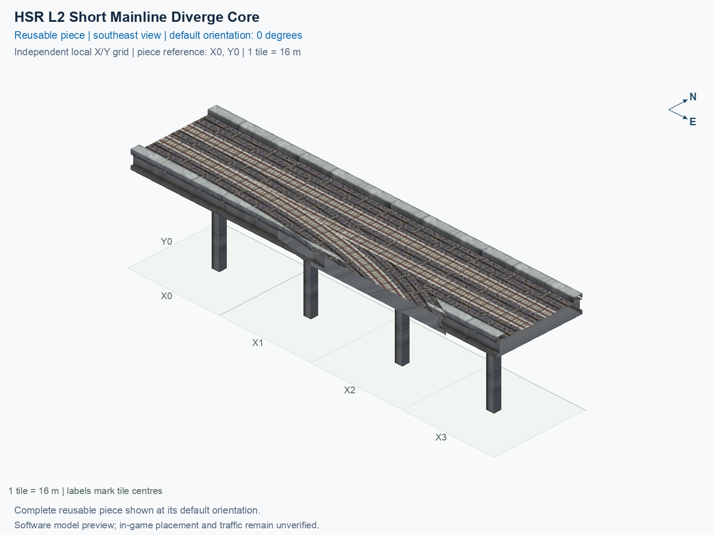
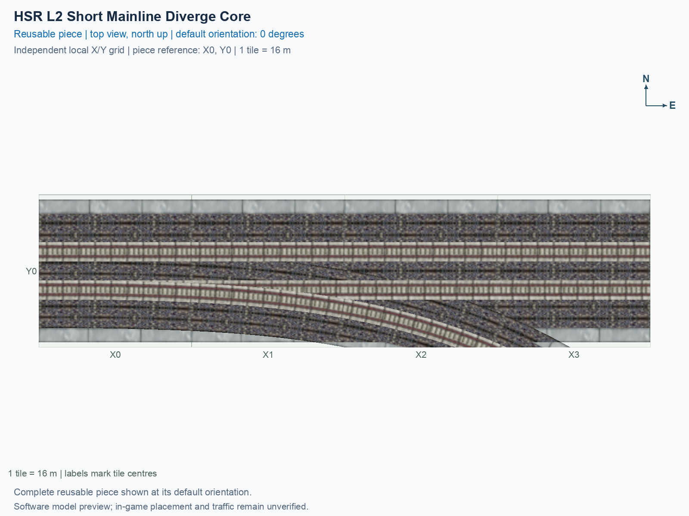

# HSR L2 Short Mainline Diverge Core

Purpose: Describe this independently selectable reusable HSR piece, its native and custom connections, canonical previews and exact software/manual evidence.

A compact junction on an ordinary paired mainline, with one custom curved branch connection. It occupies **4 city tiles** in a **4 × 1 tile** bounding rectangle. A city tile is 16 × 16 m. This is one teal **PART HSR** menu type; its permanent ID is `hsr-component-l2-short-mainline-diverge-core`.

## Canonical views

Both images show the same complete saved model at **0°**, on its own local grid with the southwest tile centre **of the bounding rectangle (X0, Y0)**. X increases east and Y north. Rotating a placed copy does not change these catalogue pictures.

The [preview evidence](preview-evidence.json) records the exact saved-model inputs, cameras, grid, captions and image hashes. These are software renders, not game screenshots.

<!-- BEGIN PIECE OVERVIEW -->

Four-tile native two-track mainline with a one-way departure and an exact native straight approach; its unchanged custom curved branch accepts One-Way Curve from Diverge.

Exact reusable identifier: `hsr-component-l2-short-mainline-diverge-core`.

Footprint: **4 × 1 tiles**. Exact menu name: **HSR L2 Short Mainline Diverge Core**.

Choose this exact name in Transportation → Rail. Press Home or End to rotate; use only the supported states listed below. Join each end to a matching port profile and direction.

- [Connections and journeys](#connections-and-journeys)
- [Test checklist](#test-checklist)





<!-- END PIECE OVERVIEW -->

## Function and connections

Both mainline ends use the ordinary **15 m** paired HSR deck at **15.5 m** train-path height. Use **HSR L2 Two-Track Straight** rotated to match. The single branch end is a custom curved interface. A **port** is a directional track entrance or exit. A **custom curved interface** needs the exact matching position, tangent and physical profile; merely sharing the same height does not make another track compatible. See the generated connection table below for concrete counterpart links and relative positions.

The authoring source is [geometry.json](geometry.json); the permanent construction definition is [piece.json](piece.json). This smaller core frees one ordinary tail tile. The original tail's deviation was **4.018 mm**; the adjoining smooth join has a separate **24.5 mm** maximum correction bound. The [historical assembly decision ledger](../../01_assemblies/straight-stem-trumpet/checks/atomization.json) records why this extraction was permitted and why neighbouring candidates remained. The [current resource contract](../../01_assemblies/straight-stem-trumpet/checks/resources.json) pins the approved result without requiring deleted predecessor files. The geometry belongs to this generic piece, rather than being changed only in an assembly render.

## Select and rotate

1. Open **Transportation → Rail** and hover over a teal **PART HSR** icon until the title reads **SCP | [PART] HSR L2 Short Mainline Diverge Core**.
2. Select that button. Press **Home** or **End** to rotate the complete cursor preview. On the keyboard used here, **Fn + ←** and **Fn + →** supply those keys.
3. Align its native and custom ends with compatible neighbours. Construction rules supply proper **0°, 90°, 180° and 270°** rotations; a rotation carries its train directions with it and does not reverse a one-way route.
4. Place on clear, flat terrain for the first test. A sparse construction reference can be empty; verify the cursor footprint rather than assuming a certified mouse-click anchor from a model coordinate.

Actual game rendering, placement, each connection, traffic, demolition and save/reload require the human observations below. Software verification does not tick those checkboxes. Follow the [shared testing guide](../../../../docs/TESTING.md) when recording a result.

<!-- BEGIN MANUAL SUMMARY -->

## Manual status

Generated from [the exact test cases](#test-checklist) and [authoritative observations](checks/manual-tests.json).

- [ ] Preview review: 0/2 applicable cases passed; 0 failed, 0 stale.
- [ ] In-game rendering: 0/4 applicable cases passed; 0 failed, 0 stale.
- [ ] Directed journeys: 0/12 applicable cases passed; 0 failed, 0 stale.

These observations cover only the named services, directions, poses, rotations, and recorded platforms.

<!-- END MANUAL SUMMARY -->

<!-- BEGIN CONNECTIONS -->

## Connections and journeys

Purpose: describe intrinsic directional interfaces and permitted service journeys.

Generated from [connections.json](connections.json). Coordinates are canonical east, north and height in metres. A connection class names an encoded route interface; it does not prove visible deck/wall fit or an in-game test.

Supported placement states: 0° CCW, 90° CCW, 180° CCW, 270° CCW. Each state has its own declared manual scope.

A **port** is one directional transport-path endpoint. **Service** identifies the intended network service (for example HSR, street, or tram); **engine** is its internal traffic-class number, separate from the construction network. **Role** distinguishes primary service from auxiliary paths; sharing a traffic class does not establish service compatibility.

A **tangent** is a unit travel-direction vector: `[0,1]` means north. **Grade** is height gained per horizontal metre. These measured facts describe this subject alone. Compatibility requires a separate comparison of the complete joining boundaries; physical seams and actual game operation require their own evidence. See the [class index](../../connection-classes.json) for shared route-interface membership.

| Port | Service / engine / role | Direction | Location; tangent; grade | Connection class |
| --- | --- | --- | --- | --- |
| `Win` | hsr / 7 / primary | in | [-8.0, -2.0, 15.5]; [1.0, 0.0]; 0.0 | `path-interface-12d12be31d2057c5763d` |
| `Wout` | hsr / 7 / primary | out | [-8.0, 2.0, 15.5]; [-1.0, 0.0]; 0.0 | `path-interface-fba09fbeb87ad95c667a` |
| `Sout` | hsr / 7 / primary | out | [38.398519, -8.0, 15.5]; [0.9272548089646255, -0.3744309272108488]; 0.0 | `path-interface-d819a6d05c5e43d11db7` |
| `Eout` | hsr / 7 / primary | out | [56.0, -2.0, 15.5]; [1.0, 0.0]; 0.0 | `path-interface-12d12be31d2057c5763d` |
| `Ein` | hsr / 7 / primary | in | [56.0, 2.0, 15.5]; [-1.0, 0.0]; 0.0 | `path-interface-fba09fbeb87ad95c667a` |

### Directed journeys

| Service | Entry → exit | Role |
| --- | --- | --- |
| hsr | `Win` → `Eout` | primary |
| hsr | `Win` → `Sout` | primary |
| hsr | `Ein` → `Wout` | primary |

### Forbidden transfers

| From service / port | To service / port | Reason |
| --- | --- | --- |
| hsr / `Win` | hsr / `Wout` | No directed route exists between these ports in the saved piece transport paths. In-game confirmation remains unverified. |
| hsr / `Ein` | hsr / `Sout` | No directed route exists between these ports in the saved piece transport paths. In-game confirmation remains unverified. |
| hsr / `Ein` | hsr / `Eout` | No directed route exists between these ports in the saved piece transport paths. In-game confirmation remains unverified. |

Review the test checklist for the exact tested cases and environments.

<!-- END CONNECTIONS -->

<!-- BEGIN MANUAL CHECKS -->

## Test checklist

Generated from [the authoritative record](checks/manual-tests.json). Only explicit human observations create manual passes; software and preview checks remain separate. Expand a check/service group to see its rotation table, then expand the matching exact scope to copy a case ID and inspect its pose, reviewer, environment, and evidence. Grouping changes only this view; every declared case remains separate.

**States:** [x] passed; [ ] unverified, failed, or stale; N/A is an explicit inapplicable declaration. A dash means no case was declared in that column. Every pass covers only its recorded environment. T means a distinct construction-transposed state.

Four proper rotations are covered. No additional reflected state is established by this record; repeated construction aliases do not create new orientations.

Current totals: unverified: 42, passed: 2, failed: 0, stale: 0, not_applicable: 0.

### Record an observation

Follow the [shared testing guide](../../../../docs/TESTING.md); copy [the unconfirmed example](checks/observation.example.json) to `checks/observation.json`. Case identifiers are in the expandable sections below. Do not edit generated checkboxes.

From the repository folder containing `custom-pieces`, run after filling `checks/observation.json` and explicitly confirming the exact observation:

```sh
python3 -m scp.content record --record custom-pieces/domains/high-speed-rail/00_pieces/hsr-component-l2-short-mainline-diverge-core/checks/manual-tests.json --observation custom-pieces/domains/high-speed-rail/00_pieces/hsr-component-l2-short-mainline-diverge-core/checks/observation.json
```

### Detailed current checks

Each collapsed group shows exact case counts and states. Forbidden transfers are grouped by the directed service pair; the table inside retains every port pair and rotation.

<details>
<summary>Compiled resources — Whole subject — 1 case; passed: 1</summary>

| Check / exact scope | General | 0° | 90° | 180° | 270° |
| --- | --- | --- | --- | --- | --- |
| **Compiled resources**<br>Whole subject | <a href="#case-software_resources-1be6a14c7095a92ca6a3">[x] passed</a> | — | — | — | — |


<details>
<summary>Compiled resources — Whole subject</summary>

<a id="case-software_resources-1be6a14c7095a92ca6a3"></a>

**General: passed** — `software_resources-1be6a14c7095a92ca6a3`.

Verify the actual compiled resources and construction rules.

Scope: Whole subject.

Recorded observations (chronological; the state above checks the relevant dependency snapshot):

- result: passed; authority: software; reviewer: verify_hsr_trumpet_v4.py plus independent staged build resource checks; confirmed at: 2026-10-20T10:42:34.857695+00:00; evidence: [../../01_assemblies/straight-stem-trumpet-v4/evidence/validation.json]; environment: 

</details>

</details>

<details>
<summary>Directed routing graph — Whole subject — 1 case; passed: 1</summary>

| Check / exact scope | General | 0° | 90° | 180° | 270° |
| --- | --- | --- | --- | --- | --- |
| **Directed routing graph**<br>Whole subject | <a href="#case-software_connectivity-1be6a14c7095a92ca6a3">[x] passed</a> | — | — | — | — |


<details>
<summary>Directed routing graph — Whole subject</summary>

<a id="case-software_connectivity-1be6a14c7095a92ca6a3"></a>

**General: passed** — `software_connectivity-1be6a14c7095a92ca6a3`.

Verify the declared directed journeys and forbidden transfers.

Scope: Whole subject.

Recorded observations (chronological; the state above checks the relevant dependency snapshot):

- result: passed; authority: software; reviewer: verify_hsr_trumpet_v4.py plus independent staged build resource checks; confirmed at: 2026-10-20T10:42:34.865101+00:00; evidence: [../../01_assemblies/straight-stem-trumpet-v4/evidence/validation.json]; environment: 

</details>

</details>

<details>
<summary>Preview review — Images — 2 cases; unverified: 2</summary>

| Check / exact scope | General | 0° | 90° | 180° | 270° |
| --- | --- | --- | --- | --- | --- |
| **Preview review**<br>Image: image:hsr-component-l2-short-mainline-diverge-core:canonical-southeast | <a href="#case-preview_review-44db441b6df7ca3395fc">[ ] unverified</a> | — | — | — | — |
| **Preview review**<br>Image: image:hsr-component-l2-short-mainline-diverge-core:canonical-top | <a href="#case-preview_review-c0f82e508ffbc60632bb">[ ] unverified</a> | — | — | — | — |


<details>
<summary>Preview review — Image: image:hsr-component-l2-short-mainline-diverge-core:canonical-southeast</summary>

<a id="case-preview_review-44db441b6df7ca3395fc"></a>

**General: unverified** — `preview_review-44db441b6df7ca3395fc`.

Inspect this exact preview for tracks, walls, piers, seams and shadows.

Scope: Image: image:hsr-component-l2-short-mainline-diverge-core:canonical-southeast.

No observation recorded.

</details>


<details>
<summary>Preview review — Image: image:hsr-component-l2-short-mainline-diverge-core:canonical-top</summary>

<a id="case-preview_review-c0f82e508ffbc60632bb"></a>

**General: unverified** — `preview_review-c0f82e508ffbc60632bb`.

Inspect this exact preview for tracks, walls, piers, seams and shadows.

Scope: Image: image:hsr-component-l2-short-mainline-diverge-core:canonical-top.

No observation recorded.

</details>

</details>

<details>
<summary>In-game rendering — Whole subject — 4 cases; unverified: 4</summary>

| Check / exact scope | General | 0° | 90° | 180° | 270° |
| --- | --- | --- | --- | --- | --- |
| **In-game rendering**<br>Whole subject | — | <a href="#case-in_game_render-5b28106d377daf5b6fa0">[ ] unverified</a> | <a href="#case-in_game_render-7befb4ecda34633d72ed">[ ] unverified</a> | <a href="#case-in_game_render-150e1f8cad64f39a2e4b">[ ] unverified</a> | <a href="#case-in_game_render-3571a612233cd36909b7">[ ] unverified</a> |


<details>
<summary>In-game rendering — Whole subject</summary>

<a id="case-in_game_render-5b28106d377daf5b6fa0"></a>

**0° CCW: unverified** — `in_game_render-5b28106d377daf5b6fa0`.

Inspect the placed tracks, walls, piers, seams and shadows in SimCity 4.

Scope: Whole subject.

No observation recorded.

<a id="case-in_game_render-7befb4ecda34633d72ed"></a>

**90° CCW: unverified** — `in_game_render-7befb4ecda34633d72ed`.

Inspect the placed tracks, walls, piers, seams and shadows in SimCity 4.

Scope: Whole subject.

No observation recorded.

<a id="case-in_game_render-150e1f8cad64f39a2e4b"></a>

**180° CCW: unverified** — `in_game_render-150e1f8cad64f39a2e4b`.

Inspect the placed tracks, walls, piers, seams and shadows in SimCity 4.

Scope: Whole subject.

No observation recorded.

<a id="case-in_game_render-3571a612233cd36909b7"></a>

**270° CCW: unverified** — `in_game_render-3571a612233cd36909b7`.

Inspect the placed tracks, walls, piers, seams and shadows in SimCity 4.

Scope: Whole subject.

No observation recorded.

</details>

</details>

<details>
<summary>Placement — Whole subject — 4 cases; unverified: 4</summary>

| Check / exact scope | General | 0° | 90° | 180° | 270° |
| --- | --- | --- | --- | --- | --- |
| **Placement**<br>Whole subject | — | <a href="#case-in_game_placement-5b28106d377daf5b6fa0">[ ] unverified</a> | <a href="#case-in_game_placement-7befb4ecda34633d72ed">[ ] unverified</a> | <a href="#case-in_game_placement-150e1f8cad64f39a2e4b">[ ] unverified</a> | <a href="#case-in_game_placement-3571a612233cd36909b7">[ ] unverified</a> |


<details>
<summary>Placement — Whole subject</summary>

<a id="case-in_game_placement-5b28106d377daf5b6fa0"></a>

**0° CCW: unverified** — `in_game_placement-5b28106d377daf5b6fa0`.

Place this piece or complete blueprint and inspect every occupied tile.

Scope: Whole subject.

No observation recorded.

<a id="case-in_game_placement-7befb4ecda34633d72ed"></a>

**90° CCW: unverified** — `in_game_placement-7befb4ecda34633d72ed`.

Place this piece or complete blueprint and inspect every occupied tile.

Scope: Whole subject.

No observation recorded.

<a id="case-in_game_placement-150e1f8cad64f39a2e4b"></a>

**180° CCW: unverified** — `in_game_placement-150e1f8cad64f39a2e4b`.

Place this piece or complete blueprint and inspect every occupied tile.

Scope: Whole subject.

No observation recorded.

<a id="case-in_game_placement-3571a612233cd36909b7"></a>

**270° CCW: unverified** — `in_game_placement-3571a612233cd36909b7`.

Place this piece or complete blueprint and inspect every occupied tile.

Scope: Whole subject.

No observation recorded.

</details>

</details>

<details>
<summary>Demolition — Whole subject — 4 cases; unverified: 4</summary>

| Check / exact scope | General | 0° | 90° | 180° | 270° |
| --- | --- | --- | --- | --- | --- |
| **Demolition**<br>Whole subject | — | <a href="#case-in_game_demolition-5b28106d377daf5b6fa0">[ ] unverified</a> | <a href="#case-in_game_demolition-7befb4ecda34633d72ed">[ ] unverified</a> | <a href="#case-in_game_demolition-150e1f8cad64f39a2e4b">[ ] unverified</a> | <a href="#case-in_game_demolition-3571a612233cd36909b7">[ ] unverified</a> |


<details>
<summary>Demolition — Whole subject</summary>

<a id="case-in_game_demolition-5b28106d377daf5b6fa0"></a>

**0° CCW: unverified** — `in_game_demolition-5b28106d377daf5b6fa0`.

Bulldoze the complete placement and inspect the cleared area.

Scope: Whole subject.

No observation recorded.

<a id="case-in_game_demolition-7befb4ecda34633d72ed"></a>

**90° CCW: unverified** — `in_game_demolition-7befb4ecda34633d72ed`.

Bulldoze the complete placement and inspect the cleared area.

Scope: Whole subject.

No observation recorded.

<a id="case-in_game_demolition-150e1f8cad64f39a2e4b"></a>

**180° CCW: unverified** — `in_game_demolition-150e1f8cad64f39a2e4b`.

Bulldoze the complete placement and inspect the cleared area.

Scope: Whole subject.

No observation recorded.

<a id="case-in_game_demolition-3571a612233cd36909b7"></a>

**270° CCW: unverified** — `in_game_demolition-3571a612233cd36909b7`.

Bulldoze the complete placement and inspect the cleared area.

Scope: Whole subject.

No observation recorded.

</details>

</details>

<details>
<summary>Save and reload — Whole subject — 4 cases; unverified: 4</summary>

| Check / exact scope | General | 0° | 90° | 180° | 270° |
| --- | --- | --- | --- | --- | --- |
| **Save and reload**<br>Whole subject | — | <a href="#case-in_game_save_reload-5b28106d377daf5b6fa0">[ ] unverified</a> | <a href="#case-in_game_save_reload-7befb4ecda34633d72ed">[ ] unverified</a> | <a href="#case-in_game_save_reload-150e1f8cad64f39a2e4b">[ ] unverified</a> | <a href="#case-in_game_save_reload-3571a612233cd36909b7">[ ] unverified</a> |


<details>
<summary>Save and reload — Whole subject</summary>

<a id="case-in_game_save_reload-5b28106d377daf5b6fa0"></a>

**0° CCW: unverified** — `in_game_save_reload-5b28106d377daf5b6fa0`.

Save, quit, reload and inspect the placement and its paths.

Scope: Whole subject.

No observation recorded.

<a id="case-in_game_save_reload-7befb4ecda34633d72ed"></a>

**90° CCW: unverified** — `in_game_save_reload-7befb4ecda34633d72ed`.

Save, quit, reload and inspect the placement and its paths.

Scope: Whole subject.

No observation recorded.

<a id="case-in_game_save_reload-150e1f8cad64f39a2e4b"></a>

**180° CCW: unverified** — `in_game_save_reload-150e1f8cad64f39a2e4b`.

Save, quit, reload and inspect the placement and its paths.

Scope: Whole subject.

No observation recorded.

<a id="case-in_game_save_reload-3571a612233cd36909b7"></a>

**270° CCW: unverified** — `in_game_save_reload-3571a612233cd36909b7`.

Save, quit, reload and inspect the placement and its paths.

Scope: Whole subject.

No observation recorded.

</details>

</details>

<details>
<summary>Journey — hsr — 12 cases; unverified: 12</summary>

| Check / exact scope | General | 0° | 90° | 180° | 270° |
| --- | --- | --- | --- | --- | --- |
| **Journey**<br>Service: hsr; role: primary; journey: 7:Win>Eout; entry: Win; exit: Eout | — | <a href="#case-in_game_journey-73c9e40447db7eca5d77">[ ] unverified</a> | <a href="#case-in_game_journey-d36bbc1685e39cff4604">[ ] unverified</a> | <a href="#case-in_game_journey-820fc48049ad97989483">[ ] unverified</a> | <a href="#case-in_game_journey-23b20dbb37e7252472f9">[ ] unverified</a> |
| **Journey**<br>Service: hsr; role: primary; journey: 7:Win>Sout; entry: Win; exit: Sout | — | <a href="#case-in_game_journey-6d0026d836d5154be176">[ ] unverified</a> | <a href="#case-in_game_journey-f080eb7136ac872f4f8d">[ ] unverified</a> | <a href="#case-in_game_journey-f6edfc9aa1e2ff11c3d8">[ ] unverified</a> | <a href="#case-in_game_journey-1e8cc484450cd566a0aa">[ ] unverified</a> |
| **Journey**<br>Service: hsr; role: primary; journey: 7:Ein>Wout; entry: Ein; exit: Wout | — | <a href="#case-in_game_journey-184484f7197e20662425">[ ] unverified</a> | <a href="#case-in_game_journey-1b7f0add07635c0c9883">[ ] unverified</a> | <a href="#case-in_game_journey-cac25e7640a3a03b10d8">[ ] unverified</a> | <a href="#case-in_game_journey-8da684985233114279c5">[ ] unverified</a> |


<details>
<summary>Journey — Service: hsr; role: primary; journey: 7:Win>Eout; entry: Win; exit: Eout</summary>

<a id="case-in_game_journey-73c9e40447db7eca5d77"></a>

**0° CCW: unverified** — `in_game_journey-73c9e40447db7eca5d77`.

Run the declared journey in this direction using its service network.

Scope: Service: hsr; role: primary; journey: 7:Win>Eout; entry: Win; exit: Eout.

No observation recorded.

<a id="case-in_game_journey-d36bbc1685e39cff4604"></a>

**90° CCW: unverified** — `in_game_journey-d36bbc1685e39cff4604`.

Run the declared journey in this direction using its service network.

Scope: Service: hsr; role: primary; journey: 7:Win>Eout; entry: Win; exit: Eout.

No observation recorded.

<a id="case-in_game_journey-820fc48049ad97989483"></a>

**180° CCW: unverified** — `in_game_journey-820fc48049ad97989483`.

Run the declared journey in this direction using its service network.

Scope: Service: hsr; role: primary; journey: 7:Win>Eout; entry: Win; exit: Eout.

No observation recorded.

<a id="case-in_game_journey-23b20dbb37e7252472f9"></a>

**270° CCW: unverified** — `in_game_journey-23b20dbb37e7252472f9`.

Run the declared journey in this direction using its service network.

Scope: Service: hsr; role: primary; journey: 7:Win>Eout; entry: Win; exit: Eout.

No observation recorded.

</details>


<details>
<summary>Journey — Service: hsr; role: primary; journey: 7:Win>Sout; entry: Win; exit: Sout</summary>

<a id="case-in_game_journey-6d0026d836d5154be176"></a>

**0° CCW: unverified** — `in_game_journey-6d0026d836d5154be176`.

Run the declared journey in this direction using its service network.

Scope: Service: hsr; role: primary; journey: 7:Win>Sout; entry: Win; exit: Sout.

No observation recorded.

<a id="case-in_game_journey-f080eb7136ac872f4f8d"></a>

**90° CCW: unverified** — `in_game_journey-f080eb7136ac872f4f8d`.

Run the declared journey in this direction using its service network.

Scope: Service: hsr; role: primary; journey: 7:Win>Sout; entry: Win; exit: Sout.

No observation recorded.

<a id="case-in_game_journey-f6edfc9aa1e2ff11c3d8"></a>

**180° CCW: unverified** — `in_game_journey-f6edfc9aa1e2ff11c3d8`.

Run the declared journey in this direction using its service network.

Scope: Service: hsr; role: primary; journey: 7:Win>Sout; entry: Win; exit: Sout.

No observation recorded.

<a id="case-in_game_journey-1e8cc484450cd566a0aa"></a>

**270° CCW: unverified** — `in_game_journey-1e8cc484450cd566a0aa`.

Run the declared journey in this direction using its service network.

Scope: Service: hsr; role: primary; journey: 7:Win>Sout; entry: Win; exit: Sout.

No observation recorded.

</details>


<details>
<summary>Journey — Service: hsr; role: primary; journey: 7:Ein>Wout; entry: Ein; exit: Wout</summary>

<a id="case-in_game_journey-184484f7197e20662425"></a>

**0° CCW: unverified** — `in_game_journey-184484f7197e20662425`.

Run the declared journey in this direction using its service network.

Scope: Service: hsr; role: primary; journey: 7:Ein>Wout; entry: Ein; exit: Wout.

No observation recorded.

<a id="case-in_game_journey-1b7f0add07635c0c9883"></a>

**90° CCW: unverified** — `in_game_journey-1b7f0add07635c0c9883`.

Run the declared journey in this direction using its service network.

Scope: Service: hsr; role: primary; journey: 7:Ein>Wout; entry: Ein; exit: Wout.

No observation recorded.

<a id="case-in_game_journey-cac25e7640a3a03b10d8"></a>

**180° CCW: unverified** — `in_game_journey-cac25e7640a3a03b10d8`.

Run the declared journey in this direction using its service network.

Scope: Service: hsr; role: primary; journey: 7:Ein>Wout; entry: Ein; exit: Wout.

No observation recorded.

<a id="case-in_game_journey-8da684985233114279c5"></a>

**270° CCW: unverified** — `in_game_journey-8da684985233114279c5`.

Run the declared journey in this direction using its service network.

Scope: Service: hsr; role: primary; journey: 7:Ein>Wout; entry: Ein; exit: Wout.

No observation recorded.

</details>

</details>

<details>
<summary>Forbidden transfer — hsr → hsr — 12 cases; unverified: 12</summary>

| Check / exact scope | General | 0° | 90° | 180° | 270° |
| --- | --- | --- | --- | --- | --- |
| **Forbidden transfer**<br>from port: Win; to port: Wout; from service: hsr; to service: hsr; basis: not reachable in actual saved PATH graph | — | <a href="#case-in_game_forbidden_transfer-305dc860de6ca3c81de5">[ ] unverified</a> | <a href="#case-in_game_forbidden_transfer-2cbaea5971ea5d4d66ac">[ ] unverified</a> | <a href="#case-in_game_forbidden_transfer-b3c46a596eba0a86626d">[ ] unverified</a> | <a href="#case-in_game_forbidden_transfer-27d0b92decc6925bd802">[ ] unverified</a> |
| **Forbidden transfer**<br>from port: Ein; to port: Sout; from service: hsr; to service: hsr; basis: not reachable in actual saved PATH graph | — | <a href="#case-in_game_forbidden_transfer-959b05f5b375b9250b7b">[ ] unverified</a> | <a href="#case-in_game_forbidden_transfer-a4c71b2e80b8da6a8859">[ ] unverified</a> | <a href="#case-in_game_forbidden_transfer-a07d73b10cb5071a1f58">[ ] unverified</a> | <a href="#case-in_game_forbidden_transfer-e7c31ab107da46952bdb">[ ] unverified</a> |
| **Forbidden transfer**<br>from port: Ein; to port: Eout; from service: hsr; to service: hsr; basis: not reachable in actual saved PATH graph | — | <a href="#case-in_game_forbidden_transfer-cd77fab872666f8fde8f">[ ] unverified</a> | <a href="#case-in_game_forbidden_transfer-88fc210200e0877a9132">[ ] unverified</a> | <a href="#case-in_game_forbidden_transfer-df387881032facf6b964">[ ] unverified</a> | <a href="#case-in_game_forbidden_transfer-11c688851431796030a6">[ ] unverified</a> |


<details>
<summary>Forbidden transfer — from port: Win; to port: Wout; from service: hsr; to service: hsr; basis: not reachable in actual saved PATH graph</summary>

<a id="case-in_game_forbidden_transfer-305dc860de6ca3c81de5"></a>

**0° CCW: unverified** — `in_game_forbidden_transfer-305dc860de6ca3c81de5`.

Confirm this undeclared transfer is unavailable.

Scope: from port: Win; to port: Wout; from service: hsr; to service: hsr; basis: not reachable in actual saved PATH graph.

No observation recorded.

<a id="case-in_game_forbidden_transfer-2cbaea5971ea5d4d66ac"></a>

**90° CCW: unverified** — `in_game_forbidden_transfer-2cbaea5971ea5d4d66ac`.

Confirm this undeclared transfer is unavailable.

Scope: from port: Win; to port: Wout; from service: hsr; to service: hsr; basis: not reachable in actual saved PATH graph.

No observation recorded.

<a id="case-in_game_forbidden_transfer-b3c46a596eba0a86626d"></a>

**180° CCW: unverified** — `in_game_forbidden_transfer-b3c46a596eba0a86626d`.

Confirm this undeclared transfer is unavailable.

Scope: from port: Win; to port: Wout; from service: hsr; to service: hsr; basis: not reachable in actual saved PATH graph.

No observation recorded.

<a id="case-in_game_forbidden_transfer-27d0b92decc6925bd802"></a>

**270° CCW: unverified** — `in_game_forbidden_transfer-27d0b92decc6925bd802`.

Confirm this undeclared transfer is unavailable.

Scope: from port: Win; to port: Wout; from service: hsr; to service: hsr; basis: not reachable in actual saved PATH graph.

No observation recorded.

</details>


<details>
<summary>Forbidden transfer — from port: Ein; to port: Sout; from service: hsr; to service: hsr; basis: not reachable in actual saved PATH graph</summary>

<a id="case-in_game_forbidden_transfer-959b05f5b375b9250b7b"></a>

**0° CCW: unverified** — `in_game_forbidden_transfer-959b05f5b375b9250b7b`.

Confirm this undeclared transfer is unavailable.

Scope: from port: Ein; to port: Sout; from service: hsr; to service: hsr; basis: not reachable in actual saved PATH graph.

No observation recorded.

<a id="case-in_game_forbidden_transfer-a4c71b2e80b8da6a8859"></a>

**90° CCW: unverified** — `in_game_forbidden_transfer-a4c71b2e80b8da6a8859`.

Confirm this undeclared transfer is unavailable.

Scope: from port: Ein; to port: Sout; from service: hsr; to service: hsr; basis: not reachable in actual saved PATH graph.

No observation recorded.

<a id="case-in_game_forbidden_transfer-a07d73b10cb5071a1f58"></a>

**180° CCW: unverified** — `in_game_forbidden_transfer-a07d73b10cb5071a1f58`.

Confirm this undeclared transfer is unavailable.

Scope: from port: Ein; to port: Sout; from service: hsr; to service: hsr; basis: not reachable in actual saved PATH graph.

No observation recorded.

<a id="case-in_game_forbidden_transfer-e7c31ab107da46952bdb"></a>

**270° CCW: unverified** — `in_game_forbidden_transfer-e7c31ab107da46952bdb`.

Confirm this undeclared transfer is unavailable.

Scope: from port: Ein; to port: Sout; from service: hsr; to service: hsr; basis: not reachable in actual saved PATH graph.

No observation recorded.

</details>


<details>
<summary>Forbidden transfer — from port: Ein; to port: Eout; from service: hsr; to service: hsr; basis: not reachable in actual saved PATH graph</summary>

<a id="case-in_game_forbidden_transfer-cd77fab872666f8fde8f"></a>

**0° CCW: unverified** — `in_game_forbidden_transfer-cd77fab872666f8fde8f`.

Confirm this undeclared transfer is unavailable.

Scope: from port: Ein; to port: Eout; from service: hsr; to service: hsr; basis: not reachable in actual saved PATH graph.

No observation recorded.

<a id="case-in_game_forbidden_transfer-88fc210200e0877a9132"></a>

**90° CCW: unverified** — `in_game_forbidden_transfer-88fc210200e0877a9132`.

Confirm this undeclared transfer is unavailable.

Scope: from port: Ein; to port: Eout; from service: hsr; to service: hsr; basis: not reachable in actual saved PATH graph.

No observation recorded.

<a id="case-in_game_forbidden_transfer-df387881032facf6b964"></a>

**180° CCW: unverified** — `in_game_forbidden_transfer-df387881032facf6b964`.

Confirm this undeclared transfer is unavailable.

Scope: from port: Ein; to port: Eout; from service: hsr; to service: hsr; basis: not reachable in actual saved PATH graph.

No observation recorded.

<a id="case-in_game_forbidden_transfer-11c688851431796030a6"></a>

**270° CCW: unverified** — `in_game_forbidden_transfer-11c688851431796030a6`.

Confirm this undeclared transfer is unavailable.

Scope: from port: Ein; to port: Eout; from service: hsr; to service: hsr; basis: not reachable in actual saved PATH graph.

No observation recorded.

</details>

</details>

<!-- END MANUAL CHECKS -->
