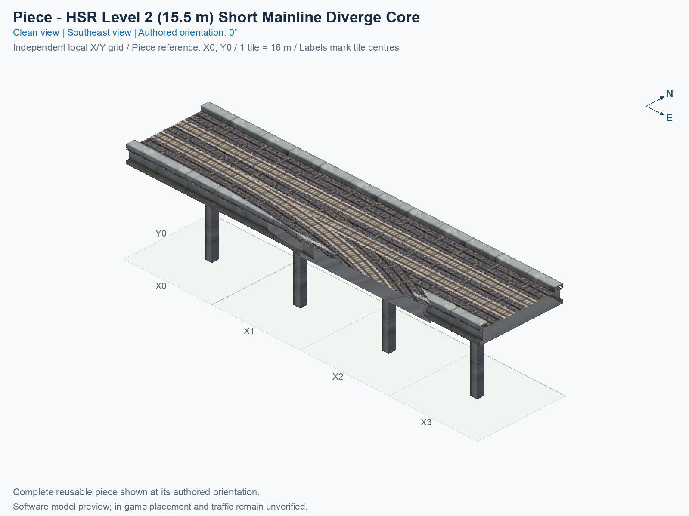
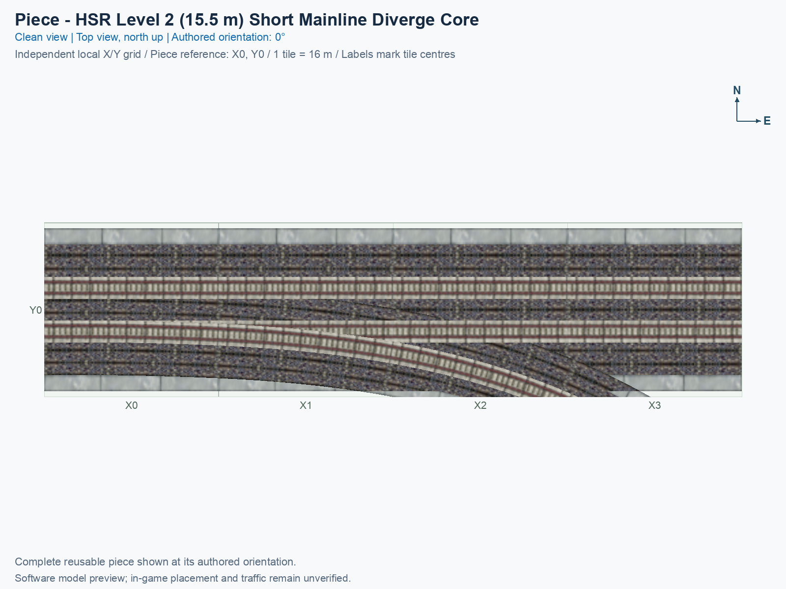
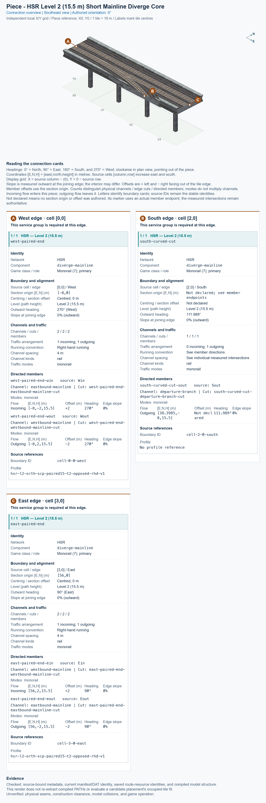

# HSR L2 Short Mainline Diverge Core

<!-- PIECE README LAYOUT: 1 -->

[1. Views](#1-views) · [2. Piece and placement](#2-piece-and-placement) · [3. Connection matrix](#3-connection-matrix) · [4. Testing](#4-testing)

This reusable High Speed Rail (HSR) piece carries two opposite directions along one mainline and provides one directed departure onto a curved branch. Every train path remains at nominal Level 2 (L2), measured at 15.5 m above the piece’s ground reference. One click places this four-tile component; it does not place a complete interchange.

**Status: experimental.** Software pictures and saved-resource checks do not establish human preview approval, game appearance, or train operation. The exact menu name is **HSR L2 Short Mainline Diverge Core**, and the permanent type ID is `hsr-component-l2-short-mainline-diverge-core`.

## 1. Views

Both clean pictures show the same complete saved model at its authored 0° orientation. North is up in the top view; X increases eastward, Y increases northward, and each city tile measures 16 × 16 m. The local picture grid belongs to this reusable type. Its software reference is not a certified mouse-click anchor.

<!-- BEGIN PIECE VIEWS -->





<!-- END PIECE VIEWS -->

The [angled-view evidence](evidence/preview.json) and [top-view evidence](evidence/preview-top.json) identify the actual saved model, textures, camera, captions, and image fingerprints. The connection overview in chapter 3 adds measured boundary cards to that same reusable type.

## 2. Piece and placement

<!-- BEGIN PIECE OVERVIEW -->

Four-tile native two-track mainline with a one-way departure and an exact native straight approach; its unchanged custom curved branch accepts One-Way Curve from Diverge.

Exact reusable identifier: `hsr-component-l2-short-mainline-diverge-core`.

Footprint: **4 × 1 tiles**. Exact menu name: **HSR L2 Short Mainline Diverge Core**.

<!-- END PIECE OVERVIEW -->

### Function and complete joining boundaries

A mainline is the pair of tracks continuing through the piece. At the authored 0° orientation, it runs east/west. Traffic entering from the west can continue east or leave through the southern curved cut; traffic entering from the east continues west. The saved resources provide no east-to-branch movement or mainline U-turn. The generated matrix identifies the exact entrances, exits, and unavailable movements.

Both mainline ends require the complete paired Level 2 boundary, including its two directed tracks and native 15 m visual profile. The branch ends obliquely, meaning its track crosses the tile edge at an angle. It requires the exact matching curved continuation, rather than an arbitrary straight at the same height. Its card preserves the measured endpoint and outward heading without inventing a centred paired section.

The permanent construction definition is [piece.json](piece.json), and its geometry belongs in [geometry.json](geometry.json). The [authored connector groups](connector-groups.jsonc), [resolved export](connector-data.json), and [measured connections](connections.json) describe this piece’s intrinsic boundaries and journeys. The library does not supply automatic compatibility discovery, and this guide does not publish a neighbour shortlist.

### Place and rotate the piece

After following the [separate installation procedure](../../../../docs/BUILD_AND_INSTALL.md), use a disposable flat test city. A proper rotation turns the whole piece and all its travel directions together; it does not reflect the piece or reverse a directed track.

1. Open **Transportation → Rail**, hover over the SCP buttons, and select **HSR L2 Short Mainline Diverge Core**. An assembly can expose the same reusable type through its Tab/Shift+Tab component cycle.
2. Move the complete cursor preview onto clear terrain. Press **Home** or **End** to rotate; on the documented Mac keyboard, **Fn + ←** and **Fn + →** provide those keys. Use only the supported construction states listed below.
3. At 0°, identify the west and east paired mainline ends and the southern curved departure in the top picture. Keep all four consecutive tiles clear, and align the whole paired boundary and curved continuation before placing.
4. Click once to place the component. Supply matching outside connections and travel demand. Inspect tracks, decks, walls, supports, and shadows, then check the permitted journeys and unavailable movements separately.

## 3. Connection matrix

<!-- BEGIN PIECE CONNECTION MATRIX -->

### Directed entrance/exit matrix

Read **from an entrance row to an exit column**. **Saved PATH** checks the saved traffic route; **Route Query** checks the route shown by the game; **Visible travel** checks a vehicle completing that journey. For HSR, visible travel means a moving train.

**Game appearance:** [?](#case-in_game_render-5b28106d377daf5b6fa0) — the complete piece’s appearance in the game, checked separately from its journeys.

**Legend:** ✅ confirmed; ❌ failed; ? not established. **Forbidden** means the movement is unavailable; its in-game check confirms that it stays unavailable. Click a result for its exact test case. Scope, evidence, and limitations remain in [the test checklist](#test-checklist).

| Entrance ↓ / Exit → | **HSR · West exit**<br>`Wout` | **HSR · South exit**<br>`Sout` | **HSR · East exit**<br>`Eout` |
| --- | --- | --- | --- |
| **HSR · West entrance**<br>`Win` | **Forbidden**<br>**Saved PATH:** [✅](#case-software_connectivity-1be6a14c7095a92ca6a3)<br>In-game check: [?](#case-in_game_forbidden_transfer-305dc860de6ca3c81de5) | **Saved PATH:** [✅](#case-software_connectivity-1be6a14c7095a92ca6a3)<br>**Route Query:** [?](#case-in_game_route_query-6d0026d836d5154be176)<br>**Visible train travel:** [?](#case-in_game_visible_travel-6d0026d836d5154be176) | **Saved PATH:** [✅](#case-software_connectivity-1be6a14c7095a92ca6a3)<br>**Route Query:** [?](#case-in_game_route_query-73c9e40447db7eca5d77)<br>**Visible train travel:** [?](#case-in_game_visible_travel-73c9e40447db7eca5d77) |
| **HSR · East entrance**<br>`Ein` | **Saved PATH:** [✅](#case-software_connectivity-1be6a14c7095a92ca6a3)<br>**Route Query:** [?](#case-in_game_route_query-184484f7197e20662425)<br>**Visible train travel:** [?](#case-in_game_visible_travel-184484f7197e20662425) | **Forbidden**<br>**Saved PATH:** [✅](#case-software_connectivity-1be6a14c7095a92ca6a3)<br>In-game check: [?](#case-in_game_forbidden_transfer-959b05f5b375b9250b7b) | **Forbidden**<br>**Saved PATH:** [✅](#case-software_connectivity-1be6a14c7095a92ca6a3)<br>In-game check: [?](#case-in_game_forbidden_transfer-cd77fab872666f8fde8f) |

Source: [connections.json](connections.json).

<!-- END PIECE CONNECTION MATRIX -->

<!-- BEGIN CONNECTOR OVERVIEW -->

### Connection overview

Generated from this piece's source-bound connector metadata and the current compiled model; marker letters refer to the boundary cards below.



[Rendering sources and verification scope](evidence/connection-overview.json).

Headings: 0° = North, 90° = East, 180° = South, and 270° = West; clockwise in plan view, pointing out of the piece.

Coordinates [E,N,H] = [east,north,height] in metres. Source cells [column,row] increase east and south.

Display grid: X = source column − (0); Y = 0 − source row.

Slope is measured outward at the joining edge; the interior may differ. Offsets are + left and − right facing out of the tile edge.

Member offsets use the section origin. Counts distinguish physical channels / edge cuts / directed members; modes do not multiply channels.

Incoming flow enters this piece; outgoing flow leaves it. Letters identify boundary cards; source IDs remain the stable identities.

Not declared means no section origin or offset was authored. Its marker uses an actual member endpoint; the measured intersections remain authoritative.

#### Boundary A: `cell-0-0-west`

This service group is required at this edge.

##### Service group 1 / 1: HSR — Level 2 (15.5 m)

| Field | Value |
| --- | --- |
| End / component | `west-paired-end` / `diverge-mainline` |
| Network / game class / role | hsr / Monorail (7); primary |
| Source cell / edge | `[0,0]` / West |
| Section origin [E,N] (m) | `[-8,0]` |
| Centring / section offset | Centred; 0 m |
| Level (path height) | Level 2 (15.5 m) |
| Outward heading | 270° (West) |
| Slope at joining edge | 0% outward |
| Channels / edge cuts / directed members | 2 / 2 / 2 |
| Traffic arrangement / running | 1 incoming; 1 outgoing; Right-hand running |
| Channel spacing | 4 m |
| Channel kinds | rail |
| Traffic modes | monorail |
| Profile | `hsr-l2-orth-scp-paired15-t2-opposed-rhd-v1` |

| Member / measured source | Channel / cut / modes | Flow | Endpoint [E,N,H] (m) | Offset (m) | Outward heading | Edge slope (%) |
| --- | --- | --- | --- | ---: | ---: | ---: |
| `west-paired-end-win` / `Win` | `eastbound-mainline` / `west-paired-end-eastbound-mainline-cut` / monorail | Incoming | `[-8,-2,15.5]` | +2 | 270° | 0 |
| `west-paired-end-wout` / `Wout` | `westbound-mainline` / `west-paired-end-westbound-mainline-cut` / monorail | Outgoing | `[-8,2,15.5]` | -2 | 270° | 0 |

#### Boundary B: `cell-2-0-south`

This service group is required at this edge.

##### Service group 1 / 1: HSR — Level 2 (15.5 m)

| Field | Value |
| --- | --- |
| End / component | `south-curved-cut` / `diverge-mainline` |
| Network / game class / role | hsr / Monorail (7); primary |
| Source cell / edge | `[2,0]` / South |
| Section origin [E,N] (m) | Not declared; see member endpoints |
| Centring / section offset | Not declared |
| Level (path height) | Level 2 (15.5 m) |
| Outward heading | 111.989° |
| Slope at joining edge | 0% outward |
| Channels / edge cuts / directed members | 1 / 1 / 1 |
| Traffic arrangement / running | 0 incoming; 1 outgoing; See member directions |
| Channel spacing | See individual measured intersections |
| Channel kinds | rail |
| Traffic modes | monorail |
| Profile | No profile reference |

| Member / measured source | Channel / cut / modes | Flow | Endpoint [E,N,H] (m) | Offset (m) | Outward heading | Edge slope (%) |
| --- | --- | --- | --- | ---: | ---: | ---: |
| `south-curved-cut-sout` / `Sout` | `departure-branch` / `south-curved-cut-departure-branch-cut` / monorail | Outgoing | `[38.3985,-8,15.5]` | Not declared | 111.989° | 0 |

#### Boundary C: `cell-3-0-east`

This service group is required at this edge.

##### Service group 1 / 1: HSR — Level 2 (15.5 m)

| Field | Value |
| --- | --- |
| End / component | `east-paired-end` / `diverge-mainline` |
| Network / game class / role | hsr / Monorail (7); primary |
| Source cell / edge | `[3,0]` / East |
| Section origin [E,N] (m) | `[56,0]` |
| Centring / section offset | Centred; 0 m |
| Level (path height) | Level 2 (15.5 m) |
| Outward heading | 90° (East) |
| Slope at joining edge | 0% outward |
| Channels / edge cuts / directed members | 2 / 2 / 2 |
| Traffic arrangement / running | 1 incoming; 1 outgoing; Right-hand running |
| Channel spacing | 4 m |
| Channel kinds | rail |
| Traffic modes | monorail |
| Profile | `hsr-l2-orth-scp-paired15-t2-opposed-rhd-v1` |

| Member / measured source | Channel / cut / modes | Flow | Endpoint [E,N,H] (m) | Offset (m) | Outward heading | Edge slope (%) |
| --- | --- | --- | --- | ---: | ---: | ---: |
| `east-paired-end-ein` / `Ein` | `westbound-mainline` / `east-paired-end-westbound-mainline-cut` / monorail | Incoming | `[56,2,15.5]` | +2 | 90° | 0 |
| `east-paired-end-eout` / `Eout` | `eastbound-mainline` / `east-paired-end-eastbound-mainline-cut` / monorail | Outgoing | `[56,-2,15.5]` | -2 | 90° | 0 |

Rendering checks source metadata, current compiled resource identities, and model structure. It does not re-extract PATHs or evaluate placement; physical seams, construction clearance, collisions, and game operation remain unverified.

<!-- END CONNECTOR OVERVIEW -->

## 4. Testing

A case is one exact check under stated conditions. Saved-resource software checks, human preview review, game appearance, Route Query, and visible train travel are separate observations. A Route Query line does not prove that a train visibly completed a journey. Only explicit human confirmation can record a manual pass.

Follow the [shared observation procedure](../../../../docs/TESTING.md#record-one-observation) with this piece’s [authoritative test record](checks/manual-tests.json). Preserve failures, stale observations, and their original scope. The generated sections below provide the exact recording command and case identifiers.

### Engineering contract

The construction rectangle is 4 × 1 tiles, with four occupied cells and four authored supports. Source [column,row] cells increase eastward and southward; the picture’s Y axis increases northward. The smaller core was extracted from an earlier longer type: its historical tail deviation was 4.018 mm, and a separate neighbouring smooth-join correction was bounded at 24.5 mm. The [historical atomization ledger](../../01_assemblies/straight-stem-trumpet/checks/atomization.json) records that decision. Those historical measurements do not establish new neighbour compatibility or game operation.

The current documentation uses the unchanged compiled piece from a verified source build. [Saved-resource evidence](evidence/saved-resource-checks.json) identifies the source DAT and the exact software-report scope; refreshing a guide does not claim another game test. Construction, traffic demand, demolition, shadows, and save/reload remain separate game checks.

<!-- BEGIN MANUAL SUMMARY -->

### Manual status

Generated from [the exact test cases](#test-checklist) and [authoritative observations](checks/manual-tests.json).

- [ ] Preview review: 0/3 applicable cases passed; 0 failed, 0 stale.
- [ ] In-game rendering: 0/4 applicable cases passed; 0 failed, 0 stale.
- [ ] Route Query: 0/12 applicable cases passed; 0 failed, 0 stale.
- [ ] Visible travel: 0/12 applicable cases passed; 0 failed, 0 stale.

These observations cover only the named services, directions, poses, rotations, and recorded platforms.

<!-- END MANUAL SUMMARY -->

<!-- BEGIN CONNECTIONS -->

### Connections and journeys

Generated from [connections.json](connections.json). Coordinates are canonical east, north, and height in metres. A connection class names an encoded route interface; it does not prove visible deck/wall fit or an in-game test.

Supported placement states: 0° CCW, 90° CCW, 180° CCW, 270° CCW. Each state has its own declared manual scope.

A **port** is one directional transport-path endpoint. **Service** identifies the intended network service (for example HSR, street, or tram); **engine** is its internal traffic-class number, separate from the construction network. **Role** distinguishes primary service from auxiliary paths; sharing a traffic class does not establish service compatibility.

A **tangent** is a unit travel-direction vector: `[0,1]` means north. **Grade** is height gained per horizontal metre. These measured facts describe this subject alone. Compatibility requires a separate comparison of the complete joining boundaries; physical seams and actual game operation require their own evidence. See the [class index](../../connection-classes.json) for shared route-interface membership.

| Port | Service / engine / role | Direction | Location; tangent; grade | Connection class |
| --- | --- | --- | --- | --- |
| `Win` | hsr / 7 / primary | in | [-8.0, -2.0, 15.5]; [1.0, 0.0]; 0.0 | `path-interface-12d12be31d2057c5763d` |
| `Wout` | hsr / 7 / primary | out | [-8.0, 2.0, 15.5]; [-1.0, 0.0]; 0.0 | `path-interface-fba09fbeb87ad95c667a` |
| `Sout` | hsr / 7 / primary | out | [38.398519, -8.0, 15.5]; [0.9272548089646255, -0.3744309272108488]; 0.0 | `path-interface-d819a6d05c5e43d11db7` |
| `Eout` | hsr / 7 / primary | out | [56.0, -2.0, 15.5]; [1.0, 0.0]; 0.0 | `path-interface-12d12be31d2057c5763d` |
| `Ein` | hsr / 7 / primary | in | [56.0, 2.0, 15.5]; [-1.0, 0.0]; 0.0 | `path-interface-fba09fbeb87ad95c667a` |

#### Directed journeys

| Service | Entry → exit | Role |
| --- | --- | --- |
| hsr | `Win` → `Eout` | primary |
| hsr | `Win` → `Sout` | primary |
| hsr | `Ein` → `Wout` | primary |

#### Forbidden transfers

| From service / port | To service / port | Reason |
| --- | --- | --- |
| hsr / `Win` | hsr / `Wout` | No directed route exists between these ports in the saved piece transport paths. In-game confirmation remains unverified. |
| hsr / `Ein` | hsr / `Sout` | No directed route exists between these ports in the saved piece transport paths. In-game confirmation remains unverified. |
| hsr / `Ein` | hsr / `Eout` | No directed route exists between these ports in the saved piece transport paths. In-game confirmation remains unverified. |

Review the test checklist for the exact tested cases and environments.

<!-- END CONNECTIONS -->

<!-- BEGIN MANUAL CHECKS -->

### Test checklist

Generated from [the authoritative record](checks/manual-tests.json). Only explicit human observations create manual passes; software and preview checks remain separate. Expand a check/service group to see its rotation table, then expand the matching exact scope to copy a case ID and inspect its pose, reviewer, environment, and evidence. Grouping changes only this view; every declared case remains separate.

**States:** [x] passed; [ ] unverified, failed, or stale; N/A is an explicit inapplicable declaration. A dash means no case was declared in that column. Every pass covers only its recorded environment. T means a distinct construction-transposed state.

Four proper rotations are covered. No additional reflected state is established by this record; repeated construction aliases do not create new orientations.

Current totals: unverified: 55, passed: 2, failed: 0, stale: 0, not_applicable: 0.

#### Record an observation

Follow the [shared testing guide](../../../../docs/TESTING.md); copy [the unconfirmed example](checks/observation.example.json) to `checks/observation.json`. Case identifiers are in the expandable sections below. Do not edit generated checkboxes.

From the repository folder containing `custom-pieces`, run after filling `checks/observation.json` and explicitly confirming the exact observation:

```sh
python3 -m scp.content record --record custom-pieces/domains/high-speed-rail/00_pieces/hsr-component-l2-short-mainline-diverge-core/checks/manual-tests.json --observation custom-pieces/domains/high-speed-rail/00_pieces/hsr-component-l2-short-mainline-diverge-core/checks/observation.json
```

#### Detailed current checks

Each collapsed group shows exact case counts and states. Forbidden transfers are grouped by the directed service pair; the table inside retains every port pair and rotation.

<details>
<summary>Compiled resources — Whole subject — 1 case; passed: 1</summary>

| Check / exact scope | General | 0° | 90° | 180° | 270° |
| --- | --- | --- | --- | --- | --- |
| **Compiled resources**<br>Whole subject | <a href="#case-software_resources-1be6a14c7095a92ca6a3">[x] passed</a> | — | — | — | — |


<details>
<summary>Compiled resources — Whole subject</summary>

<a id="case-software_resources-1be6a14c7095a92ca6a3"></a>

**General: passed** — `software_resources-1be6a14c7095a92ca6a3`.

Verify the actual compiled resources and construction rules.

Scope: Whole subject.

Recorded observations (chronological; the state above checks the relevant dependency snapshot):

- result: passed; authority: software; reviewer: verify_hsr_trumpet_v4.py plus independent staged build resource checks; confirmed at: 2026-10-20T10:42:34.857695+00:00; evidence: [../../01_assemblies/straight-stem-trumpet-v4/evidence/validation.json]; environment: {}
- result: passed; authority: software; reviewer: Actual final normal 13-piece saved-build verification; registered independent PATH, model, construction, menu, and shadow checks; confirmed at: 2026-10-27T21:57:25.376326+00:00; evidence: [evidence/saved-resource-checks.json]; environment: {}

</details>

</details>

<details>
<summary>Directed routing graph — Whole subject — 1 case; passed: 1</summary>

| Check / exact scope | General | 0° | 90° | 180° | 270° |
| --- | --- | --- | --- | --- | --- |
| **Directed routing graph**<br>Whole subject | <a href="#case-software_connectivity-1be6a14c7095a92ca6a3">[x] passed</a> | — | — | — | — |


<details>
<summary>Directed routing graph — Whole subject</summary>

<a id="case-software_connectivity-1be6a14c7095a92ca6a3"></a>

**General: passed** — `software_connectivity-1be6a14c7095a92ca6a3`.

Verify the declared directed journeys and forbidden transfers.

Scope: Whole subject.

Recorded observations (chronological; the state above checks the relevant dependency snapshot):

- result: passed; authority: software; reviewer: verify_hsr_trumpet_v4.py plus independent staged build resource checks; confirmed at: 2026-10-20T10:42:34.865101+00:00; evidence: [../../01_assemblies/straight-stem-trumpet-v4/evidence/validation.json]; environment: {}
- result: passed; authority: software; reviewer: Actual final normal 13-piece saved-build verification; registered independent PATH, model, construction, menu, and shadow checks; confirmed at: 2026-10-27T21:57:25.376326+00:00; evidence: [evidence/saved-resource-checks.json]; environment: {}

</details>

</details>

<details>
<summary>Preview review — Images — 3 cases; unverified: 3</summary>

| Check / exact scope | General | 0° | 90° | 180° | 270° |
| --- | --- | --- | --- | --- | --- |
| **Preview review**<br>Image: image:hsr-component-l2-short-mainline-diverge-core:canonical-southeast | <a href="#case-preview_review-44db441b6df7ca3395fc">[ ] unverified</a> | — | — | — | — |
| **Preview review**<br>Image: image:hsr-component-l2-short-mainline-diverge-core:canonical-top | <a href="#case-preview_review-c0f82e508ffbc60632bb">[ ] unverified</a> | — | — | — | — |
| **Preview review**<br>Image: image:hsr-component-l2-short-mainline-diverge-core:connection-overview | <a href="#case-preview_review-372750160002ee7c7ac4">[ ] unverified</a> | — | — | — | — |


<details>
<summary>Preview review — Image: image:hsr-component-l2-short-mainline-diverge-core:canonical-southeast</summary>

<a id="case-preview_review-44db441b6df7ca3395fc"></a>

**General: unverified** — `preview_review-44db441b6df7ca3395fc`.

Inspect this exact preview for tracks, walls, piers, seams, and shadows.

Scope: Image: image:hsr-component-l2-short-mainline-diverge-core:canonical-southeast.

No observation recorded.

</details>


<details>
<summary>Preview review — Image: image:hsr-component-l2-short-mainline-diverge-core:canonical-top</summary>

<a id="case-preview_review-c0f82e508ffbc60632bb"></a>

**General: unverified** — `preview_review-c0f82e508ffbc60632bb`.

Inspect this exact preview for tracks, walls, piers, seams, and shadows.

Scope: Image: image:hsr-component-l2-short-mainline-diverge-core:canonical-top.

No observation recorded.

</details>


<details>
<summary>Preview review — Image: image:hsr-component-l2-short-mainline-diverge-core:connection-overview</summary>

<a id="case-preview_review-372750160002ee7c7ac4"></a>

**General: unverified** — `preview_review-372750160002ee7c7ac4`.

Inspect this exact preview for tracks, walls, piers, seams, and shadows.

Scope: Image: image:hsr-component-l2-short-mainline-diverge-core:connection-overview.

No observation recorded.

</details>

</details>

<details>
<summary>In-game rendering — Whole subject — 4 cases; unverified: 4</summary>

| Check / exact scope | General | 0° | 90° | 180° | 270° |
| --- | --- | --- | --- | --- | --- |
| **In-game rendering**<br>Whole subject | — | <a href="#case-in_game_render-5b28106d377daf5b6fa0">[ ] unverified</a> | <a href="#case-in_game_render-7befb4ecda34633d72ed">[ ] unverified</a> | <a href="#case-in_game_render-150e1f8cad64f39a2e4b">[ ] unverified</a> | <a href="#case-in_game_render-3571a612233cd36909b7">[ ] unverified</a> |


<details>
<summary>In-game rendering — Whole subject</summary>

<a id="case-in_game_render-5b28106d377daf5b6fa0"></a>

**0° CCW: unverified** — `in_game_render-5b28106d377daf5b6fa0`.

Inspect the placed tracks, walls, piers, seams, and shadows in SimCity 4.

Scope: Whole subject.

No observation recorded.

<a id="case-in_game_render-7befb4ecda34633d72ed"></a>

**90° CCW: unverified** — `in_game_render-7befb4ecda34633d72ed`.

Inspect the placed tracks, walls, piers, seams, and shadows in SimCity 4.

Scope: Whole subject.

No observation recorded.

<a id="case-in_game_render-150e1f8cad64f39a2e4b"></a>

**180° CCW: unverified** — `in_game_render-150e1f8cad64f39a2e4b`.

Inspect the placed tracks, walls, piers, seams, and shadows in SimCity 4.

Scope: Whole subject.

No observation recorded.

<a id="case-in_game_render-3571a612233cd36909b7"></a>

**270° CCW: unverified** — `in_game_render-3571a612233cd36909b7`.

Inspect the placed tracks, walls, piers, seams, and shadows in SimCity 4.

Scope: Whole subject.

No observation recorded.

</details>

</details>

<details>
<summary>Placement — Whole subject — 4 cases; unverified: 4</summary>

| Check / exact scope | General | 0° | 90° | 180° | 270° |
| --- | --- | --- | --- | --- | --- |
| **Placement**<br>Whole subject | — | <a href="#case-in_game_placement-5b28106d377daf5b6fa0">[ ] unverified</a> | <a href="#case-in_game_placement-7befb4ecda34633d72ed">[ ] unverified</a> | <a href="#case-in_game_placement-150e1f8cad64f39a2e4b">[ ] unverified</a> | <a href="#case-in_game_placement-3571a612233cd36909b7">[ ] unverified</a> |


<details>
<summary>Placement — Whole subject</summary>

<a id="case-in_game_placement-5b28106d377daf5b6fa0"></a>

**0° CCW: unverified** — `in_game_placement-5b28106d377daf5b6fa0`.

Place this piece or complete blueprint and inspect every occupied tile.

Scope: Whole subject.

No observation recorded.

<a id="case-in_game_placement-7befb4ecda34633d72ed"></a>

**90° CCW: unverified** — `in_game_placement-7befb4ecda34633d72ed`.

Place this piece or complete blueprint and inspect every occupied tile.

Scope: Whole subject.

No observation recorded.

<a id="case-in_game_placement-150e1f8cad64f39a2e4b"></a>

**180° CCW: unverified** — `in_game_placement-150e1f8cad64f39a2e4b`.

Place this piece or complete blueprint and inspect every occupied tile.

Scope: Whole subject.

No observation recorded.

<a id="case-in_game_placement-3571a612233cd36909b7"></a>

**270° CCW: unverified** — `in_game_placement-3571a612233cd36909b7`.

Place this piece or complete blueprint and inspect every occupied tile.

Scope: Whole subject.

No observation recorded.

</details>

</details>

<details>
<summary>Demolition — Whole subject — 4 cases; unverified: 4</summary>

| Check / exact scope | General | 0° | 90° | 180° | 270° |
| --- | --- | --- | --- | --- | --- |
| **Demolition**<br>Whole subject | — | <a href="#case-in_game_demolition-5b28106d377daf5b6fa0">[ ] unverified</a> | <a href="#case-in_game_demolition-7befb4ecda34633d72ed">[ ] unverified</a> | <a href="#case-in_game_demolition-150e1f8cad64f39a2e4b">[ ] unverified</a> | <a href="#case-in_game_demolition-3571a612233cd36909b7">[ ] unverified</a> |


<details>
<summary>Demolition — Whole subject</summary>

<a id="case-in_game_demolition-5b28106d377daf5b6fa0"></a>

**0° CCW: unverified** — `in_game_demolition-5b28106d377daf5b6fa0`.

Bulldoze the complete placement and inspect the cleared area.

Scope: Whole subject.

No observation recorded.

<a id="case-in_game_demolition-7befb4ecda34633d72ed"></a>

**90° CCW: unverified** — `in_game_demolition-7befb4ecda34633d72ed`.

Bulldoze the complete placement and inspect the cleared area.

Scope: Whole subject.

No observation recorded.

<a id="case-in_game_demolition-150e1f8cad64f39a2e4b"></a>

**180° CCW: unverified** — `in_game_demolition-150e1f8cad64f39a2e4b`.

Bulldoze the complete placement and inspect the cleared area.

Scope: Whole subject.

No observation recorded.

<a id="case-in_game_demolition-3571a612233cd36909b7"></a>

**270° CCW: unverified** — `in_game_demolition-3571a612233cd36909b7`.

Bulldoze the complete placement and inspect the cleared area.

Scope: Whole subject.

No observation recorded.

</details>

</details>

<details>
<summary>Save and reload — Whole subject — 4 cases; unverified: 4</summary>

| Check / exact scope | General | 0° | 90° | 180° | 270° |
| --- | --- | --- | --- | --- | --- |
| **Save and reload**<br>Whole subject | — | <a href="#case-in_game_save_reload-5b28106d377daf5b6fa0">[ ] unverified</a> | <a href="#case-in_game_save_reload-7befb4ecda34633d72ed">[ ] unverified</a> | <a href="#case-in_game_save_reload-150e1f8cad64f39a2e4b">[ ] unverified</a> | <a href="#case-in_game_save_reload-3571a612233cd36909b7">[ ] unverified</a> |


<details>
<summary>Save and reload — Whole subject</summary>

<a id="case-in_game_save_reload-5b28106d377daf5b6fa0"></a>

**0° CCW: unverified** — `in_game_save_reload-5b28106d377daf5b6fa0`.

Save, quit, reload, and inspect the placement and its paths.

Scope: Whole subject.

No observation recorded.

<a id="case-in_game_save_reload-7befb4ecda34633d72ed"></a>

**90° CCW: unverified** — `in_game_save_reload-7befb4ecda34633d72ed`.

Save, quit, reload, and inspect the placement and its paths.

Scope: Whole subject.

No observation recorded.

<a id="case-in_game_save_reload-150e1f8cad64f39a2e4b"></a>

**180° CCW: unverified** — `in_game_save_reload-150e1f8cad64f39a2e4b`.

Save, quit, reload, and inspect the placement and its paths.

Scope: Whole subject.

No observation recorded.

<a id="case-in_game_save_reload-3571a612233cd36909b7"></a>

**270° CCW: unverified** — `in_game_save_reload-3571a612233cd36909b7`.

Save, quit, reload, and inspect the placement and its paths.

Scope: Whole subject.

No observation recorded.

</details>

</details>

<details>
<summary>Route Query — hsr — 12 cases; unverified: 12</summary>

| Check / exact scope | General | 0° | 90° | 180° | 270° |
| --- | --- | --- | --- | --- | --- |
| **Route Query**<br>Service: hsr; role: primary; journey: 7:Win>Eout; entry: Win; exit: Eout | — | <a href="#case-in_game_route_query-73c9e40447db7eca5d77">[ ] unverified</a> | <a href="#case-in_game_route_query-d36bbc1685e39cff4604">[ ] unverified</a> | <a href="#case-in_game_route_query-820fc48049ad97989483">[ ] unverified</a> | <a href="#case-in_game_route_query-23b20dbb37e7252472f9">[ ] unverified</a> |
| **Route Query**<br>Service: hsr; role: primary; journey: 7:Win>Sout; entry: Win; exit: Sout | — | <a href="#case-in_game_route_query-6d0026d836d5154be176">[ ] unverified</a> | <a href="#case-in_game_route_query-f080eb7136ac872f4f8d">[ ] unverified</a> | <a href="#case-in_game_route_query-f6edfc9aa1e2ff11c3d8">[ ] unverified</a> | <a href="#case-in_game_route_query-1e8cc484450cd566a0aa">[ ] unverified</a> |
| **Route Query**<br>Service: hsr; role: primary; journey: 7:Ein>Wout; entry: Ein; exit: Wout | — | <a href="#case-in_game_route_query-184484f7197e20662425">[ ] unverified</a> | <a href="#case-in_game_route_query-1b7f0add07635c0c9883">[ ] unverified</a> | <a href="#case-in_game_route_query-cac25e7640a3a03b10d8">[ ] unverified</a> | <a href="#case-in_game_route_query-8da684985233114279c5">[ ] unverified</a> |


<details>
<summary>Route Query — Service: hsr; role: primary; journey: 7:Win>Eout; entry: Win; exit: Eout</summary>

<a id="case-in_game_route_query-73c9e40447db7eca5d77"></a>

**0° CCW: unverified** — `in_game_route_query-73c9e40447db7eca5d77`.

Use Route Query in SimCity 4 to confirm this directed journey for its service network.

Scope: Service: hsr; role: primary; journey: 7:Win>Eout; entry: Win; exit: Eout.

No observation recorded.

<a id="case-in_game_route_query-d36bbc1685e39cff4604"></a>

**90° CCW: unverified** — `in_game_route_query-d36bbc1685e39cff4604`.

Use Route Query in SimCity 4 to confirm this directed journey for its service network.

Scope: Service: hsr; role: primary; journey: 7:Win>Eout; entry: Win; exit: Eout.

No observation recorded.

<a id="case-in_game_route_query-820fc48049ad97989483"></a>

**180° CCW: unverified** — `in_game_route_query-820fc48049ad97989483`.

Use Route Query in SimCity 4 to confirm this directed journey for its service network.

Scope: Service: hsr; role: primary; journey: 7:Win>Eout; entry: Win; exit: Eout.

No observation recorded.

<a id="case-in_game_route_query-23b20dbb37e7252472f9"></a>

**270° CCW: unverified** — `in_game_route_query-23b20dbb37e7252472f9`.

Use Route Query in SimCity 4 to confirm this directed journey for its service network.

Scope: Service: hsr; role: primary; journey: 7:Win>Eout; entry: Win; exit: Eout.

No observation recorded.

</details>


<details>
<summary>Route Query — Service: hsr; role: primary; journey: 7:Win>Sout; entry: Win; exit: Sout</summary>

<a id="case-in_game_route_query-6d0026d836d5154be176"></a>

**0° CCW: unverified** — `in_game_route_query-6d0026d836d5154be176`.

Use Route Query in SimCity 4 to confirm this directed journey for its service network.

Scope: Service: hsr; role: primary; journey: 7:Win>Sout; entry: Win; exit: Sout.

No observation recorded.

<a id="case-in_game_route_query-f080eb7136ac872f4f8d"></a>

**90° CCW: unverified** — `in_game_route_query-f080eb7136ac872f4f8d`.

Use Route Query in SimCity 4 to confirm this directed journey for its service network.

Scope: Service: hsr; role: primary; journey: 7:Win>Sout; entry: Win; exit: Sout.

No observation recorded.

<a id="case-in_game_route_query-f6edfc9aa1e2ff11c3d8"></a>

**180° CCW: unverified** — `in_game_route_query-f6edfc9aa1e2ff11c3d8`.

Use Route Query in SimCity 4 to confirm this directed journey for its service network.

Scope: Service: hsr; role: primary; journey: 7:Win>Sout; entry: Win; exit: Sout.

No observation recorded.

<a id="case-in_game_route_query-1e8cc484450cd566a0aa"></a>

**270° CCW: unverified** — `in_game_route_query-1e8cc484450cd566a0aa`.

Use Route Query in SimCity 4 to confirm this directed journey for its service network.

Scope: Service: hsr; role: primary; journey: 7:Win>Sout; entry: Win; exit: Sout.

No observation recorded.

</details>


<details>
<summary>Route Query — Service: hsr; role: primary; journey: 7:Ein>Wout; entry: Ein; exit: Wout</summary>

<a id="case-in_game_route_query-184484f7197e20662425"></a>

**0° CCW: unverified** — `in_game_route_query-184484f7197e20662425`.

Use Route Query in SimCity 4 to confirm this directed journey for its service network.

Scope: Service: hsr; role: primary; journey: 7:Ein>Wout; entry: Ein; exit: Wout.

No observation recorded.

<a id="case-in_game_route_query-1b7f0add07635c0c9883"></a>

**90° CCW: unverified** — `in_game_route_query-1b7f0add07635c0c9883`.

Use Route Query in SimCity 4 to confirm this directed journey for its service network.

Scope: Service: hsr; role: primary; journey: 7:Ein>Wout; entry: Ein; exit: Wout.

No observation recorded.

<a id="case-in_game_route_query-cac25e7640a3a03b10d8"></a>

**180° CCW: unverified** — `in_game_route_query-cac25e7640a3a03b10d8`.

Use Route Query in SimCity 4 to confirm this directed journey for its service network.

Scope: Service: hsr; role: primary; journey: 7:Ein>Wout; entry: Ein; exit: Wout.

No observation recorded.

<a id="case-in_game_route_query-8da684985233114279c5"></a>

**270° CCW: unverified** — `in_game_route_query-8da684985233114279c5`.

Use Route Query in SimCity 4 to confirm this directed journey for its service network.

Scope: Service: hsr; role: primary; journey: 7:Ein>Wout; entry: Ein; exit: Wout.

No observation recorded.

</details>

</details>

<details>
<summary>Visible travel — hsr — 12 cases; unverified: 12</summary>

| Check / exact scope | General | 0° | 90° | 180° | 270° |
| --- | --- | --- | --- | --- | --- |
| **Visible travel**<br>Service: hsr; role: primary; journey: 7:Win>Eout; entry: Win; exit: Eout | — | <a href="#case-in_game_visible_travel-73c9e40447db7eca5d77">[ ] unverified</a> | <a href="#case-in_game_visible_travel-d36bbc1685e39cff4604">[ ] unverified</a> | <a href="#case-in_game_visible_travel-820fc48049ad97989483">[ ] unverified</a> | <a href="#case-in_game_visible_travel-23b20dbb37e7252472f9">[ ] unverified</a> |
| **Visible travel**<br>Service: hsr; role: primary; journey: 7:Win>Sout; entry: Win; exit: Sout | — | <a href="#case-in_game_visible_travel-6d0026d836d5154be176">[ ] unverified</a> | <a href="#case-in_game_visible_travel-f080eb7136ac872f4f8d">[ ] unverified</a> | <a href="#case-in_game_visible_travel-f6edfc9aa1e2ff11c3d8">[ ] unverified</a> | <a href="#case-in_game_visible_travel-1e8cc484450cd566a0aa">[ ] unverified</a> |
| **Visible travel**<br>Service: hsr; role: primary; journey: 7:Ein>Wout; entry: Ein; exit: Wout | — | <a href="#case-in_game_visible_travel-184484f7197e20662425">[ ] unverified</a> | <a href="#case-in_game_visible_travel-1b7f0add07635c0c9883">[ ] unverified</a> | <a href="#case-in_game_visible_travel-cac25e7640a3a03b10d8">[ ] unverified</a> | <a href="#case-in_game_visible_travel-8da684985233114279c5">[ ] unverified</a> |


<details>
<summary>Visible travel — Service: hsr; role: primary; journey: 7:Win>Eout; entry: Win; exit: Eout</summary>

<a id="case-in_game_visible_travel-73c9e40447db7eca5d77"></a>

**0° CCW: unverified** — `in_game_visible_travel-73c9e40447db7eca5d77`.

Observe traffic visibly complete this directed journey for its service network; Route Query alone does not complete this check.

Scope: Service: hsr; role: primary; journey: 7:Win>Eout; entry: Win; exit: Eout.

No observation recorded.

<a id="case-in_game_visible_travel-d36bbc1685e39cff4604"></a>

**90° CCW: unverified** — `in_game_visible_travel-d36bbc1685e39cff4604`.

Observe traffic visibly complete this directed journey for its service network; Route Query alone does not complete this check.

Scope: Service: hsr; role: primary; journey: 7:Win>Eout; entry: Win; exit: Eout.

No observation recorded.

<a id="case-in_game_visible_travel-820fc48049ad97989483"></a>

**180° CCW: unverified** — `in_game_visible_travel-820fc48049ad97989483`.

Observe traffic visibly complete this directed journey for its service network; Route Query alone does not complete this check.

Scope: Service: hsr; role: primary; journey: 7:Win>Eout; entry: Win; exit: Eout.

No observation recorded.

<a id="case-in_game_visible_travel-23b20dbb37e7252472f9"></a>

**270° CCW: unverified** — `in_game_visible_travel-23b20dbb37e7252472f9`.

Observe traffic visibly complete this directed journey for its service network; Route Query alone does not complete this check.

Scope: Service: hsr; role: primary; journey: 7:Win>Eout; entry: Win; exit: Eout.

No observation recorded.

</details>


<details>
<summary>Visible travel — Service: hsr; role: primary; journey: 7:Win>Sout; entry: Win; exit: Sout</summary>

<a id="case-in_game_visible_travel-6d0026d836d5154be176"></a>

**0° CCW: unverified** — `in_game_visible_travel-6d0026d836d5154be176`.

Observe traffic visibly complete this directed journey for its service network; Route Query alone does not complete this check.

Scope: Service: hsr; role: primary; journey: 7:Win>Sout; entry: Win; exit: Sout.

No observation recorded.

<a id="case-in_game_visible_travel-f080eb7136ac872f4f8d"></a>

**90° CCW: unverified** — `in_game_visible_travel-f080eb7136ac872f4f8d`.

Observe traffic visibly complete this directed journey for its service network; Route Query alone does not complete this check.

Scope: Service: hsr; role: primary; journey: 7:Win>Sout; entry: Win; exit: Sout.

No observation recorded.

<a id="case-in_game_visible_travel-f6edfc9aa1e2ff11c3d8"></a>

**180° CCW: unverified** — `in_game_visible_travel-f6edfc9aa1e2ff11c3d8`.

Observe traffic visibly complete this directed journey for its service network; Route Query alone does not complete this check.

Scope: Service: hsr; role: primary; journey: 7:Win>Sout; entry: Win; exit: Sout.

No observation recorded.

<a id="case-in_game_visible_travel-1e8cc484450cd566a0aa"></a>

**270° CCW: unverified** — `in_game_visible_travel-1e8cc484450cd566a0aa`.

Observe traffic visibly complete this directed journey for its service network; Route Query alone does not complete this check.

Scope: Service: hsr; role: primary; journey: 7:Win>Sout; entry: Win; exit: Sout.

No observation recorded.

</details>


<details>
<summary>Visible travel — Service: hsr; role: primary; journey: 7:Ein>Wout; entry: Ein; exit: Wout</summary>

<a id="case-in_game_visible_travel-184484f7197e20662425"></a>

**0° CCW: unverified** — `in_game_visible_travel-184484f7197e20662425`.

Observe traffic visibly complete this directed journey for its service network; Route Query alone does not complete this check.

Scope: Service: hsr; role: primary; journey: 7:Ein>Wout; entry: Ein; exit: Wout.

No observation recorded.

<a id="case-in_game_visible_travel-1b7f0add07635c0c9883"></a>

**90° CCW: unverified** — `in_game_visible_travel-1b7f0add07635c0c9883`.

Observe traffic visibly complete this directed journey for its service network; Route Query alone does not complete this check.

Scope: Service: hsr; role: primary; journey: 7:Ein>Wout; entry: Ein; exit: Wout.

No observation recorded.

<a id="case-in_game_visible_travel-cac25e7640a3a03b10d8"></a>

**180° CCW: unverified** — `in_game_visible_travel-cac25e7640a3a03b10d8`.

Observe traffic visibly complete this directed journey for its service network; Route Query alone does not complete this check.

Scope: Service: hsr; role: primary; journey: 7:Ein>Wout; entry: Ein; exit: Wout.

No observation recorded.

<a id="case-in_game_visible_travel-8da684985233114279c5"></a>

**270° CCW: unverified** — `in_game_visible_travel-8da684985233114279c5`.

Observe traffic visibly complete this directed journey for its service network; Route Query alone does not complete this check.

Scope: Service: hsr; role: primary; journey: 7:Ein>Wout; entry: Ein; exit: Wout.

No observation recorded.

</details>

</details>

<details>
<summary>Forbidden transfer — hsr → hsr — 12 cases; unverified: 12</summary>

| Check / exact scope | General | 0° | 90° | 180° | 270° |
| --- | --- | --- | --- | --- | --- |
| **Forbidden transfer**<br>from port: Win; to port: Wout; from service: hsr; to service: hsr; basis: not reachable in actual saved PATH graph | — | <a href="#case-in_game_forbidden_transfer-305dc860de6ca3c81de5">[ ] unverified</a> | <a href="#case-in_game_forbidden_transfer-2cbaea5971ea5d4d66ac">[ ] unverified</a> | <a href="#case-in_game_forbidden_transfer-b3c46a596eba0a86626d">[ ] unverified</a> | <a href="#case-in_game_forbidden_transfer-27d0b92decc6925bd802">[ ] unverified</a> |
| **Forbidden transfer**<br>from port: Ein; to port: Sout; from service: hsr; to service: hsr; basis: not reachable in actual saved PATH graph | — | <a href="#case-in_game_forbidden_transfer-959b05f5b375b9250b7b">[ ] unverified</a> | <a href="#case-in_game_forbidden_transfer-a4c71b2e80b8da6a8859">[ ] unverified</a> | <a href="#case-in_game_forbidden_transfer-a07d73b10cb5071a1f58">[ ] unverified</a> | <a href="#case-in_game_forbidden_transfer-e7c31ab107da46952bdb">[ ] unverified</a> |
| **Forbidden transfer**<br>from port: Ein; to port: Eout; from service: hsr; to service: hsr; basis: not reachable in actual saved PATH graph | — | <a href="#case-in_game_forbidden_transfer-cd77fab872666f8fde8f">[ ] unverified</a> | <a href="#case-in_game_forbidden_transfer-88fc210200e0877a9132">[ ] unverified</a> | <a href="#case-in_game_forbidden_transfer-df387881032facf6b964">[ ] unverified</a> | <a href="#case-in_game_forbidden_transfer-11c688851431796030a6">[ ] unverified</a> |


<details>
<summary>Forbidden transfer — from port: Win; to port: Wout; from service: hsr; to service: hsr; basis: not reachable in actual saved PATH graph</summary>

<a id="case-in_game_forbidden_transfer-305dc860de6ca3c81de5"></a>

**0° CCW: unverified** — `in_game_forbidden_transfer-305dc860de6ca3c81de5`.

Confirm this undeclared transfer is unavailable.

Scope: from port: Win; to port: Wout; from service: hsr; to service: hsr; basis: not reachable in actual saved PATH graph.

No observation recorded.

<a id="case-in_game_forbidden_transfer-2cbaea5971ea5d4d66ac"></a>

**90° CCW: unverified** — `in_game_forbidden_transfer-2cbaea5971ea5d4d66ac`.

Confirm this undeclared transfer is unavailable.

Scope: from port: Win; to port: Wout; from service: hsr; to service: hsr; basis: not reachable in actual saved PATH graph.

No observation recorded.

<a id="case-in_game_forbidden_transfer-b3c46a596eba0a86626d"></a>

**180° CCW: unverified** — `in_game_forbidden_transfer-b3c46a596eba0a86626d`.

Confirm this undeclared transfer is unavailable.

Scope: from port: Win; to port: Wout; from service: hsr; to service: hsr; basis: not reachable in actual saved PATH graph.

No observation recorded.

<a id="case-in_game_forbidden_transfer-27d0b92decc6925bd802"></a>

**270° CCW: unverified** — `in_game_forbidden_transfer-27d0b92decc6925bd802`.

Confirm this undeclared transfer is unavailable.

Scope: from port: Win; to port: Wout; from service: hsr; to service: hsr; basis: not reachable in actual saved PATH graph.

No observation recorded.

</details>


<details>
<summary>Forbidden transfer — from port: Ein; to port: Sout; from service: hsr; to service: hsr; basis: not reachable in actual saved PATH graph</summary>

<a id="case-in_game_forbidden_transfer-959b05f5b375b9250b7b"></a>

**0° CCW: unverified** — `in_game_forbidden_transfer-959b05f5b375b9250b7b`.

Confirm this undeclared transfer is unavailable.

Scope: from port: Ein; to port: Sout; from service: hsr; to service: hsr; basis: not reachable in actual saved PATH graph.

No observation recorded.

<a id="case-in_game_forbidden_transfer-a4c71b2e80b8da6a8859"></a>

**90° CCW: unverified** — `in_game_forbidden_transfer-a4c71b2e80b8da6a8859`.

Confirm this undeclared transfer is unavailable.

Scope: from port: Ein; to port: Sout; from service: hsr; to service: hsr; basis: not reachable in actual saved PATH graph.

No observation recorded.

<a id="case-in_game_forbidden_transfer-a07d73b10cb5071a1f58"></a>

**180° CCW: unverified** — `in_game_forbidden_transfer-a07d73b10cb5071a1f58`.

Confirm this undeclared transfer is unavailable.

Scope: from port: Ein; to port: Sout; from service: hsr; to service: hsr; basis: not reachable in actual saved PATH graph.

No observation recorded.

<a id="case-in_game_forbidden_transfer-e7c31ab107da46952bdb"></a>

**270° CCW: unverified** — `in_game_forbidden_transfer-e7c31ab107da46952bdb`.

Confirm this undeclared transfer is unavailable.

Scope: from port: Ein; to port: Sout; from service: hsr; to service: hsr; basis: not reachable in actual saved PATH graph.

No observation recorded.

</details>


<details>
<summary>Forbidden transfer — from port: Ein; to port: Eout; from service: hsr; to service: hsr; basis: not reachable in actual saved PATH graph</summary>

<a id="case-in_game_forbidden_transfer-cd77fab872666f8fde8f"></a>

**0° CCW: unverified** — `in_game_forbidden_transfer-cd77fab872666f8fde8f`.

Confirm this undeclared transfer is unavailable.

Scope: from port: Ein; to port: Eout; from service: hsr; to service: hsr; basis: not reachable in actual saved PATH graph.

No observation recorded.

<a id="case-in_game_forbidden_transfer-88fc210200e0877a9132"></a>

**90° CCW: unverified** — `in_game_forbidden_transfer-88fc210200e0877a9132`.

Confirm this undeclared transfer is unavailable.

Scope: from port: Ein; to port: Eout; from service: hsr; to service: hsr; basis: not reachable in actual saved PATH graph.

No observation recorded.

<a id="case-in_game_forbidden_transfer-df387881032facf6b964"></a>

**180° CCW: unverified** — `in_game_forbidden_transfer-df387881032facf6b964`.

Confirm this undeclared transfer is unavailable.

Scope: from port: Ein; to port: Eout; from service: hsr; to service: hsr; basis: not reachable in actual saved PATH graph.

No observation recorded.

<a id="case-in_game_forbidden_transfer-11c688851431796030a6"></a>

**270° CCW: unverified** — `in_game_forbidden_transfer-11c688851431796030a6`.

Confirm this undeclared transfer is unavailable.

Scope: from port: Ein; to port: Eout; from service: hsr; to service: hsr; basis: not reachable in actual saved PATH graph.

No observation recorded.

</details>

</details>

<!-- END MANUAL CHECKS -->
