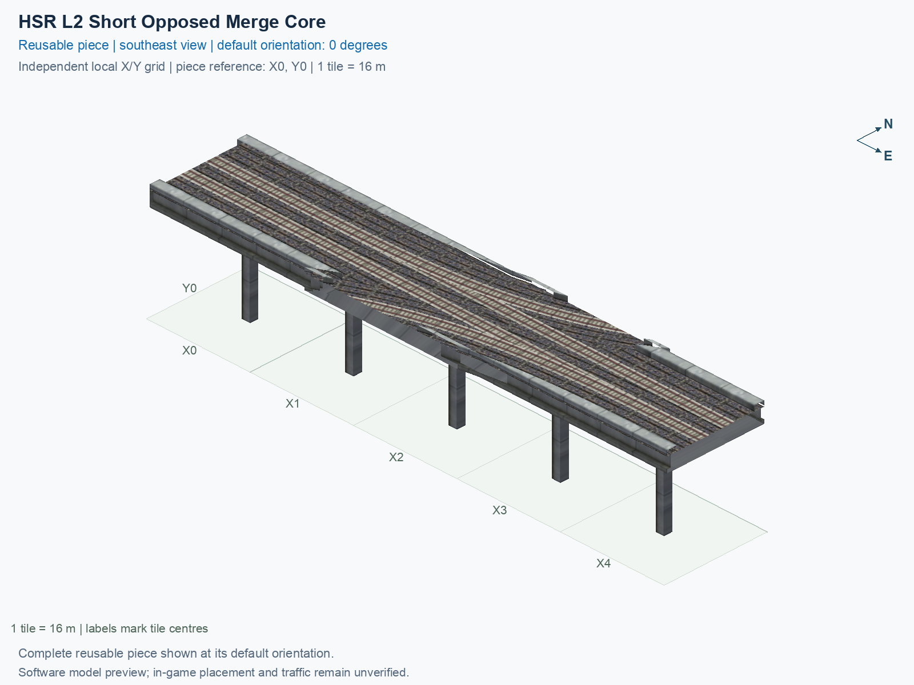
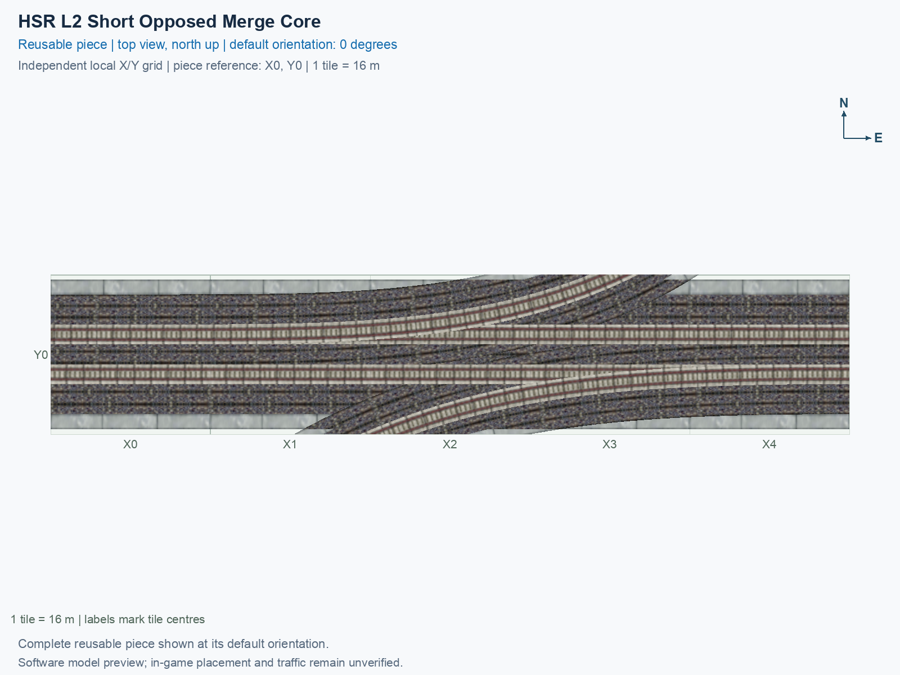

# HSR L2 Short Opposed Merge Core

Purpose: Describe this independently selectable reusable HSR piece, its native and custom connections, canonical previews and exact software/manual evidence.

A compact junction on an ordinary paired mainline, with custom curved branch connections. It occupies **5 city tiles** in a **5 × 1 tile** bounding rectangle. A city tile is 16 × 16 m. This is one teal **PART HSR** menu type; its permanent ID is `hsr-component-l2-short-opposed-merge-core`.

## Canonical views

Both images show the same complete saved model at **0°**, on its own local grid with the southwest tile centre **of the bounding rectangle (X0, Y0)**. X increases east and Y north. Rotating a placed copy does not change these catalogue pictures.

The [preview evidence](preview-evidence.json) records the exact saved-model inputs, cameras, grid, captions and image hashes. These are software renders, not game screenshots.

<!-- BEGIN PIECE OVERVIEW -->

Five-tile native two-track mainline receiving opposed one-way branches, with an exact native straight departure and unchanged custom curved branch entrances.

Exact reusable identifier: `hsr-component-l2-short-opposed-merge-core`.

Footprint: **5 × 1 tiles**. Exact menu name: **HSR L2 Short Opposed Merge Core**.

Choose this exact name in Transportation → Rail. Press Home or End to rotate; use only the supported states listed below. Join each end to a matching port profile and direction.

- [Connections and journeys](#connections-and-journeys)
- [Test checklist](#test-checklist)





<!-- END PIECE OVERVIEW -->

## Function and connections

Both mainline ends use the ordinary **15 m** paired HSR deck at **15.5 m** train-path height. Use **HSR L2 Two-Track Straight** rotated to match. The branch ends are custom curved interfaces. A **port** is a directional track entrance or exit. A **custom curved interface** needs the exact matching position, tangent and physical profile; merely sharing the same height does not make another track compatible. See the generated connection table below for concrete counterpart links and relative positions.

The authoring source is [geometry.json](geometry.json); the permanent construction definition is [piece.json](piece.json). This smaller core frees one ordinary tail tile. The original tail's deviation was **4.018 mm**; the adjoining smooth join has a separate **24.5 mm** maximum correction bound. The [historical assembly decision ledger](../../01_assemblies/straight-stem-trumpet-v4/checks/atomization.json) records why this extraction was permitted and why neighbouring candidates remained. The [current resource contract](../../01_assemblies/straight-stem-trumpet-v4/checks/resources.json) pins the approved result without requiring deleted predecessor files. The geometry belongs to this generic piece, rather than being changed only in an assembly render.

## Select and rotate

1. Open **Transportation → Rail** and hover over a teal **PART HSR** icon until the title reads **SCP | [PART] HSR L2 Short Opposed Merge Core**.
2. Select that button. Press **Home** or **End** to rotate the complete cursor preview. On the keyboard used here, **Fn + ←** and **Fn + →** supply those keys.
3. Align its native and custom ends with compatible neighbours. Construction rules supply proper **0°, 90°, 180° and 270°** rotations; a rotation carries its train directions with it and does not reverse a one-way route.
4. Place on clear, flat terrain for the first test. A sparse construction reference can be empty; verify the cursor footprint rather than assuming a certified mouse-click anchor from a model coordinate.

Actual game rendering, placement, each connection, traffic, demolition and save/reload require the human observations below. Software verification does not tick those checkboxes. Follow the [shared testing guide](../../../../docs/TESTING.md) when recording a result.

<!-- BEGIN MANUAL SUMMARY -->

## Manual status

Generated from [the exact test cases](#test-checklist) and [authoritative observations](checks/manual-tests.json).

- [ ] Preview review: 0/2 applicable cases passed; 0 failed, 0 stale.
- [ ] In-game rendering: 0/4 applicable cases passed; 0 failed, 0 stale.
- [ ] Directed journeys: 0/16 applicable cases passed; 0 failed, 0 stale.

These observations cover only the named services, directions, poses, rotations, and recorded platforms.

<!-- END MANUAL SUMMARY -->

<!-- BEGIN CONNECTIONS -->

## Connections and journeys

Purpose: describe intrinsic directional interfaces and permitted service journeys.

Generated from [connections.json](connections.json). Coordinates are canonical east, north and height in metres. A connection class names an encoded route interface; it does not prove visible deck/wall fit or an in-game test.

Supported placement states: 0° CCW, 90° CCW, 180° CCW, 270° CCW. Each state has its own declared manual scope.

A **port** is one directional transport-path endpoint. **Service** identifies the intended network service (for example HSR, street, or tram); **engine** is its internal traffic-class number, separate from the construction network. **Role** distinguishes primary service from auxiliary paths; sharing a traffic class does not establish service compatibility.

A **tangent** is a unit travel-direction vector: `[0,1]` means north. **Grade** is height gained per horizontal metre. These measured facts describe this subject alone. Compatibility requires a separate comparison of the complete joining boundaries; physical seams and actual game operation require their own evidence. See the [class index](../../connection-classes.json) for shared route-interface membership.

| Port | Service / engine / role | Direction | Location; tangent; grade | Connection class |
| --- | --- | --- | --- | --- |
| `Win` | hsr / 7 / primary | in | [-8.0, -2.0, 15.5]; [1.0, 0.0]; 0.0 | `path-interface-12d12be31d2057c5763d` |
| `Wout` | hsr / 7 / primary | out | [-8.0, 2.0, 15.5]; [-1.0, 0.0]; 0.0 | `path-interface-fba09fbeb87ad95c667a` |
| `Sin` | hsr / 7 / primary | in | [25.601481, -8.0, 15.5]; [0.9272548089646255, 0.3744309272108488]; 0.0 | `path-interface-0f4b8204e68941486c48` |
| `Nin` | hsr / 7 / primary | in | [48.562689, 8.0, 15.5]; [-0.9121771234450041, -0.4097961633100019]; 0.0 | `path-interface-cbe8d469a6c3c876ed7f` |
| `Eout` | hsr / 7 / primary | out | [72.0, -2.0, 15.5]; [1.0, 0.0]; 0.0 | `path-interface-12d12be31d2057c5763d` |
| `Ein` | hsr / 7 / primary | in | [72.0, 2.0, 15.5]; [-1.0, 0.0]; 0.0 | `path-interface-fba09fbeb87ad95c667a` |

### Directed journeys

| Service | Entry → exit | Role |
| --- | --- | --- |
| hsr | `Win` → `Eout` | primary |
| hsr | `Sin` → `Eout` | primary |
| hsr | `Nin` → `Wout` | primary |
| hsr | `Ein` → `Wout` | primary |

### Forbidden transfers

| From service / port | To service / port | Reason |
| --- | --- | --- |
| hsr / `Win` | hsr / `Wout` | No directed route exists between these ports in the saved piece transport paths. In-game confirmation remains unverified. |
| hsr / `Sin` | hsr / `Wout` | No directed route exists between these ports in the saved piece transport paths. In-game confirmation remains unverified. |
| hsr / `Nin` | hsr / `Eout` | No directed route exists between these ports in the saved piece transport paths. In-game confirmation remains unverified. |
| hsr / `Ein` | hsr / `Eout` | No directed route exists between these ports in the saved piece transport paths. In-game confirmation remains unverified. |

Review the test checklist for the exact tested cases and environments.

<!-- END CONNECTIONS -->

<!-- BEGIN MANUAL CHECKS -->

## Test checklist

Generated from [the authoritative record](checks/manual-tests.json). Only explicit human observations create manual passes; software and preview checks remain separate. Expand a check/service group to see its rotation table, then expand the matching exact scope to copy a case ID and inspect its pose, reviewer, environment, and evidence. Grouping changes only this view; every declared case remains separate.

**States:** [x] passed; [ ] unverified, failed, or stale; N/A is an explicit inapplicable declaration. A dash means no case was declared in that column. Every pass covers only its recorded environment. T means a distinct construction-transposed state.

Four proper rotations are covered. No additional reflected state is established by this record; repeated construction aliases do not create new orientations.

Current totals: unverified: 50, passed: 2, failed: 0, stale: 0, not_applicable: 0.

### Record an observation

Follow the [shared testing guide](../../../../docs/TESTING.md); copy [the unconfirmed example](checks/observation.example.json) to `checks/observation.json`. Case identifiers are in the expandable sections below. Do not edit generated checkboxes.

From the repository folder containing `custom-pieces`, run after filling `checks/observation.json` and explicitly confirming the exact observation:

```sh
python3 -m scp.content record --record custom-pieces/domains/high-speed-rail/00_pieces/hsr-component-l2-short-opposed-merge-core/checks/manual-tests.json --observation custom-pieces/domains/high-speed-rail/00_pieces/hsr-component-l2-short-opposed-merge-core/checks/observation.json
```

### Detailed current checks

Each collapsed group shows exact case counts and states. Forbidden transfers are grouped by the directed service pair; the table inside retains every port pair and rotation.

<details>
<summary>Compiled resources — Whole subject — 1 case; passed: 1</summary>

| Check / exact scope | General | 0° | 90° | 180° | 270° |
| --- | --- | --- | --- | --- | --- |
| **Compiled resources**<br>Whole subject | <a href="#case-software_resources-bb298338ce132e94abe3">[x] passed</a> | — | — | — | — |


<details>
<summary>Compiled resources — Whole subject</summary>

<a id="case-software_resources-bb298338ce132e94abe3"></a>

**General: passed** — `software_resources-bb298338ce132e94abe3`.

Verify the actual compiled resources and construction rules.

Scope: Whole subject.

Recorded observations (chronological; the state above checks the relevant dependency snapshot):

- result: passed; authority: software; reviewer: verify_hsr_trumpet_v4.py plus independent staged build resource checks; confirmed at: 2026-10-20T10:42:34.956270+00:00; evidence: [../../01_assemblies/straight-stem-trumpet-v4/evidence/validation.json]; environment: 

</details>

</details>

<details>
<summary>Directed routing graph — Whole subject — 1 case; passed: 1</summary>

| Check / exact scope | General | 0° | 90° | 180° | 270° |
| --- | --- | --- | --- | --- | --- |
| **Directed routing graph**<br>Whole subject | <a href="#case-software_connectivity-bb298338ce132e94abe3">[x] passed</a> | — | — | — | — |


<details>
<summary>Directed routing graph — Whole subject</summary>

<a id="case-software_connectivity-bb298338ce132e94abe3"></a>

**General: passed** — `software_connectivity-bb298338ce132e94abe3`.

Verify the declared directed journeys and forbidden transfers.

Scope: Whole subject.

Recorded observations (chronological; the state above checks the relevant dependency snapshot):

- result: passed; authority: software; reviewer: verify_hsr_trumpet_v4.py plus independent staged build resource checks; confirmed at: 2026-10-20T10:42:34.964878+00:00; evidence: [../../01_assemblies/straight-stem-trumpet-v4/evidence/validation.json]; environment: 

</details>

</details>

<details>
<summary>Preview review — Images — 2 cases; unverified: 2</summary>

| Check / exact scope | General | 0° | 90° | 180° | 270° |
| --- | --- | --- | --- | --- | --- |
| **Preview review**<br>Image: image:hsr-component-l2-short-opposed-merge-core:canonical-southeast | <a href="#case-preview_review-82efb43975086d8a2c0f">[ ] unverified</a> | — | — | — | — |
| **Preview review**<br>Image: image:hsr-component-l2-short-opposed-merge-core:canonical-top | <a href="#case-preview_review-7b1a76173037cf9da141">[ ] unverified</a> | — | — | — | — |


<details>
<summary>Preview review — Image: image:hsr-component-l2-short-opposed-merge-core:canonical-southeast</summary>

<a id="case-preview_review-82efb43975086d8a2c0f"></a>

**General: unverified** — `preview_review-82efb43975086d8a2c0f`.

Inspect this exact preview for tracks, walls, piers, seams and shadows.

Scope: Image: image:hsr-component-l2-short-opposed-merge-core:canonical-southeast.

No observation recorded.

</details>


<details>
<summary>Preview review — Image: image:hsr-component-l2-short-opposed-merge-core:canonical-top</summary>

<a id="case-preview_review-7b1a76173037cf9da141"></a>

**General: unverified** — `preview_review-7b1a76173037cf9da141`.

Inspect this exact preview for tracks, walls, piers, seams and shadows.

Scope: Image: image:hsr-component-l2-short-opposed-merge-core:canonical-top.

No observation recorded.

</details>

</details>

<details>
<summary>In-game rendering — Whole subject — 4 cases; unverified: 4</summary>

| Check / exact scope | General | 0° | 90° | 180° | 270° |
| --- | --- | --- | --- | --- | --- |
| **In-game rendering**<br>Whole subject | — | <a href="#case-in_game_render-5fa20a2de78ef24ee969">[ ] unverified</a> | <a href="#case-in_game_render-44036cf5ca9c219e69b6">[ ] unverified</a> | <a href="#case-in_game_render-e0bbb6e7f63828f7273a">[ ] unverified</a> | <a href="#case-in_game_render-64d5cec7500a6a74eb63">[ ] unverified</a> |


<details>
<summary>In-game rendering — Whole subject</summary>

<a id="case-in_game_render-5fa20a2de78ef24ee969"></a>

**0° CCW: unverified** — `in_game_render-5fa20a2de78ef24ee969`.

Inspect the placed tracks, walls, piers, seams and shadows in SimCity 4.

Scope: Whole subject.

No observation recorded.

<a id="case-in_game_render-44036cf5ca9c219e69b6"></a>

**90° CCW: unverified** — `in_game_render-44036cf5ca9c219e69b6`.

Inspect the placed tracks, walls, piers, seams and shadows in SimCity 4.

Scope: Whole subject.

No observation recorded.

<a id="case-in_game_render-e0bbb6e7f63828f7273a"></a>

**180° CCW: unverified** — `in_game_render-e0bbb6e7f63828f7273a`.

Inspect the placed tracks, walls, piers, seams and shadows in SimCity 4.

Scope: Whole subject.

No observation recorded.

<a id="case-in_game_render-64d5cec7500a6a74eb63"></a>

**270° CCW: unverified** — `in_game_render-64d5cec7500a6a74eb63`.

Inspect the placed tracks, walls, piers, seams and shadows in SimCity 4.

Scope: Whole subject.

No observation recorded.

</details>

</details>

<details>
<summary>Placement — Whole subject — 4 cases; unverified: 4</summary>

| Check / exact scope | General | 0° | 90° | 180° | 270° |
| --- | --- | --- | --- | --- | --- |
| **Placement**<br>Whole subject | — | <a href="#case-in_game_placement-5fa20a2de78ef24ee969">[ ] unverified</a> | <a href="#case-in_game_placement-44036cf5ca9c219e69b6">[ ] unverified</a> | <a href="#case-in_game_placement-e0bbb6e7f63828f7273a">[ ] unverified</a> | <a href="#case-in_game_placement-64d5cec7500a6a74eb63">[ ] unverified</a> |


<details>
<summary>Placement — Whole subject</summary>

<a id="case-in_game_placement-5fa20a2de78ef24ee969"></a>

**0° CCW: unverified** — `in_game_placement-5fa20a2de78ef24ee969`.

Place this piece or complete blueprint and inspect every occupied tile.

Scope: Whole subject.

No observation recorded.

<a id="case-in_game_placement-44036cf5ca9c219e69b6"></a>

**90° CCW: unverified** — `in_game_placement-44036cf5ca9c219e69b6`.

Place this piece or complete blueprint and inspect every occupied tile.

Scope: Whole subject.

No observation recorded.

<a id="case-in_game_placement-e0bbb6e7f63828f7273a"></a>

**180° CCW: unverified** — `in_game_placement-e0bbb6e7f63828f7273a`.

Place this piece or complete blueprint and inspect every occupied tile.

Scope: Whole subject.

No observation recorded.

<a id="case-in_game_placement-64d5cec7500a6a74eb63"></a>

**270° CCW: unverified** — `in_game_placement-64d5cec7500a6a74eb63`.

Place this piece or complete blueprint and inspect every occupied tile.

Scope: Whole subject.

No observation recorded.

</details>

</details>

<details>
<summary>Demolition — Whole subject — 4 cases; unverified: 4</summary>

| Check / exact scope | General | 0° | 90° | 180° | 270° |
| --- | --- | --- | --- | --- | --- |
| **Demolition**<br>Whole subject | — | <a href="#case-in_game_demolition-5fa20a2de78ef24ee969">[ ] unverified</a> | <a href="#case-in_game_demolition-44036cf5ca9c219e69b6">[ ] unverified</a> | <a href="#case-in_game_demolition-e0bbb6e7f63828f7273a">[ ] unverified</a> | <a href="#case-in_game_demolition-64d5cec7500a6a74eb63">[ ] unverified</a> |


<details>
<summary>Demolition — Whole subject</summary>

<a id="case-in_game_demolition-5fa20a2de78ef24ee969"></a>

**0° CCW: unverified** — `in_game_demolition-5fa20a2de78ef24ee969`.

Bulldoze the complete placement and inspect the cleared area.

Scope: Whole subject.

No observation recorded.

<a id="case-in_game_demolition-44036cf5ca9c219e69b6"></a>

**90° CCW: unverified** — `in_game_demolition-44036cf5ca9c219e69b6`.

Bulldoze the complete placement and inspect the cleared area.

Scope: Whole subject.

No observation recorded.

<a id="case-in_game_demolition-e0bbb6e7f63828f7273a"></a>

**180° CCW: unverified** — `in_game_demolition-e0bbb6e7f63828f7273a`.

Bulldoze the complete placement and inspect the cleared area.

Scope: Whole subject.

No observation recorded.

<a id="case-in_game_demolition-64d5cec7500a6a74eb63"></a>

**270° CCW: unverified** — `in_game_demolition-64d5cec7500a6a74eb63`.

Bulldoze the complete placement and inspect the cleared area.

Scope: Whole subject.

No observation recorded.

</details>

</details>

<details>
<summary>Save and reload — Whole subject — 4 cases; unverified: 4</summary>

| Check / exact scope | General | 0° | 90° | 180° | 270° |
| --- | --- | --- | --- | --- | --- |
| **Save and reload**<br>Whole subject | — | <a href="#case-in_game_save_reload-5fa20a2de78ef24ee969">[ ] unverified</a> | <a href="#case-in_game_save_reload-44036cf5ca9c219e69b6">[ ] unverified</a> | <a href="#case-in_game_save_reload-e0bbb6e7f63828f7273a">[ ] unverified</a> | <a href="#case-in_game_save_reload-64d5cec7500a6a74eb63">[ ] unverified</a> |


<details>
<summary>Save and reload — Whole subject</summary>

<a id="case-in_game_save_reload-5fa20a2de78ef24ee969"></a>

**0° CCW: unverified** — `in_game_save_reload-5fa20a2de78ef24ee969`.

Save, quit, reload and inspect the placement and its paths.

Scope: Whole subject.

No observation recorded.

<a id="case-in_game_save_reload-44036cf5ca9c219e69b6"></a>

**90° CCW: unverified** — `in_game_save_reload-44036cf5ca9c219e69b6`.

Save, quit, reload and inspect the placement and its paths.

Scope: Whole subject.

No observation recorded.

<a id="case-in_game_save_reload-e0bbb6e7f63828f7273a"></a>

**180° CCW: unverified** — `in_game_save_reload-e0bbb6e7f63828f7273a`.

Save, quit, reload and inspect the placement and its paths.

Scope: Whole subject.

No observation recorded.

<a id="case-in_game_save_reload-64d5cec7500a6a74eb63"></a>

**270° CCW: unverified** — `in_game_save_reload-64d5cec7500a6a74eb63`.

Save, quit, reload and inspect the placement and its paths.

Scope: Whole subject.

No observation recorded.

</details>

</details>

<details>
<summary>Journey — hsr — 16 cases; unverified: 16</summary>

| Check / exact scope | General | 0° | 90° | 180° | 270° |
| --- | --- | --- | --- | --- | --- |
| **Journey**<br>Service: hsr; role: primary; journey: 7:Win>Eout; entry: Win; exit: Eout | — | <a href="#case-in_game_journey-893c5139b52951b645b6">[ ] unverified</a> | <a href="#case-in_game_journey-12f69b3b913acae8201d">[ ] unverified</a> | <a href="#case-in_game_journey-f3b3573e8f7ace23cff4">[ ] unverified</a> | <a href="#case-in_game_journey-f8e53ac8ceee4f799d4b">[ ] unverified</a> |
| **Journey**<br>Service: hsr; role: primary; journey: 7:Sin>Eout; entry: Sin; exit: Eout | — | <a href="#case-in_game_journey-4f0cf575be97d46acd86">[ ] unverified</a> | <a href="#case-in_game_journey-19c54ca56f8042daf844">[ ] unverified</a> | <a href="#case-in_game_journey-7d3a33b068031438fb81">[ ] unverified</a> | <a href="#case-in_game_journey-bc99ac36a202cb86cb74">[ ] unverified</a> |
| **Journey**<br>Service: hsr; role: primary; journey: 7:Nin>Wout; entry: Nin; exit: Wout | — | <a href="#case-in_game_journey-60ecb293929e38cf3d1f">[ ] unverified</a> | <a href="#case-in_game_journey-6cc0dfabda71d80528f1">[ ] unverified</a> | <a href="#case-in_game_journey-603647f229b7499b2763">[ ] unverified</a> | <a href="#case-in_game_journey-5edf5624208c8e5ae91e">[ ] unverified</a> |
| **Journey**<br>Service: hsr; role: primary; journey: 7:Ein>Wout; entry: Ein; exit: Wout | — | <a href="#case-in_game_journey-207ef3949b9f1fa27c42">[ ] unverified</a> | <a href="#case-in_game_journey-0b0d18e5a4ca71cf43fe">[ ] unverified</a> | <a href="#case-in_game_journey-3ef4c192a77b513915a5">[ ] unverified</a> | <a href="#case-in_game_journey-1925b8fbd5168e2e637d">[ ] unverified</a> |


<details>
<summary>Journey — Service: hsr; role: primary; journey: 7:Win>Eout; entry: Win; exit: Eout</summary>

<a id="case-in_game_journey-893c5139b52951b645b6"></a>

**0° CCW: unverified** — `in_game_journey-893c5139b52951b645b6`.

Run the declared journey in this direction using its service network.

Scope: Service: hsr; role: primary; journey: 7:Win>Eout; entry: Win; exit: Eout.

No observation recorded.

<a id="case-in_game_journey-12f69b3b913acae8201d"></a>

**90° CCW: unverified** — `in_game_journey-12f69b3b913acae8201d`.

Run the declared journey in this direction using its service network.

Scope: Service: hsr; role: primary; journey: 7:Win>Eout; entry: Win; exit: Eout.

No observation recorded.

<a id="case-in_game_journey-f3b3573e8f7ace23cff4"></a>

**180° CCW: unverified** — `in_game_journey-f3b3573e8f7ace23cff4`.

Run the declared journey in this direction using its service network.

Scope: Service: hsr; role: primary; journey: 7:Win>Eout; entry: Win; exit: Eout.

No observation recorded.

<a id="case-in_game_journey-f8e53ac8ceee4f799d4b"></a>

**270° CCW: unverified** — `in_game_journey-f8e53ac8ceee4f799d4b`.

Run the declared journey in this direction using its service network.

Scope: Service: hsr; role: primary; journey: 7:Win>Eout; entry: Win; exit: Eout.

No observation recorded.

</details>


<details>
<summary>Journey — Service: hsr; role: primary; journey: 7:Sin>Eout; entry: Sin; exit: Eout</summary>

<a id="case-in_game_journey-4f0cf575be97d46acd86"></a>

**0° CCW: unverified** — `in_game_journey-4f0cf575be97d46acd86`.

Run the declared journey in this direction using its service network.

Scope: Service: hsr; role: primary; journey: 7:Sin>Eout; entry: Sin; exit: Eout.

No observation recorded.

<a id="case-in_game_journey-19c54ca56f8042daf844"></a>

**90° CCW: unverified** — `in_game_journey-19c54ca56f8042daf844`.

Run the declared journey in this direction using its service network.

Scope: Service: hsr; role: primary; journey: 7:Sin>Eout; entry: Sin; exit: Eout.

No observation recorded.

<a id="case-in_game_journey-7d3a33b068031438fb81"></a>

**180° CCW: unverified** — `in_game_journey-7d3a33b068031438fb81`.

Run the declared journey in this direction using its service network.

Scope: Service: hsr; role: primary; journey: 7:Sin>Eout; entry: Sin; exit: Eout.

No observation recorded.

<a id="case-in_game_journey-bc99ac36a202cb86cb74"></a>

**270° CCW: unverified** — `in_game_journey-bc99ac36a202cb86cb74`.

Run the declared journey in this direction using its service network.

Scope: Service: hsr; role: primary; journey: 7:Sin>Eout; entry: Sin; exit: Eout.

No observation recorded.

</details>


<details>
<summary>Journey — Service: hsr; role: primary; journey: 7:Nin>Wout; entry: Nin; exit: Wout</summary>

<a id="case-in_game_journey-60ecb293929e38cf3d1f"></a>

**0° CCW: unverified** — `in_game_journey-60ecb293929e38cf3d1f`.

Run the declared journey in this direction using its service network.

Scope: Service: hsr; role: primary; journey: 7:Nin>Wout; entry: Nin; exit: Wout.

No observation recorded.

<a id="case-in_game_journey-6cc0dfabda71d80528f1"></a>

**90° CCW: unverified** — `in_game_journey-6cc0dfabda71d80528f1`.

Run the declared journey in this direction using its service network.

Scope: Service: hsr; role: primary; journey: 7:Nin>Wout; entry: Nin; exit: Wout.

No observation recorded.

<a id="case-in_game_journey-603647f229b7499b2763"></a>

**180° CCW: unverified** — `in_game_journey-603647f229b7499b2763`.

Run the declared journey in this direction using its service network.

Scope: Service: hsr; role: primary; journey: 7:Nin>Wout; entry: Nin; exit: Wout.

No observation recorded.

<a id="case-in_game_journey-5edf5624208c8e5ae91e"></a>

**270° CCW: unverified** — `in_game_journey-5edf5624208c8e5ae91e`.

Run the declared journey in this direction using its service network.

Scope: Service: hsr; role: primary; journey: 7:Nin>Wout; entry: Nin; exit: Wout.

No observation recorded.

</details>


<details>
<summary>Journey — Service: hsr; role: primary; journey: 7:Ein>Wout; entry: Ein; exit: Wout</summary>

<a id="case-in_game_journey-207ef3949b9f1fa27c42"></a>

**0° CCW: unverified** — `in_game_journey-207ef3949b9f1fa27c42`.

Run the declared journey in this direction using its service network.

Scope: Service: hsr; role: primary; journey: 7:Ein>Wout; entry: Ein; exit: Wout.

No observation recorded.

<a id="case-in_game_journey-0b0d18e5a4ca71cf43fe"></a>

**90° CCW: unverified** — `in_game_journey-0b0d18e5a4ca71cf43fe`.

Run the declared journey in this direction using its service network.

Scope: Service: hsr; role: primary; journey: 7:Ein>Wout; entry: Ein; exit: Wout.

No observation recorded.

<a id="case-in_game_journey-3ef4c192a77b513915a5"></a>

**180° CCW: unverified** — `in_game_journey-3ef4c192a77b513915a5`.

Run the declared journey in this direction using its service network.

Scope: Service: hsr; role: primary; journey: 7:Ein>Wout; entry: Ein; exit: Wout.

No observation recorded.

<a id="case-in_game_journey-1925b8fbd5168e2e637d"></a>

**270° CCW: unverified** — `in_game_journey-1925b8fbd5168e2e637d`.

Run the declared journey in this direction using its service network.

Scope: Service: hsr; role: primary; journey: 7:Ein>Wout; entry: Ein; exit: Wout.

No observation recorded.

</details>

</details>

<details>
<summary>Forbidden transfer — hsr → hsr — 16 cases; unverified: 16</summary>

| Check / exact scope | General | 0° | 90° | 180° | 270° |
| --- | --- | --- | --- | --- | --- |
| **Forbidden transfer**<br>from port: Win; to port: Wout; from service: hsr; to service: hsr; basis: not reachable in actual saved PATH graph | — | <a href="#case-in_game_forbidden_transfer-207270803a527230f629">[ ] unverified</a> | <a href="#case-in_game_forbidden_transfer-c1fed664bf7e79661bb7">[ ] unverified</a> | <a href="#case-in_game_forbidden_transfer-4901a3adbd023156c295">[ ] unverified</a> | <a href="#case-in_game_forbidden_transfer-0bd4ea3cffdeb32f0a21">[ ] unverified</a> |
| **Forbidden transfer**<br>from port: Sin; to port: Wout; from service: hsr; to service: hsr; basis: not reachable in actual saved PATH graph | — | <a href="#case-in_game_forbidden_transfer-7dd99ef9226dd9ae5cc2">[ ] unverified</a> | <a href="#case-in_game_forbidden_transfer-ace301d7d331012dfac3">[ ] unverified</a> | <a href="#case-in_game_forbidden_transfer-6da1e63af5bcd9339cee">[ ] unverified</a> | <a href="#case-in_game_forbidden_transfer-56a3d4e78c3526c29ef4">[ ] unverified</a> |
| **Forbidden transfer**<br>from port: Nin; to port: Eout; from service: hsr; to service: hsr; basis: not reachable in actual saved PATH graph | — | <a href="#case-in_game_forbidden_transfer-a430fa085cdc293296ca">[ ] unverified</a> | <a href="#case-in_game_forbidden_transfer-598f3f16a8f1a7e76b1b">[ ] unverified</a> | <a href="#case-in_game_forbidden_transfer-217ae4d152ecfd03acbb">[ ] unverified</a> | <a href="#case-in_game_forbidden_transfer-7a96f320a3615ec1876f">[ ] unverified</a> |
| **Forbidden transfer**<br>from port: Ein; to port: Eout; from service: hsr; to service: hsr; basis: not reachable in actual saved PATH graph | — | <a href="#case-in_game_forbidden_transfer-5c49c60a8ee59fd1e7fb">[ ] unverified</a> | <a href="#case-in_game_forbidden_transfer-c5d8a576cb782858ec32">[ ] unverified</a> | <a href="#case-in_game_forbidden_transfer-d91ca221aae8c94f0245">[ ] unverified</a> | <a href="#case-in_game_forbidden_transfer-6546640b65f44fc33f06">[ ] unverified</a> |


<details>
<summary>Forbidden transfer — from port: Win; to port: Wout; from service: hsr; to service: hsr; basis: not reachable in actual saved PATH graph</summary>

<a id="case-in_game_forbidden_transfer-207270803a527230f629"></a>

**0° CCW: unverified** — `in_game_forbidden_transfer-207270803a527230f629`.

Confirm this undeclared transfer is unavailable.

Scope: from port: Win; to port: Wout; from service: hsr; to service: hsr; basis: not reachable in actual saved PATH graph.

No observation recorded.

<a id="case-in_game_forbidden_transfer-c1fed664bf7e79661bb7"></a>

**90° CCW: unverified** — `in_game_forbidden_transfer-c1fed664bf7e79661bb7`.

Confirm this undeclared transfer is unavailable.

Scope: from port: Win; to port: Wout; from service: hsr; to service: hsr; basis: not reachable in actual saved PATH graph.

No observation recorded.

<a id="case-in_game_forbidden_transfer-4901a3adbd023156c295"></a>

**180° CCW: unverified** — `in_game_forbidden_transfer-4901a3adbd023156c295`.

Confirm this undeclared transfer is unavailable.

Scope: from port: Win; to port: Wout; from service: hsr; to service: hsr; basis: not reachable in actual saved PATH graph.

No observation recorded.

<a id="case-in_game_forbidden_transfer-0bd4ea3cffdeb32f0a21"></a>

**270° CCW: unverified** — `in_game_forbidden_transfer-0bd4ea3cffdeb32f0a21`.

Confirm this undeclared transfer is unavailable.

Scope: from port: Win; to port: Wout; from service: hsr; to service: hsr; basis: not reachable in actual saved PATH graph.

No observation recorded.

</details>


<details>
<summary>Forbidden transfer — from port: Sin; to port: Wout; from service: hsr; to service: hsr; basis: not reachable in actual saved PATH graph</summary>

<a id="case-in_game_forbidden_transfer-7dd99ef9226dd9ae5cc2"></a>

**0° CCW: unverified** — `in_game_forbidden_transfer-7dd99ef9226dd9ae5cc2`.

Confirm this undeclared transfer is unavailable.

Scope: from port: Sin; to port: Wout; from service: hsr; to service: hsr; basis: not reachable in actual saved PATH graph.

No observation recorded.

<a id="case-in_game_forbidden_transfer-ace301d7d331012dfac3"></a>

**90° CCW: unverified** — `in_game_forbidden_transfer-ace301d7d331012dfac3`.

Confirm this undeclared transfer is unavailable.

Scope: from port: Sin; to port: Wout; from service: hsr; to service: hsr; basis: not reachable in actual saved PATH graph.

No observation recorded.

<a id="case-in_game_forbidden_transfer-6da1e63af5bcd9339cee"></a>

**180° CCW: unverified** — `in_game_forbidden_transfer-6da1e63af5bcd9339cee`.

Confirm this undeclared transfer is unavailable.

Scope: from port: Sin; to port: Wout; from service: hsr; to service: hsr; basis: not reachable in actual saved PATH graph.

No observation recorded.

<a id="case-in_game_forbidden_transfer-56a3d4e78c3526c29ef4"></a>

**270° CCW: unverified** — `in_game_forbidden_transfer-56a3d4e78c3526c29ef4`.

Confirm this undeclared transfer is unavailable.

Scope: from port: Sin; to port: Wout; from service: hsr; to service: hsr; basis: not reachable in actual saved PATH graph.

No observation recorded.

</details>


<details>
<summary>Forbidden transfer — from port: Nin; to port: Eout; from service: hsr; to service: hsr; basis: not reachable in actual saved PATH graph</summary>

<a id="case-in_game_forbidden_transfer-a430fa085cdc293296ca"></a>

**0° CCW: unverified** — `in_game_forbidden_transfer-a430fa085cdc293296ca`.

Confirm this undeclared transfer is unavailable.

Scope: from port: Nin; to port: Eout; from service: hsr; to service: hsr; basis: not reachable in actual saved PATH graph.

No observation recorded.

<a id="case-in_game_forbidden_transfer-598f3f16a8f1a7e76b1b"></a>

**90° CCW: unverified** — `in_game_forbidden_transfer-598f3f16a8f1a7e76b1b`.

Confirm this undeclared transfer is unavailable.

Scope: from port: Nin; to port: Eout; from service: hsr; to service: hsr; basis: not reachable in actual saved PATH graph.

No observation recorded.

<a id="case-in_game_forbidden_transfer-217ae4d152ecfd03acbb"></a>

**180° CCW: unverified** — `in_game_forbidden_transfer-217ae4d152ecfd03acbb`.

Confirm this undeclared transfer is unavailable.

Scope: from port: Nin; to port: Eout; from service: hsr; to service: hsr; basis: not reachable in actual saved PATH graph.

No observation recorded.

<a id="case-in_game_forbidden_transfer-7a96f320a3615ec1876f"></a>

**270° CCW: unverified** — `in_game_forbidden_transfer-7a96f320a3615ec1876f`.

Confirm this undeclared transfer is unavailable.

Scope: from port: Nin; to port: Eout; from service: hsr; to service: hsr; basis: not reachable in actual saved PATH graph.

No observation recorded.

</details>


<details>
<summary>Forbidden transfer — from port: Ein; to port: Eout; from service: hsr; to service: hsr; basis: not reachable in actual saved PATH graph</summary>

<a id="case-in_game_forbidden_transfer-5c49c60a8ee59fd1e7fb"></a>

**0° CCW: unverified** — `in_game_forbidden_transfer-5c49c60a8ee59fd1e7fb`.

Confirm this undeclared transfer is unavailable.

Scope: from port: Ein; to port: Eout; from service: hsr; to service: hsr; basis: not reachable in actual saved PATH graph.

No observation recorded.

<a id="case-in_game_forbidden_transfer-c5d8a576cb782858ec32"></a>

**90° CCW: unverified** — `in_game_forbidden_transfer-c5d8a576cb782858ec32`.

Confirm this undeclared transfer is unavailable.

Scope: from port: Ein; to port: Eout; from service: hsr; to service: hsr; basis: not reachable in actual saved PATH graph.

No observation recorded.

<a id="case-in_game_forbidden_transfer-d91ca221aae8c94f0245"></a>

**180° CCW: unverified** — `in_game_forbidden_transfer-d91ca221aae8c94f0245`.

Confirm this undeclared transfer is unavailable.

Scope: from port: Ein; to port: Eout; from service: hsr; to service: hsr; basis: not reachable in actual saved PATH graph.

No observation recorded.

<a id="case-in_game_forbidden_transfer-6546640b65f44fc33f06"></a>

**270° CCW: unverified** — `in_game_forbidden_transfer-6546640b65f44fc33f06`.

Confirm this undeclared transfer is unavailable.

Scope: from port: Ein; to port: Eout; from service: hsr; to service: hsr; basis: not reachable in actual saved PATH graph.

No observation recorded.

</details>

</details>

<!-- END MANUAL CHECKS -->
