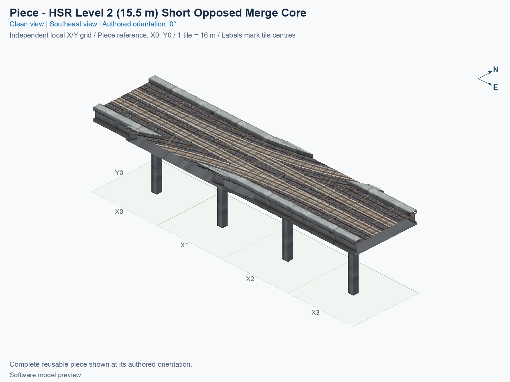
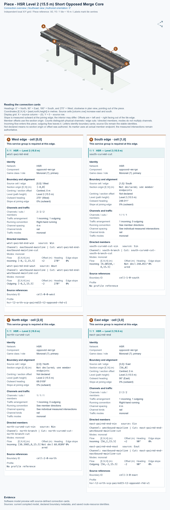

# HSR L2 Short Opposed Merge Core

<!-- PIECE README LAYOUT: 2 -->

[1. Views](#1-views) · [2. Piece and placement](#2-piece-and-placement) · [3. Connection matrix](#3-connection-matrix) · [Testing ↗ (separate document)](TESTING.md)

This reusable High Speed Rail (HSR) junction carries a paired mainline and receives two directed curved branches within a **four-tile core**. Its ordinary western approach uses the existing paired-straight type as a separate placement. The mainline and branch traffic remain at nominal Level 2 (L2), with a train-path height of 15.5 m. A placed copy is one component; a complete interchange needs additional pieces.

**Status: experimental.** Human image approval and operation inside SimCity 4 require their own recorded observations. The permanent type ID is `hsr-component-l2-short-opposed-merge-core`; its existing game-resource identifiers are retained. This guide describes the reusable type independently of any assembly placement label.

## 1. Views

Both clean pictures show the same complete saved model at the authored 0° orientation. North is up in the top view; X increases eastward, Y increases northward, and each city tile measures 16 × 16 m. The standalone grid belongs to this piece. It does not use an interchange's placement positions or rotations.

The current pictures and connection cards show the four-tile saved model. Their source and image fingerprints are linked from [TESTING](TESTING.md#3-software-checks); earlier five-tile reports remain separate historical evidence. A software picture does not approve appearance in the game.

<!-- BEGIN PIECE VIEWS -->

<!-- END PIECE VIEWS -->

The generated connection overview in chapter 3 identifies complete joining boundaries and their required channels. Its cards report the measured facts for the saved model. Software pictures show geometry and selected textures; they do not establish game appearance or train operation.

In the top view, the southern grey strip in X0 and the northern grey strip in X3 now meet their curved wings along the existing brown ballast boundaries. Ballast means the stones beneath the tracks. Each join has a continuous raised top and a matching vertical face toward the tracks. The accepted northern border from X1 into X2 and southern border from X2 into X1 remain intact.

## 2. Piece and placement

<!-- BEGIN PIECE OVERVIEW -->

Four-tile flat native L2 mainline with opposed one-way merges; both mainline ends accept the native paired straight, the northern branch retains the Short Mainline Diverge Core angle, and all retained track paths remain unchanged.

Exact reusable identifier: `hsr-component-l2-short-opposed-merge-core`.

Footprint: **4 × 1 tiles**. Exact menu name: **HSR L2 Short Opposed Merge Core**.

<!-- END PIECE OVERVIEW -->

### Function and complete joining boundaries

The two ordinary mainline ends continue paired HSR, while the directed branch entrances merge into their declared mainline directions. The current fan-facing branch is reworked to share the branch-angle policy of the paired fan and existing Short Mainline Diverge Core. The complete permitted entrance-to-exit movements come from the actual saved traffic resources, shown in the generated matrix below.

The source footprint is **4 × 1 tiles**, with four occupied cells. The previously included western straight tile is a separate **HSR L2 Two-Track Straight** (`hsr-component-lower-paired-straight`); at an east/west mainline join, use that type at 270°. The core's own source cells and local picture coordinates start again at zero. Follow the [test document](TESTING.md#3-software-checks) for the exact rebase, bounded seam adjustment, and current verification scope.

A joining boundary is the complete tile edge where this piece meets its neighbour. Both directions of the paired mainline need the matching paired profile. The curved branch entrances have specific positions, headings, physical deck shapes, and train-clearance requirements; matching only the 15.5 m height does not establish a valid join. The library does not supply automatic compatibility discovery.

The permanent construction definition is [piece.json](piece.json), and the authoring geometry is [geometry.json](geometry.json). Source cells use [column, row], with columns increasing eastward and rows increasing southward; the picture's Y axis increases northward. Use the generated coordinate conversion rather than reading a source row as a picture Y label.

Use the occupied-cell and structural-cell definitions in piece.json to understand the footprint. Keep the full construction rectangle clear for the first trial, and align the whole model rather than assuming that a software reference coordinate is a certified mouse-click anchor.

### Place and rotate the piece

After following the [separate build and installation procedure](../../../../docs/BUILD_AND_INSTALL.md), use a disposable flat test city. A proper rotation turns the entire component and all its travel directions together; it does not reflect the component or reverse a one-way route.

1. Open **Transportation → Rail**, hover over the SCP buttons, and select **HSR L2 Short Opposed Merge Core**. An installed assembly may instead include this same type within its declared Tab/Shift+Tab cycle.
2. Move the cursor preview over clear terrain. Press **Home** or **End** to rotate the whole piece; on the documented Mac keyboard, **Fn + ←** and **Fn + →** provide those keys. Use only the supported construction states listed in the generated connection section.
3. At 0°, identify the paired mainline ends and both branch entrances in the top picture. Align the complete cursor preview so that every required channel agrees with its neighbour; a curved branch needs its matching continuation.
4. Click once to place the component. Supply matching outside connections and travel demand. Inspect the rails, decks, walls, supports, and shadows, then test the permitted journeys and forbidden movements separately.

The [trumpet blueprint](../../01_assemblies/straight-stem-trumpet/README.md) is one documented use of this type. Its assembly position, neighbours, and end-to-end evidence do not approve every other use of this reusable piece.

## 3. Connection matrix

<!-- BEGIN PIECE CONNECTION MATRIX -->

### Directed entrance/exit matrix

Read **from an entrance row to an exit column**. **Saved PATH** checks the saved traffic route; **Route Query** checks the route shown by the game; **Visible travel** checks a vehicle completing that journey. For HSR, visible travel means a moving train.

**Game appearance:** [?](TESTING.md#case-in_game_render-5fa20a2de78ef24ee969) — the complete piece’s appearance in the game, checked separately from its journeys.

**Legend:** ✅ confirmed; ❌ failed; ? not established. **Forbidden** means the movement is unavailable; its in-game check confirms that it stays unavailable. Click a result for its exact test case. Scope, evidence, and limitations remain in [the test checklist](TESTING.md#test-checklist).

| Entrance ↓ / Exit → | **HSR · West exit** `Wout` | **HSR · East exit** `Eout` |
| --- | --- | --- |
| **HSR · West entrance** `Win` | **Forbidden** **Saved PATH:** [✅](TESTING.md#case-software_connectivity-bb298338ce132e94abe3) In-game check: [?](TESTING.md#case-in_game_forbidden_transfer-207270803a527230f629) | **Saved PATH:** [✅](TESTING.md#case-software_connectivity-bb298338ce132e94abe3) **Route Query:** [?](TESTING.md#case-in_game_route_query-893c5139b52951b645b6) **Visible train travel:** [?](TESTING.md#case-in_game_visible_travel-893c5139b52951b645b6) |
| **HSR · South entrance** `Sin` | **Forbidden** **Saved PATH:** [✅](TESTING.md#case-software_connectivity-bb298338ce132e94abe3) In-game check: [?](TESTING.md#case-in_game_forbidden_transfer-7dd99ef9226dd9ae5cc2) | **Saved PATH:** [✅](TESTING.md#case-software_connectivity-bb298338ce132e94abe3) **Route Query:** [?](TESTING.md#case-in_game_route_query-4f0cf575be97d46acd86) **Visible train travel:** [?](TESTING.md#case-in_game_visible_travel-4f0cf575be97d46acd86) |
| **HSR · North entrance** `Nin` | **Saved PATH:** [✅](TESTING.md#case-software_connectivity-bb298338ce132e94abe3) **Route Query:** [?](TESTING.md#case-in_game_route_query-60ecb293929e38cf3d1f) **Visible train travel:** [?](TESTING.md#case-in_game_visible_travel-60ecb293929e38cf3d1f) | **Forbidden** **Saved PATH:** [✅](TESTING.md#case-software_connectivity-bb298338ce132e94abe3) In-game check: [?](TESTING.md#case-in_game_forbidden_transfer-a430fa085cdc293296ca) |
| **HSR · East entrance** `Ein` | **Saved PATH:** [✅](TESTING.md#case-software_connectivity-bb298338ce132e94abe3) **Route Query:** [?](TESTING.md#case-in_game_route_query-207ef3949b9f1fa27c42) **Visible train travel:** [?](TESTING.md#case-in_game_visible_travel-207ef3949b9f1fa27c42) | **Forbidden** **Saved PATH:** [✅](TESTING.md#case-software_connectivity-bb298338ce132e94abe3) In-game check: [?](TESTING.md#case-in_game_forbidden_transfer-5c49c60a8ee59fd1e7fb) |

Source: [connections.json](connections.json).

<!-- END PIECE CONNECTION MATRIX -->

<!-- BEGIN CONNECTOR OVERVIEW -->

### Connection overview

Generated from this piece's source-bound connector metadata and the current compiled model; marker letters refer to the boundary cards below.

[Rendering sources and verification scope](evidence/connection-overview.json).

Headings: 0° = North, 90° = East, 180° = South, and 270° = West; clockwise in plan view, pointing out of the piece.

Coordinates [E,N,H] = [east,north,height] in metres. Source cells [column,row] increase east and south.

Display grid: X = source column − (0); Y = 0 − source row.

Slope is measured outward at the joining edge; the interior may differ. Offsets are + left and − right facing out of the tile edge.

Member offsets use the section origin. Counts distinguish physical channels / edge cuts / directed members; modes do not multiply channels.

Incoming flow enters this piece; outgoing flow leaves it. Letters identify boundary cards; source IDs remain the stable identities.

Not declared means no section origin or offset was authored. Its marker uses an actual member endpoint; the measured intersections remain authoritative.

#### Boundary A: `cell-0-0-west`

This service group is required at this edge.

##### Service group 1 / 1: HSR — Level 2 (15.5 m)

| Field | Value |
| --- | --- |
| End / component | `west-paired-end` / `opposed-merge` |
| Network / game class / role | hsr / Monorail (7); primary |
| Source cell / edge | `[0,0]` / West |
| Section origin [E,N] (m) | `[-8,0]` |
| Centring / section offset | Centred; 0 m |
| Level (path height) | Level 2 (15.5 m) |
| Outward heading | 270° (West) |
| Slope at joining edge | 0% outward |
| Channels / edge cuts / directed members | 2 / 2 / 2 |
| Traffic arrangement / running | 1 incoming; 1 outgoing; Right-hand running |
| Channel spacing | 4 m |
| Channel kinds | rail |
| Traffic modes | monorail |
| Profile | `hsr-l2-orth-scp-paired15-t2-opposed-rhd-v1` |

| Member / measured source | Channel / cut / modes | Flow | Endpoint [E,N,H] (m) | Offset (m) | Outward heading | Edge slope (%) |
| --- | --- | --- | --- | ---: | ---: | ---: |
| `west-paired-end-win` / `Win` | `eastbound-mainline` / `west-paired-end-eastbound-mainline-cut` / monorail | Incoming | `[-8,-2,15.5]` | +2 | 270° | 0 |
| `west-paired-end-wout` / `Wout` | `westbound-mainline` / `west-paired-end-westbound-mainline-cut` / monorail | Outgoing | `[-8,2,15.5]` | -2 | 270° | 0 |

#### Boundary B: `cell-1-0-south`

This service group is required at this edge.

##### Service group 1 / 1: HSR — Level 2 (15.5 m)

| Field | Value |
| --- | --- |
| End / component | `south-curved-cut` / `opposed-merge` |
| Network / game class / role | hsr / Monorail (7); primary |
| Source cell / edge | `[1,0]` / South |
| Section origin [E,N] (m) | Not declared; see member endpoints |
| Centring / section offset | Not declared |
| Level (path height) | Level 2 (15.5 m) |
| Outward heading | 248.011° |
| Slope at joining edge | 0% outward |
| Channels / edge cuts / directed members | 1 / 1 / 1 |
| Traffic arrangement / running | 1 incoming; 0 outgoing; See member directions |
| Channel spacing | See individual measured intersections |
| Channel kinds | rail |
| Traffic modes | monorail |
| Profile | No profile reference |

| Member / measured source | Channel / cut / modes | Flow | Endpoint [E,N,H] (m) | Offset (m) | Outward heading | Edge slope (%) |
| --- | --- | --- | --- | ---: | ---: | ---: |
| `south-curved-cut-sin` / `Sin` | `south-branch` / `south-curved-cut-south-branch-cut` / monorail | Incoming | `[9.60148,-8,15.5]` | Not declared | 248.011° | 0 |

#### Boundary C: `cell-2-0-north`

This service group is required at this edge.

##### Service group 1 / 1: HSR — Level 2 (15.5 m)

| Field | Value |
| --- | --- |
| End / component | `north-curved-cut` / `opposed-merge` |
| Network / game class / role | hsr / Monorail (7); primary |
| Source cell / edge | `[2,0]` / North |
| Section origin [E,N] (m) | Not declared; see member endpoints |
| Centring / section offset | Not declared |
| Level (path height) | Level 2 (15.5 m) |
| Outward heading | 68.0109° |
| Slope at joining edge | 0% outward |
| Channels / edge cuts / directed members | 1 / 1 / 1 |
| Traffic arrangement / running | 1 incoming; 0 outgoing; See member directions |
| Channel spacing | See individual measured intersections |
| Channel kinds | rail |
| Traffic modes | monorail |
| Profile | No profile reference |

| Member / measured source | Channel / cut / modes | Flow | Endpoint [E,N,H] (m) | Offset (m) | Outward heading | Edge slope (%) |
| --- | --- | --- | --- | ---: | ---: | ---: |
| `north-curved-cut-nin` / `Nin` | `north-branch` / `north-curved-cut-north-branch-cut` / monorail | Incoming | `[38.3985,8,15.5]` | Not declared | 68.0109° | 0 |

#### Boundary D: `cell-3-0-east`

This service group is required at this edge.

##### Service group 1 / 1: HSR — Level 2 (15.5 m)

| Field | Value |
| --- | --- |
| End / component | `east-paired-end` / `opposed-merge` |
| Network / game class / role | hsr / Monorail (7); primary |
| Source cell / edge | `[3,0]` / East |
| Section origin [E,N] (m) | `[56,0]` |
| Centring / section offset | Centred; 0 m |
| Level (path height) | Level 2 (15.5 m) |
| Outward heading | 90° (East) |
| Slope at joining edge | 0% outward |
| Channels / edge cuts / directed members | 2 / 2 / 2 |
| Traffic arrangement / running | 1 incoming; 1 outgoing; Right-hand running |
| Channel spacing | 4 m |
| Channel kinds | rail |
| Traffic modes | monorail |
| Profile | `hsr-l2-orth-scp-paired15-t2-opposed-rhd-v1` |

| Member / measured source | Channel / cut / modes | Flow | Endpoint [E,N,H] (m) | Offset (m) | Outward heading | Edge slope (%) |
| --- | --- | --- | --- | ---: | ---: | ---: |
| `east-paired-end-ein` / `Ein` | `westbound-mainline` / `east-paired-end-westbound-mainline-cut` / monorail | Incoming | `[56,2,15.5]` | +2 | 90° | 0 |
| `east-paired-end-eout` / `Eout` | `eastbound-mainline` / `east-paired-end-eastbound-mainline-cut` / monorail | Outgoing | `[56,-2,15.5]` | -2 | 90° | 0 |

The overview uses source metadata, current compiled resource identities, and the saved model. Current placement, connection, and traffic results belong to the generated connection matrix and linked testing records.

<!-- END CONNECTOR OVERVIEW -->
