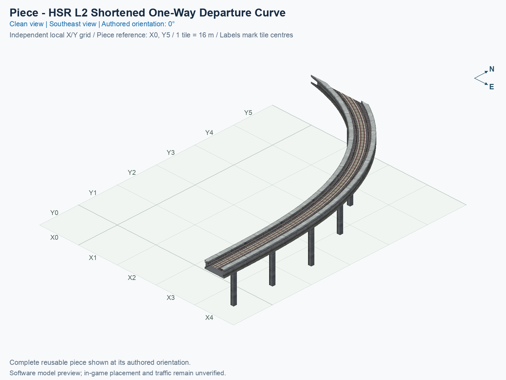
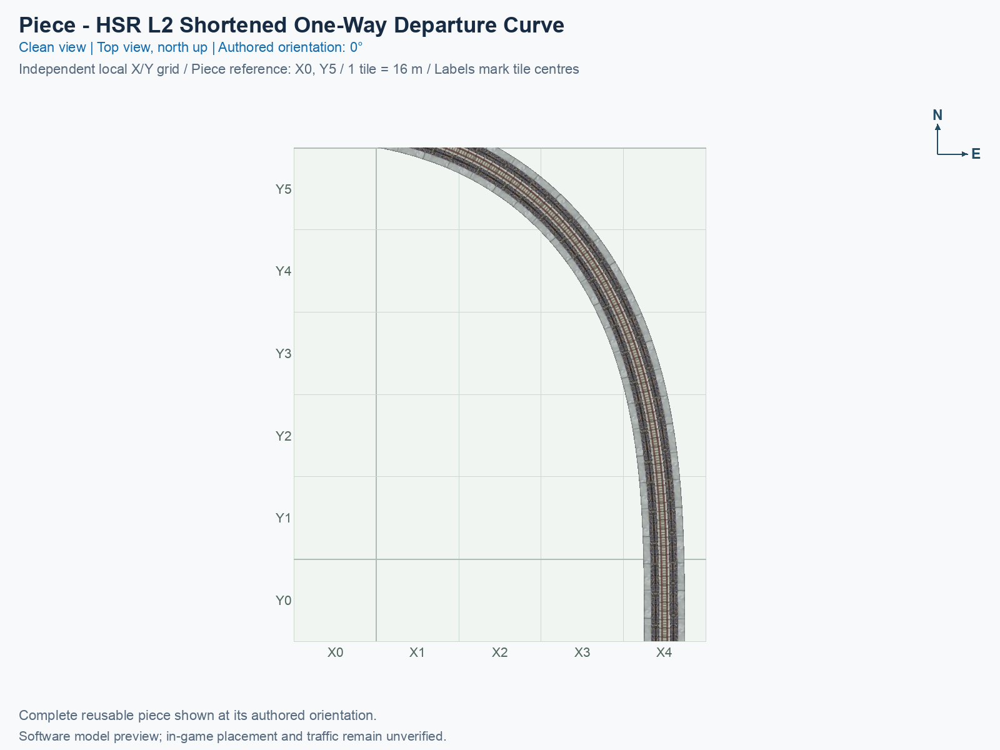
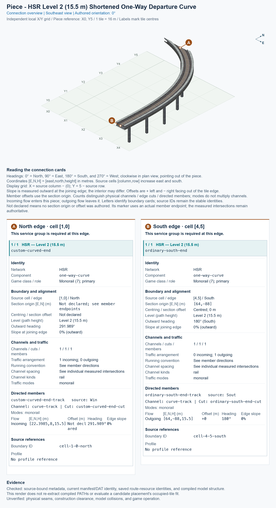

# HSR L2 Shortened One-Way Departure Curve

<!-- PIECE README LAYOUT: 1 -->

[1. Views](#1-views) · [2. Piece and placement](#2-piece-and-placement) · [3. Connection matrix](#3-connection-matrix) · [4. Testing](#4-testing)

This is one reusable one-way High Speed Rail (HSR) curve at Level 2, with train paths at 15.5 m. Trains enter the custom curved northern cut and leave through the ordinary centred south end. It owns 12 tiles inside a 5 × 6 tile construction rectangle; one city tile measures 16 × 16 m.

**Status:** experimental. Current saved-resource evidence and software pictures are separate from human preview approval and game operation. Existing observations retain their exact scope; refreshing this guide adds no human pass.

## 1. Views

Both clean pictures show the complete saved model at the same authored 0° orientation, on its local X0–X4 and Y0–Y5 grid. X increases eastward, Y increases northward, and north is up in the top view. The pictures render actual saved game models and textures; they are not game screenshots.

<!-- BEGIN PIECE VIEWS -->





<!-- END PIECE VIEWS -->

View-specific provenance is in [the angled report](evidence/preview.json) and [the top report](evidence/preview-top.json). Original render reports remain preserved under `evidence/design-history/`.

## 2. Piece and placement

<!-- BEGIN PIECE OVERVIEW -->

A twelve-tile one-way departure curve with a native eight-metre centred southern end. Its final 8.5 m collar is locally eased to free an existing ordinary straight.

Exact reusable identifier: `hsr-component-l2-shortened-departure-curve`.

Footprint: **5 × 6 tiles**. Exact menu name: **HSR L2 Shortened One-Way Departure Curve**.

<!-- END PIECE OVERVIEW -->

The permanent type ID is `hsr-component-l2-shortened-departure-curve`. The menu title uses the common **SCP | [PART]** prefix followed by **HSR L2 Shortened One-Way Departure Curve**; PART means one reusable building block.

### Complete joining boundaries

The ordinary southern end uses an 8 m single-track deck, rather than the narrower 7.5 m interchange family. The existing **One-Way HSR L2 Eight-Metre Straight** supplies that physical family. In the pictured orientation, its train direction must point south for this departure curve and north for the return curve. A proper rotation turns the track and its direction together; it cannot reverse a one-way route.

The other end crosses a northern tile boundary obliquely, with a curved, offset section. It requires the exact matching saved position, outward heading, direction, height, and physical profile. A shared 15.5 m height alone does not establish a usable neighbour. The connection overview reports this custom cut without inventing a centred or perpendicular section. Automatic compatibility discovery is not supplied by the library.

The ordinary end lies on the south edge of tile (X4, Y0); the custom cut lies on the north edge of tile (X1, Y5). Picture X equals source column, and picture Y equals 5 minus source row.

### Place and rotate

After following the [separate installation procedure](../../../../docs/BUILD_AND_INSTALL.md), use a disposable flat test city. A construction rectangle is the complete bounding area around the piece; its sparse owned cells are listed in [piece.json](piece.json).

1. Open **Transportation → Rail**, hover over the SCP buttons, and select **HSR L2 Shortened One-Way Departure Curve**.
2. Keep the complete **5 × 6 tile rectangle, measuring 80 × 96 m** clear. Press **Home** or **End** to turn the entire preview; on the documented Mac keyboard, **Fn + ←** and **Fn + →** supply those keys.
3. Align both exposed ends with their required complete approach sections. The supported proper rotations are **0°, 90°, 180°, and 270°**, measured counterclockwise from the pictures. Each rotation carries the heights and travel directions with it.
4. Click once to place this piece, then inspect each occupied tile and both joins. A sparse software reference can be an empty cell; do not treat it as a confirmed mouse-click anchor.

## 3. Connection matrix

<!-- BEGIN PIECE CONNECTION MATRIX -->

### Directed entrance/exit matrix

Read **from an entrance row to an exit column**. **Saved PATH** checks the saved traffic route; **Route Query** checks the route shown by the game; **Visible travel** checks a vehicle completing that journey. For HSR, visible travel means a moving train.

**Game appearance:** [?](#case-in_game_render-74825559fda8bcf5d368) — the complete piece’s appearance in the game, checked separately from its journeys.

**Legend:** ✅ confirmed; ❌ failed; ? not established. **Forbidden** means the movement is unavailable; its in-game check confirms that it stays unavailable. Click a result for its exact test case. Scope, evidence, and limitations remain in [the test checklist](#test-checklist).

| Entrance ↓ / Exit → | **HSR · South exit**<br>`Sout` |
| --- | --- |
| **HSR · North entrance**<br>`Win` | **Saved PATH:** [✅](#case-software_connectivity-83b743c98f8f90875b39)<br>**Route Query:** [?](#case-in_game_route_query-bced605ea8a78ee7dcad)<br>**Visible train travel:** [?](#case-in_game_visible_travel-bced605ea8a78ee7dcad) |

Source: [connections.json](connections.json).

<!-- END PIECE CONNECTION MATRIX -->

<!-- BEGIN CONNECTOR OVERVIEW -->

### Connection overview

Generated from this piece's source-bound connector metadata and the current compiled model; marker letters refer to the boundary cards below.



[Rendering sources and verification scope](evidence/connection-overview.json).

Headings: 0° = North, 90° = East, 180° = South, and 270° = West; clockwise in plan view, pointing out of the piece.

Coordinates [E,N,H] = [east,north,height] in metres. Source cells [column,row] increase east and south.

Display grid: X = source column − (0); Y = 5 − source row.

Slope is measured outward at the joining edge; the interior may differ. Offsets are + left and − right facing out of the tile edge.

Member offsets use the section origin. Counts distinguish physical channels / edge cuts / directed members; modes do not multiply channels.

Incoming flow enters this piece; outgoing flow leaves it. Letters identify boundary cards; source IDs remain the stable identities.

Not declared means no section origin or offset was authored. Its marker uses an actual member endpoint; the measured intersections remain authoritative.

#### Boundary A: `cell-1-0-north`

This service group is required at this edge.

##### Service group 1 / 1: HSR — Level 2 (15.5 m)

| Field | Value |
| --- | --- |
| End / component | `custom-curved-end` / `one-way-curve` |
| Network / game class / role | hsr / Monorail (7); primary |
| Source cell / edge | `[1,0]` / North |
| Section origin [E,N] (m) | Not declared; see member endpoints |
| Centring / section offset | Not declared |
| Level (path height) | Level 2 (15.5 m) |
| Outward heading | 291.989° |
| Slope at joining edge | 0% outward |
| Channels / edge cuts / directed members | 1 / 1 / 1 |
| Traffic arrangement / running | 1 incoming; 0 outgoing; See member directions |
| Channel spacing | See individual measured intersections |
| Channel kinds | rail |
| Traffic modes | monorail |
| Profile | No profile reference |

| Member / measured source | Channel / cut / modes | Flow | Endpoint [E,N,H] (m) | Offset (m) | Outward heading | Edge slope (%) |
| --- | --- | --- | --- | ---: | ---: | ---: |
| `custom-curved-end-track` / `Win` | `curve-track` / `custom-curved-end-cut` / monorail | Incoming | `[22.3985,8,15.5]` | Not declared | 291.989° | 0 |

#### Boundary B: `cell-4-5-south`

This service group is required at this edge.

##### Service group 1 / 1: HSR — Level 2 (15.5 m)

| Field | Value |
| --- | --- |
| End / component | `ordinary-south-end` / `one-way-curve` |
| Network / game class / role | hsr / Monorail (7); primary |
| Source cell / edge | `[4,5]` / South |
| Section origin [E,N] (m) | `[64,-88]` |
| Centring / section offset | Centred; 0 m |
| Level (path height) | Level 2 (15.5 m) |
| Outward heading | 180° (South) |
| Slope at joining edge | 0% outward |
| Channels / edge cuts / directed members | 1 / 1 / 1 |
| Traffic arrangement / running | 0 incoming; 1 outgoing; See member directions |
| Channel spacing | See individual measured intersections |
| Channel kinds | rail |
| Traffic modes | monorail |
| Profile | No profile reference |

| Member / measured source | Channel / cut / modes | Flow | Endpoint [E,N,H] (m) | Offset (m) | Outward heading | Edge slope (%) |
| --- | --- | --- | --- | ---: | ---: | ---: |
| `ordinary-south-end-track` / `Sout` | `curve-track` / `ordinary-south-end-cut` / monorail | Outgoing | `[64,-88,15.5]` | +0 | 180° | 0 |

Rendering checks source metadata, current compiled resource identities, and model structure. It does not re-extract PATHs or evaluate placement; physical seams, construction clearance, collisions, and game operation remain unverified.

<!-- END CONNECTOR OVERVIEW -->

## 4. Testing

The [independent geometry source](geometry.json) preserves the retained core and its interfaces. The extracted ordinary tail had a 2.058 mm maximum deviation; the adjoining smooth join has a separate 8.2 mm correction bound. These historical extraction allowances do not authorize moving this current piece. The assembly’s [decision ledger](../../01_assemblies/straight-stem-trumpet/checks/atomization.json) and [resource contract](../../01_assemblies/straight-stem-trumpet/checks/resources.json) retain their exact scope.

The saved route and model checks are separate from a game observation. The generated intrinsic matrix covers this piece’s single directed journey. The authored physical channel keeps the same channel ID at both exposed ends, while each local directed member and boundary cut has its own ID.

The [documentation-refresh audit](evidence/documentation-refresh.json) records the exact unchanged saved files, actual-resource connector checks, image identities, and preserved observations.

The [measured saved-route record](connections.json), [authored connector declaration](connector-groups.jsonc), [resolved connector export](connector-data.json), and [connection-overview evidence](evidence/connection-overview.json) identify the current software scope. A PATH resource contains travel routes; an S3D resource contains visible triangles. Neither a correct route nor a rendered model establishes traffic operation in the game.

For a game trial, supply demand in every declared direction, inspect **Route Query**, and separately watch a train complete the journey. Repeat placement, appearance, travel, demolition, and save/reload observations in the supported orientations. Record only explicitly observed results through the [shared testing guide](../../../../docs/TESTING.md) and the exact command in the generated checklist below. Human preview approval, game appearance, traffic choice, and physical seams retain their recorded states.

Shared network measurements remain in [NETWORK_SPEC.md](../../NETWORK_SPEC.md). Building, installing, and observing are separate steps. To reproduce the pictures and connector cards, follow [documentation generation](../../../../docs/WORKFLOW_DOCUMENTATION_GENERATION.md), select this exact piece ID, and use a verified build containing this same saved model and PATH set.

<!-- BEGIN MANUAL SUMMARY -->

### Manual status

Generated from [the exact test cases](#test-checklist) and [authoritative observations](checks/manual-tests.json).

- [ ] Preview review: 0/3 applicable cases passed; 0 failed, 0 stale.
- [ ] In-game rendering: 0/4 applicable cases passed; 0 failed, 0 stale.
- [ ] Route Query: 0/4 applicable cases passed; 0 failed, 0 stale.
- [ ] Visible travel: 0/4 applicable cases passed; 0 failed, 0 stale.

These observations cover only the named services, directions, poses, rotations, and recorded platforms.

<!-- END MANUAL SUMMARY -->

<!-- BEGIN CONNECTIONS -->

### Connections and journeys

Generated from [connections.json](connections.json). Coordinates are canonical east, north, and height in metres. A connection class names an encoded route interface; it does not prove visible deck/wall fit or an in-game test.

Supported placement states: 0° CCW, 90° CCW, 180° CCW, 270° CCW. Each state has its own declared manual scope.

A **port** is one directional transport-path endpoint. **Service** identifies the intended network service (for example HSR, street, or tram); **engine** is its internal traffic-class number, separate from the construction network. **Role** distinguishes primary service from auxiliary paths; sharing a traffic class does not establish service compatibility.

A **tangent** is a unit travel-direction vector: `[0,1]` means north. **Grade** is height gained per horizontal metre. These measured facts describe this subject alone. Compatibility requires a separate comparison of the complete joining boundaries; physical seams and actual game operation require their own evidence. See the [class index](../../connection-classes.json) for shared route-interface membership.

| Port | Service / engine / role | Direction | Location; tangent; grade | Connection class |
| --- | --- | --- | --- | --- |
| `Win` | hsr / 7 / primary | in | [22.398519, 8.0, 15.5]; [0.9272548089646255, -0.3744309272108488]; 0.0 | `path-interface-d819a6d05c5e43d11db7` |
| `Sout` | hsr / 7 / primary | out | [64.0, -88.0, 15.5]; [0.0, -1.0]; 0.0 | `path-interface-365752af76285c80cd0b` |

#### Directed journeys

| Service | Entry → exit | Role |
| --- | --- | --- |
| hsr | `Win` → `Sout` | primary |

#### Forbidden transfers

No additional forbidden-transfer cases are declared beyond the directed graph; no extra transfers are implied.

Review the test checklist for the exact tested cases and environments.

<!-- END CONNECTIONS -->

<!-- BEGIN MANUAL CHECKS -->

### Test checklist

Generated from [the authoritative record](checks/manual-tests.json). Only explicit human observations create manual passes; software and preview checks remain separate. Expand a check/service group to see its rotation table, then expand the matching exact scope to copy a case ID and inspect its pose, reviewer, environment, and evidence. Grouping changes only this view; every declared case remains separate.

**States:** [x] passed; [ ] unverified, failed, or stale; N/A is an explicit inapplicable declaration. A dash means no case was declared in that column. Every pass covers only its recorded environment. T means a distinct construction-transposed state.

Four proper rotations are covered. No additional reflected state is established by this record; repeated construction aliases do not create new orientations.

Current totals: unverified: 27, passed: 2, failed: 0, stale: 0, not_applicable: 0.

#### Record an observation

Follow the [shared testing guide](../../../../docs/TESTING.md); copy [the unconfirmed example](checks/observation.example.json) to `checks/observation.json`. Case identifiers are in the expandable sections below. Do not edit generated checkboxes.

From the repository folder containing `custom-pieces`, run after filling `checks/observation.json` and explicitly confirming the exact observation:

```sh
python3 -m scp.content record --record custom-pieces/domains/high-speed-rail/00_pieces/hsr-component-l2-shortened-departure-curve/checks/manual-tests.json --observation custom-pieces/domains/high-speed-rail/00_pieces/hsr-component-l2-shortened-departure-curve/checks/observation.json
```

#### Detailed current checks

Each collapsed group shows exact case counts and states. Forbidden transfers are grouped by the directed service pair; the table inside retains every port pair and rotation.

<details>
<summary>Compiled resources — Whole subject — 1 case; passed: 1</summary>

| Check / exact scope | General | 0° | 90° | 180° | 270° |
| --- | --- | --- | --- | --- | --- |
| **Compiled resources**<br>Whole subject | <a href="#case-software_resources-83b743c98f8f90875b39">[x] passed</a> | — | — | — | — |


<details>
<summary>Compiled resources — Whole subject</summary>

<a id="case-software_resources-83b743c98f8f90875b39"></a>

**General: passed** — `software_resources-83b743c98f8f90875b39`.

Verify the actual compiled resources and construction rules.

Scope: Whole subject.

Recorded observations (chronological; the state above checks the relevant dependency snapshot):

- result: passed; authority: software; reviewer: verify_hsr_trumpet_v4.py plus independent staged build resource checks; confirmed at: 2026-10-20T10:42:35.055343+00:00; evidence: [../../01_assemblies/straight-stem-trumpet-v4/evidence/validation.json]; environment: {}
- result: passed; authority: software; reviewer: Actual final normal 13-piece saved-build verification; registered independent PATH, model, construction, menu, and shadow checks; confirmed at: 2026-10-27T21:57:25.376326+00:00; evidence: [evidence/saved-resource-checks.json]; environment: {}

</details>

</details>

<details>
<summary>Directed routing graph — Whole subject — 1 case; passed: 1</summary>

| Check / exact scope | General | 0° | 90° | 180° | 270° |
| --- | --- | --- | --- | --- | --- |
| **Directed routing graph**<br>Whole subject | <a href="#case-software_connectivity-83b743c98f8f90875b39">[x] passed</a> | — | — | — | — |


<details>
<summary>Directed routing graph — Whole subject</summary>

<a id="case-software_connectivity-83b743c98f8f90875b39"></a>

**General: passed** — `software_connectivity-83b743c98f8f90875b39`.

Verify the declared directed journeys and forbidden transfers.

Scope: Whole subject.

Recorded observations (chronological; the state above checks the relevant dependency snapshot):

- result: passed; authority: software; reviewer: verify_hsr_trumpet_v4.py plus independent staged build resource checks; confirmed at: 2026-10-20T10:42:35.062051+00:00; evidence: [../../01_assemblies/straight-stem-trumpet-v4/evidence/validation.json]; environment: {}
- result: passed; authority: software; reviewer: Actual final normal 13-piece saved-build verification; registered independent PATH, model, construction, menu, and shadow checks; confirmed at: 2026-10-27T21:57:25.376326+00:00; evidence: [evidence/saved-resource-checks.json]; environment: {}

</details>

</details>

<details>
<summary>Preview review — Images — 3 cases; unverified: 3</summary>

| Check / exact scope | General | 0° | 90° | 180° | 270° |
| --- | --- | --- | --- | --- | --- |
| **Preview review**<br>Image: image:hsr-component-l2-shortened-departure-curve:canonical-southeast | <a href="#case-preview_review-61ced121192cf435cfcc">[ ] unverified</a> | — | — | — | — |
| **Preview review**<br>Image: image:hsr-component-l2-shortened-departure-curve:canonical-top | <a href="#case-preview_review-2a07200751b816a8ffdd">[ ] unverified</a> | — | — | — | — |
| **Preview review**<br>Image: image:hsr-component-l2-shortened-departure-curve:connection-overview | <a href="#case-preview_review-becf79702eb5e0f77906">[ ] unverified</a> | — | — | — | — |


<details>
<summary>Preview review — Image: image:hsr-component-l2-shortened-departure-curve:canonical-southeast</summary>

<a id="case-preview_review-61ced121192cf435cfcc"></a>

**General: unverified** — `preview_review-61ced121192cf435cfcc`.

Inspect this exact preview for tracks, walls, piers, seams, and shadows.

Scope: Image: image:hsr-component-l2-shortened-departure-curve:canonical-southeast.

No observation recorded.

</details>


<details>
<summary>Preview review — Image: image:hsr-component-l2-shortened-departure-curve:canonical-top</summary>

<a id="case-preview_review-2a07200751b816a8ffdd"></a>

**General: unverified** — `preview_review-2a07200751b816a8ffdd`.

Inspect this exact preview for tracks, walls, piers, seams, and shadows.

Scope: Image: image:hsr-component-l2-shortened-departure-curve:canonical-top.

No observation recorded.

</details>


<details>
<summary>Preview review — Image: image:hsr-component-l2-shortened-departure-curve:connection-overview</summary>

<a id="case-preview_review-becf79702eb5e0f77906"></a>

**General: unverified** — `preview_review-becf79702eb5e0f77906`.

Inspect this exact preview for tracks, walls, piers, seams, and shadows.

Scope: Image: image:hsr-component-l2-shortened-departure-curve:connection-overview.

No observation recorded.

</details>

</details>

<details>
<summary>In-game rendering — Whole subject — 4 cases; unverified: 4</summary>

| Check / exact scope | General | 0° | 90° | 180° | 270° |
| --- | --- | --- | --- | --- | --- |
| **In-game rendering**<br>Whole subject | — | <a href="#case-in_game_render-74825559fda8bcf5d368">[ ] unverified</a> | <a href="#case-in_game_render-a075e907aed6ea794372">[ ] unverified</a> | <a href="#case-in_game_render-178d9502e2f60a643f59">[ ] unverified</a> | <a href="#case-in_game_render-4514d331142197f0d85d">[ ] unverified</a> |


<details>
<summary>In-game rendering — Whole subject</summary>

<a id="case-in_game_render-74825559fda8bcf5d368"></a>

**0° CCW: unverified** — `in_game_render-74825559fda8bcf5d368`.

Inspect the placed tracks, walls, piers, seams, and shadows in SimCity 4.

Scope: Whole subject.

No observation recorded.

<a id="case-in_game_render-a075e907aed6ea794372"></a>

**90° CCW: unverified** — `in_game_render-a075e907aed6ea794372`.

Inspect the placed tracks, walls, piers, seams, and shadows in SimCity 4.

Scope: Whole subject.

No observation recorded.

<a id="case-in_game_render-178d9502e2f60a643f59"></a>

**180° CCW: unverified** — `in_game_render-178d9502e2f60a643f59`.

Inspect the placed tracks, walls, piers, seams, and shadows in SimCity 4.

Scope: Whole subject.

No observation recorded.

<a id="case-in_game_render-4514d331142197f0d85d"></a>

**270° CCW: unverified** — `in_game_render-4514d331142197f0d85d`.

Inspect the placed tracks, walls, piers, seams, and shadows in SimCity 4.

Scope: Whole subject.

No observation recorded.

</details>

</details>

<details>
<summary>Placement — Whole subject — 4 cases; unverified: 4</summary>

| Check / exact scope | General | 0° | 90° | 180° | 270° |
| --- | --- | --- | --- | --- | --- |
| **Placement**<br>Whole subject | — | <a href="#case-in_game_placement-74825559fda8bcf5d368">[ ] unverified</a> | <a href="#case-in_game_placement-a075e907aed6ea794372">[ ] unverified</a> | <a href="#case-in_game_placement-178d9502e2f60a643f59">[ ] unverified</a> | <a href="#case-in_game_placement-4514d331142197f0d85d">[ ] unverified</a> |


<details>
<summary>Placement — Whole subject</summary>

<a id="case-in_game_placement-74825559fda8bcf5d368"></a>

**0° CCW: unverified** — `in_game_placement-74825559fda8bcf5d368`.

Place this piece or complete blueprint and inspect every occupied tile.

Scope: Whole subject.

No observation recorded.

<a id="case-in_game_placement-a075e907aed6ea794372"></a>

**90° CCW: unverified** — `in_game_placement-a075e907aed6ea794372`.

Place this piece or complete blueprint and inspect every occupied tile.

Scope: Whole subject.

No observation recorded.

<a id="case-in_game_placement-178d9502e2f60a643f59"></a>

**180° CCW: unverified** — `in_game_placement-178d9502e2f60a643f59`.

Place this piece or complete blueprint and inspect every occupied tile.

Scope: Whole subject.

No observation recorded.

<a id="case-in_game_placement-4514d331142197f0d85d"></a>

**270° CCW: unverified** — `in_game_placement-4514d331142197f0d85d`.

Place this piece or complete blueprint and inspect every occupied tile.

Scope: Whole subject.

No observation recorded.

</details>

</details>

<details>
<summary>Demolition — Whole subject — 4 cases; unverified: 4</summary>

| Check / exact scope | General | 0° | 90° | 180° | 270° |
| --- | --- | --- | --- | --- | --- |
| **Demolition**<br>Whole subject | — | <a href="#case-in_game_demolition-74825559fda8bcf5d368">[ ] unverified</a> | <a href="#case-in_game_demolition-a075e907aed6ea794372">[ ] unverified</a> | <a href="#case-in_game_demolition-178d9502e2f60a643f59">[ ] unverified</a> | <a href="#case-in_game_demolition-4514d331142197f0d85d">[ ] unverified</a> |


<details>
<summary>Demolition — Whole subject</summary>

<a id="case-in_game_demolition-74825559fda8bcf5d368"></a>

**0° CCW: unverified** — `in_game_demolition-74825559fda8bcf5d368`.

Bulldoze the complete placement and inspect the cleared area.

Scope: Whole subject.

No observation recorded.

<a id="case-in_game_demolition-a075e907aed6ea794372"></a>

**90° CCW: unverified** — `in_game_demolition-a075e907aed6ea794372`.

Bulldoze the complete placement and inspect the cleared area.

Scope: Whole subject.

No observation recorded.

<a id="case-in_game_demolition-178d9502e2f60a643f59"></a>

**180° CCW: unverified** — `in_game_demolition-178d9502e2f60a643f59`.

Bulldoze the complete placement and inspect the cleared area.

Scope: Whole subject.

No observation recorded.

<a id="case-in_game_demolition-4514d331142197f0d85d"></a>

**270° CCW: unverified** — `in_game_demolition-4514d331142197f0d85d`.

Bulldoze the complete placement and inspect the cleared area.

Scope: Whole subject.

No observation recorded.

</details>

</details>

<details>
<summary>Save and reload — Whole subject — 4 cases; unverified: 4</summary>

| Check / exact scope | General | 0° | 90° | 180° | 270° |
| --- | --- | --- | --- | --- | --- |
| **Save and reload**<br>Whole subject | — | <a href="#case-in_game_save_reload-74825559fda8bcf5d368">[ ] unverified</a> | <a href="#case-in_game_save_reload-a075e907aed6ea794372">[ ] unverified</a> | <a href="#case-in_game_save_reload-178d9502e2f60a643f59">[ ] unverified</a> | <a href="#case-in_game_save_reload-4514d331142197f0d85d">[ ] unverified</a> |


<details>
<summary>Save and reload — Whole subject</summary>

<a id="case-in_game_save_reload-74825559fda8bcf5d368"></a>

**0° CCW: unverified** — `in_game_save_reload-74825559fda8bcf5d368`.

Save, quit, reload, and inspect the placement and its paths.

Scope: Whole subject.

No observation recorded.

<a id="case-in_game_save_reload-a075e907aed6ea794372"></a>

**90° CCW: unverified** — `in_game_save_reload-a075e907aed6ea794372`.

Save, quit, reload, and inspect the placement and its paths.

Scope: Whole subject.

No observation recorded.

<a id="case-in_game_save_reload-178d9502e2f60a643f59"></a>

**180° CCW: unverified** — `in_game_save_reload-178d9502e2f60a643f59`.

Save, quit, reload, and inspect the placement and its paths.

Scope: Whole subject.

No observation recorded.

<a id="case-in_game_save_reload-4514d331142197f0d85d"></a>

**270° CCW: unverified** — `in_game_save_reload-4514d331142197f0d85d`.

Save, quit, reload, and inspect the placement and its paths.

Scope: Whole subject.

No observation recorded.

</details>

</details>

<details>
<summary>Route Query — hsr — 4 cases; unverified: 4</summary>

| Check / exact scope | General | 0° | 90° | 180° | 270° |
| --- | --- | --- | --- | --- | --- |
| **Route Query**<br>Service: hsr; role: primary; journey: 7:Win>Sout; entry: Win; exit: Sout | — | <a href="#case-in_game_route_query-bced605ea8a78ee7dcad">[ ] unverified</a> | <a href="#case-in_game_route_query-3e23849a17fb444dd57c">[ ] unverified</a> | <a href="#case-in_game_route_query-5db4891a5c3875cce170">[ ] unverified</a> | <a href="#case-in_game_route_query-bb8634179e4f87fed5fa">[ ] unverified</a> |


<details>
<summary>Route Query — Service: hsr; role: primary; journey: 7:Win>Sout; entry: Win; exit: Sout</summary>

<a id="case-in_game_route_query-bced605ea8a78ee7dcad"></a>

**0° CCW: unverified** — `in_game_route_query-bced605ea8a78ee7dcad`.

Use Route Query in SimCity 4 to confirm this directed journey for its service network.

Scope: Service: hsr; role: primary; journey: 7:Win>Sout; entry: Win; exit: Sout.

No observation recorded.

<a id="case-in_game_route_query-3e23849a17fb444dd57c"></a>

**90° CCW: unverified** — `in_game_route_query-3e23849a17fb444dd57c`.

Use Route Query in SimCity 4 to confirm this directed journey for its service network.

Scope: Service: hsr; role: primary; journey: 7:Win>Sout; entry: Win; exit: Sout.

No observation recorded.

<a id="case-in_game_route_query-5db4891a5c3875cce170"></a>

**180° CCW: unverified** — `in_game_route_query-5db4891a5c3875cce170`.

Use Route Query in SimCity 4 to confirm this directed journey for its service network.

Scope: Service: hsr; role: primary; journey: 7:Win>Sout; entry: Win; exit: Sout.

No observation recorded.

<a id="case-in_game_route_query-bb8634179e4f87fed5fa"></a>

**270° CCW: unverified** — `in_game_route_query-bb8634179e4f87fed5fa`.

Use Route Query in SimCity 4 to confirm this directed journey for its service network.

Scope: Service: hsr; role: primary; journey: 7:Win>Sout; entry: Win; exit: Sout.

No observation recorded.

</details>

</details>

<details>
<summary>Visible travel — hsr — 4 cases; unverified: 4</summary>

| Check / exact scope | General | 0° | 90° | 180° | 270° |
| --- | --- | --- | --- | --- | --- |
| **Visible travel**<br>Service: hsr; role: primary; journey: 7:Win>Sout; entry: Win; exit: Sout | — | <a href="#case-in_game_visible_travel-bced605ea8a78ee7dcad">[ ] unverified</a> | <a href="#case-in_game_visible_travel-3e23849a17fb444dd57c">[ ] unverified</a> | <a href="#case-in_game_visible_travel-5db4891a5c3875cce170">[ ] unverified</a> | <a href="#case-in_game_visible_travel-bb8634179e4f87fed5fa">[ ] unverified</a> |


<details>
<summary>Visible travel — Service: hsr; role: primary; journey: 7:Win>Sout; entry: Win; exit: Sout</summary>

<a id="case-in_game_visible_travel-bced605ea8a78ee7dcad"></a>

**0° CCW: unverified** — `in_game_visible_travel-bced605ea8a78ee7dcad`.

Observe traffic visibly complete this directed journey for its service network; Route Query alone does not complete this check.

Scope: Service: hsr; role: primary; journey: 7:Win>Sout; entry: Win; exit: Sout.

No observation recorded.

<a id="case-in_game_visible_travel-3e23849a17fb444dd57c"></a>

**90° CCW: unverified** — `in_game_visible_travel-3e23849a17fb444dd57c`.

Observe traffic visibly complete this directed journey for its service network; Route Query alone does not complete this check.

Scope: Service: hsr; role: primary; journey: 7:Win>Sout; entry: Win; exit: Sout.

No observation recorded.

<a id="case-in_game_visible_travel-5db4891a5c3875cce170"></a>

**180° CCW: unverified** — `in_game_visible_travel-5db4891a5c3875cce170`.

Observe traffic visibly complete this directed journey for its service network; Route Query alone does not complete this check.

Scope: Service: hsr; role: primary; journey: 7:Win>Sout; entry: Win; exit: Sout.

No observation recorded.

<a id="case-in_game_visible_travel-bb8634179e4f87fed5fa"></a>

**270° CCW: unverified** — `in_game_visible_travel-bb8634179e4f87fed5fa`.

Observe traffic visibly complete this directed journey for its service network; Route Query alone does not complete this check.

Scope: Service: hsr; role: primary; journey: 7:Win>Sout; entry: Win; exit: Sout.

No observation recorded.

</details>

</details>

<!-- END MANUAL CHECKS -->
