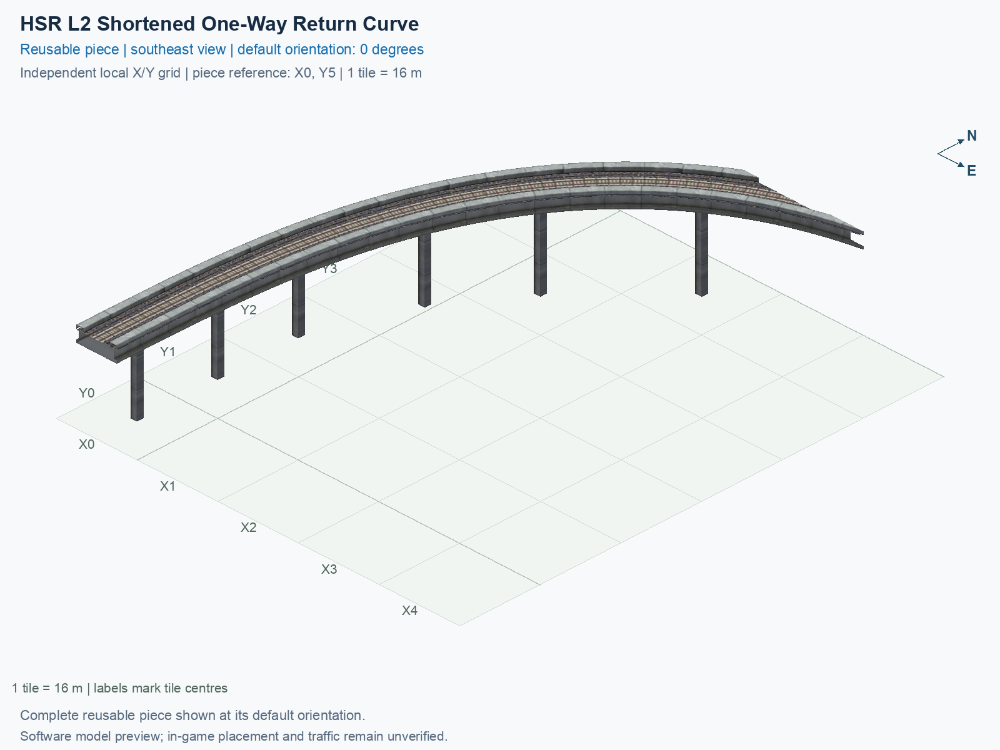
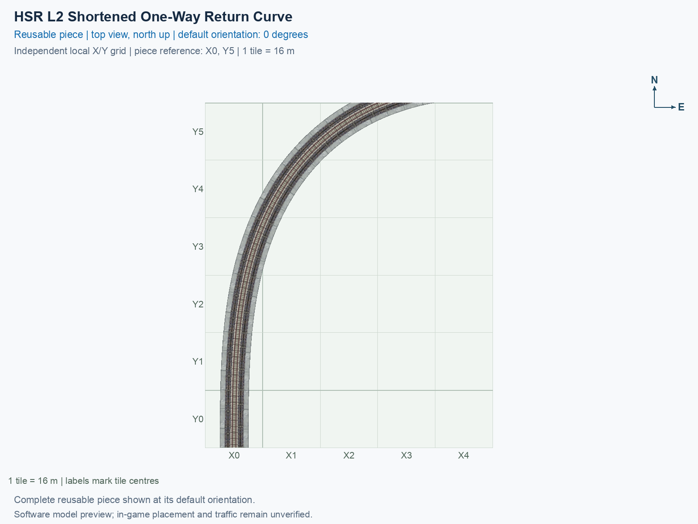

# HSR L2 Shortened One-Way Return Curve

Purpose: Describe this independently selectable reusable HSR piece, its native and custom connections, canonical previews and exact software/manual evidence.

A one-way curve with one ordinary centred south end and one custom curved end. It occupies **12 city tiles** in a **5 × 6 tile** bounding rectangle. A city tile is 16 × 16 m. This is one teal **PART HSR** menu type; its permanent ID is `hsr-component-l2-shortened-return-curve`.

## Canonical views

Both images show the same complete saved model at **0°**, on its own local grid with the southwest tile centre **of the bounding rectangle (X0, Y0)**. X increases east and Y north. Rotating a placed copy does not change these catalogue pictures.

The [preview evidence](preview-evidence.json) records the exact saved-model inputs, cameras, grid, captions and image hashes. These are software renders, not game screenshots.

<!-- BEGIN PIECE OVERVIEW -->

A twelve-tile one-way return curve with a native eight-metre centred southern end. Its first 8.5 m collar is locally eased to free an existing ordinary straight.

Exact reusable identifier: `hsr-component-l2-shortened-return-curve`.

Footprint: **5 × 6 tiles**. Exact menu name: **HSR L2 Shortened One-Way Return Curve**.

Choose this exact name in Transportation → Rail. Press Home or End to rotate; use only the supported states listed below. Join each end to a matching port profile and direction.

- [Connections and journeys](#connections-and-journeys)
- [Test checklist](#test-checklist)





<!-- END PIECE OVERVIEW -->

## Function and connections

The ordinary end has a centred **8 m** deck at **15.5 m** train-path height. Use **One-Way HSR L2 Eight-Metre Straight**; the similarly named 7.5 m interchange straight has a different physical profile. Trains enter its ordinary southern end and leave its custom curved end. At the canonical 0° orientation, the matching ordinary straight points north and uses **0°**.

A **port** is a directional track entrance or exit. A **custom curved interface** needs the exact matching position, tangent and physical profile; merely sharing the same height does not make another track compatible. See the generated connection table below for concrete counterpart links and relative positions.

The authoring source is [geometry.json](geometry.json); the permanent construction definition is [piece.json](piece.json). This smaller core frees one ordinary tail tile. The original tail's deviation was **2.058 mm**; the adjoining smooth join has a separate **8.2 mm** maximum correction bound. The [historical assembly decision ledger](../../01_assemblies/straight-stem-trumpet/checks/atomization.json) records why this extraction was permitted and why neighbouring candidates remained. The [current resource contract](../../01_assemblies/straight-stem-trumpet/checks/resources.json) pins the approved result without requiring deleted predecessor files. The geometry belongs to this generic piece, rather than being changed only in an assembly render.

## Select and rotate

1. Open **Transportation → Rail** and hover over a teal **PART HSR** icon until the title reads **SCP | [PART] HSR L2 Shortened One-Way Return Curve**.
2. Select that button. Press **Home** or **End** to rotate the complete cursor preview. On the keyboard used here, **Fn + ←** and **Fn + →** supply those keys.
3. Align its native and custom ends with compatible neighbours. Construction rules supply proper **0°, 90°, 180° and 270°** rotations; a rotation carries its train directions with it and does not reverse a one-way route.
4. Place on clear, flat terrain for the first test. A sparse construction reference can be empty; verify the cursor footprint rather than assuming a certified mouse-click anchor from a model coordinate.

Actual game rendering, placement, each connection, traffic, demolition and save/reload require the human observations below. Software verification does not tick those checkboxes. Follow the [shared testing guide](../../../../docs/TESTING.md) when recording a result.

<!-- BEGIN MANUAL SUMMARY -->

## Manual status

Generated from [the exact test cases](#test-checklist) and [authoritative observations](checks/manual-tests.json).

- [ ] Preview review: 0/2 applicable cases passed; 0 failed, 0 stale.
- [ ] In-game rendering: 0/4 applicable cases passed; 0 failed, 0 stale.
- [ ] Directed journeys: 0/4 applicable cases passed; 0 failed, 0 stale.

These observations cover only the named services, directions, poses, rotations, and recorded platforms.

<!-- END MANUAL SUMMARY -->

<!-- BEGIN CONNECTIONS -->

## Connections and journeys

Purpose: describe intrinsic directional interfaces and permitted service journeys.

Generated from [connections.json](connections.json). Coordinates are canonical east, north and height in metres. A connection class names an encoded route interface; it does not prove visible deck/wall fit or an in-game test.

Supported placement states: 0° CCW, 90° CCW, 180° CCW, 270° CCW. Each state has its own declared manual scope.

A **port** is one directional transport-path endpoint. **Service** identifies the intended network service (for example HSR, street, or tram); **engine** is its internal traffic-class number, separate from the construction network. **Role** distinguishes primary service from auxiliary paths; sharing a traffic class does not establish service compatibility.

A **tangent** is a unit travel-direction vector: `[0,1]` means north. **Grade** is height gained per horizontal metre. These measured facts describe this subject alone. Compatibility requires a separate comparison of the complete joining boundaries; physical seams and actual game operation require their own evidence. See the [class index](../../connection-classes.json) for shared route-interface membership.

| Port | Service / engine / role | Direction | Location; tangent; grade | Connection class |
| --- | --- | --- | --- | --- |
| `Sin` | hsr / 7 / primary | in | [0.0, -88.0, 15.5]; [0.0, 1.0]; 0.0 | `path-interface-ac60d237d23f01143255` |
| `Eout` | hsr / 7 / primary | out | [41.601481, 8.0, 15.5]; [0.9272548089646255, 0.3744309272108488]; 0.0 | `path-interface-0f4b8204e68941486c48` |

### Directed journeys

| Service | Entry → exit | Role |
| --- | --- | --- |
| hsr | `Sin` → `Eout` | primary |

### Forbidden transfers

No additional forbidden-transfer cases are declared beyond the directed graph; no extra transfers are implied.

Review the test checklist for the exact tested cases and environments.

<!-- END CONNECTIONS -->

<!-- BEGIN MANUAL CHECKS -->

## Test checklist

Generated from [the authoritative record](checks/manual-tests.json). Only explicit human observations create manual passes; software and preview checks remain separate. Expand a check/service group to see its rotation table, then expand the matching exact scope to copy a case ID and inspect its pose, reviewer, environment, and evidence. Grouping changes only this view; every declared case remains separate.

**States:** [x] passed; [ ] unverified, failed, or stale; N/A is an explicit inapplicable declaration. A dash means no case was declared in that column. Every pass covers only its recorded environment. T means a distinct construction-transposed state.

Four proper rotations are covered. No additional reflected state is established by this record; repeated construction aliases do not create new orientations.

Current totals: unverified: 22, passed: 2, failed: 0, stale: 0, not_applicable: 0.

### Record an observation

Follow the [shared testing guide](../../../../docs/TESTING.md); copy [the unconfirmed example](checks/observation.example.json) to `checks/observation.json`. Case identifiers are in the expandable sections below. Do not edit generated checkboxes.

From the repository folder containing `custom-pieces`, run after filling `checks/observation.json` and explicitly confirming the exact observation:

```sh
python3 -m scp.content record --record custom-pieces/domains/high-speed-rail/00_pieces/hsr-component-l2-shortened-return-curve/checks/manual-tests.json --observation custom-pieces/domains/high-speed-rail/00_pieces/hsr-component-l2-shortened-return-curve/checks/observation.json
```

### Detailed current checks

Each collapsed group shows exact case counts and states. Forbidden transfers are grouped by the directed service pair; the table inside retains every port pair and rotation.

<details>
<summary>Compiled resources — Whole subject — 1 case; passed: 1</summary>

| Check / exact scope | General | 0° | 90° | 180° | 270° |
| --- | --- | --- | --- | --- | --- |
| **Compiled resources**<br>Whole subject | <a href="#case-software_resources-bc1326e45c78b47461a2">[x] passed</a> | — | — | — | — |


<details>
<summary>Compiled resources — Whole subject</summary>

<a id="case-software_resources-bc1326e45c78b47461a2"></a>

**General: passed** — `software_resources-bc1326e45c78b47461a2`.

Verify the actual compiled resources and construction rules.

Scope: Whole subject.

Recorded observations (chronological; the state above checks the relevant dependency snapshot):

- result: passed; authority: software; reviewer: verify_hsr_trumpet_v4.py plus independent staged build resource checks; confirmed at: 2026-10-20T10:42:35.140709+00:00; evidence: [../../01_assemblies/straight-stem-trumpet-v4/evidence/validation.json]; environment: 

</details>

</details>

<details>
<summary>Directed routing graph — Whole subject — 1 case; passed: 1</summary>

| Check / exact scope | General | 0° | 90° | 180° | 270° |
| --- | --- | --- | --- | --- | --- |
| **Directed routing graph**<br>Whole subject | <a href="#case-software_connectivity-bc1326e45c78b47461a2">[x] passed</a> | — | — | — | — |


<details>
<summary>Directed routing graph — Whole subject</summary>

<a id="case-software_connectivity-bc1326e45c78b47461a2"></a>

**General: passed** — `software_connectivity-bc1326e45c78b47461a2`.

Verify the declared directed journeys and forbidden transfers.

Scope: Whole subject.

Recorded observations (chronological; the state above checks the relevant dependency snapshot):

- result: passed; authority: software; reviewer: verify_hsr_trumpet_v4.py plus independent staged build resource checks; confirmed at: 2026-10-20T10:42:35.147314+00:00; evidence: [../../01_assemblies/straight-stem-trumpet-v4/evidence/validation.json]; environment: 

</details>

</details>

<details>
<summary>Preview review — Images — 2 cases; unverified: 2</summary>

| Check / exact scope | General | 0° | 90° | 180° | 270° |
| --- | --- | --- | --- | --- | --- |
| **Preview review**<br>Image: image:hsr-component-l2-shortened-return-curve:canonical-southeast | <a href="#case-preview_review-0369518c93d40a29043f">[ ] unverified</a> | — | — | — | — |
| **Preview review**<br>Image: image:hsr-component-l2-shortened-return-curve:canonical-top | <a href="#case-preview_review-144093e558ebb8d29716">[ ] unverified</a> | — | — | — | — |


<details>
<summary>Preview review — Image: image:hsr-component-l2-shortened-return-curve:canonical-southeast</summary>

<a id="case-preview_review-0369518c93d40a29043f"></a>

**General: unverified** — `preview_review-0369518c93d40a29043f`.

Inspect this exact preview for tracks, walls, piers, seams and shadows.

Scope: Image: image:hsr-component-l2-shortened-return-curve:canonical-southeast.

No observation recorded.

</details>


<details>
<summary>Preview review — Image: image:hsr-component-l2-shortened-return-curve:canonical-top</summary>

<a id="case-preview_review-144093e558ebb8d29716"></a>

**General: unverified** — `preview_review-144093e558ebb8d29716`.

Inspect this exact preview for tracks, walls, piers, seams and shadows.

Scope: Image: image:hsr-component-l2-shortened-return-curve:canonical-top.

No observation recorded.

</details>

</details>

<details>
<summary>In-game rendering — Whole subject — 4 cases; unverified: 4</summary>

| Check / exact scope | General | 0° | 90° | 180° | 270° |
| --- | --- | --- | --- | --- | --- |
| **In-game rendering**<br>Whole subject | — | <a href="#case-in_game_render-bb819f7b898394f5bf34">[ ] unverified</a> | <a href="#case-in_game_render-c7ec0a316fdff37975be">[ ] unverified</a> | <a href="#case-in_game_render-854c0b6aa2814cccb98b">[ ] unverified</a> | <a href="#case-in_game_render-8487a22fd0e90363052d">[ ] unverified</a> |


<details>
<summary>In-game rendering — Whole subject</summary>

<a id="case-in_game_render-bb819f7b898394f5bf34"></a>

**0° CCW: unverified** — `in_game_render-bb819f7b898394f5bf34`.

Inspect the placed tracks, walls, piers, seams and shadows in SimCity 4.

Scope: Whole subject.

No observation recorded.

<a id="case-in_game_render-c7ec0a316fdff37975be"></a>

**90° CCW: unverified** — `in_game_render-c7ec0a316fdff37975be`.

Inspect the placed tracks, walls, piers, seams and shadows in SimCity 4.

Scope: Whole subject.

No observation recorded.

<a id="case-in_game_render-854c0b6aa2814cccb98b"></a>

**180° CCW: unverified** — `in_game_render-854c0b6aa2814cccb98b`.

Inspect the placed tracks, walls, piers, seams and shadows in SimCity 4.

Scope: Whole subject.

No observation recorded.

<a id="case-in_game_render-8487a22fd0e90363052d"></a>

**270° CCW: unverified** — `in_game_render-8487a22fd0e90363052d`.

Inspect the placed tracks, walls, piers, seams and shadows in SimCity 4.

Scope: Whole subject.

No observation recorded.

</details>

</details>

<details>
<summary>Placement — Whole subject — 4 cases; unverified: 4</summary>

| Check / exact scope | General | 0° | 90° | 180° | 270° |
| --- | --- | --- | --- | --- | --- |
| **Placement**<br>Whole subject | — | <a href="#case-in_game_placement-bb819f7b898394f5bf34">[ ] unverified</a> | <a href="#case-in_game_placement-c7ec0a316fdff37975be">[ ] unverified</a> | <a href="#case-in_game_placement-854c0b6aa2814cccb98b">[ ] unverified</a> | <a href="#case-in_game_placement-8487a22fd0e90363052d">[ ] unverified</a> |


<details>
<summary>Placement — Whole subject</summary>

<a id="case-in_game_placement-bb819f7b898394f5bf34"></a>

**0° CCW: unverified** — `in_game_placement-bb819f7b898394f5bf34`.

Place this piece or complete blueprint and inspect every occupied tile.

Scope: Whole subject.

No observation recorded.

<a id="case-in_game_placement-c7ec0a316fdff37975be"></a>

**90° CCW: unverified** — `in_game_placement-c7ec0a316fdff37975be`.

Place this piece or complete blueprint and inspect every occupied tile.

Scope: Whole subject.

No observation recorded.

<a id="case-in_game_placement-854c0b6aa2814cccb98b"></a>

**180° CCW: unverified** — `in_game_placement-854c0b6aa2814cccb98b`.

Place this piece or complete blueprint and inspect every occupied tile.

Scope: Whole subject.

No observation recorded.

<a id="case-in_game_placement-8487a22fd0e90363052d"></a>

**270° CCW: unverified** — `in_game_placement-8487a22fd0e90363052d`.

Place this piece or complete blueprint and inspect every occupied tile.

Scope: Whole subject.

No observation recorded.

</details>

</details>

<details>
<summary>Demolition — Whole subject — 4 cases; unverified: 4</summary>

| Check / exact scope | General | 0° | 90° | 180° | 270° |
| --- | --- | --- | --- | --- | --- |
| **Demolition**<br>Whole subject | — | <a href="#case-in_game_demolition-bb819f7b898394f5bf34">[ ] unverified</a> | <a href="#case-in_game_demolition-c7ec0a316fdff37975be">[ ] unverified</a> | <a href="#case-in_game_demolition-854c0b6aa2814cccb98b">[ ] unverified</a> | <a href="#case-in_game_demolition-8487a22fd0e90363052d">[ ] unverified</a> |


<details>
<summary>Demolition — Whole subject</summary>

<a id="case-in_game_demolition-bb819f7b898394f5bf34"></a>

**0° CCW: unverified** — `in_game_demolition-bb819f7b898394f5bf34`.

Bulldoze the complete placement and inspect the cleared area.

Scope: Whole subject.

No observation recorded.

<a id="case-in_game_demolition-c7ec0a316fdff37975be"></a>

**90° CCW: unverified** — `in_game_demolition-c7ec0a316fdff37975be`.

Bulldoze the complete placement and inspect the cleared area.

Scope: Whole subject.

No observation recorded.

<a id="case-in_game_demolition-854c0b6aa2814cccb98b"></a>

**180° CCW: unverified** — `in_game_demolition-854c0b6aa2814cccb98b`.

Bulldoze the complete placement and inspect the cleared area.

Scope: Whole subject.

No observation recorded.

<a id="case-in_game_demolition-8487a22fd0e90363052d"></a>

**270° CCW: unverified** — `in_game_demolition-8487a22fd0e90363052d`.

Bulldoze the complete placement and inspect the cleared area.

Scope: Whole subject.

No observation recorded.

</details>

</details>

<details>
<summary>Save and reload — Whole subject — 4 cases; unverified: 4</summary>

| Check / exact scope | General | 0° | 90° | 180° | 270° |
| --- | --- | --- | --- | --- | --- |
| **Save and reload**<br>Whole subject | — | <a href="#case-in_game_save_reload-bb819f7b898394f5bf34">[ ] unverified</a> | <a href="#case-in_game_save_reload-c7ec0a316fdff37975be">[ ] unverified</a> | <a href="#case-in_game_save_reload-854c0b6aa2814cccb98b">[ ] unverified</a> | <a href="#case-in_game_save_reload-8487a22fd0e90363052d">[ ] unverified</a> |


<details>
<summary>Save and reload — Whole subject</summary>

<a id="case-in_game_save_reload-bb819f7b898394f5bf34"></a>

**0° CCW: unverified** — `in_game_save_reload-bb819f7b898394f5bf34`.

Save, quit, reload and inspect the placement and its paths.

Scope: Whole subject.

No observation recorded.

<a id="case-in_game_save_reload-c7ec0a316fdff37975be"></a>

**90° CCW: unverified** — `in_game_save_reload-c7ec0a316fdff37975be`.

Save, quit, reload and inspect the placement and its paths.

Scope: Whole subject.

No observation recorded.

<a id="case-in_game_save_reload-854c0b6aa2814cccb98b"></a>

**180° CCW: unverified** — `in_game_save_reload-854c0b6aa2814cccb98b`.

Save, quit, reload and inspect the placement and its paths.

Scope: Whole subject.

No observation recorded.

<a id="case-in_game_save_reload-8487a22fd0e90363052d"></a>

**270° CCW: unverified** — `in_game_save_reload-8487a22fd0e90363052d`.

Save, quit, reload and inspect the placement and its paths.

Scope: Whole subject.

No observation recorded.

</details>

</details>

<details>
<summary>Journey — hsr — 4 cases; unverified: 4</summary>

| Check / exact scope | General | 0° | 90° | 180° | 270° |
| --- | --- | --- | --- | --- | --- |
| **Journey**<br>Service: hsr; role: primary; journey: 7:Sin>Eout; entry: Sin; exit: Eout | — | <a href="#case-in_game_journey-8dcc07c302835f8f172a">[ ] unverified</a> | <a href="#case-in_game_journey-cd7c0b112764851a517a">[ ] unverified</a> | <a href="#case-in_game_journey-95cfeb55d79e87fb2940">[ ] unverified</a> | <a href="#case-in_game_journey-ef9d79dc97a14d393d96">[ ] unverified</a> |


<details>
<summary>Journey — Service: hsr; role: primary; journey: 7:Sin>Eout; entry: Sin; exit: Eout</summary>

<a id="case-in_game_journey-8dcc07c302835f8f172a"></a>

**0° CCW: unverified** — `in_game_journey-8dcc07c302835f8f172a`.

Run the declared journey in this direction using its service network.

Scope: Service: hsr; role: primary; journey: 7:Sin>Eout; entry: Sin; exit: Eout.

No observation recorded.

<a id="case-in_game_journey-cd7c0b112764851a517a"></a>

**90° CCW: unverified** — `in_game_journey-cd7c0b112764851a517a`.

Run the declared journey in this direction using its service network.

Scope: Service: hsr; role: primary; journey: 7:Sin>Eout; entry: Sin; exit: Eout.

No observation recorded.

<a id="case-in_game_journey-95cfeb55d79e87fb2940"></a>

**180° CCW: unverified** — `in_game_journey-95cfeb55d79e87fb2940`.

Run the declared journey in this direction using its service network.

Scope: Service: hsr; role: primary; journey: 7:Sin>Eout; entry: Sin; exit: Eout.

No observation recorded.

<a id="case-in_game_journey-ef9d79dc97a14d393d96"></a>

**270° CCW: unverified** — `in_game_journey-ef9d79dc97a14d393d96`.

Run the declared journey in this direction using its service network.

Scope: Service: hsr; role: primary; journey: 7:Sin>Eout; entry: Sin; exit: Eout.

No observation recorded.

</details>

</details>

<!-- END MANUAL CHECKS -->
