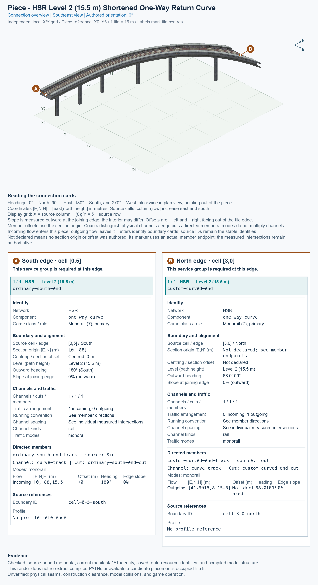

# HSR L2 Shortened One-Way Return Curve

<!-- PIECE README LAYOUT: 2 -->

[1. Views](#1-views) · [2. Piece and placement](#2-piece-and-placement) · [3. Connection matrix](#3-connection-matrix) · [Testing ↗ (separate document)](TESTING.md)

This is one reusable one-way High Speed Rail (HSR) curve at Level 2, with train paths at 15.5 m. Trains enter through the ordinary centred south end and leave through the custom curved northern cut. It owns 12 tiles inside a 5 × 6 tile construction rectangle; one city tile measures 16 × 16 m.

**Status:** experimental. Current saved-resource evidence and software pictures are separate from human preview approval and game operation. Existing observations retain their exact scope; refreshing this guide adds no human pass.

## 1. Views

Both clean pictures show the complete saved model at the same authored 0° orientation, on its local X0–X4 and Y0–Y5 grid. X increases eastward, Y increases northward, and north is up in the top view. The pictures render actual saved game models and textures; they are not game screenshots.

<!-- BEGIN PIECE VIEWS -->

<!-- END PIECE VIEWS -->

View-specific provenance is in [the angled report](evidence/preview.json) and [the top report](evidence/preview-top.json). Original render reports remain preserved under `evidence/design-history/`.

## 2. Piece and placement

<!-- BEGIN PIECE OVERVIEW -->

A twelve-tile one-way return curve with a native eight-metre centred southern end. Its first 8.5 m collar is locally eased to free an existing ordinary straight.

Exact reusable identifier: `hsr-component-l2-shortened-return-curve`.

Footprint: **5 × 6 tiles**. Exact menu name: **HSR L2 Shortened One-Way Return Curve**.

<!-- END PIECE OVERVIEW -->

The permanent type ID is `hsr-component-l2-shortened-return-curve`. The menu title uses the common **SCP | [PART]** prefix followed by **HSR L2 Shortened One-Way Return Curve**; PART means one reusable building block.

### Complete joining boundaries

The ordinary southern end uses an 8 m single-track deck, rather than the narrower 7.5 m interchange family. The existing **One-Way HSR L2 Eight-Metre Straight** supplies that physical family. In the pictured orientation, its train direction must point south for this departure curve and north for the return curve. A proper rotation turns the track and its direction together; it cannot reverse a one-way route.

The other end crosses a northern tile boundary obliquely, with a curved, offset section. It requires the exact matching saved position, outward heading, direction, height, and physical profile. A shared 15.5 m height alone does not establish a usable neighbour. The connection overview reports this custom cut without inventing a centred or perpendicular section. Automatic compatibility discovery is not supplied by the library.

The ordinary end lies on the south edge of tile (X0, Y0); the custom cut lies on the north edge of tile (X3, Y5). Picture X equals source column, and picture Y equals 5 minus source row.

### Place and rotate

After following the [separate installation procedure](../../../../docs/BUILD_AND_INSTALL.md), use a disposable flat test city. A construction rectangle is the complete bounding area around the piece; its sparse owned cells are listed in [piece.json](piece.json).

1. Open **Transportation → Rail**, hover over the SCP buttons, and select **HSR L2 Shortened One-Way Return Curve**.
2. Keep the complete **5 × 6 tile rectangle, measuring 80 × 96 m** clear. Press **Home** or **End** to turn the entire preview; on the documented Mac keyboard, **Fn + ←** and **Fn + →** supply those keys.
3. Align both exposed ends with their required complete approach sections. The supported proper rotations are **0°, 90°, 180°, and 270°**, measured counterclockwise from the pictures. Each rotation carries the heights and travel directions with it.
4. Click once to place this piece, then inspect each occupied tile and both joins. A sparse software reference can be an empty cell; do not treat it as a confirmed mouse-click anchor.

## 3. Connection matrix

<!-- BEGIN PIECE CONNECTION MATRIX -->

### Directed entrance/exit matrix

Read **from an entrance row to an exit column**. **Saved PATH** checks the saved traffic route; **Route Query** checks the route shown by the game; **Visible travel** checks a vehicle completing that journey. For HSR, visible travel means a moving train.

**Game appearance:** [?](TESTING.md#case-in_game_render-bb819f7b898394f5bf34) — the complete piece’s appearance in the game, checked separately from its journeys.

**Legend:** ✅ confirmed; ❌ failed; ? not established. **Forbidden** means the movement is unavailable; its in-game check confirms that it stays unavailable. Click a result for its exact test case. Scope, evidence, and limitations remain in [the test checklist](TESTING.md#test-checklist).

| Entrance ↓ / Exit → | **HSR · North exit** `Eout` |
| --- | --- |
| **HSR · South entrance** `Sin` | **Saved PATH:** [✅](TESTING.md#case-software_connectivity-bc1326e45c78b47461a2) **Route Query:** [?](TESTING.md#case-in_game_route_query-8dcc07c302835f8f172a) **Visible train travel:** [?](TESTING.md#case-in_game_visible_travel-8dcc07c302835f8f172a) |

Source: [connections.json](connections.json).

<!-- END PIECE CONNECTION MATRIX -->

<!-- BEGIN CONNECTOR OVERVIEW -->

### Connection overview

Generated from this piece's source-bound connector metadata and the current compiled model; marker letters refer to the boundary cards below.

[Rendering sources and verification scope](evidence/connection-overview.json).

Headings: 0° = North, 90° = East, 180° = South, and 270° = West; clockwise in plan view, pointing out of the piece.

Coordinates [E,N,H] = [east,north,height] in metres. Source cells [column,row] increase east and south.

Display grid: X = source column − (0); Y = 5 − source row.

Slope is measured outward at the joining edge; the interior may differ. Offsets are + left and − right facing out of the tile edge.

Member offsets use the section origin. Counts distinguish physical channels / edge cuts / directed members; modes do not multiply channels.

Incoming flow enters this piece; outgoing flow leaves it. Letters identify boundary cards; source IDs remain the stable identities.

Not declared means no section origin or offset was authored. Its marker uses an actual member endpoint; the measured intersections remain authoritative.

#### Boundary A: `cell-0-5-south`

This service group is required at this edge.

##### Service group 1 / 1: HSR — Level 2 (15.5 m)

| Field | Value |
| --- | --- |
| End / component | `ordinary-south-end` / `one-way-curve` |
| Network / game class / role | hsr / Monorail (7); primary |
| Source cell / edge | `[0,5]` / South |
| Section origin [E,N] (m) | `[0,-88]` |
| Centring / section offset | Centred; 0 m |
| Level (path height) | Level 2 (15.5 m) |
| Outward heading | 180° (South) |
| Slope at joining edge | 0% outward |
| Channels / edge cuts / directed members | 1 / 1 / 1 |
| Traffic arrangement / running | 1 incoming; 0 outgoing; See member directions |
| Channel spacing | See individual measured intersections |
| Channel kinds | rail |
| Traffic modes | monorail |
| Profile | No profile reference |

| Member / measured source | Channel / cut / modes | Flow | Endpoint [E,N,H] (m) | Offset (m) | Outward heading | Edge slope (%) |
| --- | --- | --- | --- | ---: | ---: | ---: |
| `ordinary-south-end-track` / `Sin` | `curve-track` / `ordinary-south-end-cut` / monorail | Incoming | `[0,-88,15.5]` | +0 | 180° | 0 |

#### Boundary B: `cell-3-0-north`

This service group is required at this edge.

##### Service group 1 / 1: HSR — Level 2 (15.5 m)

| Field | Value |
| --- | --- |
| End / component | `custom-curved-end` / `one-way-curve` |
| Network / game class / role | hsr / Monorail (7); primary |
| Source cell / edge | `[3,0]` / North |
| Section origin [E,N] (m) | Not declared; see member endpoints |
| Centring / section offset | Not declared |
| Level (path height) | Level 2 (15.5 m) |
| Outward heading | 68.0109° |
| Slope at joining edge | 0% outward |
| Channels / edge cuts / directed members | 1 / 1 / 1 |
| Traffic arrangement / running | 0 incoming; 1 outgoing; See member directions |
| Channel spacing | See individual measured intersections |
| Channel kinds | rail |
| Traffic modes | monorail |
| Profile | No profile reference |

| Member / measured source | Channel / cut / modes | Flow | Endpoint [E,N,H] (m) | Offset (m) | Outward heading | Edge slope (%) |
| --- | --- | --- | --- | ---: | ---: | ---: |
| `custom-curved-end-track` / `Eout` | `curve-track` / `custom-curved-end-cut` / monorail | Outgoing | `[41.6015,8,15.5]` | Not declared | 68.0109° | 0 |

Rendering checks source metadata, current compiled resource identities, and model structure. It does not re-extract PATHs or evaluate placement; physical seams, construction clearance, collisions, and game operation remain unverified.

<!-- END CONNECTOR OVERVIEW -->
