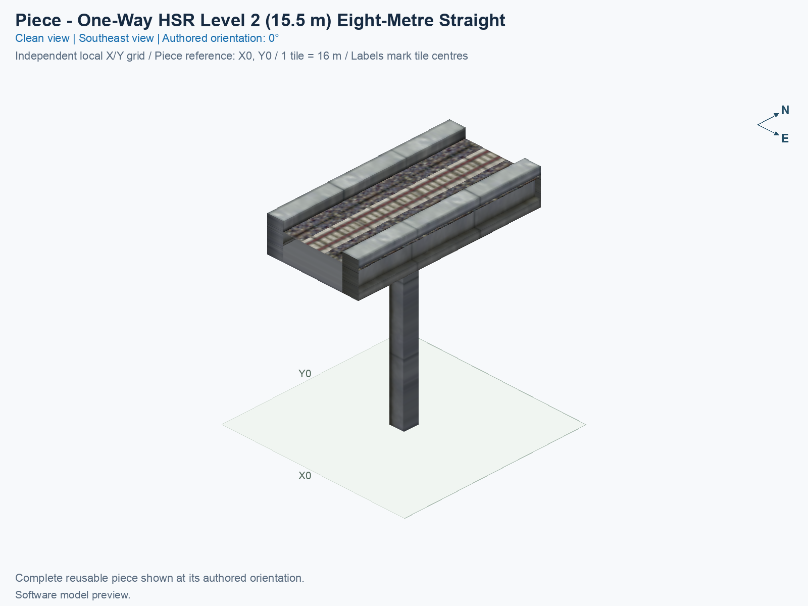
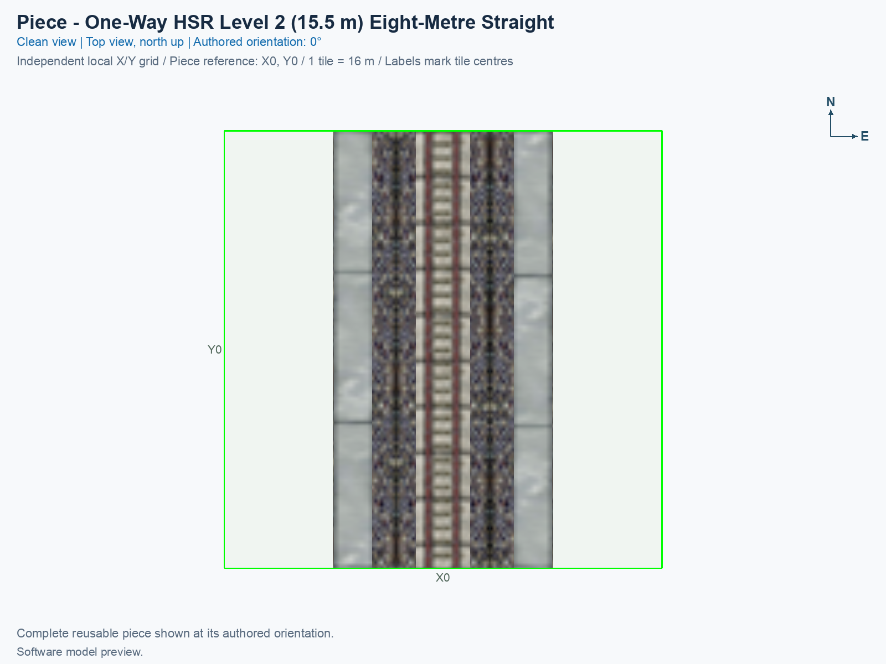
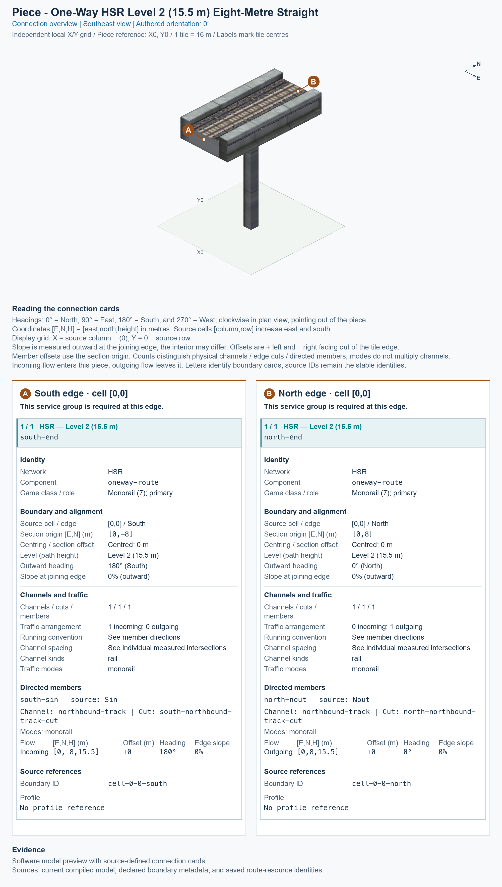

# One-Way HSR L2 Eight-Metre Straight

<!-- PIECE README LAYOUT: 2 -->

[1. Views](#1-views) · [2. Piece and placement](#2-piece-and-placement) · [3. Connection matrix](#3-connection-matrix) · [Testing ↗ (separate document)](TESTING.md)

This reusable High Speed Rail (HSR) piece is one centred, northbound track on an 8 m wide slab. Its traffic path is at Level 2 (L2), 15.5 m above ground. In the pictured 0° orientation, a train enters at the south end and leaves at the north end; the piece supplies no reverse-direction journey.

**Status: experimental.** These pictures and connector measurements come from the actual saved game resources. Human preview approval and in-game behavior remain unverified. The type is optional and disabled in default builds.

The permanent type ID is `hsr-component-lower-oneway-straight`. The exact compiled menu title is **SCP | [PART] One-Way HSR L2 Eight-Metre Straight**. PART identifies one individual building block. The puzzle ID is `f7b0`, and the complete cursor-preview model ID is `7f509ff5`.

## 1. Views

Both pictures show the same complete saved model in its authored 0° orientation. X increases eastward, Y increases northward, and each city tile measures 16 × 16 m. These are software renders rather than game screenshots.

The complete piece occupies tile (X0, Y0). Its south entrance and north exit lie on that tile’s outside edges. Source cell [0, 0] and the software construction reference identify the same tile; that reference has not been confirmed as the game’s mouse-click anchor.

<!-- BEGIN PIECE VIEWS -->

<!-- END PIECE VIEWS -->

## 2. Piece and placement

<!-- BEGIN PIECE OVERVIEW -->

One centred northbound track on an eight-metre slab at 15.5 m; matches the new single-track curved ramps.

Exact reusable identifier: `hsr-component-lower-oneway-straight`.

Footprint: **1 × 1 tiles**. Exact menu name: **One-Way HSR L2 Eight-Metre Straight**.

<!-- END PIECE OVERVIEW -->

### Footprint and joining ends

Keep the full **1 × 1 tile construction rectangle**, measuring 16 × 16 m, clear. This piece owns the single source cell listed in [piece.json](piece.json). The supports are part of its saved model; their appearance does not establish that another object can occupy the same construction cell.

Each joining boundary has one centred physical track channel, meaning one continuous train passage. Use matching one-way approaches with an 8 m slab and a traffic-path height of 15.5 m. The ordinary paired 15 m slab has two tracks offset 2 m either side of its centre, so it does not supply this centred one-way connection. Match the entering and leaving directions as well as the height.

The [connector declaration](connector-groups.jsonc), [resolved export](connector-data.json), and measured [connections](connections.json) describe this piece’s intrinsic boundaries and journeys. They do not discover or certify arbitrary neighbours; an actual physical seam and game operation need their own evidence.

### Placement and rotation

A **proper rotation** turns the complete piece without reflecting it. The eight construction states repeat four proper orientations: 0°, 90°, 180°, and 270° counterclockwise from the pictures. All ends, supports, and travel directions rotate together.

After following the separate [installation procedure](../../../../docs/BUILD_AND_INSTALL.md), use a disposable flat test city. Placement remains unverified in game.

1. Open **Transportation → Rail**, hover over the SCP buttons, and select **One-Way HSR L2 Eight-Metre Straight**. In an assembly’s component cycle, use **Tab** or **Shift+Tab** to select this same type.
2. Move the preview over a clear **1 × 1 tile rectangle**. Press **Home** or **End** to rotate; on the documented Mac keyboard, **Fn + ←** and **Fn + →** produce those keys.
3. At 0°, connect the south entrance and north exit to matching centred one-way approaches at 15.5 m. Check that both approaches carry trains in the intended south-to-north direction.
4. Click once to place the complete piece. Supply travel demand for each permitted journey, then inspect the game’s route query and moving trains separately.

## 3. Connection matrix

<!-- BEGIN PIECE CONNECTION MATRIX -->

### Directed entrance/exit matrix

Read **from an entrance row to an exit column**. **Saved PATH** checks the saved traffic route; **Route Query** checks the route shown by the game; **Visible travel** checks a vehicle completing that journey. For HSR, visible travel means a moving train.

**Game appearance:** [?](TESTING.md#case-in_game_render-87aec0f404d82c774efd) — the complete piece’s appearance in the game, checked separately from its journeys.

**Legend:** ✅ confirmed; ❌ failed; ? not established. **Forbidden** means the movement is unavailable; its in-game check confirms that it stays unavailable. Click a result for its exact test case. Scope, evidence, and limitations remain in [the test checklist](TESTING.md#test-checklist).

| Entrance ↓ / Exit → | **HSR · North exit** `Nout` |
| --- | --- |
| **HSR · South entrance** `Sin` | **Saved PATH:** [✅](TESTING.md#case-software_connectivity-b93c8e1190df4ef7f0b2) **Route Query:** [?](TESTING.md#case-in_game_route_query-184b7009a7e6bce1af4a) **Visible train travel:** [?](TESTING.md#case-in_game_visible_travel-184b7009a7e6bce1af4a) |

Source: [connections.json](connections.json).

<!-- END PIECE CONNECTION MATRIX -->

<!-- BEGIN CONNECTOR OVERVIEW -->

### Connection overview

Generated from this piece's source-bound connector metadata and the current compiled model; marker letters refer to the boundary cards below.

[Rendering sources and verification scope](evidence/connection-overview.json).

Headings: 0° = North, 90° = East, 180° = South, and 270° = West; clockwise in plan view, pointing out of the piece.

Coordinates [E,N,H] = [east,north,height] in metres. Source cells [column,row] increase east and south.

Display grid: X = source column − (0); Y = 0 − source row.

Slope is measured outward at the joining edge; the interior may differ. Offsets are + left and − right facing out of the tile edge.

Member offsets use the section origin. Counts distinguish physical channels / edge cuts / directed members; modes do not multiply channels.

Incoming flow enters this piece; outgoing flow leaves it. Letters identify boundary cards; source IDs remain the stable identities.

#### Boundary A: `cell-0-0-south`

This service group is required at this edge.

##### Service group 1 / 1: HSR — Level 2 (15.5 m)

| Field | Value |
| --- | --- |
| End / component | `south-end` / `oneway-route` |
| Network / game class / role | hsr / Monorail (7); primary |
| Source cell / edge | `[0,0]` / South |
| Section origin [E,N] (m) | `[0,-8]` |
| Centring / section offset | Centred; 0 m |
| Level (path height) | Level 2 (15.5 m) |
| Outward heading | 180° (South) |
| Slope at joining edge | 0% outward |
| Channels / edge cuts / directed members | 1 / 1 / 1 |
| Traffic arrangement / running | 1 incoming; 0 outgoing; See member directions |
| Channel spacing | See individual measured intersections |
| Channel kinds | rail |
| Traffic modes | monorail |
| Profile | No profile reference |

| Member / measured source | Channel / cut / modes | Flow | Endpoint [E,N,H] (m) | Offset (m) | Outward heading | Edge slope (%) |
| --- | --- | --- | --- | ---: | ---: | ---: |
| `south-sin` / `Sin` | `northbound-track` / `south-northbound-track-cut` / monorail | Incoming | `[0,-8,15.5]` | +0 | 180° | 0 |

#### Boundary B: `cell-0-0-north`

This service group is required at this edge.

##### Service group 1 / 1: HSR — Level 2 (15.5 m)

| Field | Value |
| --- | --- |
| End / component | `north-end` / `oneway-route` |
| Network / game class / role | hsr / Monorail (7); primary |
| Source cell / edge | `[0,0]` / North |
| Section origin [E,N] (m) | `[0,8]` |
| Centring / section offset | Centred; 0 m |
| Level (path height) | Level 2 (15.5 m) |
| Outward heading | 0° (North) |
| Slope at joining edge | 0% outward |
| Channels / edge cuts / directed members | 1 / 1 / 1 |
| Traffic arrangement / running | 0 incoming; 1 outgoing; See member directions |
| Channel spacing | See individual measured intersections |
| Channel kinds | rail |
| Traffic modes | monorail |
| Profile | No profile reference |

| Member / measured source | Channel / cut / modes | Flow | Endpoint [E,N,H] (m) | Offset (m) | Outward heading | Edge slope (%) |
| --- | --- | --- | --- | ---: | ---: | ---: |
| `north-nout` / `Nout` | `northbound-track` / `north-northbound-track-cut` / monorail | Outgoing | `[0,8,15.5]` | +0 | 0° | 0 |

The overview uses source metadata, current compiled resource identities, and the saved model. Current placement, connection, and traffic results belong to the generated connection matrix and linked testing records.

<!-- END CONNECTOR OVERVIEW -->
