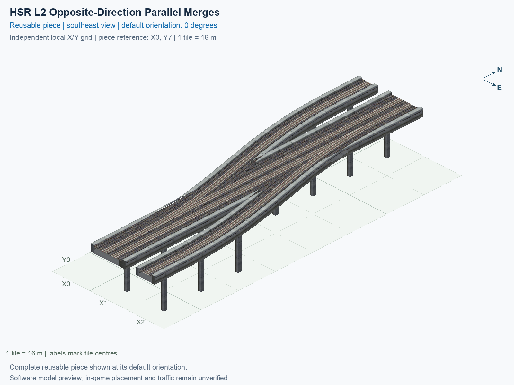

# HSR L2 Opposite-Direction Parallel Merges

Purpose: explain this reusable piece, its matching connections and current test coverage.

<!-- BEGIN PIECE OVERVIEW -->

Two outside one-way tracks merge into their matching directions of one straight two-track mainline, without crossing either track.

Exact reusable identifier: `hsr-component-lower-zero-turn-double-merge`.

Footprint: **3 × 8 tiles**. Exact menu name: **HSR L2 Opposite-Direction Parallel Merges**.

Choose this exact name in Transportation → Rail. Press Home or End to rotate; use only the supported states listed below. Join each end to a matching port profile and direction.

- [Connections and journeys](#connections-and-journeys)
- [Test checklist](#test-checklist)



<!-- END PIECE OVERVIEW -->

<!-- BEGIN MANUAL SUMMARY -->

## Manual status

Generated from [the exact test cases](#test-checklist) and [authoritative observations](checks/manual-tests.json).

- [ ] Preview review: 0/1 applicable cases passed; 0 failed, 0 stale.
- [ ] In-game rendering: 0/4 applicable cases passed; 0 failed, 0 stale.
- [ ] Directed journeys: 0/16 applicable cases passed; 0 failed, 0 stale.

These observations cover only the named services, directions, poses, rotations, and recorded platforms.

<!-- END MANUAL SUMMARY -->

<!-- BEGIN CONNECTIONS -->

## Connections and journeys

Purpose: describe intrinsic directional interfaces and permitted service journeys.

Generated from [connections.json](connections.json). Coordinates are canonical east, north and height in metres. A connection class names an encoded route interface; it does not prove visible deck/wall fit or an in-game test.

Supported placement states: 0° CCW, 90° CCW, 180° CCW, 270° CCW. Each state has its own declared manual scope.

A **port** is one directional transport-path endpoint. **Service** identifies the intended network service (for example HSR, street, or tram); **engine** is its internal traffic-class number, separate from the construction network. **Role** distinguishes primary service from auxiliary paths; sharing a traffic class does not establish service compatibility.

A **tangent** is a unit travel-direction vector: `[0,1]` means north. **Grade** is height gained per horizontal metre. These measured facts describe this subject alone. Compatibility requires a separate comparison of the complete joining boundaries; physical seams and actual game operation require their own evidence. See the [class index](../../connection-classes.json) for shared route-interface membership.

| Port | Service / engine / role | Direction | Location; tangent; grade | Connection class |
| --- | --- | --- | --- | --- |
| `Lin` | hsr / 7 / primary | in | [0.0, 8.0, 15.5]; [0.0, -1.0]; 0.0 | `path-interface-365752af76285c80cd0b` |
| `Sout` | hsr / 7 / primary | out | [14.0, -120.0, 15.5]; [0.0, -1.0]; 0.0 | `path-interface-12d12be31d2057c5763d` |
| `Nin` | hsr / 7 / primary | in | [14.0, 8.0, 15.5]; [0.0, -1.0]; 0.0 | `path-interface-12d12be31d2057c5763d` |
| `Sin` | hsr / 7 / primary | in | [18.0, -120.0, 15.5]; [0.0, 1.0]; 0.0 | `path-interface-fba09fbeb87ad95c667a` |
| `Nout` | hsr / 7 / primary | out | [18.0, 8.0, 15.5]; [0.0, 1.0]; 0.0 | `path-interface-fba09fbeb87ad95c667a` |
| `Rin` | hsr / 7 / primary | in | [32.0, -120.0, 15.5]; [0.0, 1.0]; 0.0 | `path-interface-ac60d237d23f01143255` |

### Directed journeys

| Service | Entry → exit | Role |
| --- | --- | --- |
| hsr | `Lin` → `Sout` | primary |
| hsr | `Nin` → `Sout` | primary |
| hsr | `Sin` → `Nout` | primary |
| hsr | `Rin` → `Nout` | primary |

### Forbidden transfers

| From service / port | To service / port | Reason |
| --- | --- | --- |
| hsr / `Lin` | hsr / `Nout` | No directed route exists between these ports in the saved piece transport paths. In-game confirmation remains unverified. |
| hsr / `Nin` | hsr / `Nout` | No directed route exists between these ports in the saved piece transport paths. In-game confirmation remains unverified. |
| hsr / `Sin` | hsr / `Sout` | No directed route exists between these ports in the saved piece transport paths. In-game confirmation remains unverified. |
| hsr / `Rin` | hsr / `Sout` | No directed route exists between these ports in the saved piece transport paths. In-game confirmation remains unverified. |

Review the test checklist for the exact tested cases and environments.

<!-- END CONNECTIONS -->

<!-- BEGIN MANUAL CHECKS -->

## Test checklist

Generated from [the authoritative record](checks/manual-tests.json). Only explicit human observations create manual passes; software and preview checks remain separate. Expand a check/service group to see its rotation table, then expand the matching exact scope to copy a case ID and inspect its pose, reviewer, environment, and evidence. Grouping changes only this view; every declared case remains separate.

**States:** [x] passed; [ ] unverified, failed, or stale; N/A is an explicit inapplicable declaration. A dash means no case was declared in that column. Every pass covers only its recorded environment. T means a distinct construction-transposed state.

Four proper rotations are covered. No additional reflected state is established by this record; repeated construction aliases do not create new orientations.

Current totals: unverified: 51, passed: 0, failed: 0, stale: 0, not_applicable: 0.

### Record an observation

Follow the [shared testing guide](../../../../docs/TESTING.md); copy [the unconfirmed example](checks/observation.example.json) to `checks/observation.json`. Case identifiers are in the expandable sections below. Do not edit generated checkboxes.

From the repository folder containing `custom-pieces`, run after filling `checks/observation.json` and explicitly confirming the exact observation:

```sh
python3 -m scp.content record --record custom-pieces/domains/high-speed-rail/00_pieces/hsr-component-lower-zero-turn-double-merge/checks/manual-tests.json --observation custom-pieces/domains/high-speed-rail/00_pieces/hsr-component-lower-zero-turn-double-merge/checks/observation.json
```

### Detailed current checks

Each collapsed group shows exact case counts and states. Forbidden transfers are grouped by the directed service pair; the table inside retains every port pair and rotation.

<details>
<summary>Compiled resources — Whole subject — 1 case; unverified: 1</summary>

| Check / exact scope | General | 0° | 90° | 180° | 270° |
| --- | --- | --- | --- | --- | --- |
| **Compiled resources**<br>Whole subject | <a href="#case-software_resources-c74f0624f9b036e82fee">[ ] unverified</a> | — | — | — | — |


<details>
<summary>Compiled resources — Whole subject</summary>

<a id="case-software_resources-c74f0624f9b036e82fee"></a>

**General: unverified** — `software_resources-c74f0624f9b036e82fee`.

Verify the actual compiled resources and construction rules.

Scope: Whole subject.

No observation recorded.

</details>

</details>

<details>
<summary>Directed routing graph — Whole subject — 1 case; unverified: 1</summary>

| Check / exact scope | General | 0° | 90° | 180° | 270° |
| --- | --- | --- | --- | --- | --- |
| **Directed routing graph**<br>Whole subject | <a href="#case-software_connectivity-c74f0624f9b036e82fee">[ ] unverified</a> | — | — | — | — |


<details>
<summary>Directed routing graph — Whole subject</summary>

<a id="case-software_connectivity-c74f0624f9b036e82fee"></a>

**General: unverified** — `software_connectivity-c74f0624f9b036e82fee`.

Verify the declared directed journeys and forbidden transfers.

Scope: Whole subject.

No observation recorded.

</details>

</details>

<details>
<summary>Preview review — Images — 1 case; unverified: 1</summary>

| Check / exact scope | General | 0° | 90° | 180° | 270° |
| --- | --- | --- | --- | --- | --- |
| **Preview review**<br>Image: image:hsr-component-lower-zero-turn-double-merge:canonical-southeast | <a href="#case-preview_review-c9ea8dd854e012d731f3">[ ] unverified</a> | — | — | — | — |


<details>
<summary>Preview review — Image: image:hsr-component-lower-zero-turn-double-merge:canonical-southeast</summary>

<a id="case-preview_review-c9ea8dd854e012d731f3"></a>

**General: unverified** — `preview_review-c9ea8dd854e012d731f3`.

Inspect this exact preview for tracks, walls, piers, seams and shadows.

Scope: Image: image:hsr-component-lower-zero-turn-double-merge:canonical-southeast.

No observation recorded.

</details>

</details>

<details>
<summary>In-game rendering — Whole subject — 4 cases; unverified: 4</summary>

| Check / exact scope | General | 0° | 90° | 180° | 270° |
| --- | --- | --- | --- | --- | --- |
| **In-game rendering**<br>Whole subject | — | <a href="#case-in_game_render-9d3c65ed5a5cb8303489">[ ] unverified</a> | <a href="#case-in_game_render-d123b13819fe9b88d20e">[ ] unverified</a> | <a href="#case-in_game_render-8bf28820f36c4e5cc2c5">[ ] unverified</a> | <a href="#case-in_game_render-791aac650819f7fba049">[ ] unverified</a> |


<details>
<summary>In-game rendering — Whole subject</summary>

<a id="case-in_game_render-9d3c65ed5a5cb8303489"></a>

**0° CCW: unverified** — `in_game_render-9d3c65ed5a5cb8303489`.

Inspect the placed tracks, walls, piers, seams and shadows in SimCity 4.

Scope: Whole subject.

No observation recorded.

<a id="case-in_game_render-d123b13819fe9b88d20e"></a>

**90° CCW: unverified** — `in_game_render-d123b13819fe9b88d20e`.

Inspect the placed tracks, walls, piers, seams and shadows in SimCity 4.

Scope: Whole subject.

No observation recorded.

<a id="case-in_game_render-8bf28820f36c4e5cc2c5"></a>

**180° CCW: unverified** — `in_game_render-8bf28820f36c4e5cc2c5`.

Inspect the placed tracks, walls, piers, seams and shadows in SimCity 4.

Scope: Whole subject.

No observation recorded.

<a id="case-in_game_render-791aac650819f7fba049"></a>

**270° CCW: unverified** — `in_game_render-791aac650819f7fba049`.

Inspect the placed tracks, walls, piers, seams and shadows in SimCity 4.

Scope: Whole subject.

No observation recorded.

</details>

</details>

<details>
<summary>Placement — Whole subject — 4 cases; unverified: 4</summary>

| Check / exact scope | General | 0° | 90° | 180° | 270° |
| --- | --- | --- | --- | --- | --- |
| **Placement**<br>Whole subject | — | <a href="#case-in_game_placement-9d3c65ed5a5cb8303489">[ ] unverified</a> | <a href="#case-in_game_placement-d123b13819fe9b88d20e">[ ] unverified</a> | <a href="#case-in_game_placement-8bf28820f36c4e5cc2c5">[ ] unverified</a> | <a href="#case-in_game_placement-791aac650819f7fba049">[ ] unverified</a> |


<details>
<summary>Placement — Whole subject</summary>

<a id="case-in_game_placement-9d3c65ed5a5cb8303489"></a>

**0° CCW: unverified** — `in_game_placement-9d3c65ed5a5cb8303489`.

Place this piece or complete blueprint and inspect every occupied tile.

Scope: Whole subject.

No observation recorded.

<a id="case-in_game_placement-d123b13819fe9b88d20e"></a>

**90° CCW: unverified** — `in_game_placement-d123b13819fe9b88d20e`.

Place this piece or complete blueprint and inspect every occupied tile.

Scope: Whole subject.

No observation recorded.

<a id="case-in_game_placement-8bf28820f36c4e5cc2c5"></a>

**180° CCW: unverified** — `in_game_placement-8bf28820f36c4e5cc2c5`.

Place this piece or complete blueprint and inspect every occupied tile.

Scope: Whole subject.

No observation recorded.

<a id="case-in_game_placement-791aac650819f7fba049"></a>

**270° CCW: unverified** — `in_game_placement-791aac650819f7fba049`.

Place this piece or complete blueprint and inspect every occupied tile.

Scope: Whole subject.

No observation recorded.

</details>

</details>

<details>
<summary>Demolition — Whole subject — 4 cases; unverified: 4</summary>

| Check / exact scope | General | 0° | 90° | 180° | 270° |
| --- | --- | --- | --- | --- | --- |
| **Demolition**<br>Whole subject | — | <a href="#case-in_game_demolition-9d3c65ed5a5cb8303489">[ ] unverified</a> | <a href="#case-in_game_demolition-d123b13819fe9b88d20e">[ ] unverified</a> | <a href="#case-in_game_demolition-8bf28820f36c4e5cc2c5">[ ] unverified</a> | <a href="#case-in_game_demolition-791aac650819f7fba049">[ ] unverified</a> |


<details>
<summary>Demolition — Whole subject</summary>

<a id="case-in_game_demolition-9d3c65ed5a5cb8303489"></a>

**0° CCW: unverified** — `in_game_demolition-9d3c65ed5a5cb8303489`.

Bulldoze the complete placement and inspect the cleared area.

Scope: Whole subject.

No observation recorded.

<a id="case-in_game_demolition-d123b13819fe9b88d20e"></a>

**90° CCW: unverified** — `in_game_demolition-d123b13819fe9b88d20e`.

Bulldoze the complete placement and inspect the cleared area.

Scope: Whole subject.

No observation recorded.

<a id="case-in_game_demolition-8bf28820f36c4e5cc2c5"></a>

**180° CCW: unverified** — `in_game_demolition-8bf28820f36c4e5cc2c5`.

Bulldoze the complete placement and inspect the cleared area.

Scope: Whole subject.

No observation recorded.

<a id="case-in_game_demolition-791aac650819f7fba049"></a>

**270° CCW: unverified** — `in_game_demolition-791aac650819f7fba049`.

Bulldoze the complete placement and inspect the cleared area.

Scope: Whole subject.

No observation recorded.

</details>

</details>

<details>
<summary>Save and reload — Whole subject — 4 cases; unverified: 4</summary>

| Check / exact scope | General | 0° | 90° | 180° | 270° |
| --- | --- | --- | --- | --- | --- |
| **Save and reload**<br>Whole subject | — | <a href="#case-in_game_save_reload-9d3c65ed5a5cb8303489">[ ] unverified</a> | <a href="#case-in_game_save_reload-d123b13819fe9b88d20e">[ ] unverified</a> | <a href="#case-in_game_save_reload-8bf28820f36c4e5cc2c5">[ ] unverified</a> | <a href="#case-in_game_save_reload-791aac650819f7fba049">[ ] unverified</a> |


<details>
<summary>Save and reload — Whole subject</summary>

<a id="case-in_game_save_reload-9d3c65ed5a5cb8303489"></a>

**0° CCW: unverified** — `in_game_save_reload-9d3c65ed5a5cb8303489`.

Save, quit, reload and inspect the placement and its paths.

Scope: Whole subject.

No observation recorded.

<a id="case-in_game_save_reload-d123b13819fe9b88d20e"></a>

**90° CCW: unverified** — `in_game_save_reload-d123b13819fe9b88d20e`.

Save, quit, reload and inspect the placement and its paths.

Scope: Whole subject.

No observation recorded.

<a id="case-in_game_save_reload-8bf28820f36c4e5cc2c5"></a>

**180° CCW: unverified** — `in_game_save_reload-8bf28820f36c4e5cc2c5`.

Save, quit, reload and inspect the placement and its paths.

Scope: Whole subject.

No observation recorded.

<a id="case-in_game_save_reload-791aac650819f7fba049"></a>

**270° CCW: unverified** — `in_game_save_reload-791aac650819f7fba049`.

Save, quit, reload and inspect the placement and its paths.

Scope: Whole subject.

No observation recorded.

</details>

</details>

<details>
<summary>Journey — hsr — 16 cases; unverified: 16</summary>

| Check / exact scope | General | 0° | 90° | 180° | 270° |
| --- | --- | --- | --- | --- | --- |
| **Journey**<br>Service: hsr; role: primary; journey: 7:Lin>Sout; entry: Lin; exit: Sout | — | <a href="#case-in_game_journey-5458220f4d3778db0f0d">[ ] unverified</a> | <a href="#case-in_game_journey-8f727ad4c1a1c4becfee">[ ] unverified</a> | <a href="#case-in_game_journey-a0c451ba62c883eecd1a">[ ] unverified</a> | <a href="#case-in_game_journey-7f246b4ff949dccf990f">[ ] unverified</a> |
| **Journey**<br>Service: hsr; role: primary; journey: 7:Nin>Sout; entry: Nin; exit: Sout | — | <a href="#case-in_game_journey-8c9e65da07ca51f35780">[ ] unverified</a> | <a href="#case-in_game_journey-ad03e8e3bd45b4751a7b">[ ] unverified</a> | <a href="#case-in_game_journey-cb352e8f3858b6f87946">[ ] unverified</a> | <a href="#case-in_game_journey-abb4c746f35ba79144e3">[ ] unverified</a> |
| **Journey**<br>Service: hsr; role: primary; journey: 7:Sin>Nout; entry: Sin; exit: Nout | — | <a href="#case-in_game_journey-1d129e33fc4143dfb940">[ ] unverified</a> | <a href="#case-in_game_journey-3c6f162bf3e857b565df">[ ] unverified</a> | <a href="#case-in_game_journey-60b2aea99c3faef6c432">[ ] unverified</a> | <a href="#case-in_game_journey-86a50854df5ffaf45217">[ ] unverified</a> |
| **Journey**<br>Service: hsr; role: primary; journey: 7:Rin>Nout; entry: Rin; exit: Nout | — | <a href="#case-in_game_journey-d644a583a37acfe82e01">[ ] unverified</a> | <a href="#case-in_game_journey-686f17242c60d3050ff8">[ ] unverified</a> | <a href="#case-in_game_journey-c2a9096a299e40ab080f">[ ] unverified</a> | <a href="#case-in_game_journey-b70845ddf1c2dce8c21d">[ ] unverified</a> |


<details>
<summary>Journey — Service: hsr; role: primary; journey: 7:Lin>Sout; entry: Lin; exit: Sout</summary>

<a id="case-in_game_journey-5458220f4d3778db0f0d"></a>

**0° CCW: unverified** — `in_game_journey-5458220f4d3778db0f0d`.

Run the declared journey in this direction using its service network.

Scope: Service: hsr; role: primary; journey: 7:Lin>Sout; entry: Lin; exit: Sout.

No observation recorded.

<a id="case-in_game_journey-8f727ad4c1a1c4becfee"></a>

**90° CCW: unverified** — `in_game_journey-8f727ad4c1a1c4becfee`.

Run the declared journey in this direction using its service network.

Scope: Service: hsr; role: primary; journey: 7:Lin>Sout; entry: Lin; exit: Sout.

No observation recorded.

<a id="case-in_game_journey-a0c451ba62c883eecd1a"></a>

**180° CCW: unverified** — `in_game_journey-a0c451ba62c883eecd1a`.

Run the declared journey in this direction using its service network.

Scope: Service: hsr; role: primary; journey: 7:Lin>Sout; entry: Lin; exit: Sout.

No observation recorded.

<a id="case-in_game_journey-7f246b4ff949dccf990f"></a>

**270° CCW: unverified** — `in_game_journey-7f246b4ff949dccf990f`.

Run the declared journey in this direction using its service network.

Scope: Service: hsr; role: primary; journey: 7:Lin>Sout; entry: Lin; exit: Sout.

No observation recorded.

</details>


<details>
<summary>Journey — Service: hsr; role: primary; journey: 7:Nin>Sout; entry: Nin; exit: Sout</summary>

<a id="case-in_game_journey-8c9e65da07ca51f35780"></a>

**0° CCW: unverified** — `in_game_journey-8c9e65da07ca51f35780`.

Run the declared journey in this direction using its service network.

Scope: Service: hsr; role: primary; journey: 7:Nin>Sout; entry: Nin; exit: Sout.

No observation recorded.

<a id="case-in_game_journey-ad03e8e3bd45b4751a7b"></a>

**90° CCW: unverified** — `in_game_journey-ad03e8e3bd45b4751a7b`.

Run the declared journey in this direction using its service network.

Scope: Service: hsr; role: primary; journey: 7:Nin>Sout; entry: Nin; exit: Sout.

No observation recorded.

<a id="case-in_game_journey-cb352e8f3858b6f87946"></a>

**180° CCW: unverified** — `in_game_journey-cb352e8f3858b6f87946`.

Run the declared journey in this direction using its service network.

Scope: Service: hsr; role: primary; journey: 7:Nin>Sout; entry: Nin; exit: Sout.

No observation recorded.

<a id="case-in_game_journey-abb4c746f35ba79144e3"></a>

**270° CCW: unverified** — `in_game_journey-abb4c746f35ba79144e3`.

Run the declared journey in this direction using its service network.

Scope: Service: hsr; role: primary; journey: 7:Nin>Sout; entry: Nin; exit: Sout.

No observation recorded.

</details>


<details>
<summary>Journey — Service: hsr; role: primary; journey: 7:Sin>Nout; entry: Sin; exit: Nout</summary>

<a id="case-in_game_journey-1d129e33fc4143dfb940"></a>

**0° CCW: unverified** — `in_game_journey-1d129e33fc4143dfb940`.

Run the declared journey in this direction using its service network.

Scope: Service: hsr; role: primary; journey: 7:Sin>Nout; entry: Sin; exit: Nout.

No observation recorded.

<a id="case-in_game_journey-3c6f162bf3e857b565df"></a>

**90° CCW: unverified** — `in_game_journey-3c6f162bf3e857b565df`.

Run the declared journey in this direction using its service network.

Scope: Service: hsr; role: primary; journey: 7:Sin>Nout; entry: Sin; exit: Nout.

No observation recorded.

<a id="case-in_game_journey-60b2aea99c3faef6c432"></a>

**180° CCW: unverified** — `in_game_journey-60b2aea99c3faef6c432`.

Run the declared journey in this direction using its service network.

Scope: Service: hsr; role: primary; journey: 7:Sin>Nout; entry: Sin; exit: Nout.

No observation recorded.

<a id="case-in_game_journey-86a50854df5ffaf45217"></a>

**270° CCW: unverified** — `in_game_journey-86a50854df5ffaf45217`.

Run the declared journey in this direction using its service network.

Scope: Service: hsr; role: primary; journey: 7:Sin>Nout; entry: Sin; exit: Nout.

No observation recorded.

</details>


<details>
<summary>Journey — Service: hsr; role: primary; journey: 7:Rin>Nout; entry: Rin; exit: Nout</summary>

<a id="case-in_game_journey-d644a583a37acfe82e01"></a>

**0° CCW: unverified** — `in_game_journey-d644a583a37acfe82e01`.

Run the declared journey in this direction using its service network.

Scope: Service: hsr; role: primary; journey: 7:Rin>Nout; entry: Rin; exit: Nout.

No observation recorded.

<a id="case-in_game_journey-686f17242c60d3050ff8"></a>

**90° CCW: unverified** — `in_game_journey-686f17242c60d3050ff8`.

Run the declared journey in this direction using its service network.

Scope: Service: hsr; role: primary; journey: 7:Rin>Nout; entry: Rin; exit: Nout.

No observation recorded.

<a id="case-in_game_journey-c2a9096a299e40ab080f"></a>

**180° CCW: unverified** — `in_game_journey-c2a9096a299e40ab080f`.

Run the declared journey in this direction using its service network.

Scope: Service: hsr; role: primary; journey: 7:Rin>Nout; entry: Rin; exit: Nout.

No observation recorded.

<a id="case-in_game_journey-b70845ddf1c2dce8c21d"></a>

**270° CCW: unverified** — `in_game_journey-b70845ddf1c2dce8c21d`.

Run the declared journey in this direction using its service network.

Scope: Service: hsr; role: primary; journey: 7:Rin>Nout; entry: Rin; exit: Nout.

No observation recorded.

</details>

</details>

<details>
<summary>Forbidden transfer — hsr → hsr — 16 cases; unverified: 16</summary>

| Check / exact scope | General | 0° | 90° | 180° | 270° |
| --- | --- | --- | --- | --- | --- |
| **Forbidden transfer**<br>from port: Lin; to port: Nout; from service: hsr; to service: hsr; basis: not reachable in actual saved PATH graph | — | <a href="#case-in_game_forbidden_transfer-a5513d6b0ee1b035031e">[ ] unverified</a> | <a href="#case-in_game_forbidden_transfer-ded9508776ae7c7d0916">[ ] unverified</a> | <a href="#case-in_game_forbidden_transfer-749d593cf10bcf8aecf7">[ ] unverified</a> | <a href="#case-in_game_forbidden_transfer-f15200834867e039923d">[ ] unverified</a> |
| **Forbidden transfer**<br>from port: Nin; to port: Nout; from service: hsr; to service: hsr; basis: not reachable in actual saved PATH graph | — | <a href="#case-in_game_forbidden_transfer-0029f6d3cf0b2e741b5e">[ ] unverified</a> | <a href="#case-in_game_forbidden_transfer-73096118ea6126430203">[ ] unverified</a> | <a href="#case-in_game_forbidden_transfer-08c9a956abd1c8174ff9">[ ] unverified</a> | <a href="#case-in_game_forbidden_transfer-5fe8c288de04ae07def1">[ ] unverified</a> |
| **Forbidden transfer**<br>from port: Sin; to port: Sout; from service: hsr; to service: hsr; basis: not reachable in actual saved PATH graph | — | <a href="#case-in_game_forbidden_transfer-be7b7d60a56b954d9bdd">[ ] unverified</a> | <a href="#case-in_game_forbidden_transfer-7bb8141561a618d39883">[ ] unverified</a> | <a href="#case-in_game_forbidden_transfer-04da3e1c5a5f6de6eaea">[ ] unverified</a> | <a href="#case-in_game_forbidden_transfer-1081f9ece4beb9e6160b">[ ] unverified</a> |
| **Forbidden transfer**<br>from port: Rin; to port: Sout; from service: hsr; to service: hsr; basis: not reachable in actual saved PATH graph | — | <a href="#case-in_game_forbidden_transfer-b1d463a84cea29dee053">[ ] unverified</a> | <a href="#case-in_game_forbidden_transfer-dfe5ad23b5d7ffde7206">[ ] unverified</a> | <a href="#case-in_game_forbidden_transfer-ad0cda0f6dd953ef20e0">[ ] unverified</a> | <a href="#case-in_game_forbidden_transfer-1e90822c2e66c0f1181c">[ ] unverified</a> |


<details>
<summary>Forbidden transfer — from port: Lin; to port: Nout; from service: hsr; to service: hsr; basis: not reachable in actual saved PATH graph</summary>

<a id="case-in_game_forbidden_transfer-a5513d6b0ee1b035031e"></a>

**0° CCW: unverified** — `in_game_forbidden_transfer-a5513d6b0ee1b035031e`.

Confirm this undeclared transfer is unavailable.

Scope: from port: Lin; to port: Nout; from service: hsr; to service: hsr; basis: not reachable in actual saved PATH graph.

No observation recorded.

<a id="case-in_game_forbidden_transfer-ded9508776ae7c7d0916"></a>

**90° CCW: unverified** — `in_game_forbidden_transfer-ded9508776ae7c7d0916`.

Confirm this undeclared transfer is unavailable.

Scope: from port: Lin; to port: Nout; from service: hsr; to service: hsr; basis: not reachable in actual saved PATH graph.

No observation recorded.

<a id="case-in_game_forbidden_transfer-749d593cf10bcf8aecf7"></a>

**180° CCW: unverified** — `in_game_forbidden_transfer-749d593cf10bcf8aecf7`.

Confirm this undeclared transfer is unavailable.

Scope: from port: Lin; to port: Nout; from service: hsr; to service: hsr; basis: not reachable in actual saved PATH graph.

No observation recorded.

<a id="case-in_game_forbidden_transfer-f15200834867e039923d"></a>

**270° CCW: unverified** — `in_game_forbidden_transfer-f15200834867e039923d`.

Confirm this undeclared transfer is unavailable.

Scope: from port: Lin; to port: Nout; from service: hsr; to service: hsr; basis: not reachable in actual saved PATH graph.

No observation recorded.

</details>


<details>
<summary>Forbidden transfer — from port: Nin; to port: Nout; from service: hsr; to service: hsr; basis: not reachable in actual saved PATH graph</summary>

<a id="case-in_game_forbidden_transfer-0029f6d3cf0b2e741b5e"></a>

**0° CCW: unverified** — `in_game_forbidden_transfer-0029f6d3cf0b2e741b5e`.

Confirm this undeclared transfer is unavailable.

Scope: from port: Nin; to port: Nout; from service: hsr; to service: hsr; basis: not reachable in actual saved PATH graph.

No observation recorded.

<a id="case-in_game_forbidden_transfer-73096118ea6126430203"></a>

**90° CCW: unverified** — `in_game_forbidden_transfer-73096118ea6126430203`.

Confirm this undeclared transfer is unavailable.

Scope: from port: Nin; to port: Nout; from service: hsr; to service: hsr; basis: not reachable in actual saved PATH graph.

No observation recorded.

<a id="case-in_game_forbidden_transfer-08c9a956abd1c8174ff9"></a>

**180° CCW: unverified** — `in_game_forbidden_transfer-08c9a956abd1c8174ff9`.

Confirm this undeclared transfer is unavailable.

Scope: from port: Nin; to port: Nout; from service: hsr; to service: hsr; basis: not reachable in actual saved PATH graph.

No observation recorded.

<a id="case-in_game_forbidden_transfer-5fe8c288de04ae07def1"></a>

**270° CCW: unverified** — `in_game_forbidden_transfer-5fe8c288de04ae07def1`.

Confirm this undeclared transfer is unavailable.

Scope: from port: Nin; to port: Nout; from service: hsr; to service: hsr; basis: not reachable in actual saved PATH graph.

No observation recorded.

</details>


<details>
<summary>Forbidden transfer — from port: Sin; to port: Sout; from service: hsr; to service: hsr; basis: not reachable in actual saved PATH graph</summary>

<a id="case-in_game_forbidden_transfer-be7b7d60a56b954d9bdd"></a>

**0° CCW: unverified** — `in_game_forbidden_transfer-be7b7d60a56b954d9bdd`.

Confirm this undeclared transfer is unavailable.

Scope: from port: Sin; to port: Sout; from service: hsr; to service: hsr; basis: not reachable in actual saved PATH graph.

No observation recorded.

<a id="case-in_game_forbidden_transfer-7bb8141561a618d39883"></a>

**90° CCW: unverified** — `in_game_forbidden_transfer-7bb8141561a618d39883`.

Confirm this undeclared transfer is unavailable.

Scope: from port: Sin; to port: Sout; from service: hsr; to service: hsr; basis: not reachable in actual saved PATH graph.

No observation recorded.

<a id="case-in_game_forbidden_transfer-04da3e1c5a5f6de6eaea"></a>

**180° CCW: unverified** — `in_game_forbidden_transfer-04da3e1c5a5f6de6eaea`.

Confirm this undeclared transfer is unavailable.

Scope: from port: Sin; to port: Sout; from service: hsr; to service: hsr; basis: not reachable in actual saved PATH graph.

No observation recorded.

<a id="case-in_game_forbidden_transfer-1081f9ece4beb9e6160b"></a>

**270° CCW: unverified** — `in_game_forbidden_transfer-1081f9ece4beb9e6160b`.

Confirm this undeclared transfer is unavailable.

Scope: from port: Sin; to port: Sout; from service: hsr; to service: hsr; basis: not reachable in actual saved PATH graph.

No observation recorded.

</details>


<details>
<summary>Forbidden transfer — from port: Rin; to port: Sout; from service: hsr; to service: hsr; basis: not reachable in actual saved PATH graph</summary>

<a id="case-in_game_forbidden_transfer-b1d463a84cea29dee053"></a>

**0° CCW: unverified** — `in_game_forbidden_transfer-b1d463a84cea29dee053`.

Confirm this undeclared transfer is unavailable.

Scope: from port: Rin; to port: Sout; from service: hsr; to service: hsr; basis: not reachable in actual saved PATH graph.

No observation recorded.

<a id="case-in_game_forbidden_transfer-dfe5ad23b5d7ffde7206"></a>

**90° CCW: unverified** — `in_game_forbidden_transfer-dfe5ad23b5d7ffde7206`.

Confirm this undeclared transfer is unavailable.

Scope: from port: Rin; to port: Sout; from service: hsr; to service: hsr; basis: not reachable in actual saved PATH graph.

No observation recorded.

<a id="case-in_game_forbidden_transfer-ad0cda0f6dd953ef20e0"></a>

**180° CCW: unverified** — `in_game_forbidden_transfer-ad0cda0f6dd953ef20e0`.

Confirm this undeclared transfer is unavailable.

Scope: from port: Rin; to port: Sout; from service: hsr; to service: hsr; basis: not reachable in actual saved PATH graph.

No observation recorded.

<a id="case-in_game_forbidden_transfer-1e90822c2e66c0f1181c"></a>

**270° CCW: unverified** — `in_game_forbidden_transfer-1e90822c2e66c0f1181c`.

Confirm this undeclared transfer is unavailable.

Scope: from port: Rin; to port: Sout; from service: hsr; to service: hsr; basis: not reachable in actual saved PATH graph.

No observation recorded.

</details>

</details>

<!-- END MANUAL CHECKS -->
