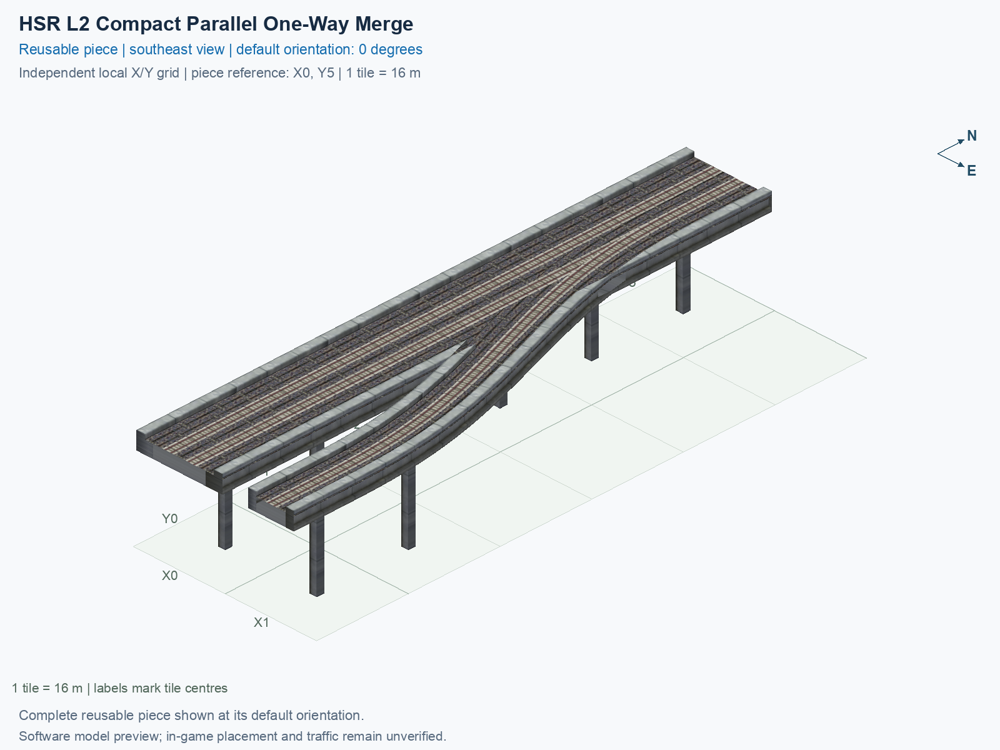

# HSR L2 Compact Parallel One-Way Merge

Purpose: explain this reusable piece, its matching connections and current test coverage.

<!-- BEGIN PIECE OVERVIEW -->

A 96 m long turnout merges a parallel one-way track one tile to the right into the forward mainline track, while preserving the opposite straight track.

Exact reusable identifier: `hsr-component-lower-zero-turn-merge-compact`.

Footprint: **2 × 6 tiles**. Exact menu name: **HSR L2 Compact Parallel One-Way Merge**.

Choose this exact name in Transportation → Rail. Press Home or End to rotate; use only the supported states listed below. Join each end to a matching port profile and direction.

- [Connections and journeys](#connections-and-journeys)
- [Test checklist](#test-checklist)



<!-- END PIECE OVERVIEW -->

<!-- BEGIN MANUAL SUMMARY -->

## Manual status

Generated from [the exact test cases](#test-checklist) and [authoritative observations](checks/manual-tests.json).

- [ ] Preview review: 0/1 applicable cases passed; 0 failed, 0 stale.
- [ ] In-game rendering: 0/4 applicable cases passed; 0 failed, 0 stale.
- [ ] Directed journeys: 0/12 applicable cases passed; 0 failed, 0 stale.

These observations cover only the named services, directions, poses, rotations, and recorded platforms.

<!-- END MANUAL SUMMARY -->

<!-- BEGIN CONNECTIONS -->

## Connections and journeys

Purpose: describe intrinsic directional interfaces and permitted service journeys.

Generated from [connections.json](connections.json). Coordinates are canonical east, north and height in metres. A connection class names an encoded route interface; it does not prove visible deck/wall fit or an in-game test.

Supported placement states: 0° CCW, 90° CCW, 180° CCW, 270° CCW. Each state has its own declared manual scope.

A **port** is one directional transport-path endpoint. **Service** identifies the intended network service (for example HSR, street, or tram); **engine** is its internal traffic-class number, separate from the construction network. **Role** distinguishes primary service from auxiliary paths; sharing a traffic class does not establish service compatibility.

A **tangent** is a unit travel-direction vector: `[0,1]` means north. **Grade** is height gained per horizontal metre. These measured facts describe this subject alone. Compatibility requires a separate comparison of the complete joining boundaries; physical seams and actual game operation require their own evidence. See the [class index](../../connection-classes.json) for shared route-interface membership.

| Port | Service / engine / role | Direction | Location; tangent; grade | Connection class |
| --- | --- | --- | --- | --- |
| `Sout` | hsr / 7 / primary | out | [-2.0, -88.0, 15.5]; [0.0, -1.0]; 0.0 | `path-interface-12d12be31d2057c5763d` |
| `Nin` | hsr / 7 / primary | in | [-2.0, 8.0, 15.5]; [0.0, -1.0]; 0.0 | `path-interface-12d12be31d2057c5763d` |
| `Sin` | hsr / 7 / primary | in | [2.0, -88.0, 15.5]; [0.0, 1.0]; 0.0 | `path-interface-fba09fbeb87ad95c667a` |
| `Nout` | hsr / 7 / primary | out | [2.0, 8.0, 15.5]; [0.0, 1.0]; 0.0 | `path-interface-fba09fbeb87ad95c667a` |
| `Bin` | hsr / 7 / primary | in | [16.0, -88.0, 15.5]; [0.0, 1.0]; 0.0 | `path-interface-ac60d237d23f01143255` |

### Directed journeys

| Service | Entry → exit | Role |
| --- | --- | --- |
| hsr | `Nin` → `Sout` | primary |
| hsr | `Sin` → `Nout` | primary |
| hsr | `Bin` → `Nout` | primary |

### Forbidden transfers

| From service / port | To service / port | Reason |
| --- | --- | --- |
| hsr / `Nin` | hsr / `Nout` | No directed route exists between these ports in the saved piece transport paths. In-game confirmation remains unverified. |
| hsr / `Sin` | hsr / `Sout` | No directed route exists between these ports in the saved piece transport paths. In-game confirmation remains unverified. |
| hsr / `Bin` | hsr / `Sout` | No directed route exists between these ports in the saved piece transport paths. In-game confirmation remains unverified. |

Review the test checklist for the exact tested cases and environments.

<!-- END CONNECTIONS -->

<!-- BEGIN MANUAL CHECKS -->

## Test checklist

Generated from [the authoritative record](checks/manual-tests.json). Only explicit human observations create manual passes; software and preview checks remain separate. Expand a check/service group to see its rotation table, then expand the matching exact scope to copy a case ID and inspect its pose, reviewer, environment, and evidence. Grouping changes only this view; every declared case remains separate.

**States:** [x] passed; [ ] unverified, failed, or stale; N/A is an explicit inapplicable declaration. A dash means no case was declared in that column. Every pass covers only its recorded environment. T means a distinct construction-transposed state.

Four proper rotations are covered. No additional reflected state is established by this record; repeated construction aliases do not create new orientations.

Current totals: unverified: 43, passed: 0, failed: 0, stale: 0, not_applicable: 0.

### Record an observation

Follow the [shared testing guide](../../../../docs/TESTING.md); copy [the unconfirmed example](checks/observation.example.json) to `checks/observation.json`. Case identifiers are in the expandable sections below. Do not edit generated checkboxes.

From the repository folder containing `custom-pieces`, run after filling `checks/observation.json` and explicitly confirming the exact observation:

```sh
python3 -m scp.content record --record custom-pieces/domains/high-speed-rail/00_pieces/hsr-component-lower-zero-turn-merge-compact/checks/manual-tests.json --observation custom-pieces/domains/high-speed-rail/00_pieces/hsr-component-lower-zero-turn-merge-compact/checks/observation.json
```

### Detailed current checks

Each collapsed group shows exact case counts and states. Forbidden transfers are grouped by the directed service pair; the table inside retains every port pair and rotation.

<details>
<summary>Compiled resources — Whole subject — 1 case; unverified: 1</summary>

| Check / exact scope | General | 0° | 90° | 180° | 270° |
| --- | --- | --- | --- | --- | --- |
| **Compiled resources**<br>Whole subject | <a href="#case-software_resources-eda93a01263da2c714e1">[ ] unverified</a> | — | — | — | — |


<details>
<summary>Compiled resources — Whole subject</summary>

<a id="case-software_resources-eda93a01263da2c714e1"></a>

**General: unverified** — `software_resources-eda93a01263da2c714e1`.

Verify the actual compiled resources and construction rules.

Scope: Whole subject.

No observation recorded.

</details>

</details>

<details>
<summary>Directed routing graph — Whole subject — 1 case; unverified: 1</summary>

| Check / exact scope | General | 0° | 90° | 180° | 270° |
| --- | --- | --- | --- | --- | --- |
| **Directed routing graph**<br>Whole subject | <a href="#case-software_connectivity-eda93a01263da2c714e1">[ ] unverified</a> | — | — | — | — |


<details>
<summary>Directed routing graph — Whole subject</summary>

<a id="case-software_connectivity-eda93a01263da2c714e1"></a>

**General: unverified** — `software_connectivity-eda93a01263da2c714e1`.

Verify the declared directed journeys and forbidden transfers.

Scope: Whole subject.

No observation recorded.

</details>

</details>

<details>
<summary>Preview review — Images — 1 case; unverified: 1</summary>

| Check / exact scope | General | 0° | 90° | 180° | 270° |
| --- | --- | --- | --- | --- | --- |
| **Preview review**<br>Image: image:hsr-component-lower-zero-turn-merge-compact:canonical-southeast | <a href="#case-preview_review-bfec4a183b2fd5b94b10">[ ] unverified</a> | — | — | — | — |


<details>
<summary>Preview review — Image: image:hsr-component-lower-zero-turn-merge-compact:canonical-southeast</summary>

<a id="case-preview_review-bfec4a183b2fd5b94b10"></a>

**General: unverified** — `preview_review-bfec4a183b2fd5b94b10`.

Inspect this exact preview for tracks, walls, piers, seams and shadows.

Scope: Image: image:hsr-component-lower-zero-turn-merge-compact:canonical-southeast.

No observation recorded.

</details>

</details>

<details>
<summary>In-game rendering — Whole subject — 4 cases; unverified: 4</summary>

| Check / exact scope | General | 0° | 90° | 180° | 270° |
| --- | --- | --- | --- | --- | --- |
| **In-game rendering**<br>Whole subject | — | <a href="#case-in_game_render-f01b94469767094ea2ef">[ ] unverified</a> | <a href="#case-in_game_render-c86ab7a613d829bbd786">[ ] unverified</a> | <a href="#case-in_game_render-6e698609d4171d31d6f8">[ ] unverified</a> | <a href="#case-in_game_render-63b2b76e092836313e85">[ ] unverified</a> |


<details>
<summary>In-game rendering — Whole subject</summary>

<a id="case-in_game_render-f01b94469767094ea2ef"></a>

**0° CCW: unverified** — `in_game_render-f01b94469767094ea2ef`.

Inspect the placed tracks, walls, piers, seams and shadows in SimCity 4.

Scope: Whole subject.

No observation recorded.

<a id="case-in_game_render-c86ab7a613d829bbd786"></a>

**90° CCW: unverified** — `in_game_render-c86ab7a613d829bbd786`.

Inspect the placed tracks, walls, piers, seams and shadows in SimCity 4.

Scope: Whole subject.

No observation recorded.

<a id="case-in_game_render-6e698609d4171d31d6f8"></a>

**180° CCW: unverified** — `in_game_render-6e698609d4171d31d6f8`.

Inspect the placed tracks, walls, piers, seams and shadows in SimCity 4.

Scope: Whole subject.

No observation recorded.

<a id="case-in_game_render-63b2b76e092836313e85"></a>

**270° CCW: unverified** — `in_game_render-63b2b76e092836313e85`.

Inspect the placed tracks, walls, piers, seams and shadows in SimCity 4.

Scope: Whole subject.

No observation recorded.

</details>

</details>

<details>
<summary>Placement — Whole subject — 4 cases; unverified: 4</summary>

| Check / exact scope | General | 0° | 90° | 180° | 270° |
| --- | --- | --- | --- | --- | --- |
| **Placement**<br>Whole subject | — | <a href="#case-in_game_placement-f01b94469767094ea2ef">[ ] unverified</a> | <a href="#case-in_game_placement-c86ab7a613d829bbd786">[ ] unverified</a> | <a href="#case-in_game_placement-6e698609d4171d31d6f8">[ ] unverified</a> | <a href="#case-in_game_placement-63b2b76e092836313e85">[ ] unverified</a> |


<details>
<summary>Placement — Whole subject</summary>

<a id="case-in_game_placement-f01b94469767094ea2ef"></a>

**0° CCW: unverified** — `in_game_placement-f01b94469767094ea2ef`.

Place this piece or complete blueprint and inspect every occupied tile.

Scope: Whole subject.

No observation recorded.

<a id="case-in_game_placement-c86ab7a613d829bbd786"></a>

**90° CCW: unverified** — `in_game_placement-c86ab7a613d829bbd786`.

Place this piece or complete blueprint and inspect every occupied tile.

Scope: Whole subject.

No observation recorded.

<a id="case-in_game_placement-6e698609d4171d31d6f8"></a>

**180° CCW: unverified** — `in_game_placement-6e698609d4171d31d6f8`.

Place this piece or complete blueprint and inspect every occupied tile.

Scope: Whole subject.

No observation recorded.

<a id="case-in_game_placement-63b2b76e092836313e85"></a>

**270° CCW: unverified** — `in_game_placement-63b2b76e092836313e85`.

Place this piece or complete blueprint and inspect every occupied tile.

Scope: Whole subject.

No observation recorded.

</details>

</details>

<details>
<summary>Demolition — Whole subject — 4 cases; unverified: 4</summary>

| Check / exact scope | General | 0° | 90° | 180° | 270° |
| --- | --- | --- | --- | --- | --- |
| **Demolition**<br>Whole subject | — | <a href="#case-in_game_demolition-f01b94469767094ea2ef">[ ] unverified</a> | <a href="#case-in_game_demolition-c86ab7a613d829bbd786">[ ] unverified</a> | <a href="#case-in_game_demolition-6e698609d4171d31d6f8">[ ] unverified</a> | <a href="#case-in_game_demolition-63b2b76e092836313e85">[ ] unverified</a> |


<details>
<summary>Demolition — Whole subject</summary>

<a id="case-in_game_demolition-f01b94469767094ea2ef"></a>

**0° CCW: unverified** — `in_game_demolition-f01b94469767094ea2ef`.

Bulldoze the complete placement and inspect the cleared area.

Scope: Whole subject.

No observation recorded.

<a id="case-in_game_demolition-c86ab7a613d829bbd786"></a>

**90° CCW: unverified** — `in_game_demolition-c86ab7a613d829bbd786`.

Bulldoze the complete placement and inspect the cleared area.

Scope: Whole subject.

No observation recorded.

<a id="case-in_game_demolition-6e698609d4171d31d6f8"></a>

**180° CCW: unverified** — `in_game_demolition-6e698609d4171d31d6f8`.

Bulldoze the complete placement and inspect the cleared area.

Scope: Whole subject.

No observation recorded.

<a id="case-in_game_demolition-63b2b76e092836313e85"></a>

**270° CCW: unverified** — `in_game_demolition-63b2b76e092836313e85`.

Bulldoze the complete placement and inspect the cleared area.

Scope: Whole subject.

No observation recorded.

</details>

</details>

<details>
<summary>Save and reload — Whole subject — 4 cases; unverified: 4</summary>

| Check / exact scope | General | 0° | 90° | 180° | 270° |
| --- | --- | --- | --- | --- | --- |
| **Save and reload**<br>Whole subject | — | <a href="#case-in_game_save_reload-f01b94469767094ea2ef">[ ] unverified</a> | <a href="#case-in_game_save_reload-c86ab7a613d829bbd786">[ ] unverified</a> | <a href="#case-in_game_save_reload-6e698609d4171d31d6f8">[ ] unverified</a> | <a href="#case-in_game_save_reload-63b2b76e092836313e85">[ ] unverified</a> |


<details>
<summary>Save and reload — Whole subject</summary>

<a id="case-in_game_save_reload-f01b94469767094ea2ef"></a>

**0° CCW: unverified** — `in_game_save_reload-f01b94469767094ea2ef`.

Save, quit, reload and inspect the placement and its paths.

Scope: Whole subject.

No observation recorded.

<a id="case-in_game_save_reload-c86ab7a613d829bbd786"></a>

**90° CCW: unverified** — `in_game_save_reload-c86ab7a613d829bbd786`.

Save, quit, reload and inspect the placement and its paths.

Scope: Whole subject.

No observation recorded.

<a id="case-in_game_save_reload-6e698609d4171d31d6f8"></a>

**180° CCW: unverified** — `in_game_save_reload-6e698609d4171d31d6f8`.

Save, quit, reload and inspect the placement and its paths.

Scope: Whole subject.

No observation recorded.

<a id="case-in_game_save_reload-63b2b76e092836313e85"></a>

**270° CCW: unverified** — `in_game_save_reload-63b2b76e092836313e85`.

Save, quit, reload and inspect the placement and its paths.

Scope: Whole subject.

No observation recorded.

</details>

</details>

<details>
<summary>Journey — hsr — 12 cases; unverified: 12</summary>

| Check / exact scope | General | 0° | 90° | 180° | 270° |
| --- | --- | --- | --- | --- | --- |
| **Journey**<br>Service: hsr; role: primary; journey: 7:Nin>Sout; entry: Nin; exit: Sout | — | <a href="#case-in_game_journey-69b30732dc88b2178fef">[ ] unverified</a> | <a href="#case-in_game_journey-3ea78fcd0d42dc30e718">[ ] unverified</a> | <a href="#case-in_game_journey-70e812a9c4dfcfd72ef1">[ ] unverified</a> | <a href="#case-in_game_journey-c1da585d4a23f1ad8125">[ ] unverified</a> |
| **Journey**<br>Service: hsr; role: primary; journey: 7:Sin>Nout; entry: Sin; exit: Nout | — | <a href="#case-in_game_journey-d28273d6ab33db1379ac">[ ] unverified</a> | <a href="#case-in_game_journey-c495ca0321ada65bd63a">[ ] unverified</a> | <a href="#case-in_game_journey-a641c1ac50d66c1471c1">[ ] unverified</a> | <a href="#case-in_game_journey-e7f0402ab49ca4634cd2">[ ] unverified</a> |
| **Journey**<br>Service: hsr; role: primary; journey: 7:Bin>Nout; entry: Bin; exit: Nout | — | <a href="#case-in_game_journey-25b0eec03c00ce24c55a">[ ] unverified</a> | <a href="#case-in_game_journey-705c8f7bb0c47b3e354e">[ ] unverified</a> | <a href="#case-in_game_journey-893578d35da52067d3ea">[ ] unverified</a> | <a href="#case-in_game_journey-6afe6ec4a3013e91ea09">[ ] unverified</a> |


<details>
<summary>Journey — Service: hsr; role: primary; journey: 7:Nin>Sout; entry: Nin; exit: Sout</summary>

<a id="case-in_game_journey-69b30732dc88b2178fef"></a>

**0° CCW: unverified** — `in_game_journey-69b30732dc88b2178fef`.

Run the declared journey in this direction using its service network.

Scope: Service: hsr; role: primary; journey: 7:Nin>Sout; entry: Nin; exit: Sout.

No observation recorded.

<a id="case-in_game_journey-3ea78fcd0d42dc30e718"></a>

**90° CCW: unverified** — `in_game_journey-3ea78fcd0d42dc30e718`.

Run the declared journey in this direction using its service network.

Scope: Service: hsr; role: primary; journey: 7:Nin>Sout; entry: Nin; exit: Sout.

No observation recorded.

<a id="case-in_game_journey-70e812a9c4dfcfd72ef1"></a>

**180° CCW: unverified** — `in_game_journey-70e812a9c4dfcfd72ef1`.

Run the declared journey in this direction using its service network.

Scope: Service: hsr; role: primary; journey: 7:Nin>Sout; entry: Nin; exit: Sout.

No observation recorded.

<a id="case-in_game_journey-c1da585d4a23f1ad8125"></a>

**270° CCW: unverified** — `in_game_journey-c1da585d4a23f1ad8125`.

Run the declared journey in this direction using its service network.

Scope: Service: hsr; role: primary; journey: 7:Nin>Sout; entry: Nin; exit: Sout.

No observation recorded.

</details>


<details>
<summary>Journey — Service: hsr; role: primary; journey: 7:Sin>Nout; entry: Sin; exit: Nout</summary>

<a id="case-in_game_journey-d28273d6ab33db1379ac"></a>

**0° CCW: unverified** — `in_game_journey-d28273d6ab33db1379ac`.

Run the declared journey in this direction using its service network.

Scope: Service: hsr; role: primary; journey: 7:Sin>Nout; entry: Sin; exit: Nout.

No observation recorded.

<a id="case-in_game_journey-c495ca0321ada65bd63a"></a>

**90° CCW: unverified** — `in_game_journey-c495ca0321ada65bd63a`.

Run the declared journey in this direction using its service network.

Scope: Service: hsr; role: primary; journey: 7:Sin>Nout; entry: Sin; exit: Nout.

No observation recorded.

<a id="case-in_game_journey-a641c1ac50d66c1471c1"></a>

**180° CCW: unverified** — `in_game_journey-a641c1ac50d66c1471c1`.

Run the declared journey in this direction using its service network.

Scope: Service: hsr; role: primary; journey: 7:Sin>Nout; entry: Sin; exit: Nout.

No observation recorded.

<a id="case-in_game_journey-e7f0402ab49ca4634cd2"></a>

**270° CCW: unverified** — `in_game_journey-e7f0402ab49ca4634cd2`.

Run the declared journey in this direction using its service network.

Scope: Service: hsr; role: primary; journey: 7:Sin>Nout; entry: Sin; exit: Nout.

No observation recorded.

</details>


<details>
<summary>Journey — Service: hsr; role: primary; journey: 7:Bin>Nout; entry: Bin; exit: Nout</summary>

<a id="case-in_game_journey-25b0eec03c00ce24c55a"></a>

**0° CCW: unverified** — `in_game_journey-25b0eec03c00ce24c55a`.

Run the declared journey in this direction using its service network.

Scope: Service: hsr; role: primary; journey: 7:Bin>Nout; entry: Bin; exit: Nout.

No observation recorded.

<a id="case-in_game_journey-705c8f7bb0c47b3e354e"></a>

**90° CCW: unverified** — `in_game_journey-705c8f7bb0c47b3e354e`.

Run the declared journey in this direction using its service network.

Scope: Service: hsr; role: primary; journey: 7:Bin>Nout; entry: Bin; exit: Nout.

No observation recorded.

<a id="case-in_game_journey-893578d35da52067d3ea"></a>

**180° CCW: unverified** — `in_game_journey-893578d35da52067d3ea`.

Run the declared journey in this direction using its service network.

Scope: Service: hsr; role: primary; journey: 7:Bin>Nout; entry: Bin; exit: Nout.

No observation recorded.

<a id="case-in_game_journey-6afe6ec4a3013e91ea09"></a>

**270° CCW: unverified** — `in_game_journey-6afe6ec4a3013e91ea09`.

Run the declared journey in this direction using its service network.

Scope: Service: hsr; role: primary; journey: 7:Bin>Nout; entry: Bin; exit: Nout.

No observation recorded.

</details>

</details>

<details>
<summary>Forbidden transfer — hsr → hsr — 12 cases; unverified: 12</summary>

| Check / exact scope | General | 0° | 90° | 180° | 270° |
| --- | --- | --- | --- | --- | --- |
| **Forbidden transfer**<br>from port: Nin; to port: Nout; from service: hsr; to service: hsr; basis: not reachable in actual saved PATH graph | — | <a href="#case-in_game_forbidden_transfer-bd6604b9a6f33f80fe11">[ ] unverified</a> | <a href="#case-in_game_forbidden_transfer-deec12fbb92af381c7ea">[ ] unverified</a> | <a href="#case-in_game_forbidden_transfer-4231a49b02522a2c0c91">[ ] unverified</a> | <a href="#case-in_game_forbidden_transfer-2bb0a7a40999e629e391">[ ] unverified</a> |
| **Forbidden transfer**<br>from port: Sin; to port: Sout; from service: hsr; to service: hsr; basis: not reachable in actual saved PATH graph | — | <a href="#case-in_game_forbidden_transfer-9144ac011d14b6a10c7b">[ ] unverified</a> | <a href="#case-in_game_forbidden_transfer-66961e95986f005a9ee0">[ ] unverified</a> | <a href="#case-in_game_forbidden_transfer-905309588a8e05399f4d">[ ] unverified</a> | <a href="#case-in_game_forbidden_transfer-771b582212ba09891963">[ ] unverified</a> |
| **Forbidden transfer**<br>from port: Bin; to port: Sout; from service: hsr; to service: hsr; basis: not reachable in actual saved PATH graph | — | <a href="#case-in_game_forbidden_transfer-f518f5c99698a3cc6cf5">[ ] unverified</a> | <a href="#case-in_game_forbidden_transfer-139aedf25ac161de10bd">[ ] unverified</a> | <a href="#case-in_game_forbidden_transfer-b6f20f8d58f33787b2bd">[ ] unverified</a> | <a href="#case-in_game_forbidden_transfer-e654372ed756d7159fe9">[ ] unverified</a> |


<details>
<summary>Forbidden transfer — from port: Nin; to port: Nout; from service: hsr; to service: hsr; basis: not reachable in actual saved PATH graph</summary>

<a id="case-in_game_forbidden_transfer-bd6604b9a6f33f80fe11"></a>

**0° CCW: unverified** — `in_game_forbidden_transfer-bd6604b9a6f33f80fe11`.

Confirm this undeclared transfer is unavailable.

Scope: from port: Nin; to port: Nout; from service: hsr; to service: hsr; basis: not reachable in actual saved PATH graph.

No observation recorded.

<a id="case-in_game_forbidden_transfer-deec12fbb92af381c7ea"></a>

**90° CCW: unverified** — `in_game_forbidden_transfer-deec12fbb92af381c7ea`.

Confirm this undeclared transfer is unavailable.

Scope: from port: Nin; to port: Nout; from service: hsr; to service: hsr; basis: not reachable in actual saved PATH graph.

No observation recorded.

<a id="case-in_game_forbidden_transfer-4231a49b02522a2c0c91"></a>

**180° CCW: unverified** — `in_game_forbidden_transfer-4231a49b02522a2c0c91`.

Confirm this undeclared transfer is unavailable.

Scope: from port: Nin; to port: Nout; from service: hsr; to service: hsr; basis: not reachable in actual saved PATH graph.

No observation recorded.

<a id="case-in_game_forbidden_transfer-2bb0a7a40999e629e391"></a>

**270° CCW: unverified** — `in_game_forbidden_transfer-2bb0a7a40999e629e391`.

Confirm this undeclared transfer is unavailable.

Scope: from port: Nin; to port: Nout; from service: hsr; to service: hsr; basis: not reachable in actual saved PATH graph.

No observation recorded.

</details>


<details>
<summary>Forbidden transfer — from port: Sin; to port: Sout; from service: hsr; to service: hsr; basis: not reachable in actual saved PATH graph</summary>

<a id="case-in_game_forbidden_transfer-9144ac011d14b6a10c7b"></a>

**0° CCW: unverified** — `in_game_forbidden_transfer-9144ac011d14b6a10c7b`.

Confirm this undeclared transfer is unavailable.

Scope: from port: Sin; to port: Sout; from service: hsr; to service: hsr; basis: not reachable in actual saved PATH graph.

No observation recorded.

<a id="case-in_game_forbidden_transfer-66961e95986f005a9ee0"></a>

**90° CCW: unverified** — `in_game_forbidden_transfer-66961e95986f005a9ee0`.

Confirm this undeclared transfer is unavailable.

Scope: from port: Sin; to port: Sout; from service: hsr; to service: hsr; basis: not reachable in actual saved PATH graph.

No observation recorded.

<a id="case-in_game_forbidden_transfer-905309588a8e05399f4d"></a>

**180° CCW: unverified** — `in_game_forbidden_transfer-905309588a8e05399f4d`.

Confirm this undeclared transfer is unavailable.

Scope: from port: Sin; to port: Sout; from service: hsr; to service: hsr; basis: not reachable in actual saved PATH graph.

No observation recorded.

<a id="case-in_game_forbidden_transfer-771b582212ba09891963"></a>

**270° CCW: unverified** — `in_game_forbidden_transfer-771b582212ba09891963`.

Confirm this undeclared transfer is unavailable.

Scope: from port: Sin; to port: Sout; from service: hsr; to service: hsr; basis: not reachable in actual saved PATH graph.

No observation recorded.

</details>


<details>
<summary>Forbidden transfer — from port: Bin; to port: Sout; from service: hsr; to service: hsr; basis: not reachable in actual saved PATH graph</summary>

<a id="case-in_game_forbidden_transfer-f518f5c99698a3cc6cf5"></a>

**0° CCW: unverified** — `in_game_forbidden_transfer-f518f5c99698a3cc6cf5`.

Confirm this undeclared transfer is unavailable.

Scope: from port: Bin; to port: Sout; from service: hsr; to service: hsr; basis: not reachable in actual saved PATH graph.

No observation recorded.

<a id="case-in_game_forbidden_transfer-139aedf25ac161de10bd"></a>

**90° CCW: unverified** — `in_game_forbidden_transfer-139aedf25ac161de10bd`.

Confirm this undeclared transfer is unavailable.

Scope: from port: Bin; to port: Sout; from service: hsr; to service: hsr; basis: not reachable in actual saved PATH graph.

No observation recorded.

<a id="case-in_game_forbidden_transfer-b6f20f8d58f33787b2bd"></a>

**180° CCW: unverified** — `in_game_forbidden_transfer-b6f20f8d58f33787b2bd`.

Confirm this undeclared transfer is unavailable.

Scope: from port: Bin; to port: Sout; from service: hsr; to service: hsr; basis: not reachable in actual saved PATH graph.

No observation recorded.

<a id="case-in_game_forbidden_transfer-e654372ed756d7159fe9"></a>

**270° CCW: unverified** — `in_game_forbidden_transfer-e654372ed756d7159fe9`.

Confirm this undeclared transfer is unavailable.

Scope: from port: Bin; to port: Sout; from service: hsr; to service: hsr; basis: not reachable in actual saved PATH graph.

No observation recorded.

</details>

</details>

<!-- END MANUAL CHECKS -->

## Engineering contract

This compact type spans 96 m in a 2 × 6 construction rectangle, with 11 occupied cells, one structural cell, and eight supports. The full-length adapter/split/merge alternatives and wider curves remain separate functional variants. Align neighbours to this type's actual measured ends rather than moving an existing port to fit.

Use the [independent source contract](../../implementation/scp_hsr/hsr_components_verify.py) and this type's [definition](piece.json) for exact expectations. Shared HSR/GHSR facts remain in [NETWORK_SPEC.md](../../NETWORK_SPEC.md). These authored notes supplement generated source views; they do not change geometry, reset observations, or establish game operation.
