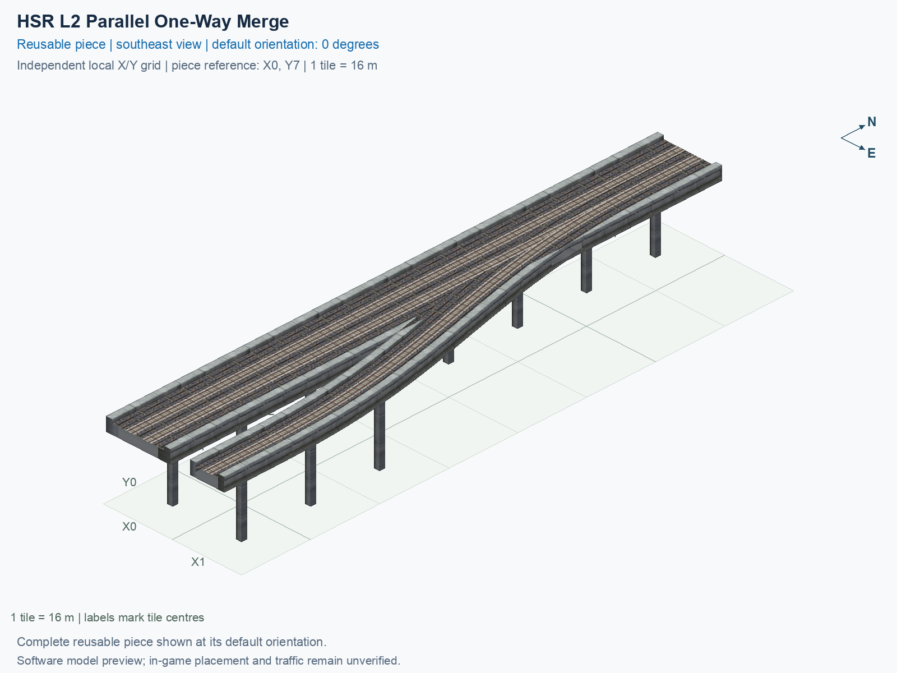

# HSR L2 Parallel One-Way Merge

Purpose: explain this reusable piece, its matching connections and current test coverage.

<!-- BEGIN PIECE OVERVIEW -->

A parallel one-way track one tile to the right merges into the forward track of the straight two-track mainline.

Exact reusable identifier: `hsr-component-lower-zero-turn-merge`.

Footprint: **2 × 8 tiles**. Exact menu name: **HSR L2 Parallel One-Way Merge**.

Choose this exact name in Transportation → Rail. Press Home or End to rotate; use only the supported states listed below. Join each end to a matching port profile and direction.

- [Connections and journeys](#connections-and-journeys)
- [Test checklist](#test-checklist)



<!-- END PIECE OVERVIEW -->

<!-- BEGIN MANUAL SUMMARY -->

## Manual status

Generated from [the exact test cases](#test-checklist) and [authoritative observations](checks/manual-tests.json).

- [ ] Preview review: 0/1 applicable cases passed; 0 failed, 0 stale.
- [ ] In-game rendering: 0/4 applicable cases passed; 0 failed, 0 stale.
- [ ] Directed journeys: 0/12 applicable cases passed; 0 failed, 0 stale.

These observations cover only the named services, directions, poses, rotations, and recorded platforms.

<!-- END MANUAL SUMMARY -->

<!-- BEGIN CONNECTIONS -->

## Connections and journeys

Purpose: describe intrinsic directional interfaces and permitted service journeys.

Generated from [connections.json](connections.json). Coordinates are canonical east, north and height in metres. A connection class names an encoded route interface; it does not prove visible deck/wall fit or an in-game test.

Supported placement states: 0° CCW, 90° CCW, 180° CCW, 270° CCW. Each state has its own declared manual scope.

A **port** is one directional transport-path endpoint. **Service** identifies the intended network service (for example HSR, street, or tram); **engine** is its internal traffic-class number, separate from the construction network. **Role** distinguishes primary service from auxiliary paths; sharing a traffic class does not establish service compatibility.

A **tangent** is a unit travel-direction vector: `[0,1]` means north. **Grade** is height gained per horizontal metre. These measured facts describe this subject alone. Compatibility requires a separate comparison of the complete joining boundaries; physical seams and actual game operation require their own evidence. See the [class index](../../connection-classes.json) for shared route-interface membership.

| Port | Service / engine / role | Direction | Location; tangent; grade | Connection class |
| --- | --- | --- | --- | --- |
| `Sout` | hsr / 7 / primary | out | [-2.0, -120.0, 15.5]; [0.0, -1.0]; 0.0 | `path-interface-12d12be31d2057c5763d` |
| `Nin` | hsr / 7 / primary | in | [-2.0, 8.0, 15.5]; [0.0, -1.0]; 0.0 | `path-interface-12d12be31d2057c5763d` |
| `Sin` | hsr / 7 / primary | in | [2.0, -120.0, 15.5]; [0.0, 1.0]; 0.0 | `path-interface-fba09fbeb87ad95c667a` |
| `Nout` | hsr / 7 / primary | out | [2.0, 8.0, 15.5]; [0.0, 1.0]; 0.0 | `path-interface-fba09fbeb87ad95c667a` |
| `Bin` | hsr / 7 / primary | in | [16.0, -120.0, 15.5]; [0.0, 1.0]; 0.0 | `path-interface-ac60d237d23f01143255` |

### Directed journeys

| Service | Entry → exit | Role |
| --- | --- | --- |
| hsr | `Nin` → `Sout` | primary |
| hsr | `Sin` → `Nout` | primary |
| hsr | `Bin` → `Nout` | primary |

### Forbidden transfers

| From service / port | To service / port | Reason |
| --- | --- | --- |
| hsr / `Nin` | hsr / `Nout` | No directed route exists between these ports in the saved piece transport paths. In-game confirmation remains unverified. |
| hsr / `Sin` | hsr / `Sout` | No directed route exists between these ports in the saved piece transport paths. In-game confirmation remains unverified. |
| hsr / `Bin` | hsr / `Sout` | No directed route exists between these ports in the saved piece transport paths. In-game confirmation remains unverified. |

Review the test checklist for the exact tested cases and environments.

<!-- END CONNECTIONS -->

<!-- BEGIN MANUAL CHECKS -->

## Test checklist

Generated from [the authoritative record](checks/manual-tests.json). Only explicit human observations create manual passes; software and preview checks remain separate. Expand a check/service group to see its rotation table, then expand the matching exact scope to copy a case ID and inspect its pose, reviewer, environment, and evidence. Grouping changes only this view; every declared case remains separate.

**States:** [x] passed; [ ] unverified, failed, or stale; N/A is an explicit inapplicable declaration. A dash means no case was declared in that column. Every pass covers only its recorded environment. T means a distinct construction-transposed state.

Four proper rotations are covered. No additional reflected state is established by this record; repeated construction aliases do not create new orientations.

Current totals: unverified: 43, passed: 0, failed: 0, stale: 0, not_applicable: 0.

### Record an observation

Follow the [shared testing guide](../../../../docs/TESTING.md); copy [the unconfirmed example](checks/observation.example.json) to `checks/observation.json`. Case identifiers are in the expandable sections below. Do not edit generated checkboxes.

From the repository folder containing `custom-pieces`, run after filling `checks/observation.json` and explicitly confirming the exact observation:

```sh
python3 -m scp.content record --record custom-pieces/domains/high-speed-rail/00_pieces/hsr-component-lower-zero-turn-merge/checks/manual-tests.json --observation custom-pieces/domains/high-speed-rail/00_pieces/hsr-component-lower-zero-turn-merge/checks/observation.json
```

### Detailed current checks

Each collapsed group shows exact case counts and states. Forbidden transfers are grouped by the directed service pair; the table inside retains every port pair and rotation.

<details>
<summary>Compiled resources — Whole subject — 1 case; unverified: 1</summary>

| Check / exact scope | General | 0° | 90° | 180° | 270° |
| --- | --- | --- | --- | --- | --- |
| **Compiled resources**<br>Whole subject | <a href="#case-software_resources-60161a191a66dd48239d">[ ] unverified</a> | — | — | — | — |


<details>
<summary>Compiled resources — Whole subject</summary>

<a id="case-software_resources-60161a191a66dd48239d"></a>

**General: unverified** — `software_resources-60161a191a66dd48239d`.

Verify the actual compiled resources and construction rules.

Scope: Whole subject.

No observation recorded.

</details>

</details>

<details>
<summary>Directed routing graph — Whole subject — 1 case; unverified: 1</summary>

| Check / exact scope | General | 0° | 90° | 180° | 270° |
| --- | --- | --- | --- | --- | --- |
| **Directed routing graph**<br>Whole subject | <a href="#case-software_connectivity-60161a191a66dd48239d">[ ] unverified</a> | — | — | — | — |


<details>
<summary>Directed routing graph — Whole subject</summary>

<a id="case-software_connectivity-60161a191a66dd48239d"></a>

**General: unverified** — `software_connectivity-60161a191a66dd48239d`.

Verify the declared directed journeys and forbidden transfers.

Scope: Whole subject.

No observation recorded.

</details>

</details>

<details>
<summary>Preview review — Images — 1 case; unverified: 1</summary>

| Check / exact scope | General | 0° | 90° | 180° | 270° |
| --- | --- | --- | --- | --- | --- |
| **Preview review**<br>Image: image:hsr-component-lower-zero-turn-merge:canonical-southeast | <a href="#case-preview_review-03898ac8eeb0e6b1f184">[ ] unverified</a> | — | — | — | — |


<details>
<summary>Preview review — Image: image:hsr-component-lower-zero-turn-merge:canonical-southeast</summary>

<a id="case-preview_review-03898ac8eeb0e6b1f184"></a>

**General: unverified** — `preview_review-03898ac8eeb0e6b1f184`.

Inspect this exact preview for tracks, walls, piers, seams and shadows.

Scope: Image: image:hsr-component-lower-zero-turn-merge:canonical-southeast.

No observation recorded.

</details>

</details>

<details>
<summary>In-game rendering — Whole subject — 4 cases; unverified: 4</summary>

| Check / exact scope | General | 0° | 90° | 180° | 270° |
| --- | --- | --- | --- | --- | --- |
| **In-game rendering**<br>Whole subject | — | <a href="#case-in_game_render-b49785a4eea1acbc0bd0">[ ] unverified</a> | <a href="#case-in_game_render-a5c1ff7c12997f88d00a">[ ] unverified</a> | <a href="#case-in_game_render-601563ae7108b847a9a4">[ ] unverified</a> | <a href="#case-in_game_render-77b0d41ef7e54aa1e47d">[ ] unverified</a> |


<details>
<summary>In-game rendering — Whole subject</summary>

<a id="case-in_game_render-b49785a4eea1acbc0bd0"></a>

**0° CCW: unverified** — `in_game_render-b49785a4eea1acbc0bd0`.

Inspect the placed tracks, walls, piers, seams and shadows in SimCity 4.

Scope: Whole subject.

No observation recorded.

<a id="case-in_game_render-a5c1ff7c12997f88d00a"></a>

**90° CCW: unverified** — `in_game_render-a5c1ff7c12997f88d00a`.

Inspect the placed tracks, walls, piers, seams and shadows in SimCity 4.

Scope: Whole subject.

No observation recorded.

<a id="case-in_game_render-601563ae7108b847a9a4"></a>

**180° CCW: unverified** — `in_game_render-601563ae7108b847a9a4`.

Inspect the placed tracks, walls, piers, seams and shadows in SimCity 4.

Scope: Whole subject.

No observation recorded.

<a id="case-in_game_render-77b0d41ef7e54aa1e47d"></a>

**270° CCW: unverified** — `in_game_render-77b0d41ef7e54aa1e47d`.

Inspect the placed tracks, walls, piers, seams and shadows in SimCity 4.

Scope: Whole subject.

No observation recorded.

</details>

</details>

<details>
<summary>Placement — Whole subject — 4 cases; unverified: 4</summary>

| Check / exact scope | General | 0° | 90° | 180° | 270° |
| --- | --- | --- | --- | --- | --- |
| **Placement**<br>Whole subject | — | <a href="#case-in_game_placement-b49785a4eea1acbc0bd0">[ ] unverified</a> | <a href="#case-in_game_placement-a5c1ff7c12997f88d00a">[ ] unverified</a> | <a href="#case-in_game_placement-601563ae7108b847a9a4">[ ] unverified</a> | <a href="#case-in_game_placement-77b0d41ef7e54aa1e47d">[ ] unverified</a> |


<details>
<summary>Placement — Whole subject</summary>

<a id="case-in_game_placement-b49785a4eea1acbc0bd0"></a>

**0° CCW: unverified** — `in_game_placement-b49785a4eea1acbc0bd0`.

Place this piece or complete blueprint and inspect every occupied tile.

Scope: Whole subject.

No observation recorded.

<a id="case-in_game_placement-a5c1ff7c12997f88d00a"></a>

**90° CCW: unverified** — `in_game_placement-a5c1ff7c12997f88d00a`.

Place this piece or complete blueprint and inspect every occupied tile.

Scope: Whole subject.

No observation recorded.

<a id="case-in_game_placement-601563ae7108b847a9a4"></a>

**180° CCW: unverified** — `in_game_placement-601563ae7108b847a9a4`.

Place this piece or complete blueprint and inspect every occupied tile.

Scope: Whole subject.

No observation recorded.

<a id="case-in_game_placement-77b0d41ef7e54aa1e47d"></a>

**270° CCW: unverified** — `in_game_placement-77b0d41ef7e54aa1e47d`.

Place this piece or complete blueprint and inspect every occupied tile.

Scope: Whole subject.

No observation recorded.

</details>

</details>

<details>
<summary>Demolition — Whole subject — 4 cases; unverified: 4</summary>

| Check / exact scope | General | 0° | 90° | 180° | 270° |
| --- | --- | --- | --- | --- | --- |
| **Demolition**<br>Whole subject | — | <a href="#case-in_game_demolition-b49785a4eea1acbc0bd0">[ ] unverified</a> | <a href="#case-in_game_demolition-a5c1ff7c12997f88d00a">[ ] unverified</a> | <a href="#case-in_game_demolition-601563ae7108b847a9a4">[ ] unverified</a> | <a href="#case-in_game_demolition-77b0d41ef7e54aa1e47d">[ ] unverified</a> |


<details>
<summary>Demolition — Whole subject</summary>

<a id="case-in_game_demolition-b49785a4eea1acbc0bd0"></a>

**0° CCW: unverified** — `in_game_demolition-b49785a4eea1acbc0bd0`.

Bulldoze the complete placement and inspect the cleared area.

Scope: Whole subject.

No observation recorded.

<a id="case-in_game_demolition-a5c1ff7c12997f88d00a"></a>

**90° CCW: unverified** — `in_game_demolition-a5c1ff7c12997f88d00a`.

Bulldoze the complete placement and inspect the cleared area.

Scope: Whole subject.

No observation recorded.

<a id="case-in_game_demolition-601563ae7108b847a9a4"></a>

**180° CCW: unverified** — `in_game_demolition-601563ae7108b847a9a4`.

Bulldoze the complete placement and inspect the cleared area.

Scope: Whole subject.

No observation recorded.

<a id="case-in_game_demolition-77b0d41ef7e54aa1e47d"></a>

**270° CCW: unverified** — `in_game_demolition-77b0d41ef7e54aa1e47d`.

Bulldoze the complete placement and inspect the cleared area.

Scope: Whole subject.

No observation recorded.

</details>

</details>

<details>
<summary>Save and reload — Whole subject — 4 cases; unverified: 4</summary>

| Check / exact scope | General | 0° | 90° | 180° | 270° |
| --- | --- | --- | --- | --- | --- |
| **Save and reload**<br>Whole subject | — | <a href="#case-in_game_save_reload-b49785a4eea1acbc0bd0">[ ] unverified</a> | <a href="#case-in_game_save_reload-a5c1ff7c12997f88d00a">[ ] unverified</a> | <a href="#case-in_game_save_reload-601563ae7108b847a9a4">[ ] unverified</a> | <a href="#case-in_game_save_reload-77b0d41ef7e54aa1e47d">[ ] unverified</a> |


<details>
<summary>Save and reload — Whole subject</summary>

<a id="case-in_game_save_reload-b49785a4eea1acbc0bd0"></a>

**0° CCW: unverified** — `in_game_save_reload-b49785a4eea1acbc0bd0`.

Save, quit, reload and inspect the placement and its paths.

Scope: Whole subject.

No observation recorded.

<a id="case-in_game_save_reload-a5c1ff7c12997f88d00a"></a>

**90° CCW: unverified** — `in_game_save_reload-a5c1ff7c12997f88d00a`.

Save, quit, reload and inspect the placement and its paths.

Scope: Whole subject.

No observation recorded.

<a id="case-in_game_save_reload-601563ae7108b847a9a4"></a>

**180° CCW: unverified** — `in_game_save_reload-601563ae7108b847a9a4`.

Save, quit, reload and inspect the placement and its paths.

Scope: Whole subject.

No observation recorded.

<a id="case-in_game_save_reload-77b0d41ef7e54aa1e47d"></a>

**270° CCW: unverified** — `in_game_save_reload-77b0d41ef7e54aa1e47d`.

Save, quit, reload and inspect the placement and its paths.

Scope: Whole subject.

No observation recorded.

</details>

</details>

<details>
<summary>Journey — hsr — 12 cases; unverified: 12</summary>

| Check / exact scope | General | 0° | 90° | 180° | 270° |
| --- | --- | --- | --- | --- | --- |
| **Journey**<br>Service: hsr; role: primary; journey: 7:Nin>Sout; entry: Nin; exit: Sout | — | <a href="#case-in_game_journey-4b005fdf2f36a2198ff4">[ ] unverified</a> | <a href="#case-in_game_journey-755f1c158e1c0ee0daf2">[ ] unverified</a> | <a href="#case-in_game_journey-a549a635eee4a20a737c">[ ] unverified</a> | <a href="#case-in_game_journey-873d114f040cf4ceecd8">[ ] unverified</a> |
| **Journey**<br>Service: hsr; role: primary; journey: 7:Sin>Nout; entry: Sin; exit: Nout | — | <a href="#case-in_game_journey-7c86b57c9597dd43e8f1">[ ] unverified</a> | <a href="#case-in_game_journey-bb72646c90973d4f2193">[ ] unverified</a> | <a href="#case-in_game_journey-0b26c81cf00c6b574ebe">[ ] unverified</a> | <a href="#case-in_game_journey-ffc342f3bee7184c818e">[ ] unverified</a> |
| **Journey**<br>Service: hsr; role: primary; journey: 7:Bin>Nout; entry: Bin; exit: Nout | — | <a href="#case-in_game_journey-1518dd1186bc1fffea25">[ ] unverified</a> | <a href="#case-in_game_journey-a25c3c6d0b3ff5823da9">[ ] unverified</a> | <a href="#case-in_game_journey-8e4cc968e355e974f1c5">[ ] unverified</a> | <a href="#case-in_game_journey-c83667e5e3203c1a4eaa">[ ] unverified</a> |


<details>
<summary>Journey — Service: hsr; role: primary; journey: 7:Nin>Sout; entry: Nin; exit: Sout</summary>

<a id="case-in_game_journey-4b005fdf2f36a2198ff4"></a>

**0° CCW: unverified** — `in_game_journey-4b005fdf2f36a2198ff4`.

Run the declared journey in this direction using its service network.

Scope: Service: hsr; role: primary; journey: 7:Nin>Sout; entry: Nin; exit: Sout.

No observation recorded.

<a id="case-in_game_journey-755f1c158e1c0ee0daf2"></a>

**90° CCW: unverified** — `in_game_journey-755f1c158e1c0ee0daf2`.

Run the declared journey in this direction using its service network.

Scope: Service: hsr; role: primary; journey: 7:Nin>Sout; entry: Nin; exit: Sout.

No observation recorded.

<a id="case-in_game_journey-a549a635eee4a20a737c"></a>

**180° CCW: unverified** — `in_game_journey-a549a635eee4a20a737c`.

Run the declared journey in this direction using its service network.

Scope: Service: hsr; role: primary; journey: 7:Nin>Sout; entry: Nin; exit: Sout.

No observation recorded.

<a id="case-in_game_journey-873d114f040cf4ceecd8"></a>

**270° CCW: unverified** — `in_game_journey-873d114f040cf4ceecd8`.

Run the declared journey in this direction using its service network.

Scope: Service: hsr; role: primary; journey: 7:Nin>Sout; entry: Nin; exit: Sout.

No observation recorded.

</details>


<details>
<summary>Journey — Service: hsr; role: primary; journey: 7:Sin>Nout; entry: Sin; exit: Nout</summary>

<a id="case-in_game_journey-7c86b57c9597dd43e8f1"></a>

**0° CCW: unverified** — `in_game_journey-7c86b57c9597dd43e8f1`.

Run the declared journey in this direction using its service network.

Scope: Service: hsr; role: primary; journey: 7:Sin>Nout; entry: Sin; exit: Nout.

No observation recorded.

<a id="case-in_game_journey-bb72646c90973d4f2193"></a>

**90° CCW: unverified** — `in_game_journey-bb72646c90973d4f2193`.

Run the declared journey in this direction using its service network.

Scope: Service: hsr; role: primary; journey: 7:Sin>Nout; entry: Sin; exit: Nout.

No observation recorded.

<a id="case-in_game_journey-0b26c81cf00c6b574ebe"></a>

**180° CCW: unverified** — `in_game_journey-0b26c81cf00c6b574ebe`.

Run the declared journey in this direction using its service network.

Scope: Service: hsr; role: primary; journey: 7:Sin>Nout; entry: Sin; exit: Nout.

No observation recorded.

<a id="case-in_game_journey-ffc342f3bee7184c818e"></a>

**270° CCW: unverified** — `in_game_journey-ffc342f3bee7184c818e`.

Run the declared journey in this direction using its service network.

Scope: Service: hsr; role: primary; journey: 7:Sin>Nout; entry: Sin; exit: Nout.

No observation recorded.

</details>


<details>
<summary>Journey — Service: hsr; role: primary; journey: 7:Bin>Nout; entry: Bin; exit: Nout</summary>

<a id="case-in_game_journey-1518dd1186bc1fffea25"></a>

**0° CCW: unverified** — `in_game_journey-1518dd1186bc1fffea25`.

Run the declared journey in this direction using its service network.

Scope: Service: hsr; role: primary; journey: 7:Bin>Nout; entry: Bin; exit: Nout.

No observation recorded.

<a id="case-in_game_journey-a25c3c6d0b3ff5823da9"></a>

**90° CCW: unverified** — `in_game_journey-a25c3c6d0b3ff5823da9`.

Run the declared journey in this direction using its service network.

Scope: Service: hsr; role: primary; journey: 7:Bin>Nout; entry: Bin; exit: Nout.

No observation recorded.

<a id="case-in_game_journey-8e4cc968e355e974f1c5"></a>

**180° CCW: unverified** — `in_game_journey-8e4cc968e355e974f1c5`.

Run the declared journey in this direction using its service network.

Scope: Service: hsr; role: primary; journey: 7:Bin>Nout; entry: Bin; exit: Nout.

No observation recorded.

<a id="case-in_game_journey-c83667e5e3203c1a4eaa"></a>

**270° CCW: unverified** — `in_game_journey-c83667e5e3203c1a4eaa`.

Run the declared journey in this direction using its service network.

Scope: Service: hsr; role: primary; journey: 7:Bin>Nout; entry: Bin; exit: Nout.

No observation recorded.

</details>

</details>

<details>
<summary>Forbidden transfer — hsr → hsr — 12 cases; unverified: 12</summary>

| Check / exact scope | General | 0° | 90° | 180° | 270° |
| --- | --- | --- | --- | --- | --- |
| **Forbidden transfer**<br>from port: Nin; to port: Nout; from service: hsr; to service: hsr; basis: not reachable in actual saved PATH graph | — | <a href="#case-in_game_forbidden_transfer-9e4cea06521c5c8483cd">[ ] unverified</a> | <a href="#case-in_game_forbidden_transfer-1bad7bd66e57a6e6c5bc">[ ] unverified</a> | <a href="#case-in_game_forbidden_transfer-1b29aa74e440c245a69a">[ ] unverified</a> | <a href="#case-in_game_forbidden_transfer-93ed6f4792af7ac1ae98">[ ] unverified</a> |
| **Forbidden transfer**<br>from port: Sin; to port: Sout; from service: hsr; to service: hsr; basis: not reachable in actual saved PATH graph | — | <a href="#case-in_game_forbidden_transfer-e6e3802d541ce96c0004">[ ] unverified</a> | <a href="#case-in_game_forbidden_transfer-6e18b90dbfcd83b8465d">[ ] unverified</a> | <a href="#case-in_game_forbidden_transfer-b6e45e212748de852ac1">[ ] unverified</a> | <a href="#case-in_game_forbidden_transfer-36c613bd88919cb4f893">[ ] unverified</a> |
| **Forbidden transfer**<br>from port: Bin; to port: Sout; from service: hsr; to service: hsr; basis: not reachable in actual saved PATH graph | — | <a href="#case-in_game_forbidden_transfer-8fc5c1cd1b6c59f557a1">[ ] unverified</a> | <a href="#case-in_game_forbidden_transfer-210913f4be051d68ec20">[ ] unverified</a> | <a href="#case-in_game_forbidden_transfer-5e7872b5c83d77624b3b">[ ] unverified</a> | <a href="#case-in_game_forbidden_transfer-32c2280880b41775c631">[ ] unverified</a> |


<details>
<summary>Forbidden transfer — from port: Nin; to port: Nout; from service: hsr; to service: hsr; basis: not reachable in actual saved PATH graph</summary>

<a id="case-in_game_forbidden_transfer-9e4cea06521c5c8483cd"></a>

**0° CCW: unverified** — `in_game_forbidden_transfer-9e4cea06521c5c8483cd`.

Confirm this undeclared transfer is unavailable.

Scope: from port: Nin; to port: Nout; from service: hsr; to service: hsr; basis: not reachable in actual saved PATH graph.

No observation recorded.

<a id="case-in_game_forbidden_transfer-1bad7bd66e57a6e6c5bc"></a>

**90° CCW: unverified** — `in_game_forbidden_transfer-1bad7bd66e57a6e6c5bc`.

Confirm this undeclared transfer is unavailable.

Scope: from port: Nin; to port: Nout; from service: hsr; to service: hsr; basis: not reachable in actual saved PATH graph.

No observation recorded.

<a id="case-in_game_forbidden_transfer-1b29aa74e440c245a69a"></a>

**180° CCW: unverified** — `in_game_forbidden_transfer-1b29aa74e440c245a69a`.

Confirm this undeclared transfer is unavailable.

Scope: from port: Nin; to port: Nout; from service: hsr; to service: hsr; basis: not reachable in actual saved PATH graph.

No observation recorded.

<a id="case-in_game_forbidden_transfer-93ed6f4792af7ac1ae98"></a>

**270° CCW: unverified** — `in_game_forbidden_transfer-93ed6f4792af7ac1ae98`.

Confirm this undeclared transfer is unavailable.

Scope: from port: Nin; to port: Nout; from service: hsr; to service: hsr; basis: not reachable in actual saved PATH graph.

No observation recorded.

</details>


<details>
<summary>Forbidden transfer — from port: Sin; to port: Sout; from service: hsr; to service: hsr; basis: not reachable in actual saved PATH graph</summary>

<a id="case-in_game_forbidden_transfer-e6e3802d541ce96c0004"></a>

**0° CCW: unverified** — `in_game_forbidden_transfer-e6e3802d541ce96c0004`.

Confirm this undeclared transfer is unavailable.

Scope: from port: Sin; to port: Sout; from service: hsr; to service: hsr; basis: not reachable in actual saved PATH graph.

No observation recorded.

<a id="case-in_game_forbidden_transfer-6e18b90dbfcd83b8465d"></a>

**90° CCW: unverified** — `in_game_forbidden_transfer-6e18b90dbfcd83b8465d`.

Confirm this undeclared transfer is unavailable.

Scope: from port: Sin; to port: Sout; from service: hsr; to service: hsr; basis: not reachable in actual saved PATH graph.

No observation recorded.

<a id="case-in_game_forbidden_transfer-b6e45e212748de852ac1"></a>

**180° CCW: unverified** — `in_game_forbidden_transfer-b6e45e212748de852ac1`.

Confirm this undeclared transfer is unavailable.

Scope: from port: Sin; to port: Sout; from service: hsr; to service: hsr; basis: not reachable in actual saved PATH graph.

No observation recorded.

<a id="case-in_game_forbidden_transfer-36c613bd88919cb4f893"></a>

**270° CCW: unverified** — `in_game_forbidden_transfer-36c613bd88919cb4f893`.

Confirm this undeclared transfer is unavailable.

Scope: from port: Sin; to port: Sout; from service: hsr; to service: hsr; basis: not reachable in actual saved PATH graph.

No observation recorded.

</details>


<details>
<summary>Forbidden transfer — from port: Bin; to port: Sout; from service: hsr; to service: hsr; basis: not reachable in actual saved PATH graph</summary>

<a id="case-in_game_forbidden_transfer-8fc5c1cd1b6c59f557a1"></a>

**0° CCW: unverified** — `in_game_forbidden_transfer-8fc5c1cd1b6c59f557a1`.

Confirm this undeclared transfer is unavailable.

Scope: from port: Bin; to port: Sout; from service: hsr; to service: hsr; basis: not reachable in actual saved PATH graph.

No observation recorded.

<a id="case-in_game_forbidden_transfer-210913f4be051d68ec20"></a>

**90° CCW: unverified** — `in_game_forbidden_transfer-210913f4be051d68ec20`.

Confirm this undeclared transfer is unavailable.

Scope: from port: Bin; to port: Sout; from service: hsr; to service: hsr; basis: not reachable in actual saved PATH graph.

No observation recorded.

<a id="case-in_game_forbidden_transfer-5e7872b5c83d77624b3b"></a>

**180° CCW: unverified** — `in_game_forbidden_transfer-5e7872b5c83d77624b3b`.

Confirm this undeclared transfer is unavailable.

Scope: from port: Bin; to port: Sout; from service: hsr; to service: hsr; basis: not reachable in actual saved PATH graph.

No observation recorded.

<a id="case-in_game_forbidden_transfer-32c2280880b41775c631"></a>

**270° CCW: unverified** — `in_game_forbidden_transfer-32c2280880b41775c631`.

Confirm this undeclared transfer is unavailable.

Scope: from port: Bin; to port: Sout; from service: hsr; to service: hsr; basis: not reachable in actual saved PATH graph.

No observation recorded.

</details>

</details>

<!-- END MANUAL CHECKS -->
