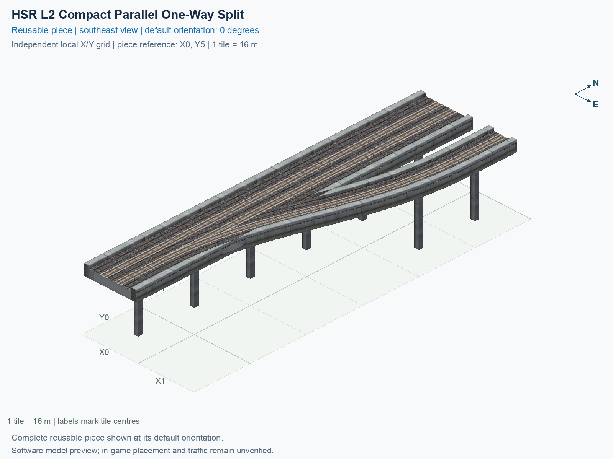

# HSR L2 Compact Parallel One-Way Split

Purpose: explain this reusable piece, its matching connections and current test coverage.

<!-- BEGIN PIECE OVERVIEW -->

A 96 m long turnout separates the forward track into a parallel one-way track one tile to the right; the opposite mainline track remains straight.

Exact reusable identifier: `hsr-component-lower-zero-turn-split-compact`.

Footprint: **2 × 6 tiles**. Exact menu name: **HSR L2 Compact Parallel One-Way Split**.

Choose this exact name in Transportation → Rail. Press Home or End to rotate; use only the supported states listed below. Join each end to a matching port profile and direction.

- [Connections and journeys](#connections-and-journeys)
- [Test checklist](#test-checklist)



<!-- END PIECE OVERVIEW -->

<!-- BEGIN MANUAL SUMMARY -->

## Manual status

Generated from [the exact test cases](#test-checklist) and [authoritative observations](checks/manual-tests.json).

- [ ] Preview review: 0/1 applicable cases passed; 0 failed, 0 stale.
- [ ] In-game rendering: 0/4 applicable cases passed; 0 failed, 0 stale.
- [ ] Directed journeys: 0/12 applicable cases passed; 0 failed, 0 stale.

These observations cover only the named services, directions, poses, rotations, and recorded platforms.

<!-- END MANUAL SUMMARY -->

<!-- BEGIN CONNECTIONS -->

## Connections and journeys

Purpose: describe intrinsic directional interfaces and permitted service journeys.

Generated from [connections.json](connections.json). Coordinates are canonical east, north and height in metres. A connection class names an encoded route interface; it does not prove visible deck/wall fit or an in-game test.

Supported placement states: 0° CCW, 90° CCW, 180° CCW, 270° CCW. Each state has its own declared manual scope.

A **port** is one directional transport-path endpoint. **Service** identifies the intended network service (for example HSR, street, or tram); **engine** is its internal traffic-class number, separate from the construction network. **Role** distinguishes primary service from auxiliary paths; sharing a traffic class does not establish service compatibility.

A **tangent** is a unit travel-direction vector: `[0,1]` means north. **Grade** is height gained per horizontal metre. These measured facts describe this subject alone. Compatibility requires a separate comparison of the complete joining boundaries; physical seams and actual game operation require their own evidence. See the [class index](../../connection-classes.json) for shared route-interface membership.

| Port | Service / engine / role | Direction | Location; tangent; grade | Connection class |
| --- | --- | --- | --- | --- |
| `Sout` | hsr / 7 / primary | out | [-2.0, -88.0, 15.5]; [0.0, -1.0]; 0.0 | `path-interface-12d12be31d2057c5763d` |
| `Nin` | hsr / 7 / primary | in | [-2.0, 8.0, 15.5]; [0.0, -1.0]; 0.0 | `path-interface-12d12be31d2057c5763d` |
| `Sin` | hsr / 7 / primary | in | [2.0, -88.0, 15.5]; [0.0, 1.0]; 0.0 | `path-interface-fba09fbeb87ad95c667a` |
| `Nout` | hsr / 7 / primary | out | [2.0, 8.0, 15.5]; [0.0, 1.0]; 0.0 | `path-interface-fba09fbeb87ad95c667a` |
| `Bout` | hsr / 7 / primary | out | [16.0, 8.0, 15.5]; [0.0, 1.0]; 0.0 | `path-interface-ac60d237d23f01143255` |

### Directed journeys

| Service | Entry → exit | Role |
| --- | --- | --- |
| hsr | `Nin` → `Sout` | primary |
| hsr | `Sin` → `Bout` | primary |
| hsr | `Sin` → `Nout` | primary |

### Forbidden transfers

| From service / port | To service / port | Reason |
| --- | --- | --- |
| hsr / `Nin` | hsr / `Nout` | No directed route exists between these ports in the saved piece transport paths. In-game confirmation remains unverified. |
| hsr / `Nin` | hsr / `Bout` | No directed route exists between these ports in the saved piece transport paths. In-game confirmation remains unverified. |
| hsr / `Sin` | hsr / `Sout` | No directed route exists between these ports in the saved piece transport paths. In-game confirmation remains unverified. |

Review the test checklist for the exact tested cases and environments.

<!-- END CONNECTIONS -->

<!-- BEGIN MANUAL CHECKS -->

## Test checklist

Generated from [the authoritative record](checks/manual-tests.json). Only explicit human observations create manual passes; software and preview checks remain separate. Expand a check/service group to see its rotation table, then expand the matching exact scope to copy a case ID and inspect its pose, reviewer, environment, and evidence. Grouping changes only this view; every declared case remains separate.

**States:** [x] passed; [ ] unverified, failed, or stale; N/A is an explicit inapplicable declaration. A dash means no case was declared in that column. Every pass covers only its recorded environment. T means a distinct construction-transposed state.

Four proper rotations are covered. No additional reflected state is established by this record; repeated construction aliases do not create new orientations.

Current totals: unverified: 43, passed: 0, failed: 0, stale: 0, not_applicable: 0.

### Record an observation

Follow the [shared testing guide](../../../../docs/TESTING.md); copy [the unconfirmed example](checks/observation.example.json) to `checks/observation.json`. Case identifiers are in the expandable sections below. Do not edit generated checkboxes.

From the repository folder containing `custom-pieces`, run after filling `checks/observation.json` and explicitly confirming the exact observation:

```sh
python3 -m scp.content record --record custom-pieces/domains/high-speed-rail/00_pieces/hsr-component-lower-zero-turn-split-compact/checks/manual-tests.json --observation custom-pieces/domains/high-speed-rail/00_pieces/hsr-component-lower-zero-turn-split-compact/checks/observation.json
```

### Detailed current checks

Each collapsed group shows exact case counts and states. Forbidden transfers are grouped by the directed service pair; the table inside retains every port pair and rotation.

<details>
<summary>Compiled resources — Whole subject — 1 case; unverified: 1</summary>

| Check / exact scope | General | 0° | 90° | 180° | 270° |
| --- | --- | --- | --- | --- | --- |
| **Compiled resources**<br>Whole subject | <a href="#case-software_resources-2457112a712b2a384782">[ ] unverified</a> | — | — | — | — |


<details>
<summary>Compiled resources — Whole subject</summary>

<a id="case-software_resources-2457112a712b2a384782"></a>

**General: unverified** — `software_resources-2457112a712b2a384782`.

Verify the actual compiled resources and construction rules.

Scope: Whole subject.

No observation recorded.

</details>

</details>

<details>
<summary>Directed routing graph — Whole subject — 1 case; unverified: 1</summary>

| Check / exact scope | General | 0° | 90° | 180° | 270° |
| --- | --- | --- | --- | --- | --- |
| **Directed routing graph**<br>Whole subject | <a href="#case-software_connectivity-2457112a712b2a384782">[ ] unverified</a> | — | — | — | — |


<details>
<summary>Directed routing graph — Whole subject</summary>

<a id="case-software_connectivity-2457112a712b2a384782"></a>

**General: unverified** — `software_connectivity-2457112a712b2a384782`.

Verify the declared directed journeys and forbidden transfers.

Scope: Whole subject.

No observation recorded.

</details>

</details>

<details>
<summary>Preview review — Images — 1 case; unverified: 1</summary>

| Check / exact scope | General | 0° | 90° | 180° | 270° |
| --- | --- | --- | --- | --- | --- |
| **Preview review**<br>Image: image:hsr-component-lower-zero-turn-split-compact:canonical-southeast | <a href="#case-preview_review-3900c7326a0e28c69c66">[ ] unverified</a> | — | — | — | — |


<details>
<summary>Preview review — Image: image:hsr-component-lower-zero-turn-split-compact:canonical-southeast</summary>

<a id="case-preview_review-3900c7326a0e28c69c66"></a>

**General: unverified** — `preview_review-3900c7326a0e28c69c66`.

Inspect this exact preview for tracks, walls, piers, seams and shadows.

Scope: Image: image:hsr-component-lower-zero-turn-split-compact:canonical-southeast.

No observation recorded.

</details>

</details>

<details>
<summary>In-game rendering — Whole subject — 4 cases; unverified: 4</summary>

| Check / exact scope | General | 0° | 90° | 180° | 270° |
| --- | --- | --- | --- | --- | --- |
| **In-game rendering**<br>Whole subject | — | <a href="#case-in_game_render-7dd27c7367a8f0aad447">[ ] unverified</a> | <a href="#case-in_game_render-1af9dadaf55a04582a89">[ ] unverified</a> | <a href="#case-in_game_render-cc5c18dd601533519417">[ ] unverified</a> | <a href="#case-in_game_render-84a084dff05390ea5a54">[ ] unverified</a> |


<details>
<summary>In-game rendering — Whole subject</summary>

<a id="case-in_game_render-7dd27c7367a8f0aad447"></a>

**0° CCW: unverified** — `in_game_render-7dd27c7367a8f0aad447`.

Inspect the placed tracks, walls, piers, seams and shadows in SimCity 4.

Scope: Whole subject.

No observation recorded.

<a id="case-in_game_render-1af9dadaf55a04582a89"></a>

**90° CCW: unverified** — `in_game_render-1af9dadaf55a04582a89`.

Inspect the placed tracks, walls, piers, seams and shadows in SimCity 4.

Scope: Whole subject.

No observation recorded.

<a id="case-in_game_render-cc5c18dd601533519417"></a>

**180° CCW: unverified** — `in_game_render-cc5c18dd601533519417`.

Inspect the placed tracks, walls, piers, seams and shadows in SimCity 4.

Scope: Whole subject.

No observation recorded.

<a id="case-in_game_render-84a084dff05390ea5a54"></a>

**270° CCW: unverified** — `in_game_render-84a084dff05390ea5a54`.

Inspect the placed tracks, walls, piers, seams and shadows in SimCity 4.

Scope: Whole subject.

No observation recorded.

</details>

</details>

<details>
<summary>Placement — Whole subject — 4 cases; unverified: 4</summary>

| Check / exact scope | General | 0° | 90° | 180° | 270° |
| --- | --- | --- | --- | --- | --- |
| **Placement**<br>Whole subject | — | <a href="#case-in_game_placement-7dd27c7367a8f0aad447">[ ] unverified</a> | <a href="#case-in_game_placement-1af9dadaf55a04582a89">[ ] unverified</a> | <a href="#case-in_game_placement-cc5c18dd601533519417">[ ] unverified</a> | <a href="#case-in_game_placement-84a084dff05390ea5a54">[ ] unverified</a> |


<details>
<summary>Placement — Whole subject</summary>

<a id="case-in_game_placement-7dd27c7367a8f0aad447"></a>

**0° CCW: unverified** — `in_game_placement-7dd27c7367a8f0aad447`.

Place this piece or complete blueprint and inspect every occupied tile.

Scope: Whole subject.

No observation recorded.

<a id="case-in_game_placement-1af9dadaf55a04582a89"></a>

**90° CCW: unverified** — `in_game_placement-1af9dadaf55a04582a89`.

Place this piece or complete blueprint and inspect every occupied tile.

Scope: Whole subject.

No observation recorded.

<a id="case-in_game_placement-cc5c18dd601533519417"></a>

**180° CCW: unverified** — `in_game_placement-cc5c18dd601533519417`.

Place this piece or complete blueprint and inspect every occupied tile.

Scope: Whole subject.

No observation recorded.

<a id="case-in_game_placement-84a084dff05390ea5a54"></a>

**270° CCW: unverified** — `in_game_placement-84a084dff05390ea5a54`.

Place this piece or complete blueprint and inspect every occupied tile.

Scope: Whole subject.

No observation recorded.

</details>

</details>

<details>
<summary>Demolition — Whole subject — 4 cases; unverified: 4</summary>

| Check / exact scope | General | 0° | 90° | 180° | 270° |
| --- | --- | --- | --- | --- | --- |
| **Demolition**<br>Whole subject | — | <a href="#case-in_game_demolition-7dd27c7367a8f0aad447">[ ] unverified</a> | <a href="#case-in_game_demolition-1af9dadaf55a04582a89">[ ] unverified</a> | <a href="#case-in_game_demolition-cc5c18dd601533519417">[ ] unverified</a> | <a href="#case-in_game_demolition-84a084dff05390ea5a54">[ ] unverified</a> |


<details>
<summary>Demolition — Whole subject</summary>

<a id="case-in_game_demolition-7dd27c7367a8f0aad447"></a>

**0° CCW: unverified** — `in_game_demolition-7dd27c7367a8f0aad447`.

Bulldoze the complete placement and inspect the cleared area.

Scope: Whole subject.

No observation recorded.

<a id="case-in_game_demolition-1af9dadaf55a04582a89"></a>

**90° CCW: unverified** — `in_game_demolition-1af9dadaf55a04582a89`.

Bulldoze the complete placement and inspect the cleared area.

Scope: Whole subject.

No observation recorded.

<a id="case-in_game_demolition-cc5c18dd601533519417"></a>

**180° CCW: unverified** — `in_game_demolition-cc5c18dd601533519417`.

Bulldoze the complete placement and inspect the cleared area.

Scope: Whole subject.

No observation recorded.

<a id="case-in_game_demolition-84a084dff05390ea5a54"></a>

**270° CCW: unverified** — `in_game_demolition-84a084dff05390ea5a54`.

Bulldoze the complete placement and inspect the cleared area.

Scope: Whole subject.

No observation recorded.

</details>

</details>

<details>
<summary>Save and reload — Whole subject — 4 cases; unverified: 4</summary>

| Check / exact scope | General | 0° | 90° | 180° | 270° |
| --- | --- | --- | --- | --- | --- |
| **Save and reload**<br>Whole subject | — | <a href="#case-in_game_save_reload-7dd27c7367a8f0aad447">[ ] unverified</a> | <a href="#case-in_game_save_reload-1af9dadaf55a04582a89">[ ] unverified</a> | <a href="#case-in_game_save_reload-cc5c18dd601533519417">[ ] unverified</a> | <a href="#case-in_game_save_reload-84a084dff05390ea5a54">[ ] unverified</a> |


<details>
<summary>Save and reload — Whole subject</summary>

<a id="case-in_game_save_reload-7dd27c7367a8f0aad447"></a>

**0° CCW: unverified** — `in_game_save_reload-7dd27c7367a8f0aad447`.

Save, quit, reload and inspect the placement and its paths.

Scope: Whole subject.

No observation recorded.

<a id="case-in_game_save_reload-1af9dadaf55a04582a89"></a>

**90° CCW: unverified** — `in_game_save_reload-1af9dadaf55a04582a89`.

Save, quit, reload and inspect the placement and its paths.

Scope: Whole subject.

No observation recorded.

<a id="case-in_game_save_reload-cc5c18dd601533519417"></a>

**180° CCW: unverified** — `in_game_save_reload-cc5c18dd601533519417`.

Save, quit, reload and inspect the placement and its paths.

Scope: Whole subject.

No observation recorded.

<a id="case-in_game_save_reload-84a084dff05390ea5a54"></a>

**270° CCW: unverified** — `in_game_save_reload-84a084dff05390ea5a54`.

Save, quit, reload and inspect the placement and its paths.

Scope: Whole subject.

No observation recorded.

</details>

</details>

<details>
<summary>Journey — hsr — 12 cases; unverified: 12</summary>

| Check / exact scope | General | 0° | 90° | 180° | 270° |
| --- | --- | --- | --- | --- | --- |
| **Journey**<br>Service: hsr; role: primary; journey: 7:Nin>Sout; entry: Nin; exit: Sout | — | <a href="#case-in_game_journey-e0b259959d9d5ec5f0ec">[ ] unverified</a> | <a href="#case-in_game_journey-9098792a090a614f7b8d">[ ] unverified</a> | <a href="#case-in_game_journey-8610cd4b416695785264">[ ] unverified</a> | <a href="#case-in_game_journey-542621aeb2c929bb8740">[ ] unverified</a> |
| **Journey**<br>Service: hsr; role: primary; journey: 7:Sin>Bout; entry: Sin; exit: Bout | — | <a href="#case-in_game_journey-227f3b4b14606fb7f1c8">[ ] unverified</a> | <a href="#case-in_game_journey-147f116d501c0146c75f">[ ] unverified</a> | <a href="#case-in_game_journey-22d4e3704ca769550e8f">[ ] unverified</a> | <a href="#case-in_game_journey-84946e747b40ad5b15b7">[ ] unverified</a> |
| **Journey**<br>Service: hsr; role: primary; journey: 7:Sin>Nout; entry: Sin; exit: Nout | — | <a href="#case-in_game_journey-7edd7b359fa88a3c2d01">[ ] unverified</a> | <a href="#case-in_game_journey-4fa207efe88f1a6c9dbb">[ ] unverified</a> | <a href="#case-in_game_journey-3608aefb449aaf4cd40c">[ ] unverified</a> | <a href="#case-in_game_journey-063785e22b45dfe1733c">[ ] unverified</a> |


<details>
<summary>Journey — Service: hsr; role: primary; journey: 7:Nin>Sout; entry: Nin; exit: Sout</summary>

<a id="case-in_game_journey-e0b259959d9d5ec5f0ec"></a>

**0° CCW: unverified** — `in_game_journey-e0b259959d9d5ec5f0ec`.

Run the declared journey in this direction using its service network.

Scope: Service: hsr; role: primary; journey: 7:Nin>Sout; entry: Nin; exit: Sout.

No observation recorded.

<a id="case-in_game_journey-9098792a090a614f7b8d"></a>

**90° CCW: unverified** — `in_game_journey-9098792a090a614f7b8d`.

Run the declared journey in this direction using its service network.

Scope: Service: hsr; role: primary; journey: 7:Nin>Sout; entry: Nin; exit: Sout.

No observation recorded.

<a id="case-in_game_journey-8610cd4b416695785264"></a>

**180° CCW: unverified** — `in_game_journey-8610cd4b416695785264`.

Run the declared journey in this direction using its service network.

Scope: Service: hsr; role: primary; journey: 7:Nin>Sout; entry: Nin; exit: Sout.

No observation recorded.

<a id="case-in_game_journey-542621aeb2c929bb8740"></a>

**270° CCW: unverified** — `in_game_journey-542621aeb2c929bb8740`.

Run the declared journey in this direction using its service network.

Scope: Service: hsr; role: primary; journey: 7:Nin>Sout; entry: Nin; exit: Sout.

No observation recorded.

</details>


<details>
<summary>Journey — Service: hsr; role: primary; journey: 7:Sin>Bout; entry: Sin; exit: Bout</summary>

<a id="case-in_game_journey-227f3b4b14606fb7f1c8"></a>

**0° CCW: unverified** — `in_game_journey-227f3b4b14606fb7f1c8`.

Run the declared journey in this direction using its service network.

Scope: Service: hsr; role: primary; journey: 7:Sin>Bout; entry: Sin; exit: Bout.

No observation recorded.

<a id="case-in_game_journey-147f116d501c0146c75f"></a>

**90° CCW: unverified** — `in_game_journey-147f116d501c0146c75f`.

Run the declared journey in this direction using its service network.

Scope: Service: hsr; role: primary; journey: 7:Sin>Bout; entry: Sin; exit: Bout.

No observation recorded.

<a id="case-in_game_journey-22d4e3704ca769550e8f"></a>

**180° CCW: unverified** — `in_game_journey-22d4e3704ca769550e8f`.

Run the declared journey in this direction using its service network.

Scope: Service: hsr; role: primary; journey: 7:Sin>Bout; entry: Sin; exit: Bout.

No observation recorded.

<a id="case-in_game_journey-84946e747b40ad5b15b7"></a>

**270° CCW: unverified** — `in_game_journey-84946e747b40ad5b15b7`.

Run the declared journey in this direction using its service network.

Scope: Service: hsr; role: primary; journey: 7:Sin>Bout; entry: Sin; exit: Bout.

No observation recorded.

</details>


<details>
<summary>Journey — Service: hsr; role: primary; journey: 7:Sin>Nout; entry: Sin; exit: Nout</summary>

<a id="case-in_game_journey-7edd7b359fa88a3c2d01"></a>

**0° CCW: unverified** — `in_game_journey-7edd7b359fa88a3c2d01`.

Run the declared journey in this direction using its service network.

Scope: Service: hsr; role: primary; journey: 7:Sin>Nout; entry: Sin; exit: Nout.

No observation recorded.

<a id="case-in_game_journey-4fa207efe88f1a6c9dbb"></a>

**90° CCW: unverified** — `in_game_journey-4fa207efe88f1a6c9dbb`.

Run the declared journey in this direction using its service network.

Scope: Service: hsr; role: primary; journey: 7:Sin>Nout; entry: Sin; exit: Nout.

No observation recorded.

<a id="case-in_game_journey-3608aefb449aaf4cd40c"></a>

**180° CCW: unverified** — `in_game_journey-3608aefb449aaf4cd40c`.

Run the declared journey in this direction using its service network.

Scope: Service: hsr; role: primary; journey: 7:Sin>Nout; entry: Sin; exit: Nout.

No observation recorded.

<a id="case-in_game_journey-063785e22b45dfe1733c"></a>

**270° CCW: unverified** — `in_game_journey-063785e22b45dfe1733c`.

Run the declared journey in this direction using its service network.

Scope: Service: hsr; role: primary; journey: 7:Sin>Nout; entry: Sin; exit: Nout.

No observation recorded.

</details>

</details>

<details>
<summary>Forbidden transfer — hsr → hsr — 12 cases; unverified: 12</summary>

| Check / exact scope | General | 0° | 90° | 180° | 270° |
| --- | --- | --- | --- | --- | --- |
| **Forbidden transfer**<br>from port: Nin; to port: Nout; from service: hsr; to service: hsr; basis: not reachable in actual saved PATH graph | — | <a href="#case-in_game_forbidden_transfer-7f6a0aca69843df81e11">[ ] unverified</a> | <a href="#case-in_game_forbidden_transfer-beb71d4ad4eaac4c7fa5">[ ] unverified</a> | <a href="#case-in_game_forbidden_transfer-9c59aba2009711ae6255">[ ] unverified</a> | <a href="#case-in_game_forbidden_transfer-11ea955f0ae59849a1c0">[ ] unverified</a> |
| **Forbidden transfer**<br>from port: Nin; to port: Bout; from service: hsr; to service: hsr; basis: not reachable in actual saved PATH graph | — | <a href="#case-in_game_forbidden_transfer-53bc1e728b3e9ef7a344">[ ] unverified</a> | <a href="#case-in_game_forbidden_transfer-212d30faa95c48b5cfae">[ ] unverified</a> | <a href="#case-in_game_forbidden_transfer-4b9845c519f47fa10d4b">[ ] unverified</a> | <a href="#case-in_game_forbidden_transfer-3b70d8b4a588fd76b195">[ ] unverified</a> |
| **Forbidden transfer**<br>from port: Sin; to port: Sout; from service: hsr; to service: hsr; basis: not reachable in actual saved PATH graph | — | <a href="#case-in_game_forbidden_transfer-01675bc973a6647efb25">[ ] unverified</a> | <a href="#case-in_game_forbidden_transfer-0217d414721a22b9e20f">[ ] unverified</a> | <a href="#case-in_game_forbidden_transfer-15a6dcba7b6f1068abf8">[ ] unverified</a> | <a href="#case-in_game_forbidden_transfer-4671069aa61e5251e84b">[ ] unverified</a> |


<details>
<summary>Forbidden transfer — from port: Nin; to port: Nout; from service: hsr; to service: hsr; basis: not reachable in actual saved PATH graph</summary>

<a id="case-in_game_forbidden_transfer-7f6a0aca69843df81e11"></a>

**0° CCW: unverified** — `in_game_forbidden_transfer-7f6a0aca69843df81e11`.

Confirm this undeclared transfer is unavailable.

Scope: from port: Nin; to port: Nout; from service: hsr; to service: hsr; basis: not reachable in actual saved PATH graph.

No observation recorded.

<a id="case-in_game_forbidden_transfer-beb71d4ad4eaac4c7fa5"></a>

**90° CCW: unverified** — `in_game_forbidden_transfer-beb71d4ad4eaac4c7fa5`.

Confirm this undeclared transfer is unavailable.

Scope: from port: Nin; to port: Nout; from service: hsr; to service: hsr; basis: not reachable in actual saved PATH graph.

No observation recorded.

<a id="case-in_game_forbidden_transfer-9c59aba2009711ae6255"></a>

**180° CCW: unverified** — `in_game_forbidden_transfer-9c59aba2009711ae6255`.

Confirm this undeclared transfer is unavailable.

Scope: from port: Nin; to port: Nout; from service: hsr; to service: hsr; basis: not reachable in actual saved PATH graph.

No observation recorded.

<a id="case-in_game_forbidden_transfer-11ea955f0ae59849a1c0"></a>

**270° CCW: unverified** — `in_game_forbidden_transfer-11ea955f0ae59849a1c0`.

Confirm this undeclared transfer is unavailable.

Scope: from port: Nin; to port: Nout; from service: hsr; to service: hsr; basis: not reachable in actual saved PATH graph.

No observation recorded.

</details>


<details>
<summary>Forbidden transfer — from port: Nin; to port: Bout; from service: hsr; to service: hsr; basis: not reachable in actual saved PATH graph</summary>

<a id="case-in_game_forbidden_transfer-53bc1e728b3e9ef7a344"></a>

**0° CCW: unverified** — `in_game_forbidden_transfer-53bc1e728b3e9ef7a344`.

Confirm this undeclared transfer is unavailable.

Scope: from port: Nin; to port: Bout; from service: hsr; to service: hsr; basis: not reachable in actual saved PATH graph.

No observation recorded.

<a id="case-in_game_forbidden_transfer-212d30faa95c48b5cfae"></a>

**90° CCW: unverified** — `in_game_forbidden_transfer-212d30faa95c48b5cfae`.

Confirm this undeclared transfer is unavailable.

Scope: from port: Nin; to port: Bout; from service: hsr; to service: hsr; basis: not reachable in actual saved PATH graph.

No observation recorded.

<a id="case-in_game_forbidden_transfer-4b9845c519f47fa10d4b"></a>

**180° CCW: unverified** — `in_game_forbidden_transfer-4b9845c519f47fa10d4b`.

Confirm this undeclared transfer is unavailable.

Scope: from port: Nin; to port: Bout; from service: hsr; to service: hsr; basis: not reachable in actual saved PATH graph.

No observation recorded.

<a id="case-in_game_forbidden_transfer-3b70d8b4a588fd76b195"></a>

**270° CCW: unverified** — `in_game_forbidden_transfer-3b70d8b4a588fd76b195`.

Confirm this undeclared transfer is unavailable.

Scope: from port: Nin; to port: Bout; from service: hsr; to service: hsr; basis: not reachable in actual saved PATH graph.

No observation recorded.

</details>


<details>
<summary>Forbidden transfer — from port: Sin; to port: Sout; from service: hsr; to service: hsr; basis: not reachable in actual saved PATH graph</summary>

<a id="case-in_game_forbidden_transfer-01675bc973a6647efb25"></a>

**0° CCW: unverified** — `in_game_forbidden_transfer-01675bc973a6647efb25`.

Confirm this undeclared transfer is unavailable.

Scope: from port: Sin; to port: Sout; from service: hsr; to service: hsr; basis: not reachable in actual saved PATH graph.

No observation recorded.

<a id="case-in_game_forbidden_transfer-0217d414721a22b9e20f"></a>

**90° CCW: unverified** — `in_game_forbidden_transfer-0217d414721a22b9e20f`.

Confirm this undeclared transfer is unavailable.

Scope: from port: Sin; to port: Sout; from service: hsr; to service: hsr; basis: not reachable in actual saved PATH graph.

No observation recorded.

<a id="case-in_game_forbidden_transfer-15a6dcba7b6f1068abf8"></a>

**180° CCW: unverified** — `in_game_forbidden_transfer-15a6dcba7b6f1068abf8`.

Confirm this undeclared transfer is unavailable.

Scope: from port: Sin; to port: Sout; from service: hsr; to service: hsr; basis: not reachable in actual saved PATH graph.

No observation recorded.

<a id="case-in_game_forbidden_transfer-4671069aa61e5251e84b"></a>

**270° CCW: unverified** — `in_game_forbidden_transfer-4671069aa61e5251e84b`.

Confirm this undeclared transfer is unavailable.

Scope: from port: Sin; to port: Sout; from service: hsr; to service: hsr; basis: not reachable in actual saved PATH graph.

No observation recorded.

</details>

</details>

<!-- END MANUAL CHECKS -->

## Engineering contract

This compact type spans 96 m in a 2 × 6 construction rectangle, with 11 occupied cells, one structural cell, and eight supports. The full-length adapter/split/merge alternatives and wider curves remain separate functional variants. Align neighbours to this type's actual measured ends rather than moving an existing port to fit.

Use the [independent source contract](../../implementation/scp_hsr/hsr_components_verify.py) and this type's [definition](piece.json) for exact expectations. Shared HSR/GHSR facts remain in [NETWORK_SPEC.md](../../NETWORK_SPEC.md). These authored notes supplement generated source views; they do not change geometry, reset observations, or establish game operation.
