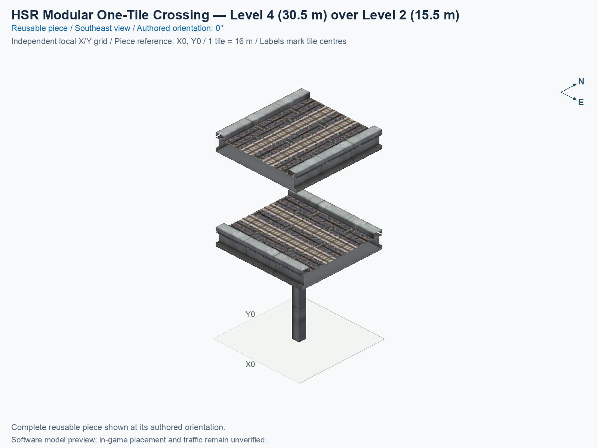
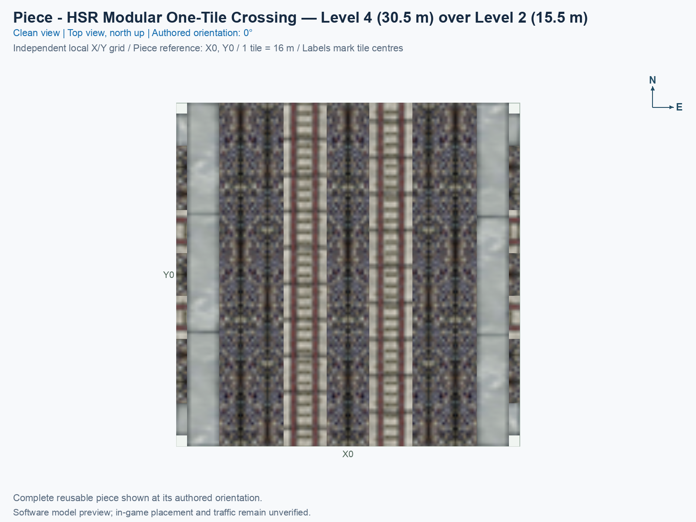

# HSR Modular One-Tile Two-Level Crossing

<!-- PIECE README LAYOUT: 2 -->

[1. Views](#1-views) · [2. Piece and placement](#2-piece-and-placement) · [3. Connection matrix](#3-connection-matrix) · [Testing](TESTING.md)

This reusable High Speed Rail (HSR) piece crosses two paired lines within one 16 × 16 m city tile. East/west traffic stays at nominal Level 2 (L2), measured at 15.5 m, while north/south traffic stays at nominal Level 4 (L4), measured at 30.5 m. The two heights remain separate; this piece provides no turn or transfer between them.

**Status: experimental.** Software pictures and saved-resource checks do not establish human preview approval, game appearance, or train operation. The exact menu name is **HSR Modular One-Tile Two-Level Crossing**, and the permanent type ID is `hsr-component-modular-crossing-core`.

## 1. Views

Both clean pictures show the same complete saved model at its authored 0° orientation. North is up in the top view; X increases eastward, Y increases northward, and each city tile measures 16 × 16 m. The local picture grid belongs to this reusable type. Its software reference is not a certified mouse-click anchor.

<!-- BEGIN PIECE VIEWS -->

<!-- END PIECE VIEWS -->

The [angled-view evidence](evidence/preview.json) and [top-view evidence](evidence/preview-top.json) identify the actual saved model, textures, camera, captions, and image fingerprints. The connection overview in chapter 3 adds measured boundary cards to that same reusable type.

## 2. Piece and placement

<!-- BEGIN PIECE OVERVIEW -->

One city tile with north/south HSR at 30.5 m above east/west HSR at 15.5 m, four native paired connections and one lower support.

Exact reusable identifier: `hsr-component-modular-crossing-core`.

Footprint: **1 × 1 tiles**. Exact menu name: **HSR Modular One-Tile Two-Level Crossing**.

<!-- END PIECE OVERVIEW -->

### Function and complete joining boundaries

At the authored 0° orientation, the lower pair continues east/west, and the upper pair continues north/south. Each pair carries opposite travel directions. A crossing allows routes to pass at different heights; it does not create a junction between the levels. The generated matrix distinguishes the four through journeys from unavailable turns and transfers.

Each of the four exposed tile edges requires one complete two-track paired section. West and east are Level 2 at 15.5 m; north and south are Level 4 at 30.5 m. Level names are labels, while the measured path heights and directions determine the route facts. Matching one track or a nominal level alone does not establish a complete connection, physical seam, or game result.

The permanent construction definition is [piece.json](piece.json), and its geometry belongs in [geometry.json](geometry.json). The [authored connector groups](connector-groups.jsonc), [resolved export](connector-data.json), and [measured connections](connections.json) describe this piece’s intrinsic boundaries and journeys. The library does not supply automatic compatibility discovery, and this guide does not publish a neighbour shortlist.

### Place and rotate the piece

After following the [separate installation procedure](../../../../docs/BUILD_AND_INSTALL.md), use a disposable flat test city. A proper rotation turns the whole piece and all its travel directions together; it does not reflect the piece or reverse a directed track.

1. Open **Transportation → Rail**, hover over the SCP buttons, and select **HSR Modular One-Tile Two-Level Crossing**. An assembly can expose the same reusable type through its Tab/Shift+Tab component cycle.
2. Move the complete cursor preview onto clear terrain. Press **Home** or **End** to rotate; on the documented Mac keyboard, **Fn + ←** and **Fn + →** provide those keys. Use only the supported construction states listed below.
3. At 0°, identify the lower east/west pair and upper north/south pair in both clean views. Place this component on one clear tile, with the intended Level 2 and Level 4 approaches aligned to their respective boundaries.
4. Click once to place the component. Supply matching outside connections and travel demand. Inspect tracks, decks, walls, supports, and shadows, then check the permitted journeys and unavailable movements separately.

## 3. Connection matrix

<!-- BEGIN PIECE CONNECTION MATRIX -->

### Directed entrance/exit matrix

Read **from an entrance row to an exit column**. **Saved PATH** checks the saved traffic route; **Route Query** checks the route shown by the game; **Visible travel** checks a vehicle completing that journey. For HSR, visible travel means a moving train.

**Game appearance:** [?](TESTING.md#case-in_game_render-60bb45d1c468daf9127a) — the complete piece’s appearance in the game, checked separately from its journeys.

**Legend:** ✅ confirmed; ❌ failed; ? not established. **Forbidden** means the movement is unavailable; its in-game check confirms that it stays unavailable. Click a result for its exact test case. Scope, evidence, and limitations remain in [the test checklist](TESTING.md#test-checklist).

| Entrance ↓ / Exit → | **HSR · West exit** `Wout` | **HSR · South exit** `Sout` | **HSR · North exit** `Nout` | **HSR · East exit** `Eout` |
| --- | --- | --- | --- | --- |
| **HSR · West entrance** `Win` | **Forbidden** **Saved PATH:** [✅](TESTING.md#case-software_connectivity-0ce2c7625a107ac300a9) In-game check: [?](TESTING.md#case-in_game_forbidden_transfer-a21b5e58377bc7e9477c) | **Forbidden** **Saved PATH:** [✅](TESTING.md#case-software_connectivity-0ce2c7625a107ac300a9) In-game check: [?](TESTING.md#case-in_game_forbidden_transfer-4bd98de4f164984e9fc4) | **Forbidden** **Saved PATH:** [✅](TESTING.md#case-software_connectivity-0ce2c7625a107ac300a9) In-game check: [?](TESTING.md#case-in_game_forbidden_transfer-898e76225b3e7c1300bc) | **Saved PATH:** [✅](TESTING.md#case-software_connectivity-0ce2c7625a107ac300a9) **Route Query:** [?](TESTING.md#case-in_game_route_query-f4d9cf8f9cd43b3ed436) **Visible train travel:** [?](TESTING.md#case-in_game_visible_travel-f4d9cf8f9cd43b3ed436) |
| **HSR · North entrance** `Nin` | **Forbidden** **Saved PATH:** [✅](TESTING.md#case-software_connectivity-0ce2c7625a107ac300a9) In-game check: [?](TESTING.md#case-in_game_forbidden_transfer-d5e030b5e7d39415eb3d) | **Saved PATH:** [✅](TESTING.md#case-software_connectivity-0ce2c7625a107ac300a9) **Route Query:** [?](TESTING.md#case-in_game_route_query-c784d630dc08288b2fdf) **Visible train travel:** [?](TESTING.md#case-in_game_visible_travel-c784d630dc08288b2fdf) | **Forbidden** **Saved PATH:** [✅](TESTING.md#case-software_connectivity-0ce2c7625a107ac300a9) In-game check: [?](TESTING.md#case-in_game_forbidden_transfer-a95f8121f4d8cc51c61f) | **Forbidden** **Saved PATH:** [✅](TESTING.md#case-software_connectivity-0ce2c7625a107ac300a9) In-game check: [?](TESTING.md#case-in_game_forbidden_transfer-6c46dbac8020aa6f92ea) |
| **HSR · South entrance** `Sin` | **Forbidden** **Saved PATH:** [✅](TESTING.md#case-software_connectivity-0ce2c7625a107ac300a9) In-game check: [?](TESTING.md#case-in_game_forbidden_transfer-6bfa6d9a37f3aca18752) | **Forbidden** **Saved PATH:** [✅](TESTING.md#case-software_connectivity-0ce2c7625a107ac300a9) In-game check: [?](TESTING.md#case-in_game_forbidden_transfer-ab64d46ede8871adbd9a) | **Saved PATH:** [✅](TESTING.md#case-software_connectivity-0ce2c7625a107ac300a9) **Route Query:** [?](TESTING.md#case-in_game_route_query-f5ef54272d07300cac9a) **Visible train travel:** [?](TESTING.md#case-in_game_visible_travel-f5ef54272d07300cac9a) | **Forbidden** **Saved PATH:** [✅](TESTING.md#case-software_connectivity-0ce2c7625a107ac300a9) In-game check: [?](TESTING.md#case-in_game_forbidden_transfer-cf09a5bd45e2e7752d29) |
| **HSR · East entrance** `Ein` | **Saved PATH:** [✅](TESTING.md#case-software_connectivity-0ce2c7625a107ac300a9) **Route Query:** [?](TESTING.md#case-in_game_route_query-4fe45956037912e0b05c) **Visible train travel:** [?](TESTING.md#case-in_game_visible_travel-4fe45956037912e0b05c) | **Forbidden** **Saved PATH:** [✅](TESTING.md#case-software_connectivity-0ce2c7625a107ac300a9) In-game check: [?](TESTING.md#case-in_game_forbidden_transfer-2eb11d5412e3c60c6e77) | **Forbidden** **Saved PATH:** [✅](TESTING.md#case-software_connectivity-0ce2c7625a107ac300a9) In-game check: [?](TESTING.md#case-in_game_forbidden_transfer-9bd1568734121623c4fe) | **Forbidden** **Saved PATH:** [✅](TESTING.md#case-software_connectivity-0ce2c7625a107ac300a9) In-game check: [?](TESTING.md#case-in_game_forbidden_transfer-4e4a8eca7572428aaafc) |

Source: [connections.json](connections.json).

<!-- END PIECE CONNECTION MATRIX -->

<!-- BEGIN CONNECTOR OVERVIEW -->

### Connection overview

Generated from this piece's source-bound connector metadata and the current compiled model; marker letters refer to the boundary cards below.

[Rendering sources and verification scope](evidence/connection-overview.json).

Headings: 0° = North, 90° = East, 180° = South, and 270° = West; clockwise in plan view, pointing out of the piece.

Coordinates [E,N,H] = [east,north,height] in metres. Source cells [column,row] increase east and south.

Display grid: X = source column − (0); Y = 0 − source row.

Slope is measured outward at the joining edge; the interior may differ. Offsets are + left and − right facing out of the tile edge.

Member offsets use the section origin. Counts distinguish physical channels / edge cuts / directed members; modes do not multiply channels.

Incoming flow enters this piece; outgoing flow leaves it. Letters identify boundary cards; source IDs remain the stable identities.

#### Boundary A: `cell-0-0-south`

This service group is required at this edge.

##### Service group 1 / 1: HSR — Level 4 (30.5 m)

| Field | Value |
| --- | --- |
| End / component | `upper-end-a` / `upper-mainline` |
| Network / game class / role | hsr / Monorail (7); primary |
| Source cell / edge | `[0,0]` / South |
| Section origin [E,N] (m) | `[0,-8]` |
| Centring / section offset | Centred; 0 m |
| Level (path height) | Level 4 (30.5 m) |
| Outward heading | 180° (South) |
| Slope at joining edge | 0% outward |
| Channels / edge cuts / directed members | 2 / 2 / 2 |
| Traffic arrangement / running | 1 incoming; 1 outgoing; Right-hand running |
| Channel spacing | 4 m |
| Channel kinds | rail |
| Traffic modes | monorail |
| Profile | `hsr-l4-orth-scp-paired15-t2-opposed-rhd-v1` |

| Member / measured source | Channel / cut / modes | Flow | Endpoint [E,N,H] (m) | Offset (m) | Outward heading | Edge slope (%) |
| --- | --- | --- | --- | ---: | ---: | ---: |
| `upper-end-a-track-01` / `Sin` | `upper-channel-01` / `upper-end-a-cut-01` / monorail | Incoming | `[2,-8,30.5]` | +2 | 180° | 0 |
| `upper-end-a-track-02` / `Sout` | `upper-channel-02` / `upper-end-a-cut-02` / monorail | Outgoing | `[-2,-8,30.5]` | -2 | 180° | 0 |

#### Boundary B: `cell-0-0-north`

This service group is required at this edge.

##### Service group 1 / 1: HSR — Level 4 (30.5 m)

| Field | Value |
| --- | --- |
| End / component | `upper-end-b` / `upper-mainline` |
| Network / game class / role | hsr / Monorail (7); primary |
| Source cell / edge | `[0,0]` / North |
| Section origin [E,N] (m) | `[0,8]` |
| Centring / section offset | Centred; 0 m |
| Level (path height) | Level 4 (30.5 m) |
| Outward heading | 0° (North) |
| Slope at joining edge | 0% outward |
| Channels / edge cuts / directed members | 2 / 2 / 2 |
| Traffic arrangement / running | 1 incoming; 1 outgoing; Right-hand running |
| Channel spacing | 4 m |
| Channel kinds | rail |
| Traffic modes | monorail |
| Profile | `hsr-l4-orth-scp-paired15-t2-opposed-rhd-v1` |

| Member / measured source | Channel / cut / modes | Flow | Endpoint [E,N,H] (m) | Offset (m) | Outward heading | Edge slope (%) |
| --- | --- | --- | --- | ---: | ---: | ---: |
| `upper-end-b-track-01` / `Nin` | `upper-channel-02` / `upper-end-b-cut-01` / monorail | Incoming | `[-2,8,30.5]` | +2 | 0° | 0 |
| `upper-end-b-track-02` / `Nout` | `upper-channel-01` / `upper-end-b-cut-02` / monorail | Outgoing | `[2,8,30.5]` | -2 | 0° | 0 |

#### Boundary C: `cell-0-0-west`

This service group is required at this edge.

##### Service group 1 / 1: HSR — Level 2 (15.5 m)

| Field | Value |
| --- | --- |
| End / component | `lower-end-a` / `lower-mainline` |
| Network / game class / role | hsr / Monorail (7); primary |
| Source cell / edge | `[0,0]` / West |
| Section origin [E,N] (m) | `[-8,0]` |
| Centring / section offset | Centred; 0 m |
| Level (path height) | Level 2 (15.5 m) |
| Outward heading | 270° (West) |
| Slope at joining edge | 0% outward |
| Channels / edge cuts / directed members | 2 / 2 / 2 |
| Traffic arrangement / running | 1 incoming; 1 outgoing; Right-hand running |
| Channel spacing | 4 m |
| Channel kinds | rail |
| Traffic modes | monorail |
| Profile | `hsr-l2-orth-scp-paired15-t2-opposed-rhd-v1` |

| Member / measured source | Channel / cut / modes | Flow | Endpoint [E,N,H] (m) | Offset (m) | Outward heading | Edge slope (%) |
| --- | --- | --- | --- | ---: | ---: | ---: |
| `lower-end-a-track-01` / `Win` | `lower-channel-01` / `lower-end-a-cut-01` / monorail | Incoming | `[-8,-2,15.5]` | +2 | 270° | 0 |
| `lower-end-a-track-02` / `Wout` | `lower-channel-02` / `lower-end-a-cut-02` / monorail | Outgoing | `[-8,2,15.5]` | -2 | 270° | 0 |

#### Boundary D: `cell-0-0-east`

This service group is required at this edge.

##### Service group 1 / 1: HSR — Level 2 (15.5 m)

| Field | Value |
| --- | --- |
| End / component | `lower-end-b` / `lower-mainline` |
| Network / game class / role | hsr / Monorail (7); primary |
| Source cell / edge | `[0,0]` / East |
| Section origin [E,N] (m) | `[8,0]` |
| Centring / section offset | Centred; 0 m |
| Level (path height) | Level 2 (15.5 m) |
| Outward heading | 90° (East) |
| Slope at joining edge | 0% outward |
| Channels / edge cuts / directed members | 2 / 2 / 2 |
| Traffic arrangement / running | 1 incoming; 1 outgoing; Right-hand running |
| Channel spacing | 4 m |
| Channel kinds | rail |
| Traffic modes | monorail |
| Profile | `hsr-l2-orth-scp-paired15-t2-opposed-rhd-v1` |

| Member / measured source | Channel / cut / modes | Flow | Endpoint [E,N,H] (m) | Offset (m) | Outward heading | Edge slope (%) |
| --- | --- | --- | --- | ---: | ---: | ---: |
| `lower-end-b-track-01` / `Ein` | `lower-channel-02` / `lower-end-b-cut-01` / monorail | Incoming | `[8,2,15.5]` | +2 | 90° | 0 |
| `lower-end-b-track-02` / `Eout` | `lower-channel-01` / `lower-end-b-cut-02` / monorail | Outgoing | `[8,-2,15.5]` | -2 | 90° | 0 |

Rendering checks source metadata, current compiled resource identities, and model structure. It does not re-extract PATHs or evaluate placement; physical seams, construction clearance, collisions, and game operation remain unverified.

<!-- END CONNECTOR OVERVIEW -->
