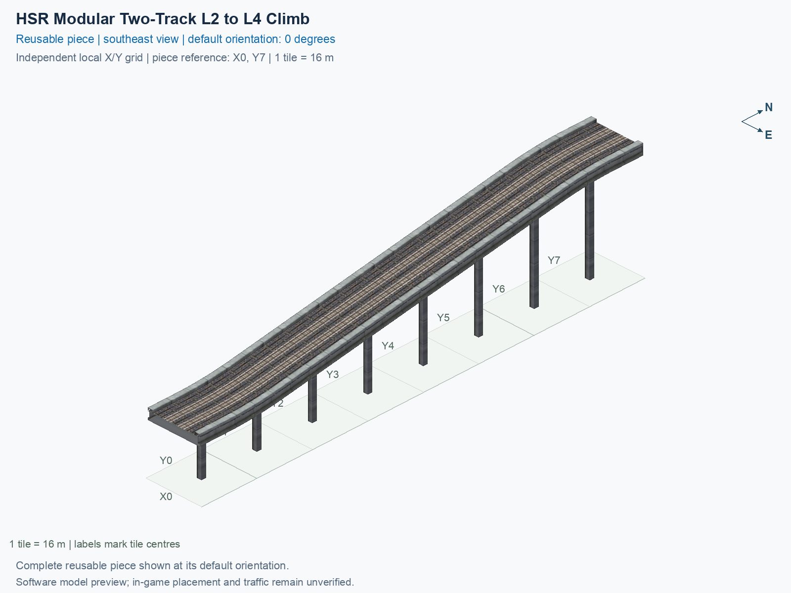

# HSR Modular Two-Track L2 to L4 Climb

Purpose: explain this reusable piece, its matching connections and current test coverage.

<!-- BEGIN PIECE OVERVIEW -->

A 128 m two-track climb between 15.5 and 30.5 m, with opposing travel directions, flat native-profile ends and coordinated supports.

Exact reusable identifier: `hsr-component-modular-paired-climb`.

Footprint: **1 × 8 tiles**. Exact menu name: **HSR Modular Two-Track L2 to L4 Climb**.

Choose this exact name in Transportation → Rail. Press Home or End to rotate; use only the supported states listed below. Join each end to a matching port profile and direction.

- [Connections and journeys](#connections-and-journeys)
- [Test checklist](#test-checklist)



<!-- END PIECE OVERVIEW -->

<!-- BEGIN MANUAL SUMMARY -->

## Manual status

Generated from [the exact test cases](#test-checklist) and [authoritative observations](checks/manual-tests.json).

- [ ] Preview review: 0/1 applicable cases passed; 0 failed, 0 stale.
- [ ] In-game rendering: 0/4 applicable cases passed; 0 failed, 0 stale.
- [ ] Directed journeys: 0/8 applicable cases passed; 0 failed, 0 stale.

These observations cover only the named services, directions, poses, rotations, and recorded platforms.

<!-- END MANUAL SUMMARY -->

<!-- BEGIN CONNECTIONS -->

## Connections and journeys

Purpose: describe intrinsic directional interfaces and permitted service journeys.

Generated from [connections.json](connections.json). Coordinates are canonical east, north and height in metres. A connection class names an encoded route interface; it does not prove visible deck/wall fit or an in-game test.

Supported placement states: 0° CCW, 90° CCW, 180° CCW, 270° CCW. Each state has its own declared manual scope.

A **port** is one directional transport-path endpoint. **Service** identifies the intended network service (for example HSR, street, or tram); **engine** is its internal traffic-class number, separate from the construction network. **Role** distinguishes primary service from auxiliary paths; sharing a traffic class does not establish service compatibility.

A **tangent** is a unit travel-direction vector: `[0,1]` means north. **Grade** is height gained per horizontal metre. These measured facts describe this subject alone. Compatibility requires a separate comparison of the complete joining boundaries; physical seams and actual game operation require their own evidence. See the [class index](../../connection-classes.json) for shared route-interface membership.

| Port | Service / engine / role | Direction | Location; tangent; grade | Connection class |
| --- | --- | --- | --- | --- |
| `Sout` | hsr / 7 / primary | out | [-2.0, -120.0, 15.5]; [0.0, -1.0]; 0.0 | `path-interface-12d12be31d2057c5763d` |
| `Nin` | hsr / 7 / primary | in | [-2.0, 8.0, 30.5]; [0.0, -1.0]; 0.0 | `path-interface-ce3ccdc10e5e243d11ae` |
| `Sin` | hsr / 7 / primary | in | [2.0, -120.0, 15.5]; [0.0, 1.0]; 0.0 | `path-interface-fba09fbeb87ad95c667a` |
| `Nout` | hsr / 7 / primary | out | [2.0, 8.0, 30.5]; [0.0, 1.0]; 0.0 | `path-interface-9b897a8bacb659f807fe` |

### Directed journeys

| Service | Entry → exit | Role |
| --- | --- | --- |
| hsr | `Nin` → `Sout` | primary |
| hsr | `Sin` → `Nout` | primary |

### Forbidden transfers

| From service / port | To service / port | Reason |
| --- | --- | --- |
| hsr / `Nin` | hsr / `Nout` | No directed route exists between these ports in the saved piece transport paths. In-game confirmation remains unverified. |
| hsr / `Sin` | hsr / `Sout` | No directed route exists between these ports in the saved piece transport paths. In-game confirmation remains unverified. |

Review the test checklist for the exact tested cases and environments.

<!-- END CONNECTIONS -->

<!-- BEGIN MANUAL CHECKS -->

## Test checklist

Generated from [the authoritative record](checks/manual-tests.json). Only explicit human observations create manual passes; software and preview checks remain separate. Expand a check/service group to see its rotation table, then expand the matching exact scope to copy a case ID and inspect its pose, reviewer, environment, and evidence. Grouping changes only this view; every declared case remains separate.

**States:** [x] passed; [ ] unverified, failed, or stale; N/A is an explicit inapplicable declaration. A dash means no case was declared in that column. Every pass covers only its recorded environment. T means a distinct construction-transposed state.

Four proper rotations are covered. No additional reflected state is established by this record; repeated construction aliases do not create new orientations.

Current totals: unverified: 35, passed: 0, failed: 0, stale: 0, not_applicable: 0.

### Record an observation

Follow the [shared testing guide](../../../../docs/TESTING.md); copy [the unconfirmed example](checks/observation.example.json) to `checks/observation.json`. Case identifiers are in the expandable sections below. Do not edit generated checkboxes.

From the repository folder containing `custom-pieces`, run after filling `checks/observation.json` and explicitly confirming the exact observation:

```sh
python3 -m scp.content record --record custom-pieces/domains/high-speed-rail/00_pieces/hsr-component-modular-paired-climb/checks/manual-tests.json --observation custom-pieces/domains/high-speed-rail/00_pieces/hsr-component-modular-paired-climb/checks/observation.json
```

### Detailed current checks

Each collapsed group shows exact case counts and states. Forbidden transfers are grouped by the directed service pair; the table inside retains every port pair and rotation.

<details>
<summary>Compiled resources — Whole subject — 1 case; unverified: 1</summary>

| Check / exact scope | General | 0° | 90° | 180° | 270° |
| --- | --- | --- | --- | --- | --- |
| **Compiled resources**<br>Whole subject | <a href="#case-software_resources-12895ab3f28ca39a4a83">[ ] unverified</a> | — | — | — | — |


<details>
<summary>Compiled resources — Whole subject</summary>

<a id="case-software_resources-12895ab3f28ca39a4a83"></a>

**General: unverified** — `software_resources-12895ab3f28ca39a4a83`.

Verify the actual compiled resources and construction rules.

Scope: Whole subject.

No observation recorded.

</details>

</details>

<details>
<summary>Directed routing graph — Whole subject — 1 case; unverified: 1</summary>

| Check / exact scope | General | 0° | 90° | 180° | 270° |
| --- | --- | --- | --- | --- | --- |
| **Directed routing graph**<br>Whole subject | <a href="#case-software_connectivity-12895ab3f28ca39a4a83">[ ] unverified</a> | — | — | — | — |


<details>
<summary>Directed routing graph — Whole subject</summary>

<a id="case-software_connectivity-12895ab3f28ca39a4a83"></a>

**General: unverified** — `software_connectivity-12895ab3f28ca39a4a83`.

Verify the declared directed journeys and forbidden transfers.

Scope: Whole subject.

No observation recorded.

</details>

</details>

<details>
<summary>Preview review — Images — 1 case; unverified: 1</summary>

| Check / exact scope | General | 0° | 90° | 180° | 270° |
| --- | --- | --- | --- | --- | --- |
| **Preview review**<br>Image: image:hsr-component-modular-paired-climb:canonical-southeast | <a href="#case-preview_review-e70a51092f9b85197606">[ ] unverified</a> | — | — | — | — |


<details>
<summary>Preview review — Image: image:hsr-component-modular-paired-climb:canonical-southeast</summary>

<a id="case-preview_review-e70a51092f9b85197606"></a>

**General: unverified** — `preview_review-e70a51092f9b85197606`.

Inspect this exact preview for tracks, walls, piers, seams and shadows.

Scope: Image: image:hsr-component-modular-paired-climb:canonical-southeast.

No observation recorded.

</details>

</details>

<details>
<summary>In-game rendering — Whole subject — 4 cases; unverified: 4</summary>

| Check / exact scope | General | 0° | 90° | 180° | 270° |
| --- | --- | --- | --- | --- | --- |
| **In-game rendering**<br>Whole subject | — | <a href="#case-in_game_render-18b2fb81220f57ffa6d1">[ ] unverified</a> | <a href="#case-in_game_render-dff780af19ef90b23370">[ ] unverified</a> | <a href="#case-in_game_render-81207a0427f8e53ea967">[ ] unverified</a> | <a href="#case-in_game_render-773146795aef8883a9fc">[ ] unverified</a> |


<details>
<summary>In-game rendering — Whole subject</summary>

<a id="case-in_game_render-18b2fb81220f57ffa6d1"></a>

**0° CCW: unverified** — `in_game_render-18b2fb81220f57ffa6d1`.

Inspect the placed tracks, walls, piers, seams and shadows in SimCity 4.

Scope: Whole subject.

No observation recorded.

<a id="case-in_game_render-dff780af19ef90b23370"></a>

**90° CCW: unverified** — `in_game_render-dff780af19ef90b23370`.

Inspect the placed tracks, walls, piers, seams and shadows in SimCity 4.

Scope: Whole subject.

No observation recorded.

<a id="case-in_game_render-81207a0427f8e53ea967"></a>

**180° CCW: unverified** — `in_game_render-81207a0427f8e53ea967`.

Inspect the placed tracks, walls, piers, seams and shadows in SimCity 4.

Scope: Whole subject.

No observation recorded.

<a id="case-in_game_render-773146795aef8883a9fc"></a>

**270° CCW: unverified** — `in_game_render-773146795aef8883a9fc`.

Inspect the placed tracks, walls, piers, seams and shadows in SimCity 4.

Scope: Whole subject.

No observation recorded.

</details>

</details>

<details>
<summary>Placement — Whole subject — 4 cases; unverified: 4</summary>

| Check / exact scope | General | 0° | 90° | 180° | 270° |
| --- | --- | --- | --- | --- | --- |
| **Placement**<br>Whole subject | — | <a href="#case-in_game_placement-18b2fb81220f57ffa6d1">[ ] unverified</a> | <a href="#case-in_game_placement-dff780af19ef90b23370">[ ] unverified</a> | <a href="#case-in_game_placement-81207a0427f8e53ea967">[ ] unverified</a> | <a href="#case-in_game_placement-773146795aef8883a9fc">[ ] unverified</a> |


<details>
<summary>Placement — Whole subject</summary>

<a id="case-in_game_placement-18b2fb81220f57ffa6d1"></a>

**0° CCW: unverified** — `in_game_placement-18b2fb81220f57ffa6d1`.

Place this piece or complete blueprint and inspect every occupied tile.

Scope: Whole subject.

No observation recorded.

<a id="case-in_game_placement-dff780af19ef90b23370"></a>

**90° CCW: unverified** — `in_game_placement-dff780af19ef90b23370`.

Place this piece or complete blueprint and inspect every occupied tile.

Scope: Whole subject.

No observation recorded.

<a id="case-in_game_placement-81207a0427f8e53ea967"></a>

**180° CCW: unverified** — `in_game_placement-81207a0427f8e53ea967`.

Place this piece or complete blueprint and inspect every occupied tile.

Scope: Whole subject.

No observation recorded.

<a id="case-in_game_placement-773146795aef8883a9fc"></a>

**270° CCW: unverified** — `in_game_placement-773146795aef8883a9fc`.

Place this piece or complete blueprint and inspect every occupied tile.

Scope: Whole subject.

No observation recorded.

</details>

</details>

<details>
<summary>Demolition — Whole subject — 4 cases; unverified: 4</summary>

| Check / exact scope | General | 0° | 90° | 180° | 270° |
| --- | --- | --- | --- | --- | --- |
| **Demolition**<br>Whole subject | — | <a href="#case-in_game_demolition-18b2fb81220f57ffa6d1">[ ] unverified</a> | <a href="#case-in_game_demolition-dff780af19ef90b23370">[ ] unverified</a> | <a href="#case-in_game_demolition-81207a0427f8e53ea967">[ ] unverified</a> | <a href="#case-in_game_demolition-773146795aef8883a9fc">[ ] unverified</a> |


<details>
<summary>Demolition — Whole subject</summary>

<a id="case-in_game_demolition-18b2fb81220f57ffa6d1"></a>

**0° CCW: unverified** — `in_game_demolition-18b2fb81220f57ffa6d1`.

Bulldoze the complete placement and inspect the cleared area.

Scope: Whole subject.

No observation recorded.

<a id="case-in_game_demolition-dff780af19ef90b23370"></a>

**90° CCW: unverified** — `in_game_demolition-dff780af19ef90b23370`.

Bulldoze the complete placement and inspect the cleared area.

Scope: Whole subject.

No observation recorded.

<a id="case-in_game_demolition-81207a0427f8e53ea967"></a>

**180° CCW: unverified** — `in_game_demolition-81207a0427f8e53ea967`.

Bulldoze the complete placement and inspect the cleared area.

Scope: Whole subject.

No observation recorded.

<a id="case-in_game_demolition-773146795aef8883a9fc"></a>

**270° CCW: unverified** — `in_game_demolition-773146795aef8883a9fc`.

Bulldoze the complete placement and inspect the cleared area.

Scope: Whole subject.

No observation recorded.

</details>

</details>

<details>
<summary>Save and reload — Whole subject — 4 cases; unverified: 4</summary>

| Check / exact scope | General | 0° | 90° | 180° | 270° |
| --- | --- | --- | --- | --- | --- |
| **Save and reload**<br>Whole subject | — | <a href="#case-in_game_save_reload-18b2fb81220f57ffa6d1">[ ] unverified</a> | <a href="#case-in_game_save_reload-dff780af19ef90b23370">[ ] unverified</a> | <a href="#case-in_game_save_reload-81207a0427f8e53ea967">[ ] unverified</a> | <a href="#case-in_game_save_reload-773146795aef8883a9fc">[ ] unverified</a> |


<details>
<summary>Save and reload — Whole subject</summary>

<a id="case-in_game_save_reload-18b2fb81220f57ffa6d1"></a>

**0° CCW: unverified** — `in_game_save_reload-18b2fb81220f57ffa6d1`.

Save, quit, reload and inspect the placement and its paths.

Scope: Whole subject.

No observation recorded.

<a id="case-in_game_save_reload-dff780af19ef90b23370"></a>

**90° CCW: unverified** — `in_game_save_reload-dff780af19ef90b23370`.

Save, quit, reload and inspect the placement and its paths.

Scope: Whole subject.

No observation recorded.

<a id="case-in_game_save_reload-81207a0427f8e53ea967"></a>

**180° CCW: unverified** — `in_game_save_reload-81207a0427f8e53ea967`.

Save, quit, reload and inspect the placement and its paths.

Scope: Whole subject.

No observation recorded.

<a id="case-in_game_save_reload-773146795aef8883a9fc"></a>

**270° CCW: unverified** — `in_game_save_reload-773146795aef8883a9fc`.

Save, quit, reload and inspect the placement and its paths.

Scope: Whole subject.

No observation recorded.

</details>

</details>

<details>
<summary>Journey — hsr — 8 cases; unverified: 8</summary>

| Check / exact scope | General | 0° | 90° | 180° | 270° |
| --- | --- | --- | --- | --- | --- |
| **Journey**<br>Service: hsr; role: primary; journey: 7:Nin>Sout; entry: Nin; exit: Sout | — | <a href="#case-in_game_journey-c925e78d663f6aa80489">[ ] unverified</a> | <a href="#case-in_game_journey-1819d45168cbbf6d2b3f">[ ] unverified</a> | <a href="#case-in_game_journey-cf1f2e61c6aaf5b86108">[ ] unverified</a> | <a href="#case-in_game_journey-fa48d8dc955ab16aeea3">[ ] unverified</a> |
| **Journey**<br>Service: hsr; role: primary; journey: 7:Sin>Nout; entry: Sin; exit: Nout | — | <a href="#case-in_game_journey-0b11a910ca3db1fc9dfa">[ ] unverified</a> | <a href="#case-in_game_journey-239df341e133ec2270b4">[ ] unverified</a> | <a href="#case-in_game_journey-8c34ca7e01c8c58a0c84">[ ] unverified</a> | <a href="#case-in_game_journey-3e05a95d668b9db89117">[ ] unverified</a> |


<details>
<summary>Journey — Service: hsr; role: primary; journey: 7:Nin>Sout; entry: Nin; exit: Sout</summary>

<a id="case-in_game_journey-c925e78d663f6aa80489"></a>

**0° CCW: unverified** — `in_game_journey-c925e78d663f6aa80489`.

Run the declared journey in this direction using its service network.

Scope: Service: hsr; role: primary; journey: 7:Nin>Sout; entry: Nin; exit: Sout.

No observation recorded.

<a id="case-in_game_journey-1819d45168cbbf6d2b3f"></a>

**90° CCW: unverified** — `in_game_journey-1819d45168cbbf6d2b3f`.

Run the declared journey in this direction using its service network.

Scope: Service: hsr; role: primary; journey: 7:Nin>Sout; entry: Nin; exit: Sout.

No observation recorded.

<a id="case-in_game_journey-cf1f2e61c6aaf5b86108"></a>

**180° CCW: unverified** — `in_game_journey-cf1f2e61c6aaf5b86108`.

Run the declared journey in this direction using its service network.

Scope: Service: hsr; role: primary; journey: 7:Nin>Sout; entry: Nin; exit: Sout.

No observation recorded.

<a id="case-in_game_journey-fa48d8dc955ab16aeea3"></a>

**270° CCW: unverified** — `in_game_journey-fa48d8dc955ab16aeea3`.

Run the declared journey in this direction using its service network.

Scope: Service: hsr; role: primary; journey: 7:Nin>Sout; entry: Nin; exit: Sout.

No observation recorded.

</details>


<details>
<summary>Journey — Service: hsr; role: primary; journey: 7:Sin>Nout; entry: Sin; exit: Nout</summary>

<a id="case-in_game_journey-0b11a910ca3db1fc9dfa"></a>

**0° CCW: unverified** — `in_game_journey-0b11a910ca3db1fc9dfa`.

Run the declared journey in this direction using its service network.

Scope: Service: hsr; role: primary; journey: 7:Sin>Nout; entry: Sin; exit: Nout.

No observation recorded.

<a id="case-in_game_journey-239df341e133ec2270b4"></a>

**90° CCW: unverified** — `in_game_journey-239df341e133ec2270b4`.

Run the declared journey in this direction using its service network.

Scope: Service: hsr; role: primary; journey: 7:Sin>Nout; entry: Sin; exit: Nout.

No observation recorded.

<a id="case-in_game_journey-8c34ca7e01c8c58a0c84"></a>

**180° CCW: unverified** — `in_game_journey-8c34ca7e01c8c58a0c84`.

Run the declared journey in this direction using its service network.

Scope: Service: hsr; role: primary; journey: 7:Sin>Nout; entry: Sin; exit: Nout.

No observation recorded.

<a id="case-in_game_journey-3e05a95d668b9db89117"></a>

**270° CCW: unverified** — `in_game_journey-3e05a95d668b9db89117`.

Run the declared journey in this direction using its service network.

Scope: Service: hsr; role: primary; journey: 7:Sin>Nout; entry: Sin; exit: Nout.

No observation recorded.

</details>

</details>

<details>
<summary>Forbidden transfer — hsr → hsr — 8 cases; unverified: 8</summary>

| Check / exact scope | General | 0° | 90° | 180° | 270° |
| --- | --- | --- | --- | --- | --- |
| **Forbidden transfer**<br>from port: Nin; to port: Nout; from service: hsr; to service: hsr; basis: not reachable in actual saved PATH graph | — | <a href="#case-in_game_forbidden_transfer-baa13e6daa1765197b83">[ ] unverified</a> | <a href="#case-in_game_forbidden_transfer-de3967acc2d1f9561582">[ ] unverified</a> | <a href="#case-in_game_forbidden_transfer-9854f0b15a7cb38ab9da">[ ] unverified</a> | <a href="#case-in_game_forbidden_transfer-776f57e43e722879400b">[ ] unverified</a> |
| **Forbidden transfer**<br>from port: Sin; to port: Sout; from service: hsr; to service: hsr; basis: not reachable in actual saved PATH graph | — | <a href="#case-in_game_forbidden_transfer-c2b7a90b44ce5e2c0aab">[ ] unverified</a> | <a href="#case-in_game_forbidden_transfer-7f33c8003d2e6636dc6d">[ ] unverified</a> | <a href="#case-in_game_forbidden_transfer-b7b2a95ba777aedc6f56">[ ] unverified</a> | <a href="#case-in_game_forbidden_transfer-da585af19fc6c3646109">[ ] unverified</a> |


<details>
<summary>Forbidden transfer — from port: Nin; to port: Nout; from service: hsr; to service: hsr; basis: not reachable in actual saved PATH graph</summary>

<a id="case-in_game_forbidden_transfer-baa13e6daa1765197b83"></a>

**0° CCW: unverified** — `in_game_forbidden_transfer-baa13e6daa1765197b83`.

Confirm this undeclared transfer is unavailable.

Scope: from port: Nin; to port: Nout; from service: hsr; to service: hsr; basis: not reachable in actual saved PATH graph.

No observation recorded.

<a id="case-in_game_forbidden_transfer-de3967acc2d1f9561582"></a>

**90° CCW: unverified** — `in_game_forbidden_transfer-de3967acc2d1f9561582`.

Confirm this undeclared transfer is unavailable.

Scope: from port: Nin; to port: Nout; from service: hsr; to service: hsr; basis: not reachable in actual saved PATH graph.

No observation recorded.

<a id="case-in_game_forbidden_transfer-9854f0b15a7cb38ab9da"></a>

**180° CCW: unverified** — `in_game_forbidden_transfer-9854f0b15a7cb38ab9da`.

Confirm this undeclared transfer is unavailable.

Scope: from port: Nin; to port: Nout; from service: hsr; to service: hsr; basis: not reachable in actual saved PATH graph.

No observation recorded.

<a id="case-in_game_forbidden_transfer-776f57e43e722879400b"></a>

**270° CCW: unverified** — `in_game_forbidden_transfer-776f57e43e722879400b`.

Confirm this undeclared transfer is unavailable.

Scope: from port: Nin; to port: Nout; from service: hsr; to service: hsr; basis: not reachable in actual saved PATH graph.

No observation recorded.

</details>


<details>
<summary>Forbidden transfer — from port: Sin; to port: Sout; from service: hsr; to service: hsr; basis: not reachable in actual saved PATH graph</summary>

<a id="case-in_game_forbidden_transfer-c2b7a90b44ce5e2c0aab"></a>

**0° CCW: unverified** — `in_game_forbidden_transfer-c2b7a90b44ce5e2c0aab`.

Confirm this undeclared transfer is unavailable.

Scope: from port: Sin; to port: Sout; from service: hsr; to service: hsr; basis: not reachable in actual saved PATH graph.

No observation recorded.

<a id="case-in_game_forbidden_transfer-7f33c8003d2e6636dc6d"></a>

**90° CCW: unverified** — `in_game_forbidden_transfer-7f33c8003d2e6636dc6d`.

Confirm this undeclared transfer is unavailable.

Scope: from port: Sin; to port: Sout; from service: hsr; to service: hsr; basis: not reachable in actual saved PATH graph.

No observation recorded.

<a id="case-in_game_forbidden_transfer-b7b2a95ba777aedc6f56"></a>

**180° CCW: unverified** — `in_game_forbidden_transfer-b7b2a95ba777aedc6f56`.

Confirm this undeclared transfer is unavailable.

Scope: from port: Sin; to port: Sout; from service: hsr; to service: hsr; basis: not reachable in actual saved PATH graph.

No observation recorded.

<a id="case-in_game_forbidden_transfer-da585af19fc6c3646109"></a>

**270° CCW: unverified** — `in_game_forbidden_transfer-da585af19fc6c3646109`.

Confirm this undeclared transfer is unavailable.

Scope: from port: Sin; to port: Sout; from service: hsr; to service: hsr; basis: not reachable in actual saved PATH graph.

No observation recorded.

</details>

</details>

<!-- END MANUAL CHECKS -->
