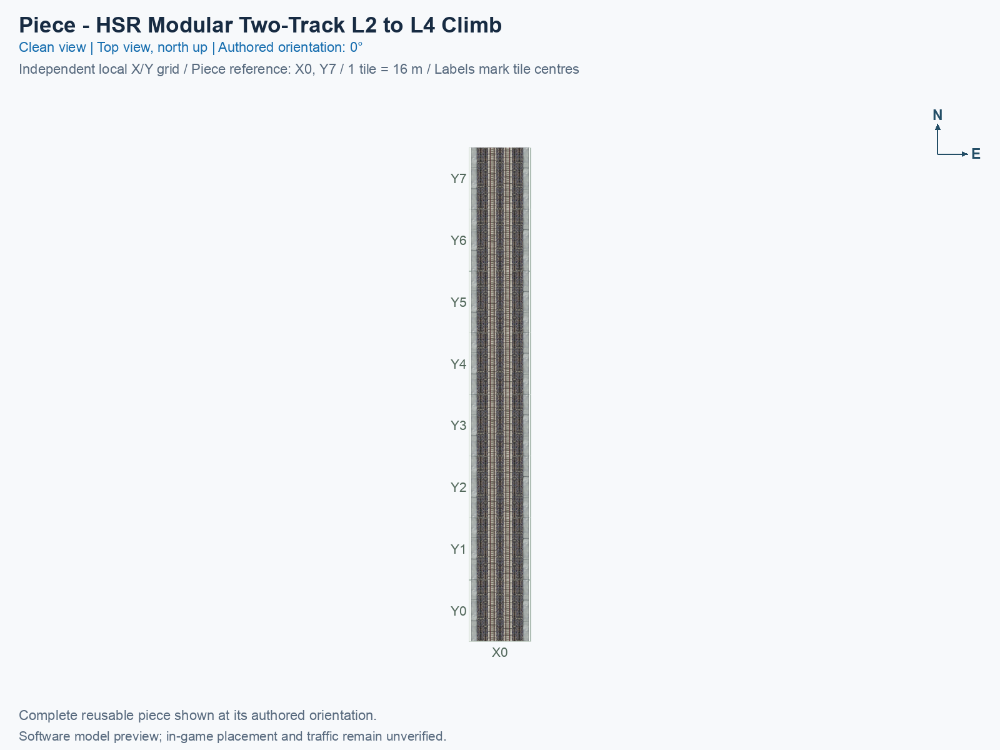
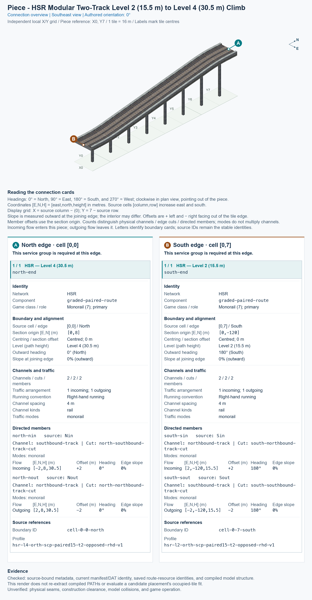

# HSR Modular Two-Track L2 to L4 Climb

<!-- PIECE README LAYOUT: 1 -->

[1. Views](#1-views) · [2. Piece and placement](#2-piece-and-placement) · [3. Connection matrix](#3-connection-matrix) · [4. Testing](#4-testing)

This reusable High Speed Rail (HSR) piece carries two tracks in opposite directions over a 128 m climb. In the pictured 0° orientation, the south end is Level 2 (L2), with traffic paths 15.5 m above ground, and the north end is Level 4 (L4), at 30.5 m. The northbound track climbs, and the southbound track descends. Both exposed ends are flat.

**Status: experimental.** These pictures and connector measurements come from the actual saved game resources. Human preview approval and in-game behavior remain unverified. The type is optional and disabled in default builds.

The permanent type ID is `hsr-component-modular-paired-climb`. The exact compiled menu title is **SCP | [PART] HSR Modular Two-Track L2 to L4 Climb**. PART identifies one individual building block. The puzzle ID is `f82f`, and the complete cursor-preview model ID is `7f58dff5`.

## 1. Views

Both pictures show the same complete saved model in its authored 0° orientation. X increases eastward, Y increases northward, and each city tile measures 16 × 16 m. These are software renders rather than game screenshots.

The local picture grid runs from X0 to X0 and from Y0 to Y7. The low end is south of tile (X0, Y0), and the high end is north of tile (X0, Y7). Source cells use [column, row], with rows increasing southward: picture Y equals 7 minus the source row. The software construction reference is tile (X0, Y7); it has not been confirmed as the game’s mouse-click anchor.

<!-- BEGIN PIECE VIEWS -->




<!-- END PIECE VIEWS -->

## 2. Piece and placement

<!-- BEGIN PIECE OVERVIEW -->

A 128 m two-track climb between 15.5 and 30.5 m, with opposing travel directions, flat native-profile ends and coordinated supports.

Exact reusable identifier: `hsr-component-modular-paired-climb`.

Footprint: **1 × 8 tiles**. Exact menu name: **HSR Modular Two-Track L2 to L4 Climb**.

<!-- END PIECE OVERVIEW -->

### Footprint and joining ends

Keep the full **1 × 8 tile construction rectangle**, measuring 16 × 128 m, clear. This piece owns all 8 source cells listed in [piece.json](piece.json). The supports are part of its saved model; their appearance does not establish that another object can occupy the same construction cell.

The south joining boundary requires a complete paired L2 approach at 15.5 m; the north boundary requires a complete paired L4 approach at 30.5 m. Both tracks must join together, with their 4 m centre spacing and opposing directions. A centred one-way slab cannot supply the two-track connection. The 15 m height change stays inside the piece; intermediate-height cells are not exposed joining ends.

The [connector declaration](connector-groups.jsonc), [resolved export](connector-data.json), and measured [connections](connections.json) describe this piece’s intrinsic boundaries and journeys. They do not discover or certify arbitrary neighbours; an actual physical seam and game operation need their own evidence.

### Placement and rotation

A **proper rotation** turns the complete piece without reflecting it. The eight construction states repeat four proper orientations: 0°, 90°, 180°, and 270° counterclockwise from the pictures. All ends, supports, and travel directions rotate together.

After following the separate [installation procedure](../../../../docs/BUILD_AND_INSTALL.md), use a disposable flat test city. Placement remains unverified in game.

1. Open **Transportation → Rail**, hover over the SCP buttons, and select **HSR Modular Two-Track L2 to L4 Climb**. In an assembly’s component cycle, use **Tab** or **Shift+Tab** to select this same type.
2. Move the preview over a clear **1 × 8 tile rectangle**. Press **Home** or **End** to rotate; on the documented Mac keyboard, **Fn + ←** and **Fn + →** produce those keys.
3. At 0°, align the south end with the paired Level 2 approach and the north end with the paired Level 4 approach. Preserve the complete joining section and both travel directions.
4. Click once to place the complete piece. Supply travel demand for each permitted journey, then inspect the game’s route query and moving trains separately.

## 3. Connection matrix

<!-- BEGIN PIECE CONNECTION MATRIX -->

### Directed entrance/exit matrix

Read **from an entrance row to an exit column**. **Saved PATH** checks the saved traffic route; **Route Query** checks the route shown by the game; **Visible travel** checks a vehicle completing that journey. For HSR, visible travel means a moving train.

**Game appearance:** [?](#case-in_game_render-18b2fb81220f57ffa6d1) — the complete piece’s appearance in the game, checked separately from its journeys.

**Legend:** ✅ confirmed; ❌ failed; ? not established. **Forbidden** means the movement is unavailable; its in-game check confirms that it stays unavailable. Click a result for its exact test case. Scope, evidence, and limitations remain in [the test checklist](#test-checklist).

| Entrance ↓ / Exit → | **HSR · South exit**<br>`Sout` | **HSR · North exit**<br>`Nout` |
| --- | --- | --- |
| **HSR · North entrance**<br>`Nin` | **Saved PATH:** [✅](#case-software_connectivity-12895ab3f28ca39a4a83)<br>**Route Query:** [?](#case-in_game_route_query-c925e78d663f6aa80489)<br>**Visible train travel:** [?](#case-in_game_visible_travel-c925e78d663f6aa80489) | **Forbidden**<br>**Saved PATH:** [✅](#case-software_connectivity-12895ab3f28ca39a4a83)<br>In-game check: [?](#case-in_game_forbidden_transfer-baa13e6daa1765197b83) |
| **HSR · South entrance**<br>`Sin` | **Forbidden**<br>**Saved PATH:** [✅](#case-software_connectivity-12895ab3f28ca39a4a83)<br>In-game check: [?](#case-in_game_forbidden_transfer-c2b7a90b44ce5e2c0aab) | **Saved PATH:** [✅](#case-software_connectivity-12895ab3f28ca39a4a83)<br>**Route Query:** [?](#case-in_game_route_query-0b11a910ca3db1fc9dfa)<br>**Visible train travel:** [?](#case-in_game_visible_travel-0b11a910ca3db1fc9dfa) |

Source: [connections.json](connections.json).

<!-- END PIECE CONNECTION MATRIX -->

<!-- BEGIN CONNECTOR OVERVIEW -->

### Connection overview

Generated from this piece's source-bound connector metadata and the current compiled model; marker letters refer to the boundary cards below.



[Rendering sources and verification scope](evidence/connection-overview.json).

Headings: 0° = North, 90° = East, 180° = South, and 270° = West; clockwise in plan view, pointing out of the piece.

Coordinates [E,N,H] = [east,north,height] in metres. Source cells [column,row] increase east and south.

Display grid: X = source column − (0); Y = 7 − source row.

Slope is measured outward at the joining edge; the interior may differ. Offsets are + left and − right facing out of the tile edge.

Member offsets use the section origin. Counts distinguish physical channels / edge cuts / directed members; modes do not multiply channels.

Incoming flow enters this piece; outgoing flow leaves it. Letters identify boundary cards; source IDs remain the stable identities.

#### Boundary A: `cell-0-0-north`

This service group is required at this edge.

##### Service group 1 / 1: HSR — Level 4 (30.5 m)

| Field | Value |
| --- | --- |
| End / component | `north-end` / `graded-paired-route` |
| Network / game class / role | hsr / Monorail (7); primary |
| Source cell / edge | `[0,0]` / North |
| Section origin [E,N] (m) | `[0,8]` |
| Centring / section offset | Centred; 0 m |
| Level (path height) | Level 4 (30.5 m) |
| Outward heading | 0° (North) |
| Slope at joining edge | 0% outward |
| Channels / edge cuts / directed members | 2 / 2 / 2 |
| Traffic arrangement / running | 1 incoming; 1 outgoing; Right-hand running |
| Channel spacing | 4 m |
| Channel kinds | rail |
| Traffic modes | monorail |
| Profile | `hsr-l4-orth-scp-paired15-t2-opposed-rhd-v1` |

| Member / measured source | Channel / cut / modes | Flow | Endpoint [E,N,H] (m) | Offset (m) | Outward heading | Edge slope (%) |
| --- | --- | --- | --- | ---: | ---: | ---: |
| `north-nin` / `Nin` | `southbound-track` / `north-southbound-track-cut` / monorail | Incoming | `[-2,8,30.5]` | +2 | 0° | 0 |
| `north-nout` / `Nout` | `northbound-track` / `north-northbound-track-cut` / monorail | Outgoing | `[2,8,30.5]` | -2 | 0° | 0 |

#### Boundary B: `cell-0-7-south`

This service group is required at this edge.

##### Service group 1 / 1: HSR — Level 2 (15.5 m)

| Field | Value |
| --- | --- |
| End / component | `south-end` / `graded-paired-route` |
| Network / game class / role | hsr / Monorail (7); primary |
| Source cell / edge | `[0,7]` / South |
| Section origin [E,N] (m) | `[0,-120]` |
| Centring / section offset | Centred; 0 m |
| Level (path height) | Level 2 (15.5 m) |
| Outward heading | 180° (South) |
| Slope at joining edge | 0% outward |
| Channels / edge cuts / directed members | 2 / 2 / 2 |
| Traffic arrangement / running | 1 incoming; 1 outgoing; Right-hand running |
| Channel spacing | 4 m |
| Channel kinds | rail |
| Traffic modes | monorail |
| Profile | `hsr-l2-orth-scp-paired15-t2-opposed-rhd-v1` |

| Member / measured source | Channel / cut / modes | Flow | Endpoint [E,N,H] (m) | Offset (m) | Outward heading | Edge slope (%) |
| --- | --- | --- | --- | ---: | ---: | ---: |
| `south-sin` / `Sin` | `northbound-track` / `south-northbound-track-cut` / monorail | Incoming | `[2,-120,15.5]` | +2 | 180° | 0 |
| `south-sout` / `Sout` | `southbound-track` / `south-southbound-track-cut` / monorail | Outgoing | `[-2,-120,15.5]` | -2 | 180° | 0 |

Rendering checks source metadata, current compiled resource identities, and model structure. It does not re-extract PATHs or evaluate placement; physical seams, construction clearance, collisions, and game operation remain unverified.

<!-- END CONNECTOR OVERVIEW -->

## 4. Testing

### Software evidence and limits

The current documentation refresh re-extracted the selected type’s actual saved PATH resources from the existing verified `dist/trumpet-icon-no-tab-parts` build. The connector check independently re-extracts every directed endpoint and journey, verifies source bindings and saved resource fingerprints, validates the complete preview model, and checks current exported data and artwork. See [the scoped saved-resource report](evidence/documentation-refresh.json), [angled-view evidence](evidence/preview.json), [top-view evidence](evidence/preview-top.json), and [connector-overview evidence](evidence/connection-overview.json). This reuses unchanged game resources; it does not claim a new geometry build or game test.

To repeat extraction, use `--piece hsr-component-modular-paired-climb` with the HSR extraction command, and select the same verified build. Follow [documentation generation](../../../../docs/WORKFLOW_DOCUMENTATION_GENERATION.md) for actual-resource extraction, both canonical views, connector refresh and check, image-review binding, and final packaging in that order. Building, rendering, and packaging do not install the piece.

### Human checks and known issues

Check placement, all four proper rotations, appearance, each permitted journey’s Route Query and visible train travel, declared forbidden transfers, shadows, demolition, and save/reload in the exact recorded game environment. A software pass cannot approve any of those observations. Record only explicitly confirmed results through the [shared testing procedure](../../../../docs/TESTING.md), using this piece’s existing manual record and exact command below.

<!-- BEGIN MANUAL SUMMARY -->

### Manual status

Generated from [the exact test cases](#test-checklist) and [authoritative observations](checks/manual-tests.json).

- [ ] Preview review: 0/3 applicable cases passed; 0 failed, 0 stale.
- [ ] In-game rendering: 0/4 applicable cases passed; 0 failed, 0 stale.
- [ ] Route Query: 0/8 applicable cases passed; 0 failed, 0 stale.
- [ ] Visible travel: 0/8 applicable cases passed; 0 failed, 0 stale.

These observations cover only the named services, directions, poses, rotations, and recorded platforms.

<!-- END MANUAL SUMMARY -->

<!-- BEGIN CONNECTIONS -->

### Connections and journeys

Generated from [connections.json](connections.json). Coordinates are canonical east, north, and height in metres. A connection class names an encoded route interface; it does not prove visible deck/wall fit or an in-game test.

Supported placement states: 0° CCW, 90° CCW, 180° CCW, 270° CCW. Each state has its own declared manual scope.

A **port** is one directional transport-path endpoint. **Service** identifies the intended network service (for example HSR, street, or tram); **engine** is its internal traffic-class number, separate from the construction network. **Role** distinguishes primary service from auxiliary paths; sharing a traffic class does not establish service compatibility.

A **tangent** is a unit travel-direction vector: `[0,1]` means north. **Grade** is height gained per horizontal metre. These measured facts describe this subject alone. Compatibility requires a separate comparison of the complete joining boundaries; physical seams and actual game operation require their own evidence. See the [class index](../../connection-classes.json) for shared route-interface membership.

| Port | Service / engine / role | Direction | Location; tangent; grade | Connection class |
| --- | --- | --- | --- | --- |
| `Sout` | hsr / 7 / primary | out | [-2.0, -120.0, 15.5]; [0.0, -1.0]; 0.0 | `path-interface-12d12be31d2057c5763d` |
| `Nin` | hsr / 7 / primary | in | [-2.0, 8.0, 30.5]; [0.0, -1.0]; 0.0 | `path-interface-ce3ccdc10e5e243d11ae` |
| `Sin` | hsr / 7 / primary | in | [2.0, -120.0, 15.5]; [0.0, 1.0]; 0.0 | `path-interface-fba09fbeb87ad95c667a` |
| `Nout` | hsr / 7 / primary | out | [2.0, 8.0, 30.5]; [0.0, 1.0]; 0.0 | `path-interface-9b897a8bacb659f807fe` |

#### Directed journeys

| Service | Entry → exit | Role |
| --- | --- | --- |
| hsr | `Nin` → `Sout` | primary |
| hsr | `Sin` → `Nout` | primary |

#### Forbidden transfers

| From service / port | To service / port | Reason |
| --- | --- | --- |
| hsr / `Nin` | hsr / `Nout` | No directed route exists between these ports in the saved piece transport paths. In-game confirmation remains unverified. |
| hsr / `Sin` | hsr / `Sout` | No directed route exists between these ports in the saved piece transport paths. In-game confirmation remains unverified. |

Review the test checklist for the exact tested cases and environments.

<!-- END CONNECTIONS -->

<!-- BEGIN MANUAL CHECKS -->

### Test checklist

Generated from [the authoritative record](checks/manual-tests.json). Only explicit human observations create manual passes; software and preview checks remain separate. Expand a check/service group to see its rotation table, then expand the matching exact scope to copy a case ID and inspect its pose, reviewer, environment, and evidence. Grouping changes only this view; every declared case remains separate.

**States:** [x] passed; [ ] unverified, failed, or stale; N/A is an explicit inapplicable declaration. A dash means no case was declared in that column. Every pass covers only its recorded environment. T means a distinct construction-transposed state.

Four proper rotations are covered. No additional reflected state is established by this record; repeated construction aliases do not create new orientations.

Current totals: unverified: 43, passed: 2, failed: 0, stale: 0, not_applicable: 0.

#### Record an observation

Follow the [shared testing guide](../../../../docs/TESTING.md); copy [the unconfirmed example](checks/observation.example.json) to `checks/observation.json`. Case identifiers are in the expandable sections below. Do not edit generated checkboxes.

From the repository folder containing `custom-pieces`, run after filling `checks/observation.json` and explicitly confirming the exact observation:

```sh
python3 -m scp.content record --record custom-pieces/domains/high-speed-rail/00_pieces/hsr-component-modular-paired-climb/checks/manual-tests.json --observation custom-pieces/domains/high-speed-rail/00_pieces/hsr-component-modular-paired-climb/checks/observation.json
```

#### Detailed current checks

Each collapsed group shows exact case counts and states. Forbidden transfers are grouped by the directed service pair; the table inside retains every port pair and rotation.

<details>
<summary>Compiled resources — Whole subject — 1 case; passed: 1</summary>

| Check / exact scope | General | 0° | 90° | 180° | 270° |
| --- | --- | --- | --- | --- | --- |
| **Compiled resources**<br>Whole subject | <a href="#case-software_resources-12895ab3f28ca39a4a83">[x] passed</a> | — | — | — | — |


<details>
<summary>Compiled resources — Whole subject</summary>

<a id="case-software_resources-12895ab3f28ca39a4a83"></a>

**General: passed** — `software_resources-12895ab3f28ca39a4a83`.

Verify the actual compiled resources and construction rules.

Scope: Whole subject.

Recorded observations (chronological; the state above checks the relevant dependency snapshot):

- result: passed; authority: software; reviewer: Actual final normal 13-piece saved-build verification; registered independent PATH, model, construction, menu, and shadow checks; confirmed at: 2026-10-27T21:57:25.376326+00:00; evidence: [evidence/saved-resource-checks.json]; environment: {}

</details>

</details>

<details>
<summary>Directed routing graph — Whole subject — 1 case; passed: 1</summary>

| Check / exact scope | General | 0° | 90° | 180° | 270° |
| --- | --- | --- | --- | --- | --- |
| **Directed routing graph**<br>Whole subject | <a href="#case-software_connectivity-12895ab3f28ca39a4a83">[x] passed</a> | — | — | — | — |


<details>
<summary>Directed routing graph — Whole subject</summary>

<a id="case-software_connectivity-12895ab3f28ca39a4a83"></a>

**General: passed** — `software_connectivity-12895ab3f28ca39a4a83`.

Verify the declared directed journeys and forbidden transfers.

Scope: Whole subject.

Recorded observations (chronological; the state above checks the relevant dependency snapshot):

- result: passed; authority: software; reviewer: Scoped actual-PATH extraction and independent connector verifier; confirmed at: 2026-10-27; evidence: [evidence/documentation-refresh.json, connector-data.json, connections.json]; environment: {}
- result: passed; authority: software; reviewer: Actual final normal 13-piece saved-build verification; registered independent PATH, model, construction, menu, and shadow checks; confirmed at: 2026-10-27T21:57:25.376326+00:00; evidence: [evidence/saved-resource-checks.json]; environment: {}

</details>

</details>

<details>
<summary>Preview review — Images — 3 cases; unverified: 3</summary>

| Check / exact scope | General | 0° | 90° | 180° | 270° |
| --- | --- | --- | --- | --- | --- |
| **Preview review**<br>Image: image:hsr-component-modular-paired-climb:canonical-southeast | <a href="#case-preview_review-e70a51092f9b85197606">[ ] unverified</a> | — | — | — | — |
| **Preview review**<br>Image: image:hsr-component-modular-paired-climb:canonical-top | <a href="#case-preview_review-29176cda9137aaa92513">[ ] unverified</a> | — | — | — | — |
| **Preview review**<br>Image: image:hsr-component-modular-paired-climb:connection-overview | <a href="#case-preview_review-0e58adfc6799a757d2bc">[ ] unverified</a> | — | — | — | — |


<details>
<summary>Preview review — Image: image:hsr-component-modular-paired-climb:canonical-southeast</summary>

<a id="case-preview_review-e70a51092f9b85197606"></a>

**General: unverified** — `preview_review-e70a51092f9b85197606`.

Inspect this exact preview for tracks, walls, piers, seams, and shadows.

Scope: Image: image:hsr-component-modular-paired-climb:canonical-southeast.

No observation recorded.

</details>


<details>
<summary>Preview review — Image: image:hsr-component-modular-paired-climb:canonical-top</summary>

<a id="case-preview_review-29176cda9137aaa92513"></a>

**General: unverified** — `preview_review-29176cda9137aaa92513`.

Inspect this exact preview for tracks, walls, piers, seams, and shadows.

Scope: Image: image:hsr-component-modular-paired-climb:canonical-top.

No observation recorded.

</details>


<details>
<summary>Preview review — Image: image:hsr-component-modular-paired-climb:connection-overview</summary>

<a id="case-preview_review-0e58adfc6799a757d2bc"></a>

**General: unverified** — `preview_review-0e58adfc6799a757d2bc`.

Inspect this exact preview for tracks, walls, piers, seams, and shadows.

Scope: Image: image:hsr-component-modular-paired-climb:connection-overview.

No observation recorded.

</details>

</details>

<details>
<summary>In-game rendering — Whole subject — 4 cases; unverified: 4</summary>

| Check / exact scope | General | 0° | 90° | 180° | 270° |
| --- | --- | --- | --- | --- | --- |
| **In-game rendering**<br>Whole subject | — | <a href="#case-in_game_render-18b2fb81220f57ffa6d1">[ ] unverified</a> | <a href="#case-in_game_render-dff780af19ef90b23370">[ ] unverified</a> | <a href="#case-in_game_render-81207a0427f8e53ea967">[ ] unverified</a> | <a href="#case-in_game_render-773146795aef8883a9fc">[ ] unverified</a> |


<details>
<summary>In-game rendering — Whole subject</summary>

<a id="case-in_game_render-18b2fb81220f57ffa6d1"></a>

**0° CCW: unverified** — `in_game_render-18b2fb81220f57ffa6d1`.

Inspect the placed tracks, walls, piers, seams, and shadows in SimCity 4.

Scope: Whole subject.

No observation recorded.

<a id="case-in_game_render-dff780af19ef90b23370"></a>

**90° CCW: unverified** — `in_game_render-dff780af19ef90b23370`.

Inspect the placed tracks, walls, piers, seams, and shadows in SimCity 4.

Scope: Whole subject.

No observation recorded.

<a id="case-in_game_render-81207a0427f8e53ea967"></a>

**180° CCW: unverified** — `in_game_render-81207a0427f8e53ea967`.

Inspect the placed tracks, walls, piers, seams, and shadows in SimCity 4.

Scope: Whole subject.

No observation recorded.

<a id="case-in_game_render-773146795aef8883a9fc"></a>

**270° CCW: unverified** — `in_game_render-773146795aef8883a9fc`.

Inspect the placed tracks, walls, piers, seams, and shadows in SimCity 4.

Scope: Whole subject.

No observation recorded.

</details>

</details>

<details>
<summary>Placement — Whole subject — 4 cases; unverified: 4</summary>

| Check / exact scope | General | 0° | 90° | 180° | 270° |
| --- | --- | --- | --- | --- | --- |
| **Placement**<br>Whole subject | — | <a href="#case-in_game_placement-18b2fb81220f57ffa6d1">[ ] unverified</a> | <a href="#case-in_game_placement-dff780af19ef90b23370">[ ] unverified</a> | <a href="#case-in_game_placement-81207a0427f8e53ea967">[ ] unverified</a> | <a href="#case-in_game_placement-773146795aef8883a9fc">[ ] unverified</a> |


<details>
<summary>Placement — Whole subject</summary>

<a id="case-in_game_placement-18b2fb81220f57ffa6d1"></a>

**0° CCW: unverified** — `in_game_placement-18b2fb81220f57ffa6d1`.

Place this piece or complete blueprint and inspect every occupied tile.

Scope: Whole subject.

No observation recorded.

<a id="case-in_game_placement-dff780af19ef90b23370"></a>

**90° CCW: unverified** — `in_game_placement-dff780af19ef90b23370`.

Place this piece or complete blueprint and inspect every occupied tile.

Scope: Whole subject.

No observation recorded.

<a id="case-in_game_placement-81207a0427f8e53ea967"></a>

**180° CCW: unverified** — `in_game_placement-81207a0427f8e53ea967`.

Place this piece or complete blueprint and inspect every occupied tile.

Scope: Whole subject.

No observation recorded.

<a id="case-in_game_placement-773146795aef8883a9fc"></a>

**270° CCW: unverified** — `in_game_placement-773146795aef8883a9fc`.

Place this piece or complete blueprint and inspect every occupied tile.

Scope: Whole subject.

No observation recorded.

</details>

</details>

<details>
<summary>Demolition — Whole subject — 4 cases; unverified: 4</summary>

| Check / exact scope | General | 0° | 90° | 180° | 270° |
| --- | --- | --- | --- | --- | --- |
| **Demolition**<br>Whole subject | — | <a href="#case-in_game_demolition-18b2fb81220f57ffa6d1">[ ] unverified</a> | <a href="#case-in_game_demolition-dff780af19ef90b23370">[ ] unverified</a> | <a href="#case-in_game_demolition-81207a0427f8e53ea967">[ ] unverified</a> | <a href="#case-in_game_demolition-773146795aef8883a9fc">[ ] unverified</a> |


<details>
<summary>Demolition — Whole subject</summary>

<a id="case-in_game_demolition-18b2fb81220f57ffa6d1"></a>

**0° CCW: unverified** — `in_game_demolition-18b2fb81220f57ffa6d1`.

Bulldoze the complete placement and inspect the cleared area.

Scope: Whole subject.

No observation recorded.

<a id="case-in_game_demolition-dff780af19ef90b23370"></a>

**90° CCW: unverified** — `in_game_demolition-dff780af19ef90b23370`.

Bulldoze the complete placement and inspect the cleared area.

Scope: Whole subject.

No observation recorded.

<a id="case-in_game_demolition-81207a0427f8e53ea967"></a>

**180° CCW: unverified** — `in_game_demolition-81207a0427f8e53ea967`.

Bulldoze the complete placement and inspect the cleared area.

Scope: Whole subject.

No observation recorded.

<a id="case-in_game_demolition-773146795aef8883a9fc"></a>

**270° CCW: unverified** — `in_game_demolition-773146795aef8883a9fc`.

Bulldoze the complete placement and inspect the cleared area.

Scope: Whole subject.

No observation recorded.

</details>

</details>

<details>
<summary>Save and reload — Whole subject — 4 cases; unverified: 4</summary>

| Check / exact scope | General | 0° | 90° | 180° | 270° |
| --- | --- | --- | --- | --- | --- |
| **Save and reload**<br>Whole subject | — | <a href="#case-in_game_save_reload-18b2fb81220f57ffa6d1">[ ] unverified</a> | <a href="#case-in_game_save_reload-dff780af19ef90b23370">[ ] unverified</a> | <a href="#case-in_game_save_reload-81207a0427f8e53ea967">[ ] unverified</a> | <a href="#case-in_game_save_reload-773146795aef8883a9fc">[ ] unverified</a> |


<details>
<summary>Save and reload — Whole subject</summary>

<a id="case-in_game_save_reload-18b2fb81220f57ffa6d1"></a>

**0° CCW: unverified** — `in_game_save_reload-18b2fb81220f57ffa6d1`.

Save, quit, reload, and inspect the placement and its paths.

Scope: Whole subject.

No observation recorded.

<a id="case-in_game_save_reload-dff780af19ef90b23370"></a>

**90° CCW: unverified** — `in_game_save_reload-dff780af19ef90b23370`.

Save, quit, reload, and inspect the placement and its paths.

Scope: Whole subject.

No observation recorded.

<a id="case-in_game_save_reload-81207a0427f8e53ea967"></a>

**180° CCW: unverified** — `in_game_save_reload-81207a0427f8e53ea967`.

Save, quit, reload, and inspect the placement and its paths.

Scope: Whole subject.

No observation recorded.

<a id="case-in_game_save_reload-773146795aef8883a9fc"></a>

**270° CCW: unverified** — `in_game_save_reload-773146795aef8883a9fc`.

Save, quit, reload, and inspect the placement and its paths.

Scope: Whole subject.

No observation recorded.

</details>

</details>

<details>
<summary>Route Query — hsr — 8 cases; unverified: 8</summary>

| Check / exact scope | General | 0° | 90° | 180° | 270° |
| --- | --- | --- | --- | --- | --- |
| **Route Query**<br>Service: hsr; role: primary; journey: 7:Nin>Sout; entry: Nin; exit: Sout | — | <a href="#case-in_game_route_query-c925e78d663f6aa80489">[ ] unverified</a> | <a href="#case-in_game_route_query-1819d45168cbbf6d2b3f">[ ] unverified</a> | <a href="#case-in_game_route_query-cf1f2e61c6aaf5b86108">[ ] unverified</a> | <a href="#case-in_game_route_query-fa48d8dc955ab16aeea3">[ ] unverified</a> |
| **Route Query**<br>Service: hsr; role: primary; journey: 7:Sin>Nout; entry: Sin; exit: Nout | — | <a href="#case-in_game_route_query-0b11a910ca3db1fc9dfa">[ ] unverified</a> | <a href="#case-in_game_route_query-239df341e133ec2270b4">[ ] unverified</a> | <a href="#case-in_game_route_query-8c34ca7e01c8c58a0c84">[ ] unverified</a> | <a href="#case-in_game_route_query-3e05a95d668b9db89117">[ ] unverified</a> |


<details>
<summary>Route Query — Service: hsr; role: primary; journey: 7:Nin>Sout; entry: Nin; exit: Sout</summary>

<a id="case-in_game_route_query-c925e78d663f6aa80489"></a>

**0° CCW: unverified** — `in_game_route_query-c925e78d663f6aa80489`.

Use Route Query in SimCity 4 to confirm this directed journey for its service network.

Scope: Service: hsr; role: primary; journey: 7:Nin>Sout; entry: Nin; exit: Sout.

No observation recorded.

<a id="case-in_game_route_query-1819d45168cbbf6d2b3f"></a>

**90° CCW: unverified** — `in_game_route_query-1819d45168cbbf6d2b3f`.

Use Route Query in SimCity 4 to confirm this directed journey for its service network.

Scope: Service: hsr; role: primary; journey: 7:Nin>Sout; entry: Nin; exit: Sout.

No observation recorded.

<a id="case-in_game_route_query-cf1f2e61c6aaf5b86108"></a>

**180° CCW: unverified** — `in_game_route_query-cf1f2e61c6aaf5b86108`.

Use Route Query in SimCity 4 to confirm this directed journey for its service network.

Scope: Service: hsr; role: primary; journey: 7:Nin>Sout; entry: Nin; exit: Sout.

No observation recorded.

<a id="case-in_game_route_query-fa48d8dc955ab16aeea3"></a>

**270° CCW: unverified** — `in_game_route_query-fa48d8dc955ab16aeea3`.

Use Route Query in SimCity 4 to confirm this directed journey for its service network.

Scope: Service: hsr; role: primary; journey: 7:Nin>Sout; entry: Nin; exit: Sout.

No observation recorded.

</details>


<details>
<summary>Route Query — Service: hsr; role: primary; journey: 7:Sin>Nout; entry: Sin; exit: Nout</summary>

<a id="case-in_game_route_query-0b11a910ca3db1fc9dfa"></a>

**0° CCW: unverified** — `in_game_route_query-0b11a910ca3db1fc9dfa`.

Use Route Query in SimCity 4 to confirm this directed journey for its service network.

Scope: Service: hsr; role: primary; journey: 7:Sin>Nout; entry: Sin; exit: Nout.

No observation recorded.

<a id="case-in_game_route_query-239df341e133ec2270b4"></a>

**90° CCW: unverified** — `in_game_route_query-239df341e133ec2270b4`.

Use Route Query in SimCity 4 to confirm this directed journey for its service network.

Scope: Service: hsr; role: primary; journey: 7:Sin>Nout; entry: Sin; exit: Nout.

No observation recorded.

<a id="case-in_game_route_query-8c34ca7e01c8c58a0c84"></a>

**180° CCW: unverified** — `in_game_route_query-8c34ca7e01c8c58a0c84`.

Use Route Query in SimCity 4 to confirm this directed journey for its service network.

Scope: Service: hsr; role: primary; journey: 7:Sin>Nout; entry: Sin; exit: Nout.

No observation recorded.

<a id="case-in_game_route_query-3e05a95d668b9db89117"></a>

**270° CCW: unverified** — `in_game_route_query-3e05a95d668b9db89117`.

Use Route Query in SimCity 4 to confirm this directed journey for its service network.

Scope: Service: hsr; role: primary; journey: 7:Sin>Nout; entry: Sin; exit: Nout.

No observation recorded.

</details>

</details>

<details>
<summary>Visible travel — hsr — 8 cases; unverified: 8</summary>

| Check / exact scope | General | 0° | 90° | 180° | 270° |
| --- | --- | --- | --- | --- | --- |
| **Visible travel**<br>Service: hsr; role: primary; journey: 7:Nin>Sout; entry: Nin; exit: Sout | — | <a href="#case-in_game_visible_travel-c925e78d663f6aa80489">[ ] unverified</a> | <a href="#case-in_game_visible_travel-1819d45168cbbf6d2b3f">[ ] unverified</a> | <a href="#case-in_game_visible_travel-cf1f2e61c6aaf5b86108">[ ] unverified</a> | <a href="#case-in_game_visible_travel-fa48d8dc955ab16aeea3">[ ] unverified</a> |
| **Visible travel**<br>Service: hsr; role: primary; journey: 7:Sin>Nout; entry: Sin; exit: Nout | — | <a href="#case-in_game_visible_travel-0b11a910ca3db1fc9dfa">[ ] unverified</a> | <a href="#case-in_game_visible_travel-239df341e133ec2270b4">[ ] unverified</a> | <a href="#case-in_game_visible_travel-8c34ca7e01c8c58a0c84">[ ] unverified</a> | <a href="#case-in_game_visible_travel-3e05a95d668b9db89117">[ ] unverified</a> |


<details>
<summary>Visible travel — Service: hsr; role: primary; journey: 7:Nin>Sout; entry: Nin; exit: Sout</summary>

<a id="case-in_game_visible_travel-c925e78d663f6aa80489"></a>

**0° CCW: unverified** — `in_game_visible_travel-c925e78d663f6aa80489`.

Observe traffic visibly complete this directed journey for its service network; Route Query alone does not complete this check.

Scope: Service: hsr; role: primary; journey: 7:Nin>Sout; entry: Nin; exit: Sout.

No observation recorded.

<a id="case-in_game_visible_travel-1819d45168cbbf6d2b3f"></a>

**90° CCW: unverified** — `in_game_visible_travel-1819d45168cbbf6d2b3f`.

Observe traffic visibly complete this directed journey for its service network; Route Query alone does not complete this check.

Scope: Service: hsr; role: primary; journey: 7:Nin>Sout; entry: Nin; exit: Sout.

No observation recorded.

<a id="case-in_game_visible_travel-cf1f2e61c6aaf5b86108"></a>

**180° CCW: unverified** — `in_game_visible_travel-cf1f2e61c6aaf5b86108`.

Observe traffic visibly complete this directed journey for its service network; Route Query alone does not complete this check.

Scope: Service: hsr; role: primary; journey: 7:Nin>Sout; entry: Nin; exit: Sout.

No observation recorded.

<a id="case-in_game_visible_travel-fa48d8dc955ab16aeea3"></a>

**270° CCW: unverified** — `in_game_visible_travel-fa48d8dc955ab16aeea3`.

Observe traffic visibly complete this directed journey for its service network; Route Query alone does not complete this check.

Scope: Service: hsr; role: primary; journey: 7:Nin>Sout; entry: Nin; exit: Sout.

No observation recorded.

</details>


<details>
<summary>Visible travel — Service: hsr; role: primary; journey: 7:Sin>Nout; entry: Sin; exit: Nout</summary>

<a id="case-in_game_visible_travel-0b11a910ca3db1fc9dfa"></a>

**0° CCW: unverified** — `in_game_visible_travel-0b11a910ca3db1fc9dfa`.

Observe traffic visibly complete this directed journey for its service network; Route Query alone does not complete this check.

Scope: Service: hsr; role: primary; journey: 7:Sin>Nout; entry: Sin; exit: Nout.

No observation recorded.

<a id="case-in_game_visible_travel-239df341e133ec2270b4"></a>

**90° CCW: unverified** — `in_game_visible_travel-239df341e133ec2270b4`.

Observe traffic visibly complete this directed journey for its service network; Route Query alone does not complete this check.

Scope: Service: hsr; role: primary; journey: 7:Sin>Nout; entry: Sin; exit: Nout.

No observation recorded.

<a id="case-in_game_visible_travel-8c34ca7e01c8c58a0c84"></a>

**180° CCW: unverified** — `in_game_visible_travel-8c34ca7e01c8c58a0c84`.

Observe traffic visibly complete this directed journey for its service network; Route Query alone does not complete this check.

Scope: Service: hsr; role: primary; journey: 7:Sin>Nout; entry: Sin; exit: Nout.

No observation recorded.

<a id="case-in_game_visible_travel-3e05a95d668b9db89117"></a>

**270° CCW: unverified** — `in_game_visible_travel-3e05a95d668b9db89117`.

Observe traffic visibly complete this directed journey for its service network; Route Query alone does not complete this check.

Scope: Service: hsr; role: primary; journey: 7:Sin>Nout; entry: Sin; exit: Nout.

No observation recorded.

</details>

</details>

<details>
<summary>Forbidden transfer — hsr → hsr — 8 cases; unverified: 8</summary>

| Check / exact scope | General | 0° | 90° | 180° | 270° |
| --- | --- | --- | --- | --- | --- |
| **Forbidden transfer**<br>from port: Nin; to port: Nout; from service: hsr; to service: hsr; basis: not reachable in actual saved PATH graph | — | <a href="#case-in_game_forbidden_transfer-baa13e6daa1765197b83">[ ] unverified</a> | <a href="#case-in_game_forbidden_transfer-de3967acc2d1f9561582">[ ] unverified</a> | <a href="#case-in_game_forbidden_transfer-9854f0b15a7cb38ab9da">[ ] unverified</a> | <a href="#case-in_game_forbidden_transfer-776f57e43e722879400b">[ ] unverified</a> |
| **Forbidden transfer**<br>from port: Sin; to port: Sout; from service: hsr; to service: hsr; basis: not reachable in actual saved PATH graph | — | <a href="#case-in_game_forbidden_transfer-c2b7a90b44ce5e2c0aab">[ ] unverified</a> | <a href="#case-in_game_forbidden_transfer-7f33c8003d2e6636dc6d">[ ] unverified</a> | <a href="#case-in_game_forbidden_transfer-b7b2a95ba777aedc6f56">[ ] unverified</a> | <a href="#case-in_game_forbidden_transfer-da585af19fc6c3646109">[ ] unverified</a> |


<details>
<summary>Forbidden transfer — from port: Nin; to port: Nout; from service: hsr; to service: hsr; basis: not reachable in actual saved PATH graph</summary>

<a id="case-in_game_forbidden_transfer-baa13e6daa1765197b83"></a>

**0° CCW: unverified** — `in_game_forbidden_transfer-baa13e6daa1765197b83`.

Confirm this undeclared transfer is unavailable.

Scope: from port: Nin; to port: Nout; from service: hsr; to service: hsr; basis: not reachable in actual saved PATH graph.

No observation recorded.

<a id="case-in_game_forbidden_transfer-de3967acc2d1f9561582"></a>

**90° CCW: unverified** — `in_game_forbidden_transfer-de3967acc2d1f9561582`.

Confirm this undeclared transfer is unavailable.

Scope: from port: Nin; to port: Nout; from service: hsr; to service: hsr; basis: not reachable in actual saved PATH graph.

No observation recorded.

<a id="case-in_game_forbidden_transfer-9854f0b15a7cb38ab9da"></a>

**180° CCW: unverified** — `in_game_forbidden_transfer-9854f0b15a7cb38ab9da`.

Confirm this undeclared transfer is unavailable.

Scope: from port: Nin; to port: Nout; from service: hsr; to service: hsr; basis: not reachable in actual saved PATH graph.

No observation recorded.

<a id="case-in_game_forbidden_transfer-776f57e43e722879400b"></a>

**270° CCW: unverified** — `in_game_forbidden_transfer-776f57e43e722879400b`.

Confirm this undeclared transfer is unavailable.

Scope: from port: Nin; to port: Nout; from service: hsr; to service: hsr; basis: not reachable in actual saved PATH graph.

No observation recorded.

</details>


<details>
<summary>Forbidden transfer — from port: Sin; to port: Sout; from service: hsr; to service: hsr; basis: not reachable in actual saved PATH graph</summary>

<a id="case-in_game_forbidden_transfer-c2b7a90b44ce5e2c0aab"></a>

**0° CCW: unverified** — `in_game_forbidden_transfer-c2b7a90b44ce5e2c0aab`.

Confirm this undeclared transfer is unavailable.

Scope: from port: Sin; to port: Sout; from service: hsr; to service: hsr; basis: not reachable in actual saved PATH graph.

No observation recorded.

<a id="case-in_game_forbidden_transfer-7f33c8003d2e6636dc6d"></a>

**90° CCW: unverified** — `in_game_forbidden_transfer-7f33c8003d2e6636dc6d`.

Confirm this undeclared transfer is unavailable.

Scope: from port: Sin; to port: Sout; from service: hsr; to service: hsr; basis: not reachable in actual saved PATH graph.

No observation recorded.

<a id="case-in_game_forbidden_transfer-b7b2a95ba777aedc6f56"></a>

**180° CCW: unverified** — `in_game_forbidden_transfer-b7b2a95ba777aedc6f56`.

Confirm this undeclared transfer is unavailable.

Scope: from port: Sin; to port: Sout; from service: hsr; to service: hsr; basis: not reachable in actual saved PATH graph.

No observation recorded.

<a id="case-in_game_forbidden_transfer-da585af19fc6c3646109"></a>

**270° CCW: unverified** — `in_game_forbidden_transfer-da585af19fc6c3646109`.

Confirm this undeclared transfer is unavailable.

Scope: from port: Sin; to port: Sout; from service: hsr; to service: hsr; basis: not reachable in actual saved PATH graph.

No observation recorded.

</details>

</details>

<!-- END MANUAL CHECKS -->
