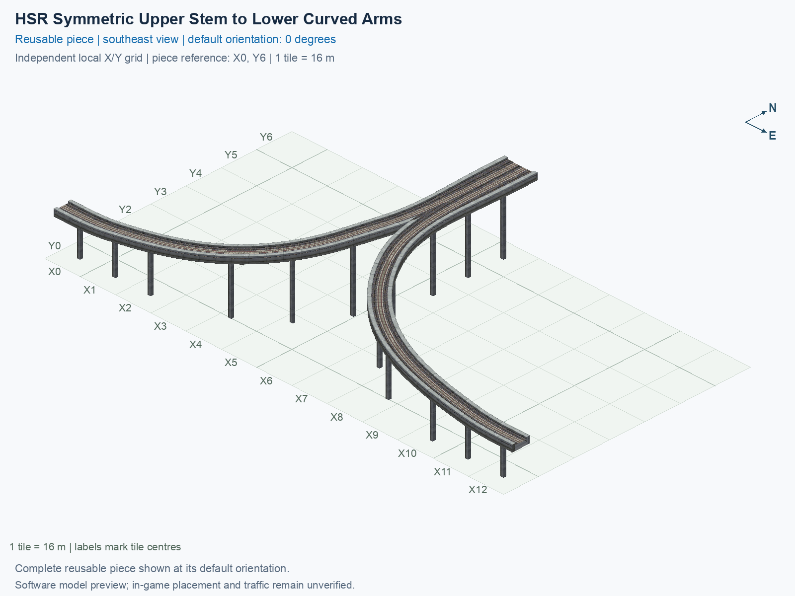

# HSR Symmetric Upper Stem to Lower Curved Arms

Purpose: explain this reusable piece, its matching connections and current test coverage.

<!-- BEGIN PIECE OVERVIEW -->

Two mirrored curved level transitions connect one native two-track upper stem to opposite lower one-way arms. The paired collar stays flat until the two tapered decks separate.

Exact reusable identifier: `hsr-component-symmetric-graded-y`.

Footprint: **13 × 7 tiles**. Exact menu name: **HSR Symmetric Upper Stem to Lower Curved Arms**.

Choose this exact name in Transportation → Rail. Press Home or End to rotate; use only the supported states listed below. Join each end to a matching port profile and direction.

- [Connections and journeys](#connections-and-journeys)
- [Test checklist](#test-checklist)



<!-- END PIECE OVERVIEW -->

<!-- BEGIN MANUAL SUMMARY -->

## Manual status

Generated from [the exact test cases](#test-checklist) and [authoritative observations](checks/manual-tests.json).

- [ ] Preview review: 0/1 applicable cases passed; 0 failed, 0 stale.
- [ ] In-game rendering: 0/4 applicable cases passed; 0 failed, 0 stale.
- [ ] Directed journeys: 0/8 applicable cases passed; 0 failed, 0 stale.

These observations cover only the named services, directions, poses, rotations, and recorded platforms.

<!-- END MANUAL SUMMARY -->

<!-- BEGIN CONNECTIONS -->

## Connections and journeys

Purpose: describe intrinsic directional interfaces and permitted service journeys.

Generated from [connections.json](connections.json). Coordinates are canonical east, north and height in metres. A connection class names an encoded route interface; it does not prove visible deck/wall fit or an in-game test.

Supported placement states: 0° CCW, 90° CCW, 180° CCW, 270° CCW. Each state has its own declared manual scope.

A **port** is one directional transport-path endpoint. **Service** identifies the intended network service (for example HSR, street, or tram); **engine** is its internal traffic-class number, separate from the construction network. **Role** distinguishes primary service from auxiliary paths; sharing a traffic class does not establish service compatibility.

A **tangent** is a unit travel-direction vector: `[0,1]` means north. **Grade** is height gained per horizontal metre. These measured facts describe this subject alone. Compatibility requires a separate comparison of the complete joining boundaries; physical seams and actual game operation require their own evidence. See the [class index](../../connection-classes.json) for shared route-interface membership.

| Port | Service / engine / role | Direction | Location; tangent; grade | Connection class |
| --- | --- | --- | --- | --- |
| `Wout` | hsr / 7 / primary | out | [-8.0, -96.0, 15.5]; [-1.0, 0.0]; 0.0 | `path-interface-ac60d237d23f01143255` |
| `Nin` | hsr / 7 / primary | in | [94.0, 8.0, 30.5]; [0.0, -1.0]; 0.0 | `path-interface-ce3ccdc10e5e243d11ae` |
| `Nout` | hsr / 7 / primary | out | [98.0, 8.0, 30.5]; [0.0, 1.0]; 0.0 | `path-interface-9b897a8bacb659f807fe` |
| `Ein` | hsr / 7 / primary | in | [200.0, -96.0, 15.5]; [-1.0, 0.0]; 0.0 | `path-interface-ac60d237d23f01143255` |

### Directed journeys

| Service | Entry → exit | Role |
| --- | --- | --- |
| hsr | `Nin` → `Wout` | primary |
| hsr | `Ein` → `Nout` | primary |

### Forbidden transfers

| From service / port | To service / port | Reason |
| --- | --- | --- |
| hsr / `Nin` | hsr / `Nout` | No directed route exists between these ports in the saved piece transport paths. In-game confirmation remains unverified. |
| hsr / `Ein` | hsr / `Wout` | No directed route exists between these ports in the saved piece transport paths. In-game confirmation remains unverified. |

Review the test checklist for the exact tested cases and environments.

<!-- END CONNECTIONS -->

<!-- BEGIN MANUAL CHECKS -->

## Test checklist

Generated from [the authoritative record](checks/manual-tests.json). Only explicit human observations create manual passes; software and preview checks remain separate. Expand a check/service group to see its rotation table, then expand the matching exact scope to copy a case ID and inspect its pose, reviewer, environment, and evidence. Grouping changes only this view; every declared case remains separate.

**States:** [x] passed; [ ] unverified, failed, or stale; N/A is an explicit inapplicable declaration. A dash means no case was declared in that column. Every pass covers only its recorded environment. T means a distinct construction-transposed state.

Four proper rotations are covered. No additional reflected state is established by this record; repeated construction aliases do not create new orientations.

Current totals: unverified: 35, passed: 0, failed: 0, stale: 0, not_applicable: 0.

### Record an observation

Follow the [shared testing guide](../../../../docs/TESTING.md); copy [the unconfirmed example](checks/observation.example.json) to `checks/observation.json`. Case identifiers are in the expandable sections below. Do not edit generated checkboxes.

From the repository folder containing `custom-pieces`, run after filling `checks/observation.json` and explicitly confirming the exact observation:

```sh
python3 -m scp.content record --record custom-pieces/domains/high-speed-rail/00_pieces/hsr-component-symmetric-graded-y/checks/manual-tests.json --observation custom-pieces/domains/high-speed-rail/00_pieces/hsr-component-symmetric-graded-y/checks/observation.json
```

### Detailed current checks

Each collapsed group shows exact case counts and states. Forbidden transfers are grouped by the directed service pair; the table inside retains every port pair and rotation.

<details>
<summary>Compiled resources — Whole subject — 1 case; unverified: 1</summary>

| Check / exact scope | General | 0° | 90° | 180° | 270° |
| --- | --- | --- | --- | --- | --- |
| **Compiled resources**<br>Whole subject | <a href="#case-software_resources-a9a081fa195d6b426159">[ ] unverified</a> | — | — | — | — |


<details>
<summary>Compiled resources — Whole subject</summary>

<a id="case-software_resources-a9a081fa195d6b426159"></a>

**General: unverified** — `software_resources-a9a081fa195d6b426159`.

Verify the actual compiled resources and construction rules.

Scope: Whole subject.

No observation recorded.

</details>

</details>

<details>
<summary>Directed routing graph — Whole subject — 1 case; unverified: 1</summary>

| Check / exact scope | General | 0° | 90° | 180° | 270° |
| --- | --- | --- | --- | --- | --- |
| **Directed routing graph**<br>Whole subject | <a href="#case-software_connectivity-a9a081fa195d6b426159">[ ] unverified</a> | — | — | — | — |


<details>
<summary>Directed routing graph — Whole subject</summary>

<a id="case-software_connectivity-a9a081fa195d6b426159"></a>

**General: unverified** — `software_connectivity-a9a081fa195d6b426159`.

Verify the declared directed journeys and forbidden transfers.

Scope: Whole subject.

No observation recorded.

</details>

</details>

<details>
<summary>Preview review — Images — 1 case; unverified: 1</summary>

| Check / exact scope | General | 0° | 90° | 180° | 270° |
| --- | --- | --- | --- | --- | --- |
| **Preview review**<br>Image: image:hsr-component-symmetric-graded-y:canonical-southeast | <a href="#case-preview_review-c34b1546e18ed7983fc5">[ ] unverified</a> | — | — | — | — |


<details>
<summary>Preview review — Image: image:hsr-component-symmetric-graded-y:canonical-southeast</summary>

<a id="case-preview_review-c34b1546e18ed7983fc5"></a>

**General: unverified** — `preview_review-c34b1546e18ed7983fc5`.

Inspect this exact preview for tracks, walls, piers, seams and shadows.

Scope: Image: image:hsr-component-symmetric-graded-y:canonical-southeast.

No observation recorded.

</details>

</details>

<details>
<summary>In-game rendering — Whole subject — 4 cases; unverified: 4</summary>

| Check / exact scope | General | 0° | 90° | 180° | 270° |
| --- | --- | --- | --- | --- | --- |
| **In-game rendering**<br>Whole subject | — | <a href="#case-in_game_render-ca971f89c6f381350267">[ ] unverified</a> | <a href="#case-in_game_render-7dd23ba123dffa9393da">[ ] unverified</a> | <a href="#case-in_game_render-be624337acbd09d4673e">[ ] unverified</a> | <a href="#case-in_game_render-9173a42ca1a28800cd60">[ ] unverified</a> |


<details>
<summary>In-game rendering — Whole subject</summary>

<a id="case-in_game_render-ca971f89c6f381350267"></a>

**0° CCW: unverified** — `in_game_render-ca971f89c6f381350267`.

Inspect the placed tracks, walls, piers, seams and shadows in SimCity 4.

Scope: Whole subject.

No observation recorded.

<a id="case-in_game_render-7dd23ba123dffa9393da"></a>

**90° CCW: unverified** — `in_game_render-7dd23ba123dffa9393da`.

Inspect the placed tracks, walls, piers, seams and shadows in SimCity 4.

Scope: Whole subject.

No observation recorded.

<a id="case-in_game_render-be624337acbd09d4673e"></a>

**180° CCW: unverified** — `in_game_render-be624337acbd09d4673e`.

Inspect the placed tracks, walls, piers, seams and shadows in SimCity 4.

Scope: Whole subject.

No observation recorded.

<a id="case-in_game_render-9173a42ca1a28800cd60"></a>

**270° CCW: unverified** — `in_game_render-9173a42ca1a28800cd60`.

Inspect the placed tracks, walls, piers, seams and shadows in SimCity 4.

Scope: Whole subject.

No observation recorded.

</details>

</details>

<details>
<summary>Placement — Whole subject — 4 cases; unverified: 4</summary>

| Check / exact scope | General | 0° | 90° | 180° | 270° |
| --- | --- | --- | --- | --- | --- |
| **Placement**<br>Whole subject | — | <a href="#case-in_game_placement-ca971f89c6f381350267">[ ] unverified</a> | <a href="#case-in_game_placement-7dd23ba123dffa9393da">[ ] unverified</a> | <a href="#case-in_game_placement-be624337acbd09d4673e">[ ] unverified</a> | <a href="#case-in_game_placement-9173a42ca1a28800cd60">[ ] unverified</a> |


<details>
<summary>Placement — Whole subject</summary>

<a id="case-in_game_placement-ca971f89c6f381350267"></a>

**0° CCW: unverified** — `in_game_placement-ca971f89c6f381350267`.

Place this piece or complete blueprint and inspect every occupied tile.

Scope: Whole subject.

No observation recorded.

<a id="case-in_game_placement-7dd23ba123dffa9393da"></a>

**90° CCW: unverified** — `in_game_placement-7dd23ba123dffa9393da`.

Place this piece or complete blueprint and inspect every occupied tile.

Scope: Whole subject.

No observation recorded.

<a id="case-in_game_placement-be624337acbd09d4673e"></a>

**180° CCW: unverified** — `in_game_placement-be624337acbd09d4673e`.

Place this piece or complete blueprint and inspect every occupied tile.

Scope: Whole subject.

No observation recorded.

<a id="case-in_game_placement-9173a42ca1a28800cd60"></a>

**270° CCW: unverified** — `in_game_placement-9173a42ca1a28800cd60`.

Place this piece or complete blueprint and inspect every occupied tile.

Scope: Whole subject.

No observation recorded.

</details>

</details>

<details>
<summary>Demolition — Whole subject — 4 cases; unverified: 4</summary>

| Check / exact scope | General | 0° | 90° | 180° | 270° |
| --- | --- | --- | --- | --- | --- |
| **Demolition**<br>Whole subject | — | <a href="#case-in_game_demolition-ca971f89c6f381350267">[ ] unverified</a> | <a href="#case-in_game_demolition-7dd23ba123dffa9393da">[ ] unverified</a> | <a href="#case-in_game_demolition-be624337acbd09d4673e">[ ] unverified</a> | <a href="#case-in_game_demolition-9173a42ca1a28800cd60">[ ] unverified</a> |


<details>
<summary>Demolition — Whole subject</summary>

<a id="case-in_game_demolition-ca971f89c6f381350267"></a>

**0° CCW: unverified** — `in_game_demolition-ca971f89c6f381350267`.

Bulldoze the complete placement and inspect the cleared area.

Scope: Whole subject.

No observation recorded.

<a id="case-in_game_demolition-7dd23ba123dffa9393da"></a>

**90° CCW: unverified** — `in_game_demolition-7dd23ba123dffa9393da`.

Bulldoze the complete placement and inspect the cleared area.

Scope: Whole subject.

No observation recorded.

<a id="case-in_game_demolition-be624337acbd09d4673e"></a>

**180° CCW: unverified** — `in_game_demolition-be624337acbd09d4673e`.

Bulldoze the complete placement and inspect the cleared area.

Scope: Whole subject.

No observation recorded.

<a id="case-in_game_demolition-9173a42ca1a28800cd60"></a>

**270° CCW: unverified** — `in_game_demolition-9173a42ca1a28800cd60`.

Bulldoze the complete placement and inspect the cleared area.

Scope: Whole subject.

No observation recorded.

</details>

</details>

<details>
<summary>Save and reload — Whole subject — 4 cases; unverified: 4</summary>

| Check / exact scope | General | 0° | 90° | 180° | 270° |
| --- | --- | --- | --- | --- | --- |
| **Save and reload**<br>Whole subject | — | <a href="#case-in_game_save_reload-ca971f89c6f381350267">[ ] unverified</a> | <a href="#case-in_game_save_reload-7dd23ba123dffa9393da">[ ] unverified</a> | <a href="#case-in_game_save_reload-be624337acbd09d4673e">[ ] unverified</a> | <a href="#case-in_game_save_reload-9173a42ca1a28800cd60">[ ] unverified</a> |


<details>
<summary>Save and reload — Whole subject</summary>

<a id="case-in_game_save_reload-ca971f89c6f381350267"></a>

**0° CCW: unverified** — `in_game_save_reload-ca971f89c6f381350267`.

Save, quit, reload and inspect the placement and its paths.

Scope: Whole subject.

No observation recorded.

<a id="case-in_game_save_reload-7dd23ba123dffa9393da"></a>

**90° CCW: unverified** — `in_game_save_reload-7dd23ba123dffa9393da`.

Save, quit, reload and inspect the placement and its paths.

Scope: Whole subject.

No observation recorded.

<a id="case-in_game_save_reload-be624337acbd09d4673e"></a>

**180° CCW: unverified** — `in_game_save_reload-be624337acbd09d4673e`.

Save, quit, reload and inspect the placement and its paths.

Scope: Whole subject.

No observation recorded.

<a id="case-in_game_save_reload-9173a42ca1a28800cd60"></a>

**270° CCW: unverified** — `in_game_save_reload-9173a42ca1a28800cd60`.

Save, quit, reload and inspect the placement and its paths.

Scope: Whole subject.

No observation recorded.

</details>

</details>

<details>
<summary>Journey — hsr — 8 cases; unverified: 8</summary>

| Check / exact scope | General | 0° | 90° | 180° | 270° |
| --- | --- | --- | --- | --- | --- |
| **Journey**<br>Service: hsr; role: primary; journey: 7:Nin>Wout; entry: Nin; exit: Wout | — | <a href="#case-in_game_journey-4925c764ae1fe1321d97">[ ] unverified</a> | <a href="#case-in_game_journey-6fd91d385f1b415a0772">[ ] unverified</a> | <a href="#case-in_game_journey-10eb3edcdd324f62a102">[ ] unverified</a> | <a href="#case-in_game_journey-f36e3ee5a2d078411844">[ ] unverified</a> |
| **Journey**<br>Service: hsr; role: primary; journey: 7:Ein>Nout; entry: Ein; exit: Nout | — | <a href="#case-in_game_journey-454fd7c6721ec253da00">[ ] unverified</a> | <a href="#case-in_game_journey-8c6718778b8938d37895">[ ] unverified</a> | <a href="#case-in_game_journey-93fe81907e151cefb9d5">[ ] unverified</a> | <a href="#case-in_game_journey-fcf2be8de6bc77fe73a0">[ ] unverified</a> |


<details>
<summary>Journey — Service: hsr; role: primary; journey: 7:Nin>Wout; entry: Nin; exit: Wout</summary>

<a id="case-in_game_journey-4925c764ae1fe1321d97"></a>

**0° CCW: unverified** — `in_game_journey-4925c764ae1fe1321d97`.

Run the declared journey in this direction using its service network.

Scope: Service: hsr; role: primary; journey: 7:Nin>Wout; entry: Nin; exit: Wout.

No observation recorded.

<a id="case-in_game_journey-6fd91d385f1b415a0772"></a>

**90° CCW: unverified** — `in_game_journey-6fd91d385f1b415a0772`.

Run the declared journey in this direction using its service network.

Scope: Service: hsr; role: primary; journey: 7:Nin>Wout; entry: Nin; exit: Wout.

No observation recorded.

<a id="case-in_game_journey-10eb3edcdd324f62a102"></a>

**180° CCW: unverified** — `in_game_journey-10eb3edcdd324f62a102`.

Run the declared journey in this direction using its service network.

Scope: Service: hsr; role: primary; journey: 7:Nin>Wout; entry: Nin; exit: Wout.

No observation recorded.

<a id="case-in_game_journey-f36e3ee5a2d078411844"></a>

**270° CCW: unverified** — `in_game_journey-f36e3ee5a2d078411844`.

Run the declared journey in this direction using its service network.

Scope: Service: hsr; role: primary; journey: 7:Nin>Wout; entry: Nin; exit: Wout.

No observation recorded.

</details>


<details>
<summary>Journey — Service: hsr; role: primary; journey: 7:Ein>Nout; entry: Ein; exit: Nout</summary>

<a id="case-in_game_journey-454fd7c6721ec253da00"></a>

**0° CCW: unverified** — `in_game_journey-454fd7c6721ec253da00`.

Run the declared journey in this direction using its service network.

Scope: Service: hsr; role: primary; journey: 7:Ein>Nout; entry: Ein; exit: Nout.

No observation recorded.

<a id="case-in_game_journey-8c6718778b8938d37895"></a>

**90° CCW: unverified** — `in_game_journey-8c6718778b8938d37895`.

Run the declared journey in this direction using its service network.

Scope: Service: hsr; role: primary; journey: 7:Ein>Nout; entry: Ein; exit: Nout.

No observation recorded.

<a id="case-in_game_journey-93fe81907e151cefb9d5"></a>

**180° CCW: unverified** — `in_game_journey-93fe81907e151cefb9d5`.

Run the declared journey in this direction using its service network.

Scope: Service: hsr; role: primary; journey: 7:Ein>Nout; entry: Ein; exit: Nout.

No observation recorded.

<a id="case-in_game_journey-fcf2be8de6bc77fe73a0"></a>

**270° CCW: unverified** — `in_game_journey-fcf2be8de6bc77fe73a0`.

Run the declared journey in this direction using its service network.

Scope: Service: hsr; role: primary; journey: 7:Ein>Nout; entry: Ein; exit: Nout.

No observation recorded.

</details>

</details>

<details>
<summary>Forbidden transfer — hsr → hsr — 8 cases; unverified: 8</summary>

| Check / exact scope | General | 0° | 90° | 180° | 270° |
| --- | --- | --- | --- | --- | --- |
| **Forbidden transfer**<br>from port: Nin; to port: Nout; from service: hsr; to service: hsr; basis: not reachable in actual saved PATH graph | — | <a href="#case-in_game_forbidden_transfer-4f101a95f04090b76ef9">[ ] unverified</a> | <a href="#case-in_game_forbidden_transfer-f4895f2abbdb7af3cfb8">[ ] unverified</a> | <a href="#case-in_game_forbidden_transfer-9c2a8dbb1ceeeab9acbd">[ ] unverified</a> | <a href="#case-in_game_forbidden_transfer-8d083752901a159c10fa">[ ] unverified</a> |
| **Forbidden transfer**<br>from port: Ein; to port: Wout; from service: hsr; to service: hsr; basis: not reachable in actual saved PATH graph | — | <a href="#case-in_game_forbidden_transfer-8d81e12a98a23ab58e2b">[ ] unverified</a> | <a href="#case-in_game_forbidden_transfer-1d5fc832992135a41d74">[ ] unverified</a> | <a href="#case-in_game_forbidden_transfer-a3c56f5cddc50ab7cdad">[ ] unverified</a> | <a href="#case-in_game_forbidden_transfer-fd0870c1a03e080d1bf3">[ ] unverified</a> |


<details>
<summary>Forbidden transfer — from port: Nin; to port: Nout; from service: hsr; to service: hsr; basis: not reachable in actual saved PATH graph</summary>

<a id="case-in_game_forbidden_transfer-4f101a95f04090b76ef9"></a>

**0° CCW: unverified** — `in_game_forbidden_transfer-4f101a95f04090b76ef9`.

Confirm this undeclared transfer is unavailable.

Scope: from port: Nin; to port: Nout; from service: hsr; to service: hsr; basis: not reachable in actual saved PATH graph.

No observation recorded.

<a id="case-in_game_forbidden_transfer-f4895f2abbdb7af3cfb8"></a>

**90° CCW: unverified** — `in_game_forbidden_transfer-f4895f2abbdb7af3cfb8`.

Confirm this undeclared transfer is unavailable.

Scope: from port: Nin; to port: Nout; from service: hsr; to service: hsr; basis: not reachable in actual saved PATH graph.

No observation recorded.

<a id="case-in_game_forbidden_transfer-9c2a8dbb1ceeeab9acbd"></a>

**180° CCW: unverified** — `in_game_forbidden_transfer-9c2a8dbb1ceeeab9acbd`.

Confirm this undeclared transfer is unavailable.

Scope: from port: Nin; to port: Nout; from service: hsr; to service: hsr; basis: not reachable in actual saved PATH graph.

No observation recorded.

<a id="case-in_game_forbidden_transfer-8d083752901a159c10fa"></a>

**270° CCW: unverified** — `in_game_forbidden_transfer-8d083752901a159c10fa`.

Confirm this undeclared transfer is unavailable.

Scope: from port: Nin; to port: Nout; from service: hsr; to service: hsr; basis: not reachable in actual saved PATH graph.

No observation recorded.

</details>


<details>
<summary>Forbidden transfer — from port: Ein; to port: Wout; from service: hsr; to service: hsr; basis: not reachable in actual saved PATH graph</summary>

<a id="case-in_game_forbidden_transfer-8d81e12a98a23ab58e2b"></a>

**0° CCW: unverified** — `in_game_forbidden_transfer-8d81e12a98a23ab58e2b`.

Confirm this undeclared transfer is unavailable.

Scope: from port: Ein; to port: Wout; from service: hsr; to service: hsr; basis: not reachable in actual saved PATH graph.

No observation recorded.

<a id="case-in_game_forbidden_transfer-1d5fc832992135a41d74"></a>

**90° CCW: unverified** — `in_game_forbidden_transfer-1d5fc832992135a41d74`.

Confirm this undeclared transfer is unavailable.

Scope: from port: Ein; to port: Wout; from service: hsr; to service: hsr; basis: not reachable in actual saved PATH graph.

No observation recorded.

<a id="case-in_game_forbidden_transfer-a3c56f5cddc50ab7cdad"></a>

**180° CCW: unverified** — `in_game_forbidden_transfer-a3c56f5cddc50ab7cdad`.

Confirm this undeclared transfer is unavailable.

Scope: from port: Ein; to port: Wout; from service: hsr; to service: hsr; basis: not reachable in actual saved PATH graph.

No observation recorded.

<a id="case-in_game_forbidden_transfer-fd0870c1a03e080d1bf3"></a>

**270° CCW: unverified** — `in_game_forbidden_transfer-fd0870c1a03e080d1bf3`.

Confirm this undeclared transfer is unavailable.

Scope: from port: Ein; to port: Wout; from service: hsr; to service: hsr; basis: not reachable in actual saved PATH graph.

No observation recorded.

</details>

</details>

<!-- END MANUAL CHECKS -->

## Engineering contract

The symmetric upper-stem-to-curved-arms component occupies a 13 × 7 rectangle with 25 occupied cells and 15 mirrored supports. Its paired upper collar stays flat for 56 m; native-to-single width tapering occurs from 8 to 56 m, before the grade. Both arms are exact mirror-reverses in east/north/height. Preserve its deliberately mirrored support plan.

Use the [independent source contract](../../implementation/scp_hsr/hsr_components_verify.py) and this type's [definition](piece.json) for exact expectations. Shared HSR/GHSR facts remain in [NETWORK_SPEC.md](../../NETWORK_SPEC.md). These authored notes supplement generated source views; they do not change geometry, reset observations, or establish game operation.
