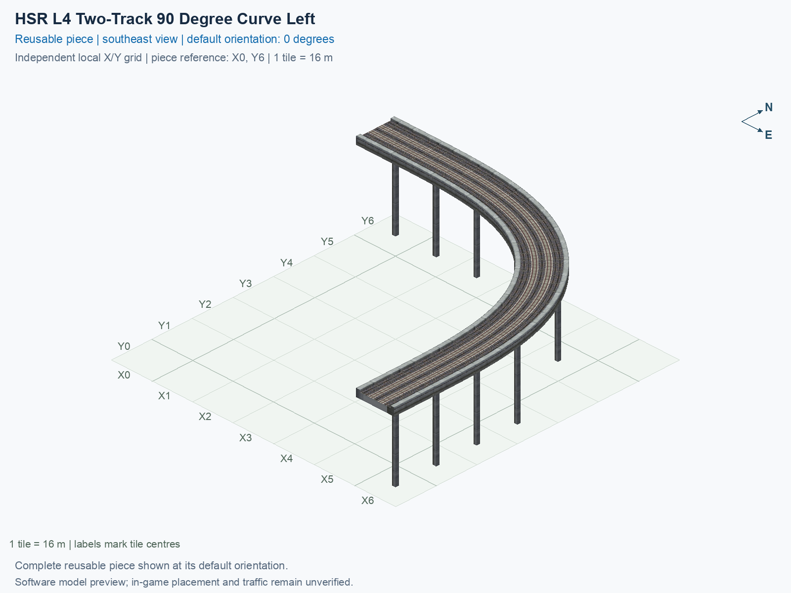

# HSR L4 Two-Track 90 Degree Curve Left

Purpose: explain this reusable piece, its matching connections and current test coverage.

<!-- BEGIN PIECE OVERVIEW -->

Close opposite-direction tracks on one native-width upper 90 degree slab, with flat cardinal connection collars.

Exact reusable identifier: `hsr-component-upper-paired-curve90-left`.

Footprint: **7 × 7 tiles**. Exact menu name: **HSR L4 Two-Track 90 Degree Curve Left**.

Choose this exact name in Transportation → Rail. Press Home or End to rotate; use only the supported states listed below. Join each end to a matching port profile and direction.

- [Connections and journeys](#connections-and-journeys)
- [Test checklist](#test-checklist)



<!-- END PIECE OVERVIEW -->

<!-- BEGIN MANUAL SUMMARY -->

## Manual status

Generated from [the exact test cases](#test-checklist) and [authoritative observations](checks/manual-tests.json).

- [ ] Preview review: 0/1 applicable cases passed; 0 failed, 0 stale.
- [ ] In-game rendering: 0/4 applicable cases passed; 0 failed, 0 stale.
- [ ] Directed journeys: 0/8 applicable cases passed; 0 failed, 0 stale.

These observations cover only the named services, directions, poses, rotations, and recorded platforms.

<!-- END MANUAL SUMMARY -->

<!-- BEGIN CONNECTIONS -->

## Connections and journeys

Purpose: describe intrinsic directional interfaces and permitted service journeys.

Generated from [connections.json](connections.json). Coordinates are canonical east, north and height in metres. A connection class names an encoded route interface; it does not prove visible deck/wall fit or an in-game test.

Supported placement states: 0° CCW, 90° CCW, 180° CCW, 270° CCW. Each state has its own declared manual scope.

A **port** is one directional transport-path endpoint. **Service** identifies the intended network service (for example HSR, street, or tram); **engine** is its internal traffic-class number, separate from the construction network. **Role** distinguishes primary service from auxiliary paths; sharing a traffic class does not establish service compatibility.

A **tangent** is a unit travel-direction vector: `[0,1]` means north. **Grade** is height gained per horizontal metre. These measured facts describe this subject alone. Compatibility requires a separate comparison of the complete joining boundaries; physical seams and actual game operation require their own evidence. See the [class index](../../connection-classes.json) for shared route-interface membership.

| Port | Service / engine / role | Direction | Location; tangent; grade | Connection class |
| --- | --- | --- | --- | --- |
| `Win` | hsr / 7 / primary | in | [-8.0, -2.0, 30.5]; [1.0, -0.0]; 0.0 | `path-interface-9b897a8bacb659f807fe` |
| `Wout` | hsr / 7 / primary | out | [-8.0, 2.0, 30.5]; [-1.0, 0.0]; 0.0 | `path-interface-9b897a8bacb659f807fe` |
| `Sout` | hsr / 7 / primary | out | [94.0, -104.0, 30.5]; [0.0, -1.0]; 0.0 | `path-interface-ce3ccdc10e5e243d11ae` |
| `Sin` | hsr / 7 / primary | in | [98.0, -104.0, 30.5]; [0.0, 1.0]; 0.0 | `path-interface-9b897a8bacb659f807fe` |

### Directed journeys

| Service | Entry → exit | Role |
| --- | --- | --- |
| hsr | `Win` → `Sout` | primary |
| hsr | `Sin` → `Wout` | primary |

### Forbidden transfers

| From service / port | To service / port | Reason |
| --- | --- | --- |
| hsr / `Win` | hsr / `Wout` | No directed route exists between these ports in the saved piece transport paths. In-game confirmation remains unverified. |
| hsr / `Sin` | hsr / `Sout` | No directed route exists between these ports in the saved piece transport paths. In-game confirmation remains unverified. |

Review the test checklist for the exact tested cases and environments.

<!-- END CONNECTIONS -->

<!-- BEGIN MANUAL CHECKS -->

## Test checklist

Generated from [the authoritative record](checks/manual-tests.json). Only explicit human observations create manual passes; software and preview checks remain separate. Expand a check/service group to see its rotation table, then expand the matching exact scope to copy a case ID and inspect its pose, reviewer, environment, and evidence. Grouping changes only this view; every declared case remains separate.

**States:** [x] passed; [ ] unverified, failed, or stale; N/A is an explicit inapplicable declaration. A dash means no case was declared in that column. Every pass covers only its recorded environment. T means a distinct construction-transposed state.

Four proper rotations are covered. No additional reflected state is established by this record; repeated construction aliases do not create new orientations.

Current totals: unverified: 35, passed: 0, failed: 0, stale: 0, not_applicable: 0.

### Record an observation

Follow the [shared testing guide](../../../../docs/TESTING.md); copy [the unconfirmed example](checks/observation.example.json) to `checks/observation.json`. Case identifiers are in the expandable sections below. Do not edit generated checkboxes.

From the repository folder containing `custom-pieces`, run after filling `checks/observation.json` and explicitly confirming the exact observation:

```sh
python3 -m scp.content record --record custom-pieces/domains/high-speed-rail/00_pieces/hsr-component-upper-paired-curve90-left/checks/manual-tests.json --observation custom-pieces/domains/high-speed-rail/00_pieces/hsr-component-upper-paired-curve90-left/checks/observation.json
```

### Detailed current checks

Each collapsed group shows exact case counts and states. Forbidden transfers are grouped by the directed service pair; the table inside retains every port pair and rotation.

<details>
<summary>Compiled resources — Whole subject — 1 case; unverified: 1</summary>

| Check / exact scope | General | 0° | 90° | 180° | 270° |
| --- | --- | --- | --- | --- | --- |
| **Compiled resources**<br>Whole subject | <a href="#case-software_resources-4db811fed4420bf453b3">[ ] unverified</a> | — | — | — | — |


<details>
<summary>Compiled resources — Whole subject</summary>

<a id="case-software_resources-4db811fed4420bf453b3"></a>

**General: unverified** — `software_resources-4db811fed4420bf453b3`.

Verify the actual compiled resources and construction rules.

Scope: Whole subject.

No observation recorded.

</details>

</details>

<details>
<summary>Directed routing graph — Whole subject — 1 case; unverified: 1</summary>

| Check / exact scope | General | 0° | 90° | 180° | 270° |
| --- | --- | --- | --- | --- | --- |
| **Directed routing graph**<br>Whole subject | <a href="#case-software_connectivity-4db811fed4420bf453b3">[ ] unverified</a> | — | — | — | — |


<details>
<summary>Directed routing graph — Whole subject</summary>

<a id="case-software_connectivity-4db811fed4420bf453b3"></a>

**General: unverified** — `software_connectivity-4db811fed4420bf453b3`.

Verify the declared directed journeys and forbidden transfers.

Scope: Whole subject.

No observation recorded.

</details>

</details>

<details>
<summary>Preview review — Images — 1 case; unverified: 1</summary>

| Check / exact scope | General | 0° | 90° | 180° | 270° |
| --- | --- | --- | --- | --- | --- |
| **Preview review**<br>Image: image:hsr-component-upper-paired-curve90-left:canonical-southeast | <a href="#case-preview_review-f4b24ee0b82a9c4f7961">[ ] unverified</a> | — | — | — | — |


<details>
<summary>Preview review — Image: image:hsr-component-upper-paired-curve90-left:canonical-southeast</summary>

<a id="case-preview_review-f4b24ee0b82a9c4f7961"></a>

**General: unverified** — `preview_review-f4b24ee0b82a9c4f7961`.

Inspect this exact preview for tracks, walls, piers, seams and shadows.

Scope: Image: image:hsr-component-upper-paired-curve90-left:canonical-southeast.

No observation recorded.

</details>

</details>

<details>
<summary>In-game rendering — Whole subject — 4 cases; unverified: 4</summary>

| Check / exact scope | General | 0° | 90° | 180° | 270° |
| --- | --- | --- | --- | --- | --- |
| **In-game rendering**<br>Whole subject | — | <a href="#case-in_game_render-197aefe9c62015c36202">[ ] unverified</a> | <a href="#case-in_game_render-be8cd231fb3ee3a66535">[ ] unverified</a> | <a href="#case-in_game_render-ef88630813b2ea99c768">[ ] unverified</a> | <a href="#case-in_game_render-261e66520de0b72f5350">[ ] unverified</a> |


<details>
<summary>In-game rendering — Whole subject</summary>

<a id="case-in_game_render-197aefe9c62015c36202"></a>

**0° CCW: unverified** — `in_game_render-197aefe9c62015c36202`.

Inspect the placed tracks, walls, piers, seams and shadows in SimCity 4.

Scope: Whole subject.

No observation recorded.

<a id="case-in_game_render-be8cd231fb3ee3a66535"></a>

**90° CCW: unverified** — `in_game_render-be8cd231fb3ee3a66535`.

Inspect the placed tracks, walls, piers, seams and shadows in SimCity 4.

Scope: Whole subject.

No observation recorded.

<a id="case-in_game_render-ef88630813b2ea99c768"></a>

**180° CCW: unverified** — `in_game_render-ef88630813b2ea99c768`.

Inspect the placed tracks, walls, piers, seams and shadows in SimCity 4.

Scope: Whole subject.

No observation recorded.

<a id="case-in_game_render-261e66520de0b72f5350"></a>

**270° CCW: unverified** — `in_game_render-261e66520de0b72f5350`.

Inspect the placed tracks, walls, piers, seams and shadows in SimCity 4.

Scope: Whole subject.

No observation recorded.

</details>

</details>

<details>
<summary>Placement — Whole subject — 4 cases; unverified: 4</summary>

| Check / exact scope | General | 0° | 90° | 180° | 270° |
| --- | --- | --- | --- | --- | --- |
| **Placement**<br>Whole subject | — | <a href="#case-in_game_placement-197aefe9c62015c36202">[ ] unverified</a> | <a href="#case-in_game_placement-be8cd231fb3ee3a66535">[ ] unverified</a> | <a href="#case-in_game_placement-ef88630813b2ea99c768">[ ] unverified</a> | <a href="#case-in_game_placement-261e66520de0b72f5350">[ ] unverified</a> |


<details>
<summary>Placement — Whole subject</summary>

<a id="case-in_game_placement-197aefe9c62015c36202"></a>

**0° CCW: unverified** — `in_game_placement-197aefe9c62015c36202`.

Place this piece or complete blueprint and inspect every occupied tile.

Scope: Whole subject.

No observation recorded.

<a id="case-in_game_placement-be8cd231fb3ee3a66535"></a>

**90° CCW: unverified** — `in_game_placement-be8cd231fb3ee3a66535`.

Place this piece or complete blueprint and inspect every occupied tile.

Scope: Whole subject.

No observation recorded.

<a id="case-in_game_placement-ef88630813b2ea99c768"></a>

**180° CCW: unverified** — `in_game_placement-ef88630813b2ea99c768`.

Place this piece or complete blueprint and inspect every occupied tile.

Scope: Whole subject.

No observation recorded.

<a id="case-in_game_placement-261e66520de0b72f5350"></a>

**270° CCW: unverified** — `in_game_placement-261e66520de0b72f5350`.

Place this piece or complete blueprint and inspect every occupied tile.

Scope: Whole subject.

No observation recorded.

</details>

</details>

<details>
<summary>Demolition — Whole subject — 4 cases; unverified: 4</summary>

| Check / exact scope | General | 0° | 90° | 180° | 270° |
| --- | --- | --- | --- | --- | --- |
| **Demolition**<br>Whole subject | — | <a href="#case-in_game_demolition-197aefe9c62015c36202">[ ] unverified</a> | <a href="#case-in_game_demolition-be8cd231fb3ee3a66535">[ ] unverified</a> | <a href="#case-in_game_demolition-ef88630813b2ea99c768">[ ] unverified</a> | <a href="#case-in_game_demolition-261e66520de0b72f5350">[ ] unverified</a> |


<details>
<summary>Demolition — Whole subject</summary>

<a id="case-in_game_demolition-197aefe9c62015c36202"></a>

**0° CCW: unverified** — `in_game_demolition-197aefe9c62015c36202`.

Bulldoze the complete placement and inspect the cleared area.

Scope: Whole subject.

No observation recorded.

<a id="case-in_game_demolition-be8cd231fb3ee3a66535"></a>

**90° CCW: unverified** — `in_game_demolition-be8cd231fb3ee3a66535`.

Bulldoze the complete placement and inspect the cleared area.

Scope: Whole subject.

No observation recorded.

<a id="case-in_game_demolition-ef88630813b2ea99c768"></a>

**180° CCW: unverified** — `in_game_demolition-ef88630813b2ea99c768`.

Bulldoze the complete placement and inspect the cleared area.

Scope: Whole subject.

No observation recorded.

<a id="case-in_game_demolition-261e66520de0b72f5350"></a>

**270° CCW: unverified** — `in_game_demolition-261e66520de0b72f5350`.

Bulldoze the complete placement and inspect the cleared area.

Scope: Whole subject.

No observation recorded.

</details>

</details>

<details>
<summary>Save and reload — Whole subject — 4 cases; unverified: 4</summary>

| Check / exact scope | General | 0° | 90° | 180° | 270° |
| --- | --- | --- | --- | --- | --- |
| **Save and reload**<br>Whole subject | — | <a href="#case-in_game_save_reload-197aefe9c62015c36202">[ ] unverified</a> | <a href="#case-in_game_save_reload-be8cd231fb3ee3a66535">[ ] unverified</a> | <a href="#case-in_game_save_reload-ef88630813b2ea99c768">[ ] unverified</a> | <a href="#case-in_game_save_reload-261e66520de0b72f5350">[ ] unverified</a> |


<details>
<summary>Save and reload — Whole subject</summary>

<a id="case-in_game_save_reload-197aefe9c62015c36202"></a>

**0° CCW: unverified** — `in_game_save_reload-197aefe9c62015c36202`.

Save, quit, reload and inspect the placement and its paths.

Scope: Whole subject.

No observation recorded.

<a id="case-in_game_save_reload-be8cd231fb3ee3a66535"></a>

**90° CCW: unverified** — `in_game_save_reload-be8cd231fb3ee3a66535`.

Save, quit, reload and inspect the placement and its paths.

Scope: Whole subject.

No observation recorded.

<a id="case-in_game_save_reload-ef88630813b2ea99c768"></a>

**180° CCW: unverified** — `in_game_save_reload-ef88630813b2ea99c768`.

Save, quit, reload and inspect the placement and its paths.

Scope: Whole subject.

No observation recorded.

<a id="case-in_game_save_reload-261e66520de0b72f5350"></a>

**270° CCW: unverified** — `in_game_save_reload-261e66520de0b72f5350`.

Save, quit, reload and inspect the placement and its paths.

Scope: Whole subject.

No observation recorded.

</details>

</details>

<details>
<summary>Journey — hsr — 8 cases; unverified: 8</summary>

| Check / exact scope | General | 0° | 90° | 180° | 270° |
| --- | --- | --- | --- | --- | --- |
| **Journey**<br>Service: hsr; role: primary; journey: 7:Win>Sout; entry: Win; exit: Sout | — | <a href="#case-in_game_journey-56222d9025e397e8e024">[ ] unverified</a> | <a href="#case-in_game_journey-504ac7d27749ab70fa3d">[ ] unverified</a> | <a href="#case-in_game_journey-821c7b9912be8e5ece8d">[ ] unverified</a> | <a href="#case-in_game_journey-1abc8cf9093fdb341119">[ ] unverified</a> |
| **Journey**<br>Service: hsr; role: primary; journey: 7:Sin>Wout; entry: Sin; exit: Wout | — | <a href="#case-in_game_journey-b3da3c1546536c2c5691">[ ] unverified</a> | <a href="#case-in_game_journey-68d47688ea76f0605176">[ ] unverified</a> | <a href="#case-in_game_journey-121877e63290e20851d2">[ ] unverified</a> | <a href="#case-in_game_journey-90c11db2e2b96e487267">[ ] unverified</a> |


<details>
<summary>Journey — Service: hsr; role: primary; journey: 7:Win>Sout; entry: Win; exit: Sout</summary>

<a id="case-in_game_journey-56222d9025e397e8e024"></a>

**0° CCW: unverified** — `in_game_journey-56222d9025e397e8e024`.

Run the declared journey in this direction using its service network.

Scope: Service: hsr; role: primary; journey: 7:Win>Sout; entry: Win; exit: Sout.

No observation recorded.

<a id="case-in_game_journey-504ac7d27749ab70fa3d"></a>

**90° CCW: unverified** — `in_game_journey-504ac7d27749ab70fa3d`.

Run the declared journey in this direction using its service network.

Scope: Service: hsr; role: primary; journey: 7:Win>Sout; entry: Win; exit: Sout.

No observation recorded.

<a id="case-in_game_journey-821c7b9912be8e5ece8d"></a>

**180° CCW: unverified** — `in_game_journey-821c7b9912be8e5ece8d`.

Run the declared journey in this direction using its service network.

Scope: Service: hsr; role: primary; journey: 7:Win>Sout; entry: Win; exit: Sout.

No observation recorded.

<a id="case-in_game_journey-1abc8cf9093fdb341119"></a>

**270° CCW: unverified** — `in_game_journey-1abc8cf9093fdb341119`.

Run the declared journey in this direction using its service network.

Scope: Service: hsr; role: primary; journey: 7:Win>Sout; entry: Win; exit: Sout.

No observation recorded.

</details>


<details>
<summary>Journey — Service: hsr; role: primary; journey: 7:Sin>Wout; entry: Sin; exit: Wout</summary>

<a id="case-in_game_journey-b3da3c1546536c2c5691"></a>

**0° CCW: unverified** — `in_game_journey-b3da3c1546536c2c5691`.

Run the declared journey in this direction using its service network.

Scope: Service: hsr; role: primary; journey: 7:Sin>Wout; entry: Sin; exit: Wout.

No observation recorded.

<a id="case-in_game_journey-68d47688ea76f0605176"></a>

**90° CCW: unverified** — `in_game_journey-68d47688ea76f0605176`.

Run the declared journey in this direction using its service network.

Scope: Service: hsr; role: primary; journey: 7:Sin>Wout; entry: Sin; exit: Wout.

No observation recorded.

<a id="case-in_game_journey-121877e63290e20851d2"></a>

**180° CCW: unverified** — `in_game_journey-121877e63290e20851d2`.

Run the declared journey in this direction using its service network.

Scope: Service: hsr; role: primary; journey: 7:Sin>Wout; entry: Sin; exit: Wout.

No observation recorded.

<a id="case-in_game_journey-90c11db2e2b96e487267"></a>

**270° CCW: unverified** — `in_game_journey-90c11db2e2b96e487267`.

Run the declared journey in this direction using its service network.

Scope: Service: hsr; role: primary; journey: 7:Sin>Wout; entry: Sin; exit: Wout.

No observation recorded.

</details>

</details>

<details>
<summary>Forbidden transfer — hsr → hsr — 8 cases; unverified: 8</summary>

| Check / exact scope | General | 0° | 90° | 180° | 270° |
| --- | --- | --- | --- | --- | --- |
| **Forbidden transfer**<br>from port: Win; to port: Wout; from service: hsr; to service: hsr; basis: not reachable in actual saved PATH graph | — | <a href="#case-in_game_forbidden_transfer-86a0ca43086c92285b9d">[ ] unverified</a> | <a href="#case-in_game_forbidden_transfer-f2f77e6f0bd789bd9826">[ ] unverified</a> | <a href="#case-in_game_forbidden_transfer-0d11c85071bf39002983">[ ] unverified</a> | <a href="#case-in_game_forbidden_transfer-561e14be92559a47634c">[ ] unverified</a> |
| **Forbidden transfer**<br>from port: Sin; to port: Sout; from service: hsr; to service: hsr; basis: not reachable in actual saved PATH graph | — | <a href="#case-in_game_forbidden_transfer-c81b87922f87fa6c630d">[ ] unverified</a> | <a href="#case-in_game_forbidden_transfer-0255ca8ef69040b0d1e8">[ ] unverified</a> | <a href="#case-in_game_forbidden_transfer-994668f911f243c5c17c">[ ] unverified</a> | <a href="#case-in_game_forbidden_transfer-1dacfe74b5d61c56c0e4">[ ] unverified</a> |


<details>
<summary>Forbidden transfer — from port: Win; to port: Wout; from service: hsr; to service: hsr; basis: not reachable in actual saved PATH graph</summary>

<a id="case-in_game_forbidden_transfer-86a0ca43086c92285b9d"></a>

**0° CCW: unverified** — `in_game_forbidden_transfer-86a0ca43086c92285b9d`.

Confirm this undeclared transfer is unavailable.

Scope: from port: Win; to port: Wout; from service: hsr; to service: hsr; basis: not reachable in actual saved PATH graph.

No observation recorded.

<a id="case-in_game_forbidden_transfer-f2f77e6f0bd789bd9826"></a>

**90° CCW: unverified** — `in_game_forbidden_transfer-f2f77e6f0bd789bd9826`.

Confirm this undeclared transfer is unavailable.

Scope: from port: Win; to port: Wout; from service: hsr; to service: hsr; basis: not reachable in actual saved PATH graph.

No observation recorded.

<a id="case-in_game_forbidden_transfer-0d11c85071bf39002983"></a>

**180° CCW: unverified** — `in_game_forbidden_transfer-0d11c85071bf39002983`.

Confirm this undeclared transfer is unavailable.

Scope: from port: Win; to port: Wout; from service: hsr; to service: hsr; basis: not reachable in actual saved PATH graph.

No observation recorded.

<a id="case-in_game_forbidden_transfer-561e14be92559a47634c"></a>

**270° CCW: unverified** — `in_game_forbidden_transfer-561e14be92559a47634c`.

Confirm this undeclared transfer is unavailable.

Scope: from port: Win; to port: Wout; from service: hsr; to service: hsr; basis: not reachable in actual saved PATH graph.

No observation recorded.

</details>


<details>
<summary>Forbidden transfer — from port: Sin; to port: Sout; from service: hsr; to service: hsr; basis: not reachable in actual saved PATH graph</summary>

<a id="case-in_game_forbidden_transfer-c81b87922f87fa6c630d"></a>

**0° CCW: unverified** — `in_game_forbidden_transfer-c81b87922f87fa6c630d`.

Confirm this undeclared transfer is unavailable.

Scope: from port: Sin; to port: Sout; from service: hsr; to service: hsr; basis: not reachable in actual saved PATH graph.

No observation recorded.

<a id="case-in_game_forbidden_transfer-0255ca8ef69040b0d1e8"></a>

**90° CCW: unverified** — `in_game_forbidden_transfer-0255ca8ef69040b0d1e8`.

Confirm this undeclared transfer is unavailable.

Scope: from port: Sin; to port: Sout; from service: hsr; to service: hsr; basis: not reachable in actual saved PATH graph.

No observation recorded.

<a id="case-in_game_forbidden_transfer-994668f911f243c5c17c"></a>

**180° CCW: unverified** — `in_game_forbidden_transfer-994668f911f243c5c17c`.

Confirm this undeclared transfer is unavailable.

Scope: from port: Sin; to port: Sout; from service: hsr; to service: hsr; basis: not reachable in actual saved PATH graph.

No observation recorded.

<a id="case-in_game_forbidden_transfer-1dacfe74b5d61c56c0e4"></a>

**270° CCW: unverified** — `in_game_forbidden_transfer-1dacfe74b5d61c56c0e4`.

Confirm this undeclared transfer is unavailable.

Scope: from port: Sin; to port: Sout; from service: hsr; to service: hsr; basis: not reachable in actual saved PATH graph.

No observation recorded.

</details>

</details>

<!-- END MANUAL CHECKS -->

## Engineering contract

This paired quarter-turn reserves a complete 7 × 7 rectangle and 20 occupied cells, including seven structural cells. Its paired deck is one 15 m physical sheet, rather than two overlapping single decks. Reserve the full mitered slab footprint, rather than only cells crossed by PATH centrelines. Structural cells have the audited native empty PATH, a declared top-level `structural_cells` entry, and independent construction checks. The sampled minimum radius exceeds 53 m, and the fixed cardinal collars are 8 m long.

Use the [independent source contract](../../implementation/scp_hsr/hsr_components_verify.py) and this type's [definition](piece.json) for exact expectations. Shared HSR/GHSR facts remain in [NETWORK_SPEC.md](../../NETWORK_SPEC.md). These authored notes supplement generated source views; they do not change geometry, reset observations, or establish game operation.
