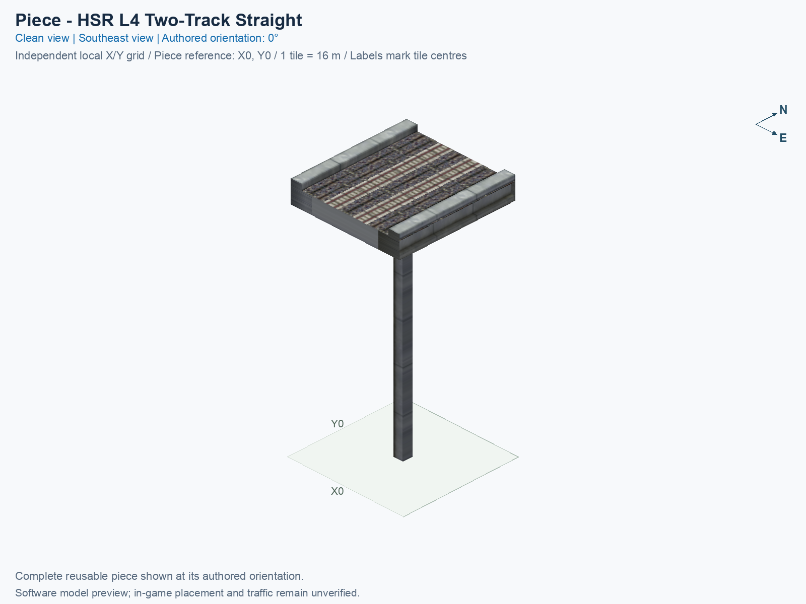
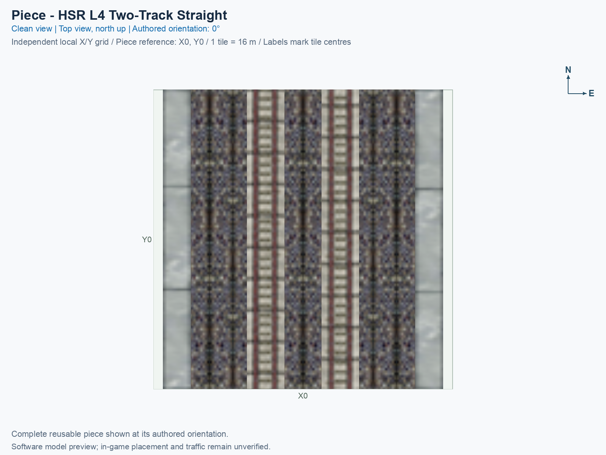
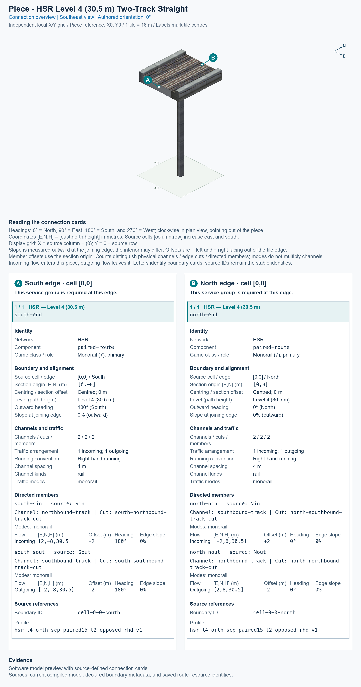

# HSR L4 Two-Track Straight

<!-- PIECE README LAYOUT: 2 -->

[1. Views](#1-views) · [2. Piece and placement](#2-piece-and-placement) · [3. Connection matrix](#3-connection-matrix) · [Testing ↗ (separate document)](TESTING.md)

This reusable High Speed Rail (HSR) piece is a flat, native-width paired straight at Level 4 (L4), with traffic paths 30.5 m above ground. In the pictured 0° orientation, the eastern track carries trains northward, and the western track carries trains southward. Both tracks are part of one tile placement.

**Status: experimental.** These pictures and connector measurements come from the actual saved game resources. Human preview approval and in-game behavior remain unverified. The type is optional and disabled in default builds.

The permanent type ID is `hsr-component-upper-paired-straight`. The exact compiled menu title is **SCP | [PART] HSR L4 Two-Track Straight**. PART identifies one individual building block. The puzzle ID is `f7a6`, and the complete cursor-preview model ID is `7f503ff5`.

## 1. Views

Both pictures show the same complete saved model in its authored 0° orientation. X increases eastward, Y increases northward, and each city tile measures 16 × 16 m. These are software renders rather than game screenshots.

The complete piece occupies tile (X0, Y0), with paired connections on its south and north edges. Source cell [0, 0] and the software construction reference identify the same tile; that reference has not been confirmed as the game’s mouse-click anchor.

<!-- BEGIN PIECE VIEWS -->

<!-- END PIECE VIEWS -->

## 2. Piece and placement

<!-- BEGIN PIECE OVERVIEW -->

Native-width opposite-direction two-track HSR at 30.5 m; connect only matching upper two-track ports.

Exact reusable identifier: `hsr-component-upper-paired-straight`.

Footprint: **1 × 1 tiles**. Exact menu name: **HSR L4 Two-Track Straight**.

<!-- END PIECE OVERVIEW -->

### Footprint and joining ends

Keep the full **1 × 1 tile construction rectangle**, measuring 16 × 16 m, clear. This piece owns the single source cell listed in [piece.json](piece.json). The supports are part of its saved model; their appearance does not establish that another object can occupy the same construction cell.

Each joining boundary carries two physical track channels, meaning two continuous passages for trains. Their centres are 4 m apart, at offsets of +2 m and −2 m from the slab centre. Both tracks must join a correctly positioned paired approach at 30.5 m, with the same complete deck profile and opposing directions. A centred one-way approach cannot supply that complete two-track connection.

The [connector declaration](connector-groups.jsonc), [resolved export](connector-data.json), and measured [connections](connections.json) describe this piece’s intrinsic boundaries and journeys. They do not discover or certify arbitrary neighbours; an actual physical seam and game operation need their own evidence.

### Placement and rotation

A **proper rotation** turns the complete piece without reflecting it. The eight construction states repeat four proper orientations: 0°, 90°, 180°, and 270° counterclockwise from the pictures. All ends, supports, and travel directions rotate together.

After following the separate [installation procedure](../../../../docs/BUILD_AND_INSTALL.md), use a disposable flat test city. Placement remains unverified in game.

1. Open **Transportation → Rail**, hover over the SCP buttons, and select **HSR L4 Two-Track Straight**. In an assembly’s component cycle, use **Tab** or **Shift+Tab** to select this same type.
2. Move the preview over a clear **1 × 1 tile rectangle**. Press **Home** or **End** to rotate; on the documented Mac keyboard, **Fn + ←** and **Fn + →** produce those keys.
3. At 0°, align both the south and north paired boundaries with flat Level 4 (L4) approaches at 30.5 m. Keep the two track channels and their travel directions aligned.
4. Click once to place the complete piece. Supply travel demand for each permitted journey, then inspect the game’s route query and moving trains separately.

## 3. Connection matrix

<!-- BEGIN PIECE CONNECTION MATRIX -->

### Directed entrance/exit matrix

Read **from an entrance row to an exit column**. **Saved PATH** checks the saved traffic route; **Route Query** checks the route shown by the game; **Visible travel** checks a vehicle completing that journey. For HSR, visible travel means a moving train.

**Game appearance:** [?](TESTING.md#case-in_game_render-a6c98bb7f68d5aeca687) — the complete piece’s appearance in the game, checked separately from its journeys.

**Legend:** ✅ confirmed; ❌ failed; ? not established. **Forbidden** means the movement is unavailable; its in-game check confirms that it stays unavailable. Click a result for its exact test case. Scope, evidence, and limitations remain in [the test checklist](TESTING.md#test-checklist).

| Entrance ↓ / Exit → | **HSR · South exit** `Sout` | **HSR · North exit** `Nout` |
| --- | --- | --- |
| **HSR · North entrance** `Nin` | **Saved PATH:** [✅](TESTING.md#case-software_connectivity-a760ff47689f4c16687b) **Route Query:** [?](TESTING.md#case-in_game_route_query-2ef9f1b58a20251989b6) **Visible train travel:** [?](TESTING.md#case-in_game_visible_travel-2ef9f1b58a20251989b6) | **Forbidden** **Saved PATH:** [✅](TESTING.md#case-software_connectivity-a760ff47689f4c16687b) In-game check: [?](TESTING.md#case-in_game_forbidden_transfer-bde4cb51165863cc495b) |
| **HSR · South entrance** `Sin` | **Forbidden** **Saved PATH:** [✅](TESTING.md#case-software_connectivity-a760ff47689f4c16687b) In-game check: [?](TESTING.md#case-in_game_forbidden_transfer-c0fe29eb3240570fc556) | **Saved PATH:** [✅](TESTING.md#case-software_connectivity-a760ff47689f4c16687b) **Route Query:** [?](TESTING.md#case-in_game_route_query-9bcbdf0e59e7dc00c5a4) **Visible train travel:** [?](TESTING.md#case-in_game_visible_travel-9bcbdf0e59e7dc00c5a4) |

Source: [connections.json](connections.json).

<!-- END PIECE CONNECTION MATRIX -->

<!-- BEGIN CONNECTOR OVERVIEW -->

### Connection overview

Generated from this piece's source-bound connector metadata and the current compiled model; marker letters refer to the boundary cards below.

[Rendering sources and verification scope](evidence/connection-overview.json).

Headings: 0° = North, 90° = East, 180° = South, and 270° = West; clockwise in plan view, pointing out of the piece.

Coordinates [E,N,H] = [east,north,height] in metres. Source cells [column,row] increase east and south.

Display grid: X = source column − (0); Y = 0 − source row.

Slope is measured outward at the joining edge; the interior may differ. Offsets are + left and − right facing out of the tile edge.

Member offsets use the section origin. Counts distinguish physical channels / edge cuts / directed members; modes do not multiply channels.

Incoming flow enters this piece; outgoing flow leaves it. Letters identify boundary cards; source IDs remain the stable identities.

#### Boundary A: `cell-0-0-south`

This service group is required at this edge.

##### Service group 1 / 1: HSR — Level 4 (30.5 m)

| Field | Value |
| --- | --- |
| End / component | `south-end` / `paired-route` |
| Network / game class / role | hsr / Monorail (7); primary |
| Source cell / edge | `[0,0]` / South |
| Section origin [E,N] (m) | `[0,-8]` |
| Centring / section offset | Centred; 0 m |
| Level (path height) | Level 4 (30.5 m) |
| Outward heading | 180° (South) |
| Slope at joining edge | 0% outward |
| Channels / edge cuts / directed members | 2 / 2 / 2 |
| Traffic arrangement / running | 1 incoming; 1 outgoing; Right-hand running |
| Channel spacing | 4 m |
| Channel kinds | rail |
| Traffic modes | monorail |
| Profile | `hsr-l4-orth-scp-paired15-t2-opposed-rhd-v1` |

| Member / measured source | Channel / cut / modes | Flow | Endpoint [E,N,H] (m) | Offset (m) | Outward heading | Edge slope (%) |
| --- | --- | --- | --- | ---: | ---: | ---: |
| `south-sin` / `Sin` | `northbound-track` / `south-northbound-track-cut` / monorail | Incoming | `[2,-8,30.5]` | +2 | 180° | 0 |
| `south-sout` / `Sout` | `southbound-track` / `south-southbound-track-cut` / monorail | Outgoing | `[-2,-8,30.5]` | -2 | 180° | 0 |

#### Boundary B: `cell-0-0-north`

This service group is required at this edge.

##### Service group 1 / 1: HSR — Level 4 (30.5 m)

| Field | Value |
| --- | --- |
| End / component | `north-end` / `paired-route` |
| Network / game class / role | hsr / Monorail (7); primary |
| Source cell / edge | `[0,0]` / North |
| Section origin [E,N] (m) | `[0,8]` |
| Centring / section offset | Centred; 0 m |
| Level (path height) | Level 4 (30.5 m) |
| Outward heading | 0° (North) |
| Slope at joining edge | 0% outward |
| Channels / edge cuts / directed members | 2 / 2 / 2 |
| Traffic arrangement / running | 1 incoming; 1 outgoing; Right-hand running |
| Channel spacing | 4 m |
| Channel kinds | rail |
| Traffic modes | monorail |
| Profile | `hsr-l4-orth-scp-paired15-t2-opposed-rhd-v1` |

| Member / measured source | Channel / cut / modes | Flow | Endpoint [E,N,H] (m) | Offset (m) | Outward heading | Edge slope (%) |
| --- | --- | --- | --- | ---: | ---: | ---: |
| `north-nin` / `Nin` | `southbound-track` / `north-southbound-track-cut` / monorail | Incoming | `[-2,8,30.5]` | +2 | 0° | 0 |
| `north-nout` / `Nout` | `northbound-track` / `north-northbound-track-cut` / monorail | Outgoing | `[2,8,30.5]` | -2 | 0° | 0 |

Rendering checks source metadata, current compiled resource identities, and model structure. It does not re-extract PATHs or evaluate placement; physical seams, construction clearance, collisions, and game operation remain unverified.

<!-- END CONNECTOR OVERVIEW -->
