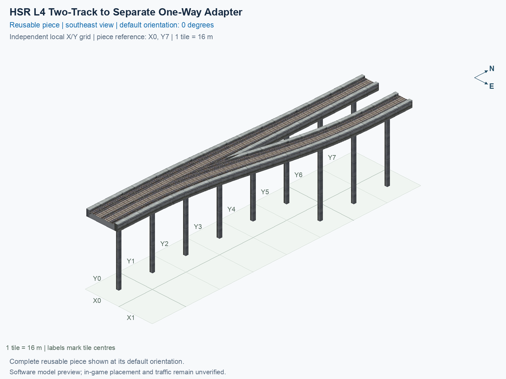

# HSR L4 Two-Track to Separate One-Way Adapter

Purpose: explain this reusable piece, its matching connections and current test coverage.

<!-- BEGIN PIECE OVERVIEW -->

Full native two-track HSR at the south end opens into separate centred one-way tracks one tile apart at the north end; all paths stay at 30.5 m.

Exact reusable identifier: `hsr-component-upper-paired-to-single-adapter`.

Footprint: **2 × 8 tiles**. Exact menu name: **HSR L4 Two-Track to Separate One-Way Adapter**.

Choose this exact name in Transportation → Rail. Press Home or End to rotate; use only the supported states listed below. Join each end to a matching port profile and direction.

- [Connections and journeys](#connections-and-journeys)
- [Test checklist](#test-checklist)



<!-- END PIECE OVERVIEW -->

<!-- BEGIN MANUAL SUMMARY -->

## Manual status

Generated from [the exact test cases](#test-checklist) and [authoritative observations](checks/manual-tests.json).

- [ ] Preview review: 0/1 applicable cases passed; 0 failed, 0 stale.
- [ ] In-game rendering: 0/4 applicable cases passed; 0 failed, 0 stale.
- [ ] Directed journeys: 0/8 applicable cases passed; 0 failed, 0 stale.

These observations cover only the named services, directions, poses, rotations, and recorded platforms.

<!-- END MANUAL SUMMARY -->

<!-- BEGIN CONNECTIONS -->

## Connections and journeys

Purpose: describe intrinsic directional interfaces and permitted service journeys.

Generated from [connections.json](connections.json). Coordinates are canonical east, north and height in metres. A connection class names an encoded route interface; it does not prove visible deck/wall fit or an in-game test.

Supported placement states: 0° CCW, 90° CCW, 180° CCW, 270° CCW. Each state has its own declared manual scope.

A **port** is one directional transport-path endpoint. **Service** identifies the intended network service (for example HSR, street, or tram); **engine** is its internal traffic-class number, separate from the construction network. **Role** distinguishes primary service from auxiliary paths; sharing a traffic class does not establish service compatibility.

A **tangent** is a unit travel-direction vector: `[0,1]` means north. **Grade** is height gained per horizontal metre. These measured facts describe this subject alone. Compatibility requires a separate comparison of the complete joining boundaries; physical seams and actual game operation require their own evidence. See the [class index](../../connection-classes.json) for shared route-interface membership.

| Port | Service / engine / role | Direction | Location; tangent; grade | Connection class |
| --- | --- | --- | --- | --- |
| `Sout` | hsr / 7 / primary | out | [-2.0, -120.0, 30.5]; [0.0, -1.0]; 0.0 | `path-interface-ce3ccdc10e5e243d11ae` |
| `Nin` | hsr / 7 / primary | in | [0.0, 8.0, 30.5]; [0.0, -1.0]; 0.0 | `path-interface-a11c9f8debd0ee1c3a94` |
| `Sin` | hsr / 7 / primary | in | [2.0, -120.0, 30.5]; [0.0, 1.0]; 0.0 | `path-interface-9b897a8bacb659f807fe` |
| `Nout` | hsr / 7 / primary | out | [16.0, 8.0, 30.5]; [0.0, 1.0]; 0.0 | `path-interface-90a5bcd3e5d324374d48` |

### Directed journeys

| Service | Entry → exit | Role |
| --- | --- | --- |
| hsr | `Nin` → `Sout` | primary |
| hsr | `Sin` → `Nout` | primary |

### Forbidden transfers

| From service / port | To service / port | Reason |
| --- | --- | --- |
| hsr / `Nin` | hsr / `Nout` | No directed route exists between these ports in the saved piece transport paths. In-game confirmation remains unverified. |
| hsr / `Sin` | hsr / `Sout` | No directed route exists between these ports in the saved piece transport paths. In-game confirmation remains unverified. |

Review the test checklist for the exact tested cases and environments.

<!-- END CONNECTIONS -->

<!-- BEGIN MANUAL CHECKS -->

## Test checklist

Generated from [the authoritative record](checks/manual-tests.json). Only explicit human observations create manual passes; software and preview checks remain separate. Expand a check/service group to see its rotation table, then expand the matching exact scope to copy a case ID and inspect its pose, reviewer, environment, and evidence. Grouping changes only this view; every declared case remains separate.

**States:** [x] passed; [ ] unverified, failed, or stale; N/A is an explicit inapplicable declaration. A dash means no case was declared in that column. Every pass covers only its recorded environment. T means a distinct construction-transposed state.

Four proper rotations are covered. No additional reflected state is established by this record; repeated construction aliases do not create new orientations.

Current totals: unverified: 35, passed: 0, failed: 0, stale: 0, not_applicable: 0.

### Record an observation

Follow the [shared testing guide](../../../../docs/TESTING.md); copy [the unconfirmed example](checks/observation.example.json) to `checks/observation.json`. Case identifiers are in the expandable sections below. Do not edit generated checkboxes.

From the repository folder containing `custom-pieces`, run after filling `checks/observation.json` and explicitly confirming the exact observation:

```sh
python3 -m scp.content record --record custom-pieces/domains/high-speed-rail/00_pieces/hsr-component-upper-paired-to-single-adapter/checks/manual-tests.json --observation custom-pieces/domains/high-speed-rail/00_pieces/hsr-component-upper-paired-to-single-adapter/checks/observation.json
```

### Detailed current checks

Each collapsed group shows exact case counts and states. Forbidden transfers are grouped by the directed service pair; the table inside retains every port pair and rotation.

<details>
<summary>Compiled resources — Whole subject — 1 case; unverified: 1</summary>

| Check / exact scope | General | 0° | 90° | 180° | 270° |
| --- | --- | --- | --- | --- | --- |
| **Compiled resources**<br>Whole subject | <a href="#case-software_resources-043455b16e856157ccd5">[ ] unverified</a> | — | — | — | — |


<details>
<summary>Compiled resources — Whole subject</summary>

<a id="case-software_resources-043455b16e856157ccd5"></a>

**General: unverified** — `software_resources-043455b16e856157ccd5`.

Verify the actual compiled resources and construction rules.

Scope: Whole subject.

No observation recorded.

</details>

</details>

<details>
<summary>Directed routing graph — Whole subject — 1 case; unverified: 1</summary>

| Check / exact scope | General | 0° | 90° | 180° | 270° |
| --- | --- | --- | --- | --- | --- |
| **Directed routing graph**<br>Whole subject | <a href="#case-software_connectivity-043455b16e856157ccd5">[ ] unverified</a> | — | — | — | — |


<details>
<summary>Directed routing graph — Whole subject</summary>

<a id="case-software_connectivity-043455b16e856157ccd5"></a>

**General: unverified** — `software_connectivity-043455b16e856157ccd5`.

Verify the declared directed journeys and forbidden transfers.

Scope: Whole subject.

No observation recorded.

</details>

</details>

<details>
<summary>Preview review — Images — 1 case; unverified: 1</summary>

| Check / exact scope | General | 0° | 90° | 180° | 270° |
| --- | --- | --- | --- | --- | --- |
| **Preview review**<br>Image: image:hsr-component-upper-paired-to-single-adapter:canonical-southeast | <a href="#case-preview_review-db95d0ef29d2e13b640a">[ ] unverified</a> | — | — | — | — |


<details>
<summary>Preview review — Image: image:hsr-component-upper-paired-to-single-adapter:canonical-southeast</summary>

<a id="case-preview_review-db95d0ef29d2e13b640a"></a>

**General: unverified** — `preview_review-db95d0ef29d2e13b640a`.

Inspect this exact preview for tracks, walls, piers, seams and shadows.

Scope: Image: image:hsr-component-upper-paired-to-single-adapter:canonical-southeast.

No observation recorded.

</details>

</details>

<details>
<summary>In-game rendering — Whole subject — 4 cases; unverified: 4</summary>

| Check / exact scope | General | 0° | 90° | 180° | 270° |
| --- | --- | --- | --- | --- | --- |
| **In-game rendering**<br>Whole subject | — | <a href="#case-in_game_render-14be87417ebf1695f01b">[ ] unverified</a> | <a href="#case-in_game_render-38781d190aa2bf4b9456">[ ] unverified</a> | <a href="#case-in_game_render-74b342c68dfddb28170c">[ ] unverified</a> | <a href="#case-in_game_render-7a4fe9c536e98bf1b39e">[ ] unverified</a> |


<details>
<summary>In-game rendering — Whole subject</summary>

<a id="case-in_game_render-14be87417ebf1695f01b"></a>

**0° CCW: unverified** — `in_game_render-14be87417ebf1695f01b`.

Inspect the placed tracks, walls, piers, seams and shadows in SimCity 4.

Scope: Whole subject.

No observation recorded.

<a id="case-in_game_render-38781d190aa2bf4b9456"></a>

**90° CCW: unverified** — `in_game_render-38781d190aa2bf4b9456`.

Inspect the placed tracks, walls, piers, seams and shadows in SimCity 4.

Scope: Whole subject.

No observation recorded.

<a id="case-in_game_render-74b342c68dfddb28170c"></a>

**180° CCW: unverified** — `in_game_render-74b342c68dfddb28170c`.

Inspect the placed tracks, walls, piers, seams and shadows in SimCity 4.

Scope: Whole subject.

No observation recorded.

<a id="case-in_game_render-7a4fe9c536e98bf1b39e"></a>

**270° CCW: unverified** — `in_game_render-7a4fe9c536e98bf1b39e`.

Inspect the placed tracks, walls, piers, seams and shadows in SimCity 4.

Scope: Whole subject.

No observation recorded.

</details>

</details>

<details>
<summary>Placement — Whole subject — 4 cases; unverified: 4</summary>

| Check / exact scope | General | 0° | 90° | 180° | 270° |
| --- | --- | --- | --- | --- | --- |
| **Placement**<br>Whole subject | — | <a href="#case-in_game_placement-14be87417ebf1695f01b">[ ] unverified</a> | <a href="#case-in_game_placement-38781d190aa2bf4b9456">[ ] unverified</a> | <a href="#case-in_game_placement-74b342c68dfddb28170c">[ ] unverified</a> | <a href="#case-in_game_placement-7a4fe9c536e98bf1b39e">[ ] unverified</a> |


<details>
<summary>Placement — Whole subject</summary>

<a id="case-in_game_placement-14be87417ebf1695f01b"></a>

**0° CCW: unverified** — `in_game_placement-14be87417ebf1695f01b`.

Place this piece or complete blueprint and inspect every occupied tile.

Scope: Whole subject.

No observation recorded.

<a id="case-in_game_placement-38781d190aa2bf4b9456"></a>

**90° CCW: unverified** — `in_game_placement-38781d190aa2bf4b9456`.

Place this piece or complete blueprint and inspect every occupied tile.

Scope: Whole subject.

No observation recorded.

<a id="case-in_game_placement-74b342c68dfddb28170c"></a>

**180° CCW: unverified** — `in_game_placement-74b342c68dfddb28170c`.

Place this piece or complete blueprint and inspect every occupied tile.

Scope: Whole subject.

No observation recorded.

<a id="case-in_game_placement-7a4fe9c536e98bf1b39e"></a>

**270° CCW: unverified** — `in_game_placement-7a4fe9c536e98bf1b39e`.

Place this piece or complete blueprint and inspect every occupied tile.

Scope: Whole subject.

No observation recorded.

</details>

</details>

<details>
<summary>Demolition — Whole subject — 4 cases; unverified: 4</summary>

| Check / exact scope | General | 0° | 90° | 180° | 270° |
| --- | --- | --- | --- | --- | --- |
| **Demolition**<br>Whole subject | — | <a href="#case-in_game_demolition-14be87417ebf1695f01b">[ ] unverified</a> | <a href="#case-in_game_demolition-38781d190aa2bf4b9456">[ ] unverified</a> | <a href="#case-in_game_demolition-74b342c68dfddb28170c">[ ] unverified</a> | <a href="#case-in_game_demolition-7a4fe9c536e98bf1b39e">[ ] unverified</a> |


<details>
<summary>Demolition — Whole subject</summary>

<a id="case-in_game_demolition-14be87417ebf1695f01b"></a>

**0° CCW: unverified** — `in_game_demolition-14be87417ebf1695f01b`.

Bulldoze the complete placement and inspect the cleared area.

Scope: Whole subject.

No observation recorded.

<a id="case-in_game_demolition-38781d190aa2bf4b9456"></a>

**90° CCW: unverified** — `in_game_demolition-38781d190aa2bf4b9456`.

Bulldoze the complete placement and inspect the cleared area.

Scope: Whole subject.

No observation recorded.

<a id="case-in_game_demolition-74b342c68dfddb28170c"></a>

**180° CCW: unverified** — `in_game_demolition-74b342c68dfddb28170c`.

Bulldoze the complete placement and inspect the cleared area.

Scope: Whole subject.

No observation recorded.

<a id="case-in_game_demolition-7a4fe9c536e98bf1b39e"></a>

**270° CCW: unverified** — `in_game_demolition-7a4fe9c536e98bf1b39e`.

Bulldoze the complete placement and inspect the cleared area.

Scope: Whole subject.

No observation recorded.

</details>

</details>

<details>
<summary>Save and reload — Whole subject — 4 cases; unverified: 4</summary>

| Check / exact scope | General | 0° | 90° | 180° | 270° |
| --- | --- | --- | --- | --- | --- |
| **Save and reload**<br>Whole subject | — | <a href="#case-in_game_save_reload-14be87417ebf1695f01b">[ ] unverified</a> | <a href="#case-in_game_save_reload-38781d190aa2bf4b9456">[ ] unverified</a> | <a href="#case-in_game_save_reload-74b342c68dfddb28170c">[ ] unverified</a> | <a href="#case-in_game_save_reload-7a4fe9c536e98bf1b39e">[ ] unverified</a> |


<details>
<summary>Save and reload — Whole subject</summary>

<a id="case-in_game_save_reload-14be87417ebf1695f01b"></a>

**0° CCW: unverified** — `in_game_save_reload-14be87417ebf1695f01b`.

Save, quit, reload and inspect the placement and its paths.

Scope: Whole subject.

No observation recorded.

<a id="case-in_game_save_reload-38781d190aa2bf4b9456"></a>

**90° CCW: unverified** — `in_game_save_reload-38781d190aa2bf4b9456`.

Save, quit, reload and inspect the placement and its paths.

Scope: Whole subject.

No observation recorded.

<a id="case-in_game_save_reload-74b342c68dfddb28170c"></a>

**180° CCW: unverified** — `in_game_save_reload-74b342c68dfddb28170c`.

Save, quit, reload and inspect the placement and its paths.

Scope: Whole subject.

No observation recorded.

<a id="case-in_game_save_reload-7a4fe9c536e98bf1b39e"></a>

**270° CCW: unverified** — `in_game_save_reload-7a4fe9c536e98bf1b39e`.

Save, quit, reload and inspect the placement and its paths.

Scope: Whole subject.

No observation recorded.

</details>

</details>

<details>
<summary>Journey — hsr — 8 cases; unverified: 8</summary>

| Check / exact scope | General | 0° | 90° | 180° | 270° |
| --- | --- | --- | --- | --- | --- |
| **Journey**<br>Service: hsr; role: primary; journey: 7:Nin>Sout; entry: Nin; exit: Sout | — | <a href="#case-in_game_journey-a61395f2f1988e6f6acf">[ ] unverified</a> | <a href="#case-in_game_journey-6977bd682ecfa83b353a">[ ] unverified</a> | <a href="#case-in_game_journey-17a241a152e6640cf6e0">[ ] unverified</a> | <a href="#case-in_game_journey-3e399ecde48d0be0f742">[ ] unverified</a> |
| **Journey**<br>Service: hsr; role: primary; journey: 7:Sin>Nout; entry: Sin; exit: Nout | — | <a href="#case-in_game_journey-8cd1777034dc3415d206">[ ] unverified</a> | <a href="#case-in_game_journey-0c6b5b8f98399b4dfd92">[ ] unverified</a> | <a href="#case-in_game_journey-fe49c1d1a4386538405b">[ ] unverified</a> | <a href="#case-in_game_journey-3b57a07bb31d10509d2f">[ ] unverified</a> |


<details>
<summary>Journey — Service: hsr; role: primary; journey: 7:Nin>Sout; entry: Nin; exit: Sout</summary>

<a id="case-in_game_journey-a61395f2f1988e6f6acf"></a>

**0° CCW: unverified** — `in_game_journey-a61395f2f1988e6f6acf`.

Run the declared journey in this direction using its service network.

Scope: Service: hsr; role: primary; journey: 7:Nin>Sout; entry: Nin; exit: Sout.

No observation recorded.

<a id="case-in_game_journey-6977bd682ecfa83b353a"></a>

**90° CCW: unverified** — `in_game_journey-6977bd682ecfa83b353a`.

Run the declared journey in this direction using its service network.

Scope: Service: hsr; role: primary; journey: 7:Nin>Sout; entry: Nin; exit: Sout.

No observation recorded.

<a id="case-in_game_journey-17a241a152e6640cf6e0"></a>

**180° CCW: unverified** — `in_game_journey-17a241a152e6640cf6e0`.

Run the declared journey in this direction using its service network.

Scope: Service: hsr; role: primary; journey: 7:Nin>Sout; entry: Nin; exit: Sout.

No observation recorded.

<a id="case-in_game_journey-3e399ecde48d0be0f742"></a>

**270° CCW: unverified** — `in_game_journey-3e399ecde48d0be0f742`.

Run the declared journey in this direction using its service network.

Scope: Service: hsr; role: primary; journey: 7:Nin>Sout; entry: Nin; exit: Sout.

No observation recorded.

</details>


<details>
<summary>Journey — Service: hsr; role: primary; journey: 7:Sin>Nout; entry: Sin; exit: Nout</summary>

<a id="case-in_game_journey-8cd1777034dc3415d206"></a>

**0° CCW: unverified** — `in_game_journey-8cd1777034dc3415d206`.

Run the declared journey in this direction using its service network.

Scope: Service: hsr; role: primary; journey: 7:Sin>Nout; entry: Sin; exit: Nout.

No observation recorded.

<a id="case-in_game_journey-0c6b5b8f98399b4dfd92"></a>

**90° CCW: unverified** — `in_game_journey-0c6b5b8f98399b4dfd92`.

Run the declared journey in this direction using its service network.

Scope: Service: hsr; role: primary; journey: 7:Sin>Nout; entry: Sin; exit: Nout.

No observation recorded.

<a id="case-in_game_journey-fe49c1d1a4386538405b"></a>

**180° CCW: unverified** — `in_game_journey-fe49c1d1a4386538405b`.

Run the declared journey in this direction using its service network.

Scope: Service: hsr; role: primary; journey: 7:Sin>Nout; entry: Sin; exit: Nout.

No observation recorded.

<a id="case-in_game_journey-3b57a07bb31d10509d2f"></a>

**270° CCW: unverified** — `in_game_journey-3b57a07bb31d10509d2f`.

Run the declared journey in this direction using its service network.

Scope: Service: hsr; role: primary; journey: 7:Sin>Nout; entry: Sin; exit: Nout.

No observation recorded.

</details>

</details>

<details>
<summary>Forbidden transfer — hsr → hsr — 8 cases; unverified: 8</summary>

| Check / exact scope | General | 0° | 90° | 180° | 270° |
| --- | --- | --- | --- | --- | --- |
| **Forbidden transfer**<br>from port: Nin; to port: Nout; from service: hsr; to service: hsr; basis: not reachable in actual saved PATH graph | — | <a href="#case-in_game_forbidden_transfer-bf4a9023f06ecfcb49a1">[ ] unverified</a> | <a href="#case-in_game_forbidden_transfer-785135eaf7a99b656568">[ ] unverified</a> | <a href="#case-in_game_forbidden_transfer-ef2f3d8cd4b82d4d5c9e">[ ] unverified</a> | <a href="#case-in_game_forbidden_transfer-be93d44adfa7f71480a2">[ ] unverified</a> |
| **Forbidden transfer**<br>from port: Sin; to port: Sout; from service: hsr; to service: hsr; basis: not reachable in actual saved PATH graph | — | <a href="#case-in_game_forbidden_transfer-41888a9bc4eeab40bd77">[ ] unverified</a> | <a href="#case-in_game_forbidden_transfer-f41b9a731de94f390656">[ ] unverified</a> | <a href="#case-in_game_forbidden_transfer-7dfa861c27b52071705f">[ ] unverified</a> | <a href="#case-in_game_forbidden_transfer-c79dfd24106b6f2ec196">[ ] unverified</a> |


<details>
<summary>Forbidden transfer — from port: Nin; to port: Nout; from service: hsr; to service: hsr; basis: not reachable in actual saved PATH graph</summary>

<a id="case-in_game_forbidden_transfer-bf4a9023f06ecfcb49a1"></a>

**0° CCW: unverified** — `in_game_forbidden_transfer-bf4a9023f06ecfcb49a1`.

Confirm this undeclared transfer is unavailable.

Scope: from port: Nin; to port: Nout; from service: hsr; to service: hsr; basis: not reachable in actual saved PATH graph.

No observation recorded.

<a id="case-in_game_forbidden_transfer-785135eaf7a99b656568"></a>

**90° CCW: unverified** — `in_game_forbidden_transfer-785135eaf7a99b656568`.

Confirm this undeclared transfer is unavailable.

Scope: from port: Nin; to port: Nout; from service: hsr; to service: hsr; basis: not reachable in actual saved PATH graph.

No observation recorded.

<a id="case-in_game_forbidden_transfer-ef2f3d8cd4b82d4d5c9e"></a>

**180° CCW: unverified** — `in_game_forbidden_transfer-ef2f3d8cd4b82d4d5c9e`.

Confirm this undeclared transfer is unavailable.

Scope: from port: Nin; to port: Nout; from service: hsr; to service: hsr; basis: not reachable in actual saved PATH graph.

No observation recorded.

<a id="case-in_game_forbidden_transfer-be93d44adfa7f71480a2"></a>

**270° CCW: unverified** — `in_game_forbidden_transfer-be93d44adfa7f71480a2`.

Confirm this undeclared transfer is unavailable.

Scope: from port: Nin; to port: Nout; from service: hsr; to service: hsr; basis: not reachable in actual saved PATH graph.

No observation recorded.

</details>


<details>
<summary>Forbidden transfer — from port: Sin; to port: Sout; from service: hsr; to service: hsr; basis: not reachable in actual saved PATH graph</summary>

<a id="case-in_game_forbidden_transfer-41888a9bc4eeab40bd77"></a>

**0° CCW: unverified** — `in_game_forbidden_transfer-41888a9bc4eeab40bd77`.

Confirm this undeclared transfer is unavailable.

Scope: from port: Sin; to port: Sout; from service: hsr; to service: hsr; basis: not reachable in actual saved PATH graph.

No observation recorded.

<a id="case-in_game_forbidden_transfer-f41b9a731de94f390656"></a>

**90° CCW: unverified** — `in_game_forbidden_transfer-f41b9a731de94f390656`.

Confirm this undeclared transfer is unavailable.

Scope: from port: Sin; to port: Sout; from service: hsr; to service: hsr; basis: not reachable in actual saved PATH graph.

No observation recorded.

<a id="case-in_game_forbidden_transfer-7dfa861c27b52071705f"></a>

**180° CCW: unverified** — `in_game_forbidden_transfer-7dfa861c27b52071705f`.

Confirm this undeclared transfer is unavailable.

Scope: from port: Sin; to port: Sout; from service: hsr; to service: hsr; basis: not reachable in actual saved PATH graph.

No observation recorded.

<a id="case-in_game_forbidden_transfer-c79dfd24106b6f2ec196"></a>

**270° CCW: unverified** — `in_game_forbidden_transfer-c79dfd24106b6f2ec196`.

Confirm this undeclared transfer is unavailable.

Scope: from port: Sin; to port: Sout; from service: hsr; to service: hsr; basis: not reachable in actual saved PATH graph.

No observation recorded.

</details>

</details>

<!-- END MANUAL CHECKS -->

## Engineering contract

The upper paired-to-single adapter has a 2 × 8 rectangle and 15 cells, excluding only (1,7). Its structural cells are (1,5), (1,6). South ports are native ±2 m at north-coordinate −120; north ports are centred at east-coordinates 0 and 16 m, north-coordinate +8. The eastern track goes north, the western track south; all heights remain 30.5 m. Its two physical sheets are ordered south-to-north independently of traffic direction. `deck_half_widths` reserves their variable outside half widths: 5.5 m throughout the first 8 m, a smooth quintic taper, then 4 m throughout the final 8 m. Each sheet's taper distance uses its actual horizontal arclength. Their initial union is exactly the native 15 m exterior; their separate ends are 8 m wide with an 8 m gap.

The new-only `_sweep_component_profile` widens only the adapter's ballast, underside, and parapets. Rail ribbons stay unchanged. At its paired end, each sheet's outside half width is 5.5 m and inside wall is `source.inner-2`; together their outer/inner walls exactly match the native paired profile. At separate ends they match the new 8 m single profiles, with inside walls at 2.6 m. Do not replace the taper with a shoulder stub or scale wall thickness indiscriminately. The compiler must remove internal coplanar walls, preserve rail UV priority, and keep both separate output decks.

Adapter profile checks inspect both collars at 0.5, 4, and 7.5 m from their ends, including floor, underside, and internal walls. The component-family assembly tests additionally connect this adapter with two curved ramps, using encoded routes and disjoint owned cells, under all four proper rotations.

Use the [independent source contract](../../implementation/scp_hsr/hsr_components_verify.py) and this type's [definition](piece.json) for exact expectations. Shared HSR/GHSR facts remain in [NETWORK_SPEC.md](../../NETWORK_SPEC.md). These authored notes supplement generated source views; they do not change geometry, reset observations, or establish game operation.
