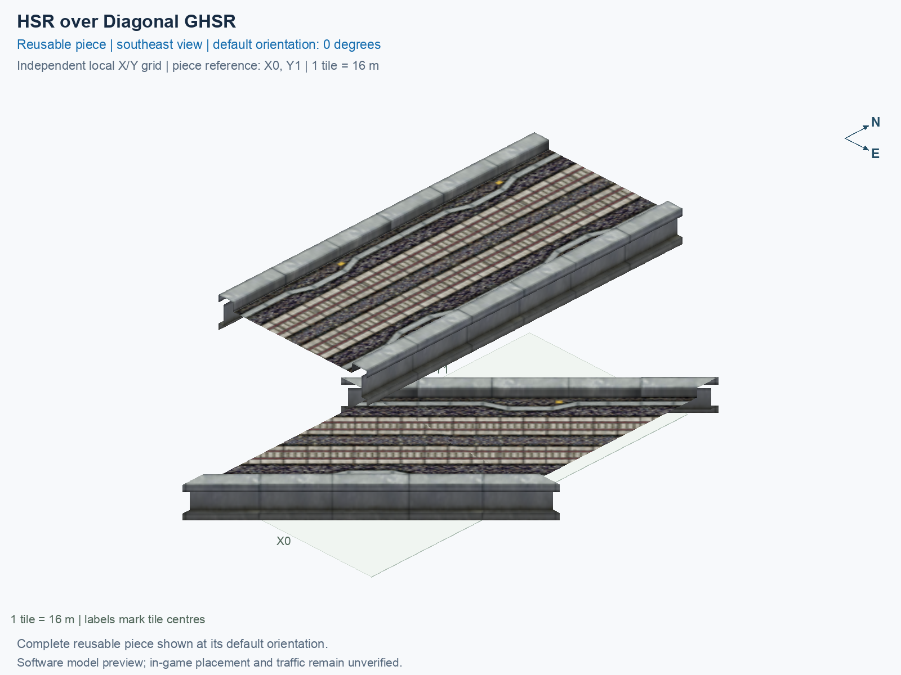

# HSR over Diagonal GHSR

Purpose: explain this reusable piece, its matching connections and current test coverage.

<!-- BEGIN PIECE OVERVIEW -->

Straight elevated High Speed Rail crosses diagonal ground High Speed Rail. Two tiles; no interchange.

Exact reusable identifier: `hsr-diagonal-ghsr`.

Footprint: **1 × 2 tiles**. Exact menu name: **HSR over Diagonal GHSR**.

Choose this exact name in Transportation → Rail. Press Home or End to rotate; use only the supported states listed below. Join each end to a matching port profile and direction.

- [Connections and journeys](#connections-and-journeys)
- [Test checklist](#test-checklist)



<!-- END PIECE OVERVIEW -->

<!-- BEGIN MANUAL SUMMARY -->

## Manual status

Generated from [the exact test cases](#test-checklist) and [authoritative observations](checks/manual-tests.json).

- [ ] Preview review: 0/1 applicable cases passed; 0 failed, 0 stale.
- [ ] In-game rendering: 0/8 applicable cases passed; 0 failed, 0 stale.
- [ ] Directed journeys: 0/32 applicable cases passed; 0 failed, 0 stale.

These observations cover only the named services, directions, poses, rotations, and recorded platforms.

<!-- END MANUAL SUMMARY -->

<!-- BEGIN CONNECTIONS -->

## Connections and journeys

Purpose: describe intrinsic directional interfaces and permitted service journeys.

Generated from [connections.json](connections.json). Coordinates are canonical east, north and height in metres. A connection class names an encoded route interface; it does not prove visible deck/wall fit or an in-game test.

Supported placement states: 0° CCW, 90° CCW, 180° CCW, 270° CCW, 0° CCW with construction Transpose, 90° CCW with construction Transpose, 180° CCW with construction Transpose, 270° CCW with construction Transpose. Each state has its own declared manual scope.

A **port** is one directional transport-path endpoint. **Service** identifies the intended network service (for example HSR, street, or tram); **engine** is its internal traffic-class number, separate from the construction network. **Role** distinguishes primary service from auxiliary paths; sharing a traffic class does not establish service compatibility.

A **tangent** is a unit travel-direction vector: `[0,1]` means north. **Grade** is height gained per horizontal metre. These measured facts describe this subject alone. Compatibility requires a separate comparison of the complete joining boundaries; physical seams and actual game operation require their own evidence. See the [class index](../../connection-classes.json) for shared route-interface membership.

| Port | Service / engine / role | Direction | Location; tangent; grade | Connection class |
| --- | --- | --- | --- | --- |
| `7-W-in-1` | ghsr / 7 / primary | in | [-8.0, -18.9, 1.0]; [0.7071067811865476, 0.7071067811865475]; 0.0 | `path-interface-6ed8ad7d9e460ea9e26e` |
| `7-W-out-2` | ghsr / 7 / primary | out | [-8.0, -13.2, 1.0]; [-0.7002086668924693, -0.7139382485962431]; 0.0 | `path-interface-ea9aec3cf7f13a65eeea` |
| `7-S-out-3` | hsr / 7 / primary | out | [-2.0, -24.0, 15.5]; [0.0, -1.0]; 0.0 | `path-interface-12d12be31d2057c5763d` |
| `7-N-in-4` | hsr / 7 / primary | in | [-2.0, 8.0, 15.5]; [0.0, -1.0]; 0.0 | `path-interface-12d12be31d2057c5763d` |
| `7-S-in-5` | hsr / 7 / primary | in | [2.0, -24.0, 15.5]; [0.0, 1.0]; 0.0 | `path-interface-fba09fbeb87ad95c667a` |
| `7-N-out-6` | hsr / 7 / primary | out | [2.0, 8.0, 15.5]; [0.0, 1.0]; 0.0 | `path-interface-fba09fbeb87ad95c667a` |
| `7-E-out-7` | ghsr / 7 / primary | out | [8.0, -2.8, 1.0]; [0.7002086668924692, 0.7139382485962431]; 0.0 | `path-interface-ea9aec3cf7f13a65eeea` |
| `7-E-in-8` | ghsr / 7 / primary | in | [8.0, 2.9, 1.0]; [-0.7071067811865476, -0.7071067811865476]; 0.0 | `path-interface-6ed8ad7d9e460ea9e26e` |

### Directed journeys

| Service | Entry → exit | Role |
| --- | --- | --- |
| ghsr | `7-W-in-1` → `7-E-out-7` | primary |
| hsr | `7-N-in-4` → `7-S-out-3` | primary |
| hsr | `7-S-in-5` → `7-N-out-6` | primary |
| ghsr | `7-E-in-8` → `7-W-out-2` | primary |

### Forbidden transfers

| From service / port | To service / port | Reason |
| --- | --- | --- |
| ghsr / `7-W-in-1` | ghsr / `7-W-out-2` | No directed route exists between these ports in the saved piece transport paths. In-game confirmation remains unverified. |
| ghsr / `7-W-in-1` | hsr / `7-S-out-3` | No directed route exists between these ports in the saved piece transport paths. In-game confirmation remains unverified. |
| ghsr / `7-W-in-1` | hsr / `7-N-out-6` | No directed route exists between these ports in the saved piece transport paths. In-game confirmation remains unverified. |
| hsr / `7-N-in-4` | ghsr / `7-W-out-2` | No directed route exists between these ports in the saved piece transport paths. In-game confirmation remains unverified. |
| hsr / `7-N-in-4` | hsr / `7-N-out-6` | No directed route exists between these ports in the saved piece transport paths. In-game confirmation remains unverified. |
| hsr / `7-N-in-4` | ghsr / `7-E-out-7` | No directed route exists between these ports in the saved piece transport paths. In-game confirmation remains unverified. |
| hsr / `7-S-in-5` | ghsr / `7-W-out-2` | No directed route exists between these ports in the saved piece transport paths. In-game confirmation remains unverified. |
| hsr / `7-S-in-5` | hsr / `7-S-out-3` | No directed route exists between these ports in the saved piece transport paths. In-game confirmation remains unverified. |
| hsr / `7-S-in-5` | ghsr / `7-E-out-7` | No directed route exists between these ports in the saved piece transport paths. In-game confirmation remains unverified. |
| ghsr / `7-E-in-8` | hsr / `7-S-out-3` | No directed route exists between these ports in the saved piece transport paths. In-game confirmation remains unverified. |
| ghsr / `7-E-in-8` | hsr / `7-N-out-6` | No directed route exists between these ports in the saved piece transport paths. In-game confirmation remains unverified. |
| ghsr / `7-E-in-8` | ghsr / `7-E-out-7` | No directed route exists between these ports in the saved piece transport paths. In-game confirmation remains unverified. |

Review the test checklist for the exact tested cases and environments.

<!-- END CONNECTIONS -->

<!-- BEGIN MANUAL CHECKS -->

## Test checklist

Generated from [the authoritative record](checks/manual-tests.json). Only explicit human observations create manual passes; software and preview checks remain separate. Expand a check/service group to see its rotation table, then expand the matching exact scope to copy a case ID and inspect its pose, reviewer, environment, and evidence. Grouping changes only this view; every declared case remains separate.

**States:** [x] passed; [ ] unverified, failed, or stale; N/A is an explicit inapplicable declaration. A dash means no case was declared in that column. Every pass covers only its recorded environment. T means a distinct construction-transposed state.

Actual emitted rules support four proper rotations and four distinct construction-transposed states; each has separate manual coverage. Counterpart reflection is never assumed.

Current totals: unverified: 163, passed: 0, failed: 0, stale: 0, not_applicable: 0.

### Record an observation

Follow the [shared testing guide](../../../../docs/TESTING.md); copy [the unconfirmed example](checks/observation.example.json) to `checks/observation.json`. Case identifiers are in the expandable sections below. Do not edit generated checkboxes.

From the repository folder containing `custom-pieces`, run after filling `checks/observation.json` and explicitly confirming the exact observation:

```sh
python3 -m scp.content record --record custom-pieces/domains/high-speed-rail/00_pieces/hsr-diagonal-ghsr/checks/manual-tests.json --observation custom-pieces/domains/high-speed-rail/00_pieces/hsr-diagonal-ghsr/checks/observation.json
```

### Detailed current checks

Each collapsed group shows exact case counts and states. Forbidden transfers are grouped by the directed service pair; the table inside retains every port pair and rotation.

<details>
<summary>Compiled resources — Whole subject — 1 case; unverified: 1</summary>

| Check / exact scope | General | 0° | 90° | 180° | 270° | 0° T | 90° T | 180° T | 270° T |
| --- | --- | --- | --- | --- | --- | --- | --- | --- | --- |
| **Compiled resources**<br>Whole subject | <a href="#case-software_resources-f0618d4bf35ccfc7a9f5">[ ] unverified</a> | — | — | — | — | — | — | — | — |


<details>
<summary>Compiled resources — Whole subject</summary>

<a id="case-software_resources-f0618d4bf35ccfc7a9f5"></a>

**General: unverified** — `software_resources-f0618d4bf35ccfc7a9f5`.

Verify the actual compiled resources and construction rules.

Scope: Whole subject.

No observation recorded.

</details>

</details>

<details>
<summary>Directed routing graph — Whole subject — 1 case; unverified: 1</summary>

| Check / exact scope | General | 0° | 90° | 180° | 270° | 0° T | 90° T | 180° T | 270° T |
| --- | --- | --- | --- | --- | --- | --- | --- | --- | --- |
| **Directed routing graph**<br>Whole subject | <a href="#case-software_connectivity-f0618d4bf35ccfc7a9f5">[ ] unverified</a> | — | — | — | — | — | — | — | — |


<details>
<summary>Directed routing graph — Whole subject</summary>

<a id="case-software_connectivity-f0618d4bf35ccfc7a9f5"></a>

**General: unverified** — `software_connectivity-f0618d4bf35ccfc7a9f5`.

Verify the declared directed journeys and forbidden transfers.

Scope: Whole subject.

No observation recorded.

</details>

</details>

<details>
<summary>Preview review — Images — 1 case; unverified: 1</summary>

| Check / exact scope | General | 0° | 90° | 180° | 270° | 0° T | 90° T | 180° T | 270° T |
| --- | --- | --- | --- | --- | --- | --- | --- | --- | --- |
| **Preview review**<br>Image: image:hsr-diagonal-ghsr:canonical-southeast | <a href="#case-preview_review-8c9c77283aead5dcb2ca">[ ] unverified</a> | — | — | — | — | — | — | — | — |


<details>
<summary>Preview review — Image: image:hsr-diagonal-ghsr:canonical-southeast</summary>

<a id="case-preview_review-8c9c77283aead5dcb2ca"></a>

**General: unverified** — `preview_review-8c9c77283aead5dcb2ca`.

Inspect this exact preview for tracks, walls, piers, seams and shadows.

Scope: Image: image:hsr-diagonal-ghsr:canonical-southeast.

No observation recorded.

</details>

</details>

<details>
<summary>In-game rendering — Whole subject — 8 cases; unverified: 8</summary>

| Check / exact scope | General | 0° | 90° | 180° | 270° | 0° T | 90° T | 180° T | 270° T |
| --- | --- | --- | --- | --- | --- | --- | --- | --- | --- |
| **In-game rendering**<br>Whole subject | — | <a href="#case-in_game_render-06f4be56856ee5ba9427">[ ] unverified</a> | <a href="#case-in_game_render-1dff9c94d9d841c9440d">[ ] unverified</a> | <a href="#case-in_game_render-69013c774d7cda134818">[ ] unverified</a> | <a href="#case-in_game_render-667ff7175005a32d498b">[ ] unverified</a> | <a href="#case-in_game_render-2dfdb15ec4b890fc580e">[ ] unverified</a> | <a href="#case-in_game_render-801e4bd02789a2dea433">[ ] unverified</a> | <a href="#case-in_game_render-fe4fe41ed0c1d93c32c5">[ ] unverified</a> | <a href="#case-in_game_render-32729d617da30f68742a">[ ] unverified</a> |


<details>
<summary>In-game rendering — Whole subject</summary>

<a id="case-in_game_render-06f4be56856ee5ba9427"></a>

**0° CCW: unverified** — `in_game_render-06f4be56856ee5ba9427`.

Inspect the placed tracks, walls, piers, seams and shadows in SimCity 4.

Scope: Whole subject.

No observation recorded.

<a id="case-in_game_render-1dff9c94d9d841c9440d"></a>

**90° CCW: unverified** — `in_game_render-1dff9c94d9d841c9440d`.

Inspect the placed tracks, walls, piers, seams and shadows in SimCity 4.

Scope: Whole subject.

No observation recorded.

<a id="case-in_game_render-69013c774d7cda134818"></a>

**180° CCW: unverified** — `in_game_render-69013c774d7cda134818`.

Inspect the placed tracks, walls, piers, seams and shadows in SimCity 4.

Scope: Whole subject.

No observation recorded.

<a id="case-in_game_render-667ff7175005a32d498b"></a>

**270° CCW: unverified** — `in_game_render-667ff7175005a32d498b`.

Inspect the placed tracks, walls, piers, seams and shadows in SimCity 4.

Scope: Whole subject.

No observation recorded.

<a id="case-in_game_render-2dfdb15ec4b890fc580e"></a>

**0° CCW with construction Transpose: unverified** — `in_game_render-2dfdb15ec4b890fc580e`.

Inspect the placed tracks, walls, piers, seams and shadows in SimCity 4.

Scope: Whole subject.

No observation recorded.

<a id="case-in_game_render-801e4bd02789a2dea433"></a>

**90° CCW with construction Transpose: unverified** — `in_game_render-801e4bd02789a2dea433`.

Inspect the placed tracks, walls, piers, seams and shadows in SimCity 4.

Scope: Whole subject.

No observation recorded.

<a id="case-in_game_render-fe4fe41ed0c1d93c32c5"></a>

**180° CCW with construction Transpose: unverified** — `in_game_render-fe4fe41ed0c1d93c32c5`.

Inspect the placed tracks, walls, piers, seams and shadows in SimCity 4.

Scope: Whole subject.

No observation recorded.

<a id="case-in_game_render-32729d617da30f68742a"></a>

**270° CCW with construction Transpose: unverified** — `in_game_render-32729d617da30f68742a`.

Inspect the placed tracks, walls, piers, seams and shadows in SimCity 4.

Scope: Whole subject.

No observation recorded.

</details>

</details>

<details>
<summary>Placement — Whole subject — 8 cases; unverified: 8</summary>

| Check / exact scope | General | 0° | 90° | 180° | 270° | 0° T | 90° T | 180° T | 270° T |
| --- | --- | --- | --- | --- | --- | --- | --- | --- | --- |
| **Placement**<br>Whole subject | — | <a href="#case-in_game_placement-06f4be56856ee5ba9427">[ ] unverified</a> | <a href="#case-in_game_placement-1dff9c94d9d841c9440d">[ ] unverified</a> | <a href="#case-in_game_placement-69013c774d7cda134818">[ ] unverified</a> | <a href="#case-in_game_placement-667ff7175005a32d498b">[ ] unverified</a> | <a href="#case-in_game_placement-2dfdb15ec4b890fc580e">[ ] unverified</a> | <a href="#case-in_game_placement-801e4bd02789a2dea433">[ ] unverified</a> | <a href="#case-in_game_placement-fe4fe41ed0c1d93c32c5">[ ] unverified</a> | <a href="#case-in_game_placement-32729d617da30f68742a">[ ] unverified</a> |


<details>
<summary>Placement — Whole subject</summary>

<a id="case-in_game_placement-06f4be56856ee5ba9427"></a>

**0° CCW: unverified** — `in_game_placement-06f4be56856ee5ba9427`.

Place this piece or complete blueprint and inspect every occupied tile.

Scope: Whole subject.

No observation recorded.

<a id="case-in_game_placement-1dff9c94d9d841c9440d"></a>

**90° CCW: unverified** — `in_game_placement-1dff9c94d9d841c9440d`.

Place this piece or complete blueprint and inspect every occupied tile.

Scope: Whole subject.

No observation recorded.

<a id="case-in_game_placement-69013c774d7cda134818"></a>

**180° CCW: unverified** — `in_game_placement-69013c774d7cda134818`.

Place this piece or complete blueprint and inspect every occupied tile.

Scope: Whole subject.

No observation recorded.

<a id="case-in_game_placement-667ff7175005a32d498b"></a>

**270° CCW: unverified** — `in_game_placement-667ff7175005a32d498b`.

Place this piece or complete blueprint and inspect every occupied tile.

Scope: Whole subject.

No observation recorded.

<a id="case-in_game_placement-2dfdb15ec4b890fc580e"></a>

**0° CCW with construction Transpose: unverified** — `in_game_placement-2dfdb15ec4b890fc580e`.

Place this piece or complete blueprint and inspect every occupied tile.

Scope: Whole subject.

No observation recorded.

<a id="case-in_game_placement-801e4bd02789a2dea433"></a>

**90° CCW with construction Transpose: unverified** — `in_game_placement-801e4bd02789a2dea433`.

Place this piece or complete blueprint and inspect every occupied tile.

Scope: Whole subject.

No observation recorded.

<a id="case-in_game_placement-fe4fe41ed0c1d93c32c5"></a>

**180° CCW with construction Transpose: unverified** — `in_game_placement-fe4fe41ed0c1d93c32c5`.

Place this piece or complete blueprint and inspect every occupied tile.

Scope: Whole subject.

No observation recorded.

<a id="case-in_game_placement-32729d617da30f68742a"></a>

**270° CCW with construction Transpose: unverified** — `in_game_placement-32729d617da30f68742a`.

Place this piece or complete blueprint and inspect every occupied tile.

Scope: Whole subject.

No observation recorded.

</details>

</details>

<details>
<summary>Demolition — Whole subject — 8 cases; unverified: 8</summary>

| Check / exact scope | General | 0° | 90° | 180° | 270° | 0° T | 90° T | 180° T | 270° T |
| --- | --- | --- | --- | --- | --- | --- | --- | --- | --- |
| **Demolition**<br>Whole subject | — | <a href="#case-in_game_demolition-06f4be56856ee5ba9427">[ ] unverified</a> | <a href="#case-in_game_demolition-1dff9c94d9d841c9440d">[ ] unverified</a> | <a href="#case-in_game_demolition-69013c774d7cda134818">[ ] unverified</a> | <a href="#case-in_game_demolition-667ff7175005a32d498b">[ ] unverified</a> | <a href="#case-in_game_demolition-2dfdb15ec4b890fc580e">[ ] unverified</a> | <a href="#case-in_game_demolition-801e4bd02789a2dea433">[ ] unverified</a> | <a href="#case-in_game_demolition-fe4fe41ed0c1d93c32c5">[ ] unverified</a> | <a href="#case-in_game_demolition-32729d617da30f68742a">[ ] unverified</a> |


<details>
<summary>Demolition — Whole subject</summary>

<a id="case-in_game_demolition-06f4be56856ee5ba9427"></a>

**0° CCW: unverified** — `in_game_demolition-06f4be56856ee5ba9427`.

Bulldoze the complete placement and inspect the cleared area.

Scope: Whole subject.

No observation recorded.

<a id="case-in_game_demolition-1dff9c94d9d841c9440d"></a>

**90° CCW: unverified** — `in_game_demolition-1dff9c94d9d841c9440d`.

Bulldoze the complete placement and inspect the cleared area.

Scope: Whole subject.

No observation recorded.

<a id="case-in_game_demolition-69013c774d7cda134818"></a>

**180° CCW: unverified** — `in_game_demolition-69013c774d7cda134818`.

Bulldoze the complete placement and inspect the cleared area.

Scope: Whole subject.

No observation recorded.

<a id="case-in_game_demolition-667ff7175005a32d498b"></a>

**270° CCW: unverified** — `in_game_demolition-667ff7175005a32d498b`.

Bulldoze the complete placement and inspect the cleared area.

Scope: Whole subject.

No observation recorded.

<a id="case-in_game_demolition-2dfdb15ec4b890fc580e"></a>

**0° CCW with construction Transpose: unverified** — `in_game_demolition-2dfdb15ec4b890fc580e`.

Bulldoze the complete placement and inspect the cleared area.

Scope: Whole subject.

No observation recorded.

<a id="case-in_game_demolition-801e4bd02789a2dea433"></a>

**90° CCW with construction Transpose: unverified** — `in_game_demolition-801e4bd02789a2dea433`.

Bulldoze the complete placement and inspect the cleared area.

Scope: Whole subject.

No observation recorded.

<a id="case-in_game_demolition-fe4fe41ed0c1d93c32c5"></a>

**180° CCW with construction Transpose: unverified** — `in_game_demolition-fe4fe41ed0c1d93c32c5`.

Bulldoze the complete placement and inspect the cleared area.

Scope: Whole subject.

No observation recorded.

<a id="case-in_game_demolition-32729d617da30f68742a"></a>

**270° CCW with construction Transpose: unverified** — `in_game_demolition-32729d617da30f68742a`.

Bulldoze the complete placement and inspect the cleared area.

Scope: Whole subject.

No observation recorded.

</details>

</details>

<details>
<summary>Save and reload — Whole subject — 8 cases; unverified: 8</summary>

| Check / exact scope | General | 0° | 90° | 180° | 270° | 0° T | 90° T | 180° T | 270° T |
| --- | --- | --- | --- | --- | --- | --- | --- | --- | --- |
| **Save and reload**<br>Whole subject | — | <a href="#case-in_game_save_reload-06f4be56856ee5ba9427">[ ] unverified</a> | <a href="#case-in_game_save_reload-1dff9c94d9d841c9440d">[ ] unverified</a> | <a href="#case-in_game_save_reload-69013c774d7cda134818">[ ] unverified</a> | <a href="#case-in_game_save_reload-667ff7175005a32d498b">[ ] unverified</a> | <a href="#case-in_game_save_reload-2dfdb15ec4b890fc580e">[ ] unverified</a> | <a href="#case-in_game_save_reload-801e4bd02789a2dea433">[ ] unverified</a> | <a href="#case-in_game_save_reload-fe4fe41ed0c1d93c32c5">[ ] unverified</a> | <a href="#case-in_game_save_reload-32729d617da30f68742a">[ ] unverified</a> |


<details>
<summary>Save and reload — Whole subject</summary>

<a id="case-in_game_save_reload-06f4be56856ee5ba9427"></a>

**0° CCW: unverified** — `in_game_save_reload-06f4be56856ee5ba9427`.

Save, quit, reload and inspect the placement and its paths.

Scope: Whole subject.

No observation recorded.

<a id="case-in_game_save_reload-1dff9c94d9d841c9440d"></a>

**90° CCW: unverified** — `in_game_save_reload-1dff9c94d9d841c9440d`.

Save, quit, reload and inspect the placement and its paths.

Scope: Whole subject.

No observation recorded.

<a id="case-in_game_save_reload-69013c774d7cda134818"></a>

**180° CCW: unverified** — `in_game_save_reload-69013c774d7cda134818`.

Save, quit, reload and inspect the placement and its paths.

Scope: Whole subject.

No observation recorded.

<a id="case-in_game_save_reload-667ff7175005a32d498b"></a>

**270° CCW: unverified** — `in_game_save_reload-667ff7175005a32d498b`.

Save, quit, reload and inspect the placement and its paths.

Scope: Whole subject.

No observation recorded.

<a id="case-in_game_save_reload-2dfdb15ec4b890fc580e"></a>

**0° CCW with construction Transpose: unverified** — `in_game_save_reload-2dfdb15ec4b890fc580e`.

Save, quit, reload and inspect the placement and its paths.

Scope: Whole subject.

No observation recorded.

<a id="case-in_game_save_reload-801e4bd02789a2dea433"></a>

**90° CCW with construction Transpose: unverified** — `in_game_save_reload-801e4bd02789a2dea433`.

Save, quit, reload and inspect the placement and its paths.

Scope: Whole subject.

No observation recorded.

<a id="case-in_game_save_reload-fe4fe41ed0c1d93c32c5"></a>

**180° CCW with construction Transpose: unverified** — `in_game_save_reload-fe4fe41ed0c1d93c32c5`.

Save, quit, reload and inspect the placement and its paths.

Scope: Whole subject.

No observation recorded.

<a id="case-in_game_save_reload-32729d617da30f68742a"></a>

**270° CCW with construction Transpose: unverified** — `in_game_save_reload-32729d617da30f68742a`.

Save, quit, reload and inspect the placement and its paths.

Scope: Whole subject.

No observation recorded.

</details>

</details>

<details>
<summary>Journey — ghsr — 16 cases; unverified: 16</summary>

| Check / exact scope | General | 0° | 90° | 180° | 270° | 0° T | 90° T | 180° T | 270° T |
| --- | --- | --- | --- | --- | --- | --- | --- | --- | --- |
| **Journey**<br>Service: ghsr; role: primary; journey: 7:7-W-in-1>7-E-out-7; entry: 7-W-in-1; exit: 7-E-out-7 | — | <a href="#case-in_game_journey-4860649455771b444228">[ ] unverified</a> | <a href="#case-in_game_journey-03ca24065ab03c672329">[ ] unverified</a> | <a href="#case-in_game_journey-68fe51f93c5783395158">[ ] unverified</a> | <a href="#case-in_game_journey-a3d3159162e207510e91">[ ] unverified</a> | <a href="#case-in_game_journey-0c3d4a8f35d7af681dfd">[ ] unverified</a> | <a href="#case-in_game_journey-2b9643350a6bd6f5fbc8">[ ] unverified</a> | <a href="#case-in_game_journey-26ccf8bd63a208d1a9a4">[ ] unverified</a> | <a href="#case-in_game_journey-9d43cde8ad64344cad71">[ ] unverified</a> |
| **Journey**<br>Service: ghsr; role: primary; journey: 7:7-E-in-8>7-W-out-2; entry: 7-E-in-8; exit: 7-W-out-2 | — | <a href="#case-in_game_journey-c46198bdca634b638340">[ ] unverified</a> | <a href="#case-in_game_journey-cc71a89b5d45800e6c5c">[ ] unverified</a> | <a href="#case-in_game_journey-20e66bdc20a4a0324097">[ ] unverified</a> | <a href="#case-in_game_journey-461b8035d0fc1a5290d1">[ ] unverified</a> | <a href="#case-in_game_journey-b89a63bba37bfe781d75">[ ] unverified</a> | <a href="#case-in_game_journey-e18b532c6a2d583191d1">[ ] unverified</a> | <a href="#case-in_game_journey-a4ef536009837f8463b7">[ ] unverified</a> | <a href="#case-in_game_journey-30904b2f8674c0ed6ca8">[ ] unverified</a> |


<details>
<summary>Journey — Service: ghsr; role: primary; journey: 7:7-W-in-1>7-E-out-7; entry: 7-W-in-1; exit: 7-E-out-7</summary>

<a id="case-in_game_journey-4860649455771b444228"></a>

**0° CCW: unverified** — `in_game_journey-4860649455771b444228`.

Run the declared journey in this direction using its service network.

Scope: Service: ghsr; role: primary; journey: 7:7-W-in-1>7-E-out-7; entry: 7-W-in-1; exit: 7-E-out-7.

No observation recorded.

<a id="case-in_game_journey-03ca24065ab03c672329"></a>

**90° CCW: unverified** — `in_game_journey-03ca24065ab03c672329`.

Run the declared journey in this direction using its service network.

Scope: Service: ghsr; role: primary; journey: 7:7-W-in-1>7-E-out-7; entry: 7-W-in-1; exit: 7-E-out-7.

No observation recorded.

<a id="case-in_game_journey-68fe51f93c5783395158"></a>

**180° CCW: unverified** — `in_game_journey-68fe51f93c5783395158`.

Run the declared journey in this direction using its service network.

Scope: Service: ghsr; role: primary; journey: 7:7-W-in-1>7-E-out-7; entry: 7-W-in-1; exit: 7-E-out-7.

No observation recorded.

<a id="case-in_game_journey-a3d3159162e207510e91"></a>

**270° CCW: unverified** — `in_game_journey-a3d3159162e207510e91`.

Run the declared journey in this direction using its service network.

Scope: Service: ghsr; role: primary; journey: 7:7-W-in-1>7-E-out-7; entry: 7-W-in-1; exit: 7-E-out-7.

No observation recorded.

<a id="case-in_game_journey-0c3d4a8f35d7af681dfd"></a>

**0° CCW with construction Transpose: unverified** — `in_game_journey-0c3d4a8f35d7af681dfd`.

Run the declared journey in this direction using its service network.

Scope: Service: ghsr; role: primary; journey: 7:7-W-in-1>7-E-out-7; entry: 7-W-in-1; exit: 7-E-out-7.

No observation recorded.

<a id="case-in_game_journey-2b9643350a6bd6f5fbc8"></a>

**90° CCW with construction Transpose: unverified** — `in_game_journey-2b9643350a6bd6f5fbc8`.

Run the declared journey in this direction using its service network.

Scope: Service: ghsr; role: primary; journey: 7:7-W-in-1>7-E-out-7; entry: 7-W-in-1; exit: 7-E-out-7.

No observation recorded.

<a id="case-in_game_journey-26ccf8bd63a208d1a9a4"></a>

**180° CCW with construction Transpose: unverified** — `in_game_journey-26ccf8bd63a208d1a9a4`.

Run the declared journey in this direction using its service network.

Scope: Service: ghsr; role: primary; journey: 7:7-W-in-1>7-E-out-7; entry: 7-W-in-1; exit: 7-E-out-7.

No observation recorded.

<a id="case-in_game_journey-9d43cde8ad64344cad71"></a>

**270° CCW with construction Transpose: unverified** — `in_game_journey-9d43cde8ad64344cad71`.

Run the declared journey in this direction using its service network.

Scope: Service: ghsr; role: primary; journey: 7:7-W-in-1>7-E-out-7; entry: 7-W-in-1; exit: 7-E-out-7.

No observation recorded.

</details>


<details>
<summary>Journey — Service: ghsr; role: primary; journey: 7:7-E-in-8>7-W-out-2; entry: 7-E-in-8; exit: 7-W-out-2</summary>

<a id="case-in_game_journey-c46198bdca634b638340"></a>

**0° CCW: unverified** — `in_game_journey-c46198bdca634b638340`.

Run the declared journey in this direction using its service network.

Scope: Service: ghsr; role: primary; journey: 7:7-E-in-8>7-W-out-2; entry: 7-E-in-8; exit: 7-W-out-2.

No observation recorded.

<a id="case-in_game_journey-cc71a89b5d45800e6c5c"></a>

**90° CCW: unverified** — `in_game_journey-cc71a89b5d45800e6c5c`.

Run the declared journey in this direction using its service network.

Scope: Service: ghsr; role: primary; journey: 7:7-E-in-8>7-W-out-2; entry: 7-E-in-8; exit: 7-W-out-2.

No observation recorded.

<a id="case-in_game_journey-20e66bdc20a4a0324097"></a>

**180° CCW: unverified** — `in_game_journey-20e66bdc20a4a0324097`.

Run the declared journey in this direction using its service network.

Scope: Service: ghsr; role: primary; journey: 7:7-E-in-8>7-W-out-2; entry: 7-E-in-8; exit: 7-W-out-2.

No observation recorded.

<a id="case-in_game_journey-461b8035d0fc1a5290d1"></a>

**270° CCW: unverified** — `in_game_journey-461b8035d0fc1a5290d1`.

Run the declared journey in this direction using its service network.

Scope: Service: ghsr; role: primary; journey: 7:7-E-in-8>7-W-out-2; entry: 7-E-in-8; exit: 7-W-out-2.

No observation recorded.

<a id="case-in_game_journey-b89a63bba37bfe781d75"></a>

**0° CCW with construction Transpose: unverified** — `in_game_journey-b89a63bba37bfe781d75`.

Run the declared journey in this direction using its service network.

Scope: Service: ghsr; role: primary; journey: 7:7-E-in-8>7-W-out-2; entry: 7-E-in-8; exit: 7-W-out-2.

No observation recorded.

<a id="case-in_game_journey-e18b532c6a2d583191d1"></a>

**90° CCW with construction Transpose: unverified** — `in_game_journey-e18b532c6a2d583191d1`.

Run the declared journey in this direction using its service network.

Scope: Service: ghsr; role: primary; journey: 7:7-E-in-8>7-W-out-2; entry: 7-E-in-8; exit: 7-W-out-2.

No observation recorded.

<a id="case-in_game_journey-a4ef536009837f8463b7"></a>

**180° CCW with construction Transpose: unverified** — `in_game_journey-a4ef536009837f8463b7`.

Run the declared journey in this direction using its service network.

Scope: Service: ghsr; role: primary; journey: 7:7-E-in-8>7-W-out-2; entry: 7-E-in-8; exit: 7-W-out-2.

No observation recorded.

<a id="case-in_game_journey-30904b2f8674c0ed6ca8"></a>

**270° CCW with construction Transpose: unverified** — `in_game_journey-30904b2f8674c0ed6ca8`.

Run the declared journey in this direction using its service network.

Scope: Service: ghsr; role: primary; journey: 7:7-E-in-8>7-W-out-2; entry: 7-E-in-8; exit: 7-W-out-2.

No observation recorded.

</details>

</details>

<details>
<summary>Journey — hsr — 16 cases; unverified: 16</summary>

| Check / exact scope | General | 0° | 90° | 180° | 270° | 0° T | 90° T | 180° T | 270° T |
| --- | --- | --- | --- | --- | --- | --- | --- | --- | --- |
| **Journey**<br>Service: hsr; role: primary; journey: 7:7-N-in-4>7-S-out-3; entry: 7-N-in-4; exit: 7-S-out-3 | — | <a href="#case-in_game_journey-d0252cd18783c3f29b17">[ ] unverified</a> | <a href="#case-in_game_journey-e04d53048f22316d5ed2">[ ] unverified</a> | <a href="#case-in_game_journey-2f0c693f8ff032a6ca51">[ ] unverified</a> | <a href="#case-in_game_journey-7d551bd8a525083126c3">[ ] unverified</a> | <a href="#case-in_game_journey-dd221dea12ae95889817">[ ] unverified</a> | <a href="#case-in_game_journey-b17b9ee33f457cda76f6">[ ] unverified</a> | <a href="#case-in_game_journey-60c3690fa97135cd3c2f">[ ] unverified</a> | <a href="#case-in_game_journey-91f641b3a665819e71de">[ ] unverified</a> |
| **Journey**<br>Service: hsr; role: primary; journey: 7:7-S-in-5>7-N-out-6; entry: 7-S-in-5; exit: 7-N-out-6 | — | <a href="#case-in_game_journey-c3d741d07168588c0f8a">[ ] unverified</a> | <a href="#case-in_game_journey-dbcba32506b190f6380d">[ ] unverified</a> | <a href="#case-in_game_journey-3e2620fa3d1cf5d76077">[ ] unverified</a> | <a href="#case-in_game_journey-37536eba46eab558995d">[ ] unverified</a> | <a href="#case-in_game_journey-045af8134e67cf238d44">[ ] unverified</a> | <a href="#case-in_game_journey-54072b945f91a36e42f9">[ ] unverified</a> | <a href="#case-in_game_journey-ca282bbe14ded87561f6">[ ] unverified</a> | <a href="#case-in_game_journey-571f0564f43fd7ad855c">[ ] unverified</a> |


<details>
<summary>Journey — Service: hsr; role: primary; journey: 7:7-N-in-4>7-S-out-3; entry: 7-N-in-4; exit: 7-S-out-3</summary>

<a id="case-in_game_journey-d0252cd18783c3f29b17"></a>

**0° CCW: unverified** — `in_game_journey-d0252cd18783c3f29b17`.

Run the declared journey in this direction using its service network.

Scope: Service: hsr; role: primary; journey: 7:7-N-in-4>7-S-out-3; entry: 7-N-in-4; exit: 7-S-out-3.

No observation recorded.

<a id="case-in_game_journey-e04d53048f22316d5ed2"></a>

**90° CCW: unverified** — `in_game_journey-e04d53048f22316d5ed2`.

Run the declared journey in this direction using its service network.

Scope: Service: hsr; role: primary; journey: 7:7-N-in-4>7-S-out-3; entry: 7-N-in-4; exit: 7-S-out-3.

No observation recorded.

<a id="case-in_game_journey-2f0c693f8ff032a6ca51"></a>

**180° CCW: unverified** — `in_game_journey-2f0c693f8ff032a6ca51`.

Run the declared journey in this direction using its service network.

Scope: Service: hsr; role: primary; journey: 7:7-N-in-4>7-S-out-3; entry: 7-N-in-4; exit: 7-S-out-3.

No observation recorded.

<a id="case-in_game_journey-7d551bd8a525083126c3"></a>

**270° CCW: unverified** — `in_game_journey-7d551bd8a525083126c3`.

Run the declared journey in this direction using its service network.

Scope: Service: hsr; role: primary; journey: 7:7-N-in-4>7-S-out-3; entry: 7-N-in-4; exit: 7-S-out-3.

No observation recorded.

<a id="case-in_game_journey-dd221dea12ae95889817"></a>

**0° CCW with construction Transpose: unverified** — `in_game_journey-dd221dea12ae95889817`.

Run the declared journey in this direction using its service network.

Scope: Service: hsr; role: primary; journey: 7:7-N-in-4>7-S-out-3; entry: 7-N-in-4; exit: 7-S-out-3.

No observation recorded.

<a id="case-in_game_journey-b17b9ee33f457cda76f6"></a>

**90° CCW with construction Transpose: unverified** — `in_game_journey-b17b9ee33f457cda76f6`.

Run the declared journey in this direction using its service network.

Scope: Service: hsr; role: primary; journey: 7:7-N-in-4>7-S-out-3; entry: 7-N-in-4; exit: 7-S-out-3.

No observation recorded.

<a id="case-in_game_journey-60c3690fa97135cd3c2f"></a>

**180° CCW with construction Transpose: unverified** — `in_game_journey-60c3690fa97135cd3c2f`.

Run the declared journey in this direction using its service network.

Scope: Service: hsr; role: primary; journey: 7:7-N-in-4>7-S-out-3; entry: 7-N-in-4; exit: 7-S-out-3.

No observation recorded.

<a id="case-in_game_journey-91f641b3a665819e71de"></a>

**270° CCW with construction Transpose: unverified** — `in_game_journey-91f641b3a665819e71de`.

Run the declared journey in this direction using its service network.

Scope: Service: hsr; role: primary; journey: 7:7-N-in-4>7-S-out-3; entry: 7-N-in-4; exit: 7-S-out-3.

No observation recorded.

</details>


<details>
<summary>Journey — Service: hsr; role: primary; journey: 7:7-S-in-5>7-N-out-6; entry: 7-S-in-5; exit: 7-N-out-6</summary>

<a id="case-in_game_journey-c3d741d07168588c0f8a"></a>

**0° CCW: unverified** — `in_game_journey-c3d741d07168588c0f8a`.

Run the declared journey in this direction using its service network.

Scope: Service: hsr; role: primary; journey: 7:7-S-in-5>7-N-out-6; entry: 7-S-in-5; exit: 7-N-out-6.

No observation recorded.

<a id="case-in_game_journey-dbcba32506b190f6380d"></a>

**90° CCW: unverified** — `in_game_journey-dbcba32506b190f6380d`.

Run the declared journey in this direction using its service network.

Scope: Service: hsr; role: primary; journey: 7:7-S-in-5>7-N-out-6; entry: 7-S-in-5; exit: 7-N-out-6.

No observation recorded.

<a id="case-in_game_journey-3e2620fa3d1cf5d76077"></a>

**180° CCW: unverified** — `in_game_journey-3e2620fa3d1cf5d76077`.

Run the declared journey in this direction using its service network.

Scope: Service: hsr; role: primary; journey: 7:7-S-in-5>7-N-out-6; entry: 7-S-in-5; exit: 7-N-out-6.

No observation recorded.

<a id="case-in_game_journey-37536eba46eab558995d"></a>

**270° CCW: unverified** — `in_game_journey-37536eba46eab558995d`.

Run the declared journey in this direction using its service network.

Scope: Service: hsr; role: primary; journey: 7:7-S-in-5>7-N-out-6; entry: 7-S-in-5; exit: 7-N-out-6.

No observation recorded.

<a id="case-in_game_journey-045af8134e67cf238d44"></a>

**0° CCW with construction Transpose: unverified** — `in_game_journey-045af8134e67cf238d44`.

Run the declared journey in this direction using its service network.

Scope: Service: hsr; role: primary; journey: 7:7-S-in-5>7-N-out-6; entry: 7-S-in-5; exit: 7-N-out-6.

No observation recorded.

<a id="case-in_game_journey-54072b945f91a36e42f9"></a>

**90° CCW with construction Transpose: unverified** — `in_game_journey-54072b945f91a36e42f9`.

Run the declared journey in this direction using its service network.

Scope: Service: hsr; role: primary; journey: 7:7-S-in-5>7-N-out-6; entry: 7-S-in-5; exit: 7-N-out-6.

No observation recorded.

<a id="case-in_game_journey-ca282bbe14ded87561f6"></a>

**180° CCW with construction Transpose: unverified** — `in_game_journey-ca282bbe14ded87561f6`.

Run the declared journey in this direction using its service network.

Scope: Service: hsr; role: primary; journey: 7:7-S-in-5>7-N-out-6; entry: 7-S-in-5; exit: 7-N-out-6.

No observation recorded.

<a id="case-in_game_journey-571f0564f43fd7ad855c"></a>

**270° CCW with construction Transpose: unverified** — `in_game_journey-571f0564f43fd7ad855c`.

Run the declared journey in this direction using its service network.

Scope: Service: hsr; role: primary; journey: 7:7-S-in-5>7-N-out-6; entry: 7-S-in-5; exit: 7-N-out-6.

No observation recorded.

</details>

</details>

<details>
<summary>Forbidden transfer — ghsr → ghsr — 16 cases; unverified: 16</summary>

| Check / exact scope | General | 0° | 90° | 180° | 270° | 0° T | 90° T | 180° T | 270° T |
| --- | --- | --- | --- | --- | --- | --- | --- | --- | --- |
| **Forbidden transfer**<br>from port: 7-W-in-1; to port: 7-W-out-2; from service: ghsr; to service: ghsr; basis: not reachable in actual saved PATH graph | — | <a href="#case-in_game_forbidden_transfer-b8ce0cbae944017ab5f7">[ ] unverified</a> | <a href="#case-in_game_forbidden_transfer-9195955e0bc7eceee80f">[ ] unverified</a> | <a href="#case-in_game_forbidden_transfer-452fb4b088f76863c8fe">[ ] unverified</a> | <a href="#case-in_game_forbidden_transfer-c73c6246aa73d1c3924a">[ ] unverified</a> | <a href="#case-in_game_forbidden_transfer-5cf74f33c08b675fc667">[ ] unverified</a> | <a href="#case-in_game_forbidden_transfer-02e28073160ae5cb82ae">[ ] unverified</a> | <a href="#case-in_game_forbidden_transfer-baa6932605306dc7304d">[ ] unverified</a> | <a href="#case-in_game_forbidden_transfer-2873e5e521a6b8dd165c">[ ] unverified</a> |
| **Forbidden transfer**<br>from port: 7-E-in-8; to port: 7-E-out-7; from service: ghsr; to service: ghsr; basis: not reachable in actual saved PATH graph | — | <a href="#case-in_game_forbidden_transfer-a07b3fffabdcc6d9ea86">[ ] unverified</a> | <a href="#case-in_game_forbidden_transfer-5114cdc8993f32b296b7">[ ] unverified</a> | <a href="#case-in_game_forbidden_transfer-6df1e2bc091f108b2f22">[ ] unverified</a> | <a href="#case-in_game_forbidden_transfer-f850665e375678a979d2">[ ] unverified</a> | <a href="#case-in_game_forbidden_transfer-bf4b006619164ad4a882">[ ] unverified</a> | <a href="#case-in_game_forbidden_transfer-129ecd20352fbcaa7343">[ ] unverified</a> | <a href="#case-in_game_forbidden_transfer-54169e5aa7662397bf1b">[ ] unverified</a> | <a href="#case-in_game_forbidden_transfer-785f9757010a8e4dab28">[ ] unverified</a> |


<details>
<summary>Forbidden transfer — from port: 7-W-in-1; to port: 7-W-out-2; from service: ghsr; to service: ghsr; basis: not reachable in actual saved PATH graph</summary>

<a id="case-in_game_forbidden_transfer-b8ce0cbae944017ab5f7"></a>

**0° CCW: unverified** — `in_game_forbidden_transfer-b8ce0cbae944017ab5f7`.

Confirm this undeclared transfer is unavailable.

Scope: from port: 7-W-in-1; to port: 7-W-out-2; from service: ghsr; to service: ghsr; basis: not reachable in actual saved PATH graph.

No observation recorded.

<a id="case-in_game_forbidden_transfer-9195955e0bc7eceee80f"></a>

**90° CCW: unverified** — `in_game_forbidden_transfer-9195955e0bc7eceee80f`.

Confirm this undeclared transfer is unavailable.

Scope: from port: 7-W-in-1; to port: 7-W-out-2; from service: ghsr; to service: ghsr; basis: not reachable in actual saved PATH graph.

No observation recorded.

<a id="case-in_game_forbidden_transfer-452fb4b088f76863c8fe"></a>

**180° CCW: unverified** — `in_game_forbidden_transfer-452fb4b088f76863c8fe`.

Confirm this undeclared transfer is unavailable.

Scope: from port: 7-W-in-1; to port: 7-W-out-2; from service: ghsr; to service: ghsr; basis: not reachable in actual saved PATH graph.

No observation recorded.

<a id="case-in_game_forbidden_transfer-c73c6246aa73d1c3924a"></a>

**270° CCW: unverified** — `in_game_forbidden_transfer-c73c6246aa73d1c3924a`.

Confirm this undeclared transfer is unavailable.

Scope: from port: 7-W-in-1; to port: 7-W-out-2; from service: ghsr; to service: ghsr; basis: not reachable in actual saved PATH graph.

No observation recorded.

<a id="case-in_game_forbidden_transfer-5cf74f33c08b675fc667"></a>

**0° CCW with construction Transpose: unverified** — `in_game_forbidden_transfer-5cf74f33c08b675fc667`.

Confirm this undeclared transfer is unavailable.

Scope: from port: 7-W-in-1; to port: 7-W-out-2; from service: ghsr; to service: ghsr; basis: not reachable in actual saved PATH graph.

No observation recorded.

<a id="case-in_game_forbidden_transfer-02e28073160ae5cb82ae"></a>

**90° CCW with construction Transpose: unverified** — `in_game_forbidden_transfer-02e28073160ae5cb82ae`.

Confirm this undeclared transfer is unavailable.

Scope: from port: 7-W-in-1; to port: 7-W-out-2; from service: ghsr; to service: ghsr; basis: not reachable in actual saved PATH graph.

No observation recorded.

<a id="case-in_game_forbidden_transfer-baa6932605306dc7304d"></a>

**180° CCW with construction Transpose: unverified** — `in_game_forbidden_transfer-baa6932605306dc7304d`.

Confirm this undeclared transfer is unavailable.

Scope: from port: 7-W-in-1; to port: 7-W-out-2; from service: ghsr; to service: ghsr; basis: not reachable in actual saved PATH graph.

No observation recorded.

<a id="case-in_game_forbidden_transfer-2873e5e521a6b8dd165c"></a>

**270° CCW with construction Transpose: unverified** — `in_game_forbidden_transfer-2873e5e521a6b8dd165c`.

Confirm this undeclared transfer is unavailable.

Scope: from port: 7-W-in-1; to port: 7-W-out-2; from service: ghsr; to service: ghsr; basis: not reachable in actual saved PATH graph.

No observation recorded.

</details>


<details>
<summary>Forbidden transfer — from port: 7-E-in-8; to port: 7-E-out-7; from service: ghsr; to service: ghsr; basis: not reachable in actual saved PATH graph</summary>

<a id="case-in_game_forbidden_transfer-a07b3fffabdcc6d9ea86"></a>

**0° CCW: unverified** — `in_game_forbidden_transfer-a07b3fffabdcc6d9ea86`.

Confirm this undeclared transfer is unavailable.

Scope: from port: 7-E-in-8; to port: 7-E-out-7; from service: ghsr; to service: ghsr; basis: not reachable in actual saved PATH graph.

No observation recorded.

<a id="case-in_game_forbidden_transfer-5114cdc8993f32b296b7"></a>

**90° CCW: unverified** — `in_game_forbidden_transfer-5114cdc8993f32b296b7`.

Confirm this undeclared transfer is unavailable.

Scope: from port: 7-E-in-8; to port: 7-E-out-7; from service: ghsr; to service: ghsr; basis: not reachable in actual saved PATH graph.

No observation recorded.

<a id="case-in_game_forbidden_transfer-6df1e2bc091f108b2f22"></a>

**180° CCW: unverified** — `in_game_forbidden_transfer-6df1e2bc091f108b2f22`.

Confirm this undeclared transfer is unavailable.

Scope: from port: 7-E-in-8; to port: 7-E-out-7; from service: ghsr; to service: ghsr; basis: not reachable in actual saved PATH graph.

No observation recorded.

<a id="case-in_game_forbidden_transfer-f850665e375678a979d2"></a>

**270° CCW: unverified** — `in_game_forbidden_transfer-f850665e375678a979d2`.

Confirm this undeclared transfer is unavailable.

Scope: from port: 7-E-in-8; to port: 7-E-out-7; from service: ghsr; to service: ghsr; basis: not reachable in actual saved PATH graph.

No observation recorded.

<a id="case-in_game_forbidden_transfer-bf4b006619164ad4a882"></a>

**0° CCW with construction Transpose: unverified** — `in_game_forbidden_transfer-bf4b006619164ad4a882`.

Confirm this undeclared transfer is unavailable.

Scope: from port: 7-E-in-8; to port: 7-E-out-7; from service: ghsr; to service: ghsr; basis: not reachable in actual saved PATH graph.

No observation recorded.

<a id="case-in_game_forbidden_transfer-129ecd20352fbcaa7343"></a>

**90° CCW with construction Transpose: unverified** — `in_game_forbidden_transfer-129ecd20352fbcaa7343`.

Confirm this undeclared transfer is unavailable.

Scope: from port: 7-E-in-8; to port: 7-E-out-7; from service: ghsr; to service: ghsr; basis: not reachable in actual saved PATH graph.

No observation recorded.

<a id="case-in_game_forbidden_transfer-54169e5aa7662397bf1b"></a>

**180° CCW with construction Transpose: unverified** — `in_game_forbidden_transfer-54169e5aa7662397bf1b`.

Confirm this undeclared transfer is unavailable.

Scope: from port: 7-E-in-8; to port: 7-E-out-7; from service: ghsr; to service: ghsr; basis: not reachable in actual saved PATH graph.

No observation recorded.

<a id="case-in_game_forbidden_transfer-785f9757010a8e4dab28"></a>

**270° CCW with construction Transpose: unverified** — `in_game_forbidden_transfer-785f9757010a8e4dab28`.

Confirm this undeclared transfer is unavailable.

Scope: from port: 7-E-in-8; to port: 7-E-out-7; from service: ghsr; to service: ghsr; basis: not reachable in actual saved PATH graph.

No observation recorded.

</details>

</details>

<details>
<summary>Forbidden transfer — ghsr → hsr — 32 cases; unverified: 32</summary>

| Check / exact scope | General | 0° | 90° | 180° | 270° | 0° T | 90° T | 180° T | 270° T |
| --- | --- | --- | --- | --- | --- | --- | --- | --- | --- |
| **Forbidden transfer**<br>from port: 7-W-in-1; to port: 7-S-out-3; from service: ghsr; to service: hsr; basis: not reachable in actual saved PATH graph | — | <a href="#case-in_game_forbidden_transfer-4b6b8cef1074c1b42c3c">[ ] unverified</a> | <a href="#case-in_game_forbidden_transfer-68603832664cbb19f271">[ ] unverified</a> | <a href="#case-in_game_forbidden_transfer-98d579bd436f42f3f6d2">[ ] unverified</a> | <a href="#case-in_game_forbidden_transfer-4daa0bf96a8a672be3fd">[ ] unverified</a> | <a href="#case-in_game_forbidden_transfer-e2526d2e132da8763685">[ ] unverified</a> | <a href="#case-in_game_forbidden_transfer-6200ffad933e559747d9">[ ] unverified</a> | <a href="#case-in_game_forbidden_transfer-b683363480d994196cfc">[ ] unverified</a> | <a href="#case-in_game_forbidden_transfer-3dc3a26b11ac28b2ef12">[ ] unverified</a> |
| **Forbidden transfer**<br>from port: 7-W-in-1; to port: 7-N-out-6; from service: ghsr; to service: hsr; basis: not reachable in actual saved PATH graph | — | <a href="#case-in_game_forbidden_transfer-d4682b3f5dc11d01f039">[ ] unverified</a> | <a href="#case-in_game_forbidden_transfer-309dadf1f7aa62d8f8a1">[ ] unverified</a> | <a href="#case-in_game_forbidden_transfer-f3dc3032c7347320e1fc">[ ] unverified</a> | <a href="#case-in_game_forbidden_transfer-c846ebca50f4171ccdb3">[ ] unverified</a> | <a href="#case-in_game_forbidden_transfer-f2b80b84a242407de64d">[ ] unverified</a> | <a href="#case-in_game_forbidden_transfer-b2761590ec4a92a8b2da">[ ] unverified</a> | <a href="#case-in_game_forbidden_transfer-15d3aaa3cb5aad723407">[ ] unverified</a> | <a href="#case-in_game_forbidden_transfer-06d432a4b3bdb2a440dd">[ ] unverified</a> |
| **Forbidden transfer**<br>from port: 7-E-in-8; to port: 7-S-out-3; from service: ghsr; to service: hsr; basis: not reachable in actual saved PATH graph | — | <a href="#case-in_game_forbidden_transfer-b0f42f4d7a3f76fcbbf2">[ ] unverified</a> | <a href="#case-in_game_forbidden_transfer-a6aaad724c77fa8575b7">[ ] unverified</a> | <a href="#case-in_game_forbidden_transfer-ba00036717012dc18c16">[ ] unverified</a> | <a href="#case-in_game_forbidden_transfer-949f024ee9fb8c7d69b4">[ ] unverified</a> | <a href="#case-in_game_forbidden_transfer-03a0a20cb8f72b9cdffd">[ ] unverified</a> | <a href="#case-in_game_forbidden_transfer-4d31336a37f3a603204b">[ ] unverified</a> | <a href="#case-in_game_forbidden_transfer-576380de5a32ead43548">[ ] unverified</a> | <a href="#case-in_game_forbidden_transfer-0ffd1b72484c851534fb">[ ] unverified</a> |
| **Forbidden transfer**<br>from port: 7-E-in-8; to port: 7-N-out-6; from service: ghsr; to service: hsr; basis: not reachable in actual saved PATH graph | — | <a href="#case-in_game_forbidden_transfer-bf584713f21cb3710d91">[ ] unverified</a> | <a href="#case-in_game_forbidden_transfer-3269e071669ca1d7d477">[ ] unverified</a> | <a href="#case-in_game_forbidden_transfer-b2c6b14368fe4187d133">[ ] unverified</a> | <a href="#case-in_game_forbidden_transfer-03c9ea0af1eb3c93a44c">[ ] unverified</a> | <a href="#case-in_game_forbidden_transfer-f86803e1b08ef423ec28">[ ] unverified</a> | <a href="#case-in_game_forbidden_transfer-2635e7dda4145aad2e17">[ ] unverified</a> | <a href="#case-in_game_forbidden_transfer-3d55e3bec91c970f50a8">[ ] unverified</a> | <a href="#case-in_game_forbidden_transfer-6930693355c57b9c4fdb">[ ] unverified</a> |


<details>
<summary>Forbidden transfer — from port: 7-W-in-1; to port: 7-S-out-3; from service: ghsr; to service: hsr; basis: not reachable in actual saved PATH graph</summary>

<a id="case-in_game_forbidden_transfer-4b6b8cef1074c1b42c3c"></a>

**0° CCW: unverified** — `in_game_forbidden_transfer-4b6b8cef1074c1b42c3c`.

Confirm this undeclared transfer is unavailable.

Scope: from port: 7-W-in-1; to port: 7-S-out-3; from service: ghsr; to service: hsr; basis: not reachable in actual saved PATH graph.

No observation recorded.

<a id="case-in_game_forbidden_transfer-68603832664cbb19f271"></a>

**90° CCW: unverified** — `in_game_forbidden_transfer-68603832664cbb19f271`.

Confirm this undeclared transfer is unavailable.

Scope: from port: 7-W-in-1; to port: 7-S-out-3; from service: ghsr; to service: hsr; basis: not reachable in actual saved PATH graph.

No observation recorded.

<a id="case-in_game_forbidden_transfer-98d579bd436f42f3f6d2"></a>

**180° CCW: unverified** — `in_game_forbidden_transfer-98d579bd436f42f3f6d2`.

Confirm this undeclared transfer is unavailable.

Scope: from port: 7-W-in-1; to port: 7-S-out-3; from service: ghsr; to service: hsr; basis: not reachable in actual saved PATH graph.

No observation recorded.

<a id="case-in_game_forbidden_transfer-4daa0bf96a8a672be3fd"></a>

**270° CCW: unverified** — `in_game_forbidden_transfer-4daa0bf96a8a672be3fd`.

Confirm this undeclared transfer is unavailable.

Scope: from port: 7-W-in-1; to port: 7-S-out-3; from service: ghsr; to service: hsr; basis: not reachable in actual saved PATH graph.

No observation recorded.

<a id="case-in_game_forbidden_transfer-e2526d2e132da8763685"></a>

**0° CCW with construction Transpose: unverified** — `in_game_forbidden_transfer-e2526d2e132da8763685`.

Confirm this undeclared transfer is unavailable.

Scope: from port: 7-W-in-1; to port: 7-S-out-3; from service: ghsr; to service: hsr; basis: not reachable in actual saved PATH graph.

No observation recorded.

<a id="case-in_game_forbidden_transfer-6200ffad933e559747d9"></a>

**90° CCW with construction Transpose: unverified** — `in_game_forbidden_transfer-6200ffad933e559747d9`.

Confirm this undeclared transfer is unavailable.

Scope: from port: 7-W-in-1; to port: 7-S-out-3; from service: ghsr; to service: hsr; basis: not reachable in actual saved PATH graph.

No observation recorded.

<a id="case-in_game_forbidden_transfer-b683363480d994196cfc"></a>

**180° CCW with construction Transpose: unverified** — `in_game_forbidden_transfer-b683363480d994196cfc`.

Confirm this undeclared transfer is unavailable.

Scope: from port: 7-W-in-1; to port: 7-S-out-3; from service: ghsr; to service: hsr; basis: not reachable in actual saved PATH graph.

No observation recorded.

<a id="case-in_game_forbidden_transfer-3dc3a26b11ac28b2ef12"></a>

**270° CCW with construction Transpose: unverified** — `in_game_forbidden_transfer-3dc3a26b11ac28b2ef12`.

Confirm this undeclared transfer is unavailable.

Scope: from port: 7-W-in-1; to port: 7-S-out-3; from service: ghsr; to service: hsr; basis: not reachable in actual saved PATH graph.

No observation recorded.

</details>


<details>
<summary>Forbidden transfer — from port: 7-W-in-1; to port: 7-N-out-6; from service: ghsr; to service: hsr; basis: not reachable in actual saved PATH graph</summary>

<a id="case-in_game_forbidden_transfer-d4682b3f5dc11d01f039"></a>

**0° CCW: unverified** — `in_game_forbidden_transfer-d4682b3f5dc11d01f039`.

Confirm this undeclared transfer is unavailable.

Scope: from port: 7-W-in-1; to port: 7-N-out-6; from service: ghsr; to service: hsr; basis: not reachable in actual saved PATH graph.

No observation recorded.

<a id="case-in_game_forbidden_transfer-309dadf1f7aa62d8f8a1"></a>

**90° CCW: unverified** — `in_game_forbidden_transfer-309dadf1f7aa62d8f8a1`.

Confirm this undeclared transfer is unavailable.

Scope: from port: 7-W-in-1; to port: 7-N-out-6; from service: ghsr; to service: hsr; basis: not reachable in actual saved PATH graph.

No observation recorded.

<a id="case-in_game_forbidden_transfer-f3dc3032c7347320e1fc"></a>

**180° CCW: unverified** — `in_game_forbidden_transfer-f3dc3032c7347320e1fc`.

Confirm this undeclared transfer is unavailable.

Scope: from port: 7-W-in-1; to port: 7-N-out-6; from service: ghsr; to service: hsr; basis: not reachable in actual saved PATH graph.

No observation recorded.

<a id="case-in_game_forbidden_transfer-c846ebca50f4171ccdb3"></a>

**270° CCW: unverified** — `in_game_forbidden_transfer-c846ebca50f4171ccdb3`.

Confirm this undeclared transfer is unavailable.

Scope: from port: 7-W-in-1; to port: 7-N-out-6; from service: ghsr; to service: hsr; basis: not reachable in actual saved PATH graph.

No observation recorded.

<a id="case-in_game_forbidden_transfer-f2b80b84a242407de64d"></a>

**0° CCW with construction Transpose: unverified** — `in_game_forbidden_transfer-f2b80b84a242407de64d`.

Confirm this undeclared transfer is unavailable.

Scope: from port: 7-W-in-1; to port: 7-N-out-6; from service: ghsr; to service: hsr; basis: not reachable in actual saved PATH graph.

No observation recorded.

<a id="case-in_game_forbidden_transfer-b2761590ec4a92a8b2da"></a>

**90° CCW with construction Transpose: unverified** — `in_game_forbidden_transfer-b2761590ec4a92a8b2da`.

Confirm this undeclared transfer is unavailable.

Scope: from port: 7-W-in-1; to port: 7-N-out-6; from service: ghsr; to service: hsr; basis: not reachable in actual saved PATH graph.

No observation recorded.

<a id="case-in_game_forbidden_transfer-15d3aaa3cb5aad723407"></a>

**180° CCW with construction Transpose: unverified** — `in_game_forbidden_transfer-15d3aaa3cb5aad723407`.

Confirm this undeclared transfer is unavailable.

Scope: from port: 7-W-in-1; to port: 7-N-out-6; from service: ghsr; to service: hsr; basis: not reachable in actual saved PATH graph.

No observation recorded.

<a id="case-in_game_forbidden_transfer-06d432a4b3bdb2a440dd"></a>

**270° CCW with construction Transpose: unverified** — `in_game_forbidden_transfer-06d432a4b3bdb2a440dd`.

Confirm this undeclared transfer is unavailable.

Scope: from port: 7-W-in-1; to port: 7-N-out-6; from service: ghsr; to service: hsr; basis: not reachable in actual saved PATH graph.

No observation recorded.

</details>


<details>
<summary>Forbidden transfer — from port: 7-E-in-8; to port: 7-S-out-3; from service: ghsr; to service: hsr; basis: not reachable in actual saved PATH graph</summary>

<a id="case-in_game_forbidden_transfer-b0f42f4d7a3f76fcbbf2"></a>

**0° CCW: unverified** — `in_game_forbidden_transfer-b0f42f4d7a3f76fcbbf2`.

Confirm this undeclared transfer is unavailable.

Scope: from port: 7-E-in-8; to port: 7-S-out-3; from service: ghsr; to service: hsr; basis: not reachable in actual saved PATH graph.

No observation recorded.

<a id="case-in_game_forbidden_transfer-a6aaad724c77fa8575b7"></a>

**90° CCW: unverified** — `in_game_forbidden_transfer-a6aaad724c77fa8575b7`.

Confirm this undeclared transfer is unavailable.

Scope: from port: 7-E-in-8; to port: 7-S-out-3; from service: ghsr; to service: hsr; basis: not reachable in actual saved PATH graph.

No observation recorded.

<a id="case-in_game_forbidden_transfer-ba00036717012dc18c16"></a>

**180° CCW: unverified** — `in_game_forbidden_transfer-ba00036717012dc18c16`.

Confirm this undeclared transfer is unavailable.

Scope: from port: 7-E-in-8; to port: 7-S-out-3; from service: ghsr; to service: hsr; basis: not reachable in actual saved PATH graph.

No observation recorded.

<a id="case-in_game_forbidden_transfer-949f024ee9fb8c7d69b4"></a>

**270° CCW: unverified** — `in_game_forbidden_transfer-949f024ee9fb8c7d69b4`.

Confirm this undeclared transfer is unavailable.

Scope: from port: 7-E-in-8; to port: 7-S-out-3; from service: ghsr; to service: hsr; basis: not reachable in actual saved PATH graph.

No observation recorded.

<a id="case-in_game_forbidden_transfer-03a0a20cb8f72b9cdffd"></a>

**0° CCW with construction Transpose: unverified** — `in_game_forbidden_transfer-03a0a20cb8f72b9cdffd`.

Confirm this undeclared transfer is unavailable.

Scope: from port: 7-E-in-8; to port: 7-S-out-3; from service: ghsr; to service: hsr; basis: not reachable in actual saved PATH graph.

No observation recorded.

<a id="case-in_game_forbidden_transfer-4d31336a37f3a603204b"></a>

**90° CCW with construction Transpose: unverified** — `in_game_forbidden_transfer-4d31336a37f3a603204b`.

Confirm this undeclared transfer is unavailable.

Scope: from port: 7-E-in-8; to port: 7-S-out-3; from service: ghsr; to service: hsr; basis: not reachable in actual saved PATH graph.

No observation recorded.

<a id="case-in_game_forbidden_transfer-576380de5a32ead43548"></a>

**180° CCW with construction Transpose: unverified** — `in_game_forbidden_transfer-576380de5a32ead43548`.

Confirm this undeclared transfer is unavailable.

Scope: from port: 7-E-in-8; to port: 7-S-out-3; from service: ghsr; to service: hsr; basis: not reachable in actual saved PATH graph.

No observation recorded.

<a id="case-in_game_forbidden_transfer-0ffd1b72484c851534fb"></a>

**270° CCW with construction Transpose: unverified** — `in_game_forbidden_transfer-0ffd1b72484c851534fb`.

Confirm this undeclared transfer is unavailable.

Scope: from port: 7-E-in-8; to port: 7-S-out-3; from service: ghsr; to service: hsr; basis: not reachable in actual saved PATH graph.

No observation recorded.

</details>


<details>
<summary>Forbidden transfer — from port: 7-E-in-8; to port: 7-N-out-6; from service: ghsr; to service: hsr; basis: not reachable in actual saved PATH graph</summary>

<a id="case-in_game_forbidden_transfer-bf584713f21cb3710d91"></a>

**0° CCW: unverified** — `in_game_forbidden_transfer-bf584713f21cb3710d91`.

Confirm this undeclared transfer is unavailable.

Scope: from port: 7-E-in-8; to port: 7-N-out-6; from service: ghsr; to service: hsr; basis: not reachable in actual saved PATH graph.

No observation recorded.

<a id="case-in_game_forbidden_transfer-3269e071669ca1d7d477"></a>

**90° CCW: unverified** — `in_game_forbidden_transfer-3269e071669ca1d7d477`.

Confirm this undeclared transfer is unavailable.

Scope: from port: 7-E-in-8; to port: 7-N-out-6; from service: ghsr; to service: hsr; basis: not reachable in actual saved PATH graph.

No observation recorded.

<a id="case-in_game_forbidden_transfer-b2c6b14368fe4187d133"></a>

**180° CCW: unverified** — `in_game_forbidden_transfer-b2c6b14368fe4187d133`.

Confirm this undeclared transfer is unavailable.

Scope: from port: 7-E-in-8; to port: 7-N-out-6; from service: ghsr; to service: hsr; basis: not reachable in actual saved PATH graph.

No observation recorded.

<a id="case-in_game_forbidden_transfer-03c9ea0af1eb3c93a44c"></a>

**270° CCW: unverified** — `in_game_forbidden_transfer-03c9ea0af1eb3c93a44c`.

Confirm this undeclared transfer is unavailable.

Scope: from port: 7-E-in-8; to port: 7-N-out-6; from service: ghsr; to service: hsr; basis: not reachable in actual saved PATH graph.

No observation recorded.

<a id="case-in_game_forbidden_transfer-f86803e1b08ef423ec28"></a>

**0° CCW with construction Transpose: unverified** — `in_game_forbidden_transfer-f86803e1b08ef423ec28`.

Confirm this undeclared transfer is unavailable.

Scope: from port: 7-E-in-8; to port: 7-N-out-6; from service: ghsr; to service: hsr; basis: not reachable in actual saved PATH graph.

No observation recorded.

<a id="case-in_game_forbidden_transfer-2635e7dda4145aad2e17"></a>

**90° CCW with construction Transpose: unverified** — `in_game_forbidden_transfer-2635e7dda4145aad2e17`.

Confirm this undeclared transfer is unavailable.

Scope: from port: 7-E-in-8; to port: 7-N-out-6; from service: ghsr; to service: hsr; basis: not reachable in actual saved PATH graph.

No observation recorded.

<a id="case-in_game_forbidden_transfer-3d55e3bec91c970f50a8"></a>

**180° CCW with construction Transpose: unverified** — `in_game_forbidden_transfer-3d55e3bec91c970f50a8`.

Confirm this undeclared transfer is unavailable.

Scope: from port: 7-E-in-8; to port: 7-N-out-6; from service: ghsr; to service: hsr; basis: not reachable in actual saved PATH graph.

No observation recorded.

<a id="case-in_game_forbidden_transfer-6930693355c57b9c4fdb"></a>

**270° CCW with construction Transpose: unverified** — `in_game_forbidden_transfer-6930693355c57b9c4fdb`.

Confirm this undeclared transfer is unavailable.

Scope: from port: 7-E-in-8; to port: 7-N-out-6; from service: ghsr; to service: hsr; basis: not reachable in actual saved PATH graph.

No observation recorded.

</details>

</details>

<details>
<summary>Forbidden transfer — hsr → ghsr — 32 cases; unverified: 32</summary>

| Check / exact scope | General | 0° | 90° | 180° | 270° | 0° T | 90° T | 180° T | 270° T |
| --- | --- | --- | --- | --- | --- | --- | --- | --- | --- |
| **Forbidden transfer**<br>from port: 7-N-in-4; to port: 7-W-out-2; from service: hsr; to service: ghsr; basis: not reachable in actual saved PATH graph | — | <a href="#case-in_game_forbidden_transfer-5566c4e610d69aa29fd2">[ ] unverified</a> | <a href="#case-in_game_forbidden_transfer-1697d162f524c2b1aa7c">[ ] unverified</a> | <a href="#case-in_game_forbidden_transfer-698b9ac5b44c105168c3">[ ] unverified</a> | <a href="#case-in_game_forbidden_transfer-3e778a7ed3cf5b17b6f3">[ ] unverified</a> | <a href="#case-in_game_forbidden_transfer-beaa5a2ac3faaf67923d">[ ] unverified</a> | <a href="#case-in_game_forbidden_transfer-97a07248d4eb9b336852">[ ] unverified</a> | <a href="#case-in_game_forbidden_transfer-1b681aa11023aa44e204">[ ] unverified</a> | <a href="#case-in_game_forbidden_transfer-984756fa6ec51fdbb7e1">[ ] unverified</a> |
| **Forbidden transfer**<br>from port: 7-N-in-4; to port: 7-E-out-7; from service: hsr; to service: ghsr; basis: not reachable in actual saved PATH graph | — | <a href="#case-in_game_forbidden_transfer-d01068631773a7430e2d">[ ] unverified</a> | <a href="#case-in_game_forbidden_transfer-e69f8fe029be3ec66be6">[ ] unverified</a> | <a href="#case-in_game_forbidden_transfer-d7f771d16a83919beeac">[ ] unverified</a> | <a href="#case-in_game_forbidden_transfer-c0ede5ad2b76c64d5e69">[ ] unverified</a> | <a href="#case-in_game_forbidden_transfer-174f8a29aea1d85ecdb4">[ ] unverified</a> | <a href="#case-in_game_forbidden_transfer-90f262d70fb3e0702f82">[ ] unverified</a> | <a href="#case-in_game_forbidden_transfer-95bd825cd26b06488363">[ ] unverified</a> | <a href="#case-in_game_forbidden_transfer-8321ac2f1a9739481d42">[ ] unverified</a> |
| **Forbidden transfer**<br>from port: 7-S-in-5; to port: 7-W-out-2; from service: hsr; to service: ghsr; basis: not reachable in actual saved PATH graph | — | <a href="#case-in_game_forbidden_transfer-b51db037345cb1d9ab31">[ ] unverified</a> | <a href="#case-in_game_forbidden_transfer-7ca19b5d2363e9591f1b">[ ] unverified</a> | <a href="#case-in_game_forbidden_transfer-56ca259513c081a08937">[ ] unverified</a> | <a href="#case-in_game_forbidden_transfer-5d328b8a23d379f6effc">[ ] unverified</a> | <a href="#case-in_game_forbidden_transfer-c9c2256960e3ec75d46d">[ ] unverified</a> | <a href="#case-in_game_forbidden_transfer-d49126a581cba2f3f893">[ ] unverified</a> | <a href="#case-in_game_forbidden_transfer-41d5303356a02a7e38a0">[ ] unverified</a> | <a href="#case-in_game_forbidden_transfer-89339f2cbfca7147fbe9">[ ] unverified</a> |
| **Forbidden transfer**<br>from port: 7-S-in-5; to port: 7-E-out-7; from service: hsr; to service: ghsr; basis: not reachable in actual saved PATH graph | — | <a href="#case-in_game_forbidden_transfer-db02d82ff29130bd760c">[ ] unverified</a> | <a href="#case-in_game_forbidden_transfer-ce4aeeb491f8c33b83f4">[ ] unverified</a> | <a href="#case-in_game_forbidden_transfer-5eba996c15e2297bdd47">[ ] unverified</a> | <a href="#case-in_game_forbidden_transfer-89041279f341af113e39">[ ] unverified</a> | <a href="#case-in_game_forbidden_transfer-c184ccd7d46742f61688">[ ] unverified</a> | <a href="#case-in_game_forbidden_transfer-9dbb6a6beba320debe63">[ ] unverified</a> | <a href="#case-in_game_forbidden_transfer-6a8dccdea3c1cb7d2309">[ ] unverified</a> | <a href="#case-in_game_forbidden_transfer-9b1ffb2e85f76c83ebf5">[ ] unverified</a> |


<details>
<summary>Forbidden transfer — from port: 7-N-in-4; to port: 7-W-out-2; from service: hsr; to service: ghsr; basis: not reachable in actual saved PATH graph</summary>

<a id="case-in_game_forbidden_transfer-5566c4e610d69aa29fd2"></a>

**0° CCW: unverified** — `in_game_forbidden_transfer-5566c4e610d69aa29fd2`.

Confirm this undeclared transfer is unavailable.

Scope: from port: 7-N-in-4; to port: 7-W-out-2; from service: hsr; to service: ghsr; basis: not reachable in actual saved PATH graph.

No observation recorded.

<a id="case-in_game_forbidden_transfer-1697d162f524c2b1aa7c"></a>

**90° CCW: unverified** — `in_game_forbidden_transfer-1697d162f524c2b1aa7c`.

Confirm this undeclared transfer is unavailable.

Scope: from port: 7-N-in-4; to port: 7-W-out-2; from service: hsr; to service: ghsr; basis: not reachable in actual saved PATH graph.

No observation recorded.

<a id="case-in_game_forbidden_transfer-698b9ac5b44c105168c3"></a>

**180° CCW: unverified** — `in_game_forbidden_transfer-698b9ac5b44c105168c3`.

Confirm this undeclared transfer is unavailable.

Scope: from port: 7-N-in-4; to port: 7-W-out-2; from service: hsr; to service: ghsr; basis: not reachable in actual saved PATH graph.

No observation recorded.

<a id="case-in_game_forbidden_transfer-3e778a7ed3cf5b17b6f3"></a>

**270° CCW: unverified** — `in_game_forbidden_transfer-3e778a7ed3cf5b17b6f3`.

Confirm this undeclared transfer is unavailable.

Scope: from port: 7-N-in-4; to port: 7-W-out-2; from service: hsr; to service: ghsr; basis: not reachable in actual saved PATH graph.

No observation recorded.

<a id="case-in_game_forbidden_transfer-beaa5a2ac3faaf67923d"></a>

**0° CCW with construction Transpose: unverified** — `in_game_forbidden_transfer-beaa5a2ac3faaf67923d`.

Confirm this undeclared transfer is unavailable.

Scope: from port: 7-N-in-4; to port: 7-W-out-2; from service: hsr; to service: ghsr; basis: not reachable in actual saved PATH graph.

No observation recorded.

<a id="case-in_game_forbidden_transfer-97a07248d4eb9b336852"></a>

**90° CCW with construction Transpose: unverified** — `in_game_forbidden_transfer-97a07248d4eb9b336852`.

Confirm this undeclared transfer is unavailable.

Scope: from port: 7-N-in-4; to port: 7-W-out-2; from service: hsr; to service: ghsr; basis: not reachable in actual saved PATH graph.

No observation recorded.

<a id="case-in_game_forbidden_transfer-1b681aa11023aa44e204"></a>

**180° CCW with construction Transpose: unverified** — `in_game_forbidden_transfer-1b681aa11023aa44e204`.

Confirm this undeclared transfer is unavailable.

Scope: from port: 7-N-in-4; to port: 7-W-out-2; from service: hsr; to service: ghsr; basis: not reachable in actual saved PATH graph.

No observation recorded.

<a id="case-in_game_forbidden_transfer-984756fa6ec51fdbb7e1"></a>

**270° CCW with construction Transpose: unverified** — `in_game_forbidden_transfer-984756fa6ec51fdbb7e1`.

Confirm this undeclared transfer is unavailable.

Scope: from port: 7-N-in-4; to port: 7-W-out-2; from service: hsr; to service: ghsr; basis: not reachable in actual saved PATH graph.

No observation recorded.

</details>


<details>
<summary>Forbidden transfer — from port: 7-N-in-4; to port: 7-E-out-7; from service: hsr; to service: ghsr; basis: not reachable in actual saved PATH graph</summary>

<a id="case-in_game_forbidden_transfer-d01068631773a7430e2d"></a>

**0° CCW: unverified** — `in_game_forbidden_transfer-d01068631773a7430e2d`.

Confirm this undeclared transfer is unavailable.

Scope: from port: 7-N-in-4; to port: 7-E-out-7; from service: hsr; to service: ghsr; basis: not reachable in actual saved PATH graph.

No observation recorded.

<a id="case-in_game_forbidden_transfer-e69f8fe029be3ec66be6"></a>

**90° CCW: unverified** — `in_game_forbidden_transfer-e69f8fe029be3ec66be6`.

Confirm this undeclared transfer is unavailable.

Scope: from port: 7-N-in-4; to port: 7-E-out-7; from service: hsr; to service: ghsr; basis: not reachable in actual saved PATH graph.

No observation recorded.

<a id="case-in_game_forbidden_transfer-d7f771d16a83919beeac"></a>

**180° CCW: unverified** — `in_game_forbidden_transfer-d7f771d16a83919beeac`.

Confirm this undeclared transfer is unavailable.

Scope: from port: 7-N-in-4; to port: 7-E-out-7; from service: hsr; to service: ghsr; basis: not reachable in actual saved PATH graph.

No observation recorded.

<a id="case-in_game_forbidden_transfer-c0ede5ad2b76c64d5e69"></a>

**270° CCW: unverified** — `in_game_forbidden_transfer-c0ede5ad2b76c64d5e69`.

Confirm this undeclared transfer is unavailable.

Scope: from port: 7-N-in-4; to port: 7-E-out-7; from service: hsr; to service: ghsr; basis: not reachable in actual saved PATH graph.

No observation recorded.

<a id="case-in_game_forbidden_transfer-174f8a29aea1d85ecdb4"></a>

**0° CCW with construction Transpose: unverified** — `in_game_forbidden_transfer-174f8a29aea1d85ecdb4`.

Confirm this undeclared transfer is unavailable.

Scope: from port: 7-N-in-4; to port: 7-E-out-7; from service: hsr; to service: ghsr; basis: not reachable in actual saved PATH graph.

No observation recorded.

<a id="case-in_game_forbidden_transfer-90f262d70fb3e0702f82"></a>

**90° CCW with construction Transpose: unverified** — `in_game_forbidden_transfer-90f262d70fb3e0702f82`.

Confirm this undeclared transfer is unavailable.

Scope: from port: 7-N-in-4; to port: 7-E-out-7; from service: hsr; to service: ghsr; basis: not reachable in actual saved PATH graph.

No observation recorded.

<a id="case-in_game_forbidden_transfer-95bd825cd26b06488363"></a>

**180° CCW with construction Transpose: unverified** — `in_game_forbidden_transfer-95bd825cd26b06488363`.

Confirm this undeclared transfer is unavailable.

Scope: from port: 7-N-in-4; to port: 7-E-out-7; from service: hsr; to service: ghsr; basis: not reachable in actual saved PATH graph.

No observation recorded.

<a id="case-in_game_forbidden_transfer-8321ac2f1a9739481d42"></a>

**270° CCW with construction Transpose: unverified** — `in_game_forbidden_transfer-8321ac2f1a9739481d42`.

Confirm this undeclared transfer is unavailable.

Scope: from port: 7-N-in-4; to port: 7-E-out-7; from service: hsr; to service: ghsr; basis: not reachable in actual saved PATH graph.

No observation recorded.

</details>


<details>
<summary>Forbidden transfer — from port: 7-S-in-5; to port: 7-W-out-2; from service: hsr; to service: ghsr; basis: not reachable in actual saved PATH graph</summary>

<a id="case-in_game_forbidden_transfer-b51db037345cb1d9ab31"></a>

**0° CCW: unverified** — `in_game_forbidden_transfer-b51db037345cb1d9ab31`.

Confirm this undeclared transfer is unavailable.

Scope: from port: 7-S-in-5; to port: 7-W-out-2; from service: hsr; to service: ghsr; basis: not reachable in actual saved PATH graph.

No observation recorded.

<a id="case-in_game_forbidden_transfer-7ca19b5d2363e9591f1b"></a>

**90° CCW: unverified** — `in_game_forbidden_transfer-7ca19b5d2363e9591f1b`.

Confirm this undeclared transfer is unavailable.

Scope: from port: 7-S-in-5; to port: 7-W-out-2; from service: hsr; to service: ghsr; basis: not reachable in actual saved PATH graph.

No observation recorded.

<a id="case-in_game_forbidden_transfer-56ca259513c081a08937"></a>

**180° CCW: unverified** — `in_game_forbidden_transfer-56ca259513c081a08937`.

Confirm this undeclared transfer is unavailable.

Scope: from port: 7-S-in-5; to port: 7-W-out-2; from service: hsr; to service: ghsr; basis: not reachable in actual saved PATH graph.

No observation recorded.

<a id="case-in_game_forbidden_transfer-5d328b8a23d379f6effc"></a>

**270° CCW: unverified** — `in_game_forbidden_transfer-5d328b8a23d379f6effc`.

Confirm this undeclared transfer is unavailable.

Scope: from port: 7-S-in-5; to port: 7-W-out-2; from service: hsr; to service: ghsr; basis: not reachable in actual saved PATH graph.

No observation recorded.

<a id="case-in_game_forbidden_transfer-c9c2256960e3ec75d46d"></a>

**0° CCW with construction Transpose: unverified** — `in_game_forbidden_transfer-c9c2256960e3ec75d46d`.

Confirm this undeclared transfer is unavailable.

Scope: from port: 7-S-in-5; to port: 7-W-out-2; from service: hsr; to service: ghsr; basis: not reachable in actual saved PATH graph.

No observation recorded.

<a id="case-in_game_forbidden_transfer-d49126a581cba2f3f893"></a>

**90° CCW with construction Transpose: unverified** — `in_game_forbidden_transfer-d49126a581cba2f3f893`.

Confirm this undeclared transfer is unavailable.

Scope: from port: 7-S-in-5; to port: 7-W-out-2; from service: hsr; to service: ghsr; basis: not reachable in actual saved PATH graph.

No observation recorded.

<a id="case-in_game_forbidden_transfer-41d5303356a02a7e38a0"></a>

**180° CCW with construction Transpose: unverified** — `in_game_forbidden_transfer-41d5303356a02a7e38a0`.

Confirm this undeclared transfer is unavailable.

Scope: from port: 7-S-in-5; to port: 7-W-out-2; from service: hsr; to service: ghsr; basis: not reachable in actual saved PATH graph.

No observation recorded.

<a id="case-in_game_forbidden_transfer-89339f2cbfca7147fbe9"></a>

**270° CCW with construction Transpose: unverified** — `in_game_forbidden_transfer-89339f2cbfca7147fbe9`.

Confirm this undeclared transfer is unavailable.

Scope: from port: 7-S-in-5; to port: 7-W-out-2; from service: hsr; to service: ghsr; basis: not reachable in actual saved PATH graph.

No observation recorded.

</details>


<details>
<summary>Forbidden transfer — from port: 7-S-in-5; to port: 7-E-out-7; from service: hsr; to service: ghsr; basis: not reachable in actual saved PATH graph</summary>

<a id="case-in_game_forbidden_transfer-db02d82ff29130bd760c"></a>

**0° CCW: unverified** — `in_game_forbidden_transfer-db02d82ff29130bd760c`.

Confirm this undeclared transfer is unavailable.

Scope: from port: 7-S-in-5; to port: 7-E-out-7; from service: hsr; to service: ghsr; basis: not reachable in actual saved PATH graph.

No observation recorded.

<a id="case-in_game_forbidden_transfer-ce4aeeb491f8c33b83f4"></a>

**90° CCW: unverified** — `in_game_forbidden_transfer-ce4aeeb491f8c33b83f4`.

Confirm this undeclared transfer is unavailable.

Scope: from port: 7-S-in-5; to port: 7-E-out-7; from service: hsr; to service: ghsr; basis: not reachable in actual saved PATH graph.

No observation recorded.

<a id="case-in_game_forbidden_transfer-5eba996c15e2297bdd47"></a>

**180° CCW: unverified** — `in_game_forbidden_transfer-5eba996c15e2297bdd47`.

Confirm this undeclared transfer is unavailable.

Scope: from port: 7-S-in-5; to port: 7-E-out-7; from service: hsr; to service: ghsr; basis: not reachable in actual saved PATH graph.

No observation recorded.

<a id="case-in_game_forbidden_transfer-89041279f341af113e39"></a>

**270° CCW: unverified** — `in_game_forbidden_transfer-89041279f341af113e39`.

Confirm this undeclared transfer is unavailable.

Scope: from port: 7-S-in-5; to port: 7-E-out-7; from service: hsr; to service: ghsr; basis: not reachable in actual saved PATH graph.

No observation recorded.

<a id="case-in_game_forbidden_transfer-c184ccd7d46742f61688"></a>

**0° CCW with construction Transpose: unverified** — `in_game_forbidden_transfer-c184ccd7d46742f61688`.

Confirm this undeclared transfer is unavailable.

Scope: from port: 7-S-in-5; to port: 7-E-out-7; from service: hsr; to service: ghsr; basis: not reachable in actual saved PATH graph.

No observation recorded.

<a id="case-in_game_forbidden_transfer-9dbb6a6beba320debe63"></a>

**90° CCW with construction Transpose: unverified** — `in_game_forbidden_transfer-9dbb6a6beba320debe63`.

Confirm this undeclared transfer is unavailable.

Scope: from port: 7-S-in-5; to port: 7-E-out-7; from service: hsr; to service: ghsr; basis: not reachable in actual saved PATH graph.

No observation recorded.

<a id="case-in_game_forbidden_transfer-6a8dccdea3c1cb7d2309"></a>

**180° CCW with construction Transpose: unverified** — `in_game_forbidden_transfer-6a8dccdea3c1cb7d2309`.

Confirm this undeclared transfer is unavailable.

Scope: from port: 7-S-in-5; to port: 7-E-out-7; from service: hsr; to service: ghsr; basis: not reachable in actual saved PATH graph.

No observation recorded.

<a id="case-in_game_forbidden_transfer-9b1ffb2e85f76c83ebf5"></a>

**270° CCW with construction Transpose: unverified** — `in_game_forbidden_transfer-9b1ffb2e85f76c83ebf5`.

Confirm this undeclared transfer is unavailable.

Scope: from port: 7-S-in-5; to port: 7-E-out-7; from service: hsr; to service: ghsr; basis: not reachable in actual saved PATH graph.

No observation recorded.

</details>

</details>

<details>
<summary>Forbidden transfer — hsr → hsr — 16 cases; unverified: 16</summary>

| Check / exact scope | General | 0° | 90° | 180° | 270° | 0° T | 90° T | 180° T | 270° T |
| --- | --- | --- | --- | --- | --- | --- | --- | --- | --- |
| **Forbidden transfer**<br>from port: 7-N-in-4; to port: 7-N-out-6; from service: hsr; to service: hsr; basis: not reachable in actual saved PATH graph | — | <a href="#case-in_game_forbidden_transfer-08a6afdb5b83e7e9be07">[ ] unverified</a> | <a href="#case-in_game_forbidden_transfer-2500963411456053cb01">[ ] unverified</a> | <a href="#case-in_game_forbidden_transfer-d4f39004b07a63c22690">[ ] unverified</a> | <a href="#case-in_game_forbidden_transfer-da9b85b4165a25d27b1a">[ ] unverified</a> | <a href="#case-in_game_forbidden_transfer-0bfcf053908e9cdfee58">[ ] unverified</a> | <a href="#case-in_game_forbidden_transfer-e945097635592c0fbdb3">[ ] unverified</a> | <a href="#case-in_game_forbidden_transfer-3be2072fb7a824842c8f">[ ] unverified</a> | <a href="#case-in_game_forbidden_transfer-450526df644f188e094a">[ ] unverified</a> |
| **Forbidden transfer**<br>from port: 7-S-in-5; to port: 7-S-out-3; from service: hsr; to service: hsr; basis: not reachable in actual saved PATH graph | — | <a href="#case-in_game_forbidden_transfer-82a8a5d2eccc1809b3da">[ ] unverified</a> | <a href="#case-in_game_forbidden_transfer-b2d065c33bcd117fa2d5">[ ] unverified</a> | <a href="#case-in_game_forbidden_transfer-4f4ec0bb1b2db16c5224">[ ] unverified</a> | <a href="#case-in_game_forbidden_transfer-5469b62004fe5442181d">[ ] unverified</a> | <a href="#case-in_game_forbidden_transfer-582f2df3ad0f363f3b2c">[ ] unverified</a> | <a href="#case-in_game_forbidden_transfer-c00d81161de3944c5d44">[ ] unverified</a> | <a href="#case-in_game_forbidden_transfer-fe7947cec098dfaf8991">[ ] unverified</a> | <a href="#case-in_game_forbidden_transfer-8892bf87d0ba372535be">[ ] unverified</a> |


<details>
<summary>Forbidden transfer — from port: 7-N-in-4; to port: 7-N-out-6; from service: hsr; to service: hsr; basis: not reachable in actual saved PATH graph</summary>

<a id="case-in_game_forbidden_transfer-08a6afdb5b83e7e9be07"></a>

**0° CCW: unverified** — `in_game_forbidden_transfer-08a6afdb5b83e7e9be07`.

Confirm this undeclared transfer is unavailable.

Scope: from port: 7-N-in-4; to port: 7-N-out-6; from service: hsr; to service: hsr; basis: not reachable in actual saved PATH graph.

No observation recorded.

<a id="case-in_game_forbidden_transfer-2500963411456053cb01"></a>

**90° CCW: unverified** — `in_game_forbidden_transfer-2500963411456053cb01`.

Confirm this undeclared transfer is unavailable.

Scope: from port: 7-N-in-4; to port: 7-N-out-6; from service: hsr; to service: hsr; basis: not reachable in actual saved PATH graph.

No observation recorded.

<a id="case-in_game_forbidden_transfer-d4f39004b07a63c22690"></a>

**180° CCW: unverified** — `in_game_forbidden_transfer-d4f39004b07a63c22690`.

Confirm this undeclared transfer is unavailable.

Scope: from port: 7-N-in-4; to port: 7-N-out-6; from service: hsr; to service: hsr; basis: not reachable in actual saved PATH graph.

No observation recorded.

<a id="case-in_game_forbidden_transfer-da9b85b4165a25d27b1a"></a>

**270° CCW: unverified** — `in_game_forbidden_transfer-da9b85b4165a25d27b1a`.

Confirm this undeclared transfer is unavailable.

Scope: from port: 7-N-in-4; to port: 7-N-out-6; from service: hsr; to service: hsr; basis: not reachable in actual saved PATH graph.

No observation recorded.

<a id="case-in_game_forbidden_transfer-0bfcf053908e9cdfee58"></a>

**0° CCW with construction Transpose: unverified** — `in_game_forbidden_transfer-0bfcf053908e9cdfee58`.

Confirm this undeclared transfer is unavailable.

Scope: from port: 7-N-in-4; to port: 7-N-out-6; from service: hsr; to service: hsr; basis: not reachable in actual saved PATH graph.

No observation recorded.

<a id="case-in_game_forbidden_transfer-e945097635592c0fbdb3"></a>

**90° CCW with construction Transpose: unverified** — `in_game_forbidden_transfer-e945097635592c0fbdb3`.

Confirm this undeclared transfer is unavailable.

Scope: from port: 7-N-in-4; to port: 7-N-out-6; from service: hsr; to service: hsr; basis: not reachable in actual saved PATH graph.

No observation recorded.

<a id="case-in_game_forbidden_transfer-3be2072fb7a824842c8f"></a>

**180° CCW with construction Transpose: unverified** — `in_game_forbidden_transfer-3be2072fb7a824842c8f`.

Confirm this undeclared transfer is unavailable.

Scope: from port: 7-N-in-4; to port: 7-N-out-6; from service: hsr; to service: hsr; basis: not reachable in actual saved PATH graph.

No observation recorded.

<a id="case-in_game_forbidden_transfer-450526df644f188e094a"></a>

**270° CCW with construction Transpose: unverified** — `in_game_forbidden_transfer-450526df644f188e094a`.

Confirm this undeclared transfer is unavailable.

Scope: from port: 7-N-in-4; to port: 7-N-out-6; from service: hsr; to service: hsr; basis: not reachable in actual saved PATH graph.

No observation recorded.

</details>


<details>
<summary>Forbidden transfer — from port: 7-S-in-5; to port: 7-S-out-3; from service: hsr; to service: hsr; basis: not reachable in actual saved PATH graph</summary>

<a id="case-in_game_forbidden_transfer-82a8a5d2eccc1809b3da"></a>

**0° CCW: unverified** — `in_game_forbidden_transfer-82a8a5d2eccc1809b3da`.

Confirm this undeclared transfer is unavailable.

Scope: from port: 7-S-in-5; to port: 7-S-out-3; from service: hsr; to service: hsr; basis: not reachable in actual saved PATH graph.

No observation recorded.

<a id="case-in_game_forbidden_transfer-b2d065c33bcd117fa2d5"></a>

**90° CCW: unverified** — `in_game_forbidden_transfer-b2d065c33bcd117fa2d5`.

Confirm this undeclared transfer is unavailable.

Scope: from port: 7-S-in-5; to port: 7-S-out-3; from service: hsr; to service: hsr; basis: not reachable in actual saved PATH graph.

No observation recorded.

<a id="case-in_game_forbidden_transfer-4f4ec0bb1b2db16c5224"></a>

**180° CCW: unverified** — `in_game_forbidden_transfer-4f4ec0bb1b2db16c5224`.

Confirm this undeclared transfer is unavailable.

Scope: from port: 7-S-in-5; to port: 7-S-out-3; from service: hsr; to service: hsr; basis: not reachable in actual saved PATH graph.

No observation recorded.

<a id="case-in_game_forbidden_transfer-5469b62004fe5442181d"></a>

**270° CCW: unverified** — `in_game_forbidden_transfer-5469b62004fe5442181d`.

Confirm this undeclared transfer is unavailable.

Scope: from port: 7-S-in-5; to port: 7-S-out-3; from service: hsr; to service: hsr; basis: not reachable in actual saved PATH graph.

No observation recorded.

<a id="case-in_game_forbidden_transfer-582f2df3ad0f363f3b2c"></a>

**0° CCW with construction Transpose: unverified** — `in_game_forbidden_transfer-582f2df3ad0f363f3b2c`.

Confirm this undeclared transfer is unavailable.

Scope: from port: 7-S-in-5; to port: 7-S-out-3; from service: hsr; to service: hsr; basis: not reachable in actual saved PATH graph.

No observation recorded.

<a id="case-in_game_forbidden_transfer-c00d81161de3944c5d44"></a>

**90° CCW with construction Transpose: unverified** — `in_game_forbidden_transfer-c00d81161de3944c5d44`.

Confirm this undeclared transfer is unavailable.

Scope: from port: 7-S-in-5; to port: 7-S-out-3; from service: hsr; to service: hsr; basis: not reachable in actual saved PATH graph.

No observation recorded.

<a id="case-in_game_forbidden_transfer-fe7947cec098dfaf8991"></a>

**180° CCW with construction Transpose: unverified** — `in_game_forbidden_transfer-fe7947cec098dfaf8991`.

Confirm this undeclared transfer is unavailable.

Scope: from port: 7-S-in-5; to port: 7-S-out-3; from service: hsr; to service: hsr; basis: not reachable in actual saved PATH graph.

No observation recorded.

<a id="case-in_game_forbidden_transfer-8892bf87d0ba372535be"></a>

**270° CCW with construction Transpose: unverified** — `in_game_forbidden_transfer-8892bf87d0ba372535be`.

Confirm this undeclared transfer is unavailable.

Scope: from port: 7-S-in-5; to port: 7-S-out-3; from service: hsr; to service: hsr; basis: not reachable in actual saved PATH graph.

No observation recorded.

</details>

</details>

<!-- END MANUAL CHECKS -->
