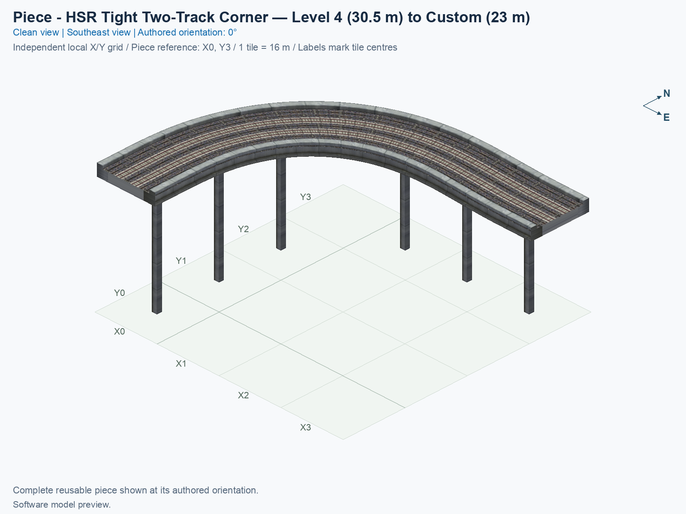
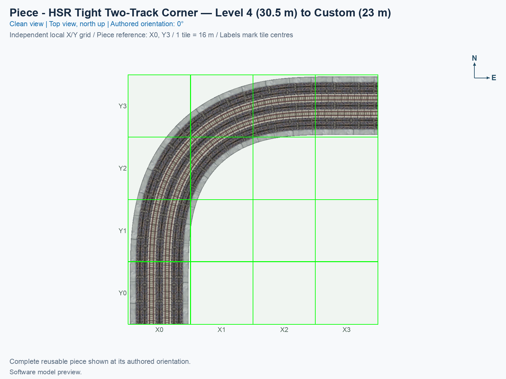
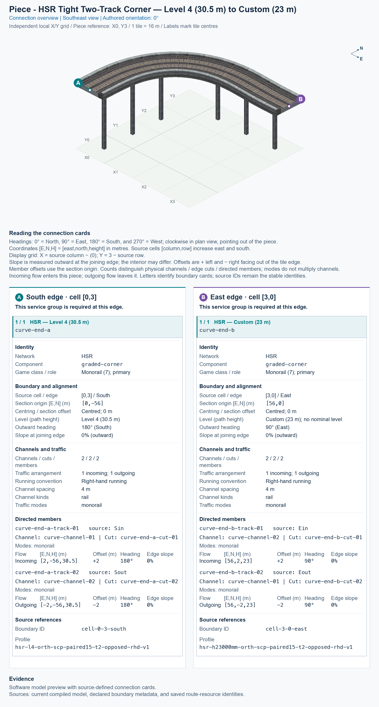

# HSR Custom (23 m) ↔ Level 4 (30.5 m) — Two-Track Curve 90° Ramp — Tight

<!-- SUBJECT IDENTITY MIGRATION -->

Identity migration: `hsr-component-tight-paired-curve90-l4-to-mid` → `hsr-h23000mm-and-l4-two-track-curve-ramp-90deg-tight`. Earlier measurements, observations, and pictures retain their recorded names and fingerprints; they do not establish verification of the renamed build. See the [identity migration rules](../../../../docs/NAMING_CONVENTIONS.md#10-choosing-and-changing-names).

<!-- PIECE README LAYOUT: 2 -->

[1. Views](#1-views) · [2. Piece and placement](#2-piece-and-placement) · [3. Connection matrix](#3-connection-matrix) · [Testing ↗ (separate document)](TESTING.md)

This is one reusable High Speed Rail (HSR) quarter-turn with two tracks carrying opposite directions. In the pictured 0° orientation, the south end is **Level 4 (30.5 m)**, and the east end is **Custom (23 m)**. A train travelling south-to-east descends; a train travelling east-to-south climbs. The 23 m interface has no assigned nominal level.

**Status:** experimental. Current saved-resource evidence and software pictures are separate from human preview approval and game operation. Existing observations retain their exact scope; refreshing this guide adds no human pass.

## 1. Views

Both clean pictures show the complete saved model at the same authored 0° orientation, on its local X0–X3 and Y0–Y3 grid. X increases eastward, Y increases northward, and north is up in the top view. The pictures render actual saved game models and textures; they are not game screenshots.

<!-- BEGIN PIECE VIEWS -->

<!-- END PIECE VIEWS -->

View-specific provenance is in [the angled report](evidence/preview.json) and [the top report](evidence/preview-top.json). Original render reports remain preserved under `evidence/design-history/`.

## 2. Piece and placement

<!-- BEGIN PIECE OVERVIEW -->

A 56 m right-angle paired corner descends from 30.5 m to the custom 23 m matching connection. The reverse-direction track climbs; both ends have 8 m flat native collars.

Exact reusable identifier: `hsr-h23000mm-and-l4-two-track-curve-ramp-90deg-tight`.

Footprint: **4 × 4 tiles**. Exact menu name: **HSR Custom (23 m) ↔ Level 4 (30.5 m) — Two-Track Curve 90° Ramp — Tight**.

<!-- END PIECE OVERVIEW -->

The permanent type ID is `hsr-h23000mm-and-l4-two-track-curve-ramp-90deg-tight`. The menu title uses the common **SCP | [PART]** prefix followed by **HSR Custom (23 m) ↔ Level 4 (30.5 m) — Two-Track Curve 90° Ramp — Tight**; PART means one reusable building block.

### Complete joining boundaries

The full paired deck is 15 m wide, with the two train-path centres 4 m apart at offsets of ±2 m. Both physical channels must continue at the same complete joining boundary. A centred one-way approach cannot supply this paired connection.

The 23 m end is a **custom paired interface** used between the two tight graded corner types. It is not an ordinary Level 3 connection, and a matching height alone cannot establish physical fit. The other end uses the paired native height shown above. Exact positions, directions, flat joining grades, and complete boundary membership appear in the generated cards; automatic compatibility discovery is not supplied by the library.

The south end lies on the south edge of tile (X0, Y0); the east end lies on the east edge of tile (X3, Y3). Picture X equals source column, and picture Y equals 3 minus source row.

### Place and rotate

After following the [separate installation procedure](../../../../docs/BUILD_AND_INSTALL.md), use a disposable flat test city. A construction rectangle is the complete bounding area around the piece; its sparse owned cells are listed in [piece.json](piece.json).

1. Open **Transportation → Rail**, hover over the SCP buttons, and select **HSR Custom (23 m) ↔ Level 4 (30.5 m) — Two-Track Curve 90° Ramp — Tight**.
2. Keep the complete **4 × 4 tile rectangle, measuring 64 × 64 m** clear. Press **Home** or **End** to turn the entire preview; on the documented Mac keyboard, **Fn + ←** and **Fn + →** supply those keys.
3. Align both exposed ends with their required complete approach sections. The supported proper rotations are **0°, 90°, 180°, and 270°**, measured counterclockwise from the pictures. Each rotation carries the heights and travel directions with it.
4. Click once to place this piece, then inspect each occupied tile and both joins. A sparse software reference can be an empty cell; do not treat it as a confirmed mouse-click anchor.

## 3. Connection matrix

<!-- BEGIN PIECE CONNECTION MATRIX -->

### Directed entrance/exit matrix

Read **from an entrance row to an exit column**. **Saved PATH** checks the saved traffic route; **Route Query** checks the route shown by the game; **Visible travel** checks a vehicle completing that journey. For HSR, visible travel means a moving train.

**Game appearance:** [?](TESTING.md#case-in_game_render-21e3a5277cb911952a2a) — the complete piece’s appearance in the game, checked separately from its journeys.

**Legend:** ✅ confirmed; ❌ failed; ? not established. **Forbidden** means the movement is unavailable; its in-game check confirms that it stays unavailable. Click a result for its exact test case. Scope, evidence, and limitations remain in [the test checklist](TESTING.md#test-checklist).

| Entrance ↓ / Exit → | **HSR · South exit** `Sout` | **HSR · East exit** `Eout` |
| --- | --- | --- |
| **HSR · South entrance** `Sin` | **Forbidden** **Saved PATH:** [✅](TESTING.md#case-software_connectivity-8852858b47c067896097) In-game check: [?](TESTING.md#case-in_game_forbidden_transfer-91d5709c0b682d7c68be) | **Saved PATH:** [✅](TESTING.md#case-software_connectivity-8852858b47c067896097) **Route Query:** [?](TESTING.md#case-in_game_route_query-e67c358a04d6ec6a9f0e) **Visible train travel:** [?](TESTING.md#case-in_game_visible_travel-e67c358a04d6ec6a9f0e) |
| **HSR · East entrance** `Ein` | **Saved PATH:** [✅](TESTING.md#case-software_connectivity-8852858b47c067896097) **Route Query:** [?](TESTING.md#case-in_game_route_query-944353620d4cec304f86) **Visible train travel:** [?](TESTING.md#case-in_game_visible_travel-944353620d4cec304f86) | **Forbidden** **Saved PATH:** [✅](TESTING.md#case-software_connectivity-8852858b47c067896097) In-game check: [?](TESTING.md#case-in_game_forbidden_transfer-f4f042adfeaa17c52e23) |

Source: [connections.json](connections.json).

<!-- END PIECE CONNECTION MATRIX -->

<!-- BEGIN CONNECTOR OVERVIEW -->

### Connection overview

Generated from this piece's source-bound connector metadata and the current compiled model; marker letters refer to the boundary cards below.

[Rendering sources and verification scope](evidence/connection-overview.json).

Headings: 0° = North, 90° = East, 180° = South, and 270° = West; clockwise in plan view, pointing out of the piece.

Coordinates [E,N,H] = [east,north,height] in metres. Source cells [column,row] increase east and south.

Display grid: X = source column − (0); Y = 3 − source row.

Slope is measured outward at the joining edge; the interior may differ. Offsets are + left and − right facing out of the tile edge.

Member offsets use the section origin. Counts distinguish physical channels / edge cuts / directed members; modes do not multiply channels.

Incoming flow enters this piece; outgoing flow leaves it. Letters identify boundary cards; source IDs remain the stable identities.

#### Boundary A: `cell-0-3-south`

This service group is required at this edge.

##### Service group 1 / 1: HSR — Level 4 (30.5 m)

| Field | Value |
| --- | --- |
| End / component | `curve-end-a` / `graded-corner` |
| Network / game class / role | hsr / Monorail (7); primary |
| Source cell / edge | `[0,3]` / South |
| Section origin [E,N] (m) | `[0,-56]` |
| Centring / section offset | Centred; 0 m |
| Level (path height) | Level 4 (30.5 m) |
| Outward heading | 180° (South) |
| Slope at joining edge | 0% outward |
| Channels / edge cuts / directed members | 2 / 2 / 2 |
| Traffic arrangement / running | 1 incoming; 1 outgoing; Right-hand running |
| Channel spacing | 4 m |
| Channel kinds | rail |
| Traffic modes | monorail |
| Profile | `hsr-l4-orth-scp-paired15-t2-opposed-rhd-v1` |

| Member / measured source | Channel / cut / modes | Flow | Endpoint [E,N,H] (m) | Offset (m) | Outward heading | Edge slope (%) |
| --- | --- | --- | --- | ---: | ---: | ---: |
| `curve-end-a-track-01` / `Sin` | `curve-channel-01` / `curve-end-a-cut-01` / monorail | Incoming | `[2,-56,30.5]` | +2 | 180° | 0 |
| `curve-end-a-track-02` / `Sout` | `curve-channel-02` / `curve-end-a-cut-02` / monorail | Outgoing | `[-2,-56,30.5]` | -2 | 180° | 0 |

#### Boundary B: `cell-3-0-east`

This service group is required at this edge.

##### Service group 1 / 1: HSR — Custom (23 m)

| Field | Value |
| --- | --- |
| End / component | `curve-end-b` / `graded-corner` |
| Network / game class / role | hsr / Monorail (7); primary |
| Source cell / edge | `[3,0]` / East |
| Section origin [E,N] (m) | `[56,0]` |
| Centring / section offset | Centred; 0 m |
| Level (path height) | Custom (23 m); no nominal level |
| Outward heading | 90° (East) |
| Slope at joining edge | 0% outward |
| Channels / edge cuts / directed members | 2 / 2 / 2 |
| Traffic arrangement / running | 1 incoming; 1 outgoing; Right-hand running |
| Channel spacing | 4 m |
| Channel kinds | rail |
| Traffic modes | monorail |
| Profile | `hsr-h23000mm-orth-scp-paired15-t2-opposed-rhd-v1` |

| Member / measured source | Channel / cut / modes | Flow | Endpoint [E,N,H] (m) | Offset (m) | Outward heading | Edge slope (%) |
| --- | --- | --- | --- | ---: | ---: | ---: |
| `curve-end-b-track-01` / `Ein` | `curve-channel-02` / `curve-end-b-cut-01` / monorail | Incoming | `[56,2,23]` | +2 | 90° | 0 |
| `curve-end-b-track-02` / `Eout` | `curve-channel-01` / `curve-end-b-cut-02` / monorail | Outgoing | `[56,-2,23]` | -2 | 90° | 0 |

The overview uses source metadata, current compiled resource identities, and the saved model. Current placement, connection, and traffic results belong to the generated connection matrix and linked testing records.

<!-- END CONNECTOR OVERVIEW -->
