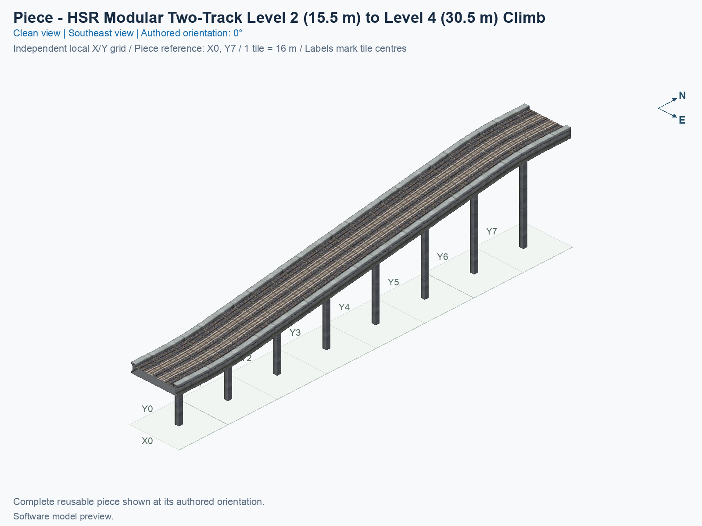
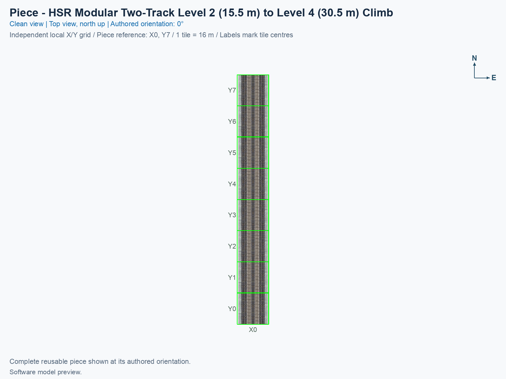
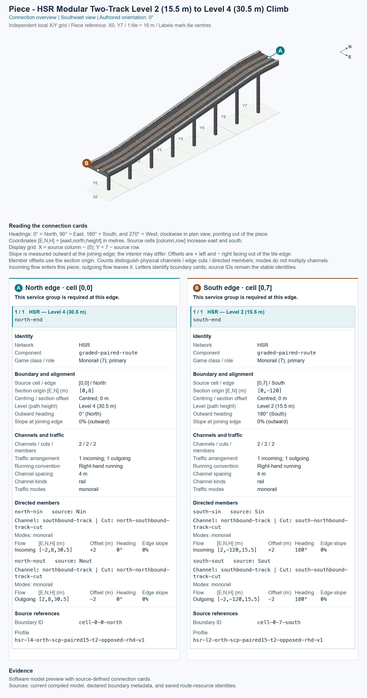

# HSR Level 2 (15.5 m) ↔ Level 4 (30.5 m) — Two-Track Ramp

<!-- SUBJECT IDENTITY MIGRATION -->

Identity migration: `hsr-component-modular-paired-climb` → `hsr-l2-and-l4-two-track-ramp`. Earlier measurements, observations, and pictures retain their recorded names and fingerprints; they do not establish verification of the renamed build. See the [identity migration rules](../../../../docs/NAMING_CONVENTIONS.md#10-choosing-and-changing-names).

<!-- PIECE README LAYOUT: 2 -->

[1. Views](#1-views) · [2. Piece and placement](#2-piece-and-placement) · [3. Connection matrix](#3-connection-matrix) · [Testing ↗ (separate document)](TESTING.md)

This reusable High Speed Rail (HSR) piece carries two tracks in opposite directions over a 128 m climb. In the pictured 0° orientation, the south end is Level 2 (L2), with traffic paths 15.5 m above ground, and the north end is Level 4 (L4), at 30.5 m. The northbound track climbs, and the southbound track descends. Both exposed ends are flat.

**Status: experimental.** These pictures and connector measurements come from the actual saved game resources. Human preview approval and in-game behavior remain unverified. The type is optional and disabled in default builds.

The permanent type ID is `hsr-l2-and-l4-two-track-ramp`. The exact compiled menu title is **SCP | [PART] HSR Level 2 (15.5 m) ↔ Level 4 (30.5 m) — Two-Track Ramp**. PART identifies one individual building block. The puzzle ID is `f82f`, and the complete cursor-preview model ID is `7f58dff5`.

## 1. Views

Both pictures show the same complete saved model in its authored 0° orientation. X increases eastward, Y increases northward, and each city tile measures 16 × 16 m. These are software renders rather than game screenshots.

The local picture grid runs from X0 to X0 and from Y0 to Y7. The low end is south of tile (X0, Y0), and the high end is north of tile (X0, Y7). Source cells use [column, row], with rows increasing southward: picture Y equals 7 minus the source row. The software construction reference is tile (X0, Y7); it has not been confirmed as the game’s mouse-click anchor.

<!-- BEGIN PIECE VIEWS -->

<!-- END PIECE VIEWS -->

## 2. Piece and placement

<!-- BEGIN PIECE OVERVIEW -->

A 128 m two-track climb between 15.5 and 30.5 m, with opposing travel directions, flat native-profile ends and coordinated supports.

Exact reusable identifier: `hsr-l2-and-l4-two-track-ramp`.

Footprint: **1 × 8 tiles**. Exact menu name: **HSR Level 2 (15.5 m) ↔ Level 4 (30.5 m) — Two-Track Ramp**.

<!-- END PIECE OVERVIEW -->

### Footprint and joining ends

Keep the full **1 × 8 tile construction rectangle**, measuring 16 × 128 m, clear. This piece owns all 8 source cells listed in [piece.json](piece.json). The supports are part of its saved model; their appearance does not establish that another object can occupy the same construction cell.

The south joining boundary requires a complete paired L2 approach at 15.5 m; the north boundary requires a complete paired L4 approach at 30.5 m. Both tracks must join together, with their 4 m centre spacing and opposing directions. A centred one-way slab cannot supply the two-track connection. The 15 m height change stays inside the piece; intermediate-height cells are not exposed joining ends.

The [connector declaration](connector-groups.jsonc), [resolved export](connector-data.json), and measured [connections](connections.json) describe this piece’s intrinsic boundaries and journeys. They do not discover or certify arbitrary neighbours; an actual physical seam and game operation need their own evidence.

### Placement and rotation

A **proper rotation** turns the complete piece without reflecting it. The eight construction states repeat four proper orientations: 0°, 90°, 180°, and 270° counterclockwise from the pictures. All ends, supports, and travel directions rotate together.

After following the separate [installation procedure](../../../../docs/BUILD_AND_INSTALL.md), use a disposable flat test city. Placement remains unverified in game.

1. Open **Transportation → Rail**, hover over the SCP buttons, and select **HSR Level 2 (15.5 m) ↔ Level 4 (30.5 m) — Two-Track Ramp**. In an assembly’s component cycle, use **Tab** or **Shift+Tab** to select this same type.
2. Move the preview over a clear **1 × 8 tile rectangle**. Press **Home** or **End** to rotate; on the documented Mac keyboard, **Fn + ←** and **Fn + →** produce those keys.
3. At 0°, align the south end with the paired Level 2 approach and the north end with the paired Level 4 approach. Preserve the complete joining section and both travel directions.
4. Click once to place the complete piece. Supply travel demand for each permitted journey, then inspect the game’s route query and moving trains separately.

## 3. Connection matrix

<!-- BEGIN PIECE CONNECTION MATRIX -->

### Directed entrance/exit matrix

Read **from an entrance row to an exit column**. **Saved PATH** checks the saved traffic route; **Route Query** checks the route shown by the game; **Visible travel** checks a vehicle completing that journey. For HSR, visible travel means a moving train.

**Game appearance:** [?](TESTING.md#case-in_game_render-18b2fb81220f57ffa6d1) — the complete piece’s appearance in the game, checked separately from its journeys.

**Legend:** ✅ confirmed; ❌ failed; ? not established. **Forbidden** means the movement is unavailable; its in-game check confirms that it stays unavailable. Click a result for its exact test case. Scope, evidence, and limitations remain in [the test checklist](TESTING.md#test-checklist).

| Entrance ↓ / Exit → | **HSR · South exit** `Sout` | **HSR · North exit** `Nout` |
| --- | --- | --- |
| **HSR · North entrance** `Nin` | **Saved PATH:** [✅](TESTING.md#case-software_connectivity-12895ab3f28ca39a4a83) **Route Query:** [?](TESTING.md#case-in_game_route_query-c925e78d663f6aa80489) **Visible train travel:** [?](TESTING.md#case-in_game_visible_travel-c925e78d663f6aa80489) | **Forbidden** **Saved PATH:** [✅](TESTING.md#case-software_connectivity-12895ab3f28ca39a4a83) In-game check: [?](TESTING.md#case-in_game_forbidden_transfer-baa13e6daa1765197b83) |
| **HSR · South entrance** `Sin` | **Forbidden** **Saved PATH:** [✅](TESTING.md#case-software_connectivity-12895ab3f28ca39a4a83) In-game check: [?](TESTING.md#case-in_game_forbidden_transfer-c2b7a90b44ce5e2c0aab) | **Saved PATH:** [✅](TESTING.md#case-software_connectivity-12895ab3f28ca39a4a83) **Route Query:** [?](TESTING.md#case-in_game_route_query-0b11a910ca3db1fc9dfa) **Visible train travel:** [?](TESTING.md#case-in_game_visible_travel-0b11a910ca3db1fc9dfa) |

Source: [connections.json](connections.json).

<!-- END PIECE CONNECTION MATRIX -->

<!-- BEGIN CONNECTOR OVERVIEW -->

### Connection overview

Generated from this piece's source-bound connector metadata and the current compiled model; marker letters refer to the boundary cards below.

[Rendering sources and verification scope](evidence/connection-overview.json).

Headings: 0° = North, 90° = East, 180° = South, and 270° = West; clockwise in plan view, pointing out of the piece.

Coordinates [E,N,H] = [east,north,height] in metres. Source cells [column,row] increase east and south.

Display grid: X = source column − (0); Y = 7 − source row.

Slope is measured outward at the joining edge; the interior may differ. Offsets are + left and − right facing out of the tile edge.

Member offsets use the section origin. Counts distinguish physical channels / edge cuts / directed members; modes do not multiply channels.

Incoming flow enters this piece; outgoing flow leaves it. Letters identify boundary cards; source IDs remain the stable identities.

#### Boundary A: `cell-0-0-north`

This service group is required at this edge.

##### Service group 1 / 1: HSR — Level 4 (30.5 m)

| Field | Value |
| --- | --- |
| End / component | `north-end` / `graded-paired-route` |
| Network / game class / role | hsr / Monorail (7); primary |
| Source cell / edge | `[0,0]` / North |
| Section origin [E,N] (m) | `[0,8]` |
| Centring / section offset | Centred; 0 m |
| Level (path height) | Level 4 (30.5 m) |
| Outward heading | 0° (North) |
| Slope at joining edge | 0% outward |
| Channels / edge cuts / directed members | 2 / 2 / 2 |
| Traffic arrangement / running | 1 incoming; 1 outgoing; Right-hand running |
| Channel spacing | 4 m |
| Channel kinds | rail |
| Traffic modes | monorail |
| Profile | `hsr-l4-orth-scp-paired15-t2-opposed-rhd-v1` |

| Member / measured source | Channel / cut / modes | Flow | Endpoint [E,N,H] (m) | Offset (m) | Outward heading | Edge slope (%) |
| --- | --- | --- | --- | ---: | ---: | ---: |
| `north-nin` / `Nin` | `southbound-track` / `north-southbound-track-cut` / monorail | Incoming | `[-2,8,30.5]` | +2 | 0° | 0 |
| `north-nout` / `Nout` | `northbound-track` / `north-northbound-track-cut` / monorail | Outgoing | `[2,8,30.5]` | -2 | 0° | 0 |

#### Boundary B: `cell-0-7-south`

This service group is required at this edge.

##### Service group 1 / 1: HSR — Level 2 (15.5 m)

| Field | Value |
| --- | --- |
| End / component | `south-end` / `graded-paired-route` |
| Network / game class / role | hsr / Monorail (7); primary |
| Source cell / edge | `[0,7]` / South |
| Section origin [E,N] (m) | `[0,-120]` |
| Centring / section offset | Centred; 0 m |
| Level (path height) | Level 2 (15.5 m) |
| Outward heading | 180° (South) |
| Slope at joining edge | 0% outward |
| Channels / edge cuts / directed members | 2 / 2 / 2 |
| Traffic arrangement / running | 1 incoming; 1 outgoing; Right-hand running |
| Channel spacing | 4 m |
| Channel kinds | rail |
| Traffic modes | monorail |
| Profile | `hsr-l2-orth-scp-paired15-t2-opposed-rhd-v1` |

| Member / measured source | Channel / cut / modes | Flow | Endpoint [E,N,H] (m) | Offset (m) | Outward heading | Edge slope (%) |
| --- | --- | --- | --- | ---: | ---: | ---: |
| `south-sin` / `Sin` | `northbound-track` / `south-northbound-track-cut` / monorail | Incoming | `[2,-120,15.5]` | +2 | 180° | 0 |
| `south-sout` / `Sout` | `southbound-track` / `south-southbound-track-cut` / monorail | Outgoing | `[-2,-120,15.5]` | -2 | 180° | 0 |

The overview uses source metadata, current compiled resource identities, and the saved model. Current placement, connection, and traffic results belong to the generated connection matrix and linked testing records.

<!-- END CONNECTOR OVERVIEW -->
