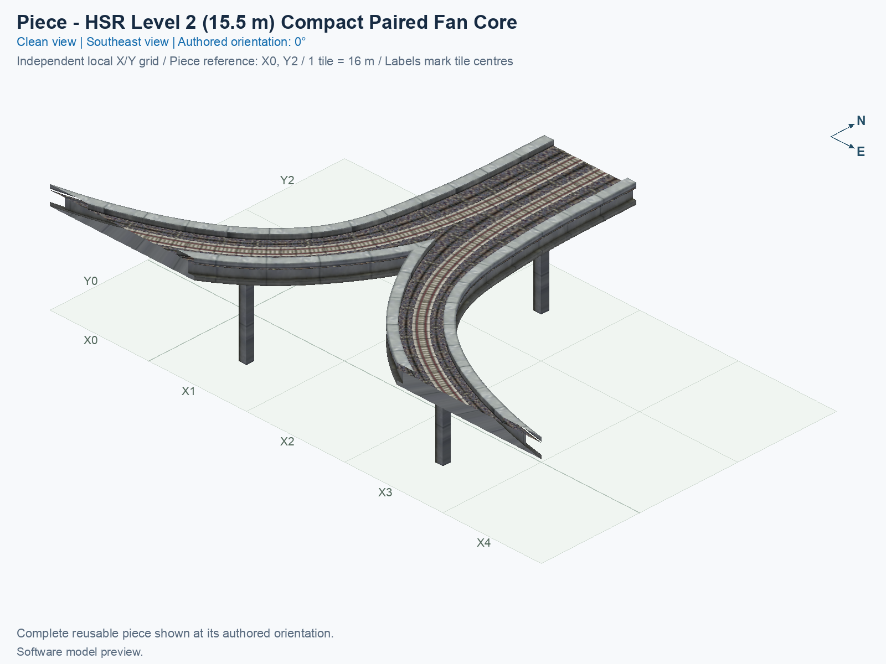
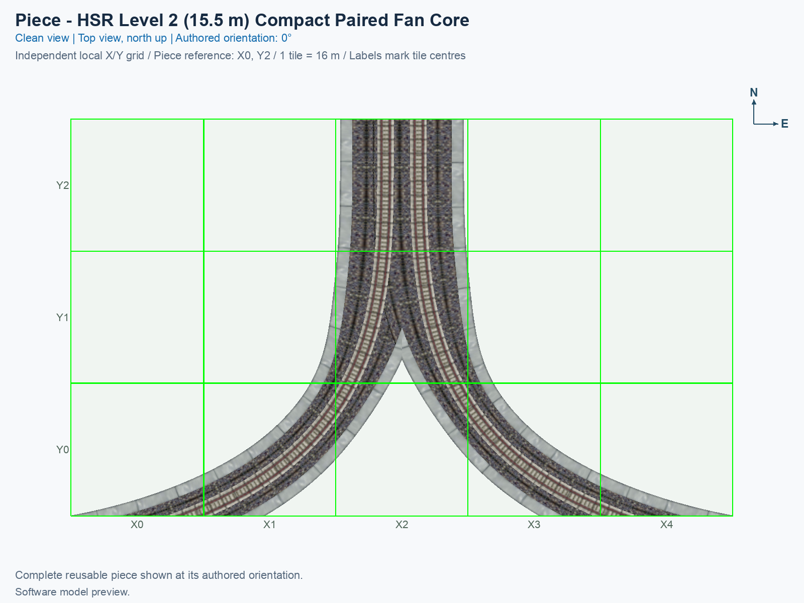
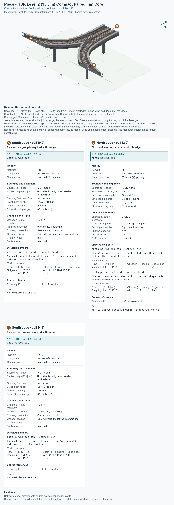

# HSR Level 2 (15.5 m) — Fan with Two-Track Stem — Compact, Recessed Web

<!-- SUBJECT IDENTITY MIGRATION -->

Identity migration: `hsr-component-l2-paired-fan-compact-core` → `hsr-l2-mixed-fan-compact-recessed-web`. Earlier measurements, observations, and pictures retain their recorded names and fingerprints; they do not establish verification of the renamed build. See the [identity migration rules](../../../../docs/NAMING_CONVENTIONS.md#10-choosing-and-changing-names).

<!-- PIECE README LAYOUT: 2 -->

[1. Views](#1-views) · [2. Piece and placement](#2-piece-and-placement) · [3. Connection matrix](#3-connection-matrix) · [Testing ↗ (separate document)](TESTING.md)

This reusable High Speed Rail (HSR) fork connects a north-facing pair of tracks to two curved southern branch ends. At its authored 0° orientation, traffic entering from the north leaves through the western branch; traffic entering from the eastern branch continues north. Both routes remain at nominal Level 2 (L2), with a train-path height of 15.5 m. The shorter core retains the nine fork cells of the former complete Compact Paired Fan Join, as recorded in its [saved extraction proof](evidence/fan-core-extraction.json). The complete predecessor has been removed after separating its two straight approach tiles into reusable pieces.

**Status: experimental.** Software resource checks, human image review, and operation inside SimCity 4 are recorded separately. The permanent type ID is `hsr-l2-mixed-fan-compact-recessed-web`. This guide describes the type independently of any assembly placement label.

## 1. Views

Both clean pictures show the complete saved model at the authored 0° orientation. North is up in the top view; X increases eastward, Y increases northward, and each city tile measures 16 × 16 m. The standalone grid belongs to this core. It does not use an interchange's placement coordinates or the original full fan's taller grid.

<!-- BEGIN PIECE VIEWS -->

<!-- END PIECE VIEWS -->

The generated connection overview in chapter 3 labels the complete joining boundaries and their required physical tracks. A software picture shows geometry and selected textures; its fixed caption does not report game or traffic status.

## 2. Piece and placement

<!-- BEGIN PIECE OVERVIEW -->

Nine-tile Level 2 paired fan fork with a paired north mouth using the recessed structural web, two matching curved branch cuts, and four owned supports; use the matching recessed-web paired straights for its approach.

Exact reusable identifier: `hsr-l2-mixed-fan-compact-recessed-web`.

Footprint: **5 × 3 tiles**. Exact menu name: **HSR Level 2 (15.5 m) — Fan with Two-Track Stem — Compact, Recessed Web**.

<!-- END PIECE OVERVIEW -->

### Function and joining boundaries

The north boundary carries two tracks travelling in opposite directions. Its concrete body uses the **recessed-web paired profile**: the structural web, the vertical concrete body below the track bed, is slightly narrower than the corresponding body of an ordinary paired straight. Use the [HSR Level 2 (15.5 m) — Two-Track Straight — Recessed Web](../hsr-l2-two-track-straight-recessed-web/README.md) when extending this approach. An ordinary straight's matching track height and 15 m outer envelope do not establish a complete physical match.

Each southern curved branch has its own directed connection. Its position, heading, deck, grey walls, and train clearance must match its neighbour. The western branch is an exit; the eastern branch is an entrance. Neither branch accepts a normal cardinal straight merely because both pieces are at L2, and the two branch routes do not transfer into one another.

The construction rectangle is **5 × 3 tiles**, with **nine owned cells**, **two structural cells without train paths**, and **four supports**. The nine saved cell models retain the accepted fork, including the central raised grey border, without reshaping. Keep the complete construction rectangle clear, including apparently empty cells. The authoring reference point is a software coordinate; it is not a confirmed game mouse-click anchor.

The [piece definition](piece.json) owns the construction identity, and the [geometry source](geometry.json) owns the selected cells and their retained compilation context. Source cells use [column, row], with columns increasing eastward and rows increasing southward. The picture's Y axis increases northward; use the generated coordinate conversion below rather than reading a source row as a picture Y label.

### Place and rotate the piece

After following the [separate build and installation procedure](../../../../docs/BUILD_AND_INSTALL.md), use a disposable flat test city. A proper rotation turns the complete component and its directions together; it does not reflect the component or reverse a route.

1. Open **Transportation → Rail**, hover over the SCP buttons, and select **HSR Level 2 (15.5 m) — Fan with Two-Track Stem — Compact, Recessed Web**. An installed assembly may include this type in its declared Tab/Shift+Tab cycle.
2. Move the complete cursor preview over clear terrain. Press **Home** or **End** to rotate it; on the documented Mac keyboard, **Fn + ←** and **Fn + →** provide those keys. Use only the construction states listed in the generated connection section.
3. At 0°, locate the north-facing paired boundary and the two southern curved cuts in the top picture. Align a matching recessed-web paired straight with the north boundary, and align matching curved continuations with the southern cuts.
4. Click once to place the component. Supply the matching outside connections and travel demand. Inspect rails, decks, grey walls, supports, and shadows, then check the permitted journeys and forbidden movements separately.

The [trumpet blueprint](../../01_assemblies/hsr-trumpet-straight-stem/README.md) documents one use of this core and two copies of the matching straight. Its end-to-end evidence does not approve every other placement. The [measured extraction decision](../../01_assemblies/hsr-trumpet-straight-stem/evidence/fan-atomization-review.json) explains the retained fork, the distinct straight profile, and the inherited northern transition in that assembly.

## 3. Connection matrix

The generated matrix describes movements inside this piece. The connection overview describes its exposed boundaries. Agreement of saved routes alone does not prove that an arbitrary neighbour's complete concrete profile fits.

<!-- BEGIN PIECE CONNECTION MATRIX -->

### Directed entrance/exit matrix

Read **from an entrance row to an exit column**. **Saved PATH** checks the saved traffic route; **Route Query** checks the route shown by the game; **Visible travel** checks a vehicle completing that journey. For HSR, visible travel means a moving train.

**Game appearance:** [?](TESTING.md#case-in_game_render-70fd682fc6b9d93afc79) — the complete piece’s appearance in the game, checked separately from its journeys.

**Legend:** ✅ confirmed; ❌ failed; ? not established. **Forbidden** means the movement is unavailable; its in-game check confirms that it stays unavailable. Click a result for its exact test case. Scope, evidence, and limitations remain in [the test checklist](TESTING.md#test-checklist).

| Entrance ↓ / Exit → | **HSR · South exit** `Wout` | **HSR · North exit** `Nout` |
| --- | --- | --- |
| **HSR · North entrance** `Nin` | **Saved PATH:** [✅](TESTING.md#case-software_connectivity-57b9c10edb4753a8a805) **Route Query:** [?](TESTING.md#case-in_game_route_query-5b0c76d60139570dba48) **Visible train travel:** [?](TESTING.md#case-in_game_visible_travel-5b0c76d60139570dba48) | **Forbidden** **Saved PATH:** [✅](TESTING.md#case-software_connectivity-57b9c10edb4753a8a805) In-game check: [?](TESTING.md#case-in_game_forbidden_transfer-a3457011d2eed1496e51) |
| **HSR · South entrance** `Ein` | **Forbidden** **Saved PATH:** [✅](TESTING.md#case-software_connectivity-57b9c10edb4753a8a805) In-game check: [?](TESTING.md#case-in_game_forbidden_transfer-6c7143e735af35441d23) | **Saved PATH:** [✅](TESTING.md#case-software_connectivity-57b9c10edb4753a8a805) **Route Query:** [?](TESTING.md#case-in_game_route_query-5ddc26ca3524d0653959) **Visible train travel:** [?](TESTING.md#case-in_game_visible_travel-5ddc26ca3524d0653959) |

Source: [connections.json](connections.json).

<!-- END PIECE CONNECTION MATRIX -->

<!-- BEGIN CONNECTOR OVERVIEW -->

### Connection overview

Generated from this piece's source-bound connector metadata and the current compiled model; marker letters refer to the boundary cards below.

[Rendering sources and verification scope](evidence/connection-overview.json).

Headings: 0° = North, 90° = East, 180° = South, and 270° = West; clockwise in plan view, pointing out of the piece.

Coordinates [E,N,H] = [east,north,height] in metres. Source cells [column,row] increase east and south.

Display grid: X = source column − (0); Y = 2 − source row.

Slope is measured outward at the joining edge; the interior may differ. Offsets are + left and − right facing out of the tile edge.

Member offsets use the section origin. Counts distinguish physical channels / edge cuts / directed members; modes do not multiply channels.

Incoming flow enters this piece; outgoing flow leaves it. Letters identify boundary cards; source IDs remain the stable identities.

Not declared means no section origin or offset was authored. Its marker uses an actual member endpoint; the measured intersections remain authoritative.

#### Boundary A: `cell-0-2-south`

This service group is required at this edge.

##### Service group 1 / 1: HSR — Level 2 (15.5 m)

| Field | Value |
| --- | --- |
| End / component | `west-curved-cut` / `paired-fan-core` |
| Network / game class / role | hsr / Monorail (7); primary |
| Source cell / edge | `[0,2]` / South |
| Section origin [E,N] (m) | Not declared; see member endpoints |
| Centring / section offset | Not declared |
| Level (path height) | Level 2 (15.5 m) |
| Outward heading | 248.011° |
| Slope at joining edge | 0% outward |
| Channels / edge cuts / directed members | 1 / 1 / 1 |
| Traffic arrangement / running | 0 incoming; 1 outgoing; See member directions |
| Channel spacing | See individual measured intersections |
| Channel kinds | rail |
| Traffic modes | monorail |
| Profile | No profile reference |

| Member / measured source | Channel / cut / modes | Flow | Endpoint [E,N,H] (m) | Offset (m) | Outward heading | Edge slope (%) |
| --- | --- | --- | --- | ---: | ---: | ---: |
| `west-curved-cut-wout` / `Wout` | `north-to-west-track` / `west-curved-cut-north-to-west-track-cut` / monorail | Outgoing | `[6.39852,-40,15.5]` | Not declared | 248.011° | 0 |

#### Boundary B: `cell-2-0-north`

This service group is required at this edge.

##### Service group 1 / 1: HSR — Level 2 (15.5 m)

| Field | Value |
| --- | --- |
| End / component | `north-paired-end` / `paired-fan-core` |
| Network / game class / role | hsr / Monorail (7); primary |
| Source cell / edge | `[2,0]` / North |
| Section origin [E,N] (m) | `[32,8]` |
| Centring / section offset | Centred; 0 m |
| Level (path height) | Level 2 (15.5 m) |
| Outward heading | 0° (North) |
| Slope at joining edge | 0% outward |
| Channels / edge cuts / directed members | 2 / 2 / 2 |
| Traffic arrangement / running | 1 incoming; 1 outgoing; Right-hand running |
| Channel spacing | 4 m |
| Channel kinds | rail |
| Traffic modes | monorail |
| Profile | `hsr-l2-paired-recessed-web15-t2-opposed-rhd-v1` |

| Member / measured source | Channel / cut / modes | Flow | Endpoint [E,N,H] (m) | Offset (m) | Outward heading | Edge slope (%) |
| --- | --- | --- | --- | ---: | ---: | ---: |
| `north-paired-end-nin` / `Nin` | `north-to-west-track` / `north-paired-end-north-to-west-track-cut` / monorail | Incoming | `[30,8,15.5]` | +2 | 0° | 0 |
| `north-paired-end-nout` / `Nout` | `east-to-north-track` / `north-paired-end-east-to-north-track-cut` / monorail | Outgoing | `[34,8,15.5]` | -2 | 0° | 0 |

#### Boundary C: `cell-4-2-south`

This service group is required at this edge.

##### Service group 1 / 1: HSR — Level 2 (15.5 m)

| Field | Value |
| --- | --- |
| End / component | `east-curved-cut` / `paired-fan-core` |
| Network / game class / role | hsr / Monorail (7); primary |
| Source cell / edge | `[4,2]` / South |
| Section origin [E,N] (m) | Not declared; see member endpoints |
| Centring / section offset | Not declared |
| Level (path height) | Level 2 (15.5 m) |
| Outward heading | 111.989° |
| Slope at joining edge | 0% outward |
| Channels / edge cuts / directed members | 1 / 1 / 1 |
| Traffic arrangement / running | 1 incoming; 0 outgoing; See member directions |
| Channel spacing | See individual measured intersections |
| Channel kinds | rail |
| Traffic modes | monorail |
| Profile | No profile reference |

| Member / measured source | Channel / cut / modes | Flow | Endpoint [E,N,H] (m) | Offset (m) | Outward heading | Edge slope (%) |
| --- | --- | --- | --- | ---: | ---: | ---: |
| `east-curved-cut-ein` / `Ein` | `east-to-north-track` / `east-curved-cut-east-to-north-track-cut` / monorail | Incoming | `[57.6015,-40,15.5]` | Not declared | 111.989° | 0 |

The overview uses source metadata, current compiled resource identities, and the saved model. Current placement, connection, and traffic results belong to the generated connection matrix and linked testing records.

<!-- END CONNECTOR OVERVIEW -->
