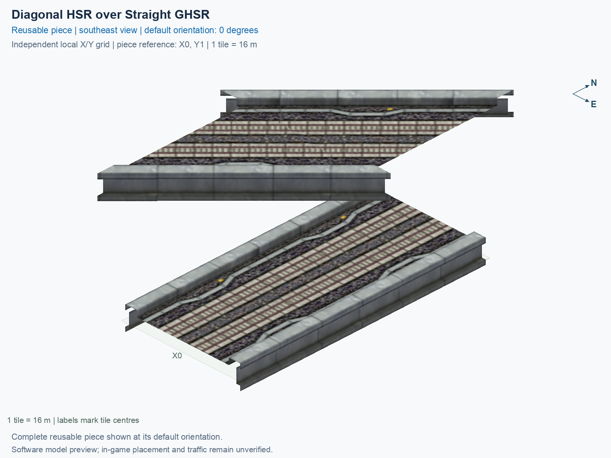

<a id="diagonal-hsr-over-straight-ghsr"></a>

# HSR Level 2 (15.5 m) over GHSR Ground (1 m) — Two-Track Crossing 45° — Upper Diagonal

<!-- SUBJECT IDENTITY MIGRATION -->

Identity migration: `diagonal-hsr-straight-ghsr` → `hsr-l2-over-ghsr-ground-two-track-crossing-upper-diagonal-45deg`. Earlier measurements, observations, and pictures retain their recorded names and fingerprints; they do not establish verification of the renamed build. See the [identity migration rules](../../../../docs/NAMING_CONVENTIONS.md#10-choosing-and-changing-names).

Purpose: explain this reusable piece, its matching connections and current test coverage.

<!-- BEGIN PIECE OVERVIEW -->

Diagonal elevated HSR crosses straight ground HSR. Two tiles; no interchange.

Exact reusable identifier: `hsr-l2-over-ghsr-ground-two-track-crossing-upper-diagonal-45deg`.

Footprint: **1 × 2 tiles**. Exact menu name: **HSR Level 2 (15.5 m) over GHSR Ground (1 m) — Two-Track Crossing 45° — Upper Diagonal**.

Choose this exact name in Transportation → Rail. Press Home or End to rotate; use only the supported states listed below. Join each end to a matching port profile and direction.

- [Connections and journeys](#connections-and-journeys)
- [Test checklist](#test-checklist)



<!-- END PIECE OVERVIEW -->

<!-- BEGIN MANUAL SUMMARY -->

## Manual status

Generated from [the exact test cases](#test-checklist) and [authoritative observations](checks/manual-tests.json).

- [ ] Preview review: 0/1 applicable cases passed; 0 failed, 0 stale.
- [ ] In-game rendering: 0/8 applicable cases passed; 0 failed, 0 stale.
- [ ] Directed journeys: 0/32 applicable cases passed; 0 failed, 0 stale.

These observations cover only the named services, directions, poses, rotations, and recorded platforms.

<!-- END MANUAL SUMMARY -->

<!-- BEGIN CONNECTIONS -->

## Connections and journeys

Purpose: describe intrinsic directional interfaces and permitted service journeys.

Generated from [connections.json](connections.json). Coordinates are canonical east, north, and height in metres. A connection class names an encoded route interface; it does not prove visible deck/wall fit or an in-game test.

Supported placement states: 0° CCW, 90° CCW, 180° CCW, 270° CCW, 0° CCW with construction Transpose, 90° CCW with construction Transpose, 180° CCW with construction Transpose, 270° CCW with construction Transpose. Each state has its own declared manual scope.

A **port** is one directional transport-path endpoint. **Service** identifies the intended network service (for example HSR, street, or tram); **engine** is its internal traffic-class number, separate from the construction network. **Role** distinguishes primary service from auxiliary paths; sharing a traffic class does not establish service compatibility.

A **tangent** is a unit travel-direction vector: `[0,1]` means north. **Grade** is height gained per horizontal metre. These measured facts describe this subject alone. Compatibility requires a separate comparison of the complete joining boundaries; physical seams and actual game operation require their own evidence. See the [class index](../../connection-classes.jsonc) for shared route-interface membership.

| Port | Service / engine / role | Direction | Location; tangent; grade | Connection class |
| --- | --- | --- | --- | --- |
| `7-W-in-1` | hsr / 7 / primary | in | [-8.0, -18.9, 15.5]; [0.7071067811865476, 0.7071067811865475]; 0.0 | `path-interface-9f8c3dd2cd3e736ce4f1` |
| `7-W-out-2` | hsr / 7 / primary | out | [-8.0, -13.2, 15.5]; [-0.7002086668924693, -0.7139382485962431]; 0.0 | `path-interface-df84be787839515335e9` |
| `7-S-out-3` | ghsr / 7 / primary | out | [-2.0, -24.0, 1.0]; [0.0, -1.0]; 0.0 | `path-interface-c78c5ac4b558d84b46f2` |
| `7-N-in-4` | ghsr / 7 / primary | in | [-2.0, 8.0, 1.0]; [0.0, -1.0]; 0.0 | `path-interface-c78c5ac4b558d84b46f2` |
| `7-S-in-5` | ghsr / 7 / primary | in | [2.0, -24.0, 1.0]; [0.0, 1.0]; 0.0 | `path-interface-fab587419de6b5848d74` |
| `7-N-out-6` | ghsr / 7 / primary | out | [2.0, 8.0, 1.0]; [0.0, 1.0]; 0.0 | `path-interface-fab587419de6b5848d74` |
| `7-E-out-7` | hsr / 7 / primary | out | [8.0, -2.8, 15.5]; [0.7002086668924692, 0.7139382485962431]; 0.0 | `path-interface-df84be787839515335e9` |
| `7-E-in-8` | hsr / 7 / primary | in | [8.0, 2.9, 15.5]; [-0.7071067811865476, -0.7071067811865476]; 0.0 | `path-interface-9f8c3dd2cd3e736ce4f1` |

### Directed journeys

| Service | Entry → exit | Role |
| --- | --- | --- |
| hsr | `7-W-in-1` → `7-E-out-7` | primary |
| ghsr | `7-N-in-4` → `7-S-out-3` | primary |
| ghsr | `7-S-in-5` → `7-N-out-6` | primary |
| hsr | `7-E-in-8` → `7-W-out-2` | primary |

### Forbidden transfers

| From service / port | To service / port | Reason |
| --- | --- | --- |
| hsr / `7-W-in-1` | hsr / `7-W-out-2` | No directed route exists between these ports in the saved piece transport paths. In-game confirmation remains unverified. |
| hsr / `7-W-in-1` | ghsr / `7-S-out-3` | No directed route exists between these ports in the saved piece transport paths. In-game confirmation remains unverified. |
| hsr / `7-W-in-1` | ghsr / `7-N-out-6` | No directed route exists between these ports in the saved piece transport paths. In-game confirmation remains unverified. |
| ghsr / `7-N-in-4` | hsr / `7-W-out-2` | No directed route exists between these ports in the saved piece transport paths. In-game confirmation remains unverified. |
| ghsr / `7-N-in-4` | ghsr / `7-N-out-6` | No directed route exists between these ports in the saved piece transport paths. In-game confirmation remains unverified. |
| ghsr / `7-N-in-4` | hsr / `7-E-out-7` | No directed route exists between these ports in the saved piece transport paths. In-game confirmation remains unverified. |
| ghsr / `7-S-in-5` | hsr / `7-W-out-2` | No directed route exists between these ports in the saved piece transport paths. In-game confirmation remains unverified. |
| ghsr / `7-S-in-5` | ghsr / `7-S-out-3` | No directed route exists between these ports in the saved piece transport paths. In-game confirmation remains unverified. |
| ghsr / `7-S-in-5` | hsr / `7-E-out-7` | No directed route exists between these ports in the saved piece transport paths. In-game confirmation remains unverified. |
| hsr / `7-E-in-8` | ghsr / `7-S-out-3` | No directed route exists between these ports in the saved piece transport paths. In-game confirmation remains unverified. |
| hsr / `7-E-in-8` | ghsr / `7-N-out-6` | No directed route exists between these ports in the saved piece transport paths. In-game confirmation remains unverified. |
| hsr / `7-E-in-8` | hsr / `7-E-out-7` | No directed route exists between these ports in the saved piece transport paths. In-game confirmation remains unverified. |

Review the test checklist for the exact tested cases and environments.

<!-- END CONNECTIONS -->

<!-- BEGIN MANUAL CHECKS -->

## Test checklist

Generated from [the authoritative record](checks/manual-tests.json). Only explicit human observations create manual passes; software and preview checks remain separate. Expand a check/service group to see its rotation table, then expand the matching exact scope to copy a case ID and inspect its pose, reviewer, environment, and evidence. Grouping changes only this view; every declared case remains separate.

**States:** [x] passed; [ ] unverified, failed, or stale; N/A is an explicit inapplicable declaration. A dash means no case was declared in that column. Every pass covers only its recorded environment. T means a distinct construction-transposed state.

Actual emitted rules support four proper rotations and four distinct construction-transposed states; each has separate manual coverage. Counterpart reflection is never assumed.

Current totals: unverified: 163, passed: 0, failed: 0, stale: 0, not_applicable: 0.

### Record an observation

Follow the [shared testing guide](../../../../docs/TESTING.md); copy [the unconfirmed example](checks/observation.example.json) to `checks/observation.json`. Case identifiers are in the expandable sections below. Do not edit generated checkboxes.

From the repository folder containing `custom-pieces`, run after filling `checks/observation.json` and explicitly confirming the exact observation:

```sh
python3 -m scp.content record --record custom-pieces/domains/high-speed-rail/00_pieces/hsr-l2-over-ghsr-ground-two-track-crossing-upper-diagonal-45deg/checks/manual-tests.json --observation custom-pieces/domains/high-speed-rail/00_pieces/hsr-l2-over-ghsr-ground-two-track-crossing-upper-diagonal-45deg/checks/observation.json
```

### Detailed current checks

Each collapsed group shows exact case counts and states. Forbidden transfers are grouped by the directed service pair; the table inside retains every port pair and rotation.

<details>
<summary>Compiled resources — Whole subject — 1 case; unverified: 1</summary>

| Check / exact scope | General | 0° | 90° | 180° | 270° | 0° T | 90° T | 180° T | 270° T |
| --- | --- | --- | --- | --- | --- | --- | --- | --- | --- |
| **Compiled resources**<br>Whole subject | <a href="#case-software_resources-215d697fd82794f8ca53">[ ] unverified</a> | — | — | — | — | — | — | — | — |


<details>
<summary>Compiled resources — Whole subject</summary>

<a id="case-software_resources-215d697fd82794f8ca53"></a>

**General: unverified** — `software_resources-215d697fd82794f8ca53`.

Verify the actual compiled resources and construction rules.

Scope: Whole subject.

No observation recorded.

</details>

</details>

<details>
<summary>Directed routing graph — Whole subject — 1 case; unverified: 1</summary>

| Check / exact scope | General | 0° | 90° | 180° | 270° | 0° T | 90° T | 180° T | 270° T |
| --- | --- | --- | --- | --- | --- | --- | --- | --- | --- |
| **Directed routing graph**<br>Whole subject | <a href="#case-software_connectivity-215d697fd82794f8ca53">[ ] unverified</a> | — | — | — | — | — | — | — | — |


<details>
<summary>Directed routing graph — Whole subject</summary>

<a id="case-software_connectivity-215d697fd82794f8ca53"></a>

**General: unverified** — `software_connectivity-215d697fd82794f8ca53`.

Verify the declared directed journeys and forbidden transfers.

Scope: Whole subject.

No observation recorded.

</details>

</details>

<details>
<summary>Preview review — Images — 1 case; unverified: 1</summary>

| Check / exact scope | General | 0° | 90° | 180° | 270° | 0° T | 90° T | 180° T | 270° T |
| --- | --- | --- | --- | --- | --- | --- | --- | --- | --- |
| **Preview review**<br>Image: image:diagonal-hsr-straight-ghsr:canonical-southeast | <a href="#case-preview_review-1b05f9c0f5b86b2451ba">[ ] unverified</a> | — | — | — | — | — | — | — | — |


<details>
<summary>Preview review — Image: image:diagonal-hsr-straight-ghsr:canonical-southeast</summary>

<a id="case-preview_review-1b05f9c0f5b86b2451ba"></a>

**General: unverified** — `preview_review-1b05f9c0f5b86b2451ba`.

Inspect this exact preview for tracks, walls, piers, seams and shadows.

Scope: Image: image:diagonal-hsr-straight-ghsr:canonical-southeast.

No observation recorded.

</details>

</details>

<details>
<summary>In-game rendering — Whole subject — 8 cases; unverified: 8</summary>

| Check / exact scope | General | 0° | 90° | 180° | 270° | 0° T | 90° T | 180° T | 270° T |
| --- | --- | --- | --- | --- | --- | --- | --- | --- | --- |
| **In-game rendering**<br>Whole subject | — | <a href="#case-in_game_render-18c9f19bb2baaa8e07d1">[ ] unverified</a> | <a href="#case-in_game_render-af713a4393d9e5b1efcb">[ ] unverified</a> | <a href="#case-in_game_render-77a4a684639897d52a53">[ ] unverified</a> | <a href="#case-in_game_render-5a3cf7e2b560f7cf0d15">[ ] unverified</a> | <a href="#case-in_game_render-a27c8257f4f3ec7f802f">[ ] unverified</a> | <a href="#case-in_game_render-8fb6d53998e9d73f44d9">[ ] unverified</a> | <a href="#case-in_game_render-0584a26798dd2ac18de7">[ ] unverified</a> | <a href="#case-in_game_render-a591dcb2b723133f9ad4">[ ] unverified</a> |


<details>
<summary>In-game rendering — Whole subject</summary>

<a id="case-in_game_render-18c9f19bb2baaa8e07d1"></a>

**0° CCW: unverified** — `in_game_render-18c9f19bb2baaa8e07d1`.

Inspect the placed tracks, walls, piers, seams and shadows in SimCity 4.

Scope: Whole subject.

No observation recorded.

<a id="case-in_game_render-af713a4393d9e5b1efcb"></a>

**90° CCW: unverified** — `in_game_render-af713a4393d9e5b1efcb`.

Inspect the placed tracks, walls, piers, seams and shadows in SimCity 4.

Scope: Whole subject.

No observation recorded.

<a id="case-in_game_render-77a4a684639897d52a53"></a>

**180° CCW: unverified** — `in_game_render-77a4a684639897d52a53`.

Inspect the placed tracks, walls, piers, seams and shadows in SimCity 4.

Scope: Whole subject.

No observation recorded.

<a id="case-in_game_render-5a3cf7e2b560f7cf0d15"></a>

**270° CCW: unverified** — `in_game_render-5a3cf7e2b560f7cf0d15`.

Inspect the placed tracks, walls, piers, seams and shadows in SimCity 4.

Scope: Whole subject.

No observation recorded.

<a id="case-in_game_render-a27c8257f4f3ec7f802f"></a>

**0° CCW with construction Transpose: unverified** — `in_game_render-a27c8257f4f3ec7f802f`.

Inspect the placed tracks, walls, piers, seams and shadows in SimCity 4.

Scope: Whole subject.

No observation recorded.

<a id="case-in_game_render-8fb6d53998e9d73f44d9"></a>

**90° CCW with construction Transpose: unverified** — `in_game_render-8fb6d53998e9d73f44d9`.

Inspect the placed tracks, walls, piers, seams and shadows in SimCity 4.

Scope: Whole subject.

No observation recorded.

<a id="case-in_game_render-0584a26798dd2ac18de7"></a>

**180° CCW with construction Transpose: unverified** — `in_game_render-0584a26798dd2ac18de7`.

Inspect the placed tracks, walls, piers, seams and shadows in SimCity 4.

Scope: Whole subject.

No observation recorded.

<a id="case-in_game_render-a591dcb2b723133f9ad4"></a>

**270° CCW with construction Transpose: unverified** — `in_game_render-a591dcb2b723133f9ad4`.

Inspect the placed tracks, walls, piers, seams and shadows in SimCity 4.

Scope: Whole subject.

No observation recorded.

</details>

</details>

<details>
<summary>Placement — Whole subject — 8 cases; unverified: 8</summary>

| Check / exact scope | General | 0° | 90° | 180° | 270° | 0° T | 90° T | 180° T | 270° T |
| --- | --- | --- | --- | --- | --- | --- | --- | --- | --- |
| **Placement**<br>Whole subject | — | <a href="#case-in_game_placement-18c9f19bb2baaa8e07d1">[ ] unverified</a> | <a href="#case-in_game_placement-af713a4393d9e5b1efcb">[ ] unverified</a> | <a href="#case-in_game_placement-77a4a684639897d52a53">[ ] unverified</a> | <a href="#case-in_game_placement-5a3cf7e2b560f7cf0d15">[ ] unverified</a> | <a href="#case-in_game_placement-a27c8257f4f3ec7f802f">[ ] unverified</a> | <a href="#case-in_game_placement-8fb6d53998e9d73f44d9">[ ] unverified</a> | <a href="#case-in_game_placement-0584a26798dd2ac18de7">[ ] unverified</a> | <a href="#case-in_game_placement-a591dcb2b723133f9ad4">[ ] unverified</a> |


<details>
<summary>Placement — Whole subject</summary>

<a id="case-in_game_placement-18c9f19bb2baaa8e07d1"></a>

**0° CCW: unverified** — `in_game_placement-18c9f19bb2baaa8e07d1`.

Place this piece or complete blueprint and inspect every occupied tile.

Scope: Whole subject.

No observation recorded.

<a id="case-in_game_placement-af713a4393d9e5b1efcb"></a>

**90° CCW: unverified** — `in_game_placement-af713a4393d9e5b1efcb`.

Place this piece or complete blueprint and inspect every occupied tile.

Scope: Whole subject.

No observation recorded.

<a id="case-in_game_placement-77a4a684639897d52a53"></a>

**180° CCW: unverified** — `in_game_placement-77a4a684639897d52a53`.

Place this piece or complete blueprint and inspect every occupied tile.

Scope: Whole subject.

No observation recorded.

<a id="case-in_game_placement-5a3cf7e2b560f7cf0d15"></a>

**270° CCW: unverified** — `in_game_placement-5a3cf7e2b560f7cf0d15`.

Place this piece or complete blueprint and inspect every occupied tile.

Scope: Whole subject.

No observation recorded.

<a id="case-in_game_placement-a27c8257f4f3ec7f802f"></a>

**0° CCW with construction Transpose: unverified** — `in_game_placement-a27c8257f4f3ec7f802f`.

Place this piece or complete blueprint and inspect every occupied tile.

Scope: Whole subject.

No observation recorded.

<a id="case-in_game_placement-8fb6d53998e9d73f44d9"></a>

**90° CCW with construction Transpose: unverified** — `in_game_placement-8fb6d53998e9d73f44d9`.

Place this piece or complete blueprint and inspect every occupied tile.

Scope: Whole subject.

No observation recorded.

<a id="case-in_game_placement-0584a26798dd2ac18de7"></a>

**180° CCW with construction Transpose: unverified** — `in_game_placement-0584a26798dd2ac18de7`.

Place this piece or complete blueprint and inspect every occupied tile.

Scope: Whole subject.

No observation recorded.

<a id="case-in_game_placement-a591dcb2b723133f9ad4"></a>

**270° CCW with construction Transpose: unverified** — `in_game_placement-a591dcb2b723133f9ad4`.

Place this piece or complete blueprint and inspect every occupied tile.

Scope: Whole subject.

No observation recorded.

</details>

</details>

<details>
<summary>Demolition — Whole subject — 8 cases; unverified: 8</summary>

| Check / exact scope | General | 0° | 90° | 180° | 270° | 0° T | 90° T | 180° T | 270° T |
| --- | --- | --- | --- | --- | --- | --- | --- | --- | --- |
| **Demolition**<br>Whole subject | — | <a href="#case-in_game_demolition-18c9f19bb2baaa8e07d1">[ ] unverified</a> | <a href="#case-in_game_demolition-af713a4393d9e5b1efcb">[ ] unverified</a> | <a href="#case-in_game_demolition-77a4a684639897d52a53">[ ] unverified</a> | <a href="#case-in_game_demolition-5a3cf7e2b560f7cf0d15">[ ] unverified</a> | <a href="#case-in_game_demolition-a27c8257f4f3ec7f802f">[ ] unverified</a> | <a href="#case-in_game_demolition-8fb6d53998e9d73f44d9">[ ] unverified</a> | <a href="#case-in_game_demolition-0584a26798dd2ac18de7">[ ] unverified</a> | <a href="#case-in_game_demolition-a591dcb2b723133f9ad4">[ ] unverified</a> |


<details>
<summary>Demolition — Whole subject</summary>

<a id="case-in_game_demolition-18c9f19bb2baaa8e07d1"></a>

**0° CCW: unverified** — `in_game_demolition-18c9f19bb2baaa8e07d1`.

Bulldoze the complete placement and inspect the cleared area.

Scope: Whole subject.

No observation recorded.

<a id="case-in_game_demolition-af713a4393d9e5b1efcb"></a>

**90° CCW: unverified** — `in_game_demolition-af713a4393d9e5b1efcb`.

Bulldoze the complete placement and inspect the cleared area.

Scope: Whole subject.

No observation recorded.

<a id="case-in_game_demolition-77a4a684639897d52a53"></a>

**180° CCW: unverified** — `in_game_demolition-77a4a684639897d52a53`.

Bulldoze the complete placement and inspect the cleared area.

Scope: Whole subject.

No observation recorded.

<a id="case-in_game_demolition-5a3cf7e2b560f7cf0d15"></a>

**270° CCW: unverified** — `in_game_demolition-5a3cf7e2b560f7cf0d15`.

Bulldoze the complete placement and inspect the cleared area.

Scope: Whole subject.

No observation recorded.

<a id="case-in_game_demolition-a27c8257f4f3ec7f802f"></a>

**0° CCW with construction Transpose: unverified** — `in_game_demolition-a27c8257f4f3ec7f802f`.

Bulldoze the complete placement and inspect the cleared area.

Scope: Whole subject.

No observation recorded.

<a id="case-in_game_demolition-8fb6d53998e9d73f44d9"></a>

**90° CCW with construction Transpose: unverified** — `in_game_demolition-8fb6d53998e9d73f44d9`.

Bulldoze the complete placement and inspect the cleared area.

Scope: Whole subject.

No observation recorded.

<a id="case-in_game_demolition-0584a26798dd2ac18de7"></a>

**180° CCW with construction Transpose: unverified** — `in_game_demolition-0584a26798dd2ac18de7`.

Bulldoze the complete placement and inspect the cleared area.

Scope: Whole subject.

No observation recorded.

<a id="case-in_game_demolition-a591dcb2b723133f9ad4"></a>

**270° CCW with construction Transpose: unverified** — `in_game_demolition-a591dcb2b723133f9ad4`.

Bulldoze the complete placement and inspect the cleared area.

Scope: Whole subject.

No observation recorded.

</details>

</details>

<details>
<summary>Save and reload — Whole subject — 8 cases; unverified: 8</summary>

| Check / exact scope | General | 0° | 90° | 180° | 270° | 0° T | 90° T | 180° T | 270° T |
| --- | --- | --- | --- | --- | --- | --- | --- | --- | --- |
| **Save and reload**<br>Whole subject | — | <a href="#case-in_game_save_reload-18c9f19bb2baaa8e07d1">[ ] unverified</a> | <a href="#case-in_game_save_reload-af713a4393d9e5b1efcb">[ ] unverified</a> | <a href="#case-in_game_save_reload-77a4a684639897d52a53">[ ] unverified</a> | <a href="#case-in_game_save_reload-5a3cf7e2b560f7cf0d15">[ ] unverified</a> | <a href="#case-in_game_save_reload-a27c8257f4f3ec7f802f">[ ] unverified</a> | <a href="#case-in_game_save_reload-8fb6d53998e9d73f44d9">[ ] unverified</a> | <a href="#case-in_game_save_reload-0584a26798dd2ac18de7">[ ] unverified</a> | <a href="#case-in_game_save_reload-a591dcb2b723133f9ad4">[ ] unverified</a> |


<details>
<summary>Save and reload — Whole subject</summary>

<a id="case-in_game_save_reload-18c9f19bb2baaa8e07d1"></a>

**0° CCW: unverified** — `in_game_save_reload-18c9f19bb2baaa8e07d1`.

Save, quit, reload and inspect the placement and its paths.

Scope: Whole subject.

No observation recorded.

<a id="case-in_game_save_reload-af713a4393d9e5b1efcb"></a>

**90° CCW: unverified** — `in_game_save_reload-af713a4393d9e5b1efcb`.

Save, quit, reload and inspect the placement and its paths.

Scope: Whole subject.

No observation recorded.

<a id="case-in_game_save_reload-77a4a684639897d52a53"></a>

**180° CCW: unverified** — `in_game_save_reload-77a4a684639897d52a53`.

Save, quit, reload and inspect the placement and its paths.

Scope: Whole subject.

No observation recorded.

<a id="case-in_game_save_reload-5a3cf7e2b560f7cf0d15"></a>

**270° CCW: unverified** — `in_game_save_reload-5a3cf7e2b560f7cf0d15`.

Save, quit, reload and inspect the placement and its paths.

Scope: Whole subject.

No observation recorded.

<a id="case-in_game_save_reload-a27c8257f4f3ec7f802f"></a>

**0° CCW with construction Transpose: unverified** — `in_game_save_reload-a27c8257f4f3ec7f802f`.

Save, quit, reload and inspect the placement and its paths.

Scope: Whole subject.

No observation recorded.

<a id="case-in_game_save_reload-8fb6d53998e9d73f44d9"></a>

**90° CCW with construction Transpose: unverified** — `in_game_save_reload-8fb6d53998e9d73f44d9`.

Save, quit, reload and inspect the placement and its paths.

Scope: Whole subject.

No observation recorded.

<a id="case-in_game_save_reload-0584a26798dd2ac18de7"></a>

**180° CCW with construction Transpose: unverified** — `in_game_save_reload-0584a26798dd2ac18de7`.

Save, quit, reload and inspect the placement and its paths.

Scope: Whole subject.

No observation recorded.

<a id="case-in_game_save_reload-a591dcb2b723133f9ad4"></a>

**270° CCW with construction Transpose: unverified** — `in_game_save_reload-a591dcb2b723133f9ad4`.

Save, quit, reload and inspect the placement and its paths.

Scope: Whole subject.

No observation recorded.

</details>

</details>

<details>
<summary>Journey — hsr — 16 cases; unverified: 16</summary>

| Check / exact scope | General | 0° | 90° | 180° | 270° | 0° T | 90° T | 180° T | 270° T |
| --- | --- | --- | --- | --- | --- | --- | --- | --- | --- |
| **Journey**<br>Service: hsr; role: primary; journey: 7:7-W-in-1>7-E-out-7; entry: 7-W-in-1; exit: 7-E-out-7 | — | <a href="#case-in_game_journey-1a53e471889a43a6d6f2">[ ] unverified</a> | <a href="#case-in_game_journey-e57d2caee7411d75c4f3">[ ] unverified</a> | <a href="#case-in_game_journey-f8eb05bf8fed7e7110bf">[ ] unverified</a> | <a href="#case-in_game_journey-ce2e930a091e39250a22">[ ] unverified</a> | <a href="#case-in_game_journey-9f186e3827843c305726">[ ] unverified</a> | <a href="#case-in_game_journey-48adc39e4f5b2f4ff231">[ ] unverified</a> | <a href="#case-in_game_journey-22d7f196452c0f8a0b85">[ ] unverified</a> | <a href="#case-in_game_journey-c81840af8efd023da640">[ ] unverified</a> |
| **Journey**<br>Service: hsr; role: primary; journey: 7:7-E-in-8>7-W-out-2; entry: 7-E-in-8; exit: 7-W-out-2 | — | <a href="#case-in_game_journey-331447b8aef4c1f83843">[ ] unverified</a> | <a href="#case-in_game_journey-1984ca47f418132e11e8">[ ] unverified</a> | <a href="#case-in_game_journey-445cf51335d4b22be524">[ ] unverified</a> | <a href="#case-in_game_journey-5bdc46ee25288cb53be6">[ ] unverified</a> | <a href="#case-in_game_journey-355fa3549bebe9e4bdf6">[ ] unverified</a> | <a href="#case-in_game_journey-98e5129200d6578d703c">[ ] unverified</a> | <a href="#case-in_game_journey-de2d13aea19f19f3c94a">[ ] unverified</a> | <a href="#case-in_game_journey-9279f7b3c4a8f4ba658a">[ ] unverified</a> |


<details>
<summary>Journey — Service: hsr; role: primary; journey: 7:7-W-in-1>7-E-out-7; entry: 7-W-in-1; exit: 7-E-out-7</summary>

<a id="case-in_game_journey-1a53e471889a43a6d6f2"></a>

**0° CCW: unverified** — `in_game_journey-1a53e471889a43a6d6f2`.

Run the declared journey in this direction using its service network.

Scope: Service: hsr; role: primary; journey: 7:7-W-in-1>7-E-out-7; entry: 7-W-in-1; exit: 7-E-out-7.

No observation recorded.

<a id="case-in_game_journey-e57d2caee7411d75c4f3"></a>

**90° CCW: unverified** — `in_game_journey-e57d2caee7411d75c4f3`.

Run the declared journey in this direction using its service network.

Scope: Service: hsr; role: primary; journey: 7:7-W-in-1>7-E-out-7; entry: 7-W-in-1; exit: 7-E-out-7.

No observation recorded.

<a id="case-in_game_journey-f8eb05bf8fed7e7110bf"></a>

**180° CCW: unverified** — `in_game_journey-f8eb05bf8fed7e7110bf`.

Run the declared journey in this direction using its service network.

Scope: Service: hsr; role: primary; journey: 7:7-W-in-1>7-E-out-7; entry: 7-W-in-1; exit: 7-E-out-7.

No observation recorded.

<a id="case-in_game_journey-ce2e930a091e39250a22"></a>

**270° CCW: unverified** — `in_game_journey-ce2e930a091e39250a22`.

Run the declared journey in this direction using its service network.

Scope: Service: hsr; role: primary; journey: 7:7-W-in-1>7-E-out-7; entry: 7-W-in-1; exit: 7-E-out-7.

No observation recorded.

<a id="case-in_game_journey-9f186e3827843c305726"></a>

**0° CCW with construction Transpose: unverified** — `in_game_journey-9f186e3827843c305726`.

Run the declared journey in this direction using its service network.

Scope: Service: hsr; role: primary; journey: 7:7-W-in-1>7-E-out-7; entry: 7-W-in-1; exit: 7-E-out-7.

No observation recorded.

<a id="case-in_game_journey-48adc39e4f5b2f4ff231"></a>

**90° CCW with construction Transpose: unverified** — `in_game_journey-48adc39e4f5b2f4ff231`.

Run the declared journey in this direction using its service network.

Scope: Service: hsr; role: primary; journey: 7:7-W-in-1>7-E-out-7; entry: 7-W-in-1; exit: 7-E-out-7.

No observation recorded.

<a id="case-in_game_journey-22d7f196452c0f8a0b85"></a>

**180° CCW with construction Transpose: unverified** — `in_game_journey-22d7f196452c0f8a0b85`.

Run the declared journey in this direction using its service network.

Scope: Service: hsr; role: primary; journey: 7:7-W-in-1>7-E-out-7; entry: 7-W-in-1; exit: 7-E-out-7.

No observation recorded.

<a id="case-in_game_journey-c81840af8efd023da640"></a>

**270° CCW with construction Transpose: unverified** — `in_game_journey-c81840af8efd023da640`.

Run the declared journey in this direction using its service network.

Scope: Service: hsr; role: primary; journey: 7:7-W-in-1>7-E-out-7; entry: 7-W-in-1; exit: 7-E-out-7.

No observation recorded.

</details>


<details>
<summary>Journey — Service: hsr; role: primary; journey: 7:7-E-in-8>7-W-out-2; entry: 7-E-in-8; exit: 7-W-out-2</summary>

<a id="case-in_game_journey-331447b8aef4c1f83843"></a>

**0° CCW: unverified** — `in_game_journey-331447b8aef4c1f83843`.

Run the declared journey in this direction using its service network.

Scope: Service: hsr; role: primary; journey: 7:7-E-in-8>7-W-out-2; entry: 7-E-in-8; exit: 7-W-out-2.

No observation recorded.

<a id="case-in_game_journey-1984ca47f418132e11e8"></a>

**90° CCW: unverified** — `in_game_journey-1984ca47f418132e11e8`.

Run the declared journey in this direction using its service network.

Scope: Service: hsr; role: primary; journey: 7:7-E-in-8>7-W-out-2; entry: 7-E-in-8; exit: 7-W-out-2.

No observation recorded.

<a id="case-in_game_journey-445cf51335d4b22be524"></a>

**180° CCW: unverified** — `in_game_journey-445cf51335d4b22be524`.

Run the declared journey in this direction using its service network.

Scope: Service: hsr; role: primary; journey: 7:7-E-in-8>7-W-out-2; entry: 7-E-in-8; exit: 7-W-out-2.

No observation recorded.

<a id="case-in_game_journey-5bdc46ee25288cb53be6"></a>

**270° CCW: unverified** — `in_game_journey-5bdc46ee25288cb53be6`.

Run the declared journey in this direction using its service network.

Scope: Service: hsr; role: primary; journey: 7:7-E-in-8>7-W-out-2; entry: 7-E-in-8; exit: 7-W-out-2.

No observation recorded.

<a id="case-in_game_journey-355fa3549bebe9e4bdf6"></a>

**0° CCW with construction Transpose: unverified** — `in_game_journey-355fa3549bebe9e4bdf6`.

Run the declared journey in this direction using its service network.

Scope: Service: hsr; role: primary; journey: 7:7-E-in-8>7-W-out-2; entry: 7-E-in-8; exit: 7-W-out-2.

No observation recorded.

<a id="case-in_game_journey-98e5129200d6578d703c"></a>

**90° CCW with construction Transpose: unverified** — `in_game_journey-98e5129200d6578d703c`.

Run the declared journey in this direction using its service network.

Scope: Service: hsr; role: primary; journey: 7:7-E-in-8>7-W-out-2; entry: 7-E-in-8; exit: 7-W-out-2.

No observation recorded.

<a id="case-in_game_journey-de2d13aea19f19f3c94a"></a>

**180° CCW with construction Transpose: unverified** — `in_game_journey-de2d13aea19f19f3c94a`.

Run the declared journey in this direction using its service network.

Scope: Service: hsr; role: primary; journey: 7:7-E-in-8>7-W-out-2; entry: 7-E-in-8; exit: 7-W-out-2.

No observation recorded.

<a id="case-in_game_journey-9279f7b3c4a8f4ba658a"></a>

**270° CCW with construction Transpose: unverified** — `in_game_journey-9279f7b3c4a8f4ba658a`.

Run the declared journey in this direction using its service network.

Scope: Service: hsr; role: primary; journey: 7:7-E-in-8>7-W-out-2; entry: 7-E-in-8; exit: 7-W-out-2.

No observation recorded.

</details>

</details>

<details>
<summary>Journey — ghsr — 16 cases; unverified: 16</summary>

| Check / exact scope | General | 0° | 90° | 180° | 270° | 0° T | 90° T | 180° T | 270° T |
| --- | --- | --- | --- | --- | --- | --- | --- | --- | --- |
| **Journey**<br>Service: ghsr; role: primary; journey: 7:7-N-in-4>7-S-out-3; entry: 7-N-in-4; exit: 7-S-out-3 | — | <a href="#case-in_game_journey-7a5766598c0b20664058">[ ] unverified</a> | <a href="#case-in_game_journey-e20422c242783a08c5cb">[ ] unverified</a> | <a href="#case-in_game_journey-44c4703d17686591b668">[ ] unverified</a> | <a href="#case-in_game_journey-6bea5358f9b52caa2e0d">[ ] unverified</a> | <a href="#case-in_game_journey-e884945abd82d23abf43">[ ] unverified</a> | <a href="#case-in_game_journey-1cbe1ce5b0db29a511ba">[ ] unverified</a> | <a href="#case-in_game_journey-0d8947ffc6bd04cab611">[ ] unverified</a> | <a href="#case-in_game_journey-09b992a29a02c0f54ebf">[ ] unverified</a> |
| **Journey**<br>Service: ghsr; role: primary; journey: 7:7-S-in-5>7-N-out-6; entry: 7-S-in-5; exit: 7-N-out-6 | — | <a href="#case-in_game_journey-25dccebcaf6e8d542765">[ ] unverified</a> | <a href="#case-in_game_journey-0155df68debe0882788a">[ ] unverified</a> | <a href="#case-in_game_journey-c037948aaaf2b6dac98f">[ ] unverified</a> | <a href="#case-in_game_journey-b4b5efbe61797c8dd47f">[ ] unverified</a> | <a href="#case-in_game_journey-bdb8ea14358f9cefc25e">[ ] unverified</a> | <a href="#case-in_game_journey-64a316e194282458763d">[ ] unverified</a> | <a href="#case-in_game_journey-41a752e21c6ff643a533">[ ] unverified</a> | <a href="#case-in_game_journey-70eb4518d972807cb6c0">[ ] unverified</a> |


<details>
<summary>Journey — Service: ghsr; role: primary; journey: 7:7-N-in-4>7-S-out-3; entry: 7-N-in-4; exit: 7-S-out-3</summary>

<a id="case-in_game_journey-7a5766598c0b20664058"></a>

**0° CCW: unverified** — `in_game_journey-7a5766598c0b20664058`.

Run the declared journey in this direction using its service network.

Scope: Service: ghsr; role: primary; journey: 7:7-N-in-4>7-S-out-3; entry: 7-N-in-4; exit: 7-S-out-3.

No observation recorded.

<a id="case-in_game_journey-e20422c242783a08c5cb"></a>

**90° CCW: unverified** — `in_game_journey-e20422c242783a08c5cb`.

Run the declared journey in this direction using its service network.

Scope: Service: ghsr; role: primary; journey: 7:7-N-in-4>7-S-out-3; entry: 7-N-in-4; exit: 7-S-out-3.

No observation recorded.

<a id="case-in_game_journey-44c4703d17686591b668"></a>

**180° CCW: unverified** — `in_game_journey-44c4703d17686591b668`.

Run the declared journey in this direction using its service network.

Scope: Service: ghsr; role: primary; journey: 7:7-N-in-4>7-S-out-3; entry: 7-N-in-4; exit: 7-S-out-3.

No observation recorded.

<a id="case-in_game_journey-6bea5358f9b52caa2e0d"></a>

**270° CCW: unverified** — `in_game_journey-6bea5358f9b52caa2e0d`.

Run the declared journey in this direction using its service network.

Scope: Service: ghsr; role: primary; journey: 7:7-N-in-4>7-S-out-3; entry: 7-N-in-4; exit: 7-S-out-3.

No observation recorded.

<a id="case-in_game_journey-e884945abd82d23abf43"></a>

**0° CCW with construction Transpose: unverified** — `in_game_journey-e884945abd82d23abf43`.

Run the declared journey in this direction using its service network.

Scope: Service: ghsr; role: primary; journey: 7:7-N-in-4>7-S-out-3; entry: 7-N-in-4; exit: 7-S-out-3.

No observation recorded.

<a id="case-in_game_journey-1cbe1ce5b0db29a511ba"></a>

**90° CCW with construction Transpose: unverified** — `in_game_journey-1cbe1ce5b0db29a511ba`.

Run the declared journey in this direction using its service network.

Scope: Service: ghsr; role: primary; journey: 7:7-N-in-4>7-S-out-3; entry: 7-N-in-4; exit: 7-S-out-3.

No observation recorded.

<a id="case-in_game_journey-0d8947ffc6bd04cab611"></a>

**180° CCW with construction Transpose: unverified** — `in_game_journey-0d8947ffc6bd04cab611`.

Run the declared journey in this direction using its service network.

Scope: Service: ghsr; role: primary; journey: 7:7-N-in-4>7-S-out-3; entry: 7-N-in-4; exit: 7-S-out-3.

No observation recorded.

<a id="case-in_game_journey-09b992a29a02c0f54ebf"></a>

**270° CCW with construction Transpose: unverified** — `in_game_journey-09b992a29a02c0f54ebf`.

Run the declared journey in this direction using its service network.

Scope: Service: ghsr; role: primary; journey: 7:7-N-in-4>7-S-out-3; entry: 7-N-in-4; exit: 7-S-out-3.

No observation recorded.

</details>


<details>
<summary>Journey — Service: ghsr; role: primary; journey: 7:7-S-in-5>7-N-out-6; entry: 7-S-in-5; exit: 7-N-out-6</summary>

<a id="case-in_game_journey-25dccebcaf6e8d542765"></a>

**0° CCW: unverified** — `in_game_journey-25dccebcaf6e8d542765`.

Run the declared journey in this direction using its service network.

Scope: Service: ghsr; role: primary; journey: 7:7-S-in-5>7-N-out-6; entry: 7-S-in-5; exit: 7-N-out-6.

No observation recorded.

<a id="case-in_game_journey-0155df68debe0882788a"></a>

**90° CCW: unverified** — `in_game_journey-0155df68debe0882788a`.

Run the declared journey in this direction using its service network.

Scope: Service: ghsr; role: primary; journey: 7:7-S-in-5>7-N-out-6; entry: 7-S-in-5; exit: 7-N-out-6.

No observation recorded.

<a id="case-in_game_journey-c037948aaaf2b6dac98f"></a>

**180° CCW: unverified** — `in_game_journey-c037948aaaf2b6dac98f`.

Run the declared journey in this direction using its service network.

Scope: Service: ghsr; role: primary; journey: 7:7-S-in-5>7-N-out-6; entry: 7-S-in-5; exit: 7-N-out-6.

No observation recorded.

<a id="case-in_game_journey-b4b5efbe61797c8dd47f"></a>

**270° CCW: unverified** — `in_game_journey-b4b5efbe61797c8dd47f`.

Run the declared journey in this direction using its service network.

Scope: Service: ghsr; role: primary; journey: 7:7-S-in-5>7-N-out-6; entry: 7-S-in-5; exit: 7-N-out-6.

No observation recorded.

<a id="case-in_game_journey-bdb8ea14358f9cefc25e"></a>

**0° CCW with construction Transpose: unverified** — `in_game_journey-bdb8ea14358f9cefc25e`.

Run the declared journey in this direction using its service network.

Scope: Service: ghsr; role: primary; journey: 7:7-S-in-5>7-N-out-6; entry: 7-S-in-5; exit: 7-N-out-6.

No observation recorded.

<a id="case-in_game_journey-64a316e194282458763d"></a>

**90° CCW with construction Transpose: unverified** — `in_game_journey-64a316e194282458763d`.

Run the declared journey in this direction using its service network.

Scope: Service: ghsr; role: primary; journey: 7:7-S-in-5>7-N-out-6; entry: 7-S-in-5; exit: 7-N-out-6.

No observation recorded.

<a id="case-in_game_journey-41a752e21c6ff643a533"></a>

**180° CCW with construction Transpose: unverified** — `in_game_journey-41a752e21c6ff643a533`.

Run the declared journey in this direction using its service network.

Scope: Service: ghsr; role: primary; journey: 7:7-S-in-5>7-N-out-6; entry: 7-S-in-5; exit: 7-N-out-6.

No observation recorded.

<a id="case-in_game_journey-70eb4518d972807cb6c0"></a>

**270° CCW with construction Transpose: unverified** — `in_game_journey-70eb4518d972807cb6c0`.

Run the declared journey in this direction using its service network.

Scope: Service: ghsr; role: primary; journey: 7:7-S-in-5>7-N-out-6; entry: 7-S-in-5; exit: 7-N-out-6.

No observation recorded.

</details>

</details>

<details>
<summary>Forbidden transfer — hsr → hsr — 16 cases; unverified: 16</summary>

| Check / exact scope | General | 0° | 90° | 180° | 270° | 0° T | 90° T | 180° T | 270° T |
| --- | --- | --- | --- | --- | --- | --- | --- | --- | --- |
| **Forbidden transfer**<br>from port: 7-W-in-1; to port: 7-W-out-2; from service: hsr; to service: hsr; basis: not reachable in actual saved PATH graph | — | <a href="#case-in_game_forbidden_transfer-a699a0150fdd874aa482">[ ] unverified</a> | <a href="#case-in_game_forbidden_transfer-b212d67dad7e6570c2ca">[ ] unverified</a> | <a href="#case-in_game_forbidden_transfer-e9eb21feb7505e42e2d3">[ ] unverified</a> | <a href="#case-in_game_forbidden_transfer-1a4c02c56d3de1c43727">[ ] unverified</a> | <a href="#case-in_game_forbidden_transfer-3e5104570a811c2136b0">[ ] unverified</a> | <a href="#case-in_game_forbidden_transfer-305a353c55fd9aa989eb">[ ] unverified</a> | <a href="#case-in_game_forbidden_transfer-3cc1422a14b8d088bd7f">[ ] unverified</a> | <a href="#case-in_game_forbidden_transfer-c538a17407fab7ebf55a">[ ] unverified</a> |
| **Forbidden transfer**<br>from port: 7-E-in-8; to port: 7-E-out-7; from service: hsr; to service: hsr; basis: not reachable in actual saved PATH graph | — | <a href="#case-in_game_forbidden_transfer-de41e451e331913d69fe">[ ] unverified</a> | <a href="#case-in_game_forbidden_transfer-28aea8cd057ec3be89a1">[ ] unverified</a> | <a href="#case-in_game_forbidden_transfer-e6bf470f0f9fc0dea0f8">[ ] unverified</a> | <a href="#case-in_game_forbidden_transfer-286cf699a4ef2b04bf48">[ ] unverified</a> | <a href="#case-in_game_forbidden_transfer-0b5a8618b908e8b8c655">[ ] unverified</a> | <a href="#case-in_game_forbidden_transfer-c9548ec9ee3fc8ee930b">[ ] unverified</a> | <a href="#case-in_game_forbidden_transfer-a4f796fdcb1210bbea54">[ ] unverified</a> | <a href="#case-in_game_forbidden_transfer-867967475ebad00f536a">[ ] unverified</a> |


<details>
<summary>Forbidden transfer — from port: 7-W-in-1; to port: 7-W-out-2; from service: hsr; to service: hsr; basis: not reachable in actual saved PATH graph</summary>

<a id="case-in_game_forbidden_transfer-a699a0150fdd874aa482"></a>

**0° CCW: unverified** — `in_game_forbidden_transfer-a699a0150fdd874aa482`.

Confirm this undeclared transfer is unavailable.

Scope: from port: 7-W-in-1; to port: 7-W-out-2; from service: hsr; to service: hsr; basis: not reachable in actual saved PATH graph.

No observation recorded.

<a id="case-in_game_forbidden_transfer-b212d67dad7e6570c2ca"></a>

**90° CCW: unverified** — `in_game_forbidden_transfer-b212d67dad7e6570c2ca`.

Confirm this undeclared transfer is unavailable.

Scope: from port: 7-W-in-1; to port: 7-W-out-2; from service: hsr; to service: hsr; basis: not reachable in actual saved PATH graph.

No observation recorded.

<a id="case-in_game_forbidden_transfer-e9eb21feb7505e42e2d3"></a>

**180° CCW: unverified** — `in_game_forbidden_transfer-e9eb21feb7505e42e2d3`.

Confirm this undeclared transfer is unavailable.

Scope: from port: 7-W-in-1; to port: 7-W-out-2; from service: hsr; to service: hsr; basis: not reachable in actual saved PATH graph.

No observation recorded.

<a id="case-in_game_forbidden_transfer-1a4c02c56d3de1c43727"></a>

**270° CCW: unverified** — `in_game_forbidden_transfer-1a4c02c56d3de1c43727`.

Confirm this undeclared transfer is unavailable.

Scope: from port: 7-W-in-1; to port: 7-W-out-2; from service: hsr; to service: hsr; basis: not reachable in actual saved PATH graph.

No observation recorded.

<a id="case-in_game_forbidden_transfer-3e5104570a811c2136b0"></a>

**0° CCW with construction Transpose: unverified** — `in_game_forbidden_transfer-3e5104570a811c2136b0`.

Confirm this undeclared transfer is unavailable.

Scope: from port: 7-W-in-1; to port: 7-W-out-2; from service: hsr; to service: hsr; basis: not reachable in actual saved PATH graph.

No observation recorded.

<a id="case-in_game_forbidden_transfer-305a353c55fd9aa989eb"></a>

**90° CCW with construction Transpose: unverified** — `in_game_forbidden_transfer-305a353c55fd9aa989eb`.

Confirm this undeclared transfer is unavailable.

Scope: from port: 7-W-in-1; to port: 7-W-out-2; from service: hsr; to service: hsr; basis: not reachable in actual saved PATH graph.

No observation recorded.

<a id="case-in_game_forbidden_transfer-3cc1422a14b8d088bd7f"></a>

**180° CCW with construction Transpose: unverified** — `in_game_forbidden_transfer-3cc1422a14b8d088bd7f`.

Confirm this undeclared transfer is unavailable.

Scope: from port: 7-W-in-1; to port: 7-W-out-2; from service: hsr; to service: hsr; basis: not reachable in actual saved PATH graph.

No observation recorded.

<a id="case-in_game_forbidden_transfer-c538a17407fab7ebf55a"></a>

**270° CCW with construction Transpose: unverified** — `in_game_forbidden_transfer-c538a17407fab7ebf55a`.

Confirm this undeclared transfer is unavailable.

Scope: from port: 7-W-in-1; to port: 7-W-out-2; from service: hsr; to service: hsr; basis: not reachable in actual saved PATH graph.

No observation recorded.

</details>


<details>
<summary>Forbidden transfer — from port: 7-E-in-8; to port: 7-E-out-7; from service: hsr; to service: hsr; basis: not reachable in actual saved PATH graph</summary>

<a id="case-in_game_forbidden_transfer-de41e451e331913d69fe"></a>

**0° CCW: unverified** — `in_game_forbidden_transfer-de41e451e331913d69fe`.

Confirm this undeclared transfer is unavailable.

Scope: from port: 7-E-in-8; to port: 7-E-out-7; from service: hsr; to service: hsr; basis: not reachable in actual saved PATH graph.

No observation recorded.

<a id="case-in_game_forbidden_transfer-28aea8cd057ec3be89a1"></a>

**90° CCW: unverified** — `in_game_forbidden_transfer-28aea8cd057ec3be89a1`.

Confirm this undeclared transfer is unavailable.

Scope: from port: 7-E-in-8; to port: 7-E-out-7; from service: hsr; to service: hsr; basis: not reachable in actual saved PATH graph.

No observation recorded.

<a id="case-in_game_forbidden_transfer-e6bf470f0f9fc0dea0f8"></a>

**180° CCW: unverified** — `in_game_forbidden_transfer-e6bf470f0f9fc0dea0f8`.

Confirm this undeclared transfer is unavailable.

Scope: from port: 7-E-in-8; to port: 7-E-out-7; from service: hsr; to service: hsr; basis: not reachable in actual saved PATH graph.

No observation recorded.

<a id="case-in_game_forbidden_transfer-286cf699a4ef2b04bf48"></a>

**270° CCW: unverified** — `in_game_forbidden_transfer-286cf699a4ef2b04bf48`.

Confirm this undeclared transfer is unavailable.

Scope: from port: 7-E-in-8; to port: 7-E-out-7; from service: hsr; to service: hsr; basis: not reachable in actual saved PATH graph.

No observation recorded.

<a id="case-in_game_forbidden_transfer-0b5a8618b908e8b8c655"></a>

**0° CCW with construction Transpose: unverified** — `in_game_forbidden_transfer-0b5a8618b908e8b8c655`.

Confirm this undeclared transfer is unavailable.

Scope: from port: 7-E-in-8; to port: 7-E-out-7; from service: hsr; to service: hsr; basis: not reachable in actual saved PATH graph.

No observation recorded.

<a id="case-in_game_forbidden_transfer-c9548ec9ee3fc8ee930b"></a>

**90° CCW with construction Transpose: unverified** — `in_game_forbidden_transfer-c9548ec9ee3fc8ee930b`.

Confirm this undeclared transfer is unavailable.

Scope: from port: 7-E-in-8; to port: 7-E-out-7; from service: hsr; to service: hsr; basis: not reachable in actual saved PATH graph.

No observation recorded.

<a id="case-in_game_forbidden_transfer-a4f796fdcb1210bbea54"></a>

**180° CCW with construction Transpose: unverified** — `in_game_forbidden_transfer-a4f796fdcb1210bbea54`.

Confirm this undeclared transfer is unavailable.

Scope: from port: 7-E-in-8; to port: 7-E-out-7; from service: hsr; to service: hsr; basis: not reachable in actual saved PATH graph.

No observation recorded.

<a id="case-in_game_forbidden_transfer-867967475ebad00f536a"></a>

**270° CCW with construction Transpose: unverified** — `in_game_forbidden_transfer-867967475ebad00f536a`.

Confirm this undeclared transfer is unavailable.

Scope: from port: 7-E-in-8; to port: 7-E-out-7; from service: hsr; to service: hsr; basis: not reachable in actual saved PATH graph.

No observation recorded.

</details>

</details>

<details>
<summary>Forbidden transfer — hsr → ghsr — 32 cases; unverified: 32</summary>

| Check / exact scope | General | 0° | 90° | 180° | 270° | 0° T | 90° T | 180° T | 270° T |
| --- | --- | --- | --- | --- | --- | --- | --- | --- | --- |
| **Forbidden transfer**<br>from port: 7-W-in-1; to port: 7-S-out-3; from service: hsr; to service: ghsr; basis: not reachable in actual saved PATH graph | — | <a href="#case-in_game_forbidden_transfer-87223eeb04307fac7e53">[ ] unverified</a> | <a href="#case-in_game_forbidden_transfer-9fea3eb30170557ed748">[ ] unverified</a> | <a href="#case-in_game_forbidden_transfer-c73bf8c9c8206d180cb1">[ ] unverified</a> | <a href="#case-in_game_forbidden_transfer-df02e21366e4281ce430">[ ] unverified</a> | <a href="#case-in_game_forbidden_transfer-7d3a133a142e7ab6a6c9">[ ] unverified</a> | <a href="#case-in_game_forbidden_transfer-ac5a5678821d2ae7127e">[ ] unverified</a> | <a href="#case-in_game_forbidden_transfer-6dff4edef3642ca5698f">[ ] unverified</a> | <a href="#case-in_game_forbidden_transfer-ab5353514def365d0dc7">[ ] unverified</a> |
| **Forbidden transfer**<br>from port: 7-W-in-1; to port: 7-N-out-6; from service: hsr; to service: ghsr; basis: not reachable in actual saved PATH graph | — | <a href="#case-in_game_forbidden_transfer-16cff2bc56fc26e3b034">[ ] unverified</a> | <a href="#case-in_game_forbidden_transfer-51497907b54eeb43001d">[ ] unverified</a> | <a href="#case-in_game_forbidden_transfer-5602524d0dd8b5529096">[ ] unverified</a> | <a href="#case-in_game_forbidden_transfer-5faf3ac01a14a87cb88d">[ ] unverified</a> | <a href="#case-in_game_forbidden_transfer-b335d7cbbbf4228b2afa">[ ] unverified</a> | <a href="#case-in_game_forbidden_transfer-25c8682aaf549246eac8">[ ] unverified</a> | <a href="#case-in_game_forbidden_transfer-416f0cb8b7754cf4ce8a">[ ] unverified</a> | <a href="#case-in_game_forbidden_transfer-ffc5cd2cf91c271c5359">[ ] unverified</a> |
| **Forbidden transfer**<br>from port: 7-E-in-8; to port: 7-S-out-3; from service: hsr; to service: ghsr; basis: not reachable in actual saved PATH graph | — | <a href="#case-in_game_forbidden_transfer-e3f5a41981c6b8d814d5">[ ] unverified</a> | <a href="#case-in_game_forbidden_transfer-56c360f5273147f688bf">[ ] unverified</a> | <a href="#case-in_game_forbidden_transfer-05d5bbca77ea64248fd0">[ ] unverified</a> | <a href="#case-in_game_forbidden_transfer-1fcbf749513dc8e770e9">[ ] unverified</a> | <a href="#case-in_game_forbidden_transfer-28b8eabf7382cae8094e">[ ] unverified</a> | <a href="#case-in_game_forbidden_transfer-5f4a3737be67c80bfeb4">[ ] unverified</a> | <a href="#case-in_game_forbidden_transfer-d56abfece6e94f8f0c8d">[ ] unverified</a> | <a href="#case-in_game_forbidden_transfer-d70d9c885cbbb0b98931">[ ] unverified</a> |
| **Forbidden transfer**<br>from port: 7-E-in-8; to port: 7-N-out-6; from service: hsr; to service: ghsr; basis: not reachable in actual saved PATH graph | — | <a href="#case-in_game_forbidden_transfer-9c8c7510ea1788023fc9">[ ] unverified</a> | <a href="#case-in_game_forbidden_transfer-e345a3aa290e1b06a1a3">[ ] unverified</a> | <a href="#case-in_game_forbidden_transfer-9c3ffa02e5c0711d0674">[ ] unverified</a> | <a href="#case-in_game_forbidden_transfer-538e2e54391595e7fc52">[ ] unverified</a> | <a href="#case-in_game_forbidden_transfer-9d5da5b84db53aad907d">[ ] unverified</a> | <a href="#case-in_game_forbidden_transfer-26382270a878013262fd">[ ] unverified</a> | <a href="#case-in_game_forbidden_transfer-13b692eadedcd59424b8">[ ] unverified</a> | <a href="#case-in_game_forbidden_transfer-0c531ef0c13413b56b33">[ ] unverified</a> |


<details>
<summary>Forbidden transfer — from port: 7-W-in-1; to port: 7-S-out-3; from service: hsr; to service: ghsr; basis: not reachable in actual saved PATH graph</summary>

<a id="case-in_game_forbidden_transfer-87223eeb04307fac7e53"></a>

**0° CCW: unverified** — `in_game_forbidden_transfer-87223eeb04307fac7e53`.

Confirm this undeclared transfer is unavailable.

Scope: from port: 7-W-in-1; to port: 7-S-out-3; from service: hsr; to service: ghsr; basis: not reachable in actual saved PATH graph.

No observation recorded.

<a id="case-in_game_forbidden_transfer-9fea3eb30170557ed748"></a>

**90° CCW: unverified** — `in_game_forbidden_transfer-9fea3eb30170557ed748`.

Confirm this undeclared transfer is unavailable.

Scope: from port: 7-W-in-1; to port: 7-S-out-3; from service: hsr; to service: ghsr; basis: not reachable in actual saved PATH graph.

No observation recorded.

<a id="case-in_game_forbidden_transfer-c73bf8c9c8206d180cb1"></a>

**180° CCW: unverified** — `in_game_forbidden_transfer-c73bf8c9c8206d180cb1`.

Confirm this undeclared transfer is unavailable.

Scope: from port: 7-W-in-1; to port: 7-S-out-3; from service: hsr; to service: ghsr; basis: not reachable in actual saved PATH graph.

No observation recorded.

<a id="case-in_game_forbidden_transfer-df02e21366e4281ce430"></a>

**270° CCW: unverified** — `in_game_forbidden_transfer-df02e21366e4281ce430`.

Confirm this undeclared transfer is unavailable.

Scope: from port: 7-W-in-1; to port: 7-S-out-3; from service: hsr; to service: ghsr; basis: not reachable in actual saved PATH graph.

No observation recorded.

<a id="case-in_game_forbidden_transfer-7d3a133a142e7ab6a6c9"></a>

**0° CCW with construction Transpose: unverified** — `in_game_forbidden_transfer-7d3a133a142e7ab6a6c9`.

Confirm this undeclared transfer is unavailable.

Scope: from port: 7-W-in-1; to port: 7-S-out-3; from service: hsr; to service: ghsr; basis: not reachable in actual saved PATH graph.

No observation recorded.

<a id="case-in_game_forbidden_transfer-ac5a5678821d2ae7127e"></a>

**90° CCW with construction Transpose: unverified** — `in_game_forbidden_transfer-ac5a5678821d2ae7127e`.

Confirm this undeclared transfer is unavailable.

Scope: from port: 7-W-in-1; to port: 7-S-out-3; from service: hsr; to service: ghsr; basis: not reachable in actual saved PATH graph.

No observation recorded.

<a id="case-in_game_forbidden_transfer-6dff4edef3642ca5698f"></a>

**180° CCW with construction Transpose: unverified** — `in_game_forbidden_transfer-6dff4edef3642ca5698f`.

Confirm this undeclared transfer is unavailable.

Scope: from port: 7-W-in-1; to port: 7-S-out-3; from service: hsr; to service: ghsr; basis: not reachable in actual saved PATH graph.

No observation recorded.

<a id="case-in_game_forbidden_transfer-ab5353514def365d0dc7"></a>

**270° CCW with construction Transpose: unverified** — `in_game_forbidden_transfer-ab5353514def365d0dc7`.

Confirm this undeclared transfer is unavailable.

Scope: from port: 7-W-in-1; to port: 7-S-out-3; from service: hsr; to service: ghsr; basis: not reachable in actual saved PATH graph.

No observation recorded.

</details>


<details>
<summary>Forbidden transfer — from port: 7-W-in-1; to port: 7-N-out-6; from service: hsr; to service: ghsr; basis: not reachable in actual saved PATH graph</summary>

<a id="case-in_game_forbidden_transfer-16cff2bc56fc26e3b034"></a>

**0° CCW: unverified** — `in_game_forbidden_transfer-16cff2bc56fc26e3b034`.

Confirm this undeclared transfer is unavailable.

Scope: from port: 7-W-in-1; to port: 7-N-out-6; from service: hsr; to service: ghsr; basis: not reachable in actual saved PATH graph.

No observation recorded.

<a id="case-in_game_forbidden_transfer-51497907b54eeb43001d"></a>

**90° CCW: unverified** — `in_game_forbidden_transfer-51497907b54eeb43001d`.

Confirm this undeclared transfer is unavailable.

Scope: from port: 7-W-in-1; to port: 7-N-out-6; from service: hsr; to service: ghsr; basis: not reachable in actual saved PATH graph.

No observation recorded.

<a id="case-in_game_forbidden_transfer-5602524d0dd8b5529096"></a>

**180° CCW: unverified** — `in_game_forbidden_transfer-5602524d0dd8b5529096`.

Confirm this undeclared transfer is unavailable.

Scope: from port: 7-W-in-1; to port: 7-N-out-6; from service: hsr; to service: ghsr; basis: not reachable in actual saved PATH graph.

No observation recorded.

<a id="case-in_game_forbidden_transfer-5faf3ac01a14a87cb88d"></a>

**270° CCW: unverified** — `in_game_forbidden_transfer-5faf3ac01a14a87cb88d`.

Confirm this undeclared transfer is unavailable.

Scope: from port: 7-W-in-1; to port: 7-N-out-6; from service: hsr; to service: ghsr; basis: not reachable in actual saved PATH graph.

No observation recorded.

<a id="case-in_game_forbidden_transfer-b335d7cbbbf4228b2afa"></a>

**0° CCW with construction Transpose: unverified** — `in_game_forbidden_transfer-b335d7cbbbf4228b2afa`.

Confirm this undeclared transfer is unavailable.

Scope: from port: 7-W-in-1; to port: 7-N-out-6; from service: hsr; to service: ghsr; basis: not reachable in actual saved PATH graph.

No observation recorded.

<a id="case-in_game_forbidden_transfer-25c8682aaf549246eac8"></a>

**90° CCW with construction Transpose: unverified** — `in_game_forbidden_transfer-25c8682aaf549246eac8`.

Confirm this undeclared transfer is unavailable.

Scope: from port: 7-W-in-1; to port: 7-N-out-6; from service: hsr; to service: ghsr; basis: not reachable in actual saved PATH graph.

No observation recorded.

<a id="case-in_game_forbidden_transfer-416f0cb8b7754cf4ce8a"></a>

**180° CCW with construction Transpose: unverified** — `in_game_forbidden_transfer-416f0cb8b7754cf4ce8a`.

Confirm this undeclared transfer is unavailable.

Scope: from port: 7-W-in-1; to port: 7-N-out-6; from service: hsr; to service: ghsr; basis: not reachable in actual saved PATH graph.

No observation recorded.

<a id="case-in_game_forbidden_transfer-ffc5cd2cf91c271c5359"></a>

**270° CCW with construction Transpose: unverified** — `in_game_forbidden_transfer-ffc5cd2cf91c271c5359`.

Confirm this undeclared transfer is unavailable.

Scope: from port: 7-W-in-1; to port: 7-N-out-6; from service: hsr; to service: ghsr; basis: not reachable in actual saved PATH graph.

No observation recorded.

</details>


<details>
<summary>Forbidden transfer — from port: 7-E-in-8; to port: 7-S-out-3; from service: hsr; to service: ghsr; basis: not reachable in actual saved PATH graph</summary>

<a id="case-in_game_forbidden_transfer-e3f5a41981c6b8d814d5"></a>

**0° CCW: unverified** — `in_game_forbidden_transfer-e3f5a41981c6b8d814d5`.

Confirm this undeclared transfer is unavailable.

Scope: from port: 7-E-in-8; to port: 7-S-out-3; from service: hsr; to service: ghsr; basis: not reachable in actual saved PATH graph.

No observation recorded.

<a id="case-in_game_forbidden_transfer-56c360f5273147f688bf"></a>

**90° CCW: unverified** — `in_game_forbidden_transfer-56c360f5273147f688bf`.

Confirm this undeclared transfer is unavailable.

Scope: from port: 7-E-in-8; to port: 7-S-out-3; from service: hsr; to service: ghsr; basis: not reachable in actual saved PATH graph.

No observation recorded.

<a id="case-in_game_forbidden_transfer-05d5bbca77ea64248fd0"></a>

**180° CCW: unverified** — `in_game_forbidden_transfer-05d5bbca77ea64248fd0`.

Confirm this undeclared transfer is unavailable.

Scope: from port: 7-E-in-8; to port: 7-S-out-3; from service: hsr; to service: ghsr; basis: not reachable in actual saved PATH graph.

No observation recorded.

<a id="case-in_game_forbidden_transfer-1fcbf749513dc8e770e9"></a>

**270° CCW: unverified** — `in_game_forbidden_transfer-1fcbf749513dc8e770e9`.

Confirm this undeclared transfer is unavailable.

Scope: from port: 7-E-in-8; to port: 7-S-out-3; from service: hsr; to service: ghsr; basis: not reachable in actual saved PATH graph.

No observation recorded.

<a id="case-in_game_forbidden_transfer-28b8eabf7382cae8094e"></a>

**0° CCW with construction Transpose: unverified** — `in_game_forbidden_transfer-28b8eabf7382cae8094e`.

Confirm this undeclared transfer is unavailable.

Scope: from port: 7-E-in-8; to port: 7-S-out-3; from service: hsr; to service: ghsr; basis: not reachable in actual saved PATH graph.

No observation recorded.

<a id="case-in_game_forbidden_transfer-5f4a3737be67c80bfeb4"></a>

**90° CCW with construction Transpose: unverified** — `in_game_forbidden_transfer-5f4a3737be67c80bfeb4`.

Confirm this undeclared transfer is unavailable.

Scope: from port: 7-E-in-8; to port: 7-S-out-3; from service: hsr; to service: ghsr; basis: not reachable in actual saved PATH graph.

No observation recorded.

<a id="case-in_game_forbidden_transfer-d56abfece6e94f8f0c8d"></a>

**180° CCW with construction Transpose: unverified** — `in_game_forbidden_transfer-d56abfece6e94f8f0c8d`.

Confirm this undeclared transfer is unavailable.

Scope: from port: 7-E-in-8; to port: 7-S-out-3; from service: hsr; to service: ghsr; basis: not reachable in actual saved PATH graph.

No observation recorded.

<a id="case-in_game_forbidden_transfer-d70d9c885cbbb0b98931"></a>

**270° CCW with construction Transpose: unverified** — `in_game_forbidden_transfer-d70d9c885cbbb0b98931`.

Confirm this undeclared transfer is unavailable.

Scope: from port: 7-E-in-8; to port: 7-S-out-3; from service: hsr; to service: ghsr; basis: not reachable in actual saved PATH graph.

No observation recorded.

</details>


<details>
<summary>Forbidden transfer — from port: 7-E-in-8; to port: 7-N-out-6; from service: hsr; to service: ghsr; basis: not reachable in actual saved PATH graph</summary>

<a id="case-in_game_forbidden_transfer-9c8c7510ea1788023fc9"></a>

**0° CCW: unverified** — `in_game_forbidden_transfer-9c8c7510ea1788023fc9`.

Confirm this undeclared transfer is unavailable.

Scope: from port: 7-E-in-8; to port: 7-N-out-6; from service: hsr; to service: ghsr; basis: not reachable in actual saved PATH graph.

No observation recorded.

<a id="case-in_game_forbidden_transfer-e345a3aa290e1b06a1a3"></a>

**90° CCW: unverified** — `in_game_forbidden_transfer-e345a3aa290e1b06a1a3`.

Confirm this undeclared transfer is unavailable.

Scope: from port: 7-E-in-8; to port: 7-N-out-6; from service: hsr; to service: ghsr; basis: not reachable in actual saved PATH graph.

No observation recorded.

<a id="case-in_game_forbidden_transfer-9c3ffa02e5c0711d0674"></a>

**180° CCW: unverified** — `in_game_forbidden_transfer-9c3ffa02e5c0711d0674`.

Confirm this undeclared transfer is unavailable.

Scope: from port: 7-E-in-8; to port: 7-N-out-6; from service: hsr; to service: ghsr; basis: not reachable in actual saved PATH graph.

No observation recorded.

<a id="case-in_game_forbidden_transfer-538e2e54391595e7fc52"></a>

**270° CCW: unverified** — `in_game_forbidden_transfer-538e2e54391595e7fc52`.

Confirm this undeclared transfer is unavailable.

Scope: from port: 7-E-in-8; to port: 7-N-out-6; from service: hsr; to service: ghsr; basis: not reachable in actual saved PATH graph.

No observation recorded.

<a id="case-in_game_forbidden_transfer-9d5da5b84db53aad907d"></a>

**0° CCW with construction Transpose: unverified** — `in_game_forbidden_transfer-9d5da5b84db53aad907d`.

Confirm this undeclared transfer is unavailable.

Scope: from port: 7-E-in-8; to port: 7-N-out-6; from service: hsr; to service: ghsr; basis: not reachable in actual saved PATH graph.

No observation recorded.

<a id="case-in_game_forbidden_transfer-26382270a878013262fd"></a>

**90° CCW with construction Transpose: unverified** — `in_game_forbidden_transfer-26382270a878013262fd`.

Confirm this undeclared transfer is unavailable.

Scope: from port: 7-E-in-8; to port: 7-N-out-6; from service: hsr; to service: ghsr; basis: not reachable in actual saved PATH graph.

No observation recorded.

<a id="case-in_game_forbidden_transfer-13b692eadedcd59424b8"></a>

**180° CCW with construction Transpose: unverified** — `in_game_forbidden_transfer-13b692eadedcd59424b8`.

Confirm this undeclared transfer is unavailable.

Scope: from port: 7-E-in-8; to port: 7-N-out-6; from service: hsr; to service: ghsr; basis: not reachable in actual saved PATH graph.

No observation recorded.

<a id="case-in_game_forbidden_transfer-0c531ef0c13413b56b33"></a>

**270° CCW with construction Transpose: unverified** — `in_game_forbidden_transfer-0c531ef0c13413b56b33`.

Confirm this undeclared transfer is unavailable.

Scope: from port: 7-E-in-8; to port: 7-N-out-6; from service: hsr; to service: ghsr; basis: not reachable in actual saved PATH graph.

No observation recorded.

</details>

</details>

<details>
<summary>Forbidden transfer — ghsr → hsr — 32 cases; unverified: 32</summary>

| Check / exact scope | General | 0° | 90° | 180° | 270° | 0° T | 90° T | 180° T | 270° T |
| --- | --- | --- | --- | --- | --- | --- | --- | --- | --- |
| **Forbidden transfer**<br>from port: 7-N-in-4; to port: 7-W-out-2; from service: ghsr; to service: hsr; basis: not reachable in actual saved PATH graph | — | <a href="#case-in_game_forbidden_transfer-4a9e2941433dd2268139">[ ] unverified</a> | <a href="#case-in_game_forbidden_transfer-53bab7ce1d11c5680feb">[ ] unverified</a> | <a href="#case-in_game_forbidden_transfer-a7ffdfcb2c8e1638f350">[ ] unverified</a> | <a href="#case-in_game_forbidden_transfer-f4df77fde16397a81858">[ ] unverified</a> | <a href="#case-in_game_forbidden_transfer-22c81f4f5017298301d0">[ ] unverified</a> | <a href="#case-in_game_forbidden_transfer-9399e0a4acf05a8194e8">[ ] unverified</a> | <a href="#case-in_game_forbidden_transfer-0808ef0afeca2b5da6d8">[ ] unverified</a> | <a href="#case-in_game_forbidden_transfer-0a734744e9720d235d43">[ ] unverified</a> |
| **Forbidden transfer**<br>from port: 7-N-in-4; to port: 7-E-out-7; from service: ghsr; to service: hsr; basis: not reachable in actual saved PATH graph | — | <a href="#case-in_game_forbidden_transfer-b9cdde1fbcbcca9cfe10">[ ] unverified</a> | <a href="#case-in_game_forbidden_transfer-5e0ec94c4ee366f9c403">[ ] unverified</a> | <a href="#case-in_game_forbidden_transfer-e31d503e106408bb09eb">[ ] unverified</a> | <a href="#case-in_game_forbidden_transfer-00a79ecee0cb5574fdc4">[ ] unverified</a> | <a href="#case-in_game_forbidden_transfer-8ba44931e2894fc4032e">[ ] unverified</a> | <a href="#case-in_game_forbidden_transfer-592fb49c13709f3843aa">[ ] unverified</a> | <a href="#case-in_game_forbidden_transfer-e9ebdcb74291bf0ebb6c">[ ] unverified</a> | <a href="#case-in_game_forbidden_transfer-a4c83528c41b4482524a">[ ] unverified</a> |
| **Forbidden transfer**<br>from port: 7-S-in-5; to port: 7-W-out-2; from service: ghsr; to service: hsr; basis: not reachable in actual saved PATH graph | — | <a href="#case-in_game_forbidden_transfer-f609736554871d61cd6e">[ ] unverified</a> | <a href="#case-in_game_forbidden_transfer-69d7ff7a25387b484f2a">[ ] unverified</a> | <a href="#case-in_game_forbidden_transfer-0d052dbbbb46b253e8d4">[ ] unverified</a> | <a href="#case-in_game_forbidden_transfer-eb38cf26981786afc7cd">[ ] unverified</a> | <a href="#case-in_game_forbidden_transfer-ed0227720cb056c7b49d">[ ] unverified</a> | <a href="#case-in_game_forbidden_transfer-c103f4bed00e5f974794">[ ] unverified</a> | <a href="#case-in_game_forbidden_transfer-8629b15907a6e25fbd76">[ ] unverified</a> | <a href="#case-in_game_forbidden_transfer-16feb9079b94a7cf2906">[ ] unverified</a> |
| **Forbidden transfer**<br>from port: 7-S-in-5; to port: 7-E-out-7; from service: ghsr; to service: hsr; basis: not reachable in actual saved PATH graph | — | <a href="#case-in_game_forbidden_transfer-211459e178483a9d72f0">[ ] unverified</a> | <a href="#case-in_game_forbidden_transfer-5eedecabc29b1080da2e">[ ] unverified</a> | <a href="#case-in_game_forbidden_transfer-f11f703b5d3e43ff81f5">[ ] unverified</a> | <a href="#case-in_game_forbidden_transfer-6e6f331bfbdb2d03a7ab">[ ] unverified</a> | <a href="#case-in_game_forbidden_transfer-65cbce886812662adf97">[ ] unverified</a> | <a href="#case-in_game_forbidden_transfer-463835c6cea33fc3c5ac">[ ] unverified</a> | <a href="#case-in_game_forbidden_transfer-9b9f96d46d8ebe874c97">[ ] unverified</a> | <a href="#case-in_game_forbidden_transfer-c73f23c7b60fd2da73b8">[ ] unverified</a> |


<details>
<summary>Forbidden transfer — from port: 7-N-in-4; to port: 7-W-out-2; from service: ghsr; to service: hsr; basis: not reachable in actual saved PATH graph</summary>

<a id="case-in_game_forbidden_transfer-4a9e2941433dd2268139"></a>

**0° CCW: unverified** — `in_game_forbidden_transfer-4a9e2941433dd2268139`.

Confirm this undeclared transfer is unavailable.

Scope: from port: 7-N-in-4; to port: 7-W-out-2; from service: ghsr; to service: hsr; basis: not reachable in actual saved PATH graph.

No observation recorded.

<a id="case-in_game_forbidden_transfer-53bab7ce1d11c5680feb"></a>

**90° CCW: unverified** — `in_game_forbidden_transfer-53bab7ce1d11c5680feb`.

Confirm this undeclared transfer is unavailable.

Scope: from port: 7-N-in-4; to port: 7-W-out-2; from service: ghsr; to service: hsr; basis: not reachable in actual saved PATH graph.

No observation recorded.

<a id="case-in_game_forbidden_transfer-a7ffdfcb2c8e1638f350"></a>

**180° CCW: unverified** — `in_game_forbidden_transfer-a7ffdfcb2c8e1638f350`.

Confirm this undeclared transfer is unavailable.

Scope: from port: 7-N-in-4; to port: 7-W-out-2; from service: ghsr; to service: hsr; basis: not reachable in actual saved PATH graph.

No observation recorded.

<a id="case-in_game_forbidden_transfer-f4df77fde16397a81858"></a>

**270° CCW: unverified** — `in_game_forbidden_transfer-f4df77fde16397a81858`.

Confirm this undeclared transfer is unavailable.

Scope: from port: 7-N-in-4; to port: 7-W-out-2; from service: ghsr; to service: hsr; basis: not reachable in actual saved PATH graph.

No observation recorded.

<a id="case-in_game_forbidden_transfer-22c81f4f5017298301d0"></a>

**0° CCW with construction Transpose: unverified** — `in_game_forbidden_transfer-22c81f4f5017298301d0`.

Confirm this undeclared transfer is unavailable.

Scope: from port: 7-N-in-4; to port: 7-W-out-2; from service: ghsr; to service: hsr; basis: not reachable in actual saved PATH graph.

No observation recorded.

<a id="case-in_game_forbidden_transfer-9399e0a4acf05a8194e8"></a>

**90° CCW with construction Transpose: unverified** — `in_game_forbidden_transfer-9399e0a4acf05a8194e8`.

Confirm this undeclared transfer is unavailable.

Scope: from port: 7-N-in-4; to port: 7-W-out-2; from service: ghsr; to service: hsr; basis: not reachable in actual saved PATH graph.

No observation recorded.

<a id="case-in_game_forbidden_transfer-0808ef0afeca2b5da6d8"></a>

**180° CCW with construction Transpose: unverified** — `in_game_forbidden_transfer-0808ef0afeca2b5da6d8`.

Confirm this undeclared transfer is unavailable.

Scope: from port: 7-N-in-4; to port: 7-W-out-2; from service: ghsr; to service: hsr; basis: not reachable in actual saved PATH graph.

No observation recorded.

<a id="case-in_game_forbidden_transfer-0a734744e9720d235d43"></a>

**270° CCW with construction Transpose: unverified** — `in_game_forbidden_transfer-0a734744e9720d235d43`.

Confirm this undeclared transfer is unavailable.

Scope: from port: 7-N-in-4; to port: 7-W-out-2; from service: ghsr; to service: hsr; basis: not reachable in actual saved PATH graph.

No observation recorded.

</details>


<details>
<summary>Forbidden transfer — from port: 7-N-in-4; to port: 7-E-out-7; from service: ghsr; to service: hsr; basis: not reachable in actual saved PATH graph</summary>

<a id="case-in_game_forbidden_transfer-b9cdde1fbcbcca9cfe10"></a>

**0° CCW: unverified** — `in_game_forbidden_transfer-b9cdde1fbcbcca9cfe10`.

Confirm this undeclared transfer is unavailable.

Scope: from port: 7-N-in-4; to port: 7-E-out-7; from service: ghsr; to service: hsr; basis: not reachable in actual saved PATH graph.

No observation recorded.

<a id="case-in_game_forbidden_transfer-5e0ec94c4ee366f9c403"></a>

**90° CCW: unverified** — `in_game_forbidden_transfer-5e0ec94c4ee366f9c403`.

Confirm this undeclared transfer is unavailable.

Scope: from port: 7-N-in-4; to port: 7-E-out-7; from service: ghsr; to service: hsr; basis: not reachable in actual saved PATH graph.

No observation recorded.

<a id="case-in_game_forbidden_transfer-e31d503e106408bb09eb"></a>

**180° CCW: unverified** — `in_game_forbidden_transfer-e31d503e106408bb09eb`.

Confirm this undeclared transfer is unavailable.

Scope: from port: 7-N-in-4; to port: 7-E-out-7; from service: ghsr; to service: hsr; basis: not reachable in actual saved PATH graph.

No observation recorded.

<a id="case-in_game_forbidden_transfer-00a79ecee0cb5574fdc4"></a>

**270° CCW: unverified** — `in_game_forbidden_transfer-00a79ecee0cb5574fdc4`.

Confirm this undeclared transfer is unavailable.

Scope: from port: 7-N-in-4; to port: 7-E-out-7; from service: ghsr; to service: hsr; basis: not reachable in actual saved PATH graph.

No observation recorded.

<a id="case-in_game_forbidden_transfer-8ba44931e2894fc4032e"></a>

**0° CCW with construction Transpose: unverified** — `in_game_forbidden_transfer-8ba44931e2894fc4032e`.

Confirm this undeclared transfer is unavailable.

Scope: from port: 7-N-in-4; to port: 7-E-out-7; from service: ghsr; to service: hsr; basis: not reachable in actual saved PATH graph.

No observation recorded.

<a id="case-in_game_forbidden_transfer-592fb49c13709f3843aa"></a>

**90° CCW with construction Transpose: unverified** — `in_game_forbidden_transfer-592fb49c13709f3843aa`.

Confirm this undeclared transfer is unavailable.

Scope: from port: 7-N-in-4; to port: 7-E-out-7; from service: ghsr; to service: hsr; basis: not reachable in actual saved PATH graph.

No observation recorded.

<a id="case-in_game_forbidden_transfer-e9ebdcb74291bf0ebb6c"></a>

**180° CCW with construction Transpose: unverified** — `in_game_forbidden_transfer-e9ebdcb74291bf0ebb6c`.

Confirm this undeclared transfer is unavailable.

Scope: from port: 7-N-in-4; to port: 7-E-out-7; from service: ghsr; to service: hsr; basis: not reachable in actual saved PATH graph.

No observation recorded.

<a id="case-in_game_forbidden_transfer-a4c83528c41b4482524a"></a>

**270° CCW with construction Transpose: unverified** — `in_game_forbidden_transfer-a4c83528c41b4482524a`.

Confirm this undeclared transfer is unavailable.

Scope: from port: 7-N-in-4; to port: 7-E-out-7; from service: ghsr; to service: hsr; basis: not reachable in actual saved PATH graph.

No observation recorded.

</details>


<details>
<summary>Forbidden transfer — from port: 7-S-in-5; to port: 7-W-out-2; from service: ghsr; to service: hsr; basis: not reachable in actual saved PATH graph</summary>

<a id="case-in_game_forbidden_transfer-f609736554871d61cd6e"></a>

**0° CCW: unverified** — `in_game_forbidden_transfer-f609736554871d61cd6e`.

Confirm this undeclared transfer is unavailable.

Scope: from port: 7-S-in-5; to port: 7-W-out-2; from service: ghsr; to service: hsr; basis: not reachable in actual saved PATH graph.

No observation recorded.

<a id="case-in_game_forbidden_transfer-69d7ff7a25387b484f2a"></a>

**90° CCW: unverified** — `in_game_forbidden_transfer-69d7ff7a25387b484f2a`.

Confirm this undeclared transfer is unavailable.

Scope: from port: 7-S-in-5; to port: 7-W-out-2; from service: ghsr; to service: hsr; basis: not reachable in actual saved PATH graph.

No observation recorded.

<a id="case-in_game_forbidden_transfer-0d052dbbbb46b253e8d4"></a>

**180° CCW: unverified** — `in_game_forbidden_transfer-0d052dbbbb46b253e8d4`.

Confirm this undeclared transfer is unavailable.

Scope: from port: 7-S-in-5; to port: 7-W-out-2; from service: ghsr; to service: hsr; basis: not reachable in actual saved PATH graph.

No observation recorded.

<a id="case-in_game_forbidden_transfer-eb38cf26981786afc7cd"></a>

**270° CCW: unverified** — `in_game_forbidden_transfer-eb38cf26981786afc7cd`.

Confirm this undeclared transfer is unavailable.

Scope: from port: 7-S-in-5; to port: 7-W-out-2; from service: ghsr; to service: hsr; basis: not reachable in actual saved PATH graph.

No observation recorded.

<a id="case-in_game_forbidden_transfer-ed0227720cb056c7b49d"></a>

**0° CCW with construction Transpose: unverified** — `in_game_forbidden_transfer-ed0227720cb056c7b49d`.

Confirm this undeclared transfer is unavailable.

Scope: from port: 7-S-in-5; to port: 7-W-out-2; from service: ghsr; to service: hsr; basis: not reachable in actual saved PATH graph.

No observation recorded.

<a id="case-in_game_forbidden_transfer-c103f4bed00e5f974794"></a>

**90° CCW with construction Transpose: unverified** — `in_game_forbidden_transfer-c103f4bed00e5f974794`.

Confirm this undeclared transfer is unavailable.

Scope: from port: 7-S-in-5; to port: 7-W-out-2; from service: ghsr; to service: hsr; basis: not reachable in actual saved PATH graph.

No observation recorded.

<a id="case-in_game_forbidden_transfer-8629b15907a6e25fbd76"></a>

**180° CCW with construction Transpose: unverified** — `in_game_forbidden_transfer-8629b15907a6e25fbd76`.

Confirm this undeclared transfer is unavailable.

Scope: from port: 7-S-in-5; to port: 7-W-out-2; from service: ghsr; to service: hsr; basis: not reachable in actual saved PATH graph.

No observation recorded.

<a id="case-in_game_forbidden_transfer-16feb9079b94a7cf2906"></a>

**270° CCW with construction Transpose: unverified** — `in_game_forbidden_transfer-16feb9079b94a7cf2906`.

Confirm this undeclared transfer is unavailable.

Scope: from port: 7-S-in-5; to port: 7-W-out-2; from service: ghsr; to service: hsr; basis: not reachable in actual saved PATH graph.

No observation recorded.

</details>


<details>
<summary>Forbidden transfer — from port: 7-S-in-5; to port: 7-E-out-7; from service: ghsr; to service: hsr; basis: not reachable in actual saved PATH graph</summary>

<a id="case-in_game_forbidden_transfer-211459e178483a9d72f0"></a>

**0° CCW: unverified** — `in_game_forbidden_transfer-211459e178483a9d72f0`.

Confirm this undeclared transfer is unavailable.

Scope: from port: 7-S-in-5; to port: 7-E-out-7; from service: ghsr; to service: hsr; basis: not reachable in actual saved PATH graph.

No observation recorded.

<a id="case-in_game_forbidden_transfer-5eedecabc29b1080da2e"></a>

**90° CCW: unverified** — `in_game_forbidden_transfer-5eedecabc29b1080da2e`.

Confirm this undeclared transfer is unavailable.

Scope: from port: 7-S-in-5; to port: 7-E-out-7; from service: ghsr; to service: hsr; basis: not reachable in actual saved PATH graph.

No observation recorded.

<a id="case-in_game_forbidden_transfer-f11f703b5d3e43ff81f5"></a>

**180° CCW: unverified** — `in_game_forbidden_transfer-f11f703b5d3e43ff81f5`.

Confirm this undeclared transfer is unavailable.

Scope: from port: 7-S-in-5; to port: 7-E-out-7; from service: ghsr; to service: hsr; basis: not reachable in actual saved PATH graph.

No observation recorded.

<a id="case-in_game_forbidden_transfer-6e6f331bfbdb2d03a7ab"></a>

**270° CCW: unverified** — `in_game_forbidden_transfer-6e6f331bfbdb2d03a7ab`.

Confirm this undeclared transfer is unavailable.

Scope: from port: 7-S-in-5; to port: 7-E-out-7; from service: ghsr; to service: hsr; basis: not reachable in actual saved PATH graph.

No observation recorded.

<a id="case-in_game_forbidden_transfer-65cbce886812662adf97"></a>

**0° CCW with construction Transpose: unverified** — `in_game_forbidden_transfer-65cbce886812662adf97`.

Confirm this undeclared transfer is unavailable.

Scope: from port: 7-S-in-5; to port: 7-E-out-7; from service: ghsr; to service: hsr; basis: not reachable in actual saved PATH graph.

No observation recorded.

<a id="case-in_game_forbidden_transfer-463835c6cea33fc3c5ac"></a>

**90° CCW with construction Transpose: unverified** — `in_game_forbidden_transfer-463835c6cea33fc3c5ac`.

Confirm this undeclared transfer is unavailable.

Scope: from port: 7-S-in-5; to port: 7-E-out-7; from service: ghsr; to service: hsr; basis: not reachable in actual saved PATH graph.

No observation recorded.

<a id="case-in_game_forbidden_transfer-9b9f96d46d8ebe874c97"></a>

**180° CCW with construction Transpose: unverified** — `in_game_forbidden_transfer-9b9f96d46d8ebe874c97`.

Confirm this undeclared transfer is unavailable.

Scope: from port: 7-S-in-5; to port: 7-E-out-7; from service: ghsr; to service: hsr; basis: not reachable in actual saved PATH graph.

No observation recorded.

<a id="case-in_game_forbidden_transfer-c73f23c7b60fd2da73b8"></a>

**270° CCW with construction Transpose: unverified** — `in_game_forbidden_transfer-c73f23c7b60fd2da73b8`.

Confirm this undeclared transfer is unavailable.

Scope: from port: 7-S-in-5; to port: 7-E-out-7; from service: ghsr; to service: hsr; basis: not reachable in actual saved PATH graph.

No observation recorded.

</details>

</details>

<details>
<summary>Forbidden transfer — ghsr → ghsr — 16 cases; unverified: 16</summary>

| Check / exact scope | General | 0° | 90° | 180° | 270° | 0° T | 90° T | 180° T | 270° T |
| --- | --- | --- | --- | --- | --- | --- | --- | --- | --- |
| **Forbidden transfer**<br>from port: 7-N-in-4; to port: 7-N-out-6; from service: ghsr; to service: ghsr; basis: not reachable in actual saved PATH graph | — | <a href="#case-in_game_forbidden_transfer-7da339d058926b71762f">[ ] unverified</a> | <a href="#case-in_game_forbidden_transfer-645ccf11c4aadb3cb6cb">[ ] unverified</a> | <a href="#case-in_game_forbidden_transfer-c810f8ee4ea0d07f81a9">[ ] unverified</a> | <a href="#case-in_game_forbidden_transfer-d446494ff47ff9802910">[ ] unverified</a> | <a href="#case-in_game_forbidden_transfer-f7d9fffe40eb7d81081c">[ ] unverified</a> | <a href="#case-in_game_forbidden_transfer-918a4e55aeb41cc39574">[ ] unverified</a> | <a href="#case-in_game_forbidden_transfer-16a12e63705e6deeac0d">[ ] unverified</a> | <a href="#case-in_game_forbidden_transfer-dfd1a7c6dd35f77c68d9">[ ] unverified</a> |
| **Forbidden transfer**<br>from port: 7-S-in-5; to port: 7-S-out-3; from service: ghsr; to service: ghsr; basis: not reachable in actual saved PATH graph | — | <a href="#case-in_game_forbidden_transfer-b7c6ae9e3f7efdaf590f">[ ] unverified</a> | <a href="#case-in_game_forbidden_transfer-e1287dfb583c73ce7561">[ ] unverified</a> | <a href="#case-in_game_forbidden_transfer-adb0e6aa74376458fe97">[ ] unverified</a> | <a href="#case-in_game_forbidden_transfer-66e55559e5fe324bb22c">[ ] unverified</a> | <a href="#case-in_game_forbidden_transfer-3d6241347c2fafdefd8d">[ ] unverified</a> | <a href="#case-in_game_forbidden_transfer-c60dc080f820094f7179">[ ] unverified</a> | <a href="#case-in_game_forbidden_transfer-74d2bd676f612cd1a1bd">[ ] unverified</a> | <a href="#case-in_game_forbidden_transfer-c1c02da7da0eba4c6caf">[ ] unverified</a> |


<details>
<summary>Forbidden transfer — from port: 7-N-in-4; to port: 7-N-out-6; from service: ghsr; to service: ghsr; basis: not reachable in actual saved PATH graph</summary>

<a id="case-in_game_forbidden_transfer-7da339d058926b71762f"></a>

**0° CCW: unverified** — `in_game_forbidden_transfer-7da339d058926b71762f`.

Confirm this undeclared transfer is unavailable.

Scope: from port: 7-N-in-4; to port: 7-N-out-6; from service: ghsr; to service: ghsr; basis: not reachable in actual saved PATH graph.

No observation recorded.

<a id="case-in_game_forbidden_transfer-645ccf11c4aadb3cb6cb"></a>

**90° CCW: unverified** — `in_game_forbidden_transfer-645ccf11c4aadb3cb6cb`.

Confirm this undeclared transfer is unavailable.

Scope: from port: 7-N-in-4; to port: 7-N-out-6; from service: ghsr; to service: ghsr; basis: not reachable in actual saved PATH graph.

No observation recorded.

<a id="case-in_game_forbidden_transfer-c810f8ee4ea0d07f81a9"></a>

**180° CCW: unverified** — `in_game_forbidden_transfer-c810f8ee4ea0d07f81a9`.

Confirm this undeclared transfer is unavailable.

Scope: from port: 7-N-in-4; to port: 7-N-out-6; from service: ghsr; to service: ghsr; basis: not reachable in actual saved PATH graph.

No observation recorded.

<a id="case-in_game_forbidden_transfer-d446494ff47ff9802910"></a>

**270° CCW: unverified** — `in_game_forbidden_transfer-d446494ff47ff9802910`.

Confirm this undeclared transfer is unavailable.

Scope: from port: 7-N-in-4; to port: 7-N-out-6; from service: ghsr; to service: ghsr; basis: not reachable in actual saved PATH graph.

No observation recorded.

<a id="case-in_game_forbidden_transfer-f7d9fffe40eb7d81081c"></a>

**0° CCW with construction Transpose: unverified** — `in_game_forbidden_transfer-f7d9fffe40eb7d81081c`.

Confirm this undeclared transfer is unavailable.

Scope: from port: 7-N-in-4; to port: 7-N-out-6; from service: ghsr; to service: ghsr; basis: not reachable in actual saved PATH graph.

No observation recorded.

<a id="case-in_game_forbidden_transfer-918a4e55aeb41cc39574"></a>

**90° CCW with construction Transpose: unverified** — `in_game_forbidden_transfer-918a4e55aeb41cc39574`.

Confirm this undeclared transfer is unavailable.

Scope: from port: 7-N-in-4; to port: 7-N-out-6; from service: ghsr; to service: ghsr; basis: not reachable in actual saved PATH graph.

No observation recorded.

<a id="case-in_game_forbidden_transfer-16a12e63705e6deeac0d"></a>

**180° CCW with construction Transpose: unverified** — `in_game_forbidden_transfer-16a12e63705e6deeac0d`.

Confirm this undeclared transfer is unavailable.

Scope: from port: 7-N-in-4; to port: 7-N-out-6; from service: ghsr; to service: ghsr; basis: not reachable in actual saved PATH graph.

No observation recorded.

<a id="case-in_game_forbidden_transfer-dfd1a7c6dd35f77c68d9"></a>

**270° CCW with construction Transpose: unverified** — `in_game_forbidden_transfer-dfd1a7c6dd35f77c68d9`.

Confirm this undeclared transfer is unavailable.

Scope: from port: 7-N-in-4; to port: 7-N-out-6; from service: ghsr; to service: ghsr; basis: not reachable in actual saved PATH graph.

No observation recorded.

</details>


<details>
<summary>Forbidden transfer — from port: 7-S-in-5; to port: 7-S-out-3; from service: ghsr; to service: ghsr; basis: not reachable in actual saved PATH graph</summary>

<a id="case-in_game_forbidden_transfer-b7c6ae9e3f7efdaf590f"></a>

**0° CCW: unverified** — `in_game_forbidden_transfer-b7c6ae9e3f7efdaf590f`.

Confirm this undeclared transfer is unavailable.

Scope: from port: 7-S-in-5; to port: 7-S-out-3; from service: ghsr; to service: ghsr; basis: not reachable in actual saved PATH graph.

No observation recorded.

<a id="case-in_game_forbidden_transfer-e1287dfb583c73ce7561"></a>

**90° CCW: unverified** — `in_game_forbidden_transfer-e1287dfb583c73ce7561`.

Confirm this undeclared transfer is unavailable.

Scope: from port: 7-S-in-5; to port: 7-S-out-3; from service: ghsr; to service: ghsr; basis: not reachable in actual saved PATH graph.

No observation recorded.

<a id="case-in_game_forbidden_transfer-adb0e6aa74376458fe97"></a>

**180° CCW: unverified** — `in_game_forbidden_transfer-adb0e6aa74376458fe97`.

Confirm this undeclared transfer is unavailable.

Scope: from port: 7-S-in-5; to port: 7-S-out-3; from service: ghsr; to service: ghsr; basis: not reachable in actual saved PATH graph.

No observation recorded.

<a id="case-in_game_forbidden_transfer-66e55559e5fe324bb22c"></a>

**270° CCW: unverified** — `in_game_forbidden_transfer-66e55559e5fe324bb22c`.

Confirm this undeclared transfer is unavailable.

Scope: from port: 7-S-in-5; to port: 7-S-out-3; from service: ghsr; to service: ghsr; basis: not reachable in actual saved PATH graph.

No observation recorded.

<a id="case-in_game_forbidden_transfer-3d6241347c2fafdefd8d"></a>

**0° CCW with construction Transpose: unverified** — `in_game_forbidden_transfer-3d6241347c2fafdefd8d`.

Confirm this undeclared transfer is unavailable.

Scope: from port: 7-S-in-5; to port: 7-S-out-3; from service: ghsr; to service: ghsr; basis: not reachable in actual saved PATH graph.

No observation recorded.

<a id="case-in_game_forbidden_transfer-c60dc080f820094f7179"></a>

**90° CCW with construction Transpose: unverified** — `in_game_forbidden_transfer-c60dc080f820094f7179`.

Confirm this undeclared transfer is unavailable.

Scope: from port: 7-S-in-5; to port: 7-S-out-3; from service: ghsr; to service: ghsr; basis: not reachable in actual saved PATH graph.

No observation recorded.

<a id="case-in_game_forbidden_transfer-74d2bd676f612cd1a1bd"></a>

**180° CCW with construction Transpose: unverified** — `in_game_forbidden_transfer-74d2bd676f612cd1a1bd`.

Confirm this undeclared transfer is unavailable.

Scope: from port: 7-S-in-5; to port: 7-S-out-3; from service: ghsr; to service: ghsr; basis: not reachable in actual saved PATH graph.

No observation recorded.

<a id="case-in_game_forbidden_transfer-c1c02da7da0eba4c6caf"></a>

**270° CCW with construction Transpose: unverified** — `in_game_forbidden_transfer-c1c02da7da0eba4c6caf`.

Confirm this undeclared transfer is unavailable.

Scope: from port: 7-S-in-5; to port: 7-S-out-3; from service: ghsr; to service: ghsr; basis: not reachable in actual saved PATH graph.

No observation recorded.

</details>

</details>

<!-- END MANUAL CHECKS -->
