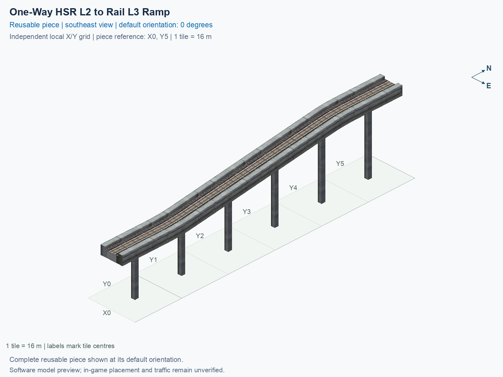

<a id="one-way-hsr-l2-to-rail-l3-ramp"></a>

# HSR Level 2 (15.5 m) → Level 3 (23 m) — Single-Track One-Way Ramp

<!-- SUBJECT IDENTITY MIGRATION -->

Identity migration: `interchange-oneway-grade-hsr-to-l3` → `hsr-l2-to-l3-single-track-oneway-ramp`. Earlier measurements, observations, and pictures retain their recorded names and fingerprints; they do not establish verification of the renamed build. See the [identity migration rules](../../../../docs/NAMING_CONVENTIONS.md#10-choosing-and-changing-names).

Purpose: explain this reusable piece, its matching connections and current test coverage.

<!-- BEGIN PIECE OVERVIEW -->

HSR Level 2 (15.5 m) → Level 3 (23 m) — Single-Track One-Way Ramp. Fixed click-to-place piece in a 1 by 6 tile area. Follow the arrows and join only matching track widths, directions, and height labels. Four proper rotations; the second four states repeat them. Experimental; game testing pending.

Exact reusable identifier: `hsr-l2-to-l3-single-track-oneway-ramp`.

Footprint: **1 × 6 tiles**. Exact menu name: **HSR Level 2 (15.5 m) → Level 3 (23 m) — Single-Track One-Way Ramp**.

Choose this exact name in Transportation → Rail. Press Home or End to rotate; use only the supported states listed below. Join each end to a matching port profile and direction.

- [Connections and journeys](#connections-and-journeys)
- [Test checklist](#test-checklist)



<!-- END PIECE OVERVIEW -->

<!-- BEGIN MANUAL SUMMARY -->

## Manual status

Generated from [the exact test cases](#test-checklist) and [authoritative observations](checks/manual-tests.json).

- [ ] Preview review: 0/1 applicable cases passed; 0 failed, 0 stale.
- [ ] In-game rendering: 0/4 applicable cases passed; 0 failed, 0 stale.
- [ ] Directed journeys: 0/4 applicable cases passed; 0 failed, 0 stale.

These observations cover only the named services, directions, poses, rotations, and recorded platforms.

<!-- END MANUAL SUMMARY -->

<!-- BEGIN CONNECTIONS -->

## Connections and journeys

Purpose: describe intrinsic directional interfaces and permitted service journeys.

Generated from [connections.json](connections.json). Coordinates are canonical east, north, and height in metres. A connection class names an encoded route interface; it does not prove visible deck/wall fit or an in-game test.

Supported placement states: 0° CCW, 90° CCW, 180° CCW, 270° CCW. Each state has its own declared manual scope.

A **port** is one directional transport-path endpoint. **Service** identifies the intended network service (for example HSR, street, or tram); **engine** is its internal traffic-class number, separate from the construction network. **Role** distinguishes primary service from auxiliary paths; sharing a traffic class does not establish service compatibility.

A **tangent** is a unit travel-direction vector: `[0,1]` means north. **Grade** is height gained per horizontal metre. These measured facts describe this subject alone. Compatibility requires a separate comparison of the complete joining boundaries; physical seams and actual game operation require their own evidence. See the [class index](../../connection-classes.jsonc) for shared route-interface membership.

| Port | Service / engine / role | Direction | Location; tangent; grade | Connection class |
| --- | --- | --- | --- | --- |
| `in` | hsr / 7 / primary | in | [0.0, -88.0, 15.5]; [0.0, 1.0]; 0.0 | `path-interface-ac60d237d23f01143255` |
| `out` | hsr / 7 / primary | out | [0.0, 8.0, 23.0]; [0.0, 1.0]; 0.0 | `path-interface-dbebe2187cdfdae6d966` |

### Directed journeys

| Service | Entry → exit | Role |
| --- | --- | --- |
| hsr | `in` → `out` | primary |

### Forbidden transfers

No additional forbidden-transfer cases are declared beyond the directed graph; no extra transfers are implied.

Review the test checklist for the exact tested cases and environments.

<!-- END CONNECTIONS -->

<!-- BEGIN MANUAL CHECKS -->

## Test checklist

Generated from [the authoritative record](checks/manual-tests.json). Only explicit human observations create manual passes; software and preview checks remain separate. Expand a check/service group to see its rotation table, then expand the matching exact scope to copy a case ID and inspect its pose, reviewer, environment, and evidence. Grouping changes only this view; every declared case remains separate.

**States:** [x] passed; [ ] unverified, failed, or stale; N/A is an explicit inapplicable declaration. A dash means no case was declared in that column. Every pass covers only its recorded environment. T means a distinct construction-transposed state.

Four proper rotations are covered. No additional reflected state is established by this record; repeated construction aliases do not create new orientations.

Current totals: unverified: 23, passed: 0, failed: 0, stale: 0, not_applicable: 0.

### Record an observation

Follow the [shared testing guide](../../../../docs/TESTING.md); copy [the unconfirmed example](checks/observation.example.json) to `checks/observation.json`. Case identifiers are in the expandable sections below. Do not edit generated checkboxes.

From the repository folder containing `custom-pieces`, run after filling `checks/observation.json` and explicitly confirming the exact observation:

```sh
python3 -m scp.content record --record custom-pieces/domains/high-speed-rail/00_pieces/hsr-l2-to-l3-single-track-oneway-ramp/checks/manual-tests.json --observation custom-pieces/domains/high-speed-rail/00_pieces/hsr-l2-to-l3-single-track-oneway-ramp/checks/observation.json
```

### Detailed current checks

Each collapsed group shows exact case counts and states. Forbidden transfers are grouped by the directed service pair; the table inside retains every port pair and rotation.

<details>
<summary>Compiled resources — Whole subject — 1 case; unverified: 1</summary>

| Check / exact scope | General | 0° | 90° | 180° | 270° |
| --- | --- | --- | --- | --- | --- |
| **Compiled resources**<br>Whole subject | <a href="#case-software_resources-eef7c9d4bdbfe26f51bb">[ ] unverified</a> | — | — | — | — |


<details>
<summary>Compiled resources — Whole subject</summary>

<a id="case-software_resources-eef7c9d4bdbfe26f51bb"></a>

**General: unverified** — `software_resources-eef7c9d4bdbfe26f51bb`.

Verify the actual compiled resources and construction rules.

Scope: Whole subject.

No observation recorded.

</details>

</details>

<details>
<summary>Directed routing graph — Whole subject — 1 case; unverified: 1</summary>

| Check / exact scope | General | 0° | 90° | 180° | 270° |
| --- | --- | --- | --- | --- | --- |
| **Directed routing graph**<br>Whole subject | <a href="#case-software_connectivity-eef7c9d4bdbfe26f51bb">[ ] unverified</a> | — | — | — | — |


<details>
<summary>Directed routing graph — Whole subject</summary>

<a id="case-software_connectivity-eef7c9d4bdbfe26f51bb"></a>

**General: unverified** — `software_connectivity-eef7c9d4bdbfe26f51bb`.

Verify the declared directed journeys and forbidden transfers.

Scope: Whole subject.

No observation recorded.

</details>

</details>

<details>
<summary>Preview review — Images — 1 case; unverified: 1</summary>

| Check / exact scope | General | 0° | 90° | 180° | 270° |
| --- | --- | --- | --- | --- | --- |
| **Preview review**<br>Image: image:interchange-oneway-grade-hsr-to-l3:canonical-southeast | <a href="#case-preview_review-e981d34382323b40ee00">[ ] unverified</a> | — | — | — | — |


<details>
<summary>Preview review — Image: image:interchange-oneway-grade-hsr-to-l3:canonical-southeast</summary>

<a id="case-preview_review-e981d34382323b40ee00"></a>

**General: unverified** — `preview_review-e981d34382323b40ee00`.

Inspect this exact preview for tracks, walls, piers, seams and shadows.

Scope: Image: image:interchange-oneway-grade-hsr-to-l3:canonical-southeast.

No observation recorded.

</details>

</details>

<details>
<summary>In-game rendering — Whole subject — 4 cases; unverified: 4</summary>

| Check / exact scope | General | 0° | 90° | 180° | 270° |
| --- | --- | --- | --- | --- | --- |
| **In-game rendering**<br>Whole subject | — | <a href="#case-in_game_render-d2f170a39db82ea95755">[ ] unverified</a> | <a href="#case-in_game_render-f520bc1c945940396ede">[ ] unverified</a> | <a href="#case-in_game_render-939db43d12030fd01fce">[ ] unverified</a> | <a href="#case-in_game_render-9852f3223f708babf858">[ ] unverified</a> |


<details>
<summary>In-game rendering — Whole subject</summary>

<a id="case-in_game_render-d2f170a39db82ea95755"></a>

**0° CCW: unverified** — `in_game_render-d2f170a39db82ea95755`.

Inspect the placed tracks, walls, piers, seams and shadows in SimCity 4.

Scope: Whole subject.

No observation recorded.

<a id="case-in_game_render-f520bc1c945940396ede"></a>

**90° CCW: unverified** — `in_game_render-f520bc1c945940396ede`.

Inspect the placed tracks, walls, piers, seams and shadows in SimCity 4.

Scope: Whole subject.

No observation recorded.

<a id="case-in_game_render-939db43d12030fd01fce"></a>

**180° CCW: unverified** — `in_game_render-939db43d12030fd01fce`.

Inspect the placed tracks, walls, piers, seams and shadows in SimCity 4.

Scope: Whole subject.

No observation recorded.

<a id="case-in_game_render-9852f3223f708babf858"></a>

**270° CCW: unverified** — `in_game_render-9852f3223f708babf858`.

Inspect the placed tracks, walls, piers, seams and shadows in SimCity 4.

Scope: Whole subject.

No observation recorded.

</details>

</details>

<details>
<summary>Placement — Whole subject — 4 cases; unverified: 4</summary>

| Check / exact scope | General | 0° | 90° | 180° | 270° |
| --- | --- | --- | --- | --- | --- |
| **Placement**<br>Whole subject | — | <a href="#case-in_game_placement-d2f170a39db82ea95755">[ ] unverified</a> | <a href="#case-in_game_placement-f520bc1c945940396ede">[ ] unverified</a> | <a href="#case-in_game_placement-939db43d12030fd01fce">[ ] unverified</a> | <a href="#case-in_game_placement-9852f3223f708babf858">[ ] unverified</a> |


<details>
<summary>Placement — Whole subject</summary>

<a id="case-in_game_placement-d2f170a39db82ea95755"></a>

**0° CCW: unverified** — `in_game_placement-d2f170a39db82ea95755`.

Place this piece or complete blueprint and inspect every occupied tile.

Scope: Whole subject.

No observation recorded.

<a id="case-in_game_placement-f520bc1c945940396ede"></a>

**90° CCW: unverified** — `in_game_placement-f520bc1c945940396ede`.

Place this piece or complete blueprint and inspect every occupied tile.

Scope: Whole subject.

No observation recorded.

<a id="case-in_game_placement-939db43d12030fd01fce"></a>

**180° CCW: unverified** — `in_game_placement-939db43d12030fd01fce`.

Place this piece or complete blueprint and inspect every occupied tile.

Scope: Whole subject.

No observation recorded.

<a id="case-in_game_placement-9852f3223f708babf858"></a>

**270° CCW: unverified** — `in_game_placement-9852f3223f708babf858`.

Place this piece or complete blueprint and inspect every occupied tile.

Scope: Whole subject.

No observation recorded.

</details>

</details>

<details>
<summary>Demolition — Whole subject — 4 cases; unverified: 4</summary>

| Check / exact scope | General | 0° | 90° | 180° | 270° |
| --- | --- | --- | --- | --- | --- |
| **Demolition**<br>Whole subject | — | <a href="#case-in_game_demolition-d2f170a39db82ea95755">[ ] unverified</a> | <a href="#case-in_game_demolition-f520bc1c945940396ede">[ ] unverified</a> | <a href="#case-in_game_demolition-939db43d12030fd01fce">[ ] unverified</a> | <a href="#case-in_game_demolition-9852f3223f708babf858">[ ] unverified</a> |


<details>
<summary>Demolition — Whole subject</summary>

<a id="case-in_game_demolition-d2f170a39db82ea95755"></a>

**0° CCW: unverified** — `in_game_demolition-d2f170a39db82ea95755`.

Bulldoze the complete placement and inspect the cleared area.

Scope: Whole subject.

No observation recorded.

<a id="case-in_game_demolition-f520bc1c945940396ede"></a>

**90° CCW: unverified** — `in_game_demolition-f520bc1c945940396ede`.

Bulldoze the complete placement and inspect the cleared area.

Scope: Whole subject.

No observation recorded.

<a id="case-in_game_demolition-939db43d12030fd01fce"></a>

**180° CCW: unverified** — `in_game_demolition-939db43d12030fd01fce`.

Bulldoze the complete placement and inspect the cleared area.

Scope: Whole subject.

No observation recorded.

<a id="case-in_game_demolition-9852f3223f708babf858"></a>

**270° CCW: unverified** — `in_game_demolition-9852f3223f708babf858`.

Bulldoze the complete placement and inspect the cleared area.

Scope: Whole subject.

No observation recorded.

</details>

</details>

<details>
<summary>Save and reload — Whole subject — 4 cases; unverified: 4</summary>

| Check / exact scope | General | 0° | 90° | 180° | 270° |
| --- | --- | --- | --- | --- | --- |
| **Save and reload**<br>Whole subject | — | <a href="#case-in_game_save_reload-d2f170a39db82ea95755">[ ] unverified</a> | <a href="#case-in_game_save_reload-f520bc1c945940396ede">[ ] unverified</a> | <a href="#case-in_game_save_reload-939db43d12030fd01fce">[ ] unverified</a> | <a href="#case-in_game_save_reload-9852f3223f708babf858">[ ] unverified</a> |


<details>
<summary>Save and reload — Whole subject</summary>

<a id="case-in_game_save_reload-d2f170a39db82ea95755"></a>

**0° CCW: unverified** — `in_game_save_reload-d2f170a39db82ea95755`.

Save, quit, reload and inspect the placement and its paths.

Scope: Whole subject.

No observation recorded.

<a id="case-in_game_save_reload-f520bc1c945940396ede"></a>

**90° CCW: unverified** — `in_game_save_reload-f520bc1c945940396ede`.

Save, quit, reload and inspect the placement and its paths.

Scope: Whole subject.

No observation recorded.

<a id="case-in_game_save_reload-939db43d12030fd01fce"></a>

**180° CCW: unverified** — `in_game_save_reload-939db43d12030fd01fce`.

Save, quit, reload and inspect the placement and its paths.

Scope: Whole subject.

No observation recorded.

<a id="case-in_game_save_reload-9852f3223f708babf858"></a>

**270° CCW: unverified** — `in_game_save_reload-9852f3223f708babf858`.

Save, quit, reload and inspect the placement and its paths.

Scope: Whole subject.

No observation recorded.

</details>

</details>

<details>
<summary>Journey — hsr — 4 cases; unverified: 4</summary>

| Check / exact scope | General | 0° | 90° | 180° | 270° |
| --- | --- | --- | --- | --- | --- |
| **Journey**<br>Service: hsr; role: primary; journey: 7:in>out; entry: in; exit: out | — | <a href="#case-in_game_journey-2293f15e0aa957587bfd">[ ] unverified</a> | <a href="#case-in_game_journey-27427e88e7e97faf8ead">[ ] unverified</a> | <a href="#case-in_game_journey-496c5dc90920c6c1cc3f">[ ] unverified</a> | <a href="#case-in_game_journey-664fbd46fabb83b6719c">[ ] unverified</a> |


<details>
<summary>Journey — Service: hsr; role: primary; journey: 7:in>out; entry: in; exit: out</summary>

<a id="case-in_game_journey-2293f15e0aa957587bfd"></a>

**0° CCW: unverified** — `in_game_journey-2293f15e0aa957587bfd`.

Run the declared journey in this direction using its service network.

Scope: Service: hsr; role: primary; journey: 7:in>out; entry: in; exit: out.

No observation recorded.

<a id="case-in_game_journey-27427e88e7e97faf8ead"></a>

**90° CCW: unverified** — `in_game_journey-27427e88e7e97faf8ead`.

Run the declared journey in this direction using its service network.

Scope: Service: hsr; role: primary; journey: 7:in>out; entry: in; exit: out.

No observation recorded.

<a id="case-in_game_journey-496c5dc90920c6c1cc3f"></a>

**180° CCW: unverified** — `in_game_journey-496c5dc90920c6c1cc3f`.

Run the declared journey in this direction using its service network.

Scope: Service: hsr; role: primary; journey: 7:in>out; entry: in; exit: out.

No observation recorded.

<a id="case-in_game_journey-664fbd46fabb83b6719c"></a>

**270° CCW: unverified** — `in_game_journey-664fbd46fabb83b6719c`.

Run the declared journey in this direction using its service network.

Scope: Service: hsr; role: primary; journey: 7:in>out; entry: in; exit: out.

No observation recorded.

</details>

</details>

<!-- END MANUAL CHECKS -->
