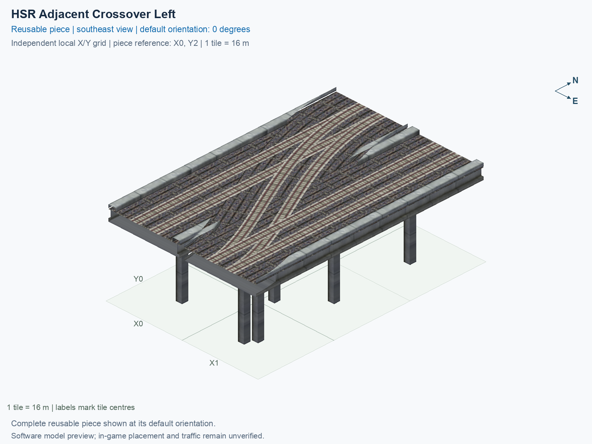

<a id="hsr-adjacent-crossover-left"></a>

# HSR Level 2 (15.5 m) — Two-Track Adjacent Crossover Left

<!-- SUBJECT IDENTITY MIGRATION -->

Identity migration: `rail-hsr-adjacent-crossover-left` → `hsr-l2-two-track-crossover-adjacent-left`. Earlier measurements, observations, and pictures retain their recorded names and fingerprints; they do not establish verification of the renamed build. See the [identity migration rules](../../../../docs/NAMING_CONVENTIONS.md#10-choosing-and-changing-names).

Purpose: explain this reusable piece, its matching connections and current test coverage.

<!-- BEGIN PIECE OVERVIEW -->

Switches between two adjacent two-track lines, with no empty tile between them. Both through lines are retained. Choose a handed crossover or a scissors for transfers in both hands.

Exact reusable identifier: `hsr-l2-two-track-crossover-adjacent-left`.

Footprint: **2 × 3 tiles**. Exact menu name: **HSR Level 2 (15.5 m) — Two-Track Adjacent Crossover Left**.

Choose this exact name in Transportation → Rail. Press Home or End to rotate; use only the supported states listed below. Join each end to a matching port profile and direction.

- [Connections and journeys](#connections-and-journeys)
- [Test checklist](#test-checklist)

### Design review

**REVIEW NEEDED** — Closely spaced pillars need a support-consolidation review.

- Separate 1.3 m-square pillar foundations have centres less than 2.6 m apart near shared rail geometry. The foundations do not overlap, but the close pair should be reviewed and consolidated to address the reported duplicate-pillar appearance. The 2.6 m review cutoff is an authoring convention, not a structural or game collision threshold.

[Design-review evidence](../../junction-design-review.json).



<!-- END PIECE OVERVIEW -->

<!-- BEGIN MANUAL SUMMARY -->

## Manual status

Generated from [the exact test cases](#test-checklist) and [authoritative observations](checks/manual-tests.json).

- [ ] Preview review: 0/1 applicable cases passed; 0 failed, 0 stale.
- [ ] In-game rendering: 0/4 applicable cases passed; 0 failed, 0 stale.
- [ ] Directed journeys: 0/24 applicable cases passed; 0 failed, 0 stale.

These observations cover only the named services, directions, poses, rotations, and recorded platforms.

<!-- END MANUAL SUMMARY -->

<!-- BEGIN CONNECTIONS -->

## Connections and journeys

Purpose: describe intrinsic directional interfaces and permitted service journeys.

Generated from [connections.json](connections.json). Coordinates are canonical east, north, and height in metres. A connection class names an encoded route interface; it does not prove visible deck/wall fit or an in-game test.

Supported placement states: 0° CCW, 90° CCW, 180° CCW, 270° CCW. Each state has its own declared manual scope.

A **port** is one directional transport-path endpoint. **Service** identifies the intended network service (for example HSR, street, or tram); **engine** is its internal traffic-class number, separate from the construction network. **Role** distinguishes primary service from auxiliary paths; sharing a traffic class does not establish service compatibility.

A **tangent** is a unit travel-direction vector: `[0,1]` means north. **Grade** is height gained per horizontal metre. These measured facts describe this subject alone. Compatibility requires a separate comparison of the complete joining boundaries; physical seams and actual game operation require their own evidence. See the [class index](../../connection-classes.jsonc) for shared route-interface membership.

| Port | Service / engine / role | Direction | Location; tangent; grade | Connection class |
| --- | --- | --- | --- | --- |
| `Sout` | hsr / 7 / primary | out | [-2.0, -40.0, 15.5]; [0.0, -1.0]; 0.0 | `path-interface-12d12be31d2057c5763d` |
| `Nin` | hsr / 7 / primary | in | [-2.0, 8.0, 15.5]; [0.0, -1.0]; 0.0 | `path-interface-12d12be31d2057c5763d` |
| `Sin` | hsr / 7 / primary | in | [2.0, -40.0, 15.5]; [0.0, 1.0]; 0.0 | `path-interface-fba09fbeb87ad95c667a` |
| `Nout` | hsr / 7 / primary | out | [2.0, 8.0, 15.5]; [0.0, 1.0]; 0.0 | `path-interface-fba09fbeb87ad95c667a` |
| `BSout` | hsr / 7 / primary | out | [14.0, -40.0, 15.5]; [0.0, -1.0]; 0.0 | `path-interface-12d12be31d2057c5763d` |
| `BNin` | hsr / 7 / primary | in | [14.0, 8.0, 15.5]; [0.0, -1.0]; 0.0 | `path-interface-12d12be31d2057c5763d` |
| `BSin` | hsr / 7 / primary | in | [18.0, -40.0, 15.5]; [0.0, 1.0]; 0.0 | `path-interface-fba09fbeb87ad95c667a` |
| `BNout` | hsr / 7 / primary | out | [18.0, 8.0, 15.5]; [0.0, 1.0]; 0.0 | `path-interface-fba09fbeb87ad95c667a` |

### Directed journeys

| Service | Entry → exit | Role |
| --- | --- | --- |
| hsr | `Nin` → `BSout` | primary |
| hsr | `Nin` → `Sout` | primary |
| hsr | `Sin` → `Nout` | primary |
| hsr | `BNin` → `BSout` | primary |
| hsr | `BSin` → `BNout` | primary |
| hsr | `BSin` → `Nout` | primary |

### Forbidden transfers

| From service / port | To service / port | Reason |
| --- | --- | --- |
| hsr / `Nin` | hsr / `Nout` | No directed route exists between these ports in the saved piece transport paths. In-game confirmation remains unverified. |
| hsr / `Nin` | hsr / `BNout` | No directed route exists between these ports in the saved piece transport paths. In-game confirmation remains unverified. |
| hsr / `Sin` | hsr / `Sout` | No directed route exists between these ports in the saved piece transport paths. In-game confirmation remains unverified. |
| hsr / `Sin` | hsr / `BSout` | No directed route exists between these ports in the saved piece transport paths. In-game confirmation remains unverified. |
| hsr / `Sin` | hsr / `BNout` | No directed route exists between these ports in the saved piece transport paths. In-game confirmation remains unverified. |
| hsr / `BNin` | hsr / `Sout` | No directed route exists between these ports in the saved piece transport paths. In-game confirmation remains unverified. |
| hsr / `BNin` | hsr / `Nout` | No directed route exists between these ports in the saved piece transport paths. In-game confirmation remains unverified. |
| hsr / `BNin` | hsr / `BNout` | No directed route exists between these ports in the saved piece transport paths. In-game confirmation remains unverified. |
| hsr / `BSin` | hsr / `Sout` | No directed route exists between these ports in the saved piece transport paths. In-game confirmation remains unverified. |
| hsr / `BSin` | hsr / `BSout` | No directed route exists between these ports in the saved piece transport paths. In-game confirmation remains unverified. |

Review the test checklist for the exact tested cases and environments.

<!-- END CONNECTIONS -->

<!-- BEGIN MANUAL CHECKS -->

## Test checklist

Generated from [the authoritative record](checks/manual-tests.json). Only explicit human observations create manual passes; software and preview checks remain separate. Expand a check/service group to see its rotation table, then expand the matching exact scope to copy a case ID and inspect its pose, reviewer, environment, and evidence. Grouping changes only this view; every declared case remains separate.

**States:** [x] passed; [ ] unverified, failed, or stale; N/A is an explicit inapplicable declaration. A dash means no case was declared in that column. Every pass covers only its recorded environment. T means a distinct construction-transposed state.

Four proper rotations are covered. No additional reflected state is established by this record; repeated construction aliases do not create new orientations.

Current totals: unverified: 83, passed: 0, failed: 0, stale: 0, not_applicable: 0.

### Record an observation

Follow the [shared testing guide](../../../../docs/TESTING.md); copy [the unconfirmed example](checks/observation.example.json) to `checks/observation.json`. Case identifiers are in the expandable sections below. Do not edit generated checkboxes.

From the repository folder containing `custom-pieces`, run after filling `checks/observation.json` and explicitly confirming the exact observation:

```sh
python3 -m scp.content record --record custom-pieces/domains/high-speed-rail/00_pieces/hsr-l2-two-track-crossover-adjacent-left/checks/manual-tests.json --observation custom-pieces/domains/high-speed-rail/00_pieces/hsr-l2-two-track-crossover-adjacent-left/checks/observation.json
```

### Detailed current checks

Each collapsed group shows exact case counts and states. Forbidden transfers are grouped by the directed service pair; the table inside retains every port pair and rotation.

<details>
<summary>Compiled resources — Whole subject — 1 case; unverified: 1</summary>

| Check / exact scope | General | 0° | 90° | 180° | 270° |
| --- | --- | --- | --- | --- | --- |
| **Compiled resources**<br>Whole subject | <a href="#case-software_resources-df38b9ce2f2c0cc5ff1e">[ ] unverified</a> | — | — | — | — |


<details>
<summary>Compiled resources — Whole subject</summary>

<a id="case-software_resources-df38b9ce2f2c0cc5ff1e"></a>

**General: unverified** — `software_resources-df38b9ce2f2c0cc5ff1e`.

Verify the actual compiled resources and construction rules.

Scope: Whole subject.

No observation recorded.

</details>

</details>

<details>
<summary>Directed routing graph — Whole subject — 1 case; unverified: 1</summary>

| Check / exact scope | General | 0° | 90° | 180° | 270° |
| --- | --- | --- | --- | --- | --- |
| **Directed routing graph**<br>Whole subject | <a href="#case-software_connectivity-df38b9ce2f2c0cc5ff1e">[ ] unverified</a> | — | — | — | — |


<details>
<summary>Directed routing graph — Whole subject</summary>

<a id="case-software_connectivity-df38b9ce2f2c0cc5ff1e"></a>

**General: unverified** — `software_connectivity-df38b9ce2f2c0cc5ff1e`.

Verify the declared directed journeys and forbidden transfers.

Scope: Whole subject.

No observation recorded.

</details>

</details>

<details>
<summary>Preview review — Images — 1 case; unverified: 1</summary>

| Check / exact scope | General | 0° | 90° | 180° | 270° |
| --- | --- | --- | --- | --- | --- |
| **Preview review**<br>Image: image:rail-hsr-adjacent-crossover-left:canonical-southeast | <a href="#case-preview_review-ff7d41a64e0be1f21190">[ ] unverified</a> | — | — | — | — |


<details>
<summary>Preview review — Image: image:rail-hsr-adjacent-crossover-left:canonical-southeast</summary>

<a id="case-preview_review-ff7d41a64e0be1f21190"></a>

**General: unverified** — `preview_review-ff7d41a64e0be1f21190`.

Inspect this exact preview for tracks, walls, piers, seams and shadows.

Scope: Image: image:rail-hsr-adjacent-crossover-left:canonical-southeast.

No observation recorded.

</details>

</details>

<details>
<summary>In-game rendering — Whole subject — 4 cases; unverified: 4</summary>

| Check / exact scope | General | 0° | 90° | 180° | 270° |
| --- | --- | --- | --- | --- | --- |
| **In-game rendering**<br>Whole subject | — | <a href="#case-in_game_render-ecb4f6d21a0357bffcd4">[ ] unverified</a> | <a href="#case-in_game_render-d33066efafb5d9f5f23f">[ ] unverified</a> | <a href="#case-in_game_render-87f8f5e780ce4fe787c7">[ ] unverified</a> | <a href="#case-in_game_render-a5426656e23a424685dc">[ ] unverified</a> |


<details>
<summary>In-game rendering — Whole subject</summary>

<a id="case-in_game_render-ecb4f6d21a0357bffcd4"></a>

**0° CCW: unverified** — `in_game_render-ecb4f6d21a0357bffcd4`.

Inspect the placed tracks, walls, piers, seams and shadows in SimCity 4.

Scope: Whole subject.

No observation recorded.

<a id="case-in_game_render-d33066efafb5d9f5f23f"></a>

**90° CCW: unverified** — `in_game_render-d33066efafb5d9f5f23f`.

Inspect the placed tracks, walls, piers, seams and shadows in SimCity 4.

Scope: Whole subject.

No observation recorded.

<a id="case-in_game_render-87f8f5e780ce4fe787c7"></a>

**180° CCW: unverified** — `in_game_render-87f8f5e780ce4fe787c7`.

Inspect the placed tracks, walls, piers, seams and shadows in SimCity 4.

Scope: Whole subject.

No observation recorded.

<a id="case-in_game_render-a5426656e23a424685dc"></a>

**270° CCW: unverified** — `in_game_render-a5426656e23a424685dc`.

Inspect the placed tracks, walls, piers, seams and shadows in SimCity 4.

Scope: Whole subject.

No observation recorded.

</details>

</details>

<details>
<summary>Placement — Whole subject — 4 cases; unverified: 4</summary>

| Check / exact scope | General | 0° | 90° | 180° | 270° |
| --- | --- | --- | --- | --- | --- |
| **Placement**<br>Whole subject | — | <a href="#case-in_game_placement-ecb4f6d21a0357bffcd4">[ ] unverified</a> | <a href="#case-in_game_placement-d33066efafb5d9f5f23f">[ ] unverified</a> | <a href="#case-in_game_placement-87f8f5e780ce4fe787c7">[ ] unverified</a> | <a href="#case-in_game_placement-a5426656e23a424685dc">[ ] unverified</a> |


<details>
<summary>Placement — Whole subject</summary>

<a id="case-in_game_placement-ecb4f6d21a0357bffcd4"></a>

**0° CCW: unverified** — `in_game_placement-ecb4f6d21a0357bffcd4`.

Place this piece or complete blueprint and inspect every occupied tile.

Scope: Whole subject.

No observation recorded.

<a id="case-in_game_placement-d33066efafb5d9f5f23f"></a>

**90° CCW: unverified** — `in_game_placement-d33066efafb5d9f5f23f`.

Place this piece or complete blueprint and inspect every occupied tile.

Scope: Whole subject.

No observation recorded.

<a id="case-in_game_placement-87f8f5e780ce4fe787c7"></a>

**180° CCW: unverified** — `in_game_placement-87f8f5e780ce4fe787c7`.

Place this piece or complete blueprint and inspect every occupied tile.

Scope: Whole subject.

No observation recorded.

<a id="case-in_game_placement-a5426656e23a424685dc"></a>

**270° CCW: unverified** — `in_game_placement-a5426656e23a424685dc`.

Place this piece or complete blueprint and inspect every occupied tile.

Scope: Whole subject.

No observation recorded.

</details>

</details>

<details>
<summary>Demolition — Whole subject — 4 cases; unverified: 4</summary>

| Check / exact scope | General | 0° | 90° | 180° | 270° |
| --- | --- | --- | --- | --- | --- |
| **Demolition**<br>Whole subject | — | <a href="#case-in_game_demolition-ecb4f6d21a0357bffcd4">[ ] unverified</a> | <a href="#case-in_game_demolition-d33066efafb5d9f5f23f">[ ] unverified</a> | <a href="#case-in_game_demolition-87f8f5e780ce4fe787c7">[ ] unverified</a> | <a href="#case-in_game_demolition-a5426656e23a424685dc">[ ] unverified</a> |


<details>
<summary>Demolition — Whole subject</summary>

<a id="case-in_game_demolition-ecb4f6d21a0357bffcd4"></a>

**0° CCW: unverified** — `in_game_demolition-ecb4f6d21a0357bffcd4`.

Bulldoze the complete placement and inspect the cleared area.

Scope: Whole subject.

No observation recorded.

<a id="case-in_game_demolition-d33066efafb5d9f5f23f"></a>

**90° CCW: unverified** — `in_game_demolition-d33066efafb5d9f5f23f`.

Bulldoze the complete placement and inspect the cleared area.

Scope: Whole subject.

No observation recorded.

<a id="case-in_game_demolition-87f8f5e780ce4fe787c7"></a>

**180° CCW: unverified** — `in_game_demolition-87f8f5e780ce4fe787c7`.

Bulldoze the complete placement and inspect the cleared area.

Scope: Whole subject.

No observation recorded.

<a id="case-in_game_demolition-a5426656e23a424685dc"></a>

**270° CCW: unverified** — `in_game_demolition-a5426656e23a424685dc`.

Bulldoze the complete placement and inspect the cleared area.

Scope: Whole subject.

No observation recorded.

</details>

</details>

<details>
<summary>Save and reload — Whole subject — 4 cases; unverified: 4</summary>

| Check / exact scope | General | 0° | 90° | 180° | 270° |
| --- | --- | --- | --- | --- | --- |
| **Save and reload**<br>Whole subject | — | <a href="#case-in_game_save_reload-ecb4f6d21a0357bffcd4">[ ] unverified</a> | <a href="#case-in_game_save_reload-d33066efafb5d9f5f23f">[ ] unverified</a> | <a href="#case-in_game_save_reload-87f8f5e780ce4fe787c7">[ ] unverified</a> | <a href="#case-in_game_save_reload-a5426656e23a424685dc">[ ] unverified</a> |


<details>
<summary>Save and reload — Whole subject</summary>

<a id="case-in_game_save_reload-ecb4f6d21a0357bffcd4"></a>

**0° CCW: unverified** — `in_game_save_reload-ecb4f6d21a0357bffcd4`.

Save, quit, reload and inspect the placement and its paths.

Scope: Whole subject.

No observation recorded.

<a id="case-in_game_save_reload-d33066efafb5d9f5f23f"></a>

**90° CCW: unverified** — `in_game_save_reload-d33066efafb5d9f5f23f`.

Save, quit, reload and inspect the placement and its paths.

Scope: Whole subject.

No observation recorded.

<a id="case-in_game_save_reload-87f8f5e780ce4fe787c7"></a>

**180° CCW: unverified** — `in_game_save_reload-87f8f5e780ce4fe787c7`.

Save, quit, reload and inspect the placement and its paths.

Scope: Whole subject.

No observation recorded.

<a id="case-in_game_save_reload-a5426656e23a424685dc"></a>

**270° CCW: unverified** — `in_game_save_reload-a5426656e23a424685dc`.

Save, quit, reload and inspect the placement and its paths.

Scope: Whole subject.

No observation recorded.

</details>

</details>

<details>
<summary>Journey — hsr — 24 cases; unverified: 24</summary>

| Check / exact scope | General | 0° | 90° | 180° | 270° |
| --- | --- | --- | --- | --- | --- |
| **Journey**<br>Service: hsr; role: primary; journey: 7:Nin>BSout; entry: Nin; exit: BSout | — | <a href="#case-in_game_journey-d25ab5f5b5f82f762d1b">[ ] unverified</a> | <a href="#case-in_game_journey-85061a40365222fecd39">[ ] unverified</a> | <a href="#case-in_game_journey-d94f7d019cdde6a3f0c9">[ ] unverified</a> | <a href="#case-in_game_journey-7979d65d85be9657b5a9">[ ] unverified</a> |
| **Journey**<br>Service: hsr; role: primary; journey: 7:Nin>Sout; entry: Nin; exit: Sout | — | <a href="#case-in_game_journey-0c0619be6c370e83dcbf">[ ] unverified</a> | <a href="#case-in_game_journey-518da0570a9cc2ff51dd">[ ] unverified</a> | <a href="#case-in_game_journey-a92ab7a570355c34acfa">[ ] unverified</a> | <a href="#case-in_game_journey-190e8c7e6bfb215f28be">[ ] unverified</a> |
| **Journey**<br>Service: hsr; role: primary; journey: 7:Sin>Nout; entry: Sin; exit: Nout | — | <a href="#case-in_game_journey-7a324c2e1ae79d2ac041">[ ] unverified</a> | <a href="#case-in_game_journey-0b3b86d03b392f3ecf42">[ ] unverified</a> | <a href="#case-in_game_journey-0561abe68b27ecbe0aea">[ ] unverified</a> | <a href="#case-in_game_journey-82d637b4737a3dc06dd0">[ ] unverified</a> |
| **Journey**<br>Service: hsr; role: primary; journey: 7:BNin>BSout; entry: BNin; exit: BSout | — | <a href="#case-in_game_journey-5ace4a8b26c9c91977f2">[ ] unverified</a> | <a href="#case-in_game_journey-d2d769603310e3c76eef">[ ] unverified</a> | <a href="#case-in_game_journey-5afbf08a18c35e29fa77">[ ] unverified</a> | <a href="#case-in_game_journey-7e417caf5b5447370f33">[ ] unverified</a> |
| **Journey**<br>Service: hsr; role: primary; journey: 7:BSin>BNout; entry: BSin; exit: BNout | — | <a href="#case-in_game_journey-60464f7b05e84bf0ccca">[ ] unverified</a> | <a href="#case-in_game_journey-a83a5e7c6593178fa3f3">[ ] unverified</a> | <a href="#case-in_game_journey-aa3de2282d178a456247">[ ] unverified</a> | <a href="#case-in_game_journey-5bc21731b67f63ab2a71">[ ] unverified</a> |
| **Journey**<br>Service: hsr; role: primary; journey: 7:BSin>Nout; entry: BSin; exit: Nout | — | <a href="#case-in_game_journey-d231a4aef7eff22fae96">[ ] unverified</a> | <a href="#case-in_game_journey-5d6142f9f5b42ef5f980">[ ] unverified</a> | <a href="#case-in_game_journey-d8a911261f9f6003354e">[ ] unverified</a> | <a href="#case-in_game_journey-2c2884e24f83acee8b31">[ ] unverified</a> |


<details>
<summary>Journey — Service: hsr; role: primary; journey: 7:Nin>BSout; entry: Nin; exit: BSout</summary>

<a id="case-in_game_journey-d25ab5f5b5f82f762d1b"></a>

**0° CCW: unverified** — `in_game_journey-d25ab5f5b5f82f762d1b`.

Run the declared journey in this direction using its service network.

Scope: Service: hsr; role: primary; journey: 7:Nin>BSout; entry: Nin; exit: BSout.

No observation recorded.

<a id="case-in_game_journey-85061a40365222fecd39"></a>

**90° CCW: unverified** — `in_game_journey-85061a40365222fecd39`.

Run the declared journey in this direction using its service network.

Scope: Service: hsr; role: primary; journey: 7:Nin>BSout; entry: Nin; exit: BSout.

No observation recorded.

<a id="case-in_game_journey-d94f7d019cdde6a3f0c9"></a>

**180° CCW: unverified** — `in_game_journey-d94f7d019cdde6a3f0c9`.

Run the declared journey in this direction using its service network.

Scope: Service: hsr; role: primary; journey: 7:Nin>BSout; entry: Nin; exit: BSout.

No observation recorded.

<a id="case-in_game_journey-7979d65d85be9657b5a9"></a>

**270° CCW: unverified** — `in_game_journey-7979d65d85be9657b5a9`.

Run the declared journey in this direction using its service network.

Scope: Service: hsr; role: primary; journey: 7:Nin>BSout; entry: Nin; exit: BSout.

No observation recorded.

</details>


<details>
<summary>Journey — Service: hsr; role: primary; journey: 7:Nin>Sout; entry: Nin; exit: Sout</summary>

<a id="case-in_game_journey-0c0619be6c370e83dcbf"></a>

**0° CCW: unverified** — `in_game_journey-0c0619be6c370e83dcbf`.

Run the declared journey in this direction using its service network.

Scope: Service: hsr; role: primary; journey: 7:Nin>Sout; entry: Nin; exit: Sout.

No observation recorded.

<a id="case-in_game_journey-518da0570a9cc2ff51dd"></a>

**90° CCW: unverified** — `in_game_journey-518da0570a9cc2ff51dd`.

Run the declared journey in this direction using its service network.

Scope: Service: hsr; role: primary; journey: 7:Nin>Sout; entry: Nin; exit: Sout.

No observation recorded.

<a id="case-in_game_journey-a92ab7a570355c34acfa"></a>

**180° CCW: unverified** — `in_game_journey-a92ab7a570355c34acfa`.

Run the declared journey in this direction using its service network.

Scope: Service: hsr; role: primary; journey: 7:Nin>Sout; entry: Nin; exit: Sout.

No observation recorded.

<a id="case-in_game_journey-190e8c7e6bfb215f28be"></a>

**270° CCW: unverified** — `in_game_journey-190e8c7e6bfb215f28be`.

Run the declared journey in this direction using its service network.

Scope: Service: hsr; role: primary; journey: 7:Nin>Sout; entry: Nin; exit: Sout.

No observation recorded.

</details>


<details>
<summary>Journey — Service: hsr; role: primary; journey: 7:Sin>Nout; entry: Sin; exit: Nout</summary>

<a id="case-in_game_journey-7a324c2e1ae79d2ac041"></a>

**0° CCW: unverified** — `in_game_journey-7a324c2e1ae79d2ac041`.

Run the declared journey in this direction using its service network.

Scope: Service: hsr; role: primary; journey: 7:Sin>Nout; entry: Sin; exit: Nout.

No observation recorded.

<a id="case-in_game_journey-0b3b86d03b392f3ecf42"></a>

**90° CCW: unverified** — `in_game_journey-0b3b86d03b392f3ecf42`.

Run the declared journey in this direction using its service network.

Scope: Service: hsr; role: primary; journey: 7:Sin>Nout; entry: Sin; exit: Nout.

No observation recorded.

<a id="case-in_game_journey-0561abe68b27ecbe0aea"></a>

**180° CCW: unverified** — `in_game_journey-0561abe68b27ecbe0aea`.

Run the declared journey in this direction using its service network.

Scope: Service: hsr; role: primary; journey: 7:Sin>Nout; entry: Sin; exit: Nout.

No observation recorded.

<a id="case-in_game_journey-82d637b4737a3dc06dd0"></a>

**270° CCW: unverified** — `in_game_journey-82d637b4737a3dc06dd0`.

Run the declared journey in this direction using its service network.

Scope: Service: hsr; role: primary; journey: 7:Sin>Nout; entry: Sin; exit: Nout.

No observation recorded.

</details>


<details>
<summary>Journey — Service: hsr; role: primary; journey: 7:BNin>BSout; entry: BNin; exit: BSout</summary>

<a id="case-in_game_journey-5ace4a8b26c9c91977f2"></a>

**0° CCW: unverified** — `in_game_journey-5ace4a8b26c9c91977f2`.

Run the declared journey in this direction using its service network.

Scope: Service: hsr; role: primary; journey: 7:BNin>BSout; entry: BNin; exit: BSout.

No observation recorded.

<a id="case-in_game_journey-d2d769603310e3c76eef"></a>

**90° CCW: unverified** — `in_game_journey-d2d769603310e3c76eef`.

Run the declared journey in this direction using its service network.

Scope: Service: hsr; role: primary; journey: 7:BNin>BSout; entry: BNin; exit: BSout.

No observation recorded.

<a id="case-in_game_journey-5afbf08a18c35e29fa77"></a>

**180° CCW: unverified** — `in_game_journey-5afbf08a18c35e29fa77`.

Run the declared journey in this direction using its service network.

Scope: Service: hsr; role: primary; journey: 7:BNin>BSout; entry: BNin; exit: BSout.

No observation recorded.

<a id="case-in_game_journey-7e417caf5b5447370f33"></a>

**270° CCW: unverified** — `in_game_journey-7e417caf5b5447370f33`.

Run the declared journey in this direction using its service network.

Scope: Service: hsr; role: primary; journey: 7:BNin>BSout; entry: BNin; exit: BSout.

No observation recorded.

</details>


<details>
<summary>Journey — Service: hsr; role: primary; journey: 7:BSin>BNout; entry: BSin; exit: BNout</summary>

<a id="case-in_game_journey-60464f7b05e84bf0ccca"></a>

**0° CCW: unverified** — `in_game_journey-60464f7b05e84bf0ccca`.

Run the declared journey in this direction using its service network.

Scope: Service: hsr; role: primary; journey: 7:BSin>BNout; entry: BSin; exit: BNout.

No observation recorded.

<a id="case-in_game_journey-a83a5e7c6593178fa3f3"></a>

**90° CCW: unverified** — `in_game_journey-a83a5e7c6593178fa3f3`.

Run the declared journey in this direction using its service network.

Scope: Service: hsr; role: primary; journey: 7:BSin>BNout; entry: BSin; exit: BNout.

No observation recorded.

<a id="case-in_game_journey-aa3de2282d178a456247"></a>

**180° CCW: unverified** — `in_game_journey-aa3de2282d178a456247`.

Run the declared journey in this direction using its service network.

Scope: Service: hsr; role: primary; journey: 7:BSin>BNout; entry: BSin; exit: BNout.

No observation recorded.

<a id="case-in_game_journey-5bc21731b67f63ab2a71"></a>

**270° CCW: unverified** — `in_game_journey-5bc21731b67f63ab2a71`.

Run the declared journey in this direction using its service network.

Scope: Service: hsr; role: primary; journey: 7:BSin>BNout; entry: BSin; exit: BNout.

No observation recorded.

</details>


<details>
<summary>Journey — Service: hsr; role: primary; journey: 7:BSin>Nout; entry: BSin; exit: Nout</summary>

<a id="case-in_game_journey-d231a4aef7eff22fae96"></a>

**0° CCW: unverified** — `in_game_journey-d231a4aef7eff22fae96`.

Run the declared journey in this direction using its service network.

Scope: Service: hsr; role: primary; journey: 7:BSin>Nout; entry: BSin; exit: Nout.

No observation recorded.

<a id="case-in_game_journey-5d6142f9f5b42ef5f980"></a>

**90° CCW: unverified** — `in_game_journey-5d6142f9f5b42ef5f980`.

Run the declared journey in this direction using its service network.

Scope: Service: hsr; role: primary; journey: 7:BSin>Nout; entry: BSin; exit: Nout.

No observation recorded.

<a id="case-in_game_journey-d8a911261f9f6003354e"></a>

**180° CCW: unverified** — `in_game_journey-d8a911261f9f6003354e`.

Run the declared journey in this direction using its service network.

Scope: Service: hsr; role: primary; journey: 7:BSin>Nout; entry: BSin; exit: Nout.

No observation recorded.

<a id="case-in_game_journey-2c2884e24f83acee8b31"></a>

**270° CCW: unverified** — `in_game_journey-2c2884e24f83acee8b31`.

Run the declared journey in this direction using its service network.

Scope: Service: hsr; role: primary; journey: 7:BSin>Nout; entry: BSin; exit: Nout.

No observation recorded.

</details>

</details>

<details>
<summary>Forbidden transfer — hsr → hsr — 40 cases; unverified: 40</summary>

| Check / exact scope | General | 0° | 90° | 180° | 270° |
| --- | --- | --- | --- | --- | --- |
| **Forbidden transfer**<br>from port: Nin; to port: Nout; from service: hsr; to service: hsr; basis: not reachable in actual saved PATH graph | — | <a href="#case-in_game_forbidden_transfer-c8a7332444dd2472c5cb">[ ] unverified</a> | <a href="#case-in_game_forbidden_transfer-707b1190ee3d4ec7c9b5">[ ] unverified</a> | <a href="#case-in_game_forbidden_transfer-2430961f05ea78ab21fe">[ ] unverified</a> | <a href="#case-in_game_forbidden_transfer-49ddb9b8c136ac1213a4">[ ] unverified</a> |
| **Forbidden transfer**<br>from port: Nin; to port: BNout; from service: hsr; to service: hsr; basis: not reachable in actual saved PATH graph | — | <a href="#case-in_game_forbidden_transfer-5f800744f5ab3fed3517">[ ] unverified</a> | <a href="#case-in_game_forbidden_transfer-c34f9049c3fba97a9e7e">[ ] unverified</a> | <a href="#case-in_game_forbidden_transfer-18ad36ee96c9e4eced88">[ ] unverified</a> | <a href="#case-in_game_forbidden_transfer-19a484e986c1c3b79a9f">[ ] unverified</a> |
| **Forbidden transfer**<br>from port: Sin; to port: Sout; from service: hsr; to service: hsr; basis: not reachable in actual saved PATH graph | — | <a href="#case-in_game_forbidden_transfer-60220ca0db31bf057c55">[ ] unverified</a> | <a href="#case-in_game_forbidden_transfer-489d46567f0d58f0c0d0">[ ] unverified</a> | <a href="#case-in_game_forbidden_transfer-e8566fd552a6beddc3b3">[ ] unverified</a> | <a href="#case-in_game_forbidden_transfer-662972fd90505a09a2e9">[ ] unverified</a> |
| **Forbidden transfer**<br>from port: Sin; to port: BSout; from service: hsr; to service: hsr; basis: not reachable in actual saved PATH graph | — | <a href="#case-in_game_forbidden_transfer-3f49762df7046b9104de">[ ] unverified</a> | <a href="#case-in_game_forbidden_transfer-48b3bb15454e1af9ac21">[ ] unverified</a> | <a href="#case-in_game_forbidden_transfer-600a6bb6223b75dc7ccc">[ ] unverified</a> | <a href="#case-in_game_forbidden_transfer-ea82dcbbcfc260f9c9e4">[ ] unverified</a> |
| **Forbidden transfer**<br>from port: Sin; to port: BNout; from service: hsr; to service: hsr; basis: not reachable in actual saved PATH graph | — | <a href="#case-in_game_forbidden_transfer-e85bc1eee92cc22c16f6">[ ] unverified</a> | <a href="#case-in_game_forbidden_transfer-1f313583a8fc28a128f7">[ ] unverified</a> | <a href="#case-in_game_forbidden_transfer-e152d5982aa5a4f169b7">[ ] unverified</a> | <a href="#case-in_game_forbidden_transfer-af933c194e7753ed7a1e">[ ] unverified</a> |
| **Forbidden transfer**<br>from port: BNin; to port: Sout; from service: hsr; to service: hsr; basis: not reachable in actual saved PATH graph | — | <a href="#case-in_game_forbidden_transfer-9c31b461e2d2e43a857f">[ ] unverified</a> | <a href="#case-in_game_forbidden_transfer-e824c71dc76d7dee70d6">[ ] unverified</a> | <a href="#case-in_game_forbidden_transfer-132b2569f5a2a3906df5">[ ] unverified</a> | <a href="#case-in_game_forbidden_transfer-d134f3f9826fbf2d56f8">[ ] unverified</a> |
| **Forbidden transfer**<br>from port: BNin; to port: Nout; from service: hsr; to service: hsr; basis: not reachable in actual saved PATH graph | — | <a href="#case-in_game_forbidden_transfer-adab4e306e81b27bcc5a">[ ] unverified</a> | <a href="#case-in_game_forbidden_transfer-c8056eea5e5b5a1421e8">[ ] unverified</a> | <a href="#case-in_game_forbidden_transfer-5823ba17a488ed527978">[ ] unverified</a> | <a href="#case-in_game_forbidden_transfer-8a7ac8f6bdbc7ba32f87">[ ] unverified</a> |
| **Forbidden transfer**<br>from port: BNin; to port: BNout; from service: hsr; to service: hsr; basis: not reachable in actual saved PATH graph | — | <a href="#case-in_game_forbidden_transfer-242bc38913e2a3bc2805">[ ] unverified</a> | <a href="#case-in_game_forbidden_transfer-b3449f674432a4ea03e8">[ ] unverified</a> | <a href="#case-in_game_forbidden_transfer-362984acd19955ea9f6e">[ ] unverified</a> | <a href="#case-in_game_forbidden_transfer-883fd59436ea9af2a67f">[ ] unverified</a> |
| **Forbidden transfer**<br>from port: BSin; to port: Sout; from service: hsr; to service: hsr; basis: not reachable in actual saved PATH graph | — | <a href="#case-in_game_forbidden_transfer-330a0ac649d74854ddc4">[ ] unverified</a> | <a href="#case-in_game_forbidden_transfer-a1e958c3036aaf966403">[ ] unverified</a> | <a href="#case-in_game_forbidden_transfer-8e7c09a449b095db6c67">[ ] unverified</a> | <a href="#case-in_game_forbidden_transfer-4b3273d202135c39f155">[ ] unverified</a> |
| **Forbidden transfer**<br>from port: BSin; to port: BSout; from service: hsr; to service: hsr; basis: not reachable in actual saved PATH graph | — | <a href="#case-in_game_forbidden_transfer-b23bda8c178a01561123">[ ] unverified</a> | <a href="#case-in_game_forbidden_transfer-4fcc0ea2b3b1a40dfa15">[ ] unverified</a> | <a href="#case-in_game_forbidden_transfer-e50894248af561d10802">[ ] unverified</a> | <a href="#case-in_game_forbidden_transfer-f6932a5d3269fc11f1d5">[ ] unverified</a> |


<details>
<summary>Forbidden transfer — from port: Nin; to port: Nout; from service: hsr; to service: hsr; basis: not reachable in actual saved PATH graph</summary>

<a id="case-in_game_forbidden_transfer-c8a7332444dd2472c5cb"></a>

**0° CCW: unverified** — `in_game_forbidden_transfer-c8a7332444dd2472c5cb`.

Confirm this undeclared transfer is unavailable.

Scope: from port: Nin; to port: Nout; from service: hsr; to service: hsr; basis: not reachable in actual saved PATH graph.

No observation recorded.

<a id="case-in_game_forbidden_transfer-707b1190ee3d4ec7c9b5"></a>

**90° CCW: unverified** — `in_game_forbidden_transfer-707b1190ee3d4ec7c9b5`.

Confirm this undeclared transfer is unavailable.

Scope: from port: Nin; to port: Nout; from service: hsr; to service: hsr; basis: not reachable in actual saved PATH graph.

No observation recorded.

<a id="case-in_game_forbidden_transfer-2430961f05ea78ab21fe"></a>

**180° CCW: unverified** — `in_game_forbidden_transfer-2430961f05ea78ab21fe`.

Confirm this undeclared transfer is unavailable.

Scope: from port: Nin; to port: Nout; from service: hsr; to service: hsr; basis: not reachable in actual saved PATH graph.

No observation recorded.

<a id="case-in_game_forbidden_transfer-49ddb9b8c136ac1213a4"></a>

**270° CCW: unverified** — `in_game_forbidden_transfer-49ddb9b8c136ac1213a4`.

Confirm this undeclared transfer is unavailable.

Scope: from port: Nin; to port: Nout; from service: hsr; to service: hsr; basis: not reachable in actual saved PATH graph.

No observation recorded.

</details>


<details>
<summary>Forbidden transfer — from port: Nin; to port: BNout; from service: hsr; to service: hsr; basis: not reachable in actual saved PATH graph</summary>

<a id="case-in_game_forbidden_transfer-5f800744f5ab3fed3517"></a>

**0° CCW: unverified** — `in_game_forbidden_transfer-5f800744f5ab3fed3517`.

Confirm this undeclared transfer is unavailable.

Scope: from port: Nin; to port: BNout; from service: hsr; to service: hsr; basis: not reachable in actual saved PATH graph.

No observation recorded.

<a id="case-in_game_forbidden_transfer-c34f9049c3fba97a9e7e"></a>

**90° CCW: unverified** — `in_game_forbidden_transfer-c34f9049c3fba97a9e7e`.

Confirm this undeclared transfer is unavailable.

Scope: from port: Nin; to port: BNout; from service: hsr; to service: hsr; basis: not reachable in actual saved PATH graph.

No observation recorded.

<a id="case-in_game_forbidden_transfer-18ad36ee96c9e4eced88"></a>

**180° CCW: unverified** — `in_game_forbidden_transfer-18ad36ee96c9e4eced88`.

Confirm this undeclared transfer is unavailable.

Scope: from port: Nin; to port: BNout; from service: hsr; to service: hsr; basis: not reachable in actual saved PATH graph.

No observation recorded.

<a id="case-in_game_forbidden_transfer-19a484e986c1c3b79a9f"></a>

**270° CCW: unverified** — `in_game_forbidden_transfer-19a484e986c1c3b79a9f`.

Confirm this undeclared transfer is unavailable.

Scope: from port: Nin; to port: BNout; from service: hsr; to service: hsr; basis: not reachable in actual saved PATH graph.

No observation recorded.

</details>


<details>
<summary>Forbidden transfer — from port: Sin; to port: Sout; from service: hsr; to service: hsr; basis: not reachable in actual saved PATH graph</summary>

<a id="case-in_game_forbidden_transfer-60220ca0db31bf057c55"></a>

**0° CCW: unverified** — `in_game_forbidden_transfer-60220ca0db31bf057c55`.

Confirm this undeclared transfer is unavailable.

Scope: from port: Sin; to port: Sout; from service: hsr; to service: hsr; basis: not reachable in actual saved PATH graph.

No observation recorded.

<a id="case-in_game_forbidden_transfer-489d46567f0d58f0c0d0"></a>

**90° CCW: unverified** — `in_game_forbidden_transfer-489d46567f0d58f0c0d0`.

Confirm this undeclared transfer is unavailable.

Scope: from port: Sin; to port: Sout; from service: hsr; to service: hsr; basis: not reachable in actual saved PATH graph.

No observation recorded.

<a id="case-in_game_forbidden_transfer-e8566fd552a6beddc3b3"></a>

**180° CCW: unverified** — `in_game_forbidden_transfer-e8566fd552a6beddc3b3`.

Confirm this undeclared transfer is unavailable.

Scope: from port: Sin; to port: Sout; from service: hsr; to service: hsr; basis: not reachable in actual saved PATH graph.

No observation recorded.

<a id="case-in_game_forbidden_transfer-662972fd90505a09a2e9"></a>

**270° CCW: unverified** — `in_game_forbidden_transfer-662972fd90505a09a2e9`.

Confirm this undeclared transfer is unavailable.

Scope: from port: Sin; to port: Sout; from service: hsr; to service: hsr; basis: not reachable in actual saved PATH graph.

No observation recorded.

</details>


<details>
<summary>Forbidden transfer — from port: Sin; to port: BSout; from service: hsr; to service: hsr; basis: not reachable in actual saved PATH graph</summary>

<a id="case-in_game_forbidden_transfer-3f49762df7046b9104de"></a>

**0° CCW: unverified** — `in_game_forbidden_transfer-3f49762df7046b9104de`.

Confirm this undeclared transfer is unavailable.

Scope: from port: Sin; to port: BSout; from service: hsr; to service: hsr; basis: not reachable in actual saved PATH graph.

No observation recorded.

<a id="case-in_game_forbidden_transfer-48b3bb15454e1af9ac21"></a>

**90° CCW: unverified** — `in_game_forbidden_transfer-48b3bb15454e1af9ac21`.

Confirm this undeclared transfer is unavailable.

Scope: from port: Sin; to port: BSout; from service: hsr; to service: hsr; basis: not reachable in actual saved PATH graph.

No observation recorded.

<a id="case-in_game_forbidden_transfer-600a6bb6223b75dc7ccc"></a>

**180° CCW: unverified** — `in_game_forbidden_transfer-600a6bb6223b75dc7ccc`.

Confirm this undeclared transfer is unavailable.

Scope: from port: Sin; to port: BSout; from service: hsr; to service: hsr; basis: not reachable in actual saved PATH graph.

No observation recorded.

<a id="case-in_game_forbidden_transfer-ea82dcbbcfc260f9c9e4"></a>

**270° CCW: unverified** — `in_game_forbidden_transfer-ea82dcbbcfc260f9c9e4`.

Confirm this undeclared transfer is unavailable.

Scope: from port: Sin; to port: BSout; from service: hsr; to service: hsr; basis: not reachable in actual saved PATH graph.

No observation recorded.

</details>


<details>
<summary>Forbidden transfer — from port: Sin; to port: BNout; from service: hsr; to service: hsr; basis: not reachable in actual saved PATH graph</summary>

<a id="case-in_game_forbidden_transfer-e85bc1eee92cc22c16f6"></a>

**0° CCW: unverified** — `in_game_forbidden_transfer-e85bc1eee92cc22c16f6`.

Confirm this undeclared transfer is unavailable.

Scope: from port: Sin; to port: BNout; from service: hsr; to service: hsr; basis: not reachable in actual saved PATH graph.

No observation recorded.

<a id="case-in_game_forbidden_transfer-1f313583a8fc28a128f7"></a>

**90° CCW: unverified** — `in_game_forbidden_transfer-1f313583a8fc28a128f7`.

Confirm this undeclared transfer is unavailable.

Scope: from port: Sin; to port: BNout; from service: hsr; to service: hsr; basis: not reachable in actual saved PATH graph.

No observation recorded.

<a id="case-in_game_forbidden_transfer-e152d5982aa5a4f169b7"></a>

**180° CCW: unverified** — `in_game_forbidden_transfer-e152d5982aa5a4f169b7`.

Confirm this undeclared transfer is unavailable.

Scope: from port: Sin; to port: BNout; from service: hsr; to service: hsr; basis: not reachable in actual saved PATH graph.

No observation recorded.

<a id="case-in_game_forbidden_transfer-af933c194e7753ed7a1e"></a>

**270° CCW: unverified** — `in_game_forbidden_transfer-af933c194e7753ed7a1e`.

Confirm this undeclared transfer is unavailable.

Scope: from port: Sin; to port: BNout; from service: hsr; to service: hsr; basis: not reachable in actual saved PATH graph.

No observation recorded.

</details>


<details>
<summary>Forbidden transfer — from port: BNin; to port: Sout; from service: hsr; to service: hsr; basis: not reachable in actual saved PATH graph</summary>

<a id="case-in_game_forbidden_transfer-9c31b461e2d2e43a857f"></a>

**0° CCW: unverified** — `in_game_forbidden_transfer-9c31b461e2d2e43a857f`.

Confirm this undeclared transfer is unavailable.

Scope: from port: BNin; to port: Sout; from service: hsr; to service: hsr; basis: not reachable in actual saved PATH graph.

No observation recorded.

<a id="case-in_game_forbidden_transfer-e824c71dc76d7dee70d6"></a>

**90° CCW: unverified** — `in_game_forbidden_transfer-e824c71dc76d7dee70d6`.

Confirm this undeclared transfer is unavailable.

Scope: from port: BNin; to port: Sout; from service: hsr; to service: hsr; basis: not reachable in actual saved PATH graph.

No observation recorded.

<a id="case-in_game_forbidden_transfer-132b2569f5a2a3906df5"></a>

**180° CCW: unverified** — `in_game_forbidden_transfer-132b2569f5a2a3906df5`.

Confirm this undeclared transfer is unavailable.

Scope: from port: BNin; to port: Sout; from service: hsr; to service: hsr; basis: not reachable in actual saved PATH graph.

No observation recorded.

<a id="case-in_game_forbidden_transfer-d134f3f9826fbf2d56f8"></a>

**270° CCW: unverified** — `in_game_forbidden_transfer-d134f3f9826fbf2d56f8`.

Confirm this undeclared transfer is unavailable.

Scope: from port: BNin; to port: Sout; from service: hsr; to service: hsr; basis: not reachable in actual saved PATH graph.

No observation recorded.

</details>


<details>
<summary>Forbidden transfer — from port: BNin; to port: Nout; from service: hsr; to service: hsr; basis: not reachable in actual saved PATH graph</summary>

<a id="case-in_game_forbidden_transfer-adab4e306e81b27bcc5a"></a>

**0° CCW: unverified** — `in_game_forbidden_transfer-adab4e306e81b27bcc5a`.

Confirm this undeclared transfer is unavailable.

Scope: from port: BNin; to port: Nout; from service: hsr; to service: hsr; basis: not reachable in actual saved PATH graph.

No observation recorded.

<a id="case-in_game_forbidden_transfer-c8056eea5e5b5a1421e8"></a>

**90° CCW: unverified** — `in_game_forbidden_transfer-c8056eea5e5b5a1421e8`.

Confirm this undeclared transfer is unavailable.

Scope: from port: BNin; to port: Nout; from service: hsr; to service: hsr; basis: not reachable in actual saved PATH graph.

No observation recorded.

<a id="case-in_game_forbidden_transfer-5823ba17a488ed527978"></a>

**180° CCW: unverified** — `in_game_forbidden_transfer-5823ba17a488ed527978`.

Confirm this undeclared transfer is unavailable.

Scope: from port: BNin; to port: Nout; from service: hsr; to service: hsr; basis: not reachable in actual saved PATH graph.

No observation recorded.

<a id="case-in_game_forbidden_transfer-8a7ac8f6bdbc7ba32f87"></a>

**270° CCW: unverified** — `in_game_forbidden_transfer-8a7ac8f6bdbc7ba32f87`.

Confirm this undeclared transfer is unavailable.

Scope: from port: BNin; to port: Nout; from service: hsr; to service: hsr; basis: not reachable in actual saved PATH graph.

No observation recorded.

</details>


<details>
<summary>Forbidden transfer — from port: BNin; to port: BNout; from service: hsr; to service: hsr; basis: not reachable in actual saved PATH graph</summary>

<a id="case-in_game_forbidden_transfer-242bc38913e2a3bc2805"></a>

**0° CCW: unverified** — `in_game_forbidden_transfer-242bc38913e2a3bc2805`.

Confirm this undeclared transfer is unavailable.

Scope: from port: BNin; to port: BNout; from service: hsr; to service: hsr; basis: not reachable in actual saved PATH graph.

No observation recorded.

<a id="case-in_game_forbidden_transfer-b3449f674432a4ea03e8"></a>

**90° CCW: unverified** — `in_game_forbidden_transfer-b3449f674432a4ea03e8`.

Confirm this undeclared transfer is unavailable.

Scope: from port: BNin; to port: BNout; from service: hsr; to service: hsr; basis: not reachable in actual saved PATH graph.

No observation recorded.

<a id="case-in_game_forbidden_transfer-362984acd19955ea9f6e"></a>

**180° CCW: unverified** — `in_game_forbidden_transfer-362984acd19955ea9f6e`.

Confirm this undeclared transfer is unavailable.

Scope: from port: BNin; to port: BNout; from service: hsr; to service: hsr; basis: not reachable in actual saved PATH graph.

No observation recorded.

<a id="case-in_game_forbidden_transfer-883fd59436ea9af2a67f"></a>

**270° CCW: unverified** — `in_game_forbidden_transfer-883fd59436ea9af2a67f`.

Confirm this undeclared transfer is unavailable.

Scope: from port: BNin; to port: BNout; from service: hsr; to service: hsr; basis: not reachable in actual saved PATH graph.

No observation recorded.

</details>


<details>
<summary>Forbidden transfer — from port: BSin; to port: Sout; from service: hsr; to service: hsr; basis: not reachable in actual saved PATH graph</summary>

<a id="case-in_game_forbidden_transfer-330a0ac649d74854ddc4"></a>

**0° CCW: unverified** — `in_game_forbidden_transfer-330a0ac649d74854ddc4`.

Confirm this undeclared transfer is unavailable.

Scope: from port: BSin; to port: Sout; from service: hsr; to service: hsr; basis: not reachable in actual saved PATH graph.

No observation recorded.

<a id="case-in_game_forbidden_transfer-a1e958c3036aaf966403"></a>

**90° CCW: unverified** — `in_game_forbidden_transfer-a1e958c3036aaf966403`.

Confirm this undeclared transfer is unavailable.

Scope: from port: BSin; to port: Sout; from service: hsr; to service: hsr; basis: not reachable in actual saved PATH graph.

No observation recorded.

<a id="case-in_game_forbidden_transfer-8e7c09a449b095db6c67"></a>

**180° CCW: unverified** — `in_game_forbidden_transfer-8e7c09a449b095db6c67`.

Confirm this undeclared transfer is unavailable.

Scope: from port: BSin; to port: Sout; from service: hsr; to service: hsr; basis: not reachable in actual saved PATH graph.

No observation recorded.

<a id="case-in_game_forbidden_transfer-4b3273d202135c39f155"></a>

**270° CCW: unverified** — `in_game_forbidden_transfer-4b3273d202135c39f155`.

Confirm this undeclared transfer is unavailable.

Scope: from port: BSin; to port: Sout; from service: hsr; to service: hsr; basis: not reachable in actual saved PATH graph.

No observation recorded.

</details>


<details>
<summary>Forbidden transfer — from port: BSin; to port: BSout; from service: hsr; to service: hsr; basis: not reachable in actual saved PATH graph</summary>

<a id="case-in_game_forbidden_transfer-b23bda8c178a01561123"></a>

**0° CCW: unverified** — `in_game_forbidden_transfer-b23bda8c178a01561123`.

Confirm this undeclared transfer is unavailable.

Scope: from port: BSin; to port: BSout; from service: hsr; to service: hsr; basis: not reachable in actual saved PATH graph.

No observation recorded.

<a id="case-in_game_forbidden_transfer-4fcc0ea2b3b1a40dfa15"></a>

**90° CCW: unverified** — `in_game_forbidden_transfer-4fcc0ea2b3b1a40dfa15`.

Confirm this undeclared transfer is unavailable.

Scope: from port: BSin; to port: BSout; from service: hsr; to service: hsr; basis: not reachable in actual saved PATH graph.

No observation recorded.

<a id="case-in_game_forbidden_transfer-e50894248af561d10802"></a>

**180° CCW: unverified** — `in_game_forbidden_transfer-e50894248af561d10802`.

Confirm this undeclared transfer is unavailable.

Scope: from port: BSin; to port: BSout; from service: hsr; to service: hsr; basis: not reachable in actual saved PATH graph.

No observation recorded.

<a id="case-in_game_forbidden_transfer-f6932a5d3269fc11f1d5"></a>

**270° CCW: unverified** — `in_game_forbidden_transfer-f6932a5d3269fc11f1d5`.

Confirm this undeclared transfer is unavailable.

Scope: from port: BSin; to port: BSout; from service: hsr; to service: hsr; basis: not reachable in actual saved PATH graph.

No observation recorded.

</details>

</details>

<!-- END MANUAL CHECKS -->

## Engineering contract

This adjacent crossover has a 2 × 3 construction rectangle and six occupied cells. Its paired mainline centres are 16 m apart, with no empty column between them. Preserve both mainlines and their directed movements. A diagonal crossover or a switch between different heights is not established by this contract.

Use the [independent source contract](../../implementation/scp_hsr/rail_feature_verify.py) and this type's [definition](piece.json) for exact expectations. Shared HSR/GHSR facts remain in [NETWORK_SPEC.md](../../NETWORK_SPEC.md). These authored notes supplement generated source views; they do not change geometry, reset observations, or establish game operation.
