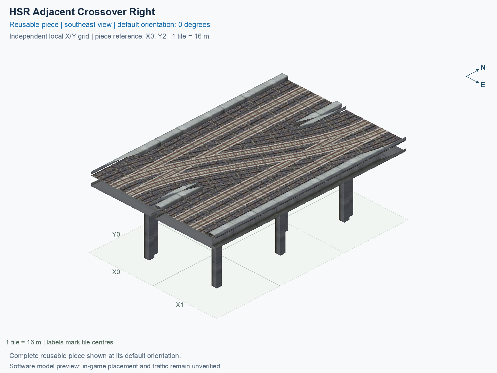

<a id="hsr-adjacent-crossover-right"></a>

# HSR Level 2 (15.5 m) — Two-Track Adjacent Crossover Right

<!-- SUBJECT IDENTITY MIGRATION -->

Identity migration: `rail-hsr-adjacent-crossover-right` → `hsr-l2-two-track-crossover-adjacent-right`. Earlier measurements, observations, and pictures retain their recorded names and fingerprints; they do not establish verification of the renamed build. See the [identity migration rules](../../../../docs/NAMING_CONVENTIONS.md#10-choosing-and-changing-names).

Purpose: explain this reusable piece, its matching connections and current test coverage.

<!-- BEGIN PIECE OVERVIEW -->

Switches between two adjacent two-track lines, with no empty tile between them. Both through lines are retained. Choose a handed crossover or a scissors for transfers in both hands.

Exact reusable identifier: `hsr-l2-two-track-crossover-adjacent-right`.

Footprint: **2 × 3 tiles**. Exact menu name: **HSR Level 2 (15.5 m) — Two-Track Adjacent Crossover Right**.

Choose this exact name in Transportation → Rail. Press Home or End to rotate; use only the supported states listed below. Join each end to a matching port profile and direction.

- [Connections and journeys](#connections-and-journeys)
- [Test checklist](#test-checklist)

### Design review

**REVIEW NEEDED** — Closely spaced pillars need a support-consolidation review.

- Separate 1.3 m-square pillar foundations have centres less than 2.6 m apart near shared rail geometry. The foundations do not overlap, but the close pair should be reviewed and consolidated to address the reported duplicate-pillar appearance. The 2.6 m review cutoff is an authoring convention, not a structural or game collision threshold.

[Design-review evidence](../../junction-design-review.jsonc).



<!-- END PIECE OVERVIEW -->

<!-- BEGIN MANUAL SUMMARY -->

## Manual status

Generated from [the exact test cases](#test-checklist) and [authoritative observations](checks/manual-tests.json).

- [ ] Preview review: 0/1 applicable cases passed; 0 failed, 0 stale.
- [ ] In-game rendering: 0/4 applicable cases passed; 0 failed, 0 stale.
- [ ] Directed journeys: 0/24 applicable cases passed; 0 failed, 0 stale.

These observations cover only the named services, directions, poses, rotations, and recorded platforms.

<!-- END MANUAL SUMMARY -->

<!-- BEGIN CONNECTIONS -->

## Connections and journeys

Purpose: describe intrinsic directional interfaces and permitted service journeys.

Generated from [connections.json](connections.json). Coordinates are canonical east, north, and height in metres. A connection class names an encoded route interface; it does not prove visible deck/wall fit or an in-game test.

Supported placement states: 0° CCW, 90° CCW, 180° CCW, 270° CCW. Each state has its own declared manual scope.

A **port** is one directional transport-path endpoint. **Service** identifies the intended network service (for example HSR, street, or tram); **engine** is its internal traffic-class number, separate from the construction network. **Role** distinguishes primary service from auxiliary paths; sharing a traffic class does not establish service compatibility.

A **tangent** is a unit travel-direction vector: `[0,1]` means north. **Grade** is height gained per horizontal metre. These measured facts describe this subject alone. Compatibility requires a separate comparison of the complete joining boundaries; physical seams and actual game operation require their own evidence. See the [class index](../../connection-classes.jsonc) for shared route-interface membership.

| Port | Service / engine / role | Direction | Location; tangent; grade | Connection class |
| --- | --- | --- | --- | --- |
| `Sout` | hsr / 7 / primary | out | [-2.0, -40.0, 15.5]; [0.0, -1.0]; 0.0 | `path-interface-12d12be31d2057c5763d` |
| `Nin` | hsr / 7 / primary | in | [-2.0, 8.0, 15.5]; [0.0, -1.0]; 0.0 | `path-interface-12d12be31d2057c5763d` |
| `Sin` | hsr / 7 / primary | in | [2.0, -40.0, 15.5]; [0.0, 1.0]; 0.0 | `path-interface-fba09fbeb87ad95c667a` |
| `Nout` | hsr / 7 / primary | out | [2.0, 8.0, 15.5]; [0.0, 1.0]; 0.0 | `path-interface-fba09fbeb87ad95c667a` |
| `BSout` | hsr / 7 / primary | out | [14.0, -40.0, 15.5]; [0.0, -1.0]; 0.0 | `path-interface-12d12be31d2057c5763d` |
| `BNin` | hsr / 7 / primary | in | [14.0, 8.0, 15.5]; [0.0, -1.0]; 0.0 | `path-interface-12d12be31d2057c5763d` |
| `BSin` | hsr / 7 / primary | in | [18.0, -40.0, 15.5]; [0.0, 1.0]; 0.0 | `path-interface-fba09fbeb87ad95c667a` |
| `BNout` | hsr / 7 / primary | out | [18.0, 8.0, 15.5]; [0.0, 1.0]; 0.0 | `path-interface-fba09fbeb87ad95c667a` |

### Directed journeys

| Service | Entry → exit | Role |
| --- | --- | --- |
| hsr | `Nin` → `Sout` | primary |
| hsr | `Sin` → `Nout` | primary |
| hsr | `Sin` → `BNout` | primary |
| hsr | `BNin` → `BSout` | primary |
| hsr | `BNin` → `Sout` | primary |
| hsr | `BSin` → `BNout` | primary |

### Forbidden transfers

| From service / port | To service / port | Reason |
| --- | --- | --- |
| hsr / `Nin` | hsr / `Nout` | No directed route exists between these ports in the saved piece transport paths. In-game confirmation remains unverified. |
| hsr / `Nin` | hsr / `BSout` | No directed route exists between these ports in the saved piece transport paths. In-game confirmation remains unverified. |
| hsr / `Nin` | hsr / `BNout` | No directed route exists between these ports in the saved piece transport paths. In-game confirmation remains unverified. |
| hsr / `Sin` | hsr / `Sout` | No directed route exists between these ports in the saved piece transport paths. In-game confirmation remains unverified. |
| hsr / `Sin` | hsr / `BSout` | No directed route exists between these ports in the saved piece transport paths. In-game confirmation remains unverified. |
| hsr / `BNin` | hsr / `Nout` | No directed route exists between these ports in the saved piece transport paths. In-game confirmation remains unverified. |
| hsr / `BNin` | hsr / `BNout` | No directed route exists between these ports in the saved piece transport paths. In-game confirmation remains unverified. |
| hsr / `BSin` | hsr / `Sout` | No directed route exists between these ports in the saved piece transport paths. In-game confirmation remains unverified. |
| hsr / `BSin` | hsr / `Nout` | No directed route exists between these ports in the saved piece transport paths. In-game confirmation remains unverified. |
| hsr / `BSin` | hsr / `BSout` | No directed route exists between these ports in the saved piece transport paths. In-game confirmation remains unverified. |

Review the test checklist for the exact tested cases and environments.

<!-- END CONNECTIONS -->

<!-- BEGIN MANUAL CHECKS -->

## Test checklist

Generated from [the authoritative record](checks/manual-tests.json). Only explicit human observations create manual passes; software and preview checks remain separate. Expand a check/service group to see its rotation table, then expand the matching exact scope to copy a case ID and inspect its pose, reviewer, environment, and evidence. Grouping changes only this view; every declared case remains separate.

**States:** [x] passed; [ ] unverified, failed, or stale; N/A is an explicit inapplicable declaration. A dash means no case was declared in that column. Every pass covers only its recorded environment. T means a distinct construction-transposed state.

Four proper rotations are covered. No additional reflected state is established by this record; repeated construction aliases do not create new orientations.

Current totals: unverified: 83, passed: 0, failed: 0, stale: 0, not_applicable: 0.

### Record an observation

Follow the [shared testing guide](../../../../docs/TESTING.md); copy [the unconfirmed example](checks/observation.example.json) to `checks/observation.json`. Case identifiers are in the expandable sections below. Do not edit generated checkboxes.

From the repository folder containing `custom-pieces`, run after filling `checks/observation.json` and explicitly confirming the exact observation:

```sh
python3 -m scp.content record --record custom-pieces/domains/high-speed-rail/00_pieces/hsr-l2-two-track-crossover-adjacent-right/checks/manual-tests.json --observation custom-pieces/domains/high-speed-rail/00_pieces/hsr-l2-two-track-crossover-adjacent-right/checks/observation.json
```

### Detailed current checks

Each collapsed group shows exact case counts and states. Forbidden transfers are grouped by the directed service pair; the table inside retains every port pair and rotation.

<details>
<summary>Compiled resources — Whole subject — 1 case; unverified: 1</summary>

| Check / exact scope | General | 0° | 90° | 180° | 270° |
| --- | --- | --- | --- | --- | --- |
| **Compiled resources**<br>Whole subject | <a href="#case-software_resources-662031b50292c55b2f20">[ ] unverified</a> | — | — | — | — |


<details>
<summary>Compiled resources — Whole subject</summary>

<a id="case-software_resources-662031b50292c55b2f20"></a>

**General: unverified** — `software_resources-662031b50292c55b2f20`.

Verify the actual compiled resources and construction rules.

Scope: Whole subject.

No observation recorded.

</details>

</details>

<details>
<summary>Directed routing graph — Whole subject — 1 case; unverified: 1</summary>

| Check / exact scope | General | 0° | 90° | 180° | 270° |
| --- | --- | --- | --- | --- | --- |
| **Directed routing graph**<br>Whole subject | <a href="#case-software_connectivity-662031b50292c55b2f20">[ ] unverified</a> | — | — | — | — |


<details>
<summary>Directed routing graph — Whole subject</summary>

<a id="case-software_connectivity-662031b50292c55b2f20"></a>

**General: unverified** — `software_connectivity-662031b50292c55b2f20`.

Verify the declared directed journeys and forbidden transfers.

Scope: Whole subject.

No observation recorded.

</details>

</details>

<details>
<summary>Preview review — Images — 1 case; unverified: 1</summary>

| Check / exact scope | General | 0° | 90° | 180° | 270° |
| --- | --- | --- | --- | --- | --- |
| **Preview review**<br>Image: image:rail-hsr-adjacent-crossover-right:canonical-southeast | <a href="#case-preview_review-f63b18d1e6f0bb1ea223">[ ] unverified</a> | — | — | — | — |


<details>
<summary>Preview review — Image: image:rail-hsr-adjacent-crossover-right:canonical-southeast</summary>

<a id="case-preview_review-f63b18d1e6f0bb1ea223"></a>

**General: unverified** — `preview_review-f63b18d1e6f0bb1ea223`.

Inspect this exact preview for tracks, walls, piers, seams and shadows.

Scope: Image: image:rail-hsr-adjacent-crossover-right:canonical-southeast.

No observation recorded.

</details>

</details>

<details>
<summary>In-game rendering — Whole subject — 4 cases; unverified: 4</summary>

| Check / exact scope | General | 0° | 90° | 180° | 270° |
| --- | --- | --- | --- | --- | --- |
| **In-game rendering**<br>Whole subject | — | <a href="#case-in_game_render-b7784bcef31474a7df07">[ ] unverified</a> | <a href="#case-in_game_render-0e6864c751a5ada687b8">[ ] unverified</a> | <a href="#case-in_game_render-91d9c19faf93b49a941a">[ ] unverified</a> | <a href="#case-in_game_render-94d9d39749484e6b8015">[ ] unverified</a> |


<details>
<summary>In-game rendering — Whole subject</summary>

<a id="case-in_game_render-b7784bcef31474a7df07"></a>

**0° CCW: unverified** — `in_game_render-b7784bcef31474a7df07`.

Inspect the placed tracks, walls, piers, seams and shadows in SimCity 4.

Scope: Whole subject.

No observation recorded.

<a id="case-in_game_render-0e6864c751a5ada687b8"></a>

**90° CCW: unverified** — `in_game_render-0e6864c751a5ada687b8`.

Inspect the placed tracks, walls, piers, seams and shadows in SimCity 4.

Scope: Whole subject.

No observation recorded.

<a id="case-in_game_render-91d9c19faf93b49a941a"></a>

**180° CCW: unverified** — `in_game_render-91d9c19faf93b49a941a`.

Inspect the placed tracks, walls, piers, seams and shadows in SimCity 4.

Scope: Whole subject.

No observation recorded.

<a id="case-in_game_render-94d9d39749484e6b8015"></a>

**270° CCW: unverified** — `in_game_render-94d9d39749484e6b8015`.

Inspect the placed tracks, walls, piers, seams and shadows in SimCity 4.

Scope: Whole subject.

No observation recorded.

</details>

</details>

<details>
<summary>Placement — Whole subject — 4 cases; unverified: 4</summary>

| Check / exact scope | General | 0° | 90° | 180° | 270° |
| --- | --- | --- | --- | --- | --- |
| **Placement**<br>Whole subject | — | <a href="#case-in_game_placement-b7784bcef31474a7df07">[ ] unverified</a> | <a href="#case-in_game_placement-0e6864c751a5ada687b8">[ ] unverified</a> | <a href="#case-in_game_placement-91d9c19faf93b49a941a">[ ] unverified</a> | <a href="#case-in_game_placement-94d9d39749484e6b8015">[ ] unverified</a> |


<details>
<summary>Placement — Whole subject</summary>

<a id="case-in_game_placement-b7784bcef31474a7df07"></a>

**0° CCW: unverified** — `in_game_placement-b7784bcef31474a7df07`.

Place this piece or complete blueprint and inspect every occupied tile.

Scope: Whole subject.

No observation recorded.

<a id="case-in_game_placement-0e6864c751a5ada687b8"></a>

**90° CCW: unverified** — `in_game_placement-0e6864c751a5ada687b8`.

Place this piece or complete blueprint and inspect every occupied tile.

Scope: Whole subject.

No observation recorded.

<a id="case-in_game_placement-91d9c19faf93b49a941a"></a>

**180° CCW: unverified** — `in_game_placement-91d9c19faf93b49a941a`.

Place this piece or complete blueprint and inspect every occupied tile.

Scope: Whole subject.

No observation recorded.

<a id="case-in_game_placement-94d9d39749484e6b8015"></a>

**270° CCW: unverified** — `in_game_placement-94d9d39749484e6b8015`.

Place this piece or complete blueprint and inspect every occupied tile.

Scope: Whole subject.

No observation recorded.

</details>

</details>

<details>
<summary>Demolition — Whole subject — 4 cases; unverified: 4</summary>

| Check / exact scope | General | 0° | 90° | 180° | 270° |
| --- | --- | --- | --- | --- | --- |
| **Demolition**<br>Whole subject | — | <a href="#case-in_game_demolition-b7784bcef31474a7df07">[ ] unverified</a> | <a href="#case-in_game_demolition-0e6864c751a5ada687b8">[ ] unverified</a> | <a href="#case-in_game_demolition-91d9c19faf93b49a941a">[ ] unverified</a> | <a href="#case-in_game_demolition-94d9d39749484e6b8015">[ ] unverified</a> |


<details>
<summary>Demolition — Whole subject</summary>

<a id="case-in_game_demolition-b7784bcef31474a7df07"></a>

**0° CCW: unverified** — `in_game_demolition-b7784bcef31474a7df07`.

Bulldoze the complete placement and inspect the cleared area.

Scope: Whole subject.

No observation recorded.

<a id="case-in_game_demolition-0e6864c751a5ada687b8"></a>

**90° CCW: unverified** — `in_game_demolition-0e6864c751a5ada687b8`.

Bulldoze the complete placement and inspect the cleared area.

Scope: Whole subject.

No observation recorded.

<a id="case-in_game_demolition-91d9c19faf93b49a941a"></a>

**180° CCW: unverified** — `in_game_demolition-91d9c19faf93b49a941a`.

Bulldoze the complete placement and inspect the cleared area.

Scope: Whole subject.

No observation recorded.

<a id="case-in_game_demolition-94d9d39749484e6b8015"></a>

**270° CCW: unverified** — `in_game_demolition-94d9d39749484e6b8015`.

Bulldoze the complete placement and inspect the cleared area.

Scope: Whole subject.

No observation recorded.

</details>

</details>

<details>
<summary>Save and reload — Whole subject — 4 cases; unverified: 4</summary>

| Check / exact scope | General | 0° | 90° | 180° | 270° |
| --- | --- | --- | --- | --- | --- |
| **Save and reload**<br>Whole subject | — | <a href="#case-in_game_save_reload-b7784bcef31474a7df07">[ ] unverified</a> | <a href="#case-in_game_save_reload-0e6864c751a5ada687b8">[ ] unverified</a> | <a href="#case-in_game_save_reload-91d9c19faf93b49a941a">[ ] unverified</a> | <a href="#case-in_game_save_reload-94d9d39749484e6b8015">[ ] unverified</a> |


<details>
<summary>Save and reload — Whole subject</summary>

<a id="case-in_game_save_reload-b7784bcef31474a7df07"></a>

**0° CCW: unverified** — `in_game_save_reload-b7784bcef31474a7df07`.

Save, quit, reload and inspect the placement and its paths.

Scope: Whole subject.

No observation recorded.

<a id="case-in_game_save_reload-0e6864c751a5ada687b8"></a>

**90° CCW: unverified** — `in_game_save_reload-0e6864c751a5ada687b8`.

Save, quit, reload and inspect the placement and its paths.

Scope: Whole subject.

No observation recorded.

<a id="case-in_game_save_reload-91d9c19faf93b49a941a"></a>

**180° CCW: unverified** — `in_game_save_reload-91d9c19faf93b49a941a`.

Save, quit, reload and inspect the placement and its paths.

Scope: Whole subject.

No observation recorded.

<a id="case-in_game_save_reload-94d9d39749484e6b8015"></a>

**270° CCW: unverified** — `in_game_save_reload-94d9d39749484e6b8015`.

Save, quit, reload and inspect the placement and its paths.

Scope: Whole subject.

No observation recorded.

</details>

</details>

<details>
<summary>Journey — hsr — 24 cases; unverified: 24</summary>

| Check / exact scope | General | 0° | 90° | 180° | 270° |
| --- | --- | --- | --- | --- | --- |
| **Journey**<br>Service: hsr; role: primary; journey: 7:Nin>Sout; entry: Nin; exit: Sout | — | <a href="#case-in_game_journey-d25f11e691209ea9b968">[ ] unverified</a> | <a href="#case-in_game_journey-ca513c38f8a12e24e924">[ ] unverified</a> | <a href="#case-in_game_journey-4b0d1cc4598bf3cd1187">[ ] unverified</a> | <a href="#case-in_game_journey-1b88cb3367d010f82853">[ ] unverified</a> |
| **Journey**<br>Service: hsr; role: primary; journey: 7:Sin>Nout; entry: Sin; exit: Nout | — | <a href="#case-in_game_journey-ade330382b9856190f27">[ ] unverified</a> | <a href="#case-in_game_journey-cf01947bdae03164aabf">[ ] unverified</a> | <a href="#case-in_game_journey-108d2013acc87e3ac3c8">[ ] unverified</a> | <a href="#case-in_game_journey-7d6ba4165ce7f2aedb5b">[ ] unverified</a> |
| **Journey**<br>Service: hsr; role: primary; journey: 7:Sin>BNout; entry: Sin; exit: BNout | — | <a href="#case-in_game_journey-bf1bd55920d896b8ad84">[ ] unverified</a> | <a href="#case-in_game_journey-8355187517b5272347da">[ ] unverified</a> | <a href="#case-in_game_journey-cac0827b7ba137abeb20">[ ] unverified</a> | <a href="#case-in_game_journey-78fbeb202e157f9dd2e1">[ ] unverified</a> |
| **Journey**<br>Service: hsr; role: primary; journey: 7:BNin>BSout; entry: BNin; exit: BSout | — | <a href="#case-in_game_journey-97ec27cf250798ed38f7">[ ] unverified</a> | <a href="#case-in_game_journey-3ff8b91f799260e33915">[ ] unverified</a> | <a href="#case-in_game_journey-3c0904fe0c7862d63501">[ ] unverified</a> | <a href="#case-in_game_journey-8665e4564275c679235e">[ ] unverified</a> |
| **Journey**<br>Service: hsr; role: primary; journey: 7:BNin>Sout; entry: BNin; exit: Sout | — | <a href="#case-in_game_journey-753a10ab0890e9f419fa">[ ] unverified</a> | <a href="#case-in_game_journey-a4a07d6adc41ec35cd3c">[ ] unverified</a> | <a href="#case-in_game_journey-e9b30bfbd00a306c3611">[ ] unverified</a> | <a href="#case-in_game_journey-bc6ce16ac0b65adef514">[ ] unverified</a> |
| **Journey**<br>Service: hsr; role: primary; journey: 7:BSin>BNout; entry: BSin; exit: BNout | — | <a href="#case-in_game_journey-8b31a35586f7eb6f7492">[ ] unverified</a> | <a href="#case-in_game_journey-8523098f71af5c3a703b">[ ] unverified</a> | <a href="#case-in_game_journey-48ab6dce9b04814ab0e8">[ ] unverified</a> | <a href="#case-in_game_journey-a042b553b11e1359cfba">[ ] unverified</a> |


<details>
<summary>Journey — Service: hsr; role: primary; journey: 7:Nin>Sout; entry: Nin; exit: Sout</summary>

<a id="case-in_game_journey-d25f11e691209ea9b968"></a>

**0° CCW: unverified** — `in_game_journey-d25f11e691209ea9b968`.

Run the declared journey in this direction using its service network.

Scope: Service: hsr; role: primary; journey: 7:Nin>Sout; entry: Nin; exit: Sout.

No observation recorded.

<a id="case-in_game_journey-ca513c38f8a12e24e924"></a>

**90° CCW: unverified** — `in_game_journey-ca513c38f8a12e24e924`.

Run the declared journey in this direction using its service network.

Scope: Service: hsr; role: primary; journey: 7:Nin>Sout; entry: Nin; exit: Sout.

No observation recorded.

<a id="case-in_game_journey-4b0d1cc4598bf3cd1187"></a>

**180° CCW: unverified** — `in_game_journey-4b0d1cc4598bf3cd1187`.

Run the declared journey in this direction using its service network.

Scope: Service: hsr; role: primary; journey: 7:Nin>Sout; entry: Nin; exit: Sout.

No observation recorded.

<a id="case-in_game_journey-1b88cb3367d010f82853"></a>

**270° CCW: unverified** — `in_game_journey-1b88cb3367d010f82853`.

Run the declared journey in this direction using its service network.

Scope: Service: hsr; role: primary; journey: 7:Nin>Sout; entry: Nin; exit: Sout.

No observation recorded.

</details>


<details>
<summary>Journey — Service: hsr; role: primary; journey: 7:Sin>Nout; entry: Sin; exit: Nout</summary>

<a id="case-in_game_journey-ade330382b9856190f27"></a>

**0° CCW: unverified** — `in_game_journey-ade330382b9856190f27`.

Run the declared journey in this direction using its service network.

Scope: Service: hsr; role: primary; journey: 7:Sin>Nout; entry: Sin; exit: Nout.

No observation recorded.

<a id="case-in_game_journey-cf01947bdae03164aabf"></a>

**90° CCW: unverified** — `in_game_journey-cf01947bdae03164aabf`.

Run the declared journey in this direction using its service network.

Scope: Service: hsr; role: primary; journey: 7:Sin>Nout; entry: Sin; exit: Nout.

No observation recorded.

<a id="case-in_game_journey-108d2013acc87e3ac3c8"></a>

**180° CCW: unverified** — `in_game_journey-108d2013acc87e3ac3c8`.

Run the declared journey in this direction using its service network.

Scope: Service: hsr; role: primary; journey: 7:Sin>Nout; entry: Sin; exit: Nout.

No observation recorded.

<a id="case-in_game_journey-7d6ba4165ce7f2aedb5b"></a>

**270° CCW: unverified** — `in_game_journey-7d6ba4165ce7f2aedb5b`.

Run the declared journey in this direction using its service network.

Scope: Service: hsr; role: primary; journey: 7:Sin>Nout; entry: Sin; exit: Nout.

No observation recorded.

</details>


<details>
<summary>Journey — Service: hsr; role: primary; journey: 7:Sin>BNout; entry: Sin; exit: BNout</summary>

<a id="case-in_game_journey-bf1bd55920d896b8ad84"></a>

**0° CCW: unverified** — `in_game_journey-bf1bd55920d896b8ad84`.

Run the declared journey in this direction using its service network.

Scope: Service: hsr; role: primary; journey: 7:Sin>BNout; entry: Sin; exit: BNout.

No observation recorded.

<a id="case-in_game_journey-8355187517b5272347da"></a>

**90° CCW: unverified** — `in_game_journey-8355187517b5272347da`.

Run the declared journey in this direction using its service network.

Scope: Service: hsr; role: primary; journey: 7:Sin>BNout; entry: Sin; exit: BNout.

No observation recorded.

<a id="case-in_game_journey-cac0827b7ba137abeb20"></a>

**180° CCW: unverified** — `in_game_journey-cac0827b7ba137abeb20`.

Run the declared journey in this direction using its service network.

Scope: Service: hsr; role: primary; journey: 7:Sin>BNout; entry: Sin; exit: BNout.

No observation recorded.

<a id="case-in_game_journey-78fbeb202e157f9dd2e1"></a>

**270° CCW: unverified** — `in_game_journey-78fbeb202e157f9dd2e1`.

Run the declared journey in this direction using its service network.

Scope: Service: hsr; role: primary; journey: 7:Sin>BNout; entry: Sin; exit: BNout.

No observation recorded.

</details>


<details>
<summary>Journey — Service: hsr; role: primary; journey: 7:BNin>BSout; entry: BNin; exit: BSout</summary>

<a id="case-in_game_journey-97ec27cf250798ed38f7"></a>

**0° CCW: unverified** — `in_game_journey-97ec27cf250798ed38f7`.

Run the declared journey in this direction using its service network.

Scope: Service: hsr; role: primary; journey: 7:BNin>BSout; entry: BNin; exit: BSout.

No observation recorded.

<a id="case-in_game_journey-3ff8b91f799260e33915"></a>

**90° CCW: unverified** — `in_game_journey-3ff8b91f799260e33915`.

Run the declared journey in this direction using its service network.

Scope: Service: hsr; role: primary; journey: 7:BNin>BSout; entry: BNin; exit: BSout.

No observation recorded.

<a id="case-in_game_journey-3c0904fe0c7862d63501"></a>

**180° CCW: unverified** — `in_game_journey-3c0904fe0c7862d63501`.

Run the declared journey in this direction using its service network.

Scope: Service: hsr; role: primary; journey: 7:BNin>BSout; entry: BNin; exit: BSout.

No observation recorded.

<a id="case-in_game_journey-8665e4564275c679235e"></a>

**270° CCW: unverified** — `in_game_journey-8665e4564275c679235e`.

Run the declared journey in this direction using its service network.

Scope: Service: hsr; role: primary; journey: 7:BNin>BSout; entry: BNin; exit: BSout.

No observation recorded.

</details>


<details>
<summary>Journey — Service: hsr; role: primary; journey: 7:BNin>Sout; entry: BNin; exit: Sout</summary>

<a id="case-in_game_journey-753a10ab0890e9f419fa"></a>

**0° CCW: unverified** — `in_game_journey-753a10ab0890e9f419fa`.

Run the declared journey in this direction using its service network.

Scope: Service: hsr; role: primary; journey: 7:BNin>Sout; entry: BNin; exit: Sout.

No observation recorded.

<a id="case-in_game_journey-a4a07d6adc41ec35cd3c"></a>

**90° CCW: unverified** — `in_game_journey-a4a07d6adc41ec35cd3c`.

Run the declared journey in this direction using its service network.

Scope: Service: hsr; role: primary; journey: 7:BNin>Sout; entry: BNin; exit: Sout.

No observation recorded.

<a id="case-in_game_journey-e9b30bfbd00a306c3611"></a>

**180° CCW: unverified** — `in_game_journey-e9b30bfbd00a306c3611`.

Run the declared journey in this direction using its service network.

Scope: Service: hsr; role: primary; journey: 7:BNin>Sout; entry: BNin; exit: Sout.

No observation recorded.

<a id="case-in_game_journey-bc6ce16ac0b65adef514"></a>

**270° CCW: unverified** — `in_game_journey-bc6ce16ac0b65adef514`.

Run the declared journey in this direction using its service network.

Scope: Service: hsr; role: primary; journey: 7:BNin>Sout; entry: BNin; exit: Sout.

No observation recorded.

</details>


<details>
<summary>Journey — Service: hsr; role: primary; journey: 7:BSin>BNout; entry: BSin; exit: BNout</summary>

<a id="case-in_game_journey-8b31a35586f7eb6f7492"></a>

**0° CCW: unverified** — `in_game_journey-8b31a35586f7eb6f7492`.

Run the declared journey in this direction using its service network.

Scope: Service: hsr; role: primary; journey: 7:BSin>BNout; entry: BSin; exit: BNout.

No observation recorded.

<a id="case-in_game_journey-8523098f71af5c3a703b"></a>

**90° CCW: unverified** — `in_game_journey-8523098f71af5c3a703b`.

Run the declared journey in this direction using its service network.

Scope: Service: hsr; role: primary; journey: 7:BSin>BNout; entry: BSin; exit: BNout.

No observation recorded.

<a id="case-in_game_journey-48ab6dce9b04814ab0e8"></a>

**180° CCW: unverified** — `in_game_journey-48ab6dce9b04814ab0e8`.

Run the declared journey in this direction using its service network.

Scope: Service: hsr; role: primary; journey: 7:BSin>BNout; entry: BSin; exit: BNout.

No observation recorded.

<a id="case-in_game_journey-a042b553b11e1359cfba"></a>

**270° CCW: unverified** — `in_game_journey-a042b553b11e1359cfba`.

Run the declared journey in this direction using its service network.

Scope: Service: hsr; role: primary; journey: 7:BSin>BNout; entry: BSin; exit: BNout.

No observation recorded.

</details>

</details>

<details>
<summary>Forbidden transfer — hsr → hsr — 40 cases; unverified: 40</summary>

| Check / exact scope | General | 0° | 90° | 180° | 270° |
| --- | --- | --- | --- | --- | --- |
| **Forbidden transfer**<br>from port: Nin; to port: Nout; from service: hsr; to service: hsr; basis: not reachable in actual saved PATH graph | — | <a href="#case-in_game_forbidden_transfer-0a5fff6898ac1587891b">[ ] unverified</a> | <a href="#case-in_game_forbidden_transfer-edcc2843404f9178dcbf">[ ] unverified</a> | <a href="#case-in_game_forbidden_transfer-39dbfc2b73014e6bf146">[ ] unverified</a> | <a href="#case-in_game_forbidden_transfer-40ec47671f320a211258">[ ] unverified</a> |
| **Forbidden transfer**<br>from port: Nin; to port: BSout; from service: hsr; to service: hsr; basis: not reachable in actual saved PATH graph | — | <a href="#case-in_game_forbidden_transfer-2e41fab1194960b2a736">[ ] unverified</a> | <a href="#case-in_game_forbidden_transfer-622980f70d7a493a9266">[ ] unverified</a> | <a href="#case-in_game_forbidden_transfer-5a656c0b41c424d0a5dd">[ ] unverified</a> | <a href="#case-in_game_forbidden_transfer-f03567de02659b77c8dc">[ ] unverified</a> |
| **Forbidden transfer**<br>from port: Nin; to port: BNout; from service: hsr; to service: hsr; basis: not reachable in actual saved PATH graph | — | <a href="#case-in_game_forbidden_transfer-0d2192231d6bf68a3464">[ ] unverified</a> | <a href="#case-in_game_forbidden_transfer-53c7fcfad11149a50256">[ ] unverified</a> | <a href="#case-in_game_forbidden_transfer-9180a5a0121c365414e2">[ ] unverified</a> | <a href="#case-in_game_forbidden_transfer-a720ea7d155000611a50">[ ] unverified</a> |
| **Forbidden transfer**<br>from port: Sin; to port: Sout; from service: hsr; to service: hsr; basis: not reachable in actual saved PATH graph | — | <a href="#case-in_game_forbidden_transfer-617c1c3b9dc4ccfd2df4">[ ] unverified</a> | <a href="#case-in_game_forbidden_transfer-f29a79361a4a3882228d">[ ] unverified</a> | <a href="#case-in_game_forbidden_transfer-072a04688bb698d450ce">[ ] unverified</a> | <a href="#case-in_game_forbidden_transfer-964f6c8fe2b9ea7d84e2">[ ] unverified</a> |
| **Forbidden transfer**<br>from port: Sin; to port: BSout; from service: hsr; to service: hsr; basis: not reachable in actual saved PATH graph | — | <a href="#case-in_game_forbidden_transfer-afd869e8296d7f35d032">[ ] unverified</a> | <a href="#case-in_game_forbidden_transfer-f965f942a5b02d1b9a62">[ ] unverified</a> | <a href="#case-in_game_forbidden_transfer-db1bf33a2e1bbc59838b">[ ] unverified</a> | <a href="#case-in_game_forbidden_transfer-094b2133a2e48b6d8c7a">[ ] unverified</a> |
| **Forbidden transfer**<br>from port: BNin; to port: Nout; from service: hsr; to service: hsr; basis: not reachable in actual saved PATH graph | — | <a href="#case-in_game_forbidden_transfer-c178a44689ae9e710bc7">[ ] unverified</a> | <a href="#case-in_game_forbidden_transfer-cab91e751ada89465bc8">[ ] unverified</a> | <a href="#case-in_game_forbidden_transfer-575e50d68b16dcd56fb3">[ ] unverified</a> | <a href="#case-in_game_forbidden_transfer-a14c24e8fba093a3f971">[ ] unverified</a> |
| **Forbidden transfer**<br>from port: BNin; to port: BNout; from service: hsr; to service: hsr; basis: not reachable in actual saved PATH graph | — | <a href="#case-in_game_forbidden_transfer-20d85df8aef3d0b79398">[ ] unverified</a> | <a href="#case-in_game_forbidden_transfer-be9c8fb0a8e9fbb1adae">[ ] unverified</a> | <a href="#case-in_game_forbidden_transfer-f87b86a7878cc1a3fc46">[ ] unverified</a> | <a href="#case-in_game_forbidden_transfer-e59adeea22d86374568a">[ ] unverified</a> |
| **Forbidden transfer**<br>from port: BSin; to port: Sout; from service: hsr; to service: hsr; basis: not reachable in actual saved PATH graph | — | <a href="#case-in_game_forbidden_transfer-0938843211ab2adf5bd1">[ ] unverified</a> | <a href="#case-in_game_forbidden_transfer-2b5fa9b87d950ecd1811">[ ] unverified</a> | <a href="#case-in_game_forbidden_transfer-b453accfcb4d7427c33c">[ ] unverified</a> | <a href="#case-in_game_forbidden_transfer-da1aa847666bbc4f194f">[ ] unverified</a> |
| **Forbidden transfer**<br>from port: BSin; to port: Nout; from service: hsr; to service: hsr; basis: not reachable in actual saved PATH graph | — | <a href="#case-in_game_forbidden_transfer-17e15015905ec1c14536">[ ] unverified</a> | <a href="#case-in_game_forbidden_transfer-5454ae2e4b8f68fae080">[ ] unverified</a> | <a href="#case-in_game_forbidden_transfer-82e10cf6555c2578f76c">[ ] unverified</a> | <a href="#case-in_game_forbidden_transfer-34ace70ffe914f2e6676">[ ] unverified</a> |
| **Forbidden transfer**<br>from port: BSin; to port: BSout; from service: hsr; to service: hsr; basis: not reachable in actual saved PATH graph | — | <a href="#case-in_game_forbidden_transfer-b05e6693df56c14c9a93">[ ] unverified</a> | <a href="#case-in_game_forbidden_transfer-4753af5aeff7fcf42d07">[ ] unverified</a> | <a href="#case-in_game_forbidden_transfer-8cae64b483de6aba08dd">[ ] unverified</a> | <a href="#case-in_game_forbidden_transfer-53d817f7deb70497c4be">[ ] unverified</a> |


<details>
<summary>Forbidden transfer — from port: Nin; to port: Nout; from service: hsr; to service: hsr; basis: not reachable in actual saved PATH graph</summary>

<a id="case-in_game_forbidden_transfer-0a5fff6898ac1587891b"></a>

**0° CCW: unverified** — `in_game_forbidden_transfer-0a5fff6898ac1587891b`.

Confirm this undeclared transfer is unavailable.

Scope: from port: Nin; to port: Nout; from service: hsr; to service: hsr; basis: not reachable in actual saved PATH graph.

No observation recorded.

<a id="case-in_game_forbidden_transfer-edcc2843404f9178dcbf"></a>

**90° CCW: unverified** — `in_game_forbidden_transfer-edcc2843404f9178dcbf`.

Confirm this undeclared transfer is unavailable.

Scope: from port: Nin; to port: Nout; from service: hsr; to service: hsr; basis: not reachable in actual saved PATH graph.

No observation recorded.

<a id="case-in_game_forbidden_transfer-39dbfc2b73014e6bf146"></a>

**180° CCW: unverified** — `in_game_forbidden_transfer-39dbfc2b73014e6bf146`.

Confirm this undeclared transfer is unavailable.

Scope: from port: Nin; to port: Nout; from service: hsr; to service: hsr; basis: not reachable in actual saved PATH graph.

No observation recorded.

<a id="case-in_game_forbidden_transfer-40ec47671f320a211258"></a>

**270° CCW: unverified** — `in_game_forbidden_transfer-40ec47671f320a211258`.

Confirm this undeclared transfer is unavailable.

Scope: from port: Nin; to port: Nout; from service: hsr; to service: hsr; basis: not reachable in actual saved PATH graph.

No observation recorded.

</details>


<details>
<summary>Forbidden transfer — from port: Nin; to port: BSout; from service: hsr; to service: hsr; basis: not reachable in actual saved PATH graph</summary>

<a id="case-in_game_forbidden_transfer-2e41fab1194960b2a736"></a>

**0° CCW: unverified** — `in_game_forbidden_transfer-2e41fab1194960b2a736`.

Confirm this undeclared transfer is unavailable.

Scope: from port: Nin; to port: BSout; from service: hsr; to service: hsr; basis: not reachable in actual saved PATH graph.

No observation recorded.

<a id="case-in_game_forbidden_transfer-622980f70d7a493a9266"></a>

**90° CCW: unverified** — `in_game_forbidden_transfer-622980f70d7a493a9266`.

Confirm this undeclared transfer is unavailable.

Scope: from port: Nin; to port: BSout; from service: hsr; to service: hsr; basis: not reachable in actual saved PATH graph.

No observation recorded.

<a id="case-in_game_forbidden_transfer-5a656c0b41c424d0a5dd"></a>

**180° CCW: unverified** — `in_game_forbidden_transfer-5a656c0b41c424d0a5dd`.

Confirm this undeclared transfer is unavailable.

Scope: from port: Nin; to port: BSout; from service: hsr; to service: hsr; basis: not reachable in actual saved PATH graph.

No observation recorded.

<a id="case-in_game_forbidden_transfer-f03567de02659b77c8dc"></a>

**270° CCW: unverified** — `in_game_forbidden_transfer-f03567de02659b77c8dc`.

Confirm this undeclared transfer is unavailable.

Scope: from port: Nin; to port: BSout; from service: hsr; to service: hsr; basis: not reachable in actual saved PATH graph.

No observation recorded.

</details>


<details>
<summary>Forbidden transfer — from port: Nin; to port: BNout; from service: hsr; to service: hsr; basis: not reachable in actual saved PATH graph</summary>

<a id="case-in_game_forbidden_transfer-0d2192231d6bf68a3464"></a>

**0° CCW: unverified** — `in_game_forbidden_transfer-0d2192231d6bf68a3464`.

Confirm this undeclared transfer is unavailable.

Scope: from port: Nin; to port: BNout; from service: hsr; to service: hsr; basis: not reachable in actual saved PATH graph.

No observation recorded.

<a id="case-in_game_forbidden_transfer-53c7fcfad11149a50256"></a>

**90° CCW: unverified** — `in_game_forbidden_transfer-53c7fcfad11149a50256`.

Confirm this undeclared transfer is unavailable.

Scope: from port: Nin; to port: BNout; from service: hsr; to service: hsr; basis: not reachable in actual saved PATH graph.

No observation recorded.

<a id="case-in_game_forbidden_transfer-9180a5a0121c365414e2"></a>

**180° CCW: unverified** — `in_game_forbidden_transfer-9180a5a0121c365414e2`.

Confirm this undeclared transfer is unavailable.

Scope: from port: Nin; to port: BNout; from service: hsr; to service: hsr; basis: not reachable in actual saved PATH graph.

No observation recorded.

<a id="case-in_game_forbidden_transfer-a720ea7d155000611a50"></a>

**270° CCW: unverified** — `in_game_forbidden_transfer-a720ea7d155000611a50`.

Confirm this undeclared transfer is unavailable.

Scope: from port: Nin; to port: BNout; from service: hsr; to service: hsr; basis: not reachable in actual saved PATH graph.

No observation recorded.

</details>


<details>
<summary>Forbidden transfer — from port: Sin; to port: Sout; from service: hsr; to service: hsr; basis: not reachable in actual saved PATH graph</summary>

<a id="case-in_game_forbidden_transfer-617c1c3b9dc4ccfd2df4"></a>

**0° CCW: unverified** — `in_game_forbidden_transfer-617c1c3b9dc4ccfd2df4`.

Confirm this undeclared transfer is unavailable.

Scope: from port: Sin; to port: Sout; from service: hsr; to service: hsr; basis: not reachable in actual saved PATH graph.

No observation recorded.

<a id="case-in_game_forbidden_transfer-f29a79361a4a3882228d"></a>

**90° CCW: unverified** — `in_game_forbidden_transfer-f29a79361a4a3882228d`.

Confirm this undeclared transfer is unavailable.

Scope: from port: Sin; to port: Sout; from service: hsr; to service: hsr; basis: not reachable in actual saved PATH graph.

No observation recorded.

<a id="case-in_game_forbidden_transfer-072a04688bb698d450ce"></a>

**180° CCW: unverified** — `in_game_forbidden_transfer-072a04688bb698d450ce`.

Confirm this undeclared transfer is unavailable.

Scope: from port: Sin; to port: Sout; from service: hsr; to service: hsr; basis: not reachable in actual saved PATH graph.

No observation recorded.

<a id="case-in_game_forbidden_transfer-964f6c8fe2b9ea7d84e2"></a>

**270° CCW: unverified** — `in_game_forbidden_transfer-964f6c8fe2b9ea7d84e2`.

Confirm this undeclared transfer is unavailable.

Scope: from port: Sin; to port: Sout; from service: hsr; to service: hsr; basis: not reachable in actual saved PATH graph.

No observation recorded.

</details>


<details>
<summary>Forbidden transfer — from port: Sin; to port: BSout; from service: hsr; to service: hsr; basis: not reachable in actual saved PATH graph</summary>

<a id="case-in_game_forbidden_transfer-afd869e8296d7f35d032"></a>

**0° CCW: unverified** — `in_game_forbidden_transfer-afd869e8296d7f35d032`.

Confirm this undeclared transfer is unavailable.

Scope: from port: Sin; to port: BSout; from service: hsr; to service: hsr; basis: not reachable in actual saved PATH graph.

No observation recorded.

<a id="case-in_game_forbidden_transfer-f965f942a5b02d1b9a62"></a>

**90° CCW: unverified** — `in_game_forbidden_transfer-f965f942a5b02d1b9a62`.

Confirm this undeclared transfer is unavailable.

Scope: from port: Sin; to port: BSout; from service: hsr; to service: hsr; basis: not reachable in actual saved PATH graph.

No observation recorded.

<a id="case-in_game_forbidden_transfer-db1bf33a2e1bbc59838b"></a>

**180° CCW: unverified** — `in_game_forbidden_transfer-db1bf33a2e1bbc59838b`.

Confirm this undeclared transfer is unavailable.

Scope: from port: Sin; to port: BSout; from service: hsr; to service: hsr; basis: not reachable in actual saved PATH graph.

No observation recorded.

<a id="case-in_game_forbidden_transfer-094b2133a2e48b6d8c7a"></a>

**270° CCW: unverified** — `in_game_forbidden_transfer-094b2133a2e48b6d8c7a`.

Confirm this undeclared transfer is unavailable.

Scope: from port: Sin; to port: BSout; from service: hsr; to service: hsr; basis: not reachable in actual saved PATH graph.

No observation recorded.

</details>


<details>
<summary>Forbidden transfer — from port: BNin; to port: Nout; from service: hsr; to service: hsr; basis: not reachable in actual saved PATH graph</summary>

<a id="case-in_game_forbidden_transfer-c178a44689ae9e710bc7"></a>

**0° CCW: unverified** — `in_game_forbidden_transfer-c178a44689ae9e710bc7`.

Confirm this undeclared transfer is unavailable.

Scope: from port: BNin; to port: Nout; from service: hsr; to service: hsr; basis: not reachable in actual saved PATH graph.

No observation recorded.

<a id="case-in_game_forbidden_transfer-cab91e751ada89465bc8"></a>

**90° CCW: unverified** — `in_game_forbidden_transfer-cab91e751ada89465bc8`.

Confirm this undeclared transfer is unavailable.

Scope: from port: BNin; to port: Nout; from service: hsr; to service: hsr; basis: not reachable in actual saved PATH graph.

No observation recorded.

<a id="case-in_game_forbidden_transfer-575e50d68b16dcd56fb3"></a>

**180° CCW: unverified** — `in_game_forbidden_transfer-575e50d68b16dcd56fb3`.

Confirm this undeclared transfer is unavailable.

Scope: from port: BNin; to port: Nout; from service: hsr; to service: hsr; basis: not reachable in actual saved PATH graph.

No observation recorded.

<a id="case-in_game_forbidden_transfer-a14c24e8fba093a3f971"></a>

**270° CCW: unverified** — `in_game_forbidden_transfer-a14c24e8fba093a3f971`.

Confirm this undeclared transfer is unavailable.

Scope: from port: BNin; to port: Nout; from service: hsr; to service: hsr; basis: not reachable in actual saved PATH graph.

No observation recorded.

</details>


<details>
<summary>Forbidden transfer — from port: BNin; to port: BNout; from service: hsr; to service: hsr; basis: not reachable in actual saved PATH graph</summary>

<a id="case-in_game_forbidden_transfer-20d85df8aef3d0b79398"></a>

**0° CCW: unverified** — `in_game_forbidden_transfer-20d85df8aef3d0b79398`.

Confirm this undeclared transfer is unavailable.

Scope: from port: BNin; to port: BNout; from service: hsr; to service: hsr; basis: not reachable in actual saved PATH graph.

No observation recorded.

<a id="case-in_game_forbidden_transfer-be9c8fb0a8e9fbb1adae"></a>

**90° CCW: unverified** — `in_game_forbidden_transfer-be9c8fb0a8e9fbb1adae`.

Confirm this undeclared transfer is unavailable.

Scope: from port: BNin; to port: BNout; from service: hsr; to service: hsr; basis: not reachable in actual saved PATH graph.

No observation recorded.

<a id="case-in_game_forbidden_transfer-f87b86a7878cc1a3fc46"></a>

**180° CCW: unverified** — `in_game_forbidden_transfer-f87b86a7878cc1a3fc46`.

Confirm this undeclared transfer is unavailable.

Scope: from port: BNin; to port: BNout; from service: hsr; to service: hsr; basis: not reachable in actual saved PATH graph.

No observation recorded.

<a id="case-in_game_forbidden_transfer-e59adeea22d86374568a"></a>

**270° CCW: unverified** — `in_game_forbidden_transfer-e59adeea22d86374568a`.

Confirm this undeclared transfer is unavailable.

Scope: from port: BNin; to port: BNout; from service: hsr; to service: hsr; basis: not reachable in actual saved PATH graph.

No observation recorded.

</details>


<details>
<summary>Forbidden transfer — from port: BSin; to port: Sout; from service: hsr; to service: hsr; basis: not reachable in actual saved PATH graph</summary>

<a id="case-in_game_forbidden_transfer-0938843211ab2adf5bd1"></a>

**0° CCW: unverified** — `in_game_forbidden_transfer-0938843211ab2adf5bd1`.

Confirm this undeclared transfer is unavailable.

Scope: from port: BSin; to port: Sout; from service: hsr; to service: hsr; basis: not reachable in actual saved PATH graph.

No observation recorded.

<a id="case-in_game_forbidden_transfer-2b5fa9b87d950ecd1811"></a>

**90° CCW: unverified** — `in_game_forbidden_transfer-2b5fa9b87d950ecd1811`.

Confirm this undeclared transfer is unavailable.

Scope: from port: BSin; to port: Sout; from service: hsr; to service: hsr; basis: not reachable in actual saved PATH graph.

No observation recorded.

<a id="case-in_game_forbidden_transfer-b453accfcb4d7427c33c"></a>

**180° CCW: unverified** — `in_game_forbidden_transfer-b453accfcb4d7427c33c`.

Confirm this undeclared transfer is unavailable.

Scope: from port: BSin; to port: Sout; from service: hsr; to service: hsr; basis: not reachable in actual saved PATH graph.

No observation recorded.

<a id="case-in_game_forbidden_transfer-da1aa847666bbc4f194f"></a>

**270° CCW: unverified** — `in_game_forbidden_transfer-da1aa847666bbc4f194f`.

Confirm this undeclared transfer is unavailable.

Scope: from port: BSin; to port: Sout; from service: hsr; to service: hsr; basis: not reachable in actual saved PATH graph.

No observation recorded.

</details>


<details>
<summary>Forbidden transfer — from port: BSin; to port: Nout; from service: hsr; to service: hsr; basis: not reachable in actual saved PATH graph</summary>

<a id="case-in_game_forbidden_transfer-17e15015905ec1c14536"></a>

**0° CCW: unverified** — `in_game_forbidden_transfer-17e15015905ec1c14536`.

Confirm this undeclared transfer is unavailable.

Scope: from port: BSin; to port: Nout; from service: hsr; to service: hsr; basis: not reachable in actual saved PATH graph.

No observation recorded.

<a id="case-in_game_forbidden_transfer-5454ae2e4b8f68fae080"></a>

**90° CCW: unverified** — `in_game_forbidden_transfer-5454ae2e4b8f68fae080`.

Confirm this undeclared transfer is unavailable.

Scope: from port: BSin; to port: Nout; from service: hsr; to service: hsr; basis: not reachable in actual saved PATH graph.

No observation recorded.

<a id="case-in_game_forbidden_transfer-82e10cf6555c2578f76c"></a>

**180° CCW: unverified** — `in_game_forbidden_transfer-82e10cf6555c2578f76c`.

Confirm this undeclared transfer is unavailable.

Scope: from port: BSin; to port: Nout; from service: hsr; to service: hsr; basis: not reachable in actual saved PATH graph.

No observation recorded.

<a id="case-in_game_forbidden_transfer-34ace70ffe914f2e6676"></a>

**270° CCW: unverified** — `in_game_forbidden_transfer-34ace70ffe914f2e6676`.

Confirm this undeclared transfer is unavailable.

Scope: from port: BSin; to port: Nout; from service: hsr; to service: hsr; basis: not reachable in actual saved PATH graph.

No observation recorded.

</details>


<details>
<summary>Forbidden transfer — from port: BSin; to port: BSout; from service: hsr; to service: hsr; basis: not reachable in actual saved PATH graph</summary>

<a id="case-in_game_forbidden_transfer-b05e6693df56c14c9a93"></a>

**0° CCW: unverified** — `in_game_forbidden_transfer-b05e6693df56c14c9a93`.

Confirm this undeclared transfer is unavailable.

Scope: from port: BSin; to port: BSout; from service: hsr; to service: hsr; basis: not reachable in actual saved PATH graph.

No observation recorded.

<a id="case-in_game_forbidden_transfer-4753af5aeff7fcf42d07"></a>

**90° CCW: unverified** — `in_game_forbidden_transfer-4753af5aeff7fcf42d07`.

Confirm this undeclared transfer is unavailable.

Scope: from port: BSin; to port: BSout; from service: hsr; to service: hsr; basis: not reachable in actual saved PATH graph.

No observation recorded.

<a id="case-in_game_forbidden_transfer-8cae64b483de6aba08dd"></a>

**180° CCW: unverified** — `in_game_forbidden_transfer-8cae64b483de6aba08dd`.

Confirm this undeclared transfer is unavailable.

Scope: from port: BSin; to port: BSout; from service: hsr; to service: hsr; basis: not reachable in actual saved PATH graph.

No observation recorded.

<a id="case-in_game_forbidden_transfer-53d817f7deb70497c4be"></a>

**270° CCW: unverified** — `in_game_forbidden_transfer-53d817f7deb70497c4be`.

Confirm this undeclared transfer is unavailable.

Scope: from port: BSin; to port: BSout; from service: hsr; to service: hsr; basis: not reachable in actual saved PATH graph.

No observation recorded.

</details>

</details>

<!-- END MANUAL CHECKS -->

## Engineering contract

This adjacent crossover has a 2 × 3 construction rectangle and six occupied cells. Its paired mainline centres are 16 m apart, with no empty column between them. Preserve both mainlines and their directed movements. A diagonal crossover or a switch between different heights is not established by this contract.

Use the [independent source contract](../../implementation/scp_hsr/rail_feature_verify.py) and this type's [definition](piece.json) for exact expectations. Shared HSR/GHSR facts remain in [NETWORK_SPEC.md](../../NETWORK_SPEC.md). These authored notes supplement generated source views; they do not change geometry, reset observations, or establish game operation.
