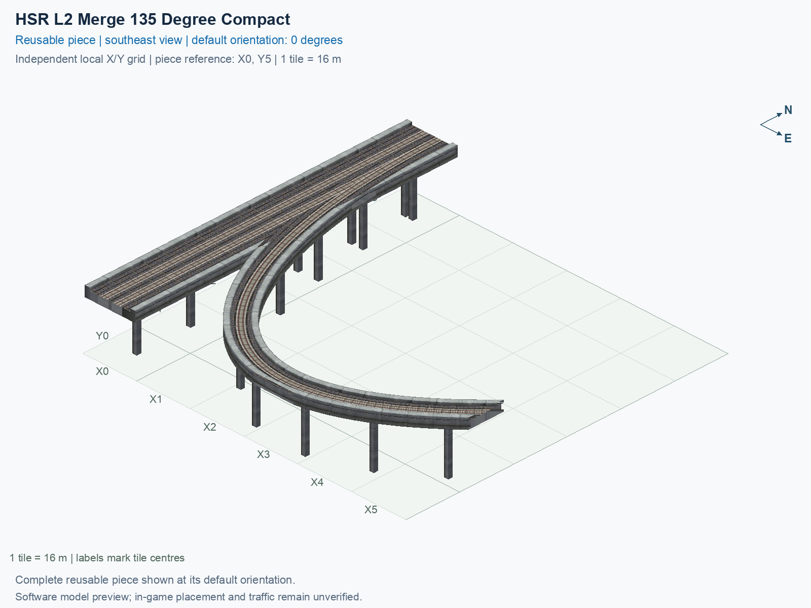

<a id="hsr-l2-merge-135-degree-compact"></a>

# HSR Level 2 (15.5 m) — Merge 135° Right to Two-Track Mainline — Compact

<!-- SUBJECT IDENTITY MIGRATION -->

Identity migration: `interchange-hsr-merge-135-compact` → `hsr-l2-two-track-mainline-merge-135deg-right-compact`. Earlier measurements, observations, and pictures retain their recorded names and fingerprints; they do not establish verification of the renamed build. See the [identity migration rules](../../../../docs/NAMING_CONVENTIONS.md#10-choosing-and-changing-names).

Purpose: explain this reusable piece, its matching connections and current test coverage.

<!-- BEGIN PIECE OVERVIEW -->

HSR Level 2 (15.5 m) — Merge 135° Right to Two-Track Mainline — Compact. Fixed click-to-place piece in a 6 by 6 tile area. Follow the arrows and join only matching track widths, directions, and height labels. Four proper rotations; the second four states repeat them. Experimental; game testing pending. The mainline retains both directions; only the branch is one-way.

Exact reusable identifier: `hsr-l2-two-track-mainline-merge-135deg-right-compact`.

Footprint: **6 × 6 tiles**. Exact menu name: **HSR Level 2 (15.5 m) — Merge 135° Right to Two-Track Mainline — Compact**.

Choose this exact name in Transportation → Rail. Press Home or End to rotate; use only the supported states listed below. Join each end to a matching port profile and direction.

- [Connections and journeys](#connections-and-journeys)
- [Test checklist](#test-checklist)

### Design review

**REVIEW NEEDED** — Closely spaced pillars need a support-consolidation review.

- Separate 1.3 m-square pillar foundations have centres less than 2.6 m apart near shared rail geometry. The foundations do not overlap, but the close pair should be reviewed and consolidated to address the reported duplicate-pillar appearance. The 2.6 m review cutoff is an authoring convention, not a structural or game collision threshold.

[Design-review evidence](../../junction-design-review.jsonc).



<!-- END PIECE OVERVIEW -->

<!-- BEGIN MANUAL SUMMARY -->

## Manual status

Generated from [the exact test cases](#test-checklist) and [authoritative observations](checks/manual-tests.json).

- [ ] Preview review: 0/1 applicable cases passed; 0 failed, 0 stale.
- [ ] In-game rendering: 0/4 applicable cases passed; 0 failed, 0 stale.
- [ ] Directed journeys: 0/12 applicable cases passed; 0 failed, 0 stale.

These observations cover only the named services, directions, poses, rotations, and recorded platforms.

<!-- END MANUAL SUMMARY -->

<!-- BEGIN CONNECTIONS -->

## Connections and journeys

Purpose: describe intrinsic directional interfaces and permitted service journeys.

Generated from [connections.json](connections.json). Coordinates are canonical east, north, and height in metres. A connection class names an encoded route interface; it does not prove visible deck/wall fit or an in-game test.

Supported placement states: 0° CCW, 90° CCW, 180° CCW, 270° CCW. Each state has its own declared manual scope.

A **port** is one directional transport-path endpoint. **Service** identifies the intended network service (for example HSR, street, or tram); **engine** is its internal traffic-class number, separate from the construction network. **Role** distinguishes primary service from auxiliary paths; sharing a traffic class does not establish service compatibility.

A **tangent** is a unit travel-direction vector: `[0,1]` means north. **Grade** is height gained per horizontal metre. These measured facts describe this subject alone. Compatibility requires a separate comparison of the complete joining boundaries; physical seams and actual game operation require their own evidence. See the [class index](../../connection-classes.jsonc) for shared route-interface membership.

| Port | Service / engine / role | Direction | Location; tangent; grade | Connection class |
| --- | --- | --- | --- | --- |
| `Sout` | hsr / 7 / primary | out | [-2.0, -88.0, 15.5]; [0.0, -1.0]; 0.0 | `path-interface-12d12be31d2057c5763d` |
| `Nin` | hsr / 7 / primary | in | [-2.0, 8.0, 15.5]; [0.0, -1.0]; 0.0 | `path-interface-12d12be31d2057c5763d` |
| `Sin` | hsr / 7 / primary | in | [2.0, -88.0, 15.5]; [0.0, 1.0]; 0.0 | `path-interface-fba09fbeb87ad95c667a` |
| `Nout` | hsr / 7 / primary | out | [2.0, 8.0, 15.5]; [0.0, 1.0]; 0.0 | `path-interface-fba09fbeb87ad95c667a` |
| `Bin` | hsr / 7 / primary | in | [88.0, -64.0, 15.5]; [-0.7071067811865475, -0.7071067811865475]; 0.0 | `path-interface-e765ac771bb89f95414d` |

### Directed journeys

| Service | Entry → exit | Role |
| --- | --- | --- |
| hsr | `Nin` → `Sout` | primary |
| hsr | `Sin` → `Nout` | primary |
| hsr | `Bin` → `Nout` | primary |

### Forbidden transfers

| From service / port | To service / port | Reason |
| --- | --- | --- |
| hsr / `Nin` | hsr / `Nout` | No directed route exists between these ports in the saved piece transport paths. In-game confirmation remains unverified. |
| hsr / `Sin` | hsr / `Sout` | No directed route exists between these ports in the saved piece transport paths. In-game confirmation remains unverified. |
| hsr / `Bin` | hsr / `Sout` | No directed route exists between these ports in the saved piece transport paths. In-game confirmation remains unverified. |

Review the test checklist for the exact tested cases and environments.

<!-- END CONNECTIONS -->

<!-- BEGIN MANUAL CHECKS -->

## Test checklist

Generated from [the authoritative record](checks/manual-tests.json). Only explicit human observations create manual passes; software and preview checks remain separate. Expand a check/service group to see its rotation table, then expand the matching exact scope to copy a case ID and inspect its pose, reviewer, environment, and evidence. Grouping changes only this view; every declared case remains separate.

**States:** [x] passed; [ ] unverified, failed, or stale; N/A is an explicit inapplicable declaration. A dash means no case was declared in that column. Every pass covers only its recorded environment. T means a distinct construction-transposed state.

Four proper rotations are covered. No additional reflected state is established by this record; repeated construction aliases do not create new orientations.

Current totals: unverified: 43, passed: 0, failed: 0, stale: 0, not_applicable: 0.

### Record an observation

Follow the [shared testing guide](../../../../docs/TESTING.md); copy [the unconfirmed example](checks/observation.example.json) to `checks/observation.json`. Case identifiers are in the expandable sections below. Do not edit generated checkboxes.

From the repository folder containing `custom-pieces`, run after filling `checks/observation.json` and explicitly confirming the exact observation:

```sh
python3 -m scp.content record --record custom-pieces/domains/high-speed-rail/00_pieces/hsr-l2-two-track-mainline-merge-135deg-right-compact/checks/manual-tests.json --observation custom-pieces/domains/high-speed-rail/00_pieces/hsr-l2-two-track-mainline-merge-135deg-right-compact/checks/observation.json
```

### Detailed current checks

Each collapsed group shows exact case counts and states. Forbidden transfers are grouped by the directed service pair; the table inside retains every port pair and rotation.

<details>
<summary>Compiled resources — Whole subject — 1 case; unverified: 1</summary>

| Check / exact scope | General | 0° | 90° | 180° | 270° |
| --- | --- | --- | --- | --- | --- |
| **Compiled resources**<br>Whole subject | <a href="#case-software_resources-41eaa522d527cf96cb3d">[ ] unverified</a> | — | — | — | — |


<details>
<summary>Compiled resources — Whole subject</summary>

<a id="case-software_resources-41eaa522d527cf96cb3d"></a>

**General: unverified** — `software_resources-41eaa522d527cf96cb3d`.

Verify the actual compiled resources and construction rules.

Scope: Whole subject.

No observation recorded.

</details>

</details>

<details>
<summary>Directed routing graph — Whole subject — 1 case; unverified: 1</summary>

| Check / exact scope | General | 0° | 90° | 180° | 270° |
| --- | --- | --- | --- | --- | --- |
| **Directed routing graph**<br>Whole subject | <a href="#case-software_connectivity-41eaa522d527cf96cb3d">[ ] unverified</a> | — | — | — | — |


<details>
<summary>Directed routing graph — Whole subject</summary>

<a id="case-software_connectivity-41eaa522d527cf96cb3d"></a>

**General: unverified** — `software_connectivity-41eaa522d527cf96cb3d`.

Verify the declared directed journeys and forbidden transfers.

Scope: Whole subject.

No observation recorded.

</details>

</details>

<details>
<summary>Preview review — Images — 1 case; unverified: 1</summary>

| Check / exact scope | General | 0° | 90° | 180° | 270° |
| --- | --- | --- | --- | --- | --- |
| **Preview review**<br>Image: image:interchange-hsr-merge-135-compact:canonical-southeast | <a href="#case-preview_review-7d557ab428b6acec84c0">[ ] unverified</a> | — | — | — | — |


<details>
<summary>Preview review — Image: image:interchange-hsr-merge-135-compact:canonical-southeast</summary>

<a id="case-preview_review-7d557ab428b6acec84c0"></a>

**General: unverified** — `preview_review-7d557ab428b6acec84c0`.

Inspect this exact preview for tracks, walls, piers, seams and shadows.

Scope: Image: image:interchange-hsr-merge-135-compact:canonical-southeast.

No observation recorded.

</details>

</details>

<details>
<summary>In-game rendering — Whole subject — 4 cases; unverified: 4</summary>

| Check / exact scope | General | 0° | 90° | 180° | 270° |
| --- | --- | --- | --- | --- | --- |
| **In-game rendering**<br>Whole subject | — | <a href="#case-in_game_render-3d67d16717b25d81546a">[ ] unverified</a> | <a href="#case-in_game_render-435e735dcc976d69f899">[ ] unverified</a> | <a href="#case-in_game_render-f5483a5987001dfb9010">[ ] unverified</a> | <a href="#case-in_game_render-c5aa25e927df81b386a2">[ ] unverified</a> |


<details>
<summary>In-game rendering — Whole subject</summary>

<a id="case-in_game_render-3d67d16717b25d81546a"></a>

**0° CCW: unverified** — `in_game_render-3d67d16717b25d81546a`.

Inspect the placed tracks, walls, piers, seams and shadows in SimCity 4.

Scope: Whole subject.

No observation recorded.

<a id="case-in_game_render-435e735dcc976d69f899"></a>

**90° CCW: unverified** — `in_game_render-435e735dcc976d69f899`.

Inspect the placed tracks, walls, piers, seams and shadows in SimCity 4.

Scope: Whole subject.

No observation recorded.

<a id="case-in_game_render-f5483a5987001dfb9010"></a>

**180° CCW: unverified** — `in_game_render-f5483a5987001dfb9010`.

Inspect the placed tracks, walls, piers, seams and shadows in SimCity 4.

Scope: Whole subject.

No observation recorded.

<a id="case-in_game_render-c5aa25e927df81b386a2"></a>

**270° CCW: unverified** — `in_game_render-c5aa25e927df81b386a2`.

Inspect the placed tracks, walls, piers, seams and shadows in SimCity 4.

Scope: Whole subject.

No observation recorded.

</details>

</details>

<details>
<summary>Placement — Whole subject — 4 cases; unverified: 4</summary>

| Check / exact scope | General | 0° | 90° | 180° | 270° |
| --- | --- | --- | --- | --- | --- |
| **Placement**<br>Whole subject | — | <a href="#case-in_game_placement-3d67d16717b25d81546a">[ ] unverified</a> | <a href="#case-in_game_placement-435e735dcc976d69f899">[ ] unverified</a> | <a href="#case-in_game_placement-f5483a5987001dfb9010">[ ] unverified</a> | <a href="#case-in_game_placement-c5aa25e927df81b386a2">[ ] unverified</a> |


<details>
<summary>Placement — Whole subject</summary>

<a id="case-in_game_placement-3d67d16717b25d81546a"></a>

**0° CCW: unverified** — `in_game_placement-3d67d16717b25d81546a`.

Place this piece or complete blueprint and inspect every occupied tile.

Scope: Whole subject.

No observation recorded.

<a id="case-in_game_placement-435e735dcc976d69f899"></a>

**90° CCW: unverified** — `in_game_placement-435e735dcc976d69f899`.

Place this piece or complete blueprint and inspect every occupied tile.

Scope: Whole subject.

No observation recorded.

<a id="case-in_game_placement-f5483a5987001dfb9010"></a>

**180° CCW: unverified** — `in_game_placement-f5483a5987001dfb9010`.

Place this piece or complete blueprint and inspect every occupied tile.

Scope: Whole subject.

No observation recorded.

<a id="case-in_game_placement-c5aa25e927df81b386a2"></a>

**270° CCW: unverified** — `in_game_placement-c5aa25e927df81b386a2`.

Place this piece or complete blueprint and inspect every occupied tile.

Scope: Whole subject.

No observation recorded.

</details>

</details>

<details>
<summary>Demolition — Whole subject — 4 cases; unverified: 4</summary>

| Check / exact scope | General | 0° | 90° | 180° | 270° |
| --- | --- | --- | --- | --- | --- |
| **Demolition**<br>Whole subject | — | <a href="#case-in_game_demolition-3d67d16717b25d81546a">[ ] unverified</a> | <a href="#case-in_game_demolition-435e735dcc976d69f899">[ ] unverified</a> | <a href="#case-in_game_demolition-f5483a5987001dfb9010">[ ] unverified</a> | <a href="#case-in_game_demolition-c5aa25e927df81b386a2">[ ] unverified</a> |


<details>
<summary>Demolition — Whole subject</summary>

<a id="case-in_game_demolition-3d67d16717b25d81546a"></a>

**0° CCW: unverified** — `in_game_demolition-3d67d16717b25d81546a`.

Bulldoze the complete placement and inspect the cleared area.

Scope: Whole subject.

No observation recorded.

<a id="case-in_game_demolition-435e735dcc976d69f899"></a>

**90° CCW: unverified** — `in_game_demolition-435e735dcc976d69f899`.

Bulldoze the complete placement and inspect the cleared area.

Scope: Whole subject.

No observation recorded.

<a id="case-in_game_demolition-f5483a5987001dfb9010"></a>

**180° CCW: unverified** — `in_game_demolition-f5483a5987001dfb9010`.

Bulldoze the complete placement and inspect the cleared area.

Scope: Whole subject.

No observation recorded.

<a id="case-in_game_demolition-c5aa25e927df81b386a2"></a>

**270° CCW: unverified** — `in_game_demolition-c5aa25e927df81b386a2`.

Bulldoze the complete placement and inspect the cleared area.

Scope: Whole subject.

No observation recorded.

</details>

</details>

<details>
<summary>Save and reload — Whole subject — 4 cases; unverified: 4</summary>

| Check / exact scope | General | 0° | 90° | 180° | 270° |
| --- | --- | --- | --- | --- | --- |
| **Save and reload**<br>Whole subject | — | <a href="#case-in_game_save_reload-3d67d16717b25d81546a">[ ] unverified</a> | <a href="#case-in_game_save_reload-435e735dcc976d69f899">[ ] unverified</a> | <a href="#case-in_game_save_reload-f5483a5987001dfb9010">[ ] unverified</a> | <a href="#case-in_game_save_reload-c5aa25e927df81b386a2">[ ] unverified</a> |


<details>
<summary>Save and reload — Whole subject</summary>

<a id="case-in_game_save_reload-3d67d16717b25d81546a"></a>

**0° CCW: unverified** — `in_game_save_reload-3d67d16717b25d81546a`.

Save, quit, reload and inspect the placement and its paths.

Scope: Whole subject.

No observation recorded.

<a id="case-in_game_save_reload-435e735dcc976d69f899"></a>

**90° CCW: unverified** — `in_game_save_reload-435e735dcc976d69f899`.

Save, quit, reload and inspect the placement and its paths.

Scope: Whole subject.

No observation recorded.

<a id="case-in_game_save_reload-f5483a5987001dfb9010"></a>

**180° CCW: unverified** — `in_game_save_reload-f5483a5987001dfb9010`.

Save, quit, reload and inspect the placement and its paths.

Scope: Whole subject.

No observation recorded.

<a id="case-in_game_save_reload-c5aa25e927df81b386a2"></a>

**270° CCW: unverified** — `in_game_save_reload-c5aa25e927df81b386a2`.

Save, quit, reload and inspect the placement and its paths.

Scope: Whole subject.

No observation recorded.

</details>

</details>

<details>
<summary>Journey — hsr — 12 cases; unverified: 12</summary>

| Check / exact scope | General | 0° | 90° | 180° | 270° |
| --- | --- | --- | --- | --- | --- |
| **Journey**<br>Service: hsr; role: primary; journey: 7:Nin>Sout; entry: Nin; exit: Sout | — | <a href="#case-in_game_journey-d031cd47d64191c24084">[ ] unverified</a> | <a href="#case-in_game_journey-3ed55f6ab9979fe92f7c">[ ] unverified</a> | <a href="#case-in_game_journey-ad8c8a1cc99c174a03f0">[ ] unverified</a> | <a href="#case-in_game_journey-6469c2b198293fcbbc8f">[ ] unverified</a> |
| **Journey**<br>Service: hsr; role: primary; journey: 7:Sin>Nout; entry: Sin; exit: Nout | — | <a href="#case-in_game_journey-55c58f6a6d8dad8fc83c">[ ] unverified</a> | <a href="#case-in_game_journey-110d208f2747ef88278d">[ ] unverified</a> | <a href="#case-in_game_journey-ecd0fed8973f44110ec7">[ ] unverified</a> | <a href="#case-in_game_journey-4cf5894bd0943ca0bd10">[ ] unverified</a> |
| **Journey**<br>Service: hsr; role: primary; journey: 7:Bin>Nout; entry: Bin; exit: Nout | — | <a href="#case-in_game_journey-e50ee6e6516de829446e">[ ] unverified</a> | <a href="#case-in_game_journey-de7039a77eb87395948e">[ ] unverified</a> | <a href="#case-in_game_journey-2210bcd0a8a5fc6d442c">[ ] unverified</a> | <a href="#case-in_game_journey-6be1f6167d823cdc15bc">[ ] unverified</a> |


<details>
<summary>Journey — Service: hsr; role: primary; journey: 7:Nin>Sout; entry: Nin; exit: Sout</summary>

<a id="case-in_game_journey-d031cd47d64191c24084"></a>

**0° CCW: unverified** — `in_game_journey-d031cd47d64191c24084`.

Run the declared journey in this direction using its service network.

Scope: Service: hsr; role: primary; journey: 7:Nin>Sout; entry: Nin; exit: Sout.

No observation recorded.

<a id="case-in_game_journey-3ed55f6ab9979fe92f7c"></a>

**90° CCW: unverified** — `in_game_journey-3ed55f6ab9979fe92f7c`.

Run the declared journey in this direction using its service network.

Scope: Service: hsr; role: primary; journey: 7:Nin>Sout; entry: Nin; exit: Sout.

No observation recorded.

<a id="case-in_game_journey-ad8c8a1cc99c174a03f0"></a>

**180° CCW: unverified** — `in_game_journey-ad8c8a1cc99c174a03f0`.

Run the declared journey in this direction using its service network.

Scope: Service: hsr; role: primary; journey: 7:Nin>Sout; entry: Nin; exit: Sout.

No observation recorded.

<a id="case-in_game_journey-6469c2b198293fcbbc8f"></a>

**270° CCW: unverified** — `in_game_journey-6469c2b198293fcbbc8f`.

Run the declared journey in this direction using its service network.

Scope: Service: hsr; role: primary; journey: 7:Nin>Sout; entry: Nin; exit: Sout.

No observation recorded.

</details>


<details>
<summary>Journey — Service: hsr; role: primary; journey: 7:Sin>Nout; entry: Sin; exit: Nout</summary>

<a id="case-in_game_journey-55c58f6a6d8dad8fc83c"></a>

**0° CCW: unverified** — `in_game_journey-55c58f6a6d8dad8fc83c`.

Run the declared journey in this direction using its service network.

Scope: Service: hsr; role: primary; journey: 7:Sin>Nout; entry: Sin; exit: Nout.

No observation recorded.

<a id="case-in_game_journey-110d208f2747ef88278d"></a>

**90° CCW: unverified** — `in_game_journey-110d208f2747ef88278d`.

Run the declared journey in this direction using its service network.

Scope: Service: hsr; role: primary; journey: 7:Sin>Nout; entry: Sin; exit: Nout.

No observation recorded.

<a id="case-in_game_journey-ecd0fed8973f44110ec7"></a>

**180° CCW: unverified** — `in_game_journey-ecd0fed8973f44110ec7`.

Run the declared journey in this direction using its service network.

Scope: Service: hsr; role: primary; journey: 7:Sin>Nout; entry: Sin; exit: Nout.

No observation recorded.

<a id="case-in_game_journey-4cf5894bd0943ca0bd10"></a>

**270° CCW: unverified** — `in_game_journey-4cf5894bd0943ca0bd10`.

Run the declared journey in this direction using its service network.

Scope: Service: hsr; role: primary; journey: 7:Sin>Nout; entry: Sin; exit: Nout.

No observation recorded.

</details>


<details>
<summary>Journey — Service: hsr; role: primary; journey: 7:Bin>Nout; entry: Bin; exit: Nout</summary>

<a id="case-in_game_journey-e50ee6e6516de829446e"></a>

**0° CCW: unverified** — `in_game_journey-e50ee6e6516de829446e`.

Run the declared journey in this direction using its service network.

Scope: Service: hsr; role: primary; journey: 7:Bin>Nout; entry: Bin; exit: Nout.

No observation recorded.

<a id="case-in_game_journey-de7039a77eb87395948e"></a>

**90° CCW: unverified** — `in_game_journey-de7039a77eb87395948e`.

Run the declared journey in this direction using its service network.

Scope: Service: hsr; role: primary; journey: 7:Bin>Nout; entry: Bin; exit: Nout.

No observation recorded.

<a id="case-in_game_journey-2210bcd0a8a5fc6d442c"></a>

**180° CCW: unverified** — `in_game_journey-2210bcd0a8a5fc6d442c`.

Run the declared journey in this direction using its service network.

Scope: Service: hsr; role: primary; journey: 7:Bin>Nout; entry: Bin; exit: Nout.

No observation recorded.

<a id="case-in_game_journey-6be1f6167d823cdc15bc"></a>

**270° CCW: unverified** — `in_game_journey-6be1f6167d823cdc15bc`.

Run the declared journey in this direction using its service network.

Scope: Service: hsr; role: primary; journey: 7:Bin>Nout; entry: Bin; exit: Nout.

No observation recorded.

</details>

</details>

<details>
<summary>Forbidden transfer — hsr → hsr — 12 cases; unverified: 12</summary>

| Check / exact scope | General | 0° | 90° | 180° | 270° |
| --- | --- | --- | --- | --- | --- |
| **Forbidden transfer**<br>from port: Nin; to port: Nout; from service: hsr; to service: hsr; basis: not reachable in actual saved PATH graph | — | <a href="#case-in_game_forbidden_transfer-10b7ffab2e33d7d7dd04">[ ] unverified</a> | <a href="#case-in_game_forbidden_transfer-3b2c96768f4bea9de202">[ ] unverified</a> | <a href="#case-in_game_forbidden_transfer-5de51aa375315631a644">[ ] unverified</a> | <a href="#case-in_game_forbidden_transfer-848f46ab0d669f65f54f">[ ] unverified</a> |
| **Forbidden transfer**<br>from port: Sin; to port: Sout; from service: hsr; to service: hsr; basis: not reachable in actual saved PATH graph | — | <a href="#case-in_game_forbidden_transfer-3ec533f34e25c02ba4bb">[ ] unverified</a> | <a href="#case-in_game_forbidden_transfer-62887fc6f11b59879528">[ ] unverified</a> | <a href="#case-in_game_forbidden_transfer-058931ca3303aab8f85b">[ ] unverified</a> | <a href="#case-in_game_forbidden_transfer-71d3282b9c7ddea49bfc">[ ] unverified</a> |
| **Forbidden transfer**<br>from port: Bin; to port: Sout; from service: hsr; to service: hsr; basis: not reachable in actual saved PATH graph | — | <a href="#case-in_game_forbidden_transfer-f0f0a5a8662aaeb62f36">[ ] unverified</a> | <a href="#case-in_game_forbidden_transfer-998e2ddd49416437c83d">[ ] unverified</a> | <a href="#case-in_game_forbidden_transfer-17ad16724775d9e8eead">[ ] unverified</a> | <a href="#case-in_game_forbidden_transfer-c7b9a69555b2ff5ce4b1">[ ] unverified</a> |


<details>
<summary>Forbidden transfer — from port: Nin; to port: Nout; from service: hsr; to service: hsr; basis: not reachable in actual saved PATH graph</summary>

<a id="case-in_game_forbidden_transfer-10b7ffab2e33d7d7dd04"></a>

**0° CCW: unverified** — `in_game_forbidden_transfer-10b7ffab2e33d7d7dd04`.

Confirm this undeclared transfer is unavailable.

Scope: from port: Nin; to port: Nout; from service: hsr; to service: hsr; basis: not reachable in actual saved PATH graph.

No observation recorded.

<a id="case-in_game_forbidden_transfer-3b2c96768f4bea9de202"></a>

**90° CCW: unverified** — `in_game_forbidden_transfer-3b2c96768f4bea9de202`.

Confirm this undeclared transfer is unavailable.

Scope: from port: Nin; to port: Nout; from service: hsr; to service: hsr; basis: not reachable in actual saved PATH graph.

No observation recorded.

<a id="case-in_game_forbidden_transfer-5de51aa375315631a644"></a>

**180° CCW: unverified** — `in_game_forbidden_transfer-5de51aa375315631a644`.

Confirm this undeclared transfer is unavailable.

Scope: from port: Nin; to port: Nout; from service: hsr; to service: hsr; basis: not reachable in actual saved PATH graph.

No observation recorded.

<a id="case-in_game_forbidden_transfer-848f46ab0d669f65f54f"></a>

**270° CCW: unverified** — `in_game_forbidden_transfer-848f46ab0d669f65f54f`.

Confirm this undeclared transfer is unavailable.

Scope: from port: Nin; to port: Nout; from service: hsr; to service: hsr; basis: not reachable in actual saved PATH graph.

No observation recorded.

</details>


<details>
<summary>Forbidden transfer — from port: Sin; to port: Sout; from service: hsr; to service: hsr; basis: not reachable in actual saved PATH graph</summary>

<a id="case-in_game_forbidden_transfer-3ec533f34e25c02ba4bb"></a>

**0° CCW: unverified** — `in_game_forbidden_transfer-3ec533f34e25c02ba4bb`.

Confirm this undeclared transfer is unavailable.

Scope: from port: Sin; to port: Sout; from service: hsr; to service: hsr; basis: not reachable in actual saved PATH graph.

No observation recorded.

<a id="case-in_game_forbidden_transfer-62887fc6f11b59879528"></a>

**90° CCW: unverified** — `in_game_forbidden_transfer-62887fc6f11b59879528`.

Confirm this undeclared transfer is unavailable.

Scope: from port: Sin; to port: Sout; from service: hsr; to service: hsr; basis: not reachable in actual saved PATH graph.

No observation recorded.

<a id="case-in_game_forbidden_transfer-058931ca3303aab8f85b"></a>

**180° CCW: unverified** — `in_game_forbidden_transfer-058931ca3303aab8f85b`.

Confirm this undeclared transfer is unavailable.

Scope: from port: Sin; to port: Sout; from service: hsr; to service: hsr; basis: not reachable in actual saved PATH graph.

No observation recorded.

<a id="case-in_game_forbidden_transfer-71d3282b9c7ddea49bfc"></a>

**270° CCW: unverified** — `in_game_forbidden_transfer-71d3282b9c7ddea49bfc`.

Confirm this undeclared transfer is unavailable.

Scope: from port: Sin; to port: Sout; from service: hsr; to service: hsr; basis: not reachable in actual saved PATH graph.

No observation recorded.

</details>


<details>
<summary>Forbidden transfer — from port: Bin; to port: Sout; from service: hsr; to service: hsr; basis: not reachable in actual saved PATH graph</summary>

<a id="case-in_game_forbidden_transfer-f0f0a5a8662aaeb62f36"></a>

**0° CCW: unverified** — `in_game_forbidden_transfer-f0f0a5a8662aaeb62f36`.

Confirm this undeclared transfer is unavailable.

Scope: from port: Bin; to port: Sout; from service: hsr; to service: hsr; basis: not reachable in actual saved PATH graph.

No observation recorded.

<a id="case-in_game_forbidden_transfer-998e2ddd49416437c83d"></a>

**90° CCW: unverified** — `in_game_forbidden_transfer-998e2ddd49416437c83d`.

Confirm this undeclared transfer is unavailable.

Scope: from port: Bin; to port: Sout; from service: hsr; to service: hsr; basis: not reachable in actual saved PATH graph.

No observation recorded.

<a id="case-in_game_forbidden_transfer-17ad16724775d9e8eead"></a>

**180° CCW: unverified** — `in_game_forbidden_transfer-17ad16724775d9e8eead`.

Confirm this undeclared transfer is unavailable.

Scope: from port: Bin; to port: Sout; from service: hsr; to service: hsr; basis: not reachable in actual saved PATH graph.

No observation recorded.

<a id="case-in_game_forbidden_transfer-c7b9a69555b2ff5ce4b1"></a>

**270° CCW: unverified** — `in_game_forbidden_transfer-c7b9a69555b2ff5ce4b1`.

Confirm this undeclared transfer is unavailable.

Scope: from port: Bin; to port: Sout; from service: hsr; to service: hsr; basis: not reachable in actual saved PATH graph.

No observation recorded.

</details>

</details>

<!-- END MANUAL CHECKS -->
