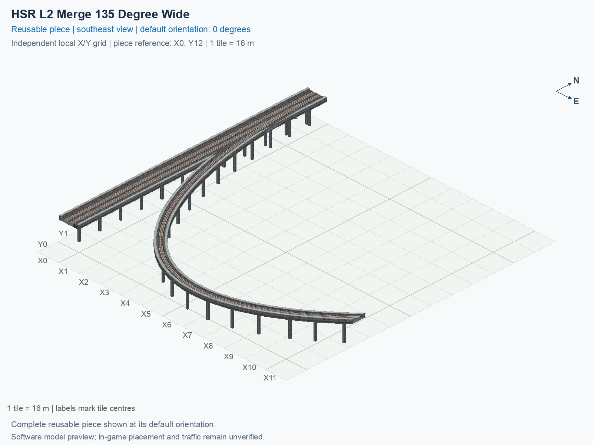

<a id="hsr-l2-merge-135-degree-wide"></a>

# HSR Level 2 (15.5 m) — Merge 135° Right to Two-Track Mainline — Wide

<!-- SUBJECT IDENTITY MIGRATION -->

Identity migration: `interchange-hsr-merge-135-wide` → `hsr-l2-two-track-mainline-merge-135deg-right-wide`. Earlier measurements, observations, and pictures retain their recorded names and fingerprints; they do not establish verification of the renamed build. See the [identity migration rules](../../../../docs/NAMING_CONVENTIONS.md#10-choosing-and-changing-names).

Purpose: explain this reusable piece, its matching connections and current test coverage.

<!-- BEGIN PIECE OVERVIEW -->

HSR Level 2 (15.5 m) — Merge 135° Right to Two-Track Mainline — Wide. Fixed click-to-place piece in a 12 by 13 tile area. Follow the arrows and join only matching track widths, directions, and height labels. Four proper rotations; the second four states repeat them. Experimental; game testing pending. The mainline retains both directions; only the branch is one-way.

Exact reusable identifier: `hsr-l2-two-track-mainline-merge-135deg-right-wide`.

Footprint: **12 × 13 tiles**. Exact menu name: **HSR Level 2 (15.5 m) — Merge 135° Right to Two-Track Mainline — Wide**.

Choose this exact name in Transportation → Rail. Press Home or End to rotate; use only the supported states listed below. Join each end to a matching port profile and direction.

- [Connections and journeys](#connections-and-journeys)
- [Test checklist](#test-checklist)

### Design review

**REVIEW NEEDED** — Closely spaced pillars need a support-consolidation review.

- Separate 1.3 m-square pillar foundations have centres less than 2.6 m apart near shared rail geometry. The foundations do not overlap, but the close pair should be reviewed and consolidated to address the reported duplicate-pillar appearance. The 2.6 m review cutoff is an authoring convention, not a structural or game collision threshold.

[Design-review evidence](../../junction-design-review.json).



<!-- END PIECE OVERVIEW -->

<!-- BEGIN MANUAL SUMMARY -->

## Manual status

Generated from [the exact test cases](#test-checklist) and [authoritative observations](checks/manual-tests.json).

- [ ] Preview review: 0/1 applicable cases passed; 0 failed, 0 stale.
- [ ] In-game rendering: 0/4 applicable cases passed; 0 failed, 0 stale.
- [ ] Directed journeys: 0/12 applicable cases passed; 0 failed, 0 stale.

These observations cover only the named services, directions, poses, rotations, and recorded platforms.

<!-- END MANUAL SUMMARY -->

<!-- BEGIN CONNECTIONS -->

## Connections and journeys

Purpose: describe intrinsic directional interfaces and permitted service journeys.

Generated from [connections.json](connections.json). Coordinates are canonical east, north, and height in metres. A connection class names an encoded route interface; it does not prove visible deck/wall fit or an in-game test.

Supported placement states: 0° CCW, 90° CCW, 180° CCW, 270° CCW. Each state has its own declared manual scope.

A **port** is one directional transport-path endpoint. **Service** identifies the intended network service (for example HSR, street, or tram); **engine** is its internal traffic-class number, separate from the construction network. **Role** distinguishes primary service from auxiliary paths; sharing a traffic class does not establish service compatibility.

A **tangent** is a unit travel-direction vector: `[0,1]` means north. **Grade** is height gained per horizontal metre. These measured facts describe this subject alone. Compatibility requires a separate comparison of the complete joining boundaries; physical seams and actual game operation require their own evidence. See the [class index](../../connection-classes.jsonc) for shared route-interface membership.

| Port | Service / engine / role | Direction | Location; tangent; grade | Connection class |
| --- | --- | --- | --- | --- |
| `Sout` | hsr / 7 / primary | out | [-2.0, -184.0, 15.5]; [0.0, -1.0]; 0.0 | `path-interface-12d12be31d2057c5763d` |
| `Nin` | hsr / 7 / primary | in | [-2.0, 8.0, 15.5]; [0.0, -1.0]; 0.0 | `path-interface-12d12be31d2057c5763d` |
| `Sin` | hsr / 7 / primary | in | [2.0, -184.0, 15.5]; [0.0, 1.0]; 0.0 | `path-interface-fba09fbeb87ad95c667a` |
| `Nout` | hsr / 7 / primary | out | [2.0, 8.0, 15.5]; [0.0, 1.0]; 0.0 | `path-interface-fba09fbeb87ad95c667a` |
| `Bin` | hsr / 7 / primary | in | [184.0, -144.0, 15.5]; [-0.7071067811865475, -0.7071067811865475]; 0.0 | `path-interface-e765ac771bb89f95414d` |

### Directed journeys

| Service | Entry → exit | Role |
| --- | --- | --- |
| hsr | `Nin` → `Sout` | primary |
| hsr | `Sin` → `Nout` | primary |
| hsr | `Bin` → `Nout` | primary |

### Forbidden transfers

| From service / port | To service / port | Reason |
| --- | --- | --- |
| hsr / `Nin` | hsr / `Nout` | No directed route exists between these ports in the saved piece transport paths. In-game confirmation remains unverified. |
| hsr / `Sin` | hsr / `Sout` | No directed route exists between these ports in the saved piece transport paths. In-game confirmation remains unverified. |
| hsr / `Bin` | hsr / `Sout` | No directed route exists between these ports in the saved piece transport paths. In-game confirmation remains unverified. |

Review the test checklist for the exact tested cases and environments.

<!-- END CONNECTIONS -->

<!-- BEGIN MANUAL CHECKS -->

## Test checklist

Generated from [the authoritative record](checks/manual-tests.json). Only explicit human observations create manual passes; software and preview checks remain separate. Expand a check/service group to see its rotation table, then expand the matching exact scope to copy a case ID and inspect its pose, reviewer, environment, and evidence. Grouping changes only this view; every declared case remains separate.

**States:** [x] passed; [ ] unverified, failed, or stale; N/A is an explicit inapplicable declaration. A dash means no case was declared in that column. Every pass covers only its recorded environment. T means a distinct construction-transposed state.

Four proper rotations are covered. No additional reflected state is established by this record; repeated construction aliases do not create new orientations.

Current totals: unverified: 43, passed: 0, failed: 0, stale: 0, not_applicable: 0.

### Record an observation

Follow the [shared testing guide](../../../../docs/TESTING.md); copy [the unconfirmed example](checks/observation.example.json) to `checks/observation.json`. Case identifiers are in the expandable sections below. Do not edit generated checkboxes.

From the repository folder containing `custom-pieces`, run after filling `checks/observation.json` and explicitly confirming the exact observation:

```sh
python3 -m scp.content record --record custom-pieces/domains/high-speed-rail/00_pieces/hsr-l2-two-track-mainline-merge-135deg-right-wide/checks/manual-tests.json --observation custom-pieces/domains/high-speed-rail/00_pieces/hsr-l2-two-track-mainline-merge-135deg-right-wide/checks/observation.json
```

### Detailed current checks

Each collapsed group shows exact case counts and states. Forbidden transfers are grouped by the directed service pair; the table inside retains every port pair and rotation.

<details>
<summary>Compiled resources — Whole subject — 1 case; unverified: 1</summary>

| Check / exact scope | General | 0° | 90° | 180° | 270° |
| --- | --- | --- | --- | --- | --- |
| **Compiled resources**<br>Whole subject | <a href="#case-software_resources-c68099c44754b5eca2a0">[ ] unverified</a> | — | — | — | — |


<details>
<summary>Compiled resources — Whole subject</summary>

<a id="case-software_resources-c68099c44754b5eca2a0"></a>

**General: unverified** — `software_resources-c68099c44754b5eca2a0`.

Verify the actual compiled resources and construction rules.

Scope: Whole subject.

No observation recorded.

</details>

</details>

<details>
<summary>Directed routing graph — Whole subject — 1 case; unverified: 1</summary>

| Check / exact scope | General | 0° | 90° | 180° | 270° |
| --- | --- | --- | --- | --- | --- |
| **Directed routing graph**<br>Whole subject | <a href="#case-software_connectivity-c68099c44754b5eca2a0">[ ] unverified</a> | — | — | — | — |


<details>
<summary>Directed routing graph — Whole subject</summary>

<a id="case-software_connectivity-c68099c44754b5eca2a0"></a>

**General: unverified** — `software_connectivity-c68099c44754b5eca2a0`.

Verify the declared directed journeys and forbidden transfers.

Scope: Whole subject.

No observation recorded.

</details>

</details>

<details>
<summary>Preview review — Images — 1 case; unverified: 1</summary>

| Check / exact scope | General | 0° | 90° | 180° | 270° |
| --- | --- | --- | --- | --- | --- |
| **Preview review**<br>Image: image:interchange-hsr-merge-135-wide:canonical-southeast | <a href="#case-preview_review-85938b34ef72f507c958">[ ] unverified</a> | — | — | — | — |


<details>
<summary>Preview review — Image: image:interchange-hsr-merge-135-wide:canonical-southeast</summary>

<a id="case-preview_review-85938b34ef72f507c958"></a>

**General: unverified** — `preview_review-85938b34ef72f507c958`.

Inspect this exact preview for tracks, walls, piers, seams and shadows.

Scope: Image: image:interchange-hsr-merge-135-wide:canonical-southeast.

No observation recorded.

</details>

</details>

<details>
<summary>In-game rendering — Whole subject — 4 cases; unverified: 4</summary>

| Check / exact scope | General | 0° | 90° | 180° | 270° |
| --- | --- | --- | --- | --- | --- |
| **In-game rendering**<br>Whole subject | — | <a href="#case-in_game_render-47cd7b1583901904e3ed">[ ] unverified</a> | <a href="#case-in_game_render-fa1de5e76c50a0d9dd7b">[ ] unverified</a> | <a href="#case-in_game_render-ce09a42893f3318cfe70">[ ] unverified</a> | <a href="#case-in_game_render-ef6ac32ea2360b54e0c5">[ ] unverified</a> |


<details>
<summary>In-game rendering — Whole subject</summary>

<a id="case-in_game_render-47cd7b1583901904e3ed"></a>

**0° CCW: unverified** — `in_game_render-47cd7b1583901904e3ed`.

Inspect the placed tracks, walls, piers, seams and shadows in SimCity 4.

Scope: Whole subject.

No observation recorded.

<a id="case-in_game_render-fa1de5e76c50a0d9dd7b"></a>

**90° CCW: unverified** — `in_game_render-fa1de5e76c50a0d9dd7b`.

Inspect the placed tracks, walls, piers, seams and shadows in SimCity 4.

Scope: Whole subject.

No observation recorded.

<a id="case-in_game_render-ce09a42893f3318cfe70"></a>

**180° CCW: unverified** — `in_game_render-ce09a42893f3318cfe70`.

Inspect the placed tracks, walls, piers, seams and shadows in SimCity 4.

Scope: Whole subject.

No observation recorded.

<a id="case-in_game_render-ef6ac32ea2360b54e0c5"></a>

**270° CCW: unverified** — `in_game_render-ef6ac32ea2360b54e0c5`.

Inspect the placed tracks, walls, piers, seams and shadows in SimCity 4.

Scope: Whole subject.

No observation recorded.

</details>

</details>

<details>
<summary>Placement — Whole subject — 4 cases; unverified: 4</summary>

| Check / exact scope | General | 0° | 90° | 180° | 270° |
| --- | --- | --- | --- | --- | --- |
| **Placement**<br>Whole subject | — | <a href="#case-in_game_placement-47cd7b1583901904e3ed">[ ] unverified</a> | <a href="#case-in_game_placement-fa1de5e76c50a0d9dd7b">[ ] unverified</a> | <a href="#case-in_game_placement-ce09a42893f3318cfe70">[ ] unverified</a> | <a href="#case-in_game_placement-ef6ac32ea2360b54e0c5">[ ] unverified</a> |


<details>
<summary>Placement — Whole subject</summary>

<a id="case-in_game_placement-47cd7b1583901904e3ed"></a>

**0° CCW: unverified** — `in_game_placement-47cd7b1583901904e3ed`.

Place this piece or complete blueprint and inspect every occupied tile.

Scope: Whole subject.

No observation recorded.

<a id="case-in_game_placement-fa1de5e76c50a0d9dd7b"></a>

**90° CCW: unverified** — `in_game_placement-fa1de5e76c50a0d9dd7b`.

Place this piece or complete blueprint and inspect every occupied tile.

Scope: Whole subject.

No observation recorded.

<a id="case-in_game_placement-ce09a42893f3318cfe70"></a>

**180° CCW: unverified** — `in_game_placement-ce09a42893f3318cfe70`.

Place this piece or complete blueprint and inspect every occupied tile.

Scope: Whole subject.

No observation recorded.

<a id="case-in_game_placement-ef6ac32ea2360b54e0c5"></a>

**270° CCW: unverified** — `in_game_placement-ef6ac32ea2360b54e0c5`.

Place this piece or complete blueprint and inspect every occupied tile.

Scope: Whole subject.

No observation recorded.

</details>

</details>

<details>
<summary>Demolition — Whole subject — 4 cases; unverified: 4</summary>

| Check / exact scope | General | 0° | 90° | 180° | 270° |
| --- | --- | --- | --- | --- | --- |
| **Demolition**<br>Whole subject | — | <a href="#case-in_game_demolition-47cd7b1583901904e3ed">[ ] unverified</a> | <a href="#case-in_game_demolition-fa1de5e76c50a0d9dd7b">[ ] unverified</a> | <a href="#case-in_game_demolition-ce09a42893f3318cfe70">[ ] unverified</a> | <a href="#case-in_game_demolition-ef6ac32ea2360b54e0c5">[ ] unverified</a> |


<details>
<summary>Demolition — Whole subject</summary>

<a id="case-in_game_demolition-47cd7b1583901904e3ed"></a>

**0° CCW: unverified** — `in_game_demolition-47cd7b1583901904e3ed`.

Bulldoze the complete placement and inspect the cleared area.

Scope: Whole subject.

No observation recorded.

<a id="case-in_game_demolition-fa1de5e76c50a0d9dd7b"></a>

**90° CCW: unverified** — `in_game_demolition-fa1de5e76c50a0d9dd7b`.

Bulldoze the complete placement and inspect the cleared area.

Scope: Whole subject.

No observation recorded.

<a id="case-in_game_demolition-ce09a42893f3318cfe70"></a>

**180° CCW: unverified** — `in_game_demolition-ce09a42893f3318cfe70`.

Bulldoze the complete placement and inspect the cleared area.

Scope: Whole subject.

No observation recorded.

<a id="case-in_game_demolition-ef6ac32ea2360b54e0c5"></a>

**270° CCW: unverified** — `in_game_demolition-ef6ac32ea2360b54e0c5`.

Bulldoze the complete placement and inspect the cleared area.

Scope: Whole subject.

No observation recorded.

</details>

</details>

<details>
<summary>Save and reload — Whole subject — 4 cases; unverified: 4</summary>

| Check / exact scope | General | 0° | 90° | 180° | 270° |
| --- | --- | --- | --- | --- | --- |
| **Save and reload**<br>Whole subject | — | <a href="#case-in_game_save_reload-47cd7b1583901904e3ed">[ ] unverified</a> | <a href="#case-in_game_save_reload-fa1de5e76c50a0d9dd7b">[ ] unverified</a> | <a href="#case-in_game_save_reload-ce09a42893f3318cfe70">[ ] unverified</a> | <a href="#case-in_game_save_reload-ef6ac32ea2360b54e0c5">[ ] unverified</a> |


<details>
<summary>Save and reload — Whole subject</summary>

<a id="case-in_game_save_reload-47cd7b1583901904e3ed"></a>

**0° CCW: unverified** — `in_game_save_reload-47cd7b1583901904e3ed`.

Save, quit, reload and inspect the placement and its paths.

Scope: Whole subject.

No observation recorded.

<a id="case-in_game_save_reload-fa1de5e76c50a0d9dd7b"></a>

**90° CCW: unverified** — `in_game_save_reload-fa1de5e76c50a0d9dd7b`.

Save, quit, reload and inspect the placement and its paths.

Scope: Whole subject.

No observation recorded.

<a id="case-in_game_save_reload-ce09a42893f3318cfe70"></a>

**180° CCW: unverified** — `in_game_save_reload-ce09a42893f3318cfe70`.

Save, quit, reload and inspect the placement and its paths.

Scope: Whole subject.

No observation recorded.

<a id="case-in_game_save_reload-ef6ac32ea2360b54e0c5"></a>

**270° CCW: unverified** — `in_game_save_reload-ef6ac32ea2360b54e0c5`.

Save, quit, reload and inspect the placement and its paths.

Scope: Whole subject.

No observation recorded.

</details>

</details>

<details>
<summary>Journey — hsr — 12 cases; unverified: 12</summary>

| Check / exact scope | General | 0° | 90° | 180° | 270° |
| --- | --- | --- | --- | --- | --- |
| **Journey**<br>Service: hsr; role: primary; journey: 7:Nin>Sout; entry: Nin; exit: Sout | — | <a href="#case-in_game_journey-2d6a7bdb2822ab63eaca">[ ] unverified</a> | <a href="#case-in_game_journey-d8f0c8c1fab534cdfbb9">[ ] unverified</a> | <a href="#case-in_game_journey-52fe3dcac49635ed5d19">[ ] unverified</a> | <a href="#case-in_game_journey-cb852d62c700593d81a8">[ ] unverified</a> |
| **Journey**<br>Service: hsr; role: primary; journey: 7:Sin>Nout; entry: Sin; exit: Nout | — | <a href="#case-in_game_journey-ef2259156bc9dcfd9d34">[ ] unverified</a> | <a href="#case-in_game_journey-01685fa48f1a6260131c">[ ] unverified</a> | <a href="#case-in_game_journey-b70ef4040f48b97ce9a3">[ ] unverified</a> | <a href="#case-in_game_journey-85fc228396a56907efd6">[ ] unverified</a> |
| **Journey**<br>Service: hsr; role: primary; journey: 7:Bin>Nout; entry: Bin; exit: Nout | — | <a href="#case-in_game_journey-4070eb70ea0dcb2cdb11">[ ] unverified</a> | <a href="#case-in_game_journey-5a9e51ac153628fcb26d">[ ] unverified</a> | <a href="#case-in_game_journey-bc59899a2420fccdbbf2">[ ] unverified</a> | <a href="#case-in_game_journey-9ad1372987985cab104a">[ ] unverified</a> |


<details>
<summary>Journey — Service: hsr; role: primary; journey: 7:Nin>Sout; entry: Nin; exit: Sout</summary>

<a id="case-in_game_journey-2d6a7bdb2822ab63eaca"></a>

**0° CCW: unverified** — `in_game_journey-2d6a7bdb2822ab63eaca`.

Run the declared journey in this direction using its service network.

Scope: Service: hsr; role: primary; journey: 7:Nin>Sout; entry: Nin; exit: Sout.

No observation recorded.

<a id="case-in_game_journey-d8f0c8c1fab534cdfbb9"></a>

**90° CCW: unverified** — `in_game_journey-d8f0c8c1fab534cdfbb9`.

Run the declared journey in this direction using its service network.

Scope: Service: hsr; role: primary; journey: 7:Nin>Sout; entry: Nin; exit: Sout.

No observation recorded.

<a id="case-in_game_journey-52fe3dcac49635ed5d19"></a>

**180° CCW: unverified** — `in_game_journey-52fe3dcac49635ed5d19`.

Run the declared journey in this direction using its service network.

Scope: Service: hsr; role: primary; journey: 7:Nin>Sout; entry: Nin; exit: Sout.

No observation recorded.

<a id="case-in_game_journey-cb852d62c700593d81a8"></a>

**270° CCW: unverified** — `in_game_journey-cb852d62c700593d81a8`.

Run the declared journey in this direction using its service network.

Scope: Service: hsr; role: primary; journey: 7:Nin>Sout; entry: Nin; exit: Sout.

No observation recorded.

</details>


<details>
<summary>Journey — Service: hsr; role: primary; journey: 7:Sin>Nout; entry: Sin; exit: Nout</summary>

<a id="case-in_game_journey-ef2259156bc9dcfd9d34"></a>

**0° CCW: unverified** — `in_game_journey-ef2259156bc9dcfd9d34`.

Run the declared journey in this direction using its service network.

Scope: Service: hsr; role: primary; journey: 7:Sin>Nout; entry: Sin; exit: Nout.

No observation recorded.

<a id="case-in_game_journey-01685fa48f1a6260131c"></a>

**90° CCW: unverified** — `in_game_journey-01685fa48f1a6260131c`.

Run the declared journey in this direction using its service network.

Scope: Service: hsr; role: primary; journey: 7:Sin>Nout; entry: Sin; exit: Nout.

No observation recorded.

<a id="case-in_game_journey-b70ef4040f48b97ce9a3"></a>

**180° CCW: unverified** — `in_game_journey-b70ef4040f48b97ce9a3`.

Run the declared journey in this direction using its service network.

Scope: Service: hsr; role: primary; journey: 7:Sin>Nout; entry: Sin; exit: Nout.

No observation recorded.

<a id="case-in_game_journey-85fc228396a56907efd6"></a>

**270° CCW: unverified** — `in_game_journey-85fc228396a56907efd6`.

Run the declared journey in this direction using its service network.

Scope: Service: hsr; role: primary; journey: 7:Sin>Nout; entry: Sin; exit: Nout.

No observation recorded.

</details>


<details>
<summary>Journey — Service: hsr; role: primary; journey: 7:Bin>Nout; entry: Bin; exit: Nout</summary>

<a id="case-in_game_journey-4070eb70ea0dcb2cdb11"></a>

**0° CCW: unverified** — `in_game_journey-4070eb70ea0dcb2cdb11`.

Run the declared journey in this direction using its service network.

Scope: Service: hsr; role: primary; journey: 7:Bin>Nout; entry: Bin; exit: Nout.

No observation recorded.

<a id="case-in_game_journey-5a9e51ac153628fcb26d"></a>

**90° CCW: unverified** — `in_game_journey-5a9e51ac153628fcb26d`.

Run the declared journey in this direction using its service network.

Scope: Service: hsr; role: primary; journey: 7:Bin>Nout; entry: Bin; exit: Nout.

No observation recorded.

<a id="case-in_game_journey-bc59899a2420fccdbbf2"></a>

**180° CCW: unverified** — `in_game_journey-bc59899a2420fccdbbf2`.

Run the declared journey in this direction using its service network.

Scope: Service: hsr; role: primary; journey: 7:Bin>Nout; entry: Bin; exit: Nout.

No observation recorded.

<a id="case-in_game_journey-9ad1372987985cab104a"></a>

**270° CCW: unverified** — `in_game_journey-9ad1372987985cab104a`.

Run the declared journey in this direction using its service network.

Scope: Service: hsr; role: primary; journey: 7:Bin>Nout; entry: Bin; exit: Nout.

No observation recorded.

</details>

</details>

<details>
<summary>Forbidden transfer — hsr → hsr — 12 cases; unverified: 12</summary>

| Check / exact scope | General | 0° | 90° | 180° | 270° |
| --- | --- | --- | --- | --- | --- |
| **Forbidden transfer**<br>from port: Nin; to port: Nout; from service: hsr; to service: hsr; basis: not reachable in actual saved PATH graph | — | <a href="#case-in_game_forbidden_transfer-c066948f5c5ceed32db7">[ ] unverified</a> | <a href="#case-in_game_forbidden_transfer-5dc8082bd062a6691250">[ ] unverified</a> | <a href="#case-in_game_forbidden_transfer-e169f4955c074287679d">[ ] unverified</a> | <a href="#case-in_game_forbidden_transfer-eea8e1f981bb44d5aa30">[ ] unverified</a> |
| **Forbidden transfer**<br>from port: Sin; to port: Sout; from service: hsr; to service: hsr; basis: not reachable in actual saved PATH graph | — | <a href="#case-in_game_forbidden_transfer-64c786d518afe894d0c1">[ ] unverified</a> | <a href="#case-in_game_forbidden_transfer-7b0c893ba936da3d4eae">[ ] unverified</a> | <a href="#case-in_game_forbidden_transfer-de7756cc21dc8aa08766">[ ] unverified</a> | <a href="#case-in_game_forbidden_transfer-2f7fbb9ed661013a541f">[ ] unverified</a> |
| **Forbidden transfer**<br>from port: Bin; to port: Sout; from service: hsr; to service: hsr; basis: not reachable in actual saved PATH graph | — | <a href="#case-in_game_forbidden_transfer-6dfd640d9662d0839924">[ ] unverified</a> | <a href="#case-in_game_forbidden_transfer-257d8c67819543c9e54f">[ ] unverified</a> | <a href="#case-in_game_forbidden_transfer-99b3146aaf9d17e60104">[ ] unverified</a> | <a href="#case-in_game_forbidden_transfer-e9fb94fdb568923063a6">[ ] unverified</a> |


<details>
<summary>Forbidden transfer — from port: Nin; to port: Nout; from service: hsr; to service: hsr; basis: not reachable in actual saved PATH graph</summary>

<a id="case-in_game_forbidden_transfer-c066948f5c5ceed32db7"></a>

**0° CCW: unverified** — `in_game_forbidden_transfer-c066948f5c5ceed32db7`.

Confirm this undeclared transfer is unavailable.

Scope: from port: Nin; to port: Nout; from service: hsr; to service: hsr; basis: not reachable in actual saved PATH graph.

No observation recorded.

<a id="case-in_game_forbidden_transfer-5dc8082bd062a6691250"></a>

**90° CCW: unverified** — `in_game_forbidden_transfer-5dc8082bd062a6691250`.

Confirm this undeclared transfer is unavailable.

Scope: from port: Nin; to port: Nout; from service: hsr; to service: hsr; basis: not reachable in actual saved PATH graph.

No observation recorded.

<a id="case-in_game_forbidden_transfer-e169f4955c074287679d"></a>

**180° CCW: unverified** — `in_game_forbidden_transfer-e169f4955c074287679d`.

Confirm this undeclared transfer is unavailable.

Scope: from port: Nin; to port: Nout; from service: hsr; to service: hsr; basis: not reachable in actual saved PATH graph.

No observation recorded.

<a id="case-in_game_forbidden_transfer-eea8e1f981bb44d5aa30"></a>

**270° CCW: unverified** — `in_game_forbidden_transfer-eea8e1f981bb44d5aa30`.

Confirm this undeclared transfer is unavailable.

Scope: from port: Nin; to port: Nout; from service: hsr; to service: hsr; basis: not reachable in actual saved PATH graph.

No observation recorded.

</details>


<details>
<summary>Forbidden transfer — from port: Sin; to port: Sout; from service: hsr; to service: hsr; basis: not reachable in actual saved PATH graph</summary>

<a id="case-in_game_forbidden_transfer-64c786d518afe894d0c1"></a>

**0° CCW: unverified** — `in_game_forbidden_transfer-64c786d518afe894d0c1`.

Confirm this undeclared transfer is unavailable.

Scope: from port: Sin; to port: Sout; from service: hsr; to service: hsr; basis: not reachable in actual saved PATH graph.

No observation recorded.

<a id="case-in_game_forbidden_transfer-7b0c893ba936da3d4eae"></a>

**90° CCW: unverified** — `in_game_forbidden_transfer-7b0c893ba936da3d4eae`.

Confirm this undeclared transfer is unavailable.

Scope: from port: Sin; to port: Sout; from service: hsr; to service: hsr; basis: not reachable in actual saved PATH graph.

No observation recorded.

<a id="case-in_game_forbidden_transfer-de7756cc21dc8aa08766"></a>

**180° CCW: unverified** — `in_game_forbidden_transfer-de7756cc21dc8aa08766`.

Confirm this undeclared transfer is unavailable.

Scope: from port: Sin; to port: Sout; from service: hsr; to service: hsr; basis: not reachable in actual saved PATH graph.

No observation recorded.

<a id="case-in_game_forbidden_transfer-2f7fbb9ed661013a541f"></a>

**270° CCW: unverified** — `in_game_forbidden_transfer-2f7fbb9ed661013a541f`.

Confirm this undeclared transfer is unavailable.

Scope: from port: Sin; to port: Sout; from service: hsr; to service: hsr; basis: not reachable in actual saved PATH graph.

No observation recorded.

</details>


<details>
<summary>Forbidden transfer — from port: Bin; to port: Sout; from service: hsr; to service: hsr; basis: not reachable in actual saved PATH graph</summary>

<a id="case-in_game_forbidden_transfer-6dfd640d9662d0839924"></a>

**0° CCW: unverified** — `in_game_forbidden_transfer-6dfd640d9662d0839924`.

Confirm this undeclared transfer is unavailable.

Scope: from port: Bin; to port: Sout; from service: hsr; to service: hsr; basis: not reachable in actual saved PATH graph.

No observation recorded.

<a id="case-in_game_forbidden_transfer-257d8c67819543c9e54f"></a>

**90° CCW: unverified** — `in_game_forbidden_transfer-257d8c67819543c9e54f`.

Confirm this undeclared transfer is unavailable.

Scope: from port: Bin; to port: Sout; from service: hsr; to service: hsr; basis: not reachable in actual saved PATH graph.

No observation recorded.

<a id="case-in_game_forbidden_transfer-99b3146aaf9d17e60104"></a>

**180° CCW: unverified** — `in_game_forbidden_transfer-99b3146aaf9d17e60104`.

Confirm this undeclared transfer is unavailable.

Scope: from port: Bin; to port: Sout; from service: hsr; to service: hsr; basis: not reachable in actual saved PATH graph.

No observation recorded.

<a id="case-in_game_forbidden_transfer-e9fb94fdb568923063a6"></a>

**270° CCW: unverified** — `in_game_forbidden_transfer-e9fb94fdb568923063a6`.

Confirm this undeclared transfer is unavailable.

Scope: from port: Bin; to port: Sout; from service: hsr; to service: hsr; basis: not reachable in actual saved PATH graph.

No observation recorded.

</details>

</details>

<!-- END MANUAL CHECKS -->
