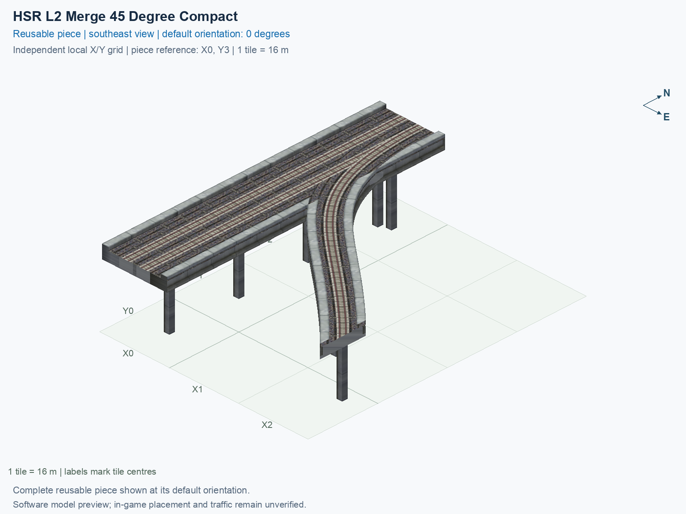

<a id="hsr-l2-merge-45-degree-compact"></a>

# HSR Level 2 (15.5 m) — Merge 45° Right to Two-Track Mainline — Compact

<!-- SUBJECT IDENTITY MIGRATION -->

Identity migration: `interchange-hsr-merge-45-compact` → `hsr-l2-two-track-mainline-merge-45deg-right-compact`. Earlier measurements, observations, and pictures retain their recorded names and fingerprints; they do not establish verification of the renamed build. See the [identity migration rules](../../../../docs/NAMING_CONVENTIONS.md#10-choosing-and-changing-names).

Purpose: explain this reusable piece, its matching connections and current test coverage.

<!-- BEGIN PIECE OVERVIEW -->

HSR Level 2 (15.5 m) — Merge 45° Right to Two-Track Mainline — Compact. Fixed click-to-place piece in a 3 by 4 tile area. Follow the arrows and join only matching track widths, directions, and height labels. Four proper rotations; the second four states repeat them. Experimental; game testing pending. The mainline retains both directions; only the branch is one-way.

Exact reusable identifier: `hsr-l2-two-track-mainline-merge-45deg-right-compact`.

Footprint: **3 × 4 tiles**. Exact menu name: **HSR Level 2 (15.5 m) — Merge 45° Right to Two-Track Mainline — Compact**.

Choose this exact name in Transportation → Rail. Press Home or End to rotate; use only the supported states listed below. Join each end to a matching port profile and direction.

- [Connections and journeys](#connections-and-journeys)
- [Test checklist](#test-checklist)

### Design review

**REVIEW NEEDED** — Closely spaced pillars need a support-consolidation review.

- Separate 1.3 m-square pillar foundations have centres less than 2.6 m apart near shared rail geometry. The foundations do not overlap, but the close pair should be reviewed and consolidated to address the reported duplicate-pillar appearance. The 2.6 m review cutoff is an authoring convention, not a structural or game collision threshold.

[Design-review evidence](../../junction-design-review.json).



<!-- END PIECE OVERVIEW -->

<!-- BEGIN MANUAL SUMMARY -->

## Manual status

Generated from [the exact test cases](#test-checklist) and [authoritative observations](checks/manual-tests.json).

- [ ] Preview review: 0/1 applicable cases passed; 0 failed, 0 stale.
- [ ] In-game rendering: 0/4 applicable cases passed; 0 failed, 0 stale.
- [ ] Directed journeys: 0/12 applicable cases passed; 0 failed, 0 stale.

These observations cover only the named services, directions, poses, rotations, and recorded platforms.

<!-- END MANUAL SUMMARY -->

<!-- BEGIN CONNECTIONS -->

## Connections and journeys

Purpose: describe intrinsic directional interfaces and permitted service journeys.

Generated from [connections.json](connections.json). Coordinates are canonical east, north, and height in metres. A connection class names an encoded route interface; it does not prove visible deck/wall fit or an in-game test.

Supported placement states: 0° CCW, 90° CCW, 180° CCW, 270° CCW. Each state has its own declared manual scope.

A **port** is one directional transport-path endpoint. **Service** identifies the intended network service (for example HSR, street, or tram); **engine** is its internal traffic-class number, separate from the construction network. **Role** distinguishes primary service from auxiliary paths; sharing a traffic class does not establish service compatibility.

A **tangent** is a unit travel-direction vector: `[0,1]` means north. **Grade** is height gained per horizontal metre. These measured facts describe this subject alone. Compatibility requires a separate comparison of the complete joining boundaries; physical seams and actual game operation require their own evidence. See the [class index](../../connection-classes.jsonc) for shared route-interface membership.

| Port | Service / engine / role | Direction | Location; tangent; grade | Connection class |
| --- | --- | --- | --- | --- |
| `Sout` | hsr / 7 / primary | out | [-2.0, -56.0, 15.5]; [0.0, -1.0]; 0.0 | `path-interface-12d12be31d2057c5763d` |
| `Nin` | hsr / 7 / primary | in | [-2.0, 8.0, 15.5]; [0.0, -1.0]; 0.0 | `path-interface-12d12be31d2057c5763d` |
| `Sin` | hsr / 7 / primary | in | [2.0, -56.0, 15.5]; [0.0, 1.0]; 0.0 | `path-interface-fba09fbeb87ad95c667a` |
| `Nout` | hsr / 7 / primary | out | [2.0, 8.0, 15.5]; [0.0, 1.0]; 0.0 | `path-interface-fba09fbeb87ad95c667a` |
| `Bin` | hsr / 7 / primary | in | [40.0, -48.0, 15.5]; [-0.7071067811865475, 0.7071067811865475]; 0.0 | `path-interface-e52e55553f098fa8572d` |

### Directed journeys

| Service | Entry → exit | Role |
| --- | --- | --- |
| hsr | `Nin` → `Sout` | primary |
| hsr | `Sin` → `Nout` | primary |
| hsr | `Bin` → `Nout` | primary |

### Forbidden transfers

| From service / port | To service / port | Reason |
| --- | --- | --- |
| hsr / `Nin` | hsr / `Nout` | No directed route exists between these ports in the saved piece transport paths. In-game confirmation remains unverified. |
| hsr / `Sin` | hsr / `Sout` | No directed route exists between these ports in the saved piece transport paths. In-game confirmation remains unverified. |
| hsr / `Bin` | hsr / `Sout` | No directed route exists between these ports in the saved piece transport paths. In-game confirmation remains unverified. |

Review the test checklist for the exact tested cases and environments.

<!-- END CONNECTIONS -->

<!-- BEGIN MANUAL CHECKS -->

## Test checklist

Generated from [the authoritative record](checks/manual-tests.json). Only explicit human observations create manual passes; software and preview checks remain separate. Expand a check/service group to see its rotation table, then expand the matching exact scope to copy a case ID and inspect its pose, reviewer, environment, and evidence. Grouping changes only this view; every declared case remains separate.

**States:** [x] passed; [ ] unverified, failed, or stale; N/A is an explicit inapplicable declaration. A dash means no case was declared in that column. Every pass covers only its recorded environment. T means a distinct construction-transposed state.

Four proper rotations are covered. No additional reflected state is established by this record; repeated construction aliases do not create new orientations.

Current totals: unverified: 43, passed: 0, failed: 0, stale: 0, not_applicable: 0.

### Record an observation

Follow the [shared testing guide](../../../../docs/TESTING.md); copy [the unconfirmed example](checks/observation.example.json) to `checks/observation.json`. Case identifiers are in the expandable sections below. Do not edit generated checkboxes.

From the repository folder containing `custom-pieces`, run after filling `checks/observation.json` and explicitly confirming the exact observation:

```sh
python3 -m scp.content record --record custom-pieces/domains/high-speed-rail/00_pieces/hsr-l2-two-track-mainline-merge-45deg-right-compact/checks/manual-tests.json --observation custom-pieces/domains/high-speed-rail/00_pieces/hsr-l2-two-track-mainline-merge-45deg-right-compact/checks/observation.json
```

### Detailed current checks

Each collapsed group shows exact case counts and states. Forbidden transfers are grouped by the directed service pair; the table inside retains every port pair and rotation.

<details>
<summary>Compiled resources — Whole subject — 1 case; unverified: 1</summary>

| Check / exact scope | General | 0° | 90° | 180° | 270° |
| --- | --- | --- | --- | --- | --- |
| **Compiled resources**<br>Whole subject | <a href="#case-software_resources-5364a3006dfe32272f68">[ ] unverified</a> | — | — | — | — |


<details>
<summary>Compiled resources — Whole subject</summary>

<a id="case-software_resources-5364a3006dfe32272f68"></a>

**General: unverified** — `software_resources-5364a3006dfe32272f68`.

Verify the actual compiled resources and construction rules.

Scope: Whole subject.

No observation recorded.

</details>

</details>

<details>
<summary>Directed routing graph — Whole subject — 1 case; unverified: 1</summary>

| Check / exact scope | General | 0° | 90° | 180° | 270° |
| --- | --- | --- | --- | --- | --- |
| **Directed routing graph**<br>Whole subject | <a href="#case-software_connectivity-5364a3006dfe32272f68">[ ] unverified</a> | — | — | — | — |


<details>
<summary>Directed routing graph — Whole subject</summary>

<a id="case-software_connectivity-5364a3006dfe32272f68"></a>

**General: unverified** — `software_connectivity-5364a3006dfe32272f68`.

Verify the declared directed journeys and forbidden transfers.

Scope: Whole subject.

No observation recorded.

</details>

</details>

<details>
<summary>Preview review — Images — 1 case; unverified: 1</summary>

| Check / exact scope | General | 0° | 90° | 180° | 270° |
| --- | --- | --- | --- | --- | --- |
| **Preview review**<br>Image: image:interchange-hsr-merge-45-compact:canonical-southeast | <a href="#case-preview_review-9a6b86070fa787cd7323">[ ] unverified</a> | — | — | — | — |


<details>
<summary>Preview review — Image: image:interchange-hsr-merge-45-compact:canonical-southeast</summary>

<a id="case-preview_review-9a6b86070fa787cd7323"></a>

**General: unverified** — `preview_review-9a6b86070fa787cd7323`.

Inspect this exact preview for tracks, walls, piers, seams and shadows.

Scope: Image: image:interchange-hsr-merge-45-compact:canonical-southeast.

No observation recorded.

</details>

</details>

<details>
<summary>In-game rendering — Whole subject — 4 cases; unverified: 4</summary>

| Check / exact scope | General | 0° | 90° | 180° | 270° |
| --- | --- | --- | --- | --- | --- |
| **In-game rendering**<br>Whole subject | — | <a href="#case-in_game_render-5c144f47016c30f9d0c8">[ ] unverified</a> | <a href="#case-in_game_render-5fc1ad0b6a244f8bdc2f">[ ] unverified</a> | <a href="#case-in_game_render-0ed3b895f07c8e4e41f9">[ ] unverified</a> | <a href="#case-in_game_render-18d8f7f97d954f633adc">[ ] unverified</a> |


<details>
<summary>In-game rendering — Whole subject</summary>

<a id="case-in_game_render-5c144f47016c30f9d0c8"></a>

**0° CCW: unverified** — `in_game_render-5c144f47016c30f9d0c8`.

Inspect the placed tracks, walls, piers, seams and shadows in SimCity 4.

Scope: Whole subject.

No observation recorded.

<a id="case-in_game_render-5fc1ad0b6a244f8bdc2f"></a>

**90° CCW: unverified** — `in_game_render-5fc1ad0b6a244f8bdc2f`.

Inspect the placed tracks, walls, piers, seams and shadows in SimCity 4.

Scope: Whole subject.

No observation recorded.

<a id="case-in_game_render-0ed3b895f07c8e4e41f9"></a>

**180° CCW: unverified** — `in_game_render-0ed3b895f07c8e4e41f9`.

Inspect the placed tracks, walls, piers, seams and shadows in SimCity 4.

Scope: Whole subject.

No observation recorded.

<a id="case-in_game_render-18d8f7f97d954f633adc"></a>

**270° CCW: unverified** — `in_game_render-18d8f7f97d954f633adc`.

Inspect the placed tracks, walls, piers, seams and shadows in SimCity 4.

Scope: Whole subject.

No observation recorded.

</details>

</details>

<details>
<summary>Placement — Whole subject — 4 cases; unverified: 4</summary>

| Check / exact scope | General | 0° | 90° | 180° | 270° |
| --- | --- | --- | --- | --- | --- |
| **Placement**<br>Whole subject | — | <a href="#case-in_game_placement-5c144f47016c30f9d0c8">[ ] unverified</a> | <a href="#case-in_game_placement-5fc1ad0b6a244f8bdc2f">[ ] unverified</a> | <a href="#case-in_game_placement-0ed3b895f07c8e4e41f9">[ ] unverified</a> | <a href="#case-in_game_placement-18d8f7f97d954f633adc">[ ] unverified</a> |


<details>
<summary>Placement — Whole subject</summary>

<a id="case-in_game_placement-5c144f47016c30f9d0c8"></a>

**0° CCW: unverified** — `in_game_placement-5c144f47016c30f9d0c8`.

Place this piece or complete blueprint and inspect every occupied tile.

Scope: Whole subject.

No observation recorded.

<a id="case-in_game_placement-5fc1ad0b6a244f8bdc2f"></a>

**90° CCW: unverified** — `in_game_placement-5fc1ad0b6a244f8bdc2f`.

Place this piece or complete blueprint and inspect every occupied tile.

Scope: Whole subject.

No observation recorded.

<a id="case-in_game_placement-0ed3b895f07c8e4e41f9"></a>

**180° CCW: unverified** — `in_game_placement-0ed3b895f07c8e4e41f9`.

Place this piece or complete blueprint and inspect every occupied tile.

Scope: Whole subject.

No observation recorded.

<a id="case-in_game_placement-18d8f7f97d954f633adc"></a>

**270° CCW: unverified** — `in_game_placement-18d8f7f97d954f633adc`.

Place this piece or complete blueprint and inspect every occupied tile.

Scope: Whole subject.

No observation recorded.

</details>

</details>

<details>
<summary>Demolition — Whole subject — 4 cases; unverified: 4</summary>

| Check / exact scope | General | 0° | 90° | 180° | 270° |
| --- | --- | --- | --- | --- | --- |
| **Demolition**<br>Whole subject | — | <a href="#case-in_game_demolition-5c144f47016c30f9d0c8">[ ] unverified</a> | <a href="#case-in_game_demolition-5fc1ad0b6a244f8bdc2f">[ ] unverified</a> | <a href="#case-in_game_demolition-0ed3b895f07c8e4e41f9">[ ] unverified</a> | <a href="#case-in_game_demolition-18d8f7f97d954f633adc">[ ] unverified</a> |


<details>
<summary>Demolition — Whole subject</summary>

<a id="case-in_game_demolition-5c144f47016c30f9d0c8"></a>

**0° CCW: unverified** — `in_game_demolition-5c144f47016c30f9d0c8`.

Bulldoze the complete placement and inspect the cleared area.

Scope: Whole subject.

No observation recorded.

<a id="case-in_game_demolition-5fc1ad0b6a244f8bdc2f"></a>

**90° CCW: unverified** — `in_game_demolition-5fc1ad0b6a244f8bdc2f`.

Bulldoze the complete placement and inspect the cleared area.

Scope: Whole subject.

No observation recorded.

<a id="case-in_game_demolition-0ed3b895f07c8e4e41f9"></a>

**180° CCW: unverified** — `in_game_demolition-0ed3b895f07c8e4e41f9`.

Bulldoze the complete placement and inspect the cleared area.

Scope: Whole subject.

No observation recorded.

<a id="case-in_game_demolition-18d8f7f97d954f633adc"></a>

**270° CCW: unverified** — `in_game_demolition-18d8f7f97d954f633adc`.

Bulldoze the complete placement and inspect the cleared area.

Scope: Whole subject.

No observation recorded.

</details>

</details>

<details>
<summary>Save and reload — Whole subject — 4 cases; unverified: 4</summary>

| Check / exact scope | General | 0° | 90° | 180° | 270° |
| --- | --- | --- | --- | --- | --- |
| **Save and reload**<br>Whole subject | — | <a href="#case-in_game_save_reload-5c144f47016c30f9d0c8">[ ] unverified</a> | <a href="#case-in_game_save_reload-5fc1ad0b6a244f8bdc2f">[ ] unverified</a> | <a href="#case-in_game_save_reload-0ed3b895f07c8e4e41f9">[ ] unverified</a> | <a href="#case-in_game_save_reload-18d8f7f97d954f633adc">[ ] unverified</a> |


<details>
<summary>Save and reload — Whole subject</summary>

<a id="case-in_game_save_reload-5c144f47016c30f9d0c8"></a>

**0° CCW: unverified** — `in_game_save_reload-5c144f47016c30f9d0c8`.

Save, quit, reload and inspect the placement and its paths.

Scope: Whole subject.

No observation recorded.

<a id="case-in_game_save_reload-5fc1ad0b6a244f8bdc2f"></a>

**90° CCW: unverified** — `in_game_save_reload-5fc1ad0b6a244f8bdc2f`.

Save, quit, reload and inspect the placement and its paths.

Scope: Whole subject.

No observation recorded.

<a id="case-in_game_save_reload-0ed3b895f07c8e4e41f9"></a>

**180° CCW: unverified** — `in_game_save_reload-0ed3b895f07c8e4e41f9`.

Save, quit, reload and inspect the placement and its paths.

Scope: Whole subject.

No observation recorded.

<a id="case-in_game_save_reload-18d8f7f97d954f633adc"></a>

**270° CCW: unverified** — `in_game_save_reload-18d8f7f97d954f633adc`.

Save, quit, reload and inspect the placement and its paths.

Scope: Whole subject.

No observation recorded.

</details>

</details>

<details>
<summary>Journey — hsr — 12 cases; unverified: 12</summary>

| Check / exact scope | General | 0° | 90° | 180° | 270° |
| --- | --- | --- | --- | --- | --- |
| **Journey**<br>Service: hsr; role: primary; journey: 7:Nin>Sout; entry: Nin; exit: Sout | — | <a href="#case-in_game_journey-afcd7968528c081c78f9">[ ] unverified</a> | <a href="#case-in_game_journey-8f9ca99d82790e836e6c">[ ] unverified</a> | <a href="#case-in_game_journey-a53406ab7c1270fc93d5">[ ] unverified</a> | <a href="#case-in_game_journey-7744ed1f170fcfca9b02">[ ] unverified</a> |
| **Journey**<br>Service: hsr; role: primary; journey: 7:Sin>Nout; entry: Sin; exit: Nout | — | <a href="#case-in_game_journey-084cd12f93f4b100b2a6">[ ] unverified</a> | <a href="#case-in_game_journey-a87a08389742a68663b3">[ ] unverified</a> | <a href="#case-in_game_journey-48df3b3dd959ee5a10c8">[ ] unverified</a> | <a href="#case-in_game_journey-dfa321757255846772a9">[ ] unverified</a> |
| **Journey**<br>Service: hsr; role: primary; journey: 7:Bin>Nout; entry: Bin; exit: Nout | — | <a href="#case-in_game_journey-a9f53c061474ac76cb9e">[ ] unverified</a> | <a href="#case-in_game_journey-0765721091e5de5ebf99">[ ] unverified</a> | <a href="#case-in_game_journey-5069b5efcd6fc52aa4c5">[ ] unverified</a> | <a href="#case-in_game_journey-d4a7d9d661d0bbe4dcd9">[ ] unverified</a> |


<details>
<summary>Journey — Service: hsr; role: primary; journey: 7:Nin>Sout; entry: Nin; exit: Sout</summary>

<a id="case-in_game_journey-afcd7968528c081c78f9"></a>

**0° CCW: unverified** — `in_game_journey-afcd7968528c081c78f9`.

Run the declared journey in this direction using its service network.

Scope: Service: hsr; role: primary; journey: 7:Nin>Sout; entry: Nin; exit: Sout.

No observation recorded.

<a id="case-in_game_journey-8f9ca99d82790e836e6c"></a>

**90° CCW: unverified** — `in_game_journey-8f9ca99d82790e836e6c`.

Run the declared journey in this direction using its service network.

Scope: Service: hsr; role: primary; journey: 7:Nin>Sout; entry: Nin; exit: Sout.

No observation recorded.

<a id="case-in_game_journey-a53406ab7c1270fc93d5"></a>

**180° CCW: unverified** — `in_game_journey-a53406ab7c1270fc93d5`.

Run the declared journey in this direction using its service network.

Scope: Service: hsr; role: primary; journey: 7:Nin>Sout; entry: Nin; exit: Sout.

No observation recorded.

<a id="case-in_game_journey-7744ed1f170fcfca9b02"></a>

**270° CCW: unverified** — `in_game_journey-7744ed1f170fcfca9b02`.

Run the declared journey in this direction using its service network.

Scope: Service: hsr; role: primary; journey: 7:Nin>Sout; entry: Nin; exit: Sout.

No observation recorded.

</details>


<details>
<summary>Journey — Service: hsr; role: primary; journey: 7:Sin>Nout; entry: Sin; exit: Nout</summary>

<a id="case-in_game_journey-084cd12f93f4b100b2a6"></a>

**0° CCW: unverified** — `in_game_journey-084cd12f93f4b100b2a6`.

Run the declared journey in this direction using its service network.

Scope: Service: hsr; role: primary; journey: 7:Sin>Nout; entry: Sin; exit: Nout.

No observation recorded.

<a id="case-in_game_journey-a87a08389742a68663b3"></a>

**90° CCW: unverified** — `in_game_journey-a87a08389742a68663b3`.

Run the declared journey in this direction using its service network.

Scope: Service: hsr; role: primary; journey: 7:Sin>Nout; entry: Sin; exit: Nout.

No observation recorded.

<a id="case-in_game_journey-48df3b3dd959ee5a10c8"></a>

**180° CCW: unverified** — `in_game_journey-48df3b3dd959ee5a10c8`.

Run the declared journey in this direction using its service network.

Scope: Service: hsr; role: primary; journey: 7:Sin>Nout; entry: Sin; exit: Nout.

No observation recorded.

<a id="case-in_game_journey-dfa321757255846772a9"></a>

**270° CCW: unverified** — `in_game_journey-dfa321757255846772a9`.

Run the declared journey in this direction using its service network.

Scope: Service: hsr; role: primary; journey: 7:Sin>Nout; entry: Sin; exit: Nout.

No observation recorded.

</details>


<details>
<summary>Journey — Service: hsr; role: primary; journey: 7:Bin>Nout; entry: Bin; exit: Nout</summary>

<a id="case-in_game_journey-a9f53c061474ac76cb9e"></a>

**0° CCW: unverified** — `in_game_journey-a9f53c061474ac76cb9e`.

Run the declared journey in this direction using its service network.

Scope: Service: hsr; role: primary; journey: 7:Bin>Nout; entry: Bin; exit: Nout.

No observation recorded.

<a id="case-in_game_journey-0765721091e5de5ebf99"></a>

**90° CCW: unverified** — `in_game_journey-0765721091e5de5ebf99`.

Run the declared journey in this direction using its service network.

Scope: Service: hsr; role: primary; journey: 7:Bin>Nout; entry: Bin; exit: Nout.

No observation recorded.

<a id="case-in_game_journey-5069b5efcd6fc52aa4c5"></a>

**180° CCW: unverified** — `in_game_journey-5069b5efcd6fc52aa4c5`.

Run the declared journey in this direction using its service network.

Scope: Service: hsr; role: primary; journey: 7:Bin>Nout; entry: Bin; exit: Nout.

No observation recorded.

<a id="case-in_game_journey-d4a7d9d661d0bbe4dcd9"></a>

**270° CCW: unverified** — `in_game_journey-d4a7d9d661d0bbe4dcd9`.

Run the declared journey in this direction using its service network.

Scope: Service: hsr; role: primary; journey: 7:Bin>Nout; entry: Bin; exit: Nout.

No observation recorded.

</details>

</details>

<details>
<summary>Forbidden transfer — hsr → hsr — 12 cases; unverified: 12</summary>

| Check / exact scope | General | 0° | 90° | 180° | 270° |
| --- | --- | --- | --- | --- | --- |
| **Forbidden transfer**<br>from port: Nin; to port: Nout; from service: hsr; to service: hsr; basis: not reachable in actual saved PATH graph | — | <a href="#case-in_game_forbidden_transfer-e4da244c4a29a7fe3050">[ ] unverified</a> | <a href="#case-in_game_forbidden_transfer-a2ded5de03c962cfe082">[ ] unverified</a> | <a href="#case-in_game_forbidden_transfer-dbf909e3b65e2a9a65ce">[ ] unverified</a> | <a href="#case-in_game_forbidden_transfer-30bf4da0a24748247f40">[ ] unverified</a> |
| **Forbidden transfer**<br>from port: Sin; to port: Sout; from service: hsr; to service: hsr; basis: not reachable in actual saved PATH graph | — | <a href="#case-in_game_forbidden_transfer-9ec79db54381de68b25b">[ ] unverified</a> | <a href="#case-in_game_forbidden_transfer-35fc8d88adad735c7278">[ ] unverified</a> | <a href="#case-in_game_forbidden_transfer-dd9f0e9242d9cea440f4">[ ] unverified</a> | <a href="#case-in_game_forbidden_transfer-17aa2adf6c1d66f5fb66">[ ] unverified</a> |
| **Forbidden transfer**<br>from port: Bin; to port: Sout; from service: hsr; to service: hsr; basis: not reachable in actual saved PATH graph | — | <a href="#case-in_game_forbidden_transfer-74f73a068498fdeeee3b">[ ] unverified</a> | <a href="#case-in_game_forbidden_transfer-4aea99a03e05b64b677f">[ ] unverified</a> | <a href="#case-in_game_forbidden_transfer-87fca4b1f9b3dd30357e">[ ] unverified</a> | <a href="#case-in_game_forbidden_transfer-1ed1550f9c6e7798a632">[ ] unverified</a> |


<details>
<summary>Forbidden transfer — from port: Nin; to port: Nout; from service: hsr; to service: hsr; basis: not reachable in actual saved PATH graph</summary>

<a id="case-in_game_forbidden_transfer-e4da244c4a29a7fe3050"></a>

**0° CCW: unverified** — `in_game_forbidden_transfer-e4da244c4a29a7fe3050`.

Confirm this undeclared transfer is unavailable.

Scope: from port: Nin; to port: Nout; from service: hsr; to service: hsr; basis: not reachable in actual saved PATH graph.

No observation recorded.

<a id="case-in_game_forbidden_transfer-a2ded5de03c962cfe082"></a>

**90° CCW: unverified** — `in_game_forbidden_transfer-a2ded5de03c962cfe082`.

Confirm this undeclared transfer is unavailable.

Scope: from port: Nin; to port: Nout; from service: hsr; to service: hsr; basis: not reachable in actual saved PATH graph.

No observation recorded.

<a id="case-in_game_forbidden_transfer-dbf909e3b65e2a9a65ce"></a>

**180° CCW: unverified** — `in_game_forbidden_transfer-dbf909e3b65e2a9a65ce`.

Confirm this undeclared transfer is unavailable.

Scope: from port: Nin; to port: Nout; from service: hsr; to service: hsr; basis: not reachable in actual saved PATH graph.

No observation recorded.

<a id="case-in_game_forbidden_transfer-30bf4da0a24748247f40"></a>

**270° CCW: unverified** — `in_game_forbidden_transfer-30bf4da0a24748247f40`.

Confirm this undeclared transfer is unavailable.

Scope: from port: Nin; to port: Nout; from service: hsr; to service: hsr; basis: not reachable in actual saved PATH graph.

No observation recorded.

</details>


<details>
<summary>Forbidden transfer — from port: Sin; to port: Sout; from service: hsr; to service: hsr; basis: not reachable in actual saved PATH graph</summary>

<a id="case-in_game_forbidden_transfer-9ec79db54381de68b25b"></a>

**0° CCW: unverified** — `in_game_forbidden_transfer-9ec79db54381de68b25b`.

Confirm this undeclared transfer is unavailable.

Scope: from port: Sin; to port: Sout; from service: hsr; to service: hsr; basis: not reachable in actual saved PATH graph.

No observation recorded.

<a id="case-in_game_forbidden_transfer-35fc8d88adad735c7278"></a>

**90° CCW: unverified** — `in_game_forbidden_transfer-35fc8d88adad735c7278`.

Confirm this undeclared transfer is unavailable.

Scope: from port: Sin; to port: Sout; from service: hsr; to service: hsr; basis: not reachable in actual saved PATH graph.

No observation recorded.

<a id="case-in_game_forbidden_transfer-dd9f0e9242d9cea440f4"></a>

**180° CCW: unverified** — `in_game_forbidden_transfer-dd9f0e9242d9cea440f4`.

Confirm this undeclared transfer is unavailable.

Scope: from port: Sin; to port: Sout; from service: hsr; to service: hsr; basis: not reachable in actual saved PATH graph.

No observation recorded.

<a id="case-in_game_forbidden_transfer-17aa2adf6c1d66f5fb66"></a>

**270° CCW: unverified** — `in_game_forbidden_transfer-17aa2adf6c1d66f5fb66`.

Confirm this undeclared transfer is unavailable.

Scope: from port: Sin; to port: Sout; from service: hsr; to service: hsr; basis: not reachable in actual saved PATH graph.

No observation recorded.

</details>


<details>
<summary>Forbidden transfer — from port: Bin; to port: Sout; from service: hsr; to service: hsr; basis: not reachable in actual saved PATH graph</summary>

<a id="case-in_game_forbidden_transfer-74f73a068498fdeeee3b"></a>

**0° CCW: unverified** — `in_game_forbidden_transfer-74f73a068498fdeeee3b`.

Confirm this undeclared transfer is unavailable.

Scope: from port: Bin; to port: Sout; from service: hsr; to service: hsr; basis: not reachable in actual saved PATH graph.

No observation recorded.

<a id="case-in_game_forbidden_transfer-4aea99a03e05b64b677f"></a>

**90° CCW: unverified** — `in_game_forbidden_transfer-4aea99a03e05b64b677f`.

Confirm this undeclared transfer is unavailable.

Scope: from port: Bin; to port: Sout; from service: hsr; to service: hsr; basis: not reachable in actual saved PATH graph.

No observation recorded.

<a id="case-in_game_forbidden_transfer-87fca4b1f9b3dd30357e"></a>

**180° CCW: unverified** — `in_game_forbidden_transfer-87fca4b1f9b3dd30357e`.

Confirm this undeclared transfer is unavailable.

Scope: from port: Bin; to port: Sout; from service: hsr; to service: hsr; basis: not reachable in actual saved PATH graph.

No observation recorded.

<a id="case-in_game_forbidden_transfer-1ed1550f9c6e7798a632"></a>

**270° CCW: unverified** — `in_game_forbidden_transfer-1ed1550f9c6e7798a632`.

Confirm this undeclared transfer is unavailable.

Scope: from port: Bin; to port: Sout; from service: hsr; to service: hsr; basis: not reachable in actual saved PATH graph.

No observation recorded.

</details>

</details>

<!-- END MANUAL CHECKS -->
