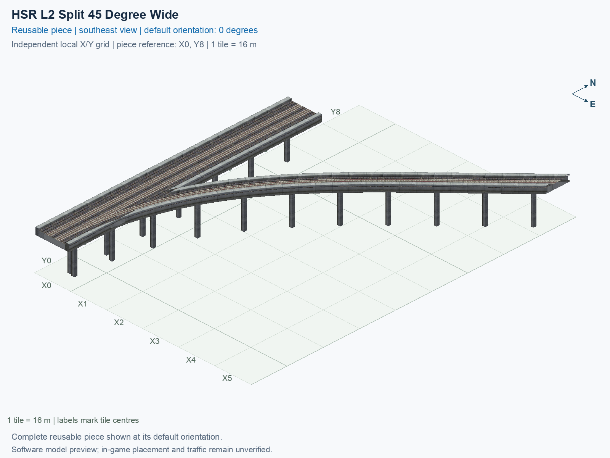

<a id="hsr-l2-split-45-degree-wide"></a>

# HSR Level 2 (15.5 m) — Split 45° Right from Two-Track Mainline — Wide

<!-- SUBJECT IDENTITY MIGRATION -->

Identity migration: `interchange-hsr-split-45-wide` → `hsr-l2-two-track-mainline-split-45deg-right-wide`. Earlier measurements, observations, and pictures retain their recorded names and fingerprints; they do not establish verification of the renamed build. See the [identity migration rules](../../../../docs/NAMING_CONVENTIONS.md#10-choosing-and-changing-names).

Purpose: explain this reusable piece, its matching connections and current test coverage.

<!-- BEGIN PIECE OVERVIEW -->

HSR Level 2 (15.5 m) — Split 45° Right from Two-Track Mainline — Wide. Fixed click-to-place piece in a 6 by 9 tile area. Follow the arrows and join only matching track widths, directions, and height labels. Four proper rotations; the second four states repeat them. Experimental; game testing pending. The mainline retains both directions; only the branch is one-way.

Exact reusable identifier: `hsr-l2-two-track-mainline-split-45deg-right-wide`.

Footprint: **6 × 9 tiles**. Exact menu name: **HSR Level 2 (15.5 m) — Split 45° Right from Two-Track Mainline — Wide**.

Choose this exact name in Transportation → Rail. Press Home or End to rotate; use only the supported states listed below. Join each end to a matching port profile and direction.

- [Connections and journeys](#connections-and-journeys)
- [Test checklist](#test-checklist)

### Design review

**REVIEW NEEDED** — Closely spaced pillars need a support-consolidation review.

- Separate 1.3 m-square pillar foundations have centres less than 2.6 m apart near shared rail geometry. The foundations do not overlap, but the close pair should be reviewed and consolidated to address the reported duplicate-pillar appearance. The 2.6 m review cutoff is an authoring convention, not a structural or game collision threshold.

[Design-review evidence](../../junction-design-review.json).



<!-- END PIECE OVERVIEW -->

<!-- BEGIN MANUAL SUMMARY -->

## Manual status

Generated from [the exact test cases](#test-checklist) and [authoritative observations](checks/manual-tests.json).

- [ ] Preview review: 0/1 applicable cases passed; 0 failed, 0 stale.
- [ ] In-game rendering: 0/4 applicable cases passed; 0 failed, 0 stale.
- [ ] Directed journeys: 0/12 applicable cases passed; 0 failed, 0 stale.

These observations cover only the named services, directions, poses, rotations, and recorded platforms.

<!-- END MANUAL SUMMARY -->

<!-- BEGIN CONNECTIONS -->

## Connections and journeys

Purpose: describe intrinsic directional interfaces and permitted service journeys.

Generated from [connections.json](connections.json). Coordinates are canonical east, north, and height in metres. A connection class names an encoded route interface; it does not prove visible deck/wall fit or an in-game test.

Supported placement states: 0° CCW, 90° CCW, 180° CCW, 270° CCW. Each state has its own declared manual scope.

A **port** is one directional transport-path endpoint. **Service** identifies the intended network service (for example HSR, street, or tram); **engine** is its internal traffic-class number, separate from the construction network. **Role** distinguishes primary service from auxiliary paths; sharing a traffic class does not establish service compatibility.

A **tangent** is a unit travel-direction vector: `[0,1]` means north. **Grade** is height gained per horizontal metre. These measured facts describe this subject alone. Compatibility requires a separate comparison of the complete joining boundaries; physical seams and actual game operation require their own evidence. See the [class index](../../connection-classes.jsonc) for shared route-interface membership.

| Port | Service / engine / role | Direction | Location; tangent; grade | Connection class |
| --- | --- | --- | --- | --- |
| `Sout` | hsr / 7 / primary | out | [-2.0, -136.0, 15.5]; [0.0, -1.0]; 0.0 | `path-interface-12d12be31d2057c5763d` |
| `Nin` | hsr / 7 / primary | in | [-2.0, -24.0, 15.5]; [0.0, -1.0]; 0.0 | `path-interface-12d12be31d2057c5763d` |
| `Sin` | hsr / 7 / primary | in | [2.0, -136.0, 15.5]; [0.0, 1.0]; 0.0 | `path-interface-fba09fbeb87ad95c667a` |
| `Nout` | hsr / 7 / primary | out | [2.0, -24.0, 15.5]; [0.0, 1.0]; 0.0 | `path-interface-fba09fbeb87ad95c667a` |
| `Bout` | hsr / 7 / primary | out | [88.0, 0.0, 15.5]; [0.7071067811865475, 0.7071067811865475]; 0.0 | `path-interface-e765ac771bb89f95414d` |

### Directed journeys

| Service | Entry → exit | Role |
| --- | --- | --- |
| hsr | `Nin` → `Sout` | primary |
| hsr | `Sin` → `Nout` | primary |
| hsr | `Sin` → `Bout` | primary |

### Forbidden transfers

| From service / port | To service / port | Reason |
| --- | --- | --- |
| hsr / `Nin` | hsr / `Nout` | No directed route exists between these ports in the saved piece transport paths. In-game confirmation remains unverified. |
| hsr / `Nin` | hsr / `Bout` | No directed route exists between these ports in the saved piece transport paths. In-game confirmation remains unverified. |
| hsr / `Sin` | hsr / `Sout` | No directed route exists between these ports in the saved piece transport paths. In-game confirmation remains unverified. |

Review the test checklist for the exact tested cases and environments.

<!-- END CONNECTIONS -->

<!-- BEGIN MANUAL CHECKS -->

## Test checklist

Generated from [the authoritative record](checks/manual-tests.json). Only explicit human observations create manual passes; software and preview checks remain separate. Expand a check/service group to see its rotation table, then expand the matching exact scope to copy a case ID and inspect its pose, reviewer, environment, and evidence. Grouping changes only this view; every declared case remains separate.

**States:** [x] passed; [ ] unverified, failed, or stale; N/A is an explicit inapplicable declaration. A dash means no case was declared in that column. Every pass covers only its recorded environment. T means a distinct construction-transposed state.

Four proper rotations are covered. No additional reflected state is established by this record; repeated construction aliases do not create new orientations.

Current totals: unverified: 43, passed: 0, failed: 0, stale: 0, not_applicable: 0.

### Record an observation

Follow the [shared testing guide](../../../../docs/TESTING.md); copy [the unconfirmed example](checks/observation.example.json) to `checks/observation.json`. Case identifiers are in the expandable sections below. Do not edit generated checkboxes.

From the repository folder containing `custom-pieces`, run after filling `checks/observation.json` and explicitly confirming the exact observation:

```sh
python3 -m scp.content record --record custom-pieces/domains/high-speed-rail/00_pieces/hsr-l2-two-track-mainline-split-45deg-right-wide/checks/manual-tests.json --observation custom-pieces/domains/high-speed-rail/00_pieces/hsr-l2-two-track-mainline-split-45deg-right-wide/checks/observation.json
```

### Detailed current checks

Each collapsed group shows exact case counts and states. Forbidden transfers are grouped by the directed service pair; the table inside retains every port pair and rotation.

<details>
<summary>Compiled resources — Whole subject — 1 case; unverified: 1</summary>

| Check / exact scope | General | 0° | 90° | 180° | 270° |
| --- | --- | --- | --- | --- | --- |
| **Compiled resources**<br>Whole subject | <a href="#case-software_resources-28c53485e1cc12cf806b">[ ] unverified</a> | — | — | — | — |


<details>
<summary>Compiled resources — Whole subject</summary>

<a id="case-software_resources-28c53485e1cc12cf806b"></a>

**General: unverified** — `software_resources-28c53485e1cc12cf806b`.

Verify the actual compiled resources and construction rules.

Scope: Whole subject.

No observation recorded.

</details>

</details>

<details>
<summary>Directed routing graph — Whole subject — 1 case; unverified: 1</summary>

| Check / exact scope | General | 0° | 90° | 180° | 270° |
| --- | --- | --- | --- | --- | --- |
| **Directed routing graph**<br>Whole subject | <a href="#case-software_connectivity-28c53485e1cc12cf806b">[ ] unverified</a> | — | — | — | — |


<details>
<summary>Directed routing graph — Whole subject</summary>

<a id="case-software_connectivity-28c53485e1cc12cf806b"></a>

**General: unverified** — `software_connectivity-28c53485e1cc12cf806b`.

Verify the declared directed journeys and forbidden transfers.

Scope: Whole subject.

No observation recorded.

</details>

</details>

<details>
<summary>Preview review — Images — 1 case; unverified: 1</summary>

| Check / exact scope | General | 0° | 90° | 180° | 270° |
| --- | --- | --- | --- | --- | --- |
| **Preview review**<br>Image: image:interchange-hsr-split-45-wide:canonical-southeast | <a href="#case-preview_review-9238ee29eee1f2b8e4c9">[ ] unverified</a> | — | — | — | — |


<details>
<summary>Preview review — Image: image:interchange-hsr-split-45-wide:canonical-southeast</summary>

<a id="case-preview_review-9238ee29eee1f2b8e4c9"></a>

**General: unverified** — `preview_review-9238ee29eee1f2b8e4c9`.

Inspect this exact preview for tracks, walls, piers, seams and shadows.

Scope: Image: image:interchange-hsr-split-45-wide:canonical-southeast.

No observation recorded.

</details>

</details>

<details>
<summary>In-game rendering — Whole subject — 4 cases; unverified: 4</summary>

| Check / exact scope | General | 0° | 90° | 180° | 270° |
| --- | --- | --- | --- | --- | --- |
| **In-game rendering**<br>Whole subject | — | <a href="#case-in_game_render-8f0253b570590831e635">[ ] unverified</a> | <a href="#case-in_game_render-1d800c7654a8e761df28">[ ] unverified</a> | <a href="#case-in_game_render-19270540e1fde95fb54d">[ ] unverified</a> | <a href="#case-in_game_render-3fe047d020ff20ef1e3f">[ ] unverified</a> |


<details>
<summary>In-game rendering — Whole subject</summary>

<a id="case-in_game_render-8f0253b570590831e635"></a>

**0° CCW: unverified** — `in_game_render-8f0253b570590831e635`.

Inspect the placed tracks, walls, piers, seams and shadows in SimCity 4.

Scope: Whole subject.

No observation recorded.

<a id="case-in_game_render-1d800c7654a8e761df28"></a>

**90° CCW: unverified** — `in_game_render-1d800c7654a8e761df28`.

Inspect the placed tracks, walls, piers, seams and shadows in SimCity 4.

Scope: Whole subject.

No observation recorded.

<a id="case-in_game_render-19270540e1fde95fb54d"></a>

**180° CCW: unverified** — `in_game_render-19270540e1fde95fb54d`.

Inspect the placed tracks, walls, piers, seams and shadows in SimCity 4.

Scope: Whole subject.

No observation recorded.

<a id="case-in_game_render-3fe047d020ff20ef1e3f"></a>

**270° CCW: unverified** — `in_game_render-3fe047d020ff20ef1e3f`.

Inspect the placed tracks, walls, piers, seams and shadows in SimCity 4.

Scope: Whole subject.

No observation recorded.

</details>

</details>

<details>
<summary>Placement — Whole subject — 4 cases; unverified: 4</summary>

| Check / exact scope | General | 0° | 90° | 180° | 270° |
| --- | --- | --- | --- | --- | --- |
| **Placement**<br>Whole subject | — | <a href="#case-in_game_placement-8f0253b570590831e635">[ ] unverified</a> | <a href="#case-in_game_placement-1d800c7654a8e761df28">[ ] unverified</a> | <a href="#case-in_game_placement-19270540e1fde95fb54d">[ ] unverified</a> | <a href="#case-in_game_placement-3fe047d020ff20ef1e3f">[ ] unverified</a> |


<details>
<summary>Placement — Whole subject</summary>

<a id="case-in_game_placement-8f0253b570590831e635"></a>

**0° CCW: unverified** — `in_game_placement-8f0253b570590831e635`.

Place this piece or complete blueprint and inspect every occupied tile.

Scope: Whole subject.

No observation recorded.

<a id="case-in_game_placement-1d800c7654a8e761df28"></a>

**90° CCW: unverified** — `in_game_placement-1d800c7654a8e761df28`.

Place this piece or complete blueprint and inspect every occupied tile.

Scope: Whole subject.

No observation recorded.

<a id="case-in_game_placement-19270540e1fde95fb54d"></a>

**180° CCW: unverified** — `in_game_placement-19270540e1fde95fb54d`.

Place this piece or complete blueprint and inspect every occupied tile.

Scope: Whole subject.

No observation recorded.

<a id="case-in_game_placement-3fe047d020ff20ef1e3f"></a>

**270° CCW: unverified** — `in_game_placement-3fe047d020ff20ef1e3f`.

Place this piece or complete blueprint and inspect every occupied tile.

Scope: Whole subject.

No observation recorded.

</details>

</details>

<details>
<summary>Demolition — Whole subject — 4 cases; unverified: 4</summary>

| Check / exact scope | General | 0° | 90° | 180° | 270° |
| --- | --- | --- | --- | --- | --- |
| **Demolition**<br>Whole subject | — | <a href="#case-in_game_demolition-8f0253b570590831e635">[ ] unverified</a> | <a href="#case-in_game_demolition-1d800c7654a8e761df28">[ ] unverified</a> | <a href="#case-in_game_demolition-19270540e1fde95fb54d">[ ] unverified</a> | <a href="#case-in_game_demolition-3fe047d020ff20ef1e3f">[ ] unverified</a> |


<details>
<summary>Demolition — Whole subject</summary>

<a id="case-in_game_demolition-8f0253b570590831e635"></a>

**0° CCW: unverified** — `in_game_demolition-8f0253b570590831e635`.

Bulldoze the complete placement and inspect the cleared area.

Scope: Whole subject.

No observation recorded.

<a id="case-in_game_demolition-1d800c7654a8e761df28"></a>

**90° CCW: unverified** — `in_game_demolition-1d800c7654a8e761df28`.

Bulldoze the complete placement and inspect the cleared area.

Scope: Whole subject.

No observation recorded.

<a id="case-in_game_demolition-19270540e1fde95fb54d"></a>

**180° CCW: unverified** — `in_game_demolition-19270540e1fde95fb54d`.

Bulldoze the complete placement and inspect the cleared area.

Scope: Whole subject.

No observation recorded.

<a id="case-in_game_demolition-3fe047d020ff20ef1e3f"></a>

**270° CCW: unverified** — `in_game_demolition-3fe047d020ff20ef1e3f`.

Bulldoze the complete placement and inspect the cleared area.

Scope: Whole subject.

No observation recorded.

</details>

</details>

<details>
<summary>Save and reload — Whole subject — 4 cases; unverified: 4</summary>

| Check / exact scope | General | 0° | 90° | 180° | 270° |
| --- | --- | --- | --- | --- | --- |
| **Save and reload**<br>Whole subject | — | <a href="#case-in_game_save_reload-8f0253b570590831e635">[ ] unverified</a> | <a href="#case-in_game_save_reload-1d800c7654a8e761df28">[ ] unverified</a> | <a href="#case-in_game_save_reload-19270540e1fde95fb54d">[ ] unverified</a> | <a href="#case-in_game_save_reload-3fe047d020ff20ef1e3f">[ ] unverified</a> |


<details>
<summary>Save and reload — Whole subject</summary>

<a id="case-in_game_save_reload-8f0253b570590831e635"></a>

**0° CCW: unverified** — `in_game_save_reload-8f0253b570590831e635`.

Save, quit, reload and inspect the placement and its paths.

Scope: Whole subject.

No observation recorded.

<a id="case-in_game_save_reload-1d800c7654a8e761df28"></a>

**90° CCW: unverified** — `in_game_save_reload-1d800c7654a8e761df28`.

Save, quit, reload and inspect the placement and its paths.

Scope: Whole subject.

No observation recorded.

<a id="case-in_game_save_reload-19270540e1fde95fb54d"></a>

**180° CCW: unverified** — `in_game_save_reload-19270540e1fde95fb54d`.

Save, quit, reload and inspect the placement and its paths.

Scope: Whole subject.

No observation recorded.

<a id="case-in_game_save_reload-3fe047d020ff20ef1e3f"></a>

**270° CCW: unverified** — `in_game_save_reload-3fe047d020ff20ef1e3f`.

Save, quit, reload and inspect the placement and its paths.

Scope: Whole subject.

No observation recorded.

</details>

</details>

<details>
<summary>Journey — hsr — 12 cases; unverified: 12</summary>

| Check / exact scope | General | 0° | 90° | 180° | 270° |
| --- | --- | --- | --- | --- | --- |
| **Journey**<br>Service: hsr; role: primary; journey: 7:Nin>Sout; entry: Nin; exit: Sout | — | <a href="#case-in_game_journey-69590e8d0b8dbe217b58">[ ] unverified</a> | <a href="#case-in_game_journey-f494f75755f2a062e2f5">[ ] unverified</a> | <a href="#case-in_game_journey-f062112387c0d0c00c06">[ ] unverified</a> | <a href="#case-in_game_journey-af9049c3faf0efc297d3">[ ] unverified</a> |
| **Journey**<br>Service: hsr; role: primary; journey: 7:Sin>Nout; entry: Sin; exit: Nout | — | <a href="#case-in_game_journey-da2d78e32fb3cfe9b4a4">[ ] unverified</a> | <a href="#case-in_game_journey-2848a71c402ba3bc82e2">[ ] unverified</a> | <a href="#case-in_game_journey-78f50d474a60d39b33f3">[ ] unverified</a> | <a href="#case-in_game_journey-54b207042585049cd607">[ ] unverified</a> |
| **Journey**<br>Service: hsr; role: primary; journey: 7:Sin>Bout; entry: Sin; exit: Bout | — | <a href="#case-in_game_journey-a34e4a8cc31fafd3c3b0">[ ] unverified</a> | <a href="#case-in_game_journey-4192f628eae7328e5e94">[ ] unverified</a> | <a href="#case-in_game_journey-f2d391ecf0f989d23f67">[ ] unverified</a> | <a href="#case-in_game_journey-889ea24f3ea5c6e77229">[ ] unverified</a> |


<details>
<summary>Journey — Service: hsr; role: primary; journey: 7:Nin>Sout; entry: Nin; exit: Sout</summary>

<a id="case-in_game_journey-69590e8d0b8dbe217b58"></a>

**0° CCW: unverified** — `in_game_journey-69590e8d0b8dbe217b58`.

Run the declared journey in this direction using its service network.

Scope: Service: hsr; role: primary; journey: 7:Nin>Sout; entry: Nin; exit: Sout.

No observation recorded.

<a id="case-in_game_journey-f494f75755f2a062e2f5"></a>

**90° CCW: unverified** — `in_game_journey-f494f75755f2a062e2f5`.

Run the declared journey in this direction using its service network.

Scope: Service: hsr; role: primary; journey: 7:Nin>Sout; entry: Nin; exit: Sout.

No observation recorded.

<a id="case-in_game_journey-f062112387c0d0c00c06"></a>

**180° CCW: unverified** — `in_game_journey-f062112387c0d0c00c06`.

Run the declared journey in this direction using its service network.

Scope: Service: hsr; role: primary; journey: 7:Nin>Sout; entry: Nin; exit: Sout.

No observation recorded.

<a id="case-in_game_journey-af9049c3faf0efc297d3"></a>

**270° CCW: unverified** — `in_game_journey-af9049c3faf0efc297d3`.

Run the declared journey in this direction using its service network.

Scope: Service: hsr; role: primary; journey: 7:Nin>Sout; entry: Nin; exit: Sout.

No observation recorded.

</details>


<details>
<summary>Journey — Service: hsr; role: primary; journey: 7:Sin>Nout; entry: Sin; exit: Nout</summary>

<a id="case-in_game_journey-da2d78e32fb3cfe9b4a4"></a>

**0° CCW: unverified** — `in_game_journey-da2d78e32fb3cfe9b4a4`.

Run the declared journey in this direction using its service network.

Scope: Service: hsr; role: primary; journey: 7:Sin>Nout; entry: Sin; exit: Nout.

No observation recorded.

<a id="case-in_game_journey-2848a71c402ba3bc82e2"></a>

**90° CCW: unverified** — `in_game_journey-2848a71c402ba3bc82e2`.

Run the declared journey in this direction using its service network.

Scope: Service: hsr; role: primary; journey: 7:Sin>Nout; entry: Sin; exit: Nout.

No observation recorded.

<a id="case-in_game_journey-78f50d474a60d39b33f3"></a>

**180° CCW: unverified** — `in_game_journey-78f50d474a60d39b33f3`.

Run the declared journey in this direction using its service network.

Scope: Service: hsr; role: primary; journey: 7:Sin>Nout; entry: Sin; exit: Nout.

No observation recorded.

<a id="case-in_game_journey-54b207042585049cd607"></a>

**270° CCW: unverified** — `in_game_journey-54b207042585049cd607`.

Run the declared journey in this direction using its service network.

Scope: Service: hsr; role: primary; journey: 7:Sin>Nout; entry: Sin; exit: Nout.

No observation recorded.

</details>


<details>
<summary>Journey — Service: hsr; role: primary; journey: 7:Sin>Bout; entry: Sin; exit: Bout</summary>

<a id="case-in_game_journey-a34e4a8cc31fafd3c3b0"></a>

**0° CCW: unverified** — `in_game_journey-a34e4a8cc31fafd3c3b0`.

Run the declared journey in this direction using its service network.

Scope: Service: hsr; role: primary; journey: 7:Sin>Bout; entry: Sin; exit: Bout.

No observation recorded.

<a id="case-in_game_journey-4192f628eae7328e5e94"></a>

**90° CCW: unverified** — `in_game_journey-4192f628eae7328e5e94`.

Run the declared journey in this direction using its service network.

Scope: Service: hsr; role: primary; journey: 7:Sin>Bout; entry: Sin; exit: Bout.

No observation recorded.

<a id="case-in_game_journey-f2d391ecf0f989d23f67"></a>

**180° CCW: unverified** — `in_game_journey-f2d391ecf0f989d23f67`.

Run the declared journey in this direction using its service network.

Scope: Service: hsr; role: primary; journey: 7:Sin>Bout; entry: Sin; exit: Bout.

No observation recorded.

<a id="case-in_game_journey-889ea24f3ea5c6e77229"></a>

**270° CCW: unverified** — `in_game_journey-889ea24f3ea5c6e77229`.

Run the declared journey in this direction using its service network.

Scope: Service: hsr; role: primary; journey: 7:Sin>Bout; entry: Sin; exit: Bout.

No observation recorded.

</details>

</details>

<details>
<summary>Forbidden transfer — hsr → hsr — 12 cases; unverified: 12</summary>

| Check / exact scope | General | 0° | 90° | 180° | 270° |
| --- | --- | --- | --- | --- | --- |
| **Forbidden transfer**<br>from port: Nin; to port: Nout; from service: hsr; to service: hsr; basis: not reachable in actual saved PATH graph | — | <a href="#case-in_game_forbidden_transfer-6a37b5a41fc0851c6211">[ ] unverified</a> | <a href="#case-in_game_forbidden_transfer-f37796b3bcdef810b424">[ ] unverified</a> | <a href="#case-in_game_forbidden_transfer-f8025576aed9a18b973e">[ ] unverified</a> | <a href="#case-in_game_forbidden_transfer-be3bb8be20f2fb7a8a6b">[ ] unverified</a> |
| **Forbidden transfer**<br>from port: Nin; to port: Bout; from service: hsr; to service: hsr; basis: not reachable in actual saved PATH graph | — | <a href="#case-in_game_forbidden_transfer-2736fca05586ab49e73e">[ ] unverified</a> | <a href="#case-in_game_forbidden_transfer-a09c359aacca737e2521">[ ] unverified</a> | <a href="#case-in_game_forbidden_transfer-cfe42c2392b9f9ebee70">[ ] unverified</a> | <a href="#case-in_game_forbidden_transfer-c2e26dceda031e8824af">[ ] unverified</a> |
| **Forbidden transfer**<br>from port: Sin; to port: Sout; from service: hsr; to service: hsr; basis: not reachable in actual saved PATH graph | — | <a href="#case-in_game_forbidden_transfer-b0649505f2c29688f5fb">[ ] unverified</a> | <a href="#case-in_game_forbidden_transfer-f0fcad6b52d33500f90d">[ ] unverified</a> | <a href="#case-in_game_forbidden_transfer-43594380c5759eae7e01">[ ] unverified</a> | <a href="#case-in_game_forbidden_transfer-b7424d86499ccd965c38">[ ] unverified</a> |


<details>
<summary>Forbidden transfer — from port: Nin; to port: Nout; from service: hsr; to service: hsr; basis: not reachable in actual saved PATH graph</summary>

<a id="case-in_game_forbidden_transfer-6a37b5a41fc0851c6211"></a>

**0° CCW: unverified** — `in_game_forbidden_transfer-6a37b5a41fc0851c6211`.

Confirm this undeclared transfer is unavailable.

Scope: from port: Nin; to port: Nout; from service: hsr; to service: hsr; basis: not reachable in actual saved PATH graph.

No observation recorded.

<a id="case-in_game_forbidden_transfer-f37796b3bcdef810b424"></a>

**90° CCW: unverified** — `in_game_forbidden_transfer-f37796b3bcdef810b424`.

Confirm this undeclared transfer is unavailable.

Scope: from port: Nin; to port: Nout; from service: hsr; to service: hsr; basis: not reachable in actual saved PATH graph.

No observation recorded.

<a id="case-in_game_forbidden_transfer-f8025576aed9a18b973e"></a>

**180° CCW: unverified** — `in_game_forbidden_transfer-f8025576aed9a18b973e`.

Confirm this undeclared transfer is unavailable.

Scope: from port: Nin; to port: Nout; from service: hsr; to service: hsr; basis: not reachable in actual saved PATH graph.

No observation recorded.

<a id="case-in_game_forbidden_transfer-be3bb8be20f2fb7a8a6b"></a>

**270° CCW: unverified** — `in_game_forbidden_transfer-be3bb8be20f2fb7a8a6b`.

Confirm this undeclared transfer is unavailable.

Scope: from port: Nin; to port: Nout; from service: hsr; to service: hsr; basis: not reachable in actual saved PATH graph.

No observation recorded.

</details>


<details>
<summary>Forbidden transfer — from port: Nin; to port: Bout; from service: hsr; to service: hsr; basis: not reachable in actual saved PATH graph</summary>

<a id="case-in_game_forbidden_transfer-2736fca05586ab49e73e"></a>

**0° CCW: unverified** — `in_game_forbidden_transfer-2736fca05586ab49e73e`.

Confirm this undeclared transfer is unavailable.

Scope: from port: Nin; to port: Bout; from service: hsr; to service: hsr; basis: not reachable in actual saved PATH graph.

No observation recorded.

<a id="case-in_game_forbidden_transfer-a09c359aacca737e2521"></a>

**90° CCW: unverified** — `in_game_forbidden_transfer-a09c359aacca737e2521`.

Confirm this undeclared transfer is unavailable.

Scope: from port: Nin; to port: Bout; from service: hsr; to service: hsr; basis: not reachable in actual saved PATH graph.

No observation recorded.

<a id="case-in_game_forbidden_transfer-cfe42c2392b9f9ebee70"></a>

**180° CCW: unverified** — `in_game_forbidden_transfer-cfe42c2392b9f9ebee70`.

Confirm this undeclared transfer is unavailable.

Scope: from port: Nin; to port: Bout; from service: hsr; to service: hsr; basis: not reachable in actual saved PATH graph.

No observation recorded.

<a id="case-in_game_forbidden_transfer-c2e26dceda031e8824af"></a>

**270° CCW: unverified** — `in_game_forbidden_transfer-c2e26dceda031e8824af`.

Confirm this undeclared transfer is unavailable.

Scope: from port: Nin; to port: Bout; from service: hsr; to service: hsr; basis: not reachable in actual saved PATH graph.

No observation recorded.

</details>


<details>
<summary>Forbidden transfer — from port: Sin; to port: Sout; from service: hsr; to service: hsr; basis: not reachable in actual saved PATH graph</summary>

<a id="case-in_game_forbidden_transfer-b0649505f2c29688f5fb"></a>

**0° CCW: unverified** — `in_game_forbidden_transfer-b0649505f2c29688f5fb`.

Confirm this undeclared transfer is unavailable.

Scope: from port: Sin; to port: Sout; from service: hsr; to service: hsr; basis: not reachable in actual saved PATH graph.

No observation recorded.

<a id="case-in_game_forbidden_transfer-f0fcad6b52d33500f90d"></a>

**90° CCW: unverified** — `in_game_forbidden_transfer-f0fcad6b52d33500f90d`.

Confirm this undeclared transfer is unavailable.

Scope: from port: Sin; to port: Sout; from service: hsr; to service: hsr; basis: not reachable in actual saved PATH graph.

No observation recorded.

<a id="case-in_game_forbidden_transfer-43594380c5759eae7e01"></a>

**180° CCW: unverified** — `in_game_forbidden_transfer-43594380c5759eae7e01`.

Confirm this undeclared transfer is unavailable.

Scope: from port: Sin; to port: Sout; from service: hsr; to service: hsr; basis: not reachable in actual saved PATH graph.

No observation recorded.

<a id="case-in_game_forbidden_transfer-b7424d86499ccd965c38"></a>

**270° CCW: unverified** — `in_game_forbidden_transfer-b7424d86499ccd965c38`.

Confirm this undeclared transfer is unavailable.

Scope: from port: Sin; to port: Sout; from service: hsr; to service: hsr; basis: not reachable in actual saved PATH graph.

No observation recorded.

</details>

</details>

<!-- END MANUAL CHECKS -->
