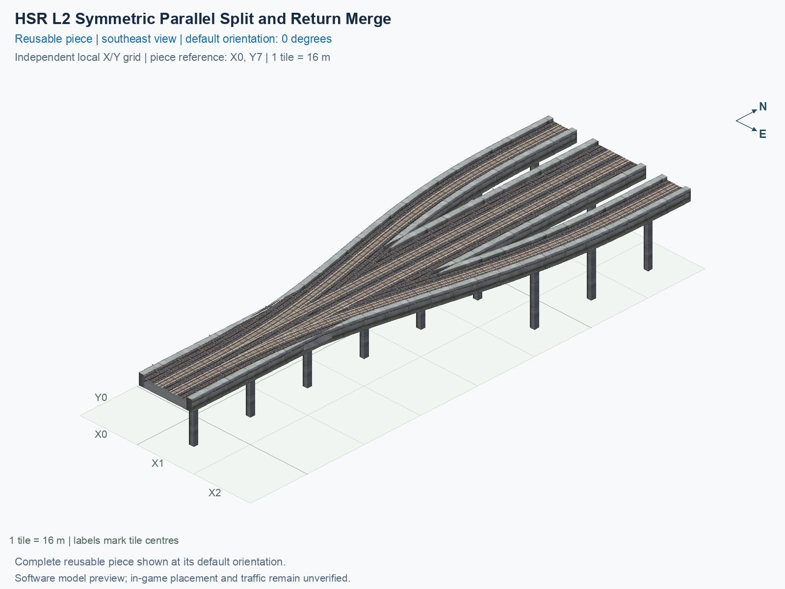

<a id="hsr-l2-symmetric-parallel-split-and-return-merge"></a>

# HSR Level 2 (15.5 m) — Parallel Split and Return Merge with Two-Track Mainline

<!-- SUBJECT IDENTITY MIGRATION -->

Identity migration: `hsr-component-lower-zero-turn-split-merge` → `hsr-l2-two-track-mainline-split-merge-parallel`. Earlier measurements, observations, and pictures retain their recorded names and fingerprints; they do not establish verification of the renamed build. See the [identity migration rules](../../../../docs/NAMING_CONVENTIONS.md#10-choosing-and-changing-names).

Purpose: explain this reusable piece, its matching connections and current test coverage.

<!-- BEGIN PIECE OVERVIEW -->

A shared 128 m two-track stem splits a northbound track to the right and merges its mirrored southbound return from the left, with both branch ends at the north side.

Exact reusable identifier: `hsr-l2-two-track-mainline-split-merge-parallel`.

Footprint: **3 × 8 tiles**. Exact menu name: **HSR Level 2 (15.5 m) — Parallel Split and Return Merge with Two-Track Mainline**.

Choose this exact name in Transportation → Rail. Press Home or End to rotate; use only the supported states listed below. Join each end to a matching port profile and direction.

- [Connections and journeys](#connections-and-journeys)
- [Test checklist](#test-checklist)



<!-- END PIECE OVERVIEW -->

<!-- BEGIN MANUAL SUMMARY -->

## Manual status

Generated from [the exact test cases](#test-checklist) and [authoritative observations](checks/manual-tests.json).

- [ ] Preview review: 0/1 applicable cases passed; 0 failed, 0 stale.
- [ ] In-game rendering: 0/4 applicable cases passed; 0 failed, 0 stale.
- [ ] Directed journeys: 0/16 applicable cases passed; 0 failed, 0 stale.

These observations cover only the named services, directions, poses, rotations, and recorded platforms.

<!-- END MANUAL SUMMARY -->

<!-- BEGIN CONNECTIONS -->

## Connections and journeys

Purpose: describe intrinsic directional interfaces and permitted service journeys.

Generated from [connections.json](connections.json). Coordinates are canonical east, north, and height in metres. A connection class names an encoded route interface; it does not prove visible deck/wall fit or an in-game test.

Supported placement states: 0° CCW, 90° CCW, 180° CCW, 270° CCW. Each state has its own declared manual scope.

A **port** is one directional transport-path endpoint. **Service** identifies the intended network service (for example HSR, street, or tram); **engine** is its internal traffic-class number, separate from the construction network. **Role** distinguishes primary service from auxiliary paths; sharing a traffic class does not establish service compatibility.

A **tangent** is a unit travel-direction vector: `[0,1]` means north. **Grade** is height gained per horizontal metre. These measured facts describe this subject alone. Compatibility requires a separate comparison of the complete joining boundaries; physical seams and actual game operation require their own evidence. See the [class index](../../connection-classes.jsonc) for shared route-interface membership.

| Port | Service / engine / role | Direction | Location; tangent; grade | Connection class |
| --- | --- | --- | --- | --- |
| `Lin` | hsr / 7 / primary | in | [0.0, 8.0, 15.5]; [0.0, -1.0]; 0.0 | `path-interface-365752af76285c80cd0b` |
| `Sout` | hsr / 7 / primary | out | [14.0, -120.0, 15.5]; [0.0, -1.0]; 0.0 | `path-interface-12d12be31d2057c5763d` |
| `Nin` | hsr / 7 / primary | in | [14.0, 8.0, 15.5]; [0.0, -1.0]; 0.0 | `path-interface-12d12be31d2057c5763d` |
| `Sin` | hsr / 7 / primary | in | [18.0, -120.0, 15.5]; [0.0, 1.0]; 0.0 | `path-interface-fba09fbeb87ad95c667a` |
| `Nout` | hsr / 7 / primary | out | [18.0, 8.0, 15.5]; [0.0, 1.0]; 0.0 | `path-interface-fba09fbeb87ad95c667a` |
| `Rout` | hsr / 7 / primary | out | [32.0, 8.0, 15.5]; [0.0, 1.0]; 0.0 | `path-interface-ac60d237d23f01143255` |

### Directed journeys

| Service | Entry → exit | Role |
| --- | --- | --- |
| hsr | `Lin` → `Sout` | primary |
| hsr | `Nin` → `Sout` | primary |
| hsr | `Sin` → `Rout` | primary |
| hsr | `Sin` → `Nout` | primary |

### Forbidden transfers

| From service / port | To service / port | Reason |
| --- | --- | --- |
| hsr / `Lin` | hsr / `Nout` | No directed route exists between these ports in the saved piece transport paths. In-game confirmation remains unverified. |
| hsr / `Lin` | hsr / `Rout` | No directed route exists between these ports in the saved piece transport paths. In-game confirmation remains unverified. |
| hsr / `Nin` | hsr / `Nout` | No directed route exists between these ports in the saved piece transport paths. In-game confirmation remains unverified. |
| hsr / `Nin` | hsr / `Rout` | No directed route exists between these ports in the saved piece transport paths. In-game confirmation remains unverified. |
| hsr / `Sin` | hsr / `Sout` | No directed route exists between these ports in the saved piece transport paths. In-game confirmation remains unverified. |

Review the test checklist for the exact tested cases and environments.

<!-- END CONNECTIONS -->

<!-- BEGIN MANUAL CHECKS -->

## Test checklist

Generated from [the authoritative record](checks/manual-tests.json). Only explicit human observations create manual passes; software and preview checks remain separate. Expand a check/service group to see its rotation table, then expand the matching exact scope to copy a case ID and inspect its pose, reviewer, environment, and evidence. Grouping changes only this view; every declared case remains separate.

**States:** [x] passed; [ ] unverified, failed, or stale; N/A is an explicit inapplicable declaration. A dash means no case was declared in that column. Every pass covers only its recorded environment. T means a distinct construction-transposed state.

Four proper rotations are covered. No additional reflected state is established by this record; repeated construction aliases do not create new orientations.

Current totals: unverified: 55, passed: 0, failed: 0, stale: 0, not_applicable: 0.

### Record an observation

Follow the [shared testing guide](../../../../docs/TESTING.md); copy [the unconfirmed example](checks/observation.example.json) to `checks/observation.json`. Case identifiers are in the expandable sections below. Do not edit generated checkboxes.

From the repository folder containing `custom-pieces`, run after filling `checks/observation.json` and explicitly confirming the exact observation:

```sh
python3 -m scp.content record --record custom-pieces/domains/high-speed-rail/00_pieces/hsr-l2-two-track-mainline-split-merge-parallel/checks/manual-tests.json --observation custom-pieces/domains/high-speed-rail/00_pieces/hsr-l2-two-track-mainline-split-merge-parallel/checks/observation.json
```

### Detailed current checks

Each collapsed group shows exact case counts and states. Forbidden transfers are grouped by the directed service pair; the table inside retains every port pair and rotation.

<details>
<summary>Compiled resources — Whole subject — 1 case; unverified: 1</summary>

| Check / exact scope | General | 0° | 90° | 180° | 270° |
| --- | --- | --- | --- | --- | --- |
| **Compiled resources**<br>Whole subject | <a href="#case-software_resources-39869e13d304b7173c09">[ ] unverified</a> | — | — | — | — |


<details>
<summary>Compiled resources — Whole subject</summary>

<a id="case-software_resources-39869e13d304b7173c09"></a>

**General: unverified** — `software_resources-39869e13d304b7173c09`.

Verify the actual compiled resources and construction rules.

Scope: Whole subject.

No observation recorded.

</details>

</details>

<details>
<summary>Directed routing graph — Whole subject — 1 case; unverified: 1</summary>

| Check / exact scope | General | 0° | 90° | 180° | 270° |
| --- | --- | --- | --- | --- | --- |
| **Directed routing graph**<br>Whole subject | <a href="#case-software_connectivity-39869e13d304b7173c09">[ ] unverified</a> | — | — | — | — |


<details>
<summary>Directed routing graph — Whole subject</summary>

<a id="case-software_connectivity-39869e13d304b7173c09"></a>

**General: unverified** — `software_connectivity-39869e13d304b7173c09`.

Verify the declared directed journeys and forbidden transfers.

Scope: Whole subject.

No observation recorded.

</details>

</details>

<details>
<summary>Preview review — Images — 1 case; unverified: 1</summary>

| Check / exact scope | General | 0° | 90° | 180° | 270° |
| --- | --- | --- | --- | --- | --- |
| **Preview review**<br>Image: image:hsr-component-lower-zero-turn-split-merge:canonical-southeast | <a href="#case-preview_review-9071fa4a727da279887b">[ ] unverified</a> | — | — | — | — |


<details>
<summary>Preview review — Image: image:hsr-component-lower-zero-turn-split-merge:canonical-southeast</summary>

<a id="case-preview_review-9071fa4a727da279887b"></a>

**General: unverified** — `preview_review-9071fa4a727da279887b`.

Inspect this exact preview for tracks, walls, piers, seams and shadows.

Scope: Image: image:hsr-component-lower-zero-turn-split-merge:canonical-southeast.

No observation recorded.

</details>

</details>

<details>
<summary>In-game rendering — Whole subject — 4 cases; unverified: 4</summary>

| Check / exact scope | General | 0° | 90° | 180° | 270° |
| --- | --- | --- | --- | --- | --- |
| **In-game rendering**<br>Whole subject | — | <a href="#case-in_game_render-969cd309fc1c5b52af68">[ ] unverified</a> | <a href="#case-in_game_render-b2f067410220370bda14">[ ] unverified</a> | <a href="#case-in_game_render-872d048378a9599f2c33">[ ] unverified</a> | <a href="#case-in_game_render-c7a518a965ac5b23cc14">[ ] unverified</a> |


<details>
<summary>In-game rendering — Whole subject</summary>

<a id="case-in_game_render-969cd309fc1c5b52af68"></a>

**0° CCW: unverified** — `in_game_render-969cd309fc1c5b52af68`.

Inspect the placed tracks, walls, piers, seams and shadows in SimCity 4.

Scope: Whole subject.

No observation recorded.

<a id="case-in_game_render-b2f067410220370bda14"></a>

**90° CCW: unverified** — `in_game_render-b2f067410220370bda14`.

Inspect the placed tracks, walls, piers, seams and shadows in SimCity 4.

Scope: Whole subject.

No observation recorded.

<a id="case-in_game_render-872d048378a9599f2c33"></a>

**180° CCW: unverified** — `in_game_render-872d048378a9599f2c33`.

Inspect the placed tracks, walls, piers, seams and shadows in SimCity 4.

Scope: Whole subject.

No observation recorded.

<a id="case-in_game_render-c7a518a965ac5b23cc14"></a>

**270° CCW: unverified** — `in_game_render-c7a518a965ac5b23cc14`.

Inspect the placed tracks, walls, piers, seams and shadows in SimCity 4.

Scope: Whole subject.

No observation recorded.

</details>

</details>

<details>
<summary>Placement — Whole subject — 4 cases; unverified: 4</summary>

| Check / exact scope | General | 0° | 90° | 180° | 270° |
| --- | --- | --- | --- | --- | --- |
| **Placement**<br>Whole subject | — | <a href="#case-in_game_placement-969cd309fc1c5b52af68">[ ] unverified</a> | <a href="#case-in_game_placement-b2f067410220370bda14">[ ] unverified</a> | <a href="#case-in_game_placement-872d048378a9599f2c33">[ ] unverified</a> | <a href="#case-in_game_placement-c7a518a965ac5b23cc14">[ ] unverified</a> |


<details>
<summary>Placement — Whole subject</summary>

<a id="case-in_game_placement-969cd309fc1c5b52af68"></a>

**0° CCW: unverified** — `in_game_placement-969cd309fc1c5b52af68`.

Place this piece or complete blueprint and inspect every occupied tile.

Scope: Whole subject.

No observation recorded.

<a id="case-in_game_placement-b2f067410220370bda14"></a>

**90° CCW: unverified** — `in_game_placement-b2f067410220370bda14`.

Place this piece or complete blueprint and inspect every occupied tile.

Scope: Whole subject.

No observation recorded.

<a id="case-in_game_placement-872d048378a9599f2c33"></a>

**180° CCW: unverified** — `in_game_placement-872d048378a9599f2c33`.

Place this piece or complete blueprint and inspect every occupied tile.

Scope: Whole subject.

No observation recorded.

<a id="case-in_game_placement-c7a518a965ac5b23cc14"></a>

**270° CCW: unverified** — `in_game_placement-c7a518a965ac5b23cc14`.

Place this piece or complete blueprint and inspect every occupied tile.

Scope: Whole subject.

No observation recorded.

</details>

</details>

<details>
<summary>Demolition — Whole subject — 4 cases; unverified: 4</summary>

| Check / exact scope | General | 0° | 90° | 180° | 270° |
| --- | --- | --- | --- | --- | --- |
| **Demolition**<br>Whole subject | — | <a href="#case-in_game_demolition-969cd309fc1c5b52af68">[ ] unverified</a> | <a href="#case-in_game_demolition-b2f067410220370bda14">[ ] unverified</a> | <a href="#case-in_game_demolition-872d048378a9599f2c33">[ ] unverified</a> | <a href="#case-in_game_demolition-c7a518a965ac5b23cc14">[ ] unverified</a> |


<details>
<summary>Demolition — Whole subject</summary>

<a id="case-in_game_demolition-969cd309fc1c5b52af68"></a>

**0° CCW: unverified** — `in_game_demolition-969cd309fc1c5b52af68`.

Bulldoze the complete placement and inspect the cleared area.

Scope: Whole subject.

No observation recorded.

<a id="case-in_game_demolition-b2f067410220370bda14"></a>

**90° CCW: unverified** — `in_game_demolition-b2f067410220370bda14`.

Bulldoze the complete placement and inspect the cleared area.

Scope: Whole subject.

No observation recorded.

<a id="case-in_game_demolition-872d048378a9599f2c33"></a>

**180° CCW: unverified** — `in_game_demolition-872d048378a9599f2c33`.

Bulldoze the complete placement and inspect the cleared area.

Scope: Whole subject.

No observation recorded.

<a id="case-in_game_demolition-c7a518a965ac5b23cc14"></a>

**270° CCW: unverified** — `in_game_demolition-c7a518a965ac5b23cc14`.

Bulldoze the complete placement and inspect the cleared area.

Scope: Whole subject.

No observation recorded.

</details>

</details>

<details>
<summary>Save and reload — Whole subject — 4 cases; unverified: 4</summary>

| Check / exact scope | General | 0° | 90° | 180° | 270° |
| --- | --- | --- | --- | --- | --- |
| **Save and reload**<br>Whole subject | — | <a href="#case-in_game_save_reload-969cd309fc1c5b52af68">[ ] unverified</a> | <a href="#case-in_game_save_reload-b2f067410220370bda14">[ ] unverified</a> | <a href="#case-in_game_save_reload-872d048378a9599f2c33">[ ] unverified</a> | <a href="#case-in_game_save_reload-c7a518a965ac5b23cc14">[ ] unverified</a> |


<details>
<summary>Save and reload — Whole subject</summary>

<a id="case-in_game_save_reload-969cd309fc1c5b52af68"></a>

**0° CCW: unverified** — `in_game_save_reload-969cd309fc1c5b52af68`.

Save, quit, reload and inspect the placement and its paths.

Scope: Whole subject.

No observation recorded.

<a id="case-in_game_save_reload-b2f067410220370bda14"></a>

**90° CCW: unverified** — `in_game_save_reload-b2f067410220370bda14`.

Save, quit, reload and inspect the placement and its paths.

Scope: Whole subject.

No observation recorded.

<a id="case-in_game_save_reload-872d048378a9599f2c33"></a>

**180° CCW: unverified** — `in_game_save_reload-872d048378a9599f2c33`.

Save, quit, reload and inspect the placement and its paths.

Scope: Whole subject.

No observation recorded.

<a id="case-in_game_save_reload-c7a518a965ac5b23cc14"></a>

**270° CCW: unverified** — `in_game_save_reload-c7a518a965ac5b23cc14`.

Save, quit, reload and inspect the placement and its paths.

Scope: Whole subject.

No observation recorded.

</details>

</details>

<details>
<summary>Journey — hsr — 16 cases; unverified: 16</summary>

| Check / exact scope | General | 0° | 90° | 180° | 270° |
| --- | --- | --- | --- | --- | --- |
| **Journey**<br>Service: hsr; role: primary; journey: 7:Lin>Sout; entry: Lin; exit: Sout | — | <a href="#case-in_game_journey-77c5c7ad008c268f7dd4">[ ] unverified</a> | <a href="#case-in_game_journey-9426c3103aec536993f7">[ ] unverified</a> | <a href="#case-in_game_journey-c5ed4d67e5bf7381bbe0">[ ] unverified</a> | <a href="#case-in_game_journey-206e3a7e7a5650584e26">[ ] unverified</a> |
| **Journey**<br>Service: hsr; role: primary; journey: 7:Nin>Sout; entry: Nin; exit: Sout | — | <a href="#case-in_game_journey-a0dd4645c70cd2af3373">[ ] unverified</a> | <a href="#case-in_game_journey-025a861eb8a637314e54">[ ] unverified</a> | <a href="#case-in_game_journey-56e0baa9bb7a2450e804">[ ] unverified</a> | <a href="#case-in_game_journey-f3b8dd8baf2b6ef78861">[ ] unverified</a> |
| **Journey**<br>Service: hsr; role: primary; journey: 7:Sin>Rout; entry: Sin; exit: Rout | — | <a href="#case-in_game_journey-62fae79d01a1e1038bf3">[ ] unverified</a> | <a href="#case-in_game_journey-555e995a7f6b61fa5b90">[ ] unverified</a> | <a href="#case-in_game_journey-f8ddcdb0a43e933a5e4b">[ ] unverified</a> | <a href="#case-in_game_journey-5c58f2edc95b9c2d2974">[ ] unverified</a> |
| **Journey**<br>Service: hsr; role: primary; journey: 7:Sin>Nout; entry: Sin; exit: Nout | — | <a href="#case-in_game_journey-0d9f257eb47eed433fe7">[ ] unverified</a> | <a href="#case-in_game_journey-9471b00e2a29a2f16f72">[ ] unverified</a> | <a href="#case-in_game_journey-9ef4779a1919c252c421">[ ] unverified</a> | <a href="#case-in_game_journey-5d388a71a65b5645e02e">[ ] unverified</a> |


<details>
<summary>Journey — Service: hsr; role: primary; journey: 7:Lin>Sout; entry: Lin; exit: Sout</summary>

<a id="case-in_game_journey-77c5c7ad008c268f7dd4"></a>

**0° CCW: unverified** — `in_game_journey-77c5c7ad008c268f7dd4`.

Run the declared journey in this direction using its service network.

Scope: Service: hsr; role: primary; journey: 7:Lin>Sout; entry: Lin; exit: Sout.

No observation recorded.

<a id="case-in_game_journey-9426c3103aec536993f7"></a>

**90° CCW: unverified** — `in_game_journey-9426c3103aec536993f7`.

Run the declared journey in this direction using its service network.

Scope: Service: hsr; role: primary; journey: 7:Lin>Sout; entry: Lin; exit: Sout.

No observation recorded.

<a id="case-in_game_journey-c5ed4d67e5bf7381bbe0"></a>

**180° CCW: unverified** — `in_game_journey-c5ed4d67e5bf7381bbe0`.

Run the declared journey in this direction using its service network.

Scope: Service: hsr; role: primary; journey: 7:Lin>Sout; entry: Lin; exit: Sout.

No observation recorded.

<a id="case-in_game_journey-206e3a7e7a5650584e26"></a>

**270° CCW: unverified** — `in_game_journey-206e3a7e7a5650584e26`.

Run the declared journey in this direction using its service network.

Scope: Service: hsr; role: primary; journey: 7:Lin>Sout; entry: Lin; exit: Sout.

No observation recorded.

</details>


<details>
<summary>Journey — Service: hsr; role: primary; journey: 7:Nin>Sout; entry: Nin; exit: Sout</summary>

<a id="case-in_game_journey-a0dd4645c70cd2af3373"></a>

**0° CCW: unverified** — `in_game_journey-a0dd4645c70cd2af3373`.

Run the declared journey in this direction using its service network.

Scope: Service: hsr; role: primary; journey: 7:Nin>Sout; entry: Nin; exit: Sout.

No observation recorded.

<a id="case-in_game_journey-025a861eb8a637314e54"></a>

**90° CCW: unverified** — `in_game_journey-025a861eb8a637314e54`.

Run the declared journey in this direction using its service network.

Scope: Service: hsr; role: primary; journey: 7:Nin>Sout; entry: Nin; exit: Sout.

No observation recorded.

<a id="case-in_game_journey-56e0baa9bb7a2450e804"></a>

**180° CCW: unverified** — `in_game_journey-56e0baa9bb7a2450e804`.

Run the declared journey in this direction using its service network.

Scope: Service: hsr; role: primary; journey: 7:Nin>Sout; entry: Nin; exit: Sout.

No observation recorded.

<a id="case-in_game_journey-f3b8dd8baf2b6ef78861"></a>

**270° CCW: unverified** — `in_game_journey-f3b8dd8baf2b6ef78861`.

Run the declared journey in this direction using its service network.

Scope: Service: hsr; role: primary; journey: 7:Nin>Sout; entry: Nin; exit: Sout.

No observation recorded.

</details>


<details>
<summary>Journey — Service: hsr; role: primary; journey: 7:Sin>Rout; entry: Sin; exit: Rout</summary>

<a id="case-in_game_journey-62fae79d01a1e1038bf3"></a>

**0° CCW: unverified** — `in_game_journey-62fae79d01a1e1038bf3`.

Run the declared journey in this direction using its service network.

Scope: Service: hsr; role: primary; journey: 7:Sin>Rout; entry: Sin; exit: Rout.

No observation recorded.

<a id="case-in_game_journey-555e995a7f6b61fa5b90"></a>

**90° CCW: unverified** — `in_game_journey-555e995a7f6b61fa5b90`.

Run the declared journey in this direction using its service network.

Scope: Service: hsr; role: primary; journey: 7:Sin>Rout; entry: Sin; exit: Rout.

No observation recorded.

<a id="case-in_game_journey-f8ddcdb0a43e933a5e4b"></a>

**180° CCW: unverified** — `in_game_journey-f8ddcdb0a43e933a5e4b`.

Run the declared journey in this direction using its service network.

Scope: Service: hsr; role: primary; journey: 7:Sin>Rout; entry: Sin; exit: Rout.

No observation recorded.

<a id="case-in_game_journey-5c58f2edc95b9c2d2974"></a>

**270° CCW: unverified** — `in_game_journey-5c58f2edc95b9c2d2974`.

Run the declared journey in this direction using its service network.

Scope: Service: hsr; role: primary; journey: 7:Sin>Rout; entry: Sin; exit: Rout.

No observation recorded.

</details>


<details>
<summary>Journey — Service: hsr; role: primary; journey: 7:Sin>Nout; entry: Sin; exit: Nout</summary>

<a id="case-in_game_journey-0d9f257eb47eed433fe7"></a>

**0° CCW: unverified** — `in_game_journey-0d9f257eb47eed433fe7`.

Run the declared journey in this direction using its service network.

Scope: Service: hsr; role: primary; journey: 7:Sin>Nout; entry: Sin; exit: Nout.

No observation recorded.

<a id="case-in_game_journey-9471b00e2a29a2f16f72"></a>

**90° CCW: unverified** — `in_game_journey-9471b00e2a29a2f16f72`.

Run the declared journey in this direction using its service network.

Scope: Service: hsr; role: primary; journey: 7:Sin>Nout; entry: Sin; exit: Nout.

No observation recorded.

<a id="case-in_game_journey-9ef4779a1919c252c421"></a>

**180° CCW: unverified** — `in_game_journey-9ef4779a1919c252c421`.

Run the declared journey in this direction using its service network.

Scope: Service: hsr; role: primary; journey: 7:Sin>Nout; entry: Sin; exit: Nout.

No observation recorded.

<a id="case-in_game_journey-5d388a71a65b5645e02e"></a>

**270° CCW: unverified** — `in_game_journey-5d388a71a65b5645e02e`.

Run the declared journey in this direction using its service network.

Scope: Service: hsr; role: primary; journey: 7:Sin>Nout; entry: Sin; exit: Nout.

No observation recorded.

</details>

</details>

<details>
<summary>Forbidden transfer — hsr → hsr — 20 cases; unverified: 20</summary>

| Check / exact scope | General | 0° | 90° | 180° | 270° |
| --- | --- | --- | --- | --- | --- |
| **Forbidden transfer**<br>from port: Lin; to port: Nout; from service: hsr; to service: hsr; basis: not reachable in actual saved PATH graph | — | <a href="#case-in_game_forbidden_transfer-a415429ff1e4794f1b4c">[ ] unverified</a> | <a href="#case-in_game_forbidden_transfer-d722b0ca2eb754fd29c2">[ ] unverified</a> | <a href="#case-in_game_forbidden_transfer-e21d175215f715972784">[ ] unverified</a> | <a href="#case-in_game_forbidden_transfer-dd9262625f558d750967">[ ] unverified</a> |
| **Forbidden transfer**<br>from port: Lin; to port: Rout; from service: hsr; to service: hsr; basis: not reachable in actual saved PATH graph | — | <a href="#case-in_game_forbidden_transfer-eb7ee3c9289306e11f5a">[ ] unverified</a> | <a href="#case-in_game_forbidden_transfer-517ca1dace103c9770bc">[ ] unverified</a> | <a href="#case-in_game_forbidden_transfer-45622de28d1feb7e1ac3">[ ] unverified</a> | <a href="#case-in_game_forbidden_transfer-85a7657b63c4cb011882">[ ] unverified</a> |
| **Forbidden transfer**<br>from port: Nin; to port: Nout; from service: hsr; to service: hsr; basis: not reachable in actual saved PATH graph | — | <a href="#case-in_game_forbidden_transfer-b871aa604fe4375b2f29">[ ] unverified</a> | <a href="#case-in_game_forbidden_transfer-609dfe5b23e73ea49ce4">[ ] unverified</a> | <a href="#case-in_game_forbidden_transfer-294f139c5944d186d362">[ ] unverified</a> | <a href="#case-in_game_forbidden_transfer-9c930838c4c3b73aada4">[ ] unverified</a> |
| **Forbidden transfer**<br>from port: Nin; to port: Rout; from service: hsr; to service: hsr; basis: not reachable in actual saved PATH graph | — | <a href="#case-in_game_forbidden_transfer-3500e7a700a35c774fa5">[ ] unverified</a> | <a href="#case-in_game_forbidden_transfer-c28dd916381cc1ee6549">[ ] unverified</a> | <a href="#case-in_game_forbidden_transfer-81d49736d2d39bf18070">[ ] unverified</a> | <a href="#case-in_game_forbidden_transfer-455aca243f34c02cab01">[ ] unverified</a> |
| **Forbidden transfer**<br>from port: Sin; to port: Sout; from service: hsr; to service: hsr; basis: not reachable in actual saved PATH graph | — | <a href="#case-in_game_forbidden_transfer-8dcfbceec0d94eca7469">[ ] unverified</a> | <a href="#case-in_game_forbidden_transfer-3e2a4ce873d105cb54d7">[ ] unverified</a> | <a href="#case-in_game_forbidden_transfer-d63b40152233e7726759">[ ] unverified</a> | <a href="#case-in_game_forbidden_transfer-023bd6ccfa75056f9ea4">[ ] unverified</a> |


<details>
<summary>Forbidden transfer — from port: Lin; to port: Nout; from service: hsr; to service: hsr; basis: not reachable in actual saved PATH graph</summary>

<a id="case-in_game_forbidden_transfer-a415429ff1e4794f1b4c"></a>

**0° CCW: unverified** — `in_game_forbidden_transfer-a415429ff1e4794f1b4c`.

Confirm this undeclared transfer is unavailable.

Scope: from port: Lin; to port: Nout; from service: hsr; to service: hsr; basis: not reachable in actual saved PATH graph.

No observation recorded.

<a id="case-in_game_forbidden_transfer-d722b0ca2eb754fd29c2"></a>

**90° CCW: unverified** — `in_game_forbidden_transfer-d722b0ca2eb754fd29c2`.

Confirm this undeclared transfer is unavailable.

Scope: from port: Lin; to port: Nout; from service: hsr; to service: hsr; basis: not reachable in actual saved PATH graph.

No observation recorded.

<a id="case-in_game_forbidden_transfer-e21d175215f715972784"></a>

**180° CCW: unverified** — `in_game_forbidden_transfer-e21d175215f715972784`.

Confirm this undeclared transfer is unavailable.

Scope: from port: Lin; to port: Nout; from service: hsr; to service: hsr; basis: not reachable in actual saved PATH graph.

No observation recorded.

<a id="case-in_game_forbidden_transfer-dd9262625f558d750967"></a>

**270° CCW: unverified** — `in_game_forbidden_transfer-dd9262625f558d750967`.

Confirm this undeclared transfer is unavailable.

Scope: from port: Lin; to port: Nout; from service: hsr; to service: hsr; basis: not reachable in actual saved PATH graph.

No observation recorded.

</details>


<details>
<summary>Forbidden transfer — from port: Lin; to port: Rout; from service: hsr; to service: hsr; basis: not reachable in actual saved PATH graph</summary>

<a id="case-in_game_forbidden_transfer-eb7ee3c9289306e11f5a"></a>

**0° CCW: unverified** — `in_game_forbidden_transfer-eb7ee3c9289306e11f5a`.

Confirm this undeclared transfer is unavailable.

Scope: from port: Lin; to port: Rout; from service: hsr; to service: hsr; basis: not reachable in actual saved PATH graph.

No observation recorded.

<a id="case-in_game_forbidden_transfer-517ca1dace103c9770bc"></a>

**90° CCW: unverified** — `in_game_forbidden_transfer-517ca1dace103c9770bc`.

Confirm this undeclared transfer is unavailable.

Scope: from port: Lin; to port: Rout; from service: hsr; to service: hsr; basis: not reachable in actual saved PATH graph.

No observation recorded.

<a id="case-in_game_forbidden_transfer-45622de28d1feb7e1ac3"></a>

**180° CCW: unverified** — `in_game_forbidden_transfer-45622de28d1feb7e1ac3`.

Confirm this undeclared transfer is unavailable.

Scope: from port: Lin; to port: Rout; from service: hsr; to service: hsr; basis: not reachable in actual saved PATH graph.

No observation recorded.

<a id="case-in_game_forbidden_transfer-85a7657b63c4cb011882"></a>

**270° CCW: unverified** — `in_game_forbidden_transfer-85a7657b63c4cb011882`.

Confirm this undeclared transfer is unavailable.

Scope: from port: Lin; to port: Rout; from service: hsr; to service: hsr; basis: not reachable in actual saved PATH graph.

No observation recorded.

</details>


<details>
<summary>Forbidden transfer — from port: Nin; to port: Nout; from service: hsr; to service: hsr; basis: not reachable in actual saved PATH graph</summary>

<a id="case-in_game_forbidden_transfer-b871aa604fe4375b2f29"></a>

**0° CCW: unverified** — `in_game_forbidden_transfer-b871aa604fe4375b2f29`.

Confirm this undeclared transfer is unavailable.

Scope: from port: Nin; to port: Nout; from service: hsr; to service: hsr; basis: not reachable in actual saved PATH graph.

No observation recorded.

<a id="case-in_game_forbidden_transfer-609dfe5b23e73ea49ce4"></a>

**90° CCW: unverified** — `in_game_forbidden_transfer-609dfe5b23e73ea49ce4`.

Confirm this undeclared transfer is unavailable.

Scope: from port: Nin; to port: Nout; from service: hsr; to service: hsr; basis: not reachable in actual saved PATH graph.

No observation recorded.

<a id="case-in_game_forbidden_transfer-294f139c5944d186d362"></a>

**180° CCW: unverified** — `in_game_forbidden_transfer-294f139c5944d186d362`.

Confirm this undeclared transfer is unavailable.

Scope: from port: Nin; to port: Nout; from service: hsr; to service: hsr; basis: not reachable in actual saved PATH graph.

No observation recorded.

<a id="case-in_game_forbidden_transfer-9c930838c4c3b73aada4"></a>

**270° CCW: unverified** — `in_game_forbidden_transfer-9c930838c4c3b73aada4`.

Confirm this undeclared transfer is unavailable.

Scope: from port: Nin; to port: Nout; from service: hsr; to service: hsr; basis: not reachable in actual saved PATH graph.

No observation recorded.

</details>


<details>
<summary>Forbidden transfer — from port: Nin; to port: Rout; from service: hsr; to service: hsr; basis: not reachable in actual saved PATH graph</summary>

<a id="case-in_game_forbidden_transfer-3500e7a700a35c774fa5"></a>

**0° CCW: unverified** — `in_game_forbidden_transfer-3500e7a700a35c774fa5`.

Confirm this undeclared transfer is unavailable.

Scope: from port: Nin; to port: Rout; from service: hsr; to service: hsr; basis: not reachable in actual saved PATH graph.

No observation recorded.

<a id="case-in_game_forbidden_transfer-c28dd916381cc1ee6549"></a>

**90° CCW: unverified** — `in_game_forbidden_transfer-c28dd916381cc1ee6549`.

Confirm this undeclared transfer is unavailable.

Scope: from port: Nin; to port: Rout; from service: hsr; to service: hsr; basis: not reachable in actual saved PATH graph.

No observation recorded.

<a id="case-in_game_forbidden_transfer-81d49736d2d39bf18070"></a>

**180° CCW: unverified** — `in_game_forbidden_transfer-81d49736d2d39bf18070`.

Confirm this undeclared transfer is unavailable.

Scope: from port: Nin; to port: Rout; from service: hsr; to service: hsr; basis: not reachable in actual saved PATH graph.

No observation recorded.

<a id="case-in_game_forbidden_transfer-455aca243f34c02cab01"></a>

**270° CCW: unverified** — `in_game_forbidden_transfer-455aca243f34c02cab01`.

Confirm this undeclared transfer is unavailable.

Scope: from port: Nin; to port: Rout; from service: hsr; to service: hsr; basis: not reachable in actual saved PATH graph.

No observation recorded.

</details>


<details>
<summary>Forbidden transfer — from port: Sin; to port: Sout; from service: hsr; to service: hsr; basis: not reachable in actual saved PATH graph</summary>

<a id="case-in_game_forbidden_transfer-8dcfbceec0d94eca7469"></a>

**0° CCW: unverified** — `in_game_forbidden_transfer-8dcfbceec0d94eca7469`.

Confirm this undeclared transfer is unavailable.

Scope: from port: Sin; to port: Sout; from service: hsr; to service: hsr; basis: not reachable in actual saved PATH graph.

No observation recorded.

<a id="case-in_game_forbidden_transfer-3e2a4ce873d105cb54d7"></a>

**90° CCW: unverified** — `in_game_forbidden_transfer-3e2a4ce873d105cb54d7`.

Confirm this undeclared transfer is unavailable.

Scope: from port: Sin; to port: Sout; from service: hsr; to service: hsr; basis: not reachable in actual saved PATH graph.

No observation recorded.

<a id="case-in_game_forbidden_transfer-d63b40152233e7726759"></a>

**180° CCW: unverified** — `in_game_forbidden_transfer-d63b40152233e7726759`.

Confirm this undeclared transfer is unavailable.

Scope: from port: Sin; to port: Sout; from service: hsr; to service: hsr; basis: not reachable in actual saved PATH graph.

No observation recorded.

<a id="case-in_game_forbidden_transfer-023bd6ccfa75056f9ea4"></a>

**270° CCW: unverified** — `in_game_forbidden_transfer-023bd6ccfa75056f9ea4`.

Confirm this undeclared transfer is unavailable.

Scope: from port: Sin; to port: Sout; from service: hsr; to service: hsr; basis: not reachable in actual saved PATH graph.

No observation recorded.

</details>

</details>

<!-- END MANUAL CHECKS -->

## Engineering contract

This flat symmetric parallel split-and-return merge spans 128 m in a 3 × 8 construction rectangle, with 20 occupied cells, two structural cells, and 14 supports. Its full-length and compact related modules remain distinct functional variants; align neighbouring types to their actual measured ends.

Use the [independent source contract](../../implementation/scp_hsr/hsr_components_verify.py) and this type's [definition](piece.json) for exact expectations. Shared HSR/GHSR facts remain in [NETWORK_SPEC.md](../../NETWORK_SPEC.md). These authored notes supplement generated source views; they do not change geometry, reset observations, or establish game operation.
