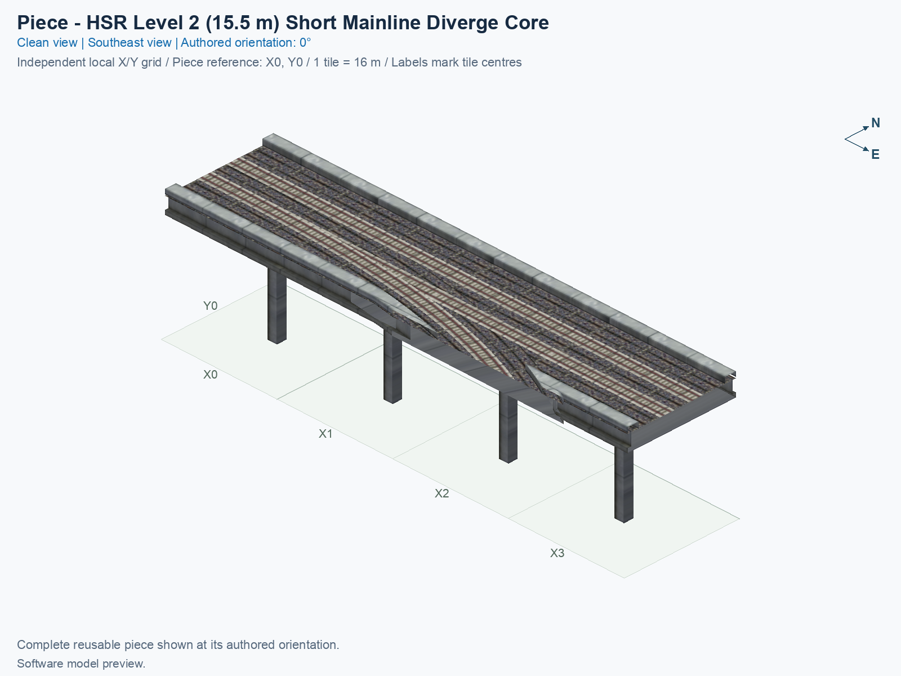
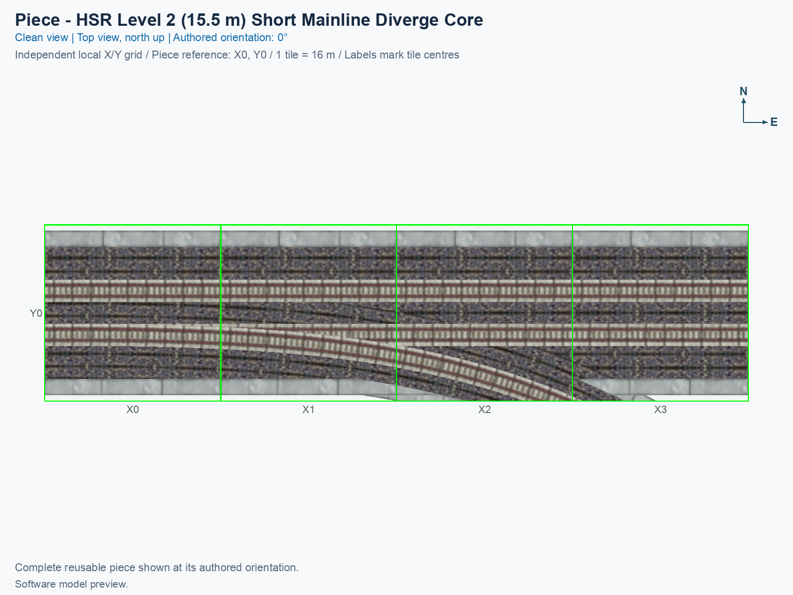
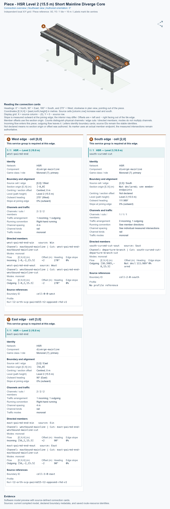

# HSR Level 2 (15.5 m) — Split from Two-Track Mainline — Oblique Branch Cut

<!-- SUBJECT IDENTITY MIGRATION -->

Identity migration: `hsr-component-l2-short-mainline-diverge-core` → `hsr-l2-two-track-mainline-split-oblique-cut`. Earlier measurements, observations, and pictures retain their recorded names and fingerprints; they do not establish verification of the renamed build. See the [identity migration rules](../../../../docs/NAMING_CONVENTIONS.md#10-choosing-and-changing-names).

<!-- PIECE README LAYOUT: 2 -->

[1. Views](#1-views) · [2. Piece and placement](#2-piece-and-placement) · [3. Connection matrix](#3-connection-matrix) · [Testing ↗ (separate document)](TESTING.md)

This reusable High Speed Rail (HSR) piece carries two opposite directions along one mainline and provides one directed departure onto a curved branch. Every train path remains at nominal Level 2 (L2), measured at 15.5 m above the piece’s ground reference. One click places this four-tile component; it does not place a complete interchange.

**Status: experimental.** Software pictures and saved-resource checks do not establish human preview approval, game appearance, or train operation. The exact menu name is **HSR Level 2 (15.5 m) — Split from Two-Track Mainline — Oblique Branch Cut**, and the permanent type ID is `hsr-l2-two-track-mainline-split-oblique-cut`.

## 1. Views

Both clean pictures show the same complete saved model at its authored 0° orientation. North is up in the top view; X increases eastward, Y increases northward, and each city tile measures 16 × 16 m. The local picture grid belongs to this reusable type. Its software reference is not a certified mouse-click anchor.

The top view draws bright green tile boundaries over the tracks and deck, so each tile remains identifiable where the model would otherwise hide the grid.

<!-- BEGIN PIECE VIEWS -->

<!-- END PIECE VIEWS -->

The [angled-view evidence](evidence/preview.json) and [top-view evidence](evidence/preview-top.json) identify the actual saved model, textures, camera, captions, and image fingerprints. The connection overview in chapter 3 adds measured boundary cards to that same reusable type.

## 2. Piece and placement

<!-- BEGIN PIECE OVERVIEW -->

Four-tile native two-track mainline with a one-way departure and an exact native straight approach; its unchanged custom curved branch accepts One-Way Curve from Diverge.

Exact reusable identifier: `hsr-l2-two-track-mainline-split-oblique-cut`.

Footprint: **4 × 1 tiles**. Exact menu name: **HSR Level 2 (15.5 m) — Split from Two-Track Mainline — Oblique Branch Cut**.

<!-- END PIECE OVERVIEW -->

### Function and complete joining boundaries

A mainline is the pair of tracks continuing through the piece. At the authored 0° orientation, it runs east/west. Traffic entering from the west can continue east or leave through the southern curved cut; traffic entering from the east continues west. The saved resources provide no east-to-branch movement or mainline U-turn. The generated matrix identifies the exact entrances, exits, and unavailable movements.

The raised grey south border, called a parapet, stays straight into X1, then follows the brown ballast outline into the existing curved grey border at the bottom of X2. Ballast is the stone bed around the rails. This left border is continuous, with no perpendicular end face interrupting the curve. Its straight section keeps the native thickness of approximately 1.50345 m; the curved continuation matches the existing branch border's 1.4 m profile measured across the curve. The straight right border in X3 now continues along the branch’s inside ballast outline into the existing curved grey border. Its top and inside wall meet that curve continuously; the former flat end face has been removed. The rails, traffic routes, four supports, and existing curved border retain their previous geometry. The [before/after comparison](evidence/parapet-alignment.json) records that preservation, and the [software checks](TESTING.md#3-software-checks) explain the exact dimensions and clearance limits.

Both mainline ends require the complete paired Level 2 boundary, including its two directed tracks and native 15 m visual profile. The branch ends obliquely, meaning its track crosses the tile edge at an angle. It requires the exact matching curved continuation, rather than an arbitrary straight at the same height. Its card preserves the measured endpoint and outward heading without inventing a centred paired section.

The permanent construction definition is [piece.json](piece.json), and its geometry belongs in [geometry.json](geometry.json). The [authored connector groups](connector-groups.jsonc), [resolved export](connector-data.json), and [measured connections](connections.json) describe this piece’s intrinsic boundaries and journeys. The library does not supply automatic compatibility discovery, and this guide does not publish a neighbour shortlist.

### Place and rotate the piece

After following the [separate installation procedure](../../../../docs/BUILD_AND_INSTALL.md), use a disposable flat test city. A proper rotation turns the whole piece and all its travel directions together; it does not reflect the piece or reverse a directed track.

1. Open **Transportation → Rail**, hover over the SCP buttons, and select **HSR Level 2 (15.5 m) — Split from Two-Track Mainline — Oblique Branch Cut**. An assembly can expose the same reusable type through its Tab/Shift+Tab component cycle.
2. Move the complete cursor preview onto clear terrain. Press **Home** or **End** to rotate; on the documented Mac keyboard, **Fn + ←** and **Fn + →** provide those keys. Use only the supported construction states listed below.
3. At 0°, identify the west and east paired mainline ends and the southern curved departure in the top picture. Keep all four consecutive tiles clear, and align the whole paired boundary and curved continuation before placing.
4. Click once to place the component. Supply matching outside connections and travel demand. Inspect tracks, decks, walls, supports, and shadows, then check the permitted journeys and unavailable movements separately.

## 3. Connection matrix

<!-- BEGIN PIECE CONNECTION MATRIX -->

### Directed entrance/exit matrix

Read **from an entrance row to an exit column**. **Saved PATH** checks the saved traffic route; **Route Query** checks the route shown by the game; **Visible travel** checks a vehicle completing that journey. For HSR, visible travel means a moving train.

**Game appearance:** [?](TESTING.md#case-in_game_render-5b28106d377daf5b6fa0) — the complete piece’s appearance in the game, checked separately from its journeys.

**Legend:** ✅ confirmed; ❌ failed; ? not established. **Forbidden** means the movement is unavailable; its in-game check confirms that it stays unavailable. Click a result for its exact test case. Scope, evidence, and limitations remain in [the test checklist](TESTING.md#test-checklist).

| Entrance ↓ / Exit → | **HSR · West exit** `Wout` | **HSR · South exit** `Sout` | **HSR · East exit** `Eout` |
| --- | --- | --- | --- |
| **HSR · West entrance** `Win` | **Forbidden** **Saved PATH:** [✅](TESTING.md#case-software_connectivity-1be6a14c7095a92ca6a3) In-game check: [?](TESTING.md#case-in_game_forbidden_transfer-305dc860de6ca3c81de5) | **Saved PATH:** [✅](TESTING.md#case-software_connectivity-1be6a14c7095a92ca6a3) **Route Query:** [?](TESTING.md#case-in_game_route_query-6d0026d836d5154be176) **Visible train travel:** [?](TESTING.md#case-in_game_visible_travel-6d0026d836d5154be176) | **Saved PATH:** [✅](TESTING.md#case-software_connectivity-1be6a14c7095a92ca6a3) **Route Query:** [?](TESTING.md#case-in_game_route_query-73c9e40447db7eca5d77) **Visible train travel:** [?](TESTING.md#case-in_game_visible_travel-73c9e40447db7eca5d77) |
| **HSR · East entrance** `Ein` | **Saved PATH:** [✅](TESTING.md#case-software_connectivity-1be6a14c7095a92ca6a3) **Route Query:** [?](TESTING.md#case-in_game_route_query-184484f7197e20662425) **Visible train travel:** [?](TESTING.md#case-in_game_visible_travel-184484f7197e20662425) | **Forbidden** **Saved PATH:** [✅](TESTING.md#case-software_connectivity-1be6a14c7095a92ca6a3) In-game check: [?](TESTING.md#case-in_game_forbidden_transfer-959b05f5b375b9250b7b) | **Forbidden** **Saved PATH:** [✅](TESTING.md#case-software_connectivity-1be6a14c7095a92ca6a3) In-game check: [?](TESTING.md#case-in_game_forbidden_transfer-cd77fab872666f8fde8f) |

Source: [connections.json](connections.json).

<!-- END PIECE CONNECTION MATRIX -->

<!-- BEGIN CONNECTOR OVERVIEW -->

### Connection overview

Generated from this piece's source-bound connector metadata and the current compiled model; marker letters refer to the boundary cards below.

[Rendering sources and verification scope](evidence/connection-overview.json).

Headings: 0° = North, 90° = East, 180° = South, and 270° = West; clockwise in plan view, pointing out of the piece.

Coordinates [E,N,H] = [east,north,height] in metres. Source cells [column,row] increase east and south.

Display grid: X = source column − (0); Y = 0 − source row.

Slope is measured outward at the joining edge; the interior may differ. Offsets are + left and − right facing out of the tile edge.

Member offsets use the section origin. Counts distinguish physical channels / edge cuts / directed members; modes do not multiply channels.

Incoming flow enters this piece; outgoing flow leaves it. Letters identify boundary cards; source IDs remain the stable identities.

Not declared means no section origin or offset was authored. Its marker uses an actual member endpoint; the measured intersections remain authoritative.

#### Boundary A: `cell-0-0-west`

This service group is required at this edge.

##### Service group 1 / 1: HSR — Level 2 (15.5 m)

| Field | Value |
| --- | --- |
| End / component | `west-paired-end` / `diverge-mainline` |
| Network / game class / role | hsr / Monorail (7); primary |
| Source cell / edge | `[0,0]` / West |
| Section origin [E,N] (m) | `[-8,0]` |
| Centring / section offset | Centred; 0 m |
| Level (path height) | Level 2 (15.5 m) |
| Outward heading | 270° (West) |
| Slope at joining edge | 0% outward |
| Channels / edge cuts / directed members | 2 / 2 / 2 |
| Traffic arrangement / running | 1 incoming; 1 outgoing; Right-hand running |
| Channel spacing | 4 m |
| Channel kinds | rail |
| Traffic modes | monorail |
| Profile | `hsr-l2-orth-scp-paired15-t2-opposed-rhd-v1` |

| Member / measured source | Channel / cut / modes | Flow | Endpoint [E,N,H] (m) | Offset (m) | Outward heading | Edge slope (%) |
| --- | --- | --- | --- | ---: | ---: | ---: |
| `west-paired-end-win` / `Win` | `eastbound-mainline` / `west-paired-end-eastbound-mainline-cut` / monorail | Incoming | `[-8,-2,15.5]` | +2 | 270° | 0 |
| `west-paired-end-wout` / `Wout` | `westbound-mainline` / `west-paired-end-westbound-mainline-cut` / monorail | Outgoing | `[-8,2,15.5]` | -2 | 270° | 0 |

#### Boundary B: `cell-2-0-south`

This service group is required at this edge.

##### Service group 1 / 1: HSR — Level 2 (15.5 m)

| Field | Value |
| --- | --- |
| End / component | `south-curved-cut` / `diverge-mainline` |
| Network / game class / role | hsr / Monorail (7); primary |
| Source cell / edge | `[2,0]` / South |
| Section origin [E,N] (m) | Not declared; see member endpoints |
| Centring / section offset | Not declared |
| Level (path height) | Level 2 (15.5 m) |
| Outward heading | 111.989° |
| Slope at joining edge | 0% outward |
| Channels / edge cuts / directed members | 1 / 1 / 1 |
| Traffic arrangement / running | 0 incoming; 1 outgoing; See member directions |
| Channel spacing | See individual measured intersections |
| Channel kinds | rail |
| Traffic modes | monorail |
| Profile | No profile reference |

| Member / measured source | Channel / cut / modes | Flow | Endpoint [E,N,H] (m) | Offset (m) | Outward heading | Edge slope (%) |
| --- | --- | --- | --- | ---: | ---: | ---: |
| `south-curved-cut-sout` / `Sout` | `departure-branch` / `south-curved-cut-departure-branch-cut` / monorail | Outgoing | `[38.3985,-8,15.5]` | Not declared | 111.989° | 0 |

#### Boundary C: `cell-3-0-east`

This service group is required at this edge.

##### Service group 1 / 1: HSR — Level 2 (15.5 m)

| Field | Value |
| --- | --- |
| End / component | `east-paired-end` / `diverge-mainline` |
| Network / game class / role | hsr / Monorail (7); primary |
| Source cell / edge | `[3,0]` / East |
| Section origin [E,N] (m) | `[56,0]` |
| Centring / section offset | Centred; 0 m |
| Level (path height) | Level 2 (15.5 m) |
| Outward heading | 90° (East) |
| Slope at joining edge | 0% outward |
| Channels / edge cuts / directed members | 2 / 2 / 2 |
| Traffic arrangement / running | 1 incoming; 1 outgoing; Right-hand running |
| Channel spacing | 4 m |
| Channel kinds | rail |
| Traffic modes | monorail |
| Profile | `hsr-l2-orth-scp-paired15-t2-opposed-rhd-v1` |

| Member / measured source | Channel / cut / modes | Flow | Endpoint [E,N,H] (m) | Offset (m) | Outward heading | Edge slope (%) |
| --- | --- | --- | --- | ---: | ---: | ---: |
| `east-paired-end-ein` / `Ein` | `westbound-mainline` / `east-paired-end-westbound-mainline-cut` / monorail | Incoming | `[56,2,15.5]` | +2 | 90° | 0 |
| `east-paired-end-eout` / `Eout` | `eastbound-mainline` / `east-paired-end-eastbound-mainline-cut` / monorail | Outgoing | `[56,-2,15.5]` | -2 | 90° | 0 |

The overview uses source metadata, current compiled resource identities, and the saved model. Current placement, connection, and traffic results belong to the generated connection matrix and linked testing records.

<!-- END CONNECTOR OVERVIEW -->
