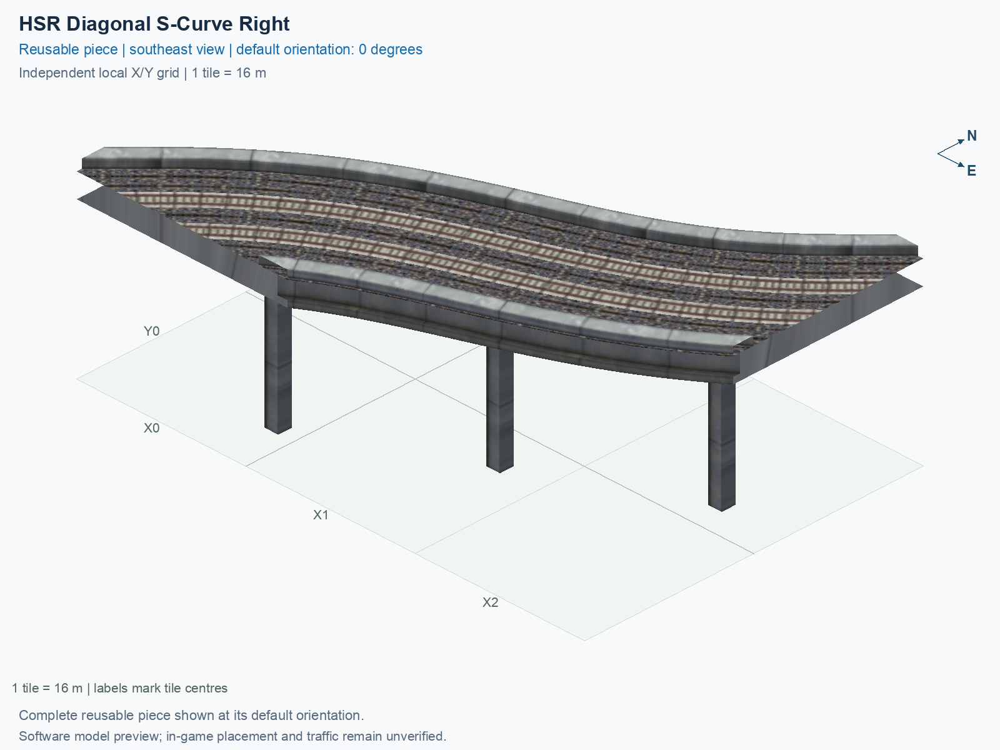

<a id="hsr-diagonal-s-curve-right"></a>

# HSR Level 2 (15.5 m) — Two-Track Diagonal S-Curve Right

<!-- SUBJECT IDENTITY MIGRATION -->

Identity migration: `rail-hsr-diagonal-s-right` → `hsr-l2-two-track-s-curve-diagonal-right`. Earlier measurements, observations, and pictures retain their recorded names and fingerprints; they do not establish verification of the renamed build. See the [identity migration rules](../../../../docs/NAMING_CONVENTIONS.md#10-choosing-and-changing-names).

Purpose: explain this reusable piece, its matching connections and current test coverage.

<!-- BEGIN PIECE OVERVIEW -->

A two-way diagonal S-curve shifts a diagonal line sideways while preserving its entry and exit heading. Native HSR or GHSR track ends; select the matching height and handedness.

Exact reusable identifier: `hsr-l2-two-track-s-curve-diagonal-right`.

Footprint: **3 × 3 tiles**. Exact menu name: **HSR Level 2 (15.5 m) — Two-Track Diagonal S-Curve Right**.

Choose this exact name in Transportation → Rail. Press Home or End to rotate; use only the supported states listed below. Join each end to a matching port profile and direction.

- [Connections and journeys](#connections-and-journeys)
- [Test checklist](#test-checklist)



<!-- END PIECE OVERVIEW -->

<!-- BEGIN MANUAL SUMMARY -->

## Manual status

Generated from [the exact test cases](#test-checklist) and [authoritative observations](checks/manual-tests.json).

- [ ] Preview review: 0/1 applicable cases passed; 0 failed, 0 stale.
- [ ] In-game rendering: 0/4 applicable cases passed; 0 failed, 0 stale.
- [ ] Directed journeys: 0/8 applicable cases passed; 0 failed, 0 stale.

These observations cover only the named services, directions, poses, rotations, and recorded platforms.

<!-- END MANUAL SUMMARY -->

<!-- BEGIN CONNECTIONS -->

## Connections and journeys

Purpose: describe intrinsic directional interfaces and permitted service journeys.

Generated from [connections.json](connections.json). Coordinates are canonical east, north, and height in metres. A connection class names an encoded route interface; it does not prove visible deck/wall fit or an in-game test.

Supported placement states: 0° CCW, 90° CCW, 180° CCW, 270° CCW. Each state has its own declared manual scope.

A **port** is one directional transport-path endpoint. **Service** identifies the intended network service (for example HSR, street, or tram); **engine** is its internal traffic-class number, separate from the construction network. **Role** distinguishes primary service from auxiliary paths; sharing a traffic class does not establish service compatibility.

A **tangent** is a unit travel-direction vector: `[0,1]` means north. **Grade** is height gained per horizontal metre. These measured facts describe this subject alone. Compatibility requires a separate comparison of the complete joining boundaries; physical seams and actual game operation require their own evidence. See the [class index](../../connection-classes.jsonc) for shared route-interface membership.

| Port | Service / engine / role | Direction | Location; tangent; grade | Connection class |
| --- | --- | --- | --- | --- |
| `Sout` | hsr / 7 / primary | out | [-2.9, -40.0, 15.5]; [-0.7071067811865469, -0.7071067811865482]; 0.0 | `path-interface-41ca57fd348f78610e6e` |
| `Sin` | hsr / 7 / primary | in | [2.9, -40.0, 15.5]; [0.7924468634807409, 0.6099409549780503]; 0.0 | `path-interface-3e71824ead491f228198` |
| `Eout` | hsr / 7 / primary | out | [40.0, -18.8, 15.5]; [0.7673849336782874, 0.6411866838632648]; 0.0 | `path-interface-b6e2464d210d16ed833a` |
| `Ein` | hsr / 7 / primary | in | [40.0, -13.1, 15.5]; [-0.707106781186548, -0.7071067811865471]; 0.0 | `path-interface-81a020999d3346a1c961` |

### Directed journeys

| Service | Entry → exit | Role |
| --- | --- | --- |
| hsr | `Sin` → `Eout` | primary |
| hsr | `Ein` → `Sout` | primary |

### Forbidden transfers

| From service / port | To service / port | Reason |
| --- | --- | --- |
| hsr / `Sin` | hsr / `Sout` | No directed route exists between these ports in the saved piece transport paths. In-game confirmation remains unverified. |
| hsr / `Ein` | hsr / `Eout` | No directed route exists between these ports in the saved piece transport paths. In-game confirmation remains unverified. |

Review the test checklist for the exact tested cases and environments.

<!-- END CONNECTIONS -->

<!-- BEGIN MANUAL CHECKS -->

## Test checklist

Generated from [the authoritative record](checks/manual-tests.json). Only explicit human observations create manual passes; software and preview checks remain separate. Expand a check/service group to see its rotation table, then expand the matching exact scope to copy a case ID and inspect its pose, reviewer, environment, and evidence. Grouping changes only this view; every declared case remains separate.

**States:** [x] passed; [ ] unverified, failed, or stale; N/A is an explicit inapplicable declaration. A dash means no case was declared in that column. Every pass covers only its recorded environment. T means a distinct construction-transposed state.

Four proper rotations are covered. No additional reflected state is established by this record; repeated construction aliases do not create new orientations.

Current totals: unverified: 35, passed: 0, failed: 0, stale: 0, not_applicable: 0.

### Record an observation

Follow the [shared testing guide](../../../../docs/TESTING.md); copy [the unconfirmed example](checks/observation.example.json) to `checks/observation.json`. Case identifiers are in the expandable sections below. Do not edit generated checkboxes.

From the repository folder containing `custom-pieces`, run after filling `checks/observation.json` and explicitly confirming the exact observation:

```sh
python3 -m scp.content record --record custom-pieces/domains/high-speed-rail/00_pieces/hsr-l2-two-track-s-curve-diagonal-right/checks/manual-tests.json --observation custom-pieces/domains/high-speed-rail/00_pieces/hsr-l2-two-track-s-curve-diagonal-right/checks/observation.json
```

### Detailed current checks

Each collapsed group shows exact case counts and states. Forbidden transfers are grouped by the directed service pair; the table inside retains every port pair and rotation.

<details>
<summary>Compiled resources — Whole subject — 1 case; unverified: 1</summary>

| Check / exact scope | General | 0° | 90° | 180° | 270° |
| --- | --- | --- | --- | --- | --- |
| **Compiled resources**<br>Whole subject | <a href="#case-software_resources-29d666441b01020fb959">[ ] unverified</a> | — | — | — | — |


<details>
<summary>Compiled resources — Whole subject</summary>

<a id="case-software_resources-29d666441b01020fb959"></a>

**General: unverified** — `software_resources-29d666441b01020fb959`.

Verify the actual compiled resources and construction rules.

Scope: Whole subject.

No observation recorded.

</details>

</details>

<details>
<summary>Directed routing graph — Whole subject — 1 case; unverified: 1</summary>

| Check / exact scope | General | 0° | 90° | 180° | 270° |
| --- | --- | --- | --- | --- | --- |
| **Directed routing graph**<br>Whole subject | <a href="#case-software_connectivity-29d666441b01020fb959">[ ] unverified</a> | — | — | — | — |


<details>
<summary>Directed routing graph — Whole subject</summary>

<a id="case-software_connectivity-29d666441b01020fb959"></a>

**General: unverified** — `software_connectivity-29d666441b01020fb959`.

Verify the declared directed journeys and forbidden transfers.

Scope: Whole subject.

No observation recorded.

</details>

</details>

<details>
<summary>Preview review — Images — 1 case; unverified: 1</summary>

| Check / exact scope | General | 0° | 90° | 180° | 270° |
| --- | --- | --- | --- | --- | --- |
| **Preview review**<br>Image: image:rail-hsr-diagonal-s-right:canonical-southeast | <a href="#case-preview_review-b11a413a84108fcfdc33">[ ] unverified</a> | — | — | — | — |


<details>
<summary>Preview review — Image: image:rail-hsr-diagonal-s-right:canonical-southeast</summary>

<a id="case-preview_review-b11a413a84108fcfdc33"></a>

**General: unverified** — `preview_review-b11a413a84108fcfdc33`.

Inspect this exact preview for tracks, walls, piers, seams and shadows.

Scope: Image: image:rail-hsr-diagonal-s-right:canonical-southeast.

No observation recorded.

</details>

</details>

<details>
<summary>In-game rendering — Whole subject — 4 cases; unverified: 4</summary>

| Check / exact scope | General | 0° | 90° | 180° | 270° |
| --- | --- | --- | --- | --- | --- |
| **In-game rendering**<br>Whole subject | — | <a href="#case-in_game_render-08a236a056182bd12673">[ ] unverified</a> | <a href="#case-in_game_render-2574c4e1f898ccb53593">[ ] unverified</a> | <a href="#case-in_game_render-b70da695fb422b01bd73">[ ] unverified</a> | <a href="#case-in_game_render-0c66e4679673e68fbbce">[ ] unverified</a> |


<details>
<summary>In-game rendering — Whole subject</summary>

<a id="case-in_game_render-08a236a056182bd12673"></a>

**0° CCW: unverified** — `in_game_render-08a236a056182bd12673`.

Inspect the placed tracks, walls, piers, seams and shadows in SimCity 4.

Scope: Whole subject.

No observation recorded.

<a id="case-in_game_render-2574c4e1f898ccb53593"></a>

**90° CCW: unverified** — `in_game_render-2574c4e1f898ccb53593`.

Inspect the placed tracks, walls, piers, seams and shadows in SimCity 4.

Scope: Whole subject.

No observation recorded.

<a id="case-in_game_render-b70da695fb422b01bd73"></a>

**180° CCW: unverified** — `in_game_render-b70da695fb422b01bd73`.

Inspect the placed tracks, walls, piers, seams and shadows in SimCity 4.

Scope: Whole subject.

No observation recorded.

<a id="case-in_game_render-0c66e4679673e68fbbce"></a>

**270° CCW: unverified** — `in_game_render-0c66e4679673e68fbbce`.

Inspect the placed tracks, walls, piers, seams and shadows in SimCity 4.

Scope: Whole subject.

No observation recorded.

</details>

</details>

<details>
<summary>Placement — Whole subject — 4 cases; unverified: 4</summary>

| Check / exact scope | General | 0° | 90° | 180° | 270° |
| --- | --- | --- | --- | --- | --- |
| **Placement**<br>Whole subject | — | <a href="#case-in_game_placement-08a236a056182bd12673">[ ] unverified</a> | <a href="#case-in_game_placement-2574c4e1f898ccb53593">[ ] unverified</a> | <a href="#case-in_game_placement-b70da695fb422b01bd73">[ ] unverified</a> | <a href="#case-in_game_placement-0c66e4679673e68fbbce">[ ] unverified</a> |


<details>
<summary>Placement — Whole subject</summary>

<a id="case-in_game_placement-08a236a056182bd12673"></a>

**0° CCW: unverified** — `in_game_placement-08a236a056182bd12673`.

Place this piece or complete blueprint and inspect every occupied tile.

Scope: Whole subject.

No observation recorded.

<a id="case-in_game_placement-2574c4e1f898ccb53593"></a>

**90° CCW: unverified** — `in_game_placement-2574c4e1f898ccb53593`.

Place this piece or complete blueprint and inspect every occupied tile.

Scope: Whole subject.

No observation recorded.

<a id="case-in_game_placement-b70da695fb422b01bd73"></a>

**180° CCW: unverified** — `in_game_placement-b70da695fb422b01bd73`.

Place this piece or complete blueprint and inspect every occupied tile.

Scope: Whole subject.

No observation recorded.

<a id="case-in_game_placement-0c66e4679673e68fbbce"></a>

**270° CCW: unverified** — `in_game_placement-0c66e4679673e68fbbce`.

Place this piece or complete blueprint and inspect every occupied tile.

Scope: Whole subject.

No observation recorded.

</details>

</details>

<details>
<summary>Demolition — Whole subject — 4 cases; unverified: 4</summary>

| Check / exact scope | General | 0° | 90° | 180° | 270° |
| --- | --- | --- | --- | --- | --- |
| **Demolition**<br>Whole subject | — | <a href="#case-in_game_demolition-08a236a056182bd12673">[ ] unverified</a> | <a href="#case-in_game_demolition-2574c4e1f898ccb53593">[ ] unverified</a> | <a href="#case-in_game_demolition-b70da695fb422b01bd73">[ ] unverified</a> | <a href="#case-in_game_demolition-0c66e4679673e68fbbce">[ ] unverified</a> |


<details>
<summary>Demolition — Whole subject</summary>

<a id="case-in_game_demolition-08a236a056182bd12673"></a>

**0° CCW: unverified** — `in_game_demolition-08a236a056182bd12673`.

Bulldoze the complete placement and inspect the cleared area.

Scope: Whole subject.

No observation recorded.

<a id="case-in_game_demolition-2574c4e1f898ccb53593"></a>

**90° CCW: unverified** — `in_game_demolition-2574c4e1f898ccb53593`.

Bulldoze the complete placement and inspect the cleared area.

Scope: Whole subject.

No observation recorded.

<a id="case-in_game_demolition-b70da695fb422b01bd73"></a>

**180° CCW: unverified** — `in_game_demolition-b70da695fb422b01bd73`.

Bulldoze the complete placement and inspect the cleared area.

Scope: Whole subject.

No observation recorded.

<a id="case-in_game_demolition-0c66e4679673e68fbbce"></a>

**270° CCW: unverified** — `in_game_demolition-0c66e4679673e68fbbce`.

Bulldoze the complete placement and inspect the cleared area.

Scope: Whole subject.

No observation recorded.

</details>

</details>

<details>
<summary>Save and reload — Whole subject — 4 cases; unverified: 4</summary>

| Check / exact scope | General | 0° | 90° | 180° | 270° |
| --- | --- | --- | --- | --- | --- |
| **Save and reload**<br>Whole subject | — | <a href="#case-in_game_save_reload-08a236a056182bd12673">[ ] unverified</a> | <a href="#case-in_game_save_reload-2574c4e1f898ccb53593">[ ] unverified</a> | <a href="#case-in_game_save_reload-b70da695fb422b01bd73">[ ] unverified</a> | <a href="#case-in_game_save_reload-0c66e4679673e68fbbce">[ ] unverified</a> |


<details>
<summary>Save and reload — Whole subject</summary>

<a id="case-in_game_save_reload-08a236a056182bd12673"></a>

**0° CCW: unverified** — `in_game_save_reload-08a236a056182bd12673`.

Save, quit, reload and inspect the placement and its paths.

Scope: Whole subject.

No observation recorded.

<a id="case-in_game_save_reload-2574c4e1f898ccb53593"></a>

**90° CCW: unverified** — `in_game_save_reload-2574c4e1f898ccb53593`.

Save, quit, reload and inspect the placement and its paths.

Scope: Whole subject.

No observation recorded.

<a id="case-in_game_save_reload-b70da695fb422b01bd73"></a>

**180° CCW: unverified** — `in_game_save_reload-b70da695fb422b01bd73`.

Save, quit, reload and inspect the placement and its paths.

Scope: Whole subject.

No observation recorded.

<a id="case-in_game_save_reload-0c66e4679673e68fbbce"></a>

**270° CCW: unverified** — `in_game_save_reload-0c66e4679673e68fbbce`.

Save, quit, reload and inspect the placement and its paths.

Scope: Whole subject.

No observation recorded.

</details>

</details>

<details>
<summary>Journey — hsr — 8 cases; unverified: 8</summary>

| Check / exact scope | General | 0° | 90° | 180° | 270° |
| --- | --- | --- | --- | --- | --- |
| **Journey**<br>Service: hsr; role: primary; journey: 7:Sin>Eout; entry: Sin; exit: Eout | — | <a href="#case-in_game_journey-994898992c5c29797d63">[ ] unverified</a> | <a href="#case-in_game_journey-584a2564bada3087e3c6">[ ] unverified</a> | <a href="#case-in_game_journey-d6ff2d3d79ba4eebd4c9">[ ] unverified</a> | <a href="#case-in_game_journey-9aeb68afef3014518c07">[ ] unverified</a> |
| **Journey**<br>Service: hsr; role: primary; journey: 7:Ein>Sout; entry: Ein; exit: Sout | — | <a href="#case-in_game_journey-0f6e5f09faa59ec8797b">[ ] unverified</a> | <a href="#case-in_game_journey-e8f4665b55f05b14ee0e">[ ] unverified</a> | <a href="#case-in_game_journey-22eedb7b1934812713f3">[ ] unverified</a> | <a href="#case-in_game_journey-c1109af3437844833d40">[ ] unverified</a> |


<details>
<summary>Journey — Service: hsr; role: primary; journey: 7:Sin>Eout; entry: Sin; exit: Eout</summary>

<a id="case-in_game_journey-994898992c5c29797d63"></a>

**0° CCW: unverified** — `in_game_journey-994898992c5c29797d63`.

Run the declared journey in this direction using its service network.

Scope: Service: hsr; role: primary; journey: 7:Sin>Eout; entry: Sin; exit: Eout.

No observation recorded.

<a id="case-in_game_journey-584a2564bada3087e3c6"></a>

**90° CCW: unverified** — `in_game_journey-584a2564bada3087e3c6`.

Run the declared journey in this direction using its service network.

Scope: Service: hsr; role: primary; journey: 7:Sin>Eout; entry: Sin; exit: Eout.

No observation recorded.

<a id="case-in_game_journey-d6ff2d3d79ba4eebd4c9"></a>

**180° CCW: unverified** — `in_game_journey-d6ff2d3d79ba4eebd4c9`.

Run the declared journey in this direction using its service network.

Scope: Service: hsr; role: primary; journey: 7:Sin>Eout; entry: Sin; exit: Eout.

No observation recorded.

<a id="case-in_game_journey-9aeb68afef3014518c07"></a>

**270° CCW: unverified** — `in_game_journey-9aeb68afef3014518c07`.

Run the declared journey in this direction using its service network.

Scope: Service: hsr; role: primary; journey: 7:Sin>Eout; entry: Sin; exit: Eout.

No observation recorded.

</details>


<details>
<summary>Journey — Service: hsr; role: primary; journey: 7:Ein>Sout; entry: Ein; exit: Sout</summary>

<a id="case-in_game_journey-0f6e5f09faa59ec8797b"></a>

**0° CCW: unverified** — `in_game_journey-0f6e5f09faa59ec8797b`.

Run the declared journey in this direction using its service network.

Scope: Service: hsr; role: primary; journey: 7:Ein>Sout; entry: Ein; exit: Sout.

No observation recorded.

<a id="case-in_game_journey-e8f4665b55f05b14ee0e"></a>

**90° CCW: unverified** — `in_game_journey-e8f4665b55f05b14ee0e`.

Run the declared journey in this direction using its service network.

Scope: Service: hsr; role: primary; journey: 7:Ein>Sout; entry: Ein; exit: Sout.

No observation recorded.

<a id="case-in_game_journey-22eedb7b1934812713f3"></a>

**180° CCW: unverified** — `in_game_journey-22eedb7b1934812713f3`.

Run the declared journey in this direction using its service network.

Scope: Service: hsr; role: primary; journey: 7:Ein>Sout; entry: Ein; exit: Sout.

No observation recorded.

<a id="case-in_game_journey-c1109af3437844833d40"></a>

**270° CCW: unverified** — `in_game_journey-c1109af3437844833d40`.

Run the declared journey in this direction using its service network.

Scope: Service: hsr; role: primary; journey: 7:Ein>Sout; entry: Ein; exit: Sout.

No observation recorded.

</details>

</details>

<details>
<summary>Forbidden transfer — hsr → hsr — 8 cases; unverified: 8</summary>

| Check / exact scope | General | 0° | 90° | 180° | 270° |
| --- | --- | --- | --- | --- | --- |
| **Forbidden transfer**<br>from port: Sin; to port: Sout; from service: hsr; to service: hsr; basis: not reachable in actual saved PATH graph | — | <a href="#case-in_game_forbidden_transfer-86cf3b5f90cd82cfff83">[ ] unverified</a> | <a href="#case-in_game_forbidden_transfer-e9a29f07ba754fb11c67">[ ] unverified</a> | <a href="#case-in_game_forbidden_transfer-0b46a574bc5d62eed8e3">[ ] unverified</a> | <a href="#case-in_game_forbidden_transfer-abac4e1cb9627e0ad0bb">[ ] unverified</a> |
| **Forbidden transfer**<br>from port: Ein; to port: Eout; from service: hsr; to service: hsr; basis: not reachable in actual saved PATH graph | — | <a href="#case-in_game_forbidden_transfer-e3a03bb0a61b100b259b">[ ] unverified</a> | <a href="#case-in_game_forbidden_transfer-64ca3aa0a548c8e0da81">[ ] unverified</a> | <a href="#case-in_game_forbidden_transfer-3ee4346955f8c5c92a0c">[ ] unverified</a> | <a href="#case-in_game_forbidden_transfer-1100f9e7fec56dc2c36f">[ ] unverified</a> |


<details>
<summary>Forbidden transfer — from port: Sin; to port: Sout; from service: hsr; to service: hsr; basis: not reachable in actual saved PATH graph</summary>

<a id="case-in_game_forbidden_transfer-86cf3b5f90cd82cfff83"></a>

**0° CCW: unverified** — `in_game_forbidden_transfer-86cf3b5f90cd82cfff83`.

Confirm this undeclared transfer is unavailable.

Scope: from port: Sin; to port: Sout; from service: hsr; to service: hsr; basis: not reachable in actual saved PATH graph.

No observation recorded.

<a id="case-in_game_forbidden_transfer-e9a29f07ba754fb11c67"></a>

**90° CCW: unverified** — `in_game_forbidden_transfer-e9a29f07ba754fb11c67`.

Confirm this undeclared transfer is unavailable.

Scope: from port: Sin; to port: Sout; from service: hsr; to service: hsr; basis: not reachable in actual saved PATH graph.

No observation recorded.

<a id="case-in_game_forbidden_transfer-0b46a574bc5d62eed8e3"></a>

**180° CCW: unverified** — `in_game_forbidden_transfer-0b46a574bc5d62eed8e3`.

Confirm this undeclared transfer is unavailable.

Scope: from port: Sin; to port: Sout; from service: hsr; to service: hsr; basis: not reachable in actual saved PATH graph.

No observation recorded.

<a id="case-in_game_forbidden_transfer-abac4e1cb9627e0ad0bb"></a>

**270° CCW: unverified** — `in_game_forbidden_transfer-abac4e1cb9627e0ad0bb`.

Confirm this undeclared transfer is unavailable.

Scope: from port: Sin; to port: Sout; from service: hsr; to service: hsr; basis: not reachable in actual saved PATH graph.

No observation recorded.

</details>


<details>
<summary>Forbidden transfer — from port: Ein; to port: Eout; from service: hsr; to service: hsr; basis: not reachable in actual saved PATH graph</summary>

<a id="case-in_game_forbidden_transfer-e3a03bb0a61b100b259b"></a>

**0° CCW: unverified** — `in_game_forbidden_transfer-e3a03bb0a61b100b259b`.

Confirm this undeclared transfer is unavailable.

Scope: from port: Ein; to port: Eout; from service: hsr; to service: hsr; basis: not reachable in actual saved PATH graph.

No observation recorded.

<a id="case-in_game_forbidden_transfer-64ca3aa0a548c8e0da81"></a>

**90° CCW: unverified** — `in_game_forbidden_transfer-64ca3aa0a548c8e0da81`.

Confirm this undeclared transfer is unavailable.

Scope: from port: Ein; to port: Eout; from service: hsr; to service: hsr; basis: not reachable in actual saved PATH graph.

No observation recorded.

<a id="case-in_game_forbidden_transfer-3ee4346955f8c5c92a0c"></a>

**180° CCW: unverified** — `in_game_forbidden_transfer-3ee4346955f8c5c92a0c`.

Confirm this undeclared transfer is unavailable.

Scope: from port: Ein; to port: Eout; from service: hsr; to service: hsr; basis: not reachable in actual saved PATH graph.

No observation recorded.

<a id="case-in_game_forbidden_transfer-1100f9e7fec56dc2c36f"></a>

**270° CCW: unverified** — `in_game_forbidden_transfer-1100f9e7fec56dc2c36f`.

Confirm this undeclared transfer is unavailable.

Scope: from port: Ein; to port: Eout; from service: hsr; to service: hsr; basis: not reachable in actual saved PATH graph.

No observation recorded.

</details>

</details>

<!-- END MANUAL CHECKS -->

## Engineering contract

This diagonal S-curve has a 3 × 3 construction rectangle, four occupied cells, and an empty construction reference cell. The Left and Right geometries are separate authored types, rather than reflections inferred from a name. Empty cells do not establish construction clearance.

Use the [independent source contract](../../implementation/scp_hsr/rail_feature_verify.py) and this type's [definition](piece.json) for exact expectations. Shared HSR/GHSR facts remain in [NETWORK_SPEC.md](../../NETWORK_SPEC.md). These authored notes supplement generated source views; they do not change geometry, reset observations, or establish game operation.
