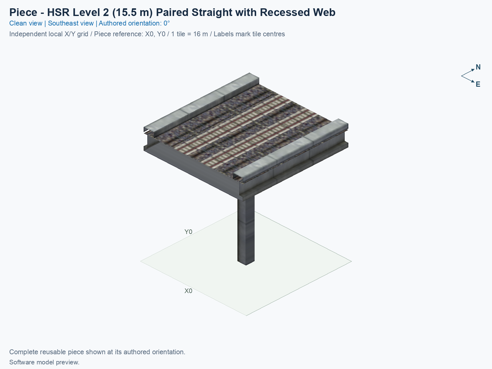
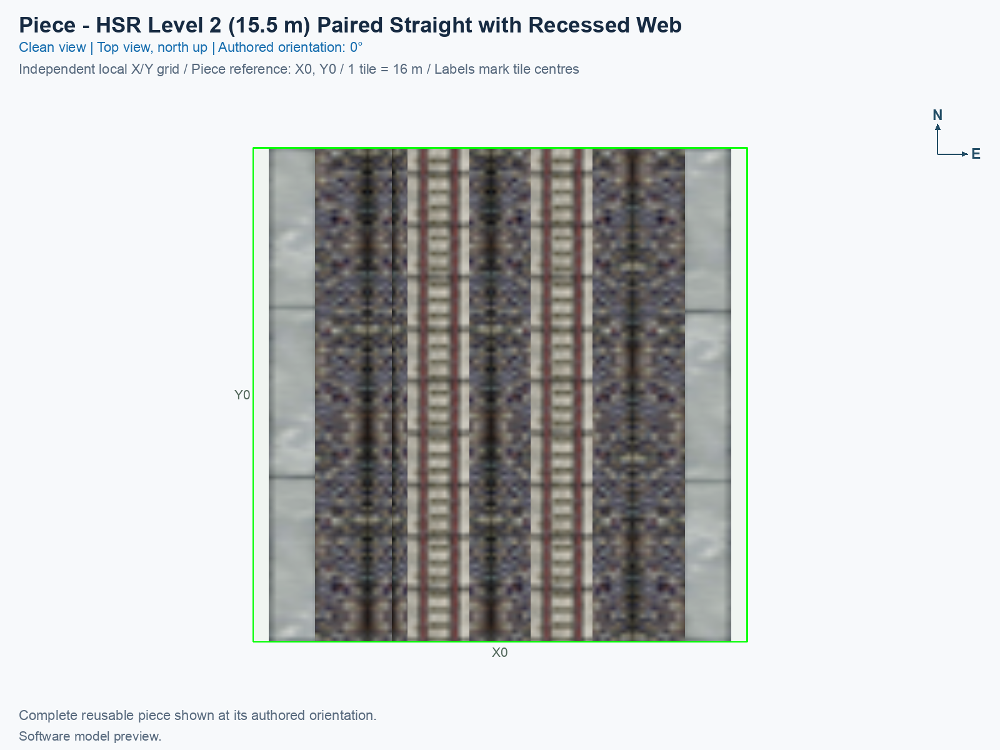
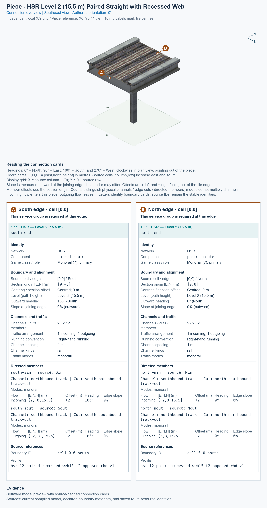

# HSR Level 2 (15.5 m) — Two-Track Straight — Recessed Web

<!-- SUBJECT IDENTITY MIGRATION -->

Identity migration: `hsr-component-l2-paired-straight-recessed-web` → `hsr-l2-two-track-straight-recessed-web`. Earlier measurements, observations, and pictures retain their recorded names and fingerprints; they do not establish verification of the renamed build. See the [identity migration rules](../../../../docs/NAMING_CONVENTIONS.md#10-choosing-and-changing-names).

<!-- PIECE README LAYOUT: 2 -->

[1. Views](#1-views) · [2. Piece and placement](#2-piece-and-placement) · [3. Connection matrix](#3-connection-matrix) · [Testing ↗ (separate document)](TESTING.md)

This reusable High Speed Rail (HSR) piece carries two opposite-direction tracks across one city tile at nominal Level 2 (L2), with a train-path height of 15.5 m. It uses the complete concrete profile of the compact fan's straight approach. Its structural web, the vertical concrete body below the track bed, is slightly narrower than that of an ordinary paired straight.

**Status: experimental.** Software checks, human image review, and operation inside SimCity 4 are recorded separately. The permanent type ID is `hsr-l2-two-track-straight-recessed-web`. Repeated placements use this one type; a rotation does not create another type or reverse a route.

## 1. Views

The clean angled and north-up pictures show the same complete saved one-tile model at its authored 0° orientation. X increases eastward, Y increases northward, and the city tile measures 16 × 16 m. Both tracks and the single support belong to this type.

<!-- BEGIN PIECE VIEWS -->

<!-- END PIECE VIEWS -->

The connection overview in chapter 3 labels the two complete joining boundaries. Its fixed software-preview caption does not report game appearance or traffic status.

## 2. Piece and placement

<!-- BEGIN PIECE OVERVIEW -->

One-tile opposite-direction Level 2 paired straight retaining the fan family's recessed structural web, complete slab, rails, and support; connect matching physical profiles.

Exact reusable identifier: `hsr-l2-two-track-straight-recessed-web`.

Footprint: **1 × 1 tiles**. Exact menu name: **HSR Level 2 (15.5 m) — Two-Track Straight — Recessed Web**.

<!-- END PIECE OVERVIEW -->

### Function and complete joining profile

At 0°, the western track carries traffic from north to south, and the eastern track carries traffic from south to north. The tracks remain separate; neither turns back into the other. Both north and south boundaries use the same recessed-web paired profile, with 4 m track spacing, opposite flow, a 15 m outer concrete envelope, and one support centred in the tile.

Use this straight with another copy of itself or with a separately verified matching recessed-web boundary, including the [Compact Paired Fan Core](../hsr-l2-mixed-fan-compact-recessed-web/README.md). The ordinary [HSR Level 2 (15.5 m) — Two-Track Straight](../hsr-l2-two-track-straight/README.md) has a structural web about 36.949 mm farther from the centre on each side. Matching rails, train-path height, and outer deck width alone do not make those complete concrete profiles equal.

The [piece definition](piece.json) owns the independent game identity. The [geometry source](geometry.json) selects the accepted compact fan's interior straight tile without reshaping its rails, ballast, concrete body, or support. This is a physical profile variant, rather than a duplicate made solely for texture alignment, rotation, or an assembly label.

Keep the complete 1 × 1 tile clear. The documented origin is a software coordinate; the game's mouse-click anchor requires its own observation. A complete neighbour comparison must check the concrete, direction, height, heading, and train clearance as well as the saved route endpoints.

### Place and rotate the piece

After following the [separate build and installation procedure](../../../../docs/BUILD_AND_INSTALL.md), use a disposable flat test city.

1. Open **Transportation → Rail**, hover over the SCP buttons, and select **HSR Level 2 (15.5 m) — Two-Track Straight — Recessed Web**. An installed assembly may include this type in its declared Tab/Shift+Tab cycle.
2. Move the complete cursor preview over clear terrain. Press **Home** or **End** to rotate it; on the documented Mac keyboard, **Fn + ←** and **Fn + →** provide those keys. Use the supported construction states listed in the generated connection section.
3. At 0°, align the north and south ends with matching recessed-web paired boundaries. Rotating the piece turns both physical tracks and their travel directions together; it does not reflect the piece or reverse an individual route.
4. Click once to place it. Supply matching outside connections and travel demand. Inspect rails, concrete, support, and shadows, then test each permitted direction and the unavailable track transfers separately.

The [trumpet blueprint](../../01_assemblies/hsr-trumpet-straight-stem/README.md) uses two copies to replace the full fan's two straight approach cells. That placement retains a separately documented, preexisting transition to the northern native curve. It does not establish universal full-profile compatibility with native paired pieces.

## 3. Connection matrix

The matrix reports journeys inside this one-tile type. The connection overview reports both exposed boundaries. Use their exact measured direction, coordinates, and physical profile when reviewing another placement.

<!-- BEGIN PIECE CONNECTION MATRIX -->

### Directed entrance/exit matrix

Read **from an entrance row to an exit column**. **Saved PATH** checks the saved traffic route; **Route Query** checks the route shown by the game; **Visible travel** checks a vehicle completing that journey. For HSR, visible travel means a moving train.

**Game appearance:** [?](TESTING.md#case-in_game_render-59e71d6d15e1c9c7a550) — the complete piece’s appearance in the game, checked separately from its journeys.

**Legend:** ✅ confirmed; ❌ failed; ? not established. **Forbidden** means the movement is unavailable; its in-game check confirms that it stays unavailable. Click a result for its exact test case. Scope, evidence, and limitations remain in [the test checklist](TESTING.md#test-checklist).

| Entrance ↓ / Exit → | **HSR · South exit** `Sout` | **HSR · North exit** `Nout` |
| --- | --- | --- |
| **HSR · North entrance** `Nin` | **Saved PATH:** [✅](TESTING.md#case-software_connectivity-b8a2cc708326e6c9dc0d) **Route Query:** [?](TESTING.md#case-in_game_route_query-1d57267cb4171468a0bd) **Visible train travel:** [?](TESTING.md#case-in_game_visible_travel-1d57267cb4171468a0bd) | **Forbidden** **Saved PATH:** [✅](TESTING.md#case-software_connectivity-b8a2cc708326e6c9dc0d) In-game check: [?](TESTING.md#case-in_game_forbidden_transfer-963fd57cc0ae1392fdd4) |
| **HSR · South entrance** `Sin` | **Forbidden** **Saved PATH:** [✅](TESTING.md#case-software_connectivity-b8a2cc708326e6c9dc0d) In-game check: [?](TESTING.md#case-in_game_forbidden_transfer-5ed9ae0a20c291e6963c) | **Saved PATH:** [✅](TESTING.md#case-software_connectivity-b8a2cc708326e6c9dc0d) **Route Query:** [?](TESTING.md#case-in_game_route_query-e8e9abdd02a4e8bf8831) **Visible train travel:** [?](TESTING.md#case-in_game_visible_travel-e8e9abdd02a4e8bf8831) |

Source: [connections.json](connections.json).

<!-- END PIECE CONNECTION MATRIX -->

<!-- BEGIN CONNECTOR OVERVIEW -->

### Connection overview

Generated from this piece's source-bound connector metadata and the current compiled model; marker letters refer to the boundary cards below.

[Rendering sources and verification scope](evidence/connection-overview.json).

Headings: 0° = North, 90° = East, 180° = South, and 270° = West; clockwise in plan view, pointing out of the piece.

Coordinates [E,N,H] = [east,north,height] in metres. Source cells [column,row] increase east and south.

Display grid: X = source column − (0); Y = 0 − source row.

Slope is measured outward at the joining edge; the interior may differ. Offsets are + left and − right facing out of the tile edge.

Member offsets use the section origin. Counts distinguish physical channels / edge cuts / directed members; modes do not multiply channels.

Incoming flow enters this piece; outgoing flow leaves it. Letters identify boundary cards; source IDs remain the stable identities.

#### Boundary A: `cell-0-0-south`

This service group is required at this edge.

##### Service group 1 / 1: HSR — Level 2 (15.5 m)

| Field | Value |
| --- | --- |
| End / component | `south-end` / `paired-route` |
| Network / game class / role | hsr / Monorail (7); primary |
| Source cell / edge | `[0,0]` / South |
| Section origin [E,N] (m) | `[0,-8]` |
| Centring / section offset | Centred; 0 m |
| Level (path height) | Level 2 (15.5 m) |
| Outward heading | 180° (South) |
| Slope at joining edge | 0% outward |
| Channels / edge cuts / directed members | 2 / 2 / 2 |
| Traffic arrangement / running | 1 incoming; 1 outgoing; Right-hand running |
| Channel spacing | 4 m |
| Channel kinds | rail |
| Traffic modes | monorail |
| Profile | `hsr-l2-paired-recessed-web15-t2-opposed-rhd-v1` |

| Member / measured source | Channel / cut / modes | Flow | Endpoint [E,N,H] (m) | Offset (m) | Outward heading | Edge slope (%) |
| --- | --- | --- | --- | ---: | ---: | ---: |
| `south-sin` / `Sin` | `northbound-track` / `south-northbound-track-cut` / monorail | Incoming | `[2,-8,15.5]` | +2 | 180° | 0 |
| `south-sout` / `Sout` | `southbound-track` / `south-southbound-track-cut` / monorail | Outgoing | `[-2,-8,15.5]` | -2 | 180° | 0 |

#### Boundary B: `cell-0-0-north`

This service group is required at this edge.

##### Service group 1 / 1: HSR — Level 2 (15.5 m)

| Field | Value |
| --- | --- |
| End / component | `north-end` / `paired-route` |
| Network / game class / role | hsr / Monorail (7); primary |
| Source cell / edge | `[0,0]` / North |
| Section origin [E,N] (m) | `[0,8]` |
| Centring / section offset | Centred; 0 m |
| Level (path height) | Level 2 (15.5 m) |
| Outward heading | 0° (North) |
| Slope at joining edge | 0% outward |
| Channels / edge cuts / directed members | 2 / 2 / 2 |
| Traffic arrangement / running | 1 incoming; 1 outgoing; Right-hand running |
| Channel spacing | 4 m |
| Channel kinds | rail |
| Traffic modes | monorail |
| Profile | `hsr-l2-paired-recessed-web15-t2-opposed-rhd-v1` |

| Member / measured source | Channel / cut / modes | Flow | Endpoint [E,N,H] (m) | Offset (m) | Outward heading | Edge slope (%) |
| --- | --- | --- | --- | ---: | ---: | ---: |
| `north-nin` / `Nin` | `southbound-track` / `north-southbound-track-cut` / monorail | Incoming | `[-2,8,15.5]` | +2 | 0° | 0 |
| `north-nout` / `Nout` | `northbound-track` / `north-northbound-track-cut` / monorail | Outgoing | `[2,8,15.5]` | -2 | 0° | 0 |

The overview uses source metadata, current compiled resource identities, and the saved model. Current placement, connection, and traffic results belong to the generated connection matrix and linked testing records.

<!-- END CONNECTOR OVERVIEW -->
